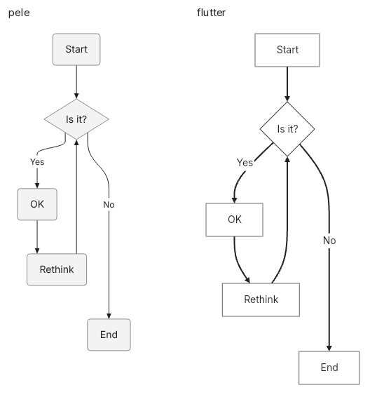

# Fixed PNG export evidence, 29 October 2026

The separately declared original Pele/native Flutter follow-up passes A/A
calibration on20 reviewed candidates. All four-library rankings remain withheld.

| Primary pair | Median input median | A/A95%case range |
|---|---:|---:|
| Pele1.9.0 /Chromium |13.375ms |0.974081–1.017081 |
| mermaid_flutter0.3.2 /native Linux release |87.6225ms |1.012334–1.047480 |

Native/Pele paired geometric time ratio6.308302; case-bootstrap range6.085299–6.544014.
This applies to the required1200×900 opaque PNG task, not widget frames, isolated
renderers or encoders. Native public renderToPng first returns an intrinsic PNG;
decode/pad/re-encode are inside its total. Native API-stage median14.58ms and
normalization-stage median70.68ms are separately aggregated and not additive.
Pele's browser serialization includes synchronous PNG/Base64 production and
Base64 decoding into binary bytes. Main-thread UI blocking is allowed by this
headless task. After-clock transport is Base64 text, not per-byte protocol objects.

The primary pair uses20 cases across6 families,2000 measured calls+160 warmups.
Every candidate passed both source-fact checks. The collapsed control is excluded:
Flutter exposesA/B/C while Pele hides them. No input is rewritten or downscaled.
The source is d4a4f84ebbf66ca8ef98d21ab3e6de24db762740; native build source
7e45a65304a37cd212b8e1790e5b9067939cb5f8, with exact worker/SDK/lock/bundle hashes.

The wider synchronous campaign remains separate:18 common inputs,3600 measured
calls+288 warmups, source46c62cc80e41206bb8a19343b92a610a1f9200c7. Observed median
input medians are Agentic39.125ms,Mermaid55.575ms,Flutter87.2105ms,Pele14.425ms.
Agentic A/A fails(1.188799–1.326930); all4-way ratios remain withheld. Agentic also
fails group membership in2 candidates. Different participants and case mix mean
these medians cannot be pooled with the pair follow-up.

All participants in each campaign use the same container on the same cloud host:
AMD EPYC9V74,Debian13.6/Linux6.18.55,Chromium154.0.8037.57,Node24.19.0,
Flutter3.47.8/Dart3.13.7,Playwright1.58.2. Kernel cgroup limits are CPU2,
100000/100000 quota,16GiB; every live thread is attested onCPU2. LP_NUM_THREADS=1
and software GL are requested. The image is only a directory/config skeleton;
readonly host/usr and/opt mounts provide installed userland. The rootfs hash is
not a complete userland fingerprint. Network is disabled; assets are local.

Reproduction: follow REPRODUCE.md; root source snapshots retain measured code.
Fresh builds need fresh identity-bound reviews. Reference PNGs are decoded and
matched to reviewed pixels; every returned PNG is hashed, every new byte stream
decoded, and exact byte matches reuse validated decoding. All per-case expected
pixels remain enforced. Cadence differs from decoder-per-call older campaigns.

Primary raw samples/summary/review/context/isolation are at the archive root and
under measurement/. Two failed wider campaigns are under history/async-cgroup/
and history/sync-four/, with independent audits, raw calls, actualPNG/SVG outputs,
plans, qualified references and diagnostic probes. The240-output real-SVG probe
compared Blob versus dataURL; all pixels match. The simpler bitmap probe did not
reproduce long waits; the focus probe did not identify unfocused documents.
These observations do not establish a universal cause of the original discrepancy.

Browser runtime distributions omit source maps/type declarations; npm lockfiles
and the prior complete package snapshot remain available at
https://github.com/adewale/trident/blob/40329f742dc47fc253b47a3946c06e70e5be2901/README.md.
Original full-corpus v1 diagnostics and the failed inherited-affinity attempt stay
there too. No previous failure or unsupported input is reclassified as success.

Original receipts keep absolute/workspace paths. Resolve a PNG by its basename
inside the owning run's png/ directory. Contact sheets crop whitespace without
resizing; full unedited1200×900 PNGs are beside them. Duplicate files are hardlinked.
Verify every extracted path/size/SHA256 in files.json. Image verification checks
all9936 completed campaign outputs, reusing independent decoded identical streams.
This is a reviewed structural profile, not full548-case or unseen-production data.

## Downloads

- [Archive part00](png-followup-evidence-2026-10-29.tar.gz.part-00?raw=true)
- [Archive part01](png-followup-evidence-2026-10-29.tar.gz.part-01?raw=true)
- [Archive part02](png-followup-evidence-2026-10-29.tar.gz.part-02?raw=true)
- [Part checksums](parts.sha256?raw=true)
- [Archive checksum](archive.sha256?raw=true)

```sh
sha256sum -c parts.sha256
cat png-followup-evidence-2026-10-29.tar.gz.part-00 png-followup-evidence-2026-10-29.tar.gz.part-01 png-followup-evidence-2026-10-29.tar.gz.part-02 > png-followup-evidence-2026-10-29.tar.gz
sha256sum -c archive.sha256
tar -xzf png-followup-evidence-2026-10-29.tar.gz
```

Archive SHA256: `46580fe55c4863047c18bd75706b69a7ab9931c2458e68b8ef04751cf1c4945c`.



Open at1x; unedited1200x900 originals are beside the contact.


