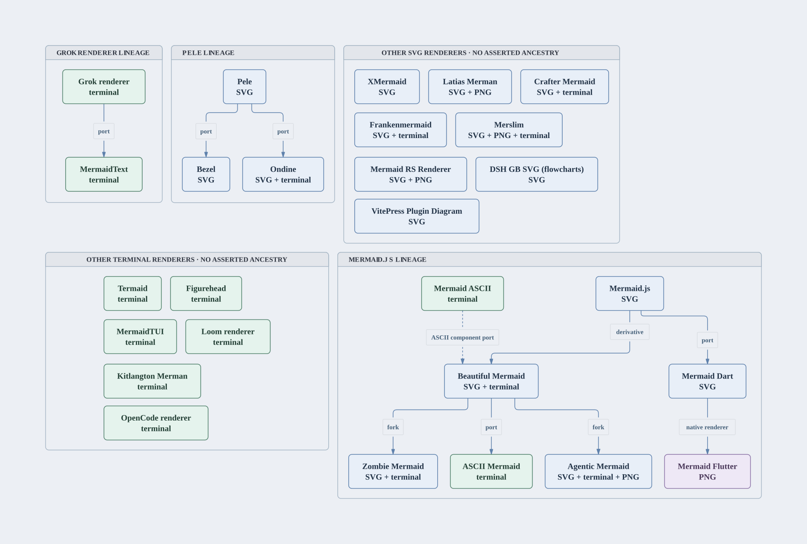

# Trident

Trident compares Mermaid tools on input compatibility, diagram meaning and rendering cost. It tests rendering and the parser/model APIs exposed by renderers through their public interfaces.

- [Benchmarks and their value](BENCHMARKS.md): what each workload measures, how to run it, and when to trust it.
- [Initial baseline](BASELINE.md): frozen ecosystem evidence required for the first public 0.1 release.
- [Release process](RELEASE.md): baseline assessment, exact-head checks and packaging.
- [Scope](SCOPE.md): core benchmark work, application exclusions and optional maintenance.
- [Methodology](METHODOLOGY.md): corpus, correctness checks, sampling and fair comparisons.
- [Measurement rules](MEASUREMENT.md): interfaces, cache state, overfitting and claims.
- [Catalog and support](CATALOG.md): what the entries mean and which suites have bindings.
- [Verified support](SUPPORT-QUALITY.md): executed public interfaces and remaining gaps for every catalog entry.
- [Comparison contracts](FAIRNESS.md): planning, independent inputs and comparable result rankings.
- [Ecosystem results](RESULTS.md): benchmark tables and charts, measurement dates and missing results for every eligible project.

## Benchmarks

Choose the question before collecting results. These seven benchmarks have
different inputs and units; Trident does not combine them into an overall score.
The command IDs stay short so existing scripts continue to work.

| Benchmark | What it tests | Results table | Command ID |
|---|---|---|---|
| **Mermaid Compatibility** | Tests shared Mermaid inputs through each project's SVG, PNG, terminal and parser interfaces. | Passed, failed, unsupported and blocked inputs, by format and diagram type. | `community` |
| **DaveBench: Documentation Examples** | Tests SVG generation for diagrams in Mermaid's own documentation, inspired by [Dave Kiss's benchmark](https://x.com/davekiss/status/2111512440106078554). | SVG return rate (%); render time (ms) on matched inputs. | `docs` |
| **Diagram Meaning** | Checks rendered SVGs against expected labels, relationships, values and visible geometry. | Passed, failed and blocked checks, by diagram type. | `fidelity` |
| **Model and Editing Contracts** | Tests how public diagram models preserve identities and relationships through parsing, edits and configuration changes. | Shared checks passed, failed, unsupported or blocked; API-specific checks separately. | `native-fidelity` |
| **Mermaid Assertion Replay** | Replays Mermaid's original tests through public parser and model APIs. | Declarations and callbacks passed, failed or unavailable; excluded tests. | `upstream-fidelity` |
| **Mermaid Reference Tests** | Runs Mermaid's own core tests to validate the reference environment. | Passed, failed, pending and todo callbacks; files executed. | `upstream-original` |
| **Render Cost and Scaling** | Measures SVG rendering through public Node APIs across first calls, repeated calls, edits and diagram sizes. | Latency (ms), CPU (ms), memory (MiB) and comparison qualification. | `portable` |

The [comparison tables](RESULTS.md#results-by-benchmark) show results for all seven
benchmarks. Tables keep versions, inputs, interfaces, units and qualification
visible. See [table conventions](REPORTING.md), [methods and limits](BENCHMARKS.md)
and [what we learned from other benchmarks](docs/reporting-research.md).

### Where the benchmarks come from

**DaveBench** is inspired by [Dave Kiss's documentation benchmark](https://x.com/davekiss/status/2111512440106078554).
Its implementation entered Trident through [Agentic Mermaid's documentation benchmark](https://github.com/adewale/agentic-mermaid/blob/main/eval/benchmark/docs/davebench.md).
That historical runner used 1,095 occurrences from AM's vendored Mermaid docs,
with 546 distinct examples across 34 pages, and built an AM candidate beside fixed
comparators. Trident's `docs` benchmark reads the raw syntax pages at the pinned
[Mermaid source commit](https://github.com/mermaid-js/mermaid/tree/1fb7869866dd619168d840291c9c54b4f129758b/packages/mermaid/src/docs/syntax)
and accepts prepared public project artifacts. Its recorded inventory and protocol
define each run; its counts and timings are not interchangeable with historical
DaveBench results. The linked AM methods document the inherited implementation.

**Mermaid Assertion Replay** and **Mermaid Reference Tests** reuse Mermaid's
original tests at that same pin. Replay translates reviewed public API boundaries;
the reference benchmark executes the genuine original core runner. Their scopes
and exclusions are documented in [the fidelity guide](fidelity/README.md).

**Mermaid Compatibility** uses an [AM-origin frozen corpus](corpus/community-corpus.json)
and can run explicitly selected inputs, including [examples from pinned external projects](corpus/external-sources.json).
Input provenance and licenses travel with the frozen inventory. **Diagram Meaning**,
**Model and Editing Contracts**, and **Render Cost and Scaling** use authored cases
developed in AM and Trident; they are not external benchmark standards or production
traffic. Public examples and development fixtures are not a validated holdout.

See [methods, commands and limitations](BENCHMARKS.md) for each benchmark. The
`support:verify` check uses six positive inputs and two separate invalid-source
controls to test invocation readiness; it is not an eighth
benchmark or a substitute for a complete campaign.

## Supported projects

Normal campaigns select **27 renderers**: 16 with SVG output, ten terminal-only
implementations and the native Mermaid Flutter PNG renderer. The dated
[public-output checks](SUPPORT-QUALITY.md) record actual invocations, versions,
failures and missing bindings; they do not certify all families or qualified timing.

| SVG-rendering project | Outputs exercised successfully |
|---|---|
| [Agentic Mermaid](https://github.com/adewale/agentic-mermaid) | SVG, terminal, PNG, parser |
| [Beautiful Mermaid](https://github.com/lukilabs/beautiful-mermaid) | SVG, terminal |
| [Bezel](https://github.com/crabtalk/bezel) | SVG |
| [Crafter Mermaid](https://github.com/crafter-station/mermaid) | Browser DOM SVG, parser; raw Node SVG has a retained XML failure |
| [DSH Mermaid GB SVG](https://github.com/sandyyst/dsh-plugin-mermaid-gb-svg) | SVG |
| [Frankenmermaid](https://github.com/Dicklesworthstone/frankenmermaid) | SVG, parser, diagnostics |
| [Latias Merman](https://github.com/Latias94/merman) | SVG |
| [Mermaid Dart](https://github.com/orestesgaolin/mermaid) | SVG |
| [Mermaid.js](https://github.com/mermaid-js/mermaid) | Browser SVG, parser |
| [Mermaid RS Renderer](https://github.com/1jehuang/mermaid-rs-renderer) | SVG, PNG |
| [Merslim](https://github.com/emtyty/merslim) | SVG, terminal, parser, browser PNG |
| [Ondine](https://github.com/wevm/ondine) | SVG, public CLI terminal output |
| [Pele](https://github.com/obsidianmd/pele) | SVG |
| [VitePress Plugin Diagram](https://github.com/KlangHaus/vitepress-plugin-diagram) | SVG |
| [XMermaid](https://github.com/evangwt/xmermaid) | Browser SVG |
| [Zombie Mermaid](https://github.com/dfadler/zombie-mermaid) | SVG, terminal |

Terminal-only interfaces are exercised for [ASCII Mermaid](https://github.com/kais-radwan/ascii-mermaid),
[Figurehead](https://github.com/Mootikins/figurehead-rs), [Grok's renderer component](https://github.com/xai-org/grok-build),
[Kitlangton Merman](https://github.com/kitlangton/merman), [Loom's renderer component](https://github.com/Yassimba/loom),
[Mermaid ASCII](https://github.com/AlexanderGrooff/mermaid-ascii),
[MermaidText](https://github.com/spacedock-dev/mermaidtext), [MermaidTUI](https://github.com/tariqshams/mermaidtui),
[OpenCode's Merman component](https://github.com/anomalyco/opencode)
and [Termaid](https://github.com/fasouto/termaid).

[Mermaid Flutter](https://pub.dev/packages/mermaid_flutter) has a separate native
PNG interface using Mermaid Dart's parser/layout core. DSH Mermaid GB SVG is a
flowchart specialist. Parser, model and invalid-input checks of enrolled renderers
remain in scope; validator-only tools do not enter renderer comparisons.

The [catalogue](CATALOG.md) retains all 89 identities and their ancestry.
**62 are excluded** by renderer scope, explicit project selection, branding,
application or binding policy. MDV, OpenCode Merman, TUI Mermaid, Lovely Mermaid
and Mermansi are catalogue-only. So are the seven parser/validator/formatter/converter
entries removed from the earlier 39-project selection. Rusty Mermaid declares
only diagnostics and is also outside renderer scope; its broken-release receipt
remains recorded. These exclusions apply before acquisition and cannot be enabled
with the descendant-investigation override. Historical receipts retain their
original project selections and dates.

## Project lineage



Every scheduled renderer appears once. Node labels show configured rendering
output checks, including interfaces that may fail or remain blocked. They do not
assert successful output or qualified performance. Blue nodes include SVG, green
nodes are terminal-only, and purple marks native PNG. Solid arrows label recorded
forks, derivatives, ports or native-renderer relationships; the dashed arrow marks
only Beautiful Mermaid's ASCII component port. Unconnected renderers are grouped
without inventing ancestry. Mermaid Dart and Mermaid Flutter remain distinct brands.

The [Mermaid source](docs/lineage-overview.mmd) is generated from the actual
selection with `bun commands.ts support --lineage --out FRESH.mmd`. To update the
tracked artwork, copy that source to `docs/lineage-overview.mmd`, then run
`bun scripts/render-lineage.ts --renderer-entry INSTALLED_AGENTIC_ENTRY --out FRESH.svg`
and copy the resulting SVG, PNG and JSON receipt into `docs/images/lineage.*`.
The public Agentic Mermaid renderer uses publication-figure and Nord Light styling.
[The receipt](docs/images/lineage.json) records the selected projects and hashes;
[the full catalogue tree](LINEAGE.md) includes every exclusion. Appearance implies
no benchmark rank.

## Install and release status

The first public 0.1 release is pending the [initial baseline](BASELINE.md) and
[release checks](RELEASE.md). The existing `v0.1.0` tag is an older preparation
snapshot; it does not contain all features described on current main. Use Bun 1.4+
and Node 24+ with the intended source revision. Published archives, when available, appear on
the [GitHub releases page](https://github.com/adewale/trident/releases).
The repository package is private. The kit ships its runtime files and manifest,
while target artifacts and the pinned Mermaid oracle are installed separately.

```sh
node commands.ts --version
```

See [release notes](CHANGELOG.md) and the [release procedure](RELEASE.md) for
validation scope, artifact checksums and known limits.

## Benchmark a project

Install Bun 1.4+, Node 24+, npm and the package dependencies. The oracle is pinned Mermaid 12.2.0, its parser and first-party ZenUML addon. Browser measurements require Chromium; compiled projects also need their declared toolchains.

```sh
bun install --frozen-lockfile
node commands.ts mermaid:install
bunx playwright install chromium
bun commands.ts community:update --projects obsidianmd/pele,mermaid-js/mermaid \
  --profile full --records /evidence/records --out /evidence/run
bun commands.ts results:publish --records /evidence/records --out /evidence/report
```

Inspect `bun commands.ts support` and `bun commands.ts bench --projects OWNER/TOOL --plan` before collecting. Execution requires a project selection or explicit `--all-projects`. Choose any project in [the catalog](catalog/mermaid-community.json). Use `--executable /path/to/chromium` for an existing browser. Exact matching records are reused with their original dates; `--force` collects a new attempt. `community:update --plan` prepares artifacts and reports reuse decisions without timing; `bench --plan` performs no acquisition or rendering. Measurements are local and reject CI.

Every tool uses its catalog release. To measure an unreleased npm package, select one project and add `--candidate-dir /path/to/built/package`, or `--candidate-tarball FILE --candidate-sha256 HEX`. Source-built projects accept `--candidate-revision COMMIT [--candidate-remote URL_OR_CLONE]`. Candidates stay separate from release rows:

```sh
bun commands.ts community:update --projects OWNER/TOOL --candidate-dir /artifacts/package \
  --profile full --records /evidence/records --out /evidence/candidate
bun commands.ts results:compare --records /evidence/records --project OWNER/TOOL
```

A checkout, environment variable or local `dist/` never silently replaces a community release.

For a workspace build that publishes several npm packages, build and pack them
with the project's own commands. Add `--candidate-dependencies archives.json`
to the candidate command above. The file contains a nonempty array:

```json
[
  { "tarball": "packs/renderer-core.tgz", "sha256": "REPLACE_WITH_64_LOWERCASE_HEX_DIGITS" }
]
```

Paths are relative to that JSON file. Trident checks each archive's hash and
package identity, installs the candidate and dependency archives together with
scripts disabled, and verifies that the candidate resolves those exact packages.
Files bundled inside a dependency archive are checked and sealed with that archive.
Unused archives, duplicate package names and substituted nested copies are
rejected. Changing any dependency archive creates a separate installation,
browser bundle and candidate record. Frozen preparation seals the dependency
payloads and rejects later changes. This does not prove the archives came from
one commit: retain the source commits and build receipts with the campaign.

The [AM/ZM source comparison](docs/comparison-2026-10-29.md) includes an example
of the resulting stack-ranked tables and explains the observed failures.

## Native Flutter entrypoints

The standalone [native Flutter / Chromium campaign](native-flutter/README.md)
measures `mermaid_flutter` 0.3.2 widgets and PNG export in a native Linux release
application alongside Pele 1.9.0 in Chromium. It separates new instances,
unchanged calls, source updates and first use in new processes, and retains
painted output and failures. It is not registered in the standard CLI or catalog;
its timing boundaries differ from the Node SVG suites. Generated evidence stays
outside source commits. [Audited result tables and withheld comparisons](docs/native-flutter-comparison.md) explain the retained campaign.

The [seven-implementation DaveBench PNG campaign](docs/davebench-png-seven-results.md) reports warm fixed-canvas export timings on 13 common reviewed inputs and PNG-contract coverage on all 548 documentation occurrences. It measures native Dart and native Flutter release separately, alongside Mermaid, Agentic, Beautiful, Zombie and Pele in Chromium, using fresh process blocks and launch-round uncertainty. The close Dart/Pele and Zombie/Beautiful ordering is unresolved. The [earlier 20-input Pele/Flutter follow-up](docs/isolated-png-results.md), [initial controlled observations](docs/controlled-png-results.md) and [withdrawn v1 comparison](docs/davebench-png-results.md) remain separate campaigns.

## Add a tool

Declare the project and its public bindings in `catalog/mermaid-community.json`. An npm SVG renderer can use the generic adapter:

```json
{
  "id": "owner/tool",
  "roles": ["renderer"],
  "outputs": ["svg"],
  "benchmark": {
    "adapter": "declared",
    "package": "tool-package",
    "version": "1.2.3",
    "outputs": ["svg"],
    "api": { "svg": { "export": "render", "result": "svg" } }
  }
}
```

A reviewed `benchmark.portable` binding can additionally name a public factory
and disposal method; registered package pipelines reuse the community binding
inside the portable Node worker. See [comparison contracts](FAIRNESS.md).

Bindings accept dotted public export paths, an optional JSON `options` argument and an optional returned field. Promises are awaited. Other outputs, source builds, WASM and native tools use their declared adapters. An installed Node CLI can additionally declare `benchmark.cli`: its npm `bin` name, arguments with `{format}`, and outputs. No project gets an implicit local native executable.

## Run the portable kit

The authored family/scaling campaign accepts a built artifact without that project's source checkout:

```sh
node commands.ts build --out /artifacts/trident-kit
node /artifacts/trident-kit/run.mjs --project obsidianmd/pele \
  --artifact-root /artifacts/pele --out /evidence/portable --records /evidence/records \
  --rounds 5 --samples 31 --cold-samples 20 --allow-partial
```

Copy the whole generated directory, including its manifest. It requires Node 24, the actual renderer artifact and the pinned oracle install; no Bun, Git or Trident `node_modules` is needed at runtime. Set `MERMAID_REFERENCE_DIR` for a nondefault install. `--allow-partial` permits incomplete diagnostics to produce a report; it does not turn them into a calibrated pass. See [portable methods](BENCHMARKS.md) and [comparison contracts](FAIRNESS.md).

## Development and ownership

`bun commands.ts test` runs the full local suite and needs the pinned oracle.
CI runs `lint`, `typecheck`, `results:snapshot --check` and the explicit
`test:ci` fixture suite without project artifacts or an oracle. Collection,
artifact acquisition and `community:update --plan` remain local operations.
Optional browser tests use `AM_BROWSER_TESTS=1` and
`AM_CHROMIUM_EXECUTABLE=/path/to/chromium` (legacy environment variable names).

Use `bun commands.ts bench --projects OWNER/TOOL,... --profile full
--out /evidence/full` for all applicable public-artifact suites. `bench --list`
lists suites and selected projects without collecting measurements. Adapter gaps,
setup failures and unsupported surfaces stay visible in the campaign report.

Product source tests, editor experiments, AM release budgets, private operation
witnesses and the AM build/pack Dave wrapper live in
[Agentic Mermaid](https://github.com/adewale/agentic-mermaid/tree/main/eval/benchmark).
Trident has no AM source launcher, workspace assembler or implicit local candidate.
AM uses a pinned Trident library for shared observers and measurement utilities.

Trident originated in Agentic Mermaid; its maintainer maintains both. The
[frozen corpus](corpus/community-corpus.json) records that origin and imported
Mermaid inputs. This public development material is not an independent holdout.
