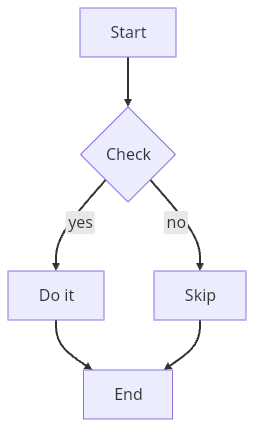
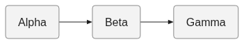

# Native Flutter / Chromium standard suites, 28 October 2026

[Scorecards](scorecards.md) · [Reproduction](STANDARD.md) · [Audit](AUDIT.md)

[Download complete evidence](native-flutter-standard-evidence-2026-10-28.tar.gz) (36 MiB). SHA-256:
`f87b43fd647a0fe48fdebe36b3679839951444457172cddcdf1fe5120ac0a5be`

Extract with `tar -xzf native-flutter-standard-evidence-2026-10-28.tar.gz`, then run
`cd standard-benchmarks && sha256sum --quiet -c SHA256SUMS`.
The archive uses tar hard links for identical artifact bytes. All 11,209 file
checksums were verified after extraction.

The archive's `published/README.md` is Trident's normal surface/mode/round index.
It selects compatibility from `community-run/` and docs/Meaning from `measured-run/`.
All failures, unsupported inputs, setup attempts, source snapshots, PNGs, SVGs and
native release bytes are retained. No cross-format speed ratio is claimed.

[Core timing CSV](core-timings.csv) · [Environment](environment.json)

Representative actual outputs use different named inputs and do not demonstrate
matched-work pixel equivalence.

| Output | Actual image |
|---|---|
| Native renderToPng, `core:flow5` |  |
| Native PNG content failure, `corpus:mermaid-gantt-bench:pg-no-tasks-error` |  |
| Pele Chromium paint, `meaning:family:flowchart` |  |
