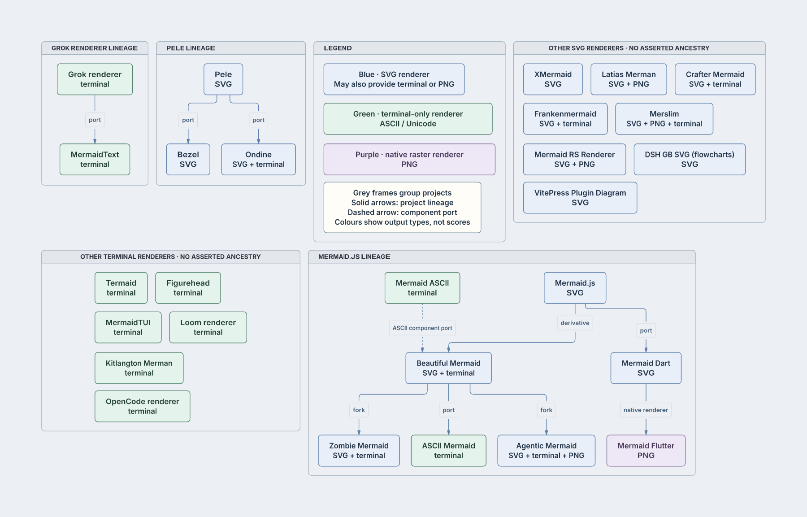

# Trident

[What Trident reliably measures](docs/measurement-contracts.md): executable measurement contracts, assessment coverage, instrument qualification and offline replay.

[Readiness and executed evidence](docs/measurement-readiness.md): retained benchmarks, implemented repairs, actual public-release measurements and remaining qualification work.

[Qualification results and supported claims](qualification/README.md).

Trident compares Mermaid tools on input compatibility, diagram meaning and rendering cost. It invokes public interfaces and keeps drawing correctness, compatibility and timing separate.

- [Benchmarks and their value](BENCHMARKS.md): what each workload measures, how to run it, and when to trust it.
- [Initial baseline](BASELINE.md): frozen ecosystem evidence required for the first public 0.1 release.
- [Release process](RELEASE.md): baseline assessment, exact-head checks and packaging.
- [Scope](SCOPE.md): core benchmark work, application exclusions and optional maintenance.
- [Methodology](METHODOLOGY.md): corpus, correctness checks, sampling and fair comparisons.
- [Measurement rules](MEASUREMENT.md): interfaces, cache state, overfitting and claims.
- [Catalog and support](CATALOG.md): what the entries mean and which suites have bindings.
- [Verified support](SUPPORT-QUALITY.md): executed public interfaces and remaining gaps for every catalog entry.
- [Comparison contracts](FAIRNESS.md): planning, independent inputs and comparable result rankings.
- [Ecosystem results](RESULTS.md): benchmark tables and charts, measurement dates and missing results for every eligible project.

The [1 November campaign](RESULTS.md) covers the 27 eligible projects: 548
documentation inputs in SVG and PNG, 120 terminal inputs and 49 adapted Mermaid
behaviour cases. Tables show recorded artifact versions, verified counts,
missing bindings and unresolved content. The [raw archive](https://github.com/adewale/trident/releases/tag/ecosystem-evidence-2026-11-01)
keeps public-call records, outputs, source provenance and failed attempts.

The [frozen B0 report](docs/qualification-results-2026-10-31.md) retains its
original minimum cohorts, observer and separate timing comparisons.
[31 October](docs/ecosystem-campaign-2026-10-31.md) and
[30 October](https://github.com/adewale/trident/blob/8b2404b0bf2940e571ca0e14e54eeff0517a98ca/README.md)
remain historical campaigns. A verified count is a lower bound while unknowns remain.

## Benchmarks

| Benchmark | What it measures | Corpus and expected answers | Results |
|---|---|---|---|
| **DaveBench — Documentation Rendering** | How many render/export calls complete and how long they take, separately for SVG and PNG. | 1,342 `mermaid` and `mermaid-example` block occurrences across 49 generated documentation files at [commit `370c4af`](https://github.com/mermaid-js/mermaid/tree/370c4af57f43cb0bda05f4a9fe2d99c912ba16dd/docs), with duplicates retained. Inspired by [Dave Kiss](https://x.com/davekiss/status/2111512440106078554). | Completed calls, failures and median total time over three runs. Outputs are discarded without assessment. [Definition](docs/davebench-definition.md). |
| **Terminal Rendering — Project Examples** | How many diagrams a terminal renderer draws correctly, including visible relationships, labels and quantities; qualified time on matched inputs. | [Active v3](corpus/terminal-active-profile.json): 115 unchanged drawings from pinned project docs, tests, issues and PRs, one disclosed alias adaptation, and four invalid controls. [Original inventory](corpus/terminal-project-examples.json) retains URLs, revisions and licenses for 18 researched repositories. | 116 drawings ranked by verified correct count; unsupported, incorrect and unresolved outcomes remain visible. Mermaid ASCII is the terminal comparator; Mermaid is an unscored source reference. |
| **Mermaid Behaviour Tests** | 30 syntax-family/precedence cases and 19 SVG accessible-name/description cases adapted from Mermaid tests. Public family returns and structural SVG metadata are checked; generated IDs and Mermaid-specific DOM conventions are not required. | A disclosed adapted subset of [Mermaid's pinned upstream tests](docs/mermaid-public-conformance.md), with original assertions and adaptation provenance preserved. | 49 whole behaviour cases, with per-assertion details; a case passes only when every required assertion passes. Exact API compatibility remains a separate diagnostic; the selected behaviour tests do not establish whole-suite conformance. |

[Benchmark definitions](BENCHMARKS.md) give commands, selection rules and limits.
[RESULTS.md](RESULTS.md) is the generated ecosystem overview; the [frozen B0
report](docs/qualification-results-2026-10-31.md) preserves the initial measured
population and observer. New grading does not rewrite that baseline.

Every result names its corpus, revision, selection or adaptation, expected-answer
origin, renderer artifact and output format. A verified-count rank orders the
available evidence. Overlapping correctness bounds do not establish an accuracy
winner. Performance belongs to each workload: browser calls, fresh CLI processes
and complete PNG exports have separate clocks.

DaveBench uses the same 30-example warm-up followed by three complete timed runs
per renderer and output format. It retains numeric counts and timings only.
The earlier retained-output drawing assessments and their qualified timing
studies remain dated historical results in [RESULTS.md](RESULTS.md).

The 154 unchanged public API callbacks, authored feature/edit cases, legacy
compatibility, model editing contracts and adaptive cost studies are optional
diagnostics. They supply no combined renderer-quality score. Product-specific
editing contracts belong in their owning projects. Assertion Replay and the
standalone nonblank PNG exporter are retired. [Historical methods](BENCHMARKS.md#retired-comparisons-and-reference-validation)
remain available with their original evidence.

### Verify Trident before collecting scores

Use the [six-project harness profile](qualification/harness-profile.json) only
when a transport changes. Mermaid, Mermaid ASCII, Agentic Mermaid, Mermaid
Flutter, Latias Merman and Termaid cover the 16 execution paths with 56 output
calls and two model workflows. Its five-minute collection budget excludes
preparation. These are invocation controls, not renderer rankings.

```sh
bun commands.ts verify:harness --plan
bun commands.ts bench --projects OWNER/TOOL,... --suites docs --profile full --plan
bun commands.ts bench --projects OWNER/TOOL,... --suites docs --out FRESH_DIR
bun commands.ts bench --terminal --plan
```

Use focused independent positive, wrong-output and equivalent-representation
controls when grading changes. Run affected checks during development, then the
full suite once the implementation is frozen. A broad renderer campaign is not
a prerequisite for each observer fix. [Release checks](RELEASE.md) reuse the same
corpora, ledgers and retained evidence.

## Supported projects

Normal campaigns select **27 renderers**: 16 with SVG output, ten terminal-only
implementations and the native Mermaid Flutter PNG renderer. The dated
[public-output checks](SUPPORT-QUALITY.md) record actual invocations, versions,
failures and missing bindings; they do not certify all families or qualified timing.

| SVG-rendering project | Outputs exercised successfully |
|---|---|
| [Agentic Mermaid](https://github.com/adewale/agentic-mermaid) | SVG, terminal, PNG, parser |
| [Beautiful Mermaid](https://github.com/lukilabs/beautiful-mermaid) | SVG, terminal |
| [Bezel](https://github.com/crabtalk/bezel) | SVG |
| [Crafter Mermaid](https://github.com/crafter-station/mermaid) | Browser DOM SVG, parser; raw Node SVG has a retained XML failure |
| [DSH Mermaid GB SVG](https://github.com/sandyyst/dsh-plugin-mermaid-gb-svg) | SVG |
| [Frankenmermaid](https://github.com/Dicklesworthstone/frankenmermaid) | SVG, parser, diagnostics |
| [Latias Merman](https://github.com/Latias94/merman) | SVG |
| [Mermaid Dart](https://github.com/orestesgaolin/mermaid) | SVG |
| [Mermaid.js](https://github.com/mermaid-js/mermaid) | Browser SVG, parser |
| [Mermaid RS Renderer](https://github.com/1jehuang/mermaid-rs-renderer) | SVG, PNG |
| [Merslim](https://github.com/emtyty/merslim) | SVG, terminal, parser, browser PNG |
| [Ondine](https://github.com/wevm/ondine) | SVG, public CLI terminal output |
| [Pele](https://github.com/obsidianmd/pele) | SVG |
| [VitePress Plugin Diagram](https://github.com/KlangHaus/vitepress-plugin-diagram) | SVG |
| [XMermaid](https://github.com/evangwt/xmermaid) | Browser SVG |
| [Zombie Mermaid](https://github.com/dfadler/zombie-mermaid) | SVG, terminal |

Terminal-only interfaces are exercised for [ASCII Mermaid](https://github.com/kais-radwan/ascii-mermaid),
[Figurehead](https://github.com/Mootikins/figurehead-rs), [Grok's renderer component](https://github.com/xai-org/grok-build),
[Kitlangton Merman](https://github.com/kitlangton/merman), [Loom's renderer component](https://github.com/Yassimba/loom),
[Mermaid ASCII](https://github.com/AlexanderGrooff/mermaid-ascii),
[MermaidText](https://github.com/spacedock-dev/mermaidtext), [MermaidTUI](https://github.com/tariqshams/mermaidtui),
[OpenCode's Merman component](https://github.com/anomalyco/opencode)
and [Termaid](https://github.com/fasouto/termaid).

[Mermaid Flutter](https://pub.dev/packages/mermaid_flutter) has a separate native
PNG interface using Mermaid Dart's parser/layout core. DSH Mermaid GB SVG is a
flowchart specialist. Parser, model and invalid-input checks of enrolled renderers
remain in scope; validator-only tools do not enter renderer comparisons.

The [catalogue](CATALOG.md) retains all 89 identities and their ancestry.
**62 are excluded** by renderer scope, explicit project selection, branding,
application or binding policy. MDV, OpenCode Merman, TUI Mermaid, Lovely Mermaid
and Mermansi are catalogue-only. So are the seven parser/validator/formatter/converter
entries removed from the earlier 39-project selection. Rusty Mermaid declares
only diagnostics and is also outside renderer scope; its broken-release receipt
remains recorded. These exclusions apply before acquisition and cannot be enabled
with the descendant-investigation override. Historical receipts retain their
original project selections and dates.

## Project lineage

[](docs/images/lineage.png)

Every scheduled renderer appears once. Node labels show configured rendering
output checks, including interfaces that may fail or remain blocked. They do not
assert successful output or qualified performance. The image's legend explains
the output colours, grey groups and arrow styles. Solid arrows label recorded
forks, derivatives, ports or native-renderer relationships; the dashed arrow marks
only Beautiful Mermaid's ASCII component port. Unconnected renderers are grouped
without inventing ancestry. Mermaid Dart and Mermaid Flutter remain distinct brands.

The [Mermaid source](docs/lineage-overview.mmd) is generated from the actual
selection with `bun commands.ts support --lineage --out FRESH.mmd`. To update the
tracked artwork, copy that source to `docs/lineage-overview.mmd`, then run
`bun scripts/render-lineage.ts --renderer-entry INSTALLED_AGENTIC_ENTRY --out FRESH.svg`
and copy the resulting SVG, PNG and JSON receipt into `docs/images/lineage.*`.
Agentic Mermaid renders the diagram with Publication Figure and Nord Light.
The script adds the legend below the graph, then rasterizes the complete figure
with verified bundled Inter fonts and system fonts disabled. Use `--look NAME`
and `--palette NAME` on the generation command to compare alternatives.
[The font and style comparison](docs/lineage-rendering.md) explains the rendering choices;
the [SVG download](docs/images/lineage.svg) retains live text.
[The receipt](docs/images/lineage.json) records the renderer version, selected projects and hashes;
[the full catalogue tree](LINEAGE.md) includes every exclusion. Appearance implies
no benchmark rank.

## Install and release status

The [initial baseline](BASELINE.md) is frozen. The first public 0.1 release has
not been published; [release checks](RELEASE.md) qualify the intended source and archive. The existing `v0.1.0` tag is an older preparation
snapshot; it does not contain all features described on current main. Use Bun 1.4+
and Node 24+ with the intended source revision. Published archives, when available, appear on
the [GitHub releases page](https://github.com/adewale/trident/releases).
The repository package is private. The kit ships its runtime files and manifest,
while target artifacts and the pinned Mermaid oracle are installed separately.

```sh
node commands.ts --version
```

See [release notes](CHANGELOG.md) and the [release procedure](RELEASE.md) for
validation scope, artifact checksums and known limits.

## Benchmark a project

Install Bun 1.4+, Node 24+, npm and the package dependencies. The oracle is pinned Mermaid 12.2.0, its parser and first-party ZenUML addon. Browser measurements require Chromium; compiled projects also need their declared toolchains.

```sh
bun install --frozen-lockfile
node commands.ts mermaid:install
bunx playwright install chromium
bun commands.ts community:update --projects obsidianmd/pele,mermaid-js/mermaid \
  --profile full --records /evidence/records --out /evidence/run
bun commands.ts results:publish --records /evidence/records --out /evidence/report
```

Inspect `bun commands.ts support` and `bun commands.ts bench --projects OWNER/TOOL --plan` before collecting. Execution requires a project selection or explicit `--all-projects`. Choose any project in [the catalog](catalog/mermaid-community.json). Use `--executable /path/to/chromium` for an existing browser. Exact matching records are reused with their original dates; `--force` collects a new attempt. `community:update --plan` prepares artifacts and reports reuse decisions without timing; `bench --plan` performs no acquisition or rendering. Measurements are local and reject CI.

Every tool uses its catalog release. To measure an unreleased npm package, select one project and add `--candidate-dir /path/to/built/package`, or `--candidate-tarball FILE --candidate-sha256 HEX`. Source-built projects accept `--candidate-revision COMMIT [--candidate-remote URL_OR_CLONE]`. Candidates stay separate from release rows:

```sh
bun commands.ts community:update --projects OWNER/TOOL --candidate-dir /artifacts/package \
  --profile full --records /evidence/records --out /evidence/candidate
bun commands.ts results:compare --records /evidence/records --project OWNER/TOOL
```

A checkout, environment variable or local `dist/` never silently replaces a community release.

For a workspace build that publishes several npm packages, build and pack them
with the project's own commands. Add `--candidate-dependencies archives.json`
to the candidate command above. The file contains a nonempty array:

```json
[
  { "tarball": "packs/renderer-core.tgz", "sha256": "REPLACE_WITH_64_LOWERCASE_HEX_DIGITS" }
]
```

Paths are relative to that JSON file. Trident checks each archive's hash and
package identity, installs the candidate and dependency archives together with
scripts disabled, and verifies that the candidate resolves those exact packages.
Files bundled inside a dependency archive are checked and sealed with that archive.
Unused archives, duplicate package names and substituted nested copies are
rejected. Changing any dependency archive creates a separate installation,
browser bundle and candidate record. Frozen preparation seals the dependency
payloads and rejects later changes. This does not prove the archives came from
one commit: retain the source commits and build receipts with the campaign.

Results are stack-ranked by the named metric within comparable input, format and
runtime groups. Verified counts sort highest first; qualified time sorts lowest
first. Ties share a rank, and missing or withheld values have no numeric rank.
[Reporting rules](REPORTING.md) explain denominators and uncertainty; the
[AM/ZM source comparison](docs/comparison-2026-10-29.md) shows dated example tables
with their original method and observed failures.

## Native Flutter entrypoints

The standalone [native Flutter / Chromium campaign](native-flutter/README.md)
measures `mermaid_flutter` 0.3.2 widgets and PNG export in a native Linux release
application alongside Pele 1.9.0 in Chromium. It separates new instances,
unchanged calls, source updates and first use in new processes, and retains
painted output and failures. It is not registered in the standard CLI or catalog;
its timing boundaries differ from the Node SVG suites and first-use browser
collector. Generated evidence stays outside source commits. [Audited result tables and withheld comparisons](docs/native-flutter-comparison.md) explain the retained campaign.

The [seven-implementation DaveBench PNG campaign](docs/davebench-png-seven-results.md) reports warm fixed-canvas export timings on 13 common reviewed inputs and PNG-contract coverage on all 548 documentation occurrences. It measures native Dart and native Flutter release separately, alongside Mermaid, Agentic, Beautiful, Zombie and Pele in Chromium, using fresh process blocks and launch-round uncertainty. The close Dart/Pele and Zombie/Beautiful ordering is unresolved. The [earlier 20-input Pele/Flutter follow-up](docs/isolated-png-results.md), [initial controlled observations](docs/controlled-png-results.md) and [withdrawn v1 comparison](docs/davebench-png-results.md) remain separate campaigns.

## Add a tool

Declare the project and its public bindings in `catalog/mermaid-community.json`. An npm SVG renderer can use the generic adapter:

```json
{
  "id": "owner/tool",
  "roles": ["renderer"],
  "outputs": ["svg"],
  "benchmark": {
    "adapter": "declared",
    "package": "tool-package",
    "version": "1.2.3",
    "outputs": ["svg"],
    "api": { "svg": { "export": "render", "result": "svg" } }
  }
}
```

A reviewed `benchmark.portable` binding can additionally name a public factory
and disposal method; registered package pipelines reuse the community binding
inside the portable Node worker. See [comparison contracts](FAIRNESS.md).

Bindings accept dotted public export paths, an optional JSON `options` argument and an optional returned field. Promises are awaited. Other outputs, source builds, WASM and native tools use their declared adapters. An installed Node CLI can additionally declare `benchmark.cli`: its npm `bin` name, arguments with `{format}`, and outputs. No project gets an implicit local native executable.

## Run the portable kit

The authored family/scaling campaign accepts a built artifact without that project's source checkout:

```sh
node commands.ts build --out /artifacts/trident-kit
node /artifacts/trident-kit/run.mjs --project obsidianmd/pele \
  --artifact-root /artifacts/pele --out /evidence/portable --records /evidence/records \
  --rounds 5 --samples 31 --cold-samples 20 --allow-partial
```

Copy the whole generated directory, including its manifest. It requires Node 24, the actual renderer artifact and the pinned oracle install; no Bun, Git or Trident `node_modules` is needed at runtime. Set `MERMAID_REFERENCE_DIR` for a nondefault install. `--allow-partial` permits incomplete diagnostics to produce a report; it does not turn them into a calibrated pass. See [portable methods](BENCHMARKS.md) and [comparison contracts](FAIRNESS.md).

## Development and ownership

`bun commands.ts test` runs the full local suite and needs the pinned oracle.
CI runs `lint`, `typecheck`, `results:snapshot --check` and the explicit
`test:ci` fixture suite without project artifacts or an oracle, and runs
`test:ci` again on macOS, whose temporary folders are symlinks. Collection,
artifact acquisition and `community:update --plan` remain local operations.
Optional browser tests use `AM_BROWSER_TESTS=1` and
`AM_CHROMIUM_EXECUTABLE=/path/to/chromium` (legacy environment variable names).

Use `bun commands.ts bench --projects OWNER/TOOL,... --profile full
--out /evidence/full` for all applicable public-artifact suites. `bench --list`
lists suites and selected projects without collecting measurements. Adapter gaps,
setup failures and unsupported surfaces stay visible in the campaign report.

Product source tests, editor experiments, AM release budgets, private operation
witnesses and the AM build/pack Dave wrapper live in
[Agentic Mermaid](https://github.com/adewale/agentic-mermaid/tree/main/eval/benchmark).
Trident has no AM source launcher, workspace assembler or implicit local candidate.
AM uses a pinned Trident library for shared observers and measurement utilities.

Trident originated in Agentic Mermaid; its maintainer maintains both. The
[frozen corpus](corpus/community-corpus.json) records that origin and imported
Mermaid inputs. This public development material is not an independent holdout.
