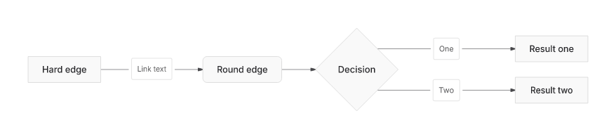
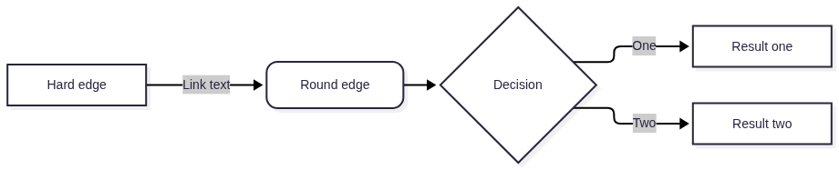
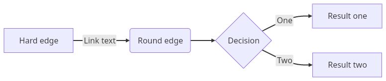
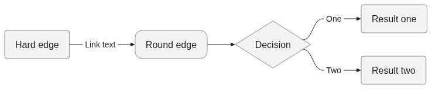
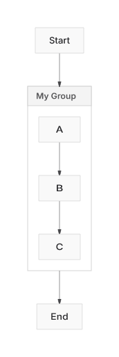
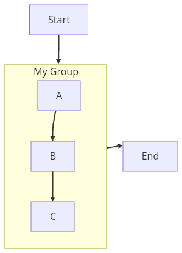
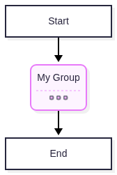
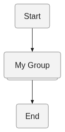

# DaveBench PNG export, 28 October 2026

[Result tables](scorecards.md) · [All per-call observations CSV](observations.csv) · [Timing summaries CSV](common-timings.csv) · [Failures with source](nonpasses.json) · [Reproduce](REPRODUCE.md)

548 occurrences × five rounds × four published libraries = 10,960 measured exports;
600 additional warmup attempts. The 315 common PNG-qualified occurrences supply
the conditional timing summaries. This is PNG decode/nonblank admission, not a
matched-fidelity or equal-pixel speed ranking. See the retained collapsed-subgraph
images below for a concrete limitation.

## Full evidence download

The complete archive is 120.3 MiB, split into four files for storage:

- [davebench-png-evidence-2026-10-28.tar.gz.part-00](davebench-png-evidence-2026-10-28.tar.gz.part-00)
- [davebench-png-evidence-2026-10-28.tar.gz.part-01](davebench-png-evidence-2026-10-28.tar.gz.part-01)
- [davebench-png-evidence-2026-10-28.tar.gz.part-02](davebench-png-evidence-2026-10-28.tar.gz.part-02)
- [davebench-png-evidence-2026-10-28.tar.gz.part-03](davebench-png-evidence-2026-10-28.tar.gz.part-03)

Download all four parts and [SHA256SUMS](SHA256SUMS), then concatenate in order:

```sh
cat davebench-png-evidence-2026-10-28.tar.gz.part-00 \
    davebench-png-evidence-2026-10-28.tar.gz.part-01 \
    davebench-png-evidence-2026-10-28.tar.gz.part-02 \
    davebench-png-evidence-2026-10-28.tar.gz.part-03 > davebench-png-evidence-2026-10-28.tar.gz
sha256sum --quiet -c SHA256SUMS
tar -xzf davebench-png-evidence-2026-10-28.tar.gz
cd davebench-png-evidence
sha256sum --quiet -c SHA256SUMS
```

Full archive SHA-256: `8784cb85800bc707f7b3c5d5eb85045593c1c605bce0d6e2bd61a4e5f4f8c83f`. All 60,282 retained file checksums were verified
after extraction. Identical bytes use tar hard links. Unsealed source maps are
omitted; all runtime/rendered-output bytes remain available.

The archive includes the normal `publication/README.md` index, owning run,
raw samples and warmups, every disposition/source, PNGs/SVGs, the complete measured
native Flutter release bundle, installed npm runtime snapshot, dependency locks,
exact producer source, SDK/font/host details, audit and verification. The
[environment receipt](environment.json) and [verification](verification.json)
are also directly readable here.

## Actual output, common ordinary fixture

Input: `packages/mermaid/src/docs/syntax/flowchart.md:1449`. Images are unedited
round1 exports of the same source, with intrinsic bounds and default styles.
Look for five nodes and Link text/One/Two edge labels. Dimensions differ.

| Participant | Actual PNG |
|---|---|
| Agentic Mermaid 0.4.1 / Node |  |
| Mermaid 12.2.0 / Chromium |  |
| mermaid_flutter 0.3.2 / native release |  |
| Pele 1.9.0 / Chromium |  |

## Qualification limit: collapsed subgraph

Input: `flowchart.md:1065` requests collapsed internals. Agentic/Flutter display
A/B/C, while Mermaid/Pele hide them. All four pass the nonblank PNG gate. These
outputs are retained to prevent interpreting admission as semantic equivalence.

| Agentic | Flutter | Mermaid | Pele |
|---|---|---|---|
|  |  |  |  |

[Visual receipt and baseline diagnostic](visual-receipt.json) · [Audit](AUDIT.md)

Measured producer: `2d99f3f38941275036c108ff1ead165bcdd8f5c2`. Later reporting and
failure-path hardening do not rewrite the original observations. This evidence
branch is isolated from source PR/main history; this is not a software release.
