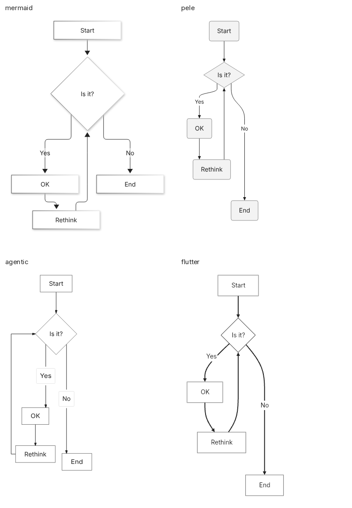
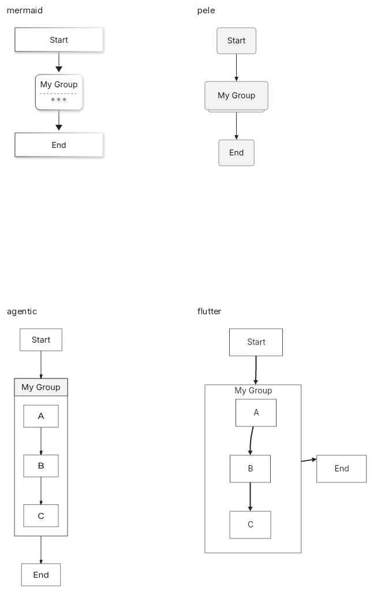

# Controlled PNG export evidence, 29 October 2026

Measured producer: 219535c3575dffd79d1e028636cedf7ab2583006.
Native worker built at200bfdf8ef99363edc58159c58ef9d88d52d0026;
the subsequent source change fixes Mermaid's public shape seed only.
Native build receipt binds exact worker/locks/SDK/bundle hashes.
CALIBRATION FAILED: relative comparisons are withheld. The table is observed
latency for this run only; it is not a renderer ranking.

Task: reviewed source to1200×900 opaque white PNG atscale1, no clipping/resizing.
Browser Mermaid12.2.0/Pele1.9.0/Agentic0.4.1 share Chromium and SVG-to-PNG code.
Native mermaid_flutter0.3.2 uses Flutter release renderToPng plus timed decode,
padding and re-encoding. Role typography/layout/palette defaults may differ;
all admitted outputs passed source-fact and legibility review. This is a usable
PNG application task, not identical typography, renderer kernels or encoders.

18 common inputs from20 candidates across6 families, plus1 negative control.
Agentic fails group membership in flowchart970/998; Agentic/Flutter expose hidden
collapsed-group nodes. All sources, failed qualification attempts and images stay.
This is not full548-input DaveBench performance or unseen holdout performance.

| Participant | Median of per-input50-call medians, ms | A/A passes |
|---|---:|---|
| mermaid | 52.075 | True |
| pele | 11.900 | False |
| agentic | 29.750 | True |
| flutter | 65.906 | False |

Raw samples: samples.jsonl (all3600 measured calls and288 warmups).
Owning run: measurement-2; final qualification: qualification-seeded.
review.json records every source/participant decision and pixel hash;
context.json owns exact environment, sealed artifacts and comparison contract.
summary.json contains A/A case-bootstrap intervals. Its relative-comparison array
is empty because calibration failed.
Independent Pillow checks reconcile decoded pixels and byte lengths for every
retained successful-run call; see independent-image-verification.json.

Earlier qualification directories retain font/config/random-shape failures.
qualification-final/unadmitted-review.json was never used for timing; its failed
pixel-reuse receipt rejected it before any call was admitted. measurement has no
samples because a stale git index triggered the producer-cleanliness gate.
Reviewers' final seeded receipt covers80 exact reused images plus4 fresh reviews.

A prospectively declared CPU2/LP_NUM_THREADS1 placement attempt is retained as
measurement-affinity, owned by placement-source.tar.gz. Effective-affinity checks
found Chromium raster threads onCPU0 and native disk threads onCPUs0-4. The setup
was stopped, partial timings excluded and no further retries made. It is not a
second admitted campaign or evidence of a fixed placement problem. The original
native A/B normalization gap remains unexplained.

Raw receipts preserve original absolute paths. An artifact /workspace/davebench-png-v2/NAME/png/FILE
is stored as NAME/png/FILE here. Original PNGs are unedited; representative contact
sheets only crop whitespace and add captions without scaling. Full PNGs are linked
beside them. Files are hardlinked by exact content to reduce archive size.

Reproduction: extract producer-source.tar.gz and follow
davebench-png/controlled/README.md. This archive includes the native bundle,
build receipt, browser distributions and supplied font. Install the exact runtime
versions recorded in context.json; machine/OS library receipts accompany the run.
New host pixels require renewed qualification; do not silently change the gate.
Verify every path/size/SHA256 in files.json after extraction.

## Download the evidence archive

- [Part00](controlled-png-evidence-2026-10-29.tar.gz.part-00?raw=true)
- [Part01](controlled-png-evidence-2026-10-29.tar.gz.part-01?raw=true)
- [Part checksums](parts.sha256?raw=true)
- [Whole-archive checksum](archive.sha256?raw=true)

```sh
sha256sum -c parts.sha256
cat controlled-png-evidence-2026-10-29.tar.gz.part-00 controlled-png-evidence-2026-10-29.tar.gz.part-01 > controlled-png-evidence-2026-10-29.tar.gz
sha256sum -c archive.sha256
tar -xzf controlled-png-evidence-2026-10-29.tar.gz
```

Archive SHA256: `a12bb9936e92c4016df7091ba831c696fdd709a8a12361e8444b69449dbea78a`.



Open at full size. The original1200×900 images remain under representative/.


