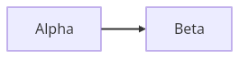
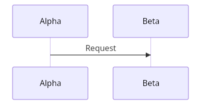
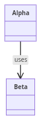
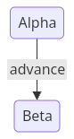
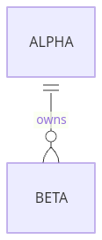
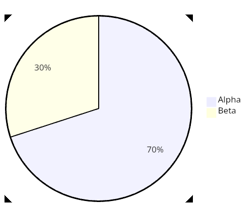

# Native Flutter public-output verification, 29 October 2026

Trident's merged [PR 51](https://github.com/adewale/trident/pull/51) was verified
with a freshly built Linux Flutter release bundle at source
[`5867f424f5048e364be65b1ac1fdf6feb8a25301`](https://github.com/adewale/trident/tree/5867f424f5048e364be65b1ac1fdf6feb8a25301).
The public call is `mermaid_flutter.renderToPng(source, pixelRatio: 1)`, version
0.3.2, with Flutter 3.47.8 and Dart 3.13.7. The check ran at 12:32 UTC.

Ranked by positive-input pass rate; one project was selected:

| Rank | Project and runtime | Version | Positive PNG inputs | Invalid inputs rejected |
|---:|---|---|---:|---:|
| 1 | Mermaid Dart / native Linux Flutter release | 0.3.2 | 6/6 | 2/2 |

The saved binding was replayed from `/tmp` with no ambient executable selector:
again 6/6 positives and 2/2 invalid controls. A conflicting executable override
was blocked before native launch. Independent Pillow inspection decoded all 24
retained first/final PNG files and confirmed positive dimensions and nonuniform
content. This is invocation and raster-content evidence, with no SVG-label,
topology, model, complete-family, paint-equivalence or performance qualification.
No comparative timing result or new ecosystem score is published.

## Evidence

- [Initial support report](verification-report.json), [saved-binding replay](replay-report.json), and [blocked conflicting override](conflicting-executable-report.json).
- [Summary and producer identities](summary.json), [environment and dependency hashes](environment.json), [independent PNG inspection](png-audit.json), and [archive audit](archive-audit.json).
- [Complete evidence archive](native-flutter-verification.tar.xz): original reports, jobs, raw/qualified JSONL, runtime/launch receipts, all returned PNGs, frozen manifests, actual release bundle, producer source closure, lockfiles, build logs and per-file checksums.
- [Archive SHA-256 and byte count](archive.json). SHA-256: `590beaec363b6c1f99ebea9f5a01a0dbe9de28198f5d2938db8924f7d11d8695`.
- [Reproduction](REPRODUCE.md) and [independent archive checker](verify-evidence.py).

These are original returned PNGs from the initial run:

| Input | Returned output |
|---|---|
| `support:flowchart` |  |
| `support:sequence` |  |
| `support:class` |  |
| `support:state` |  |
| `support:er` |  |
| `support:pie` |  |

The unknown-header control returned a public `UnsupportedError`; malformed
flowchart syntax returned `MermaidParseException`. Both remain raw observations
in the archive. The corpus and reference parser establish that these two sources
are independently invalid; the check does not infer the reason for every error.
