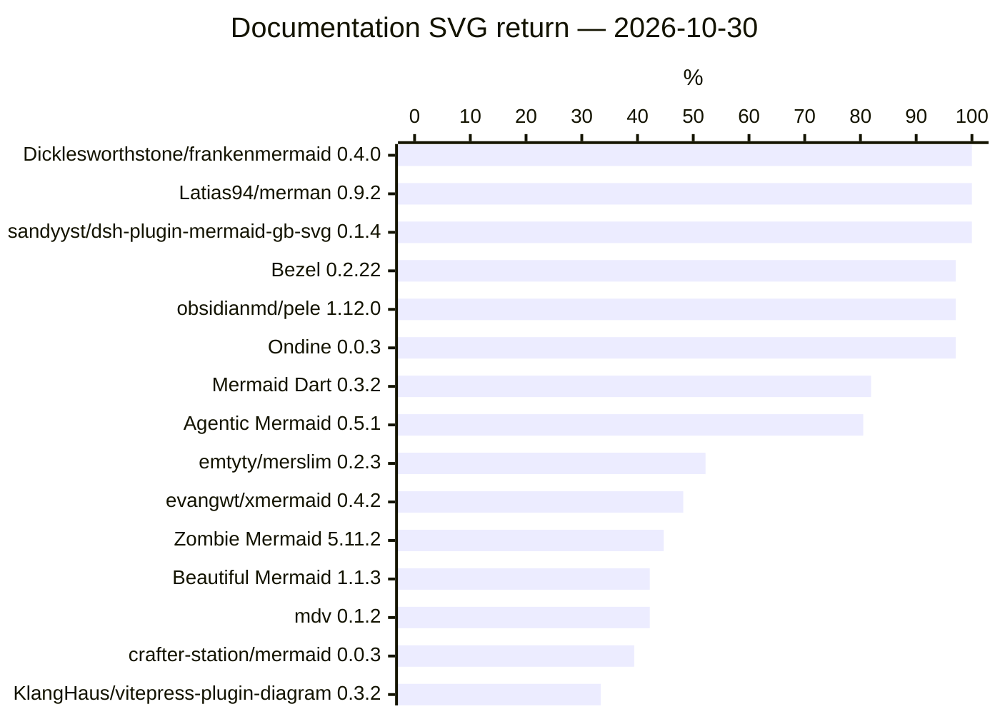

# Mermaid ecosystem benchmark results

Last recorded measurement/update: **2026-10-30**. 274 imported project/benchmark attempts; 843 retained result tables.

**Historical** marks retained measurements collected before the current reporting work. **Source candidates** are unreleased builds, ranked only within their own comparison tables; they do not replace release scores in the overview. This page is a rolling view across dated runs, not one matched ecosystem experiment. Regenerating it runs no benchmarks. Dates, versions, interfaces and qualification belong to each table.

[Machine-readable results](results/latest.json) · [Benchmark methods](BENCHMARKS.md) · [Reading the tables](REPORTING.md) · [Update this page](results/README.md)

## Ecosystem overview

39 originally recorded projects are listed below, including projects later excluded from regular campaigns. This archive preserves the measured selection; it does not change current benchmark eligibility.

Each cell links its latest recorded attempt, or a dated retained table. New failed, blocked and partial attempts take precedence over earlier tables. Different suites have different units; there is no combined score. “Unmeasured” is missing evidence; “N/A” follows the declared output or reference scope, not a measured failure.

Overview order: DaveBench: Documentation Examples, highest Returned in all rounds / Planned first (2026-10-30). Ties share a rank. Projects with no result for this measure, or a newer superseding attempt, remain unranked below. Each benchmark has its own ranking. The overview’s ranked benchmark cell uses this same table and population.

| Project | Overview rank | Compatibility | DaveBench | Meaning | Models / editing | Assertion replay | Reference tests | Render cost |
|---|---|---|---|---|---|---|---|---|
| Dicklesworthstone/frankenmermaid | 1 | [core: failed · 2026-10-30](results/tables/community-4.md#attempt-158753b39ff8af35f022806f); [external: failed · 2026-10-30](results/tables/community-11.md#attempt-9c99cdeb0ead5c485b300633) | [100.0% · 2026-10-30](#run-8b501af93dc3dbc6f265dfd4) | [failed · 2026-10-30](results/tables/fidelity-4.md#attempt-07b01ac608df05ea9b1e799e) | [blocked · 2026-10-30](results/tables/native-fidelity-2.md#attempt-1cdfa3a422823a7a6e4569dd) | [blocked · 2026-10-30](results/tables/upstream-fidelity-1.md#attempt-41aa1259c687a4dea8eec863) | N/A | [blocked · 2026-10-30](results/tables/portable-3.md#attempt-4a856a9a2d4cdb9b2d34547e) |
| Latias94/merman | 1 | [core: failed · 2026-10-30](results/tables/community-5.md#attempt-2b78cba0b41d69222cb99913); [external: failed · 2026-10-30](results/tables/community-11.md#attempt-a7834b04a35792a31ca00d2b) | [100.0% · 2026-10-30](#run-8b501af93dc3dbc6f265dfd4) | [failed · 2026-10-30](results/tables/fidelity-5.md#attempt-41480ce9de0477b0ff403525) | [blocked · 2026-10-30](results/tables/native-fidelity-2.md#attempt-7504f794ea6b208855a67fb4) | [blocked · 2026-10-30](results/tables/upstream-fidelity-1.md#attempt-5927ba61a1894221cb77c5b9) | N/A | [failed · 2026-10-30](results/tables/portable-3.md#attempt-ea58071bedca498a8a2c1c33) |
| sandyyst/dsh-plugin-mermaid-gb-svg | 1 | [core: failed · 2026-10-30](results/tables/community-5.md#attempt-251e0d968bb665881555f71e); [external: failed · 2026-10-30](results/tables/community-8.md#attempt-67878da4d34a7d8ad1141e9a) | [100.0% · 2026-10-30](#run-8b501af93dc3dbc6f265dfd4) | [failed · 2026-10-30](results/tables/fidelity-4.md#attempt-042dd9c095787acfb24ab5b9) | [blocked · 2026-10-30](results/tables/native-fidelity-2.md#attempt-1e7082e16f56d6c4f598abe2) | [blocked · 2026-10-30](results/tables/upstream-fidelity-1.md#attempt-0523080bf76af7d405d75530) | N/A | [failed · 2026-10-30](results/tables/portable-3.md#attempt-c5a35357dfa369f7aacd5dca) |
| Bezel | 4 | [core: failed · 2026-10-30](results/tables/community-5.md#attempt-325e544374f67e65b3711623); [external: recorded · 2026-10-30](results/tables/community-8.md#attempt-69cfae5bd403e8211630126e) | [97.1% · 2026-10-30](#run-8b501af93dc3dbc6f265dfd4) | [failed · 2026-10-30](results/tables/fidelity-7.md#attempt-f47a09fcc439190aebbf6324) | [blocked · 2026-10-30](results/tables/native-fidelity-2.md#attempt-0e7664cd12c2cc9abee811d5) | [blocked · 2026-10-30](results/tables/upstream-fidelity-1.md#attempt-8f19d1f355796ed03758cadd) | N/A | [blocked · 2026-10-30](results/tables/portable-3.md#attempt-09f776163c3fb0466b169dba) |
| obsidianmd/pele | 4 | [core: failed · 2026-10-30](results/tables/community-9.md#attempt-7affb7d7500dc9428ce8f648); [external: recorded · 2026-10-30](results/tables/community-12.md#attempt-d1d10dcad9710fd06e7079e3) | [97.1% · 2026-10-30](#run-8b501af93dc3dbc6f265dfd4) | [failed · 2026-10-30](results/tables/fidelity-5.md#attempt-6d9e709d54ddcab5b0a0df2f) | [failed · 2026-10-30](results/tables/native-fidelity-2.md#attempt-566186335f7fdcdf6d38fca1) | [failed · 2026-10-30](results/tables/upstream-fidelity-1.md#attempt-d5fee7a0ece4949fcd4fb3e8) | N/A | [blocked · 2026-10-30](results/tables/portable-3.md#attempt-f849c18a6af8c4a032e6ca1f) |
| Ondine | 4 | [core: failed · 2026-10-30](results/tables/community-4.md#attempt-075d15f6a668b8b0cc408176); [external: recorded · 2026-10-30](results/tables/community-5.md#attempt-2d15aba9af06324f4179e531) | [97.1% · 2026-10-30](#run-8b501af93dc3dbc6f265dfd4) | [failed · 2026-10-30](results/tables/fidelity-4.md#attempt-04e4691c4da0031e8f47be92) | [blocked · 2026-10-30](results/tables/native-fidelity-2.md#attempt-504d7acc07b1143e4ad71b93) | [blocked · 2026-10-30](results/tables/upstream-fidelity-1.md#attempt-320b61206e01b4f3ba8de0b8) | N/A | [blocked · 2026-10-30](results/tables/portable-3.md#attempt-0736740b9559facf4b5e3203) |
| Mermaid Dart | 7 | [core: failed · 2026-10-30](results/tables/community-9.md#attempt-80520cb18bbea979bc775cee); [external: failed · 2026-10-30](results/tables/community-8.md#attempt-6de6f3e8e4bb5733f4098f3f) | [81.9% · 2026-10-30](#run-8b501af93dc3dbc6f265dfd4) | [failed · 2026-10-30](results/tables/fidelity-5.md#attempt-5fe78b1e58d00e1c49d3ce97) | [blocked · 2026-10-30](results/tables/native-fidelity-2.md#attempt-6fbc2639cf9b1a12433d3baf) | [blocked · 2026-10-30](results/tables/upstream-fidelity-1.md#attempt-6611a3aa11d689037d900f4a) | N/A | [blocked · 2026-10-30](results/tables/portable-3.md#attempt-0e5a3881ac20d46a2b4cebcf) |
| Agentic Mermaid | 8 | [core: failed · 2026-10-30](results/tables/community-11.md#attempt-9caed1ac95f9d3e9229b2057); [external: failed · 2026-10-30](results/tables/community-4.md#attempt-23febd26b50b81db8f6f9a51) | [80.5% · 2026-10-30](#run-8b501af93dc3dbc6f265dfd4) | [failed · 2026-10-30](results/tables/fidelity-6.md#attempt-eaf39774002f8e7bf5c9933b) | [failed · 2026-10-30](results/tables/native-fidelity-2.md#attempt-1323bbb3db6d7719a6528146) | [failed · 2026-10-30](results/tables/upstream-fidelity-1.md#attempt-bd4ebc5235c666c9b4e11fac) | N/A | [failed · 2026-10-30](results/tables/portable-3.md#attempt-859fd204d1b7eee270f3b39a) |
| emtyty/merslim | 9 | [core: failed · 2026-10-30](results/tables/community-7.md#attempt-4c9cdd42f9c547f526091bbd); [external: failed · 2026-10-30](results/tables/community-10.md#attempt-95538ee5107927ffdbc07d10) | [52.2% · 2026-10-30](#run-8b501af93dc3dbc6f265dfd4) | [failed · 2026-10-30](results/tables/fidelity-6.md#attempt-b378de4edbd3e68deb05bd2e) | [blocked · 2026-10-30](results/tables/native-fidelity-2.md#attempt-a0e9f1f79da4842656b8a5a1) | [blocked · 2026-10-30](results/tables/upstream-fidelity-1.md#attempt-77a3bdded57884d285f06aee) | N/A | [failed · 2026-10-30](results/tables/portable-3.md#attempt-d1b9d9f341f2b136f48a8ef2) |
| evangwt/xmermaid | 10 | [core: failed · 2026-10-30](results/tables/community-10.md#attempt-93d3f4c6cb6570321940918e); [external: failed · 2026-10-30](results/tables/community-6.md#attempt-3df30dbc1f4c06374bee1da3) | [48.2% · 2026-10-30](#run-8b501af93dc3dbc6f265dfd4) | [failed · 2026-10-30](results/tables/fidelity-6.md#attempt-daef4c6fe3ec94cd106af08f) | [blocked · 2026-10-30](results/tables/native-fidelity-2.md#attempt-669cf3a96c310d3f9eaa2a48) | [blocked · 2026-10-30](results/tables/upstream-fidelity-1.md#attempt-6fbbaf663f0ab5133e1f1e07) | N/A | [blocked · 2026-10-30](results/tables/portable-3.md#attempt-64dbbbc43f1a7301b9979427) |
| Zombie Mermaid | 11 | [core: failed · 2026-10-30](results/tables/community-11.md#attempt-97a22adef38f7949eb4a9ebb); [external: failed · 2026-10-30](results/tables/community-4.md#attempt-144bb94acc77c2e585bd4543) | [44.7% · 2026-10-30](#run-8b501af93dc3dbc6f265dfd4) | [failed · 2026-10-30](results/tables/fidelity-5.md#attempt-6bb2438e2d94884e01fd9397) | [blocked · 2026-10-30](results/tables/native-fidelity-2.md#attempt-85741fc64a444cd7c9dc6f58) | [blocked · 2026-10-30](results/tables/upstream-fidelity-1.md#attempt-a9e092dfe878b477b0b32b30) | N/A | [failed · 2026-10-30](results/tables/portable-3.md#attempt-f4a452cb9ec7575e81db1f42) |
| Beautiful Mermaid | 12 | [core: failed · 2026-10-30](results/tables/community-7.md#attempt-488e4250a44caf1e6205d52d); [external: failed · 2026-10-30](results/tables/community-9.md#attempt-8085a4982e3f552831301eba) | [42.2% · 2026-10-30](#run-8b501af93dc3dbc6f265dfd4) | [failed · 2026-10-30](results/tables/fidelity-5.md#attempt-2e89cc89e57a0890ddffdb04) | [blocked · 2026-10-30](results/tables/native-fidelity-2.md#attempt-b43df06e2ce49e1cae329710) | [blocked · 2026-10-30](results/tables/upstream-fidelity-1.md#attempt-2c9a382136f6a777f9a302f1) | N/A | [failed · 2026-10-30](results/tables/portable-3.md#attempt-499a41785a46af2cabf83996) |
| mdv | 12 | [core: failed · 2026-10-30](results/tables/community-6.md#attempt-3be7773ef34459726b3e24d1); [external: failed · 2026-10-30](results/tables/community-11.md#attempt-a0c457963e6503f705b4af53) | [42.2% · 2026-10-30](#run-8b501af93dc3dbc6f265dfd4) | [failed · 2026-10-30](results/tables/fidelity-6.md#attempt-94bd292aeb1e0351d8970265) | [blocked · 2026-10-30](results/tables/native-fidelity-2.md#attempt-e3fd6394aca17c44c2f49d86) | [blocked · 2026-10-30](results/tables/upstream-fidelity-1.md#attempt-a92a9b00dd8287f86d475f0c) | Unmeasured | [failed · 2026-10-30](results/tables/portable-3.md#attempt-80484e4e2dc321b95d0e70a5) |
| crafter-station/mermaid | 14 | [core: failed · 2026-10-30](results/tables/community-14.md#attempt-f5dbccc69487082f302f514d); [external: failed · 2026-10-30](results/tables/community-12.md#attempt-cbfc603c678276e1821a3c34) | [39.4% · 2026-10-30](#run-8b501af93dc3dbc6f265dfd4) | [failed · 2026-10-30](results/tables/fidelity-6.md#attempt-e471016541d8b178d94595e3) | [blocked · 2026-10-30](results/tables/native-fidelity-2.md#attempt-283c9a08e2d62fc6a57136a6) | [blocked · 2026-10-30](results/tables/upstream-fidelity-1.md#attempt-366b770b9c143bb1d05a97eb) | N/A | [failed · 2026-10-30](results/tables/portable-3.md#attempt-a152e01e3a712c035c04b2dd) |
| KlangHaus/vitepress-plugin-diagram | 15 | [core: failed · 2026-10-30](results/tables/community-11.md#attempt-9a0f6b21fe28033e80b505d4); [external: failed · 2026-10-30](results/tables/community-6.md#attempt-3d6c48455592e33d2b6aeb56) | [33.4% · 2026-10-30](#run-8b501af93dc3dbc6f265dfd4) | [failed · 2026-10-30](results/tables/fidelity-6.md#attempt-717b09cdc1d9db40726a069e) | [blocked · 2026-10-30](results/tables/native-fidelity-2.md#attempt-852b59903fc4569325a68618) | [blocked · 2026-10-30](results/tables/upstream-fidelity-1.md#attempt-a25a7bf8a7d76c58acc1a22c) | N/A | [failed · 2026-10-30](results/tables/portable-3.md#attempt-1ceceaba574fb41f84da2028) |
| 1jehuang/mermaid-rs-renderer | — | [core: failed · 2026-10-30](results/tables/community-6.md#attempt-361a09b108a1c0906637c4b5); [external: failed · 2026-10-30](results/tables/community-10.md#attempt-966425f0bfab0f7707b291bd) | [blocked (0/6 complete rounds) · 2026-10-30](#run-8b501af93dc3dbc6f265dfd4) | [unavailable · 2026-10-30](results/tables/fidelity-4.md#attempt-13febc5028e8a3afab5e53ff) | [blocked · 2026-10-30](results/tables/native-fidelity-2.md#attempt-28244543433753bf0be2645b) | [blocked · 2026-10-30](results/tables/upstream-fidelity-1.md#attempt-f1a642493cefd57ce5bbafaa) | N/A | [blocked · 2026-10-30](results/tables/portable-3.md#attempt-09347c1197c91197093f63b2) |
| aj-archipelago/merval | — | [core: failed · 2026-10-30](results/tables/community-13.md#attempt-d73ad1fb1f508a3f0b429022); [external: failed · 2026-10-30](results/tables/community-6.md#attempt-37eb3bc5df8c927f9c0a5d2e) | [unsupported · 2026-10-30](results/tables/docs-1.md#attempt-363489bcef31f686ecbad192) | [unavailable · 2026-10-30](results/tables/fidelity-4.md#attempt-072c46decef99db3f8f72784) | [blocked · 2026-10-30](results/tables/native-fidelity-2.md#attempt-59dbfad0f9f5973240324efe) | [blocked · 2026-10-30](results/tables/upstream-fidelity-1.md#attempt-939f02214d60613b06980149) | Unmeasured | [unsupported · 2026-10-30](results/tables/portable-3.md#attempt-cb490235358dfa188e64a9cd) |
| AlexanderGrooff/mermaid-ascii | — | [core: failed · 2026-10-30](results/tables/community-8.md#attempt-4d9d1e1368d0dbc1a1d51db4); [external: failed · 2026-10-30](results/tables/community-7.md#attempt-474712fca1a22f4fc4fc1ca6) | [unsupported · 2026-10-30](results/tables/docs-1.md#attempt-06ace092b9ca06718278e0f1) | [unavailable · 2026-10-30](results/tables/fidelity-7.md#attempt-fc4f433d6a93471e5ce51922) | [blocked · 2026-10-30](results/tables/native-fidelity-2.md#attempt-72627f36400272944fd2dd3f) | [blocked · 2026-10-30](results/tables/upstream-fidelity-1.md#attempt-2de47d08eef16d3395342f69) | N/A | [unsupported · 2026-10-30](results/tables/portable-3.md#attempt-03f87a3a4ae7a294a9538c9e) |
| anomalyco/opencode | — | [core: failed · 2026-10-30](results/tables/community-8.md#attempt-54dd462bb3a501e1fa09c6e3); [external: failed · 2026-10-30](results/tables/community-12.md#attempt-c54d25355a35af29318271ed) | [unsupported · 2026-10-30](results/tables/docs-2.md#attempt-e94409080724f71fbd8fb982) | [unavailable · 2026-10-30](results/tables/fidelity-6.md#attempt-bad45a50a0c28d2ebefc50fd) | [blocked · 2026-10-30](results/tables/native-fidelity-2.md#attempt-1eec6cd8d879567f3674c0dd) | [blocked · 2026-10-30](results/tables/upstream-fidelity-1.md#attempt-520f758310e3c7273622ab52) | N/A | [unsupported · 2026-10-30](results/tables/portable-3.md#attempt-f8cc7fd779e88755a37e23d8) |
| ASCII Mermaid | — | [core: failed · 2026-10-30](results/tables/community-10.md#attempt-9381bbd713a2cc749fab5b6a); [external: failed · 2026-10-30](results/tables/community-12.md#attempt-a973a323c5d7415e4d6843a9) | [unsupported · 2026-10-30](results/tables/docs-1.md#attempt-07e44c84965ea8ee5ae18209) | [unavailable · 2026-10-30](results/tables/fidelity-5.md#attempt-1f8db49c582e97e9632eb4ff) | [blocked · 2026-10-30](results/tables/native-fidelity-2.md#attempt-49f15fb4a4cd81164e2242e2) | [blocked · 2026-10-30](results/tables/upstream-fidelity-1.md#attempt-c28bd2a9727a429225dc08d5) | N/A | [unsupported · 2026-10-30](results/tables/portable-3.md#attempt-a59e8df4dd06cade1eed2f4e) |
| chenyanchen/mermaid-formatter | — | [core: failed · 2026-10-30](results/tables/community-12.md#attempt-c1f198f41e9afec8515a103f); [external: recorded · 2026-10-30](results/tables/community-13.md#attempt-f35bcd5f6f6bcd1def6e1d1a) | [unsupported · 2026-10-30](results/tables/docs-1.md#attempt-be2eb9b6f289845f6005f1ef) | [unavailable · 2026-10-30](results/tables/fidelity-6.md#attempt-dd0f9b083735f4cb5e64df9a) | [blocked · 2026-10-30](results/tables/native-fidelity-2.md#attempt-101a124ca9a84c5644d77898) | [blocked · 2026-10-30](results/tables/upstream-fidelity-1.md#attempt-ed4035073af1eaf9cf161d05) | Unmeasured | [unsupported · 2026-10-30](results/tables/portable-3.md#attempt-aad9f52c7dc229f0ac4fdf51) |
| excalidraw/mermaid-to-excalidraw | — | [core: failed · 2026-10-30](results/tables/community-3.md#attempt-061938c28d85aa644e2cbfef); [external: failed · 2026-10-30](results/tables/community-5.md#attempt-2b4de915ead397388459d1de) | [unsupported · 2026-10-30](results/tables/docs-1.md#attempt-171ebb49438bb7b48966bed1) | [unavailable · 2026-10-30](results/tables/fidelity-5.md#attempt-43f6b6ab92652126c2b66bd2) | [blocked · 2026-10-30](results/tables/native-fidelity-2.md#attempt-493e2213a4148622c6b615d6) | [blocked · 2026-10-30](results/tables/upstream-fidelity-1.md#attempt-9bb52622faac5e0b4c71cb1a) | Unmeasured | [unsupported · 2026-10-30](results/tables/portable-3.md#attempt-e83322aba79cedf7b10d633a) |
| fasouto/termaid | — | [core: failed · 2026-10-30](results/tables/community-14.md#attempt-f9836b31ba909ac1ddf8f5e1); [external: failed · 2026-10-30](results/tables/community-8.md#attempt-5b7ec7e4e5e88493169057c3) | [unsupported · 2026-10-30](results/tables/docs-1.md#attempt-208995e311da4ecab77652fe) | [unavailable · 2026-10-30](results/tables/fidelity-6.md#attempt-742f45a095e0428c5d13c6e7) | [blocked · 2026-10-30](results/tables/native-fidelity-2.md#attempt-a9bf5a58add26e67cf21fe63) | [blocked · 2026-10-30](results/tables/upstream-fidelity-1.md#attempt-7ff83c4dce6c718b2b0c7417) | N/A | [unsupported · 2026-10-30](results/tables/portable-3.md#attempt-faf3f0af8d4d9c36ddbd891a) |
| inkeep/visimer | — | [core: failed · 2026-10-30](results/tables/community-13.md#attempt-eef4912ed2b65f8d3d31030a); [external: failed · 2026-10-30](results/tables/community-4.md#attempt-159f37db74df90f9de1c8d7d) | [unsupported · 2026-10-30](results/tables/docs-1.md#attempt-0fe1ea36e54d9835fde2e5b0) | [unavailable · 2026-10-30](results/tables/fidelity-6.md#attempt-d102ed560a4c51c16a5c1396) | [blocked · 2026-10-30](results/tables/native-fidelity-2.md#attempt-732bbdb990aa62fcba39d94e) | [blocked · 2026-10-30](results/tables/upstream-fidelity-1.md#attempt-710186871b763ab081abca6d) | Unmeasured | [unsupported · 2026-10-30](results/tables/portable-3.md#attempt-101e2c56bd2b695e4dd4c015) |
| kingsword09/mermansi | — | [core: failed · 2026-10-30](results/tables/community-13.md#attempt-d85f751b32def7f45b464779); [external: failed · 2026-10-30](results/tables/community-12.md#attempt-aa9d6a786d608350cd11b9b9) | [unsupported · 2026-10-30](results/tables/docs-2.md#attempt-e72d46ac11bb4d96b5ce8b78) | [unavailable · 2026-10-30](results/tables/fidelity-6.md#attempt-a846096805b32346ebaaa205) | [blocked · 2026-10-30](results/tables/native-fidelity-2.md#attempt-812a48ef38c2d0b2ea1b6cef) | [blocked · 2026-10-30](results/tables/upstream-fidelity-1.md#attempt-18b6e72b55729d7a942b641c) | Unmeasured | [unsupported · 2026-10-30](results/tables/portable-3.md#attempt-56e681bdc820be3cb3db6adb) |
| kitlangton/merman | — | [core: failed · 2026-10-30](results/tables/community-9.md#attempt-7b39caf0dc7af4d25303539c); [external: failed · 2026-10-30](results/tables/community-4.md#attempt-17389e9be9718a76527e6970) | [unsupported · 2026-10-30](results/tables/docs-2.md#attempt-dd66d1d9ade362f3dffb3221) | [unavailable · 2026-10-30](results/tables/fidelity-5.md#attempt-1cd842f7cd9248095bc53c7d) | [blocked · 2026-10-30](results/tables/native-fidelity-2.md#attempt-6148f486ab9a952f30d45c41) | [blocked · 2026-10-30](results/tables/upstream-fidelity-1.md#attempt-d36edd0f86881190ddd89c2d) | N/A | [unsupported · 2026-10-30](results/tables/portable-3.md#attempt-25fe85387e8a0e4705f7be85) |
| Lovely Mermaid | — | [core: failed · 2026-10-30](results/tables/community-7.md#attempt-41908d555b56a889ab0ef563); [external: failed · 2026-10-30](results/tables/community-4.md#attempt-2231d21bdf048c2301771db6) | [unsupported · 2026-10-30](results/tables/docs-1.md#attempt-b5319d15a3dbdb0f030cc523) | [unavailable · 2026-10-30](results/tables/fidelity-6.md#attempt-cac086f90c21d348468a0179) | [blocked · 2026-10-30](results/tables/native-fidelity-2.md#attempt-b15957c2cf42b6f186f3448d) | [blocked · 2026-10-30](results/tables/upstream-fidelity-1.md#attempt-c7f83b26959eb79a99707268) | Unmeasured | [unsupported · 2026-10-30](results/tables/portable-3.md#attempt-feb27c45dc0afed2479bce5b) |
| Mermaid Flutter | — | [core: failed · 2026-10-30](results/tables/community-13.md#attempt-e05ba61edb41d5a0ad8c8016); [external: failed · 2026-10-30](results/tables/community-12.md#attempt-c4334d46a77b0a8f6aaa668a) | [unsupported · 2026-10-30](results/tables/docs-1.md#attempt-7567ec55591a092439c0b056) | [unavailable · 2026-10-30](results/tables/fidelity-7.md#attempt-fc627935571da2090fe8b9f1) | [blocked · 2026-10-30](results/tables/native-fidelity-2.md#attempt-446bb1c575710812c2a974b4) | [blocked · 2026-10-30](results/tables/upstream-fidelity-1.md#attempt-4483d13d951e41c55e038da0) | N/A | [unsupported · 2026-10-30](results/tables/portable-3.md#attempt-3f015396a6964183e8f2487c) |
| mermaid-js/mermaid | — | [core: failed · 2026-10-30](results/tables/community-7.md#attempt-49c3dd8d5d2600da52276e08); [external: failed · 2026-10-30](results/tables/community-13.md#attempt-dfe1cfdf9222bf7bf15a674c) | [incomplete (5/6 complete rounds) · 2026-10-30](#run-8b501af93dc3dbc6f265dfd4) | [failed · 2026-10-30](results/tables/fidelity-5.md#attempt-2b486b40d1c9fcf918803afb) | [failed · 2026-10-30](results/tables/native-fidelity-2.md#attempt-375f6eac00098f12bfec9435) | [blocked · 2026-10-30](results/tables/upstream-fidelity-1.md#attempt-6ebd20e3247fdc6cb8751967) | [recorded · 2026-10-30](results/tables/upstream-original-1.md#attempt-ee9027dee20ff64867a864e7) | [blocked · 2026-10-30](results/tables/portable-3.md#attempt-b4f15d2049ab829ef1520040) |
| MermaidText | — | [core: failed · 2026-10-30](results/tables/community-5.md#attempt-3106be5cb8863c48f81826f8); [external: failed · 2026-10-30](results/tables/community-14.md#attempt-f847239c1665a083385de491) | [unsupported · 2026-10-30](results/tables/docs-1.md#attempt-6332603a2db741546dfb5c57) | [unavailable · 2026-10-30](results/tables/fidelity-6.md#attempt-9ff0d1a480dd1e84963dfe6b) | [blocked · 2026-10-30](results/tables/native-fidelity-2.md#attempt-905aa3f04a98e17d99128501) | [blocked · 2026-10-30](results/tables/upstream-fidelity-1.md#attempt-db7f2f40bb1bf94b798b0ce7) | N/A | [unsupported · 2026-10-30](results/tables/portable-3.md#attempt-a020eb07db7ff11fbcc66a45) |
| Mootikins/figurehead-rs | — | [core: failed · 2026-10-30](results/tables/community-10.md#attempt-8f79284ba6d50e72c5f1b6ef); [external: failed · 2026-10-30](results/tables/community-13.md#attempt-dff477e03b4daa695340bbc3) | [unsupported · 2026-10-30](results/tables/docs-2.md#attempt-f20ce064f01f364a0150e3e3) | [unavailable · 2026-10-30](results/tables/fidelity-6.md#attempt-850db92415288540327fef77) | [blocked · 2026-10-30](results/tables/native-fidelity-2.md#attempt-4133de838372b3153c75c994) | [blocked · 2026-10-30](results/tables/upstream-fidelity-1.md#attempt-0e8a4b19586e115c084c7026) | N/A | [unsupported · 2026-10-30](results/tables/portable-3.md#attempt-9851041df5bcd951805e4eb8) |
| neongreen/mermaid-ast | — | [core: failed · 2026-10-30](results/tables/community-8.md#attempt-6988ab94f23b0b883733a7bf); [external: failed · 2026-10-30](results/tables/community-4.md#attempt-20e6b8e59cc565b9aac38bb1) | [unsupported · 2026-10-30](results/tables/docs-1.md#attempt-97c480c0597487d01af6fa4e) | [unavailable · 2026-10-30](results/tables/fidelity-6.md#attempt-b0c24dfe995c7de27d12621f) | [blocked · 2026-10-30](results/tables/native-fidelity-2.md#attempt-b4e02779e57e21aa0f2d70f4) | [blocked · 2026-10-30](results/tables/upstream-fidelity-1.md#attempt-907a0fa9362e611316e96155) | Unmeasured | [unsupported · 2026-10-30](results/tables/portable-3.md#attempt-2ae98b36935eff6b449f3106) |
| OpenCode Merman | — | [core: failed · 2026-10-30](results/tables/community-6.md#attempt-3b228ceca594a905a88f200f); [external: failed · 2026-10-30](results/tables/community-7.md#attempt-43b49447f876025d00bc739c) | [unsupported · 2026-10-30](results/tables/docs-1.md#attempt-6bafd5d88e9c54cedd7d4223) | [unavailable · 2026-10-30](results/tables/fidelity-6.md#attempt-a214d4a175b7d2580283ad58) | [blocked · 2026-10-30](results/tables/native-fidelity-2.md#attempt-c3d4c87f9d2e7a5f648aea1f) | [blocked · 2026-10-30](results/tables/upstream-fidelity-1.md#attempt-20ebe91fa68d67c5a5e57c64) | Unmeasured | [unsupported · 2026-10-30](results/tables/portable-3.md#attempt-b6eeca3235b9e519c511cbe6) |
| probelabs/maid | — | [core: failed · 2026-10-30](results/tables/community-3.md#attempt-0683ebfa4bf7640e6620d576); [external: failed · 2026-10-30](results/tables/community-3.md#attempt-008bf2ff6770a40a1b252e7f) | [unsupported · 2026-10-30](results/tables/docs-1.md#attempt-a0947e89c8123b6b58cf1947) | [unavailable · 2026-10-30](results/tables/fidelity-6.md#attempt-e825ab8ed65432279c9d5c99) | [blocked · 2026-10-30](results/tables/native-fidelity-2.md#attempt-2a19ec105112bfde808f5bb7) | [blocked · 2026-10-30](results/tables/upstream-fidelity-1.md#attempt-d23cbe8f977ef008710ad857) | Unmeasured | [unsupported · 2026-10-30](results/tables/portable-3.md#attempt-33a96aeae5b73c3bc12e7be1) |
| taoche/mermaid-reactflow-render | — | [core: failed · 2026-10-30](results/tables/community-10.md#attempt-924fc4a3da8bc3f16e94fb71); [external: failed · 2026-10-30](results/tables/community-12.md#attempt-d6f9c949ab9841e0d81ee365) | [unsupported · 2026-10-30](results/tables/docs-2.md#attempt-c26dd5b59775c5077f2b97ab) | [unavailable · 2026-10-30](results/tables/fidelity-5.md#attempt-32dc2a7ba4d865993c94aedd) | [blocked · 2026-10-30](results/tables/native-fidelity-2.md#attempt-608bdea2e0a0312aa36e9fd7) | [blocked · 2026-10-30](results/tables/upstream-fidelity-1.md#attempt-81721d460ca0751cdfb52b13) | Unmeasured | [unsupported · 2026-10-30](results/tables/portable-3.md#attempt-0db9c46403118113746c9865) |
| tariqshams/mermaidtui | — | [core: failed · 2026-10-30](results/tables/community-12.md#attempt-b47851f13d092b99b371b8b4); [external: failed · 2026-10-30](results/tables/community-6.md#attempt-40f3712b3209ddd6a1aace9b) | [unsupported · 2026-10-30](results/tables/docs-1.md#attempt-39d0f75ac844f178c6bd222e) | [unavailable · 2026-10-30](results/tables/fidelity-5.md#attempt-2100eb22425496dc92485102) | [blocked · 2026-10-30](results/tables/native-fidelity-2.md#attempt-7ffc1edb17b0f304b1df8656) | [blocked · 2026-10-30](results/tables/upstream-fidelity-1.md#attempt-de8c504e2017dfeecfcbbd1b) | N/A | [unsupported · 2026-10-30](results/tables/portable-3.md#attempt-ab5417b6cc290c483104ff78) |
| TUI Mermaid | — | [core: failed · 2026-10-30](results/tables/community-9.md#attempt-798c42ceb1bb39ed1a9b07e7); [external: failed · 2026-10-30](results/tables/community-12.md#attempt-cf50f948ce8c481df38f12bb) | [unsupported · 2026-10-30](results/tables/docs-2.md#attempt-e0aae186b17a4f3a84d79533) | [unavailable · 2026-10-30](results/tables/fidelity-6.md#attempt-db07f65951ed65af3c7ce886) | [blocked · 2026-10-30](results/tables/native-fidelity-2.md#attempt-12800ecc2222aab37ee322bd) | [blocked · 2026-10-30](results/tables/upstream-fidelity-1.md#attempt-7d2e804ba2dd10111a229d56) | Unmeasured | [unsupported · 2026-10-30](results/tables/portable-3.md#attempt-867b2a6064bef5722428663c) |
| xai-org/grok-build | — | [core: failed · 2026-10-30](results/tables/community-6.md#attempt-3ca4e9eb37a8e98923573fcb); [external: failed · 2026-10-30](results/tables/community-9.md#attempt-82ddcc3007706f5e0302dfe9) | [unsupported · 2026-10-30](results/tables/docs-1.md#attempt-302413b4b391a712b2fec42c) | [unavailable · 2026-10-30](results/tables/fidelity-6.md#attempt-816a0f57ebfee338f08e63eb) | [blocked · 2026-10-30](results/tables/native-fidelity-2.md#attempt-645a81e38165e39fdec5a4ee) | [blocked · 2026-10-30](results/tables/upstream-fidelity-1.md#attempt-6576152a957b8ac0ff07ab77) | N/A | [unsupported · 2026-10-30](results/tables/portable-3.md#attempt-26a59bb280866b7e8824d593) |
| Yassimba/loom | — | [core: failed · 2026-10-30](results/tables/community-9.md#attempt-74d9add988fd545b119d12d3); [external: failed · 2026-10-30](results/tables/community-8.md#attempt-56fe07bb30bca128202265b3) | [unsupported · 2026-10-30](results/tables/docs-1.md#attempt-ab059074ccbc05a8ff8ebe4b) | [unavailable · 2026-10-30](results/tables/fidelity-7.md#attempt-fb8070cdf77fe8bf58ad4de7) | [blocked · 2026-10-30](results/tables/native-fidelity-2.md#attempt-ece4e8465393af5b202ebea0) | [blocked · 2026-10-30](results/tables/upstream-fidelity-1.md#attempt-23d20ae9c2c759d8816cbfe0) | N/A | [unsupported · 2026-10-30](results/tables/portable-3.md#attempt-89ce05457aea1c4aedfa95b9) |

## Results by benchmark

Tables retain the full recorded populations. Charts show one named measure from the adjacent table; blocked, unavailable and failed checks remain visible in that table. Raw evidence from the retained historical runs is not hosted in this repository; the linked receipts record its original paths and hashes.

### Mermaid Compatibility

[All 253 ranked tables and recorded attempts](results/tables/community.md)

**run-fbd07bfce510885939064c38** · 2026-10-30 · unit: inputs · [evidence](https://github.com/adewale/trident/tree/7d8c71a8a1307ba2834b803be24cee0270591ccf/evidence/1/report.json)

external; svg compatibility. The same recorded inputs are checked for output format and authored labels. Runtime boundaries are listed per row; this compares output checks, not speed or complete layout correctness.

Ranked by **Passed / Planned inputs**, highest first. Equal values share a rank; unavailable values are unranked. Timing ranks describe the displayed samples and retain their qualification limits.

| Project | Rank | Version | Interface | Runtime | Passed | Failed | Unsupported | Blocked | Other | Planned inputs |
| --- | --- | --- | --- | --- | --- | --- | --- | --- | --- | --- |
| Bezel | 1 | 0.2.22 | node:public-api | Node 24.19.0 | 157 | 0 | 0 | 0 | 0 | 157 |
| obsidianmd/pele | 1 | 1.12.0 | node:public-api | Node 24.19.0 | 157 | 0 | 0 | 0 | 0 | 157 |
| Ondine | 1 | 0.0.3 | node:public-api | Node 24.19.0 | 157 | 0 | 0 | 0 | 0 | 157 |
| Latias94/merman | 4 | 0.9.2 | node:public-api | Node 24.19.0 | 152 | 5 | 0 | 0 | 0 | 157 |
| Dicklesworthstone/frankenmermaid | 5 | 0.4.0 | node:public-api | Node 24.19.0 | 142 | 15 | 0 | 0 | 0 | 157 |
| Agentic Mermaid | 6 | 0.5.1 | node:public-api | Node 24.19.0 | 130 | 3 | 24 | 0 | 0 | 157 |
| Mermaid Dart | 7 | 0.3.2 | node:public-api | Node 24.19.0 | 128 | 7 | 22 | 0 | 0 | 157 |
| Zombie Mermaid | 8 | 5.11.2 | node:public-api | Node 24.19.0 | 93 | 8 | 56 | 0 | 0 | 157 |
| emtyty/merslim | 9 | 0.2.3 | node:public-api | Node 24.19.0 | 74 | 28 | 55 | 0 | 0 | 157 |
| Beautiful Mermaid | 10 | 1.1.3 | node:public-api | Node 24.19.0 | 61 | 19 | 77 | 0 | 0 | 157 |
| mdv | 10 | 0.1.2 | node:public-api | Node 24.19.0 | 61 | 19 | 77 | 0 | 0 | 157 |
| sandyyst/dsh-plugin-mermaid-gb-svg | 12 | 0.1.4 | node:public-api | Node 24.19.0 | 52 | 105 | 0 | 0 | 0 | 157 |
| KlangHaus/vitepress-plugin-diagram | 13 | 0.3.2 | node:public-api | Node 24.19.0 | 45 | 22 | 90 | 0 | 0 | 157 |
| crafter-station/mermaid | 14 | 0.0.3 | node:public-api | Node 24.19.0 | 0 | 91 | 66 | 0 | 0 | 157 |

**run-3c53a1691a4d1e41af040364** · 2026-10-30 · unit: inputs · [evidence](https://github.com/adewale/trident/tree/7d8c71a8a1307ba2834b803be24cee0270591ccf/evidence/1/report.json)

external; svg compatibility. The same recorded inputs are checked for output format and authored labels. Runtime boundaries are listed per row; this compares output checks, not speed or complete layout correctness.

Ranked by **Passed / Planned inputs**, highest first. Equal values share a rank; unavailable values are unranked. Timing ranks describe the displayed samples and retain their qualification limits.

| Project | Rank | Version | Interface | Runtime | Passed | Failed | Unsupported | Blocked | Other | Planned inputs |
| --- | --- | --- | --- | --- | --- | --- | --- | --- | --- | --- |
| Bezel | 1 | 0.2.22 | browser:public-api | chromium | 157 | 0 | 0 | 0 | 0 | 157 |
| obsidianmd/pele | 1 | 1.12.0 | browser:public-api | chromium | 157 | 0 | 0 | 0 | 0 | 157 |
| Ondine | 1 | 0.0.3 | browser:public-api | chromium | 157 | 0 | 0 | 0 | 0 | 157 |
| mermaid-js/mermaid | 4 | 12.2.0 | browser:public-api | chromium | 155 | 2 | 0 | 0 | 0 | 157 |
| Latias94/merman | 5 | 0.9.2 | browser:public-api | chromium | 152 | 5 | 0 | 0 | 0 | 157 |
| Dicklesworthstone/frankenmermaid | 6 | 0.4.0 | browser:public-api | chromium | 142 | 15 | 0 | 0 | 0 | 157 |
| Agentic Mermaid | 7 | 0.5.1 | browser:public-api | chromium | 130 | 3 | 24 | 0 | 0 | 157 |
| Mermaid Dart | 8 | 0.3.2 | browser:public-api | chromium | 128 | 7 | 22 | 0 | 0 | 157 |
| Zombie Mermaid | 9 | 5.11.2 | browser:public-api | chromium | 93 | 8 | 56 | 0 | 0 | 157 |
| evangwt/xmermaid | 10 | 0.4.2 | browser:public-api | chromium | 90 | 43 | 24 | 0 | 0 | 157 |
| Beautiful Mermaid | 11 | 1.1.3 | browser:public-api | chromium | 61 | 19 | 77 | 0 | 0 | 157 |
| mdv | 11 | 0.1.2 | browser:public-api | chromium | 61 | 19 | 77 | 0 | 0 | 157 |
| sandyyst/dsh-plugin-mermaid-gb-svg | 13 | 0.1.4 | browser:public-api | chromium | 52 | 105 | 0 | 0 | 0 | 157 |
| KlangHaus/vitepress-plugin-diagram | 14 | 0.3.2 | browser:public-api | chromium | 45 | 22 | 90 | 0 | 0 | 157 |

**run-f7b2d604a0895b928cae6b3d** · 2026-10-30 · unit: inputs · [evidence](https://github.com/adewale/trident/tree/7d8c71a8a1307ba2834b803be24cee0270591ccf/evidence/1/report.json)

external; png compatibility. The same recorded inputs are checked for output format and authored labels. Runtime boundaries are listed per row; this compares output checks, not speed or complete layout correctness.

Ranked by **Passed / Planned inputs**, highest first. Equal values share a rank; unavailable values are unranked. Timing ranks describe the displayed samples and retain their qualification limits.

| Project | Rank | Version | Interface | Runtime | Passed | Failed | Unsupported | Blocked | Other | Planned inputs |
| --- | --- | --- | --- | --- | --- | --- | --- | --- | --- | --- |
| Mermaid Flutter | 1 | 0.3.2 | native:in-process-api | Native Linux Flutter release | 131 | 1 | 22 | 3 | 0 | 157 |

**run-2b1bd1eb9d8070948cfdc1e1** · 2026-10-30 · unit: inputs · [evidence](https://github.com/adewale/trident/tree/7d8c71a8a1307ba2834b803be24cee0270591ccf/evidence/1/report.json)

external; terminal compatibility. The same recorded inputs are checked for output format and authored labels. Runtime boundaries are listed per row; this compares output checks, not speed or complete layout correctness.

Ranked by **Passed / Planned inputs**, highest first. Equal values share a rank; unavailable values are unranked. Timing ranks describe the displayed samples and retain their qualification limits.

| Project | Rank | Version | Interface | Runtime | Passed | Failed | Unsupported | Blocked | Other | Planned inputs |
| --- | --- | --- | --- | --- | --- | --- | --- | --- | --- | --- |
| Agentic Mermaid | 1 | 0.5.1 | node:public-api | Node 24.19.0 | 118 | 15 | 24 | 0 | 0 | 157 |
| fasouto/termaid | 2 | 0.10.0 | python:public-api | Python public termaid.render API; process startup recorded separately | 115 | 42 | 0 | 0 | 0 | 157 |
| kingsword09/mermansi | 3 | v0.1.6 | cli:end-to-end | native | 111 | 23 | 23 | 0 | 0 | 157 |
| OpenCode Merman | 4 | 0.1.1 | bun:opentui-headless-integration | Bun 1.4.2 | 82 | 23 | 52 | 0 | 0 | 157 |
| Yassimba/loom | 4 | 0.10.0 | bun:published-renderer-component | Bun 1.4.2 | 82 | 8 | 67 | 0 | 0 | 157 |
| Zombie Mermaid | 4 | 5.11.2 | node:public-api | Node 24.19.0 | 82 | 19 | 56 | 0 | 0 | 157 |
| Lovely Mermaid | 7 | 0.3.3 | node:public-api | Node 24.19.0 | 76 | 11 | 70 | 0 | 0 | 157 |
| emtyty/merslim | 8 | 0.2.3 | node:public-api | Node 24.19.0 | 72 | 46 | 39 | 0 | 0 | 157 |
| ASCII Mermaid | 9 | 0.1.0 | node:public-api | Node 24.19.0 | 67 | 23 | 67 | 0 | 0 | 157 |
| MermaidText | 10 | git-a6b0c7657b94 | cli:end-to-end | native Go (go version go1.27.3 linux/amd64) | 62 | 14 | 81 | 0 | 0 | 157 |
| xai-org/grok-build | 10 | git-2bdd1d6a6369 | cli:end-to-end | native Rust (rustc 1.99.1 (58cf8f9c3 2026-10-13)); public Markdown host | 62 | 14 | 81 | 0 | 0 | 157 |
| TUI Mermaid | 12 | 0.1.0 | node:public-api | Node 24.19.0 | 61 | 15 | 81 | 0 | 0 | 157 |
| anomalyco/opencode | 13 | 2.0.26 | bun:opentui-headless-integration | Bun 1.4.2 | 54 | 13 | 90 | 0 | 0 | 157 |
| AlexanderGrooff/mermaid-ascii | 14 | 1.6.1 | cli:end-to-end | linux-x64 public native CLI | 52 | 10 | 95 | 0 | 0 | 157 |
| crafter-station/mermaid | 15 | 0.0.3 | node:public-api | Node 24.19.0 | 48 | 43 | 66 | 0 | 0 | 157 |
| kitlangton/merman | 15 | 0.2.1 | bun:public-api | Bun 1.4.2 | 48 | 15 | 94 | 0 | 0 | 157 |
| Mootikins/figurehead-rs | 17 | v0.4.3 | cli:end-to-end | native | 37 | 34 | 82 | 4 | 0 | 157 |
| tariqshams/mermaidtui | 18 | 0.0.6 | node:public-api | Node 24.19.0 | 8 | 149 | 0 | 0 | 0 | 157 |

**run-99e4544debe91fa4ad34db7e** · 2026-10-30 · unit: inputs · [evidence](https://github.com/adewale/trident/tree/7d8c71a8a1307ba2834b803be24cee0270591ccf/evidence/1/report.json)

external; png compatibility. The same recorded inputs are checked for output format and authored labels. Runtime boundaries are listed per row; this compares output checks, not speed or complete layout correctness.

Ranked by **Passed / Planned inputs**, highest first. Equal values share a rank; unavailable values are unranked. Timing ranks describe the displayed samples and retain their qualification limits.

| Project | Rank | Version | Interface | Runtime | Passed | Failed | Unsupported | Blocked | Other | Planned inputs |
| --- | --- | --- | --- | --- | --- | --- | --- | --- | --- | --- |
| Agentic Mermaid | 1 | 0.5.1 | node:public-api | Node 24.19.0 | 129 | 4 | 24 | 0 | 0 | 157 |
| Latias94/merman | — | 0.9.2 | node:public-api | Node | 0 | 0 | 0 | 157 | 0 | 157 |

**run-fe3d99c34d6b65390d9d742e** · 2026-10-30 · unit: inputs · [evidence](https://github.com/adewale/trident/tree/7d8c71a8a1307ba2834b803be24cee0270591ccf/evidence/1/report.json)

external; terminal compatibility. The same recorded inputs are checked for output format and authored labels. Runtime boundaries are listed per row; this compares output checks, not speed or complete layout correctness.

Ranked by **Passed / Planned inputs**, highest first. Equal values share a rank; unavailable values are unranked. Timing ranks describe the displayed samples and retain their qualification limits.

| Project | Rank | Version | Interface | Runtime | Passed | Failed | Unsupported | Blocked | Other | Planned inputs |
| --- | --- | --- | --- | --- | --- | --- | --- | --- | --- | --- |
| Beautiful Mermaid | 1 | 1.1.3 | node:public-api | Node 24.19.0 | 49 | 28 | 77 | 0 | 0 | 154 |
| mdv | 1 | 0.1.2 | node:public-api | Node 24.19.0 | 49 | 28 | 77 | 0 | 0 | 154 |

**run-1cca62a764ce816420f19a9f** · 2026-10-30 · unit: inputs · [evidence](https://github.com/adewale/trident/tree/7d8c71a8a1307ba2834b803be24cee0270591ccf/evidence/1/report.json)

external; terminal compatibility. The same recorded inputs are checked for output format and authored labels. Runtime boundaries are listed per row; this compares output checks, not speed or complete layout correctness.

Ranked by **Passed / Planned inputs**, highest first. Equal values share a rank; unavailable values are unranked. Timing ranks describe the displayed samples and retain their qualification limits.

| Project | Rank | Version | Interface | Runtime | Passed | Failed | Unsupported | Blocked | Other | Planned inputs |
| --- | --- | --- | --- | --- | --- | --- | --- | --- | --- | --- |
| Beautiful Mermaid | 1 | 1.1.3 | node:public-api | Node | 0 | 3 | 0 | 0 | 0 | 3 |
| mdv | 1 | 0.1.2 | node:public-api | Node | 0 | 3 | 0 | 0 | 0 | 3 |

**run-1ff9086b84f118d96fae4081** · 2026-10-30 · unit: inputs · [evidence](https://github.com/adewale/trident/tree/7d8c71a8a1307ba2834b803be24cee0270591ccf/evidence/1/report.json)

external; svg compatibility. The same recorded inputs are checked for output format and authored labels. Runtime boundaries are listed per row; this compares output checks, not speed or complete layout correctness.

Ranked by **Passed / Planned inputs**, highest first. Equal values share a rank; unavailable values are unranked. Timing ranks describe the displayed samples and retain their qualification limits.

| Project | Rank | Version | Interface | Runtime | Passed | Failed | Unsupported | Blocked | Other | Planned inputs |
| --- | --- | --- | --- | --- | --- | --- | --- | --- | --- | --- |
| 1jehuang/mermaid-rs-renderer | 1 | 0.3.1 | cli:end-to-end | linux-x64 public native CLI | 120 | 35 | 2 | 0 | 0 | 157 |

**run-74b136d4fc74179d35656a36** · 2026-10-30 · unit: inputs · [evidence](https://github.com/adewale/trident/tree/7d8c71a8a1307ba2834b803be24cee0270591ccf/evidence/1/report.json)

external; png compatibility. The same recorded inputs are checked for output format and authored labels. Runtime boundaries are listed per row; this compares output checks, not speed or complete layout correctness.

Ranked by **Passed / Planned inputs**, highest first. Equal values share a rank; unavailable values are unranked. Timing ranks describe the displayed samples and retain their qualification limits.

| Project | Rank | Version | Interface | Runtime | Passed | Failed | Unsupported | Blocked | Other | Planned inputs |
| --- | --- | --- | --- | --- | --- | --- | --- | --- | --- | --- |
| 1jehuang/mermaid-rs-renderer | 1 | 0.3.1 | cli:end-to-end | linux-x64 public native CLI | 153 | 0 | 2 | 2 | 0 | 157 |

**run-d468cb6f73b5f80234b54ee8** · 2026-10-30 · unit: inputs · [evidence](https://github.com/adewale/trident/tree/7d8c71a8a1307ba2834b803be24cee0270591ccf/evidence/1/report.json)

external; svg compatibility. The same recorded inputs are checked for output format and authored labels. Runtime boundaries are listed per row; this compares output checks, not speed or complete layout correctness.

Ranked by **Passed / Planned inputs**, highest first. Equal values share a rank; unavailable values are unranked. Timing ranks describe the displayed samples and retain their qualification limits.

| Project | Rank | Version | Interface | Runtime | Passed | Failed | Unsupported | Blocked | Other | Planned inputs |
| --- | --- | --- | --- | --- | --- | --- | --- | --- | --- | --- |
| crafter-station/mermaid | 1 | 0.0.3 | browser:dom-svg-serialization | chromium | 59 | 32 | 66 | 0 | 0 | 157 |

**run-1b82fd73eeaa090f020c78a4** · 2026-10-30 · unit: inputs · [evidence](https://github.com/adewale/trident/tree/7d8c71a8a1307ba2834b803be24cee0270591ccf/evidence/1/report.json)

external; svg compatibility. The same recorded inputs are checked for output format and authored labels. Runtime boundaries are listed per row; this compares output checks, not speed or complete layout correctness.

Ranked by **Passed / Planned inputs**, highest first. Equal values share a rank; unavailable values are unranked. Timing ranks describe the displayed samples and retain their qualification limits.

| Project | Rank | Version | Interface | Runtime | Passed | Failed | Unsupported | Blocked | Other | Planned inputs |
| --- | --- | --- | --- | --- | --- | --- | --- | --- | --- | --- |
| emtyty/merslim | 1 | 0.2.3 | browser:react-component | chromium | 87 | 31 | 39 | 0 | 0 | 157 |

**run-5e2cefda4b79559566b2fc7e** · 2026-10-30 · unit: inputs · [evidence](https://github.com/adewale/trident/tree/7d8c71a8a1307ba2834b803be24cee0270591ccf/evidence/1/report.json)

external; png compatibility. The same recorded inputs are checked for output format and authored labels. Runtime boundaries are listed per row; this compares output checks, not speed or complete layout correctness.

Ranked by **Passed / Planned inputs**, highest first. Equal values share a rank; unavailable values are unranked. Timing ranks describe the displayed samples and retain their qualification limits.

| Project | Rank | Version | Interface | Runtime | Passed | Failed | Unsupported | Blocked | Other | Planned inputs |
| --- | --- | --- | --- | --- | --- | --- | --- | --- | --- | --- |
| emtyty/merslim | 1 | 0.2.3 | browser:react-component | chromium | 103 | 14 | 39 | 1 | 0 | 157 |

**run-5792b5eb86485476e0c7d207** · 2026-10-30 · unit: inputs · [evidence](https://github.com/adewale/trident/tree/7d8c71a8a1307ba2834b803be24cee0270591ccf/evidence/1/report.json)

core; svg compatibility. The same recorded inputs are checked for output format and authored labels. Runtime boundaries are listed per row; this compares output checks, not speed or complete layout correctness.

Ranked by **Passed / Planned inputs**, highest first. Equal values share a rank; unavailable values are unranked. Timing ranks describe the displayed samples and retain their qualification limits.

| Project | Rank | Version | Interface | Runtime | Passed | Failed | Unsupported | Blocked | Other | Planned inputs |
| --- | --- | --- | --- | --- | --- | --- | --- | --- | --- | --- |
| Latias94/merman | 1 | 0.9.2 | node:public-api | Node 24.19.0 | 712 | 6 | 0 | 0 | 0 | 718 |
| Bezel | 2 | 0.2.22 | node:public-api | Node 24.19.0 | 710 | 7 | 1 | 0 | 0 | 718 |
| obsidianmd/pele | 2 | 1.12.0 | node:public-api | Node 24.19.0 | 710 | 7 | 1 | 0 | 0 | 718 |
| Ondine | 4 | 0.0.3 | node:public-api | Node 24.19.0 | 707 | 10 | 1 | 0 | 0 | 718 |
| Dicklesworthstone/frankenmermaid | 5 | 0.4.0 | node:public-api | Node 24.19.0 | 603 | 115 | 0 | 0 | 0 | 718 |
| Agentic Mermaid | 6 | 0.5.1 | node:public-api | Node 24.19.0 | 595 | 17 | 106 | 0 | 0 | 718 |
| Mermaid Dart | 7 | 0.3.2 | node:public-api | Node 24.19.0 | 592 | 63 | 63 | 0 | 0 | 718 |
| Zombie Mermaid | 8 | 5.11.2 | node:public-api | Node 24.19.0 | 253 | 51 | 414 | 0 | 0 | 718 |
| Beautiful Mermaid | 9 | 1.1.3 | node:public-api | Node 24.19.0 | 172 | 87 | 459 | 0 | 0 | 718 |
| mdv | 9 | 0.1.2 | node:public-api | Node 24.19.0 | 172 | 87 | 459 | 0 | 0 | 718 |
| KlangHaus/vitepress-plugin-diagram | 11 | 0.3.2 | node:public-api | Node 24.19.0 | 144 | 37 | 537 | 0 | 0 | 718 |
| sandyyst/dsh-plugin-mermaid-gb-svg | 12 | 0.1.4 | node:public-api | Node 24.19.0 | 114 | 604 | 0 | 0 | 0 | 718 |
| emtyty/merslim | 13 | 0.2.3 | node:public-api | Node 24.19.0 | 107 | 79 | 532 | 0 | 0 | 718 |
| crafter-station/mermaid | 14 | 0.0.3 | node:public-api | Node 24.19.0 | 0 | 319 | 399 | 0 | 0 | 718 |

**run-0bd90a0f024fdb4750fb096f** · 2026-10-30 · unit: inputs · [evidence](https://github.com/adewale/trident/tree/7d8c71a8a1307ba2834b803be24cee0270591ccf/evidence/1/report.json)

core; svg compatibility. The same recorded inputs are checked for output format and authored labels. Runtime boundaries are listed per row; this compares output checks, not speed or complete layout correctness.

Ranked by **Passed / Planned inputs**, highest first. Equal values share a rank; unavailable values are unranked. Timing ranks describe the displayed samples and retain their qualification limits.

| Project | Rank | Version | Interface | Runtime | Passed | Failed | Unsupported | Blocked | Other | Planned inputs |
| --- | --- | --- | --- | --- | --- | --- | --- | --- | --- | --- |
| Latias94/merman | 1 | 0.9.2 | browser:public-api | chromium | 712 | 6 | 0 | 0 | 0 | 718 |
| Bezel | 2 | 0.2.22 | browser:public-api | chromium | 710 | 7 | 1 | 0 | 0 | 718 |
| obsidianmd/pele | 2 | 1.12.0 | browser:public-api | chromium | 710 | 7 | 1 | 0 | 0 | 718 |
| Ondine | 4 | 0.0.3 | browser:public-api | chromium | 707 | 10 | 1 | 0 | 0 | 718 |
| mermaid-js/mermaid | 5 | 12.2.0 | browser:public-api | chromium | 702 | 16 | 0 | 0 | 0 | 718 |
| Dicklesworthstone/frankenmermaid | 6 | 0.4.0 | browser:public-api | chromium | 603 | 115 | 0 | 0 | 0 | 718 |
| Agentic Mermaid | 7 | 0.5.1 | browser:public-api | chromium | 595 | 17 | 106 | 0 | 0 | 718 |
| Mermaid Dart | 8 | 0.3.2 | browser:public-api | chromium | 592 | 63 | 63 | 0 | 0 | 718 |
| evangwt/xmermaid | 9 | 0.4.2 | browser:public-api | chromium | 312 | 312 | 94 | 0 | 0 | 718 |
| Zombie Mermaid | 10 | 5.11.2 | browser:public-api | chromium | 253 | 51 | 414 | 0 | 0 | 718 |
| Beautiful Mermaid | 11 | 1.1.3 | browser:public-api | chromium | 172 | 87 | 459 | 0 | 0 | 718 |
| mdv | 11 | 0.1.2 | browser:public-api | chromium | 172 | 87 | 459 | 0 | 0 | 718 |
| KlangHaus/vitepress-plugin-diagram | 13 | 0.3.2 | browser:public-api | chromium | 144 | 37 | 537 | 0 | 0 | 718 |
| sandyyst/dsh-plugin-mermaid-gb-svg | 14 | 0.1.4 | browser:public-api | chromium | 114 | 604 | 0 | 0 | 0 | 718 |

**run-1abee3803dc32b3b24a1dae8** · 2026-10-30 · unit: inputs · [evidence](https://github.com/adewale/trident/tree/7d8c71a8a1307ba2834b803be24cee0270591ccf/evidence/1/report.json)

core; png compatibility. The same recorded inputs are checked for output format and authored labels. Runtime boundaries are listed per row; this compares output checks, not speed or complete layout correctness.

Ranked by **Passed / Planned inputs**, highest first. Equal values share a rank; unavailable values are unranked. Timing ranks describe the displayed samples and retain their qualification limits.

| Project | Rank | Version | Interface | Runtime | Passed | Failed | Unsupported | Blocked | Other | Planned inputs |
| --- | --- | --- | --- | --- | --- | --- | --- | --- | --- | --- |
| Mermaid Flutter | 1 | 0.3.2 | native:in-process-api | Native Linux Flutter release | 606 | 44 | 63 | 5 | 0 | 718 |

**run-9fcc9b5a04664db65cb63589** · 2026-10-30 · unit: inputs · [evidence](https://github.com/adewale/trident/tree/7d8c71a8a1307ba2834b803be24cee0270591ccf/evidence/1/report.json)

core; terminal compatibility. The same recorded inputs are checked for output format and authored labels. Runtime boundaries are listed per row; this compares output checks, not speed or complete layout correctness.

Ranked by **Passed / Planned inputs**, highest first. Equal values share a rank; unavailable values are unranked. Timing ranks describe the displayed samples and retain their qualification limits.

| Project | Rank | Version | Interface | Runtime | Passed | Failed | Unsupported | Blocked | Other | Planned inputs |
| --- | --- | --- | --- | --- | --- | --- | --- | --- | --- | --- |
| Agentic Mermaid | 1 | 0.5.1 | node:public-api | Node 24.19.0 | 562 | 49 | 106 | 0 | 0 | 717 |

**run-9d7d3b74e4a5d804bb6ee46e** · 2026-10-30 · unit: inputs · [evidence](https://github.com/adewale/trident/tree/7d8c71a8a1307ba2834b803be24cee0270591ccf/evidence/1/report.json)

core; terminal compatibility. The same recorded inputs are checked for output format and authored labels. Runtime boundaries are listed per row; this compares output checks, not speed or complete layout correctness.

Ranked by **Passed / Planned inputs**, highest first. Equal values share a rank; unavailable values are unranked. Timing ranks describe the displayed samples and retain their qualification limits.

| Project | Rank | Version | Interface | Runtime | Passed | Failed | Unsupported | Blocked | Other | Planned inputs |
| --- | --- | --- | --- | --- | --- | --- | --- | --- | --- | --- |
| Agentic Mermaid | 1 | 0.5.1 | node:public-api | Node | 0 | 1 | 0 | 0 | 0 | 1 |

**run-48051778870bd91d38b0c95e** · 2026-10-30 · unit: inputs · [evidence](https://github.com/adewale/trident/tree/7d8c71a8a1307ba2834b803be24cee0270591ccf/evidence/1/report.json)

core; png compatibility. The same recorded inputs are checked for output format and authored labels. Runtime boundaries are listed per row; this compares output checks, not speed or complete layout correctness.

Ranked by **Passed / Planned inputs**, highest first. Equal values share a rank; unavailable values are unranked. Timing ranks describe the displayed samples and retain their qualification limits.

| Project | Rank | Version | Interface | Runtime | Passed | Failed | Unsupported | Blocked | Other | Planned inputs |
| --- | --- | --- | --- | --- | --- | --- | --- | --- | --- | --- |
| Agentic Mermaid | 1 | 0.5.1 | node:public-api | Node 24.19.0 | 594 | 18 | 106 | 0 | 0 | 718 |
| Latias94/merman | — | 0.9.2 | node:public-api | Node | 0 | 0 | 0 | 718 | 0 | 718 |

**run-eef175b61416e15da2c89bb4** · 2026-10-30 · unit: inputs · [evidence](https://github.com/adewale/trident/tree/7d8c71a8a1307ba2834b803be24cee0270591ccf/evidence/1/report.json)

core; terminal compatibility. The same recorded inputs are checked for output format and authored labels. Runtime boundaries are listed per row; this compares output checks, not speed or complete layout correctness.

Ranked by **Passed / Planned inputs**, highest first. Equal values share a rank; unavailable values are unranked. Timing ranks describe the displayed samples and retain their qualification limits.

| Project | Rank | Version | Interface | Runtime | Passed | Failed | Unsupported | Blocked | Other | Planned inputs |
| --- | --- | --- | --- | --- | --- | --- | --- | --- | --- | --- |
| Zombie Mermaid | 1 | 5.11.2 | node:public-api | Node 24.19.0 | 237 | 65 | 414 | 0 | 0 | 716 |

**run-acdf1feff7aab681267371b9** · 2026-10-30 · unit: inputs · [evidence](https://github.com/adewale/trident/tree/7d8c71a8a1307ba2834b803be24cee0270591ccf/evidence/1/report.json)

core; terminal compatibility. The same recorded inputs are checked for output format and authored labels. Runtime boundaries are listed per row; this compares output checks, not speed or complete layout correctness.

Ranked by **Passed / Planned inputs**, highest first. Equal values share a rank; unavailable values are unranked. Timing ranks describe the displayed samples and retain their qualification limits.

| Project | Rank | Version | Interface | Runtime | Passed | Failed | Unsupported | Blocked | Other | Planned inputs |
| --- | --- | --- | --- | --- | --- | --- | --- | --- | --- | --- |
| Zombie Mermaid | 1 | 5.11.2 | node:public-api | Node | 0 | 2 | 0 | 0 | 0 | 2 |

**run-70d549eed7b9be06240309fd** · 2026-10-30 · unit: inputs · [evidence](https://github.com/adewale/trident/tree/7d8c71a8a1307ba2834b803be24cee0270591ccf/evidence/1/report.json)

core; terminal compatibility. The same recorded inputs are checked for output format and authored labels. Runtime boundaries are listed per row; this compares output checks, not speed or complete layout correctness.

Ranked by **Passed / Planned inputs**, highest first. Equal values share a rank; unavailable values are unranked. Timing ranks describe the displayed samples and retain their qualification limits.

| Project | Rank | Version | Interface | Runtime | Passed | Failed | Unsupported | Blocked | Other | Planned inputs |
| --- | --- | --- | --- | --- | --- | --- | --- | --- | --- | --- |
| mdv | 1 | 0.1.2 | node:public-api | Node 24.19.0 | 150 | 105 | 459 | 0 | 0 | 714 |

**run-ee1553e796c137d651248fad** · 2026-10-30 · unit: inputs · [evidence](https://github.com/adewale/trident/tree/7d8c71a8a1307ba2834b803be24cee0270591ccf/evidence/1/report.json)

core; terminal compatibility. The same recorded inputs are checked for output format and authored labels. Runtime boundaries are listed per row; this compares output checks, not speed or complete layout correctness.

Ranked by **Passed / Planned inputs**, highest first. Equal values share a rank; unavailable values are unranked. Timing ranks describe the displayed samples and retain their qualification limits.

| Project | Rank | Version | Interface | Runtime | Passed | Failed | Unsupported | Blocked | Other | Planned inputs |
| --- | --- | --- | --- | --- | --- | --- | --- | --- | --- | --- |
| mdv | 1 | 0.1.2 | node:public-api | Node | 0 | 4 | 0 | 0 | 0 | 4 |

**run-23c25dd882ad1800d9d55955** · 2026-10-30 · unit: inputs · [evidence](https://github.com/adewale/trident/tree/7d8c71a8a1307ba2834b803be24cee0270591ccf/evidence/1/report.json)

core; svg compatibility. The same recorded inputs are checked for output format and authored labels. Runtime boundaries are listed per row; this compares output checks, not speed or complete layout correctness.

Ranked by **Passed / Planned inputs**, highest first. Equal values share a rank; unavailable values are unranked. Timing ranks describe the displayed samples and retain their qualification limits.

| Project | Rank | Version | Interface | Runtime | Passed | Failed | Unsupported | Blocked | Other | Planned inputs |
| --- | --- | --- | --- | --- | --- | --- | --- | --- | --- | --- |
| 1jehuang/mermaid-rs-renderer | 1 | 0.3.1 | cli:end-to-end | linux-x64 public native CLI | 470 | 217 | 31 | 0 | 0 | 718 |

**run-4a44788e7447be5ede807e6a** · 2026-10-30 · unit: inputs · [evidence](https://github.com/adewale/trident/tree/7d8c71a8a1307ba2834b803be24cee0270591ccf/evidence/1/report.json)

core; png compatibility. The same recorded inputs are checked for output format and authored labels. Runtime boundaries are listed per row; this compares output checks, not speed or complete layout correctness.

Ranked by **Passed / Planned inputs**, highest first. Equal values share a rank; unavailable values are unranked. Timing ranks describe the displayed samples and retain their qualification limits.

| Project | Rank | Version | Interface | Runtime | Passed | Failed | Unsupported | Blocked | Other | Planned inputs |
| --- | --- | --- | --- | --- | --- | --- | --- | --- | --- | --- |
| 1jehuang/mermaid-rs-renderer | 1 | 0.3.1 | cli:end-to-end | linux-x64 public native CLI | 648 | 36 | 31 | 3 | 0 | 718 |

**run-ecedbcb41aafdb344238c7af** · 2026-10-30 · unit: inputs · [evidence](https://github.com/adewale/trident/tree/7d8c71a8a1307ba2834b803be24cee0270591ccf/evidence/1/report.json)

core; terminal compatibility. The same recorded inputs are checked for output format and authored labels. Runtime boundaries are listed per row; this compares output checks, not speed or complete layout correctness.

Ranked by **Passed / Planned inputs**, highest first. Equal values share a rank; unavailable values are unranked. Timing ranks describe the displayed samples and retain their qualification limits.

| Project | Rank | Version | Interface | Runtime | Passed | Failed | Unsupported | Blocked | Other | Planned inputs |
| --- | --- | --- | --- | --- | --- | --- | --- | --- | --- | --- |
| kingsword09/mermansi | 1 | v0.1.6 | cli:end-to-end | native | 489 | 131 | 98 | 0 | 0 | 718 |
| fasouto/termaid | 2 | 0.10.0 | python:public-api | Python public termaid.render API; process startup recorded separately | 467 | 250 | 0 | 1 | 0 | 718 |
| Yassimba/loom | 3 | 0.10.0 | bun:published-renderer-component | Bun 1.4.2 | 259 | 60 | 399 | 0 | 0 | 718 |
| emtyty/merslim | 4 | 0.2.3 | node:public-api | Node 24.19.0 | 253 | 129 | 336 | 0 | 0 | 718 |
| Lovely Mermaid | 5 | 0.3.3 | node:public-api | Node 24.19.0 | 242 | 55 | 421 | 0 | 0 | 718 |
| OpenCode Merman | 6 | 0.1.1 | bun:opentui-headless-integration | Bun 1.4.2 | 221 | 232 | 265 | 0 | 0 | 718 |
| ASCII Mermaid | 7 | 0.1.0 | node:public-api | Node 24.19.0 | 215 | 116 | 387 | 0 | 0 | 718 |
| MermaidText | 8 | git-a6b0c7657b94 | cli:end-to-end | native Go (go version go1.27.3 linux/amd64) | 179 | 73 | 466 | 0 | 0 | 718 |
| xai-org/grok-build | 8 | git-2bdd1d6a6369 | cli:end-to-end | native Rust (rustc 1.99.1 (58cf8f9c3 2026-10-13)); public Markdown host | 179 | 73 | 466 | 0 | 0 | 718 |
| TUI Mermaid | 10 | 0.1.0 | node:public-api | Node 24.19.0 | 174 | 78 | 466 | 0 | 0 | 718 |
| Mootikins/figurehead-rs | 11 | v0.4.3 | cli:end-to-end | native | 132 | 118 | 453 | 15 | 0 | 718 |
| crafter-station/mermaid | 12 | 0.0.3 | node:public-api | Node 24.19.0 | 118 | 201 | 399 | 0 | 0 | 718 |
| anomalyco/opencode | 13 | 2.0.26 | bun:opentui-headless-integration | Bun 1.4.2 | 112 | 115 | 491 | 0 | 0 | 718 |
| AlexanderGrooff/mermaid-ascii | 14 | 1.6.1 | cli:end-to-end | linux-x64 public native CLI | 109 | 38 | 571 | 0 | 0 | 718 |
| kitlangton/merman | 15 | 0.2.1 | bun:public-api | Bun 1.4.2 | 77 | 127 | 514 | 0 | 0 | 718 |
| tariqshams/mermaidtui | 16 | 0.0.6 | node:public-api | Node 24.19.0 | 21 | 697 | 0 | 0 | 0 | 718 |

**run-0d08e5663706d8e2c3d80164** · 2026-10-30 · unit: inputs · [evidence](https://github.com/adewale/trident/tree/7d8c71a8a1307ba2834b803be24cee0270591ccf/evidence/1/report.json)

core; svg compatibility. The same recorded inputs are checked for output format and authored labels. Runtime boundaries are listed per row; this compares output checks, not speed or complete layout correctness.

Ranked by **Passed / Planned inputs**, highest first. Equal values share a rank; unavailable values are unranked. Timing ranks describe the displayed samples and retain their qualification limits.

| Project | Rank | Version | Interface | Runtime | Passed | Failed | Unsupported | Blocked | Other | Planned inputs |
| --- | --- | --- | --- | --- | --- | --- | --- | --- | --- | --- |
| crafter-station/mermaid | 1 | 0.0.3 | browser:dom-svg-serialization | chromium | 142 | 177 | 399 | 0 | 0 | 718 |

**run-28675b485be795af0e2a08ff** · 2026-10-30 · unit: inputs · [evidence](https://github.com/adewale/trident/tree/7d8c71a8a1307ba2834b803be24cee0270591ccf/evidence/1/report.json)

core; svg compatibility. The same recorded inputs are checked for output format and authored labels. Runtime boundaries are listed per row; this compares output checks, not speed or complete layout correctness.

Ranked by **Passed / Planned inputs**, highest first. Equal values share a rank; unavailable values are unranked. Timing ranks describe the displayed samples and retain their qualification limits.

| Project | Rank | Version | Interface | Runtime | Passed | Failed | Unsupported | Blocked | Other | Planned inputs |
| --- | --- | --- | --- | --- | --- | --- | --- | --- | --- | --- |
| emtyty/merslim | 1 | 0.2.3 | browser:react-component | chromium | 267 | 115 | 336 | 0 | 0 | 718 |

**run-22afdb12c37492d8f91c21ea** · 2026-10-30 · unit: inputs · [evidence](https://github.com/adewale/trident/tree/7d8c71a8a1307ba2834b803be24cee0270591ccf/evidence/1/report.json)

core; png compatibility. The same recorded inputs are checked for output format and authored labels. Runtime boundaries are listed per row; this compares output checks, not speed or complete layout correctness.

Ranked by **Passed / Planned inputs**, highest first. Equal values share a rank; unavailable values are unranked. Timing ranks describe the displayed samples and retain their qualification limits.

| Project | Rank | Version | Interface | Runtime | Passed | Failed | Unsupported | Blocked | Other | Planned inputs |
| --- | --- | --- | --- | --- | --- | --- | --- | --- | --- | --- |
| emtyty/merslim | 1 | 0.2.3 | browser:react-component | chromium | 333 | 41 | 336 | 8 | 0 | 718 |

**run-9df8498c257c1bd757577f0e** · 2026-10-30 · unit: inputs · [evidence](https://github.com/adewale/trident/tree/7d8c71a8a1307ba2834b803be24cee0270591ccf/evidence/1/report.json)

core; terminal compatibility. The same recorded inputs are checked for output format and authored labels. Runtime boundaries are listed per row; this compares output checks, not speed or complete layout correctness.

Ranked by **Passed / Planned inputs**, highest first. Equal values share a rank; unavailable values are unranked. Timing ranks describe the displayed samples and retain their qualification limits.

| Project | Rank | Version | Interface | Runtime | Passed | Failed | Unsupported | Blocked | Other | Planned inputs |
| --- | --- | --- | --- | --- | --- | --- | --- | --- | --- | --- |
| Beautiful Mermaid | 1 | 1.1.3 | node:public-api | Node 24.19.0 | 152 | 106 | 459 | 0 | 0 | 717 |

**run-63c5060f9d4988f8f45e1d31** · 2026-10-30 · unit: inputs · [evidence](https://github.com/adewale/trident/tree/7d8c71a8a1307ba2834b803be24cee0270591ccf/evidence/1/report.json)

core; terminal compatibility. The same recorded inputs are checked for output format and authored labels. Runtime boundaries are listed per row; this compares output checks, not speed or complete layout correctness.

Ranked by **Passed / Planned inputs**, highest first. Equal values share a rank; unavailable values are unranked. Timing ranks describe the displayed samples and retain their qualification limits.

| Project | Rank | Version | Interface | Runtime | Passed | Failed | Unsupported | Blocked | Other | Planned inputs |
| --- | --- | --- | --- | --- | --- | --- | --- | --- | --- | --- |
| Beautiful Mermaid | 1 | 1.1.3 | node:public-api | Node | 0 | 1 | 0 | 0 | 0 | 1 |

### DaveBench: Documentation Examples

[All 1 ranked tables and recorded attempts](results/tables/docs.md)

**run-8b501af93dc3dbc6f265dfd4** · 2026-10-30 · unit: documentation occurrences · [evidence](https://github.com/adewale/trident/tree/7d8c71a8a1307ba2834b803be24cee0270591ccf/evidence/1/report.json)

Pinned documentation occurrences; Chromium public SVG calls. Returned means the occurrence returned SVG in all 6 declared rounds. Failures and unexecuted work retain the full inventory. SVG return does not certify meaning or paint.

Ranked by **Returned in all rounds / Planned**, highest first. Equal values share a rank; unavailable values are unranked. Timing ranks describe the displayed samples and retain their qualification limits.

| Project | Rank | Version | Returned in all rounds | Failed | Unsupported | Blocked | Unexecuted | Partially observed | Planned | Measured | % | Ranking note |
| --- | --- | --- | --- | --- | --- | --- | --- | --- | --- | --- | --- | --- |
| Dicklesworthstone/frankenmermaid | 1 | 0.4.0 | 548 | 0 | 0 | 0 | 0 | 0 | 548 | 2026-10-30T05:04:54.932Z | 100.0% |  |
| Latias94/merman | 1 | 0.9.2 | 548 | 0 | 0 | 0 | 0 | 0 | 548 | 2026-10-30T05:05:52.001Z | 100.0% |  |
| sandyyst/dsh-plugin-mermaid-gb-svg | 1 | 0.1.4 | 548 | 0 | 0 | 0 | 0 | 0 | 548 | 2026-10-30T05:05:39.320Z | 100.0% |  |
| Bezel | 4 | 0.2.22 | 532 | 16 | 0 | 0 | 0 | 0 | 548 | 2026-10-30T05:04:59.359Z | 97.1% |  |
| obsidianmd/pele | 4 | 1.12.0 | 532 | 16 | 0 | 0 | 0 | 0 | 548 | 2026-10-30T05:05:41.924Z | 97.1% |  |
| Ondine | 4 | 0.0.3 | 532 | 16 | 0 | 0 | 0 | 0 | 548 | 2026-10-30T05:04:52.149Z | 97.1% |  |
| Mermaid Dart | 7 | 0.3.2 | 449 | 99 | 0 | 0 | 0 | 0 | 548 | 2026-10-30T05:06:34.147Z | 81.9% |  |
| Agentic Mermaid | 8 | 0.5.1 | 441 | 107 | 0 | 0 | 0 | 0 | 548 | 2026-10-30T05:06:30.859Z | 80.5% |  |
| emtyty/merslim | 9 | 0.2.3 | 286 | 262 | 0 | 0 | 0 | 0 | 548 | 2026-10-30T05:06:11.748Z | 52.2% |  |
| evangwt/xmermaid | 10 | 0.4.2 | 264 | 284 | 0 | 0 | 0 | 0 | 548 | 2026-10-30T05:05:56.903Z | 48.2% |  |
| Zombie Mermaid | 11 | 5.11.2 | 245 | 303 | 0 | 0 | 0 | 0 | 548 | 2026-10-30T05:06:21.348Z | 44.7% |  |
| Beautiful Mermaid | 12 | 1.1.3 | 231 | 317 | 0 | 0 | 0 | 0 | 548 | 2026-10-30T05:05:45.344Z | 42.2% |  |
| mdv | 12 | 0.1.2 | 231 | 317 | 0 | 0 | 0 | 0 | 548 | 2026-10-30T05:06:17.482Z | 42.2% |  |
| crafter-station/mermaid | 14 | 0.0.3 | 216 | 332 | 0 | 0 | 0 | 0 | 548 | 2026-10-30T05:06:14.056Z | 39.4% |  |
| KlangHaus/vitepress-plugin-diagram | 15 | 0.3.2 | 183 | 365 | 0 | 0 | 0 | 0 | 548 | 2026-10-30T05:05:53.919Z | 33.4% |  |
| 1jehuang/mermaid-rs-renderer | — | unavailable | 0 | 0 | 0 | 548 | 0 | 0 | 548 | 2026-10-30T05:06:34.638Z | — | blocked (0/6 complete rounds) |
| mermaid-js/mermaid | — | 12.2.0 | 0 | 1 | 0 | 0 | 0 | 547 | 548 | 2026-10-30T05:05:37.011Z | — | incomplete (5/6 complete rounds) |

### Diagram Meaning

[All 311 ranked tables and recorded attempts](results/tables/fidelity.md)

### Model and Editing Contracts

[All 119 ranked tables and recorded attempts](results/tables/native-fidelity.md)

### Mermaid Assertion Replay

[All 1 ranked tables and recorded attempts](results/tables/upstream-fidelity.md)

### Mermaid Reference Tests

[All 2 ranked tables and recorded attempts](results/tables/upstream-original.md)

### Render Cost and Scaling

[All 156 ranked tables and recorded attempts](results/tables/portable.md)

## Campaign attempts

Latest attempts remain visible even when collection or qualification fails. Counts below are recorded observations, not inferred whole-diagram passes. Original inventories, protocols, timing qualification and failures remain in the owning evidence.

Per-project attempts, original failures and observation counts appear on each benchmark’s linked detail pages.

## Excluded catalog entries

These entries are omitted from normal ecosystem comparisons under the [lineage policy](LINEAGE.md). No parent score is substituted.

| Project | Reason |
| --- | --- |
| 01colyncelestine-stack/beautiful-mermaid | no-distinct-branding, zero-ahead-version |
| 2233admin/beautiful-mermaid | no-distinct-branding, zero-ahead-version |
| aj-archipelago/merval | catalog-only |
| akashacms/mermaid-wasm-renderer | no-distinct-branding, shared-engine-runtime-binding |
| app-creative/mermaid-ascii | no-distinct-branding, zero-ahead-version |
| Aurelian-Shuttleworth/mermaid-ascii | no-distinct-branding, zero-ahead-version |
| blackst0ne/mermaid | no-distinct-branding |
| CaptainCrouton89/mermaid-ascii | no-distinct-branding |
| catdevman/mermaid-ascii | no-distinct-branding, zero-ahead-version |
| chenyanchen/mermaid-formatter | catalog-only |
| Chronostasys/mermaid-ascii | no-distinct-branding |
| ColtWindy/mermaid-ascii | no-distinct-branding, zero-ahead-version |
| D3FEND Mermaid | zero-ahead-version |
| drunkhacker/mermaid-ascii | no-distinct-branding |
| dydoc/mermaid-ascii | no-distinct-branding, zero-ahead-version |
| excalidraw/mermaid-to-excalidraw | catalog-only |
| fdotu/beautiful-mermaid | no-distinct-branding, zero-ahead-version |
| gmh5225/beautiful-mermaid | no-distinct-branding, zero-ahead-version |
| gotoailab/modern_mermaid | application-workflow |
| HealthSamurai/beautiful-mermaid | no-distinct-branding, zero-ahead-version |
| inkeep/visimer | catalog-only |
| jacob-lcs/mermaid | no-distinct-branding |
| jeis4wpi/mermaid-ascii | no-distinct-branding, zero-ahead-version |
| jgraph/mermaid | no-distinct-branding |
| justsml/rusty-mermaid | non-renderer |
| kingsword09/mermansi | catalog-only |
| ktrysmt/beautiful-mermaid | no-distinct-branding |
| ktrysmt/mermaid-ascii | no-distinct-branding |
| leonj1/mermaid-ascii | no-distinct-branding, zero-ahead-version |
| lishid/mermaid | no-distinct-branding, zero-ahead-version |
| Lovely Mermaid | catalog-only |
| lyngai/mermaid | no-distinct-branding, zero-ahead-version |
| mbostock/mermaid | no-distinct-branding, zero-ahead-version |
| mdv | catalog-only |
| Mermaid-Chart/mermaid-develop | no-distinct-branding, zero-ahead-version |
| mermaid-js/mermaid-live-editor | application-workflow |
| Merman | zero-ahead-version |
| mopi1402/termaid | no-distinct-branding, zero-ahead-version |
| mopi1402/termaid-ts | no-distinct-branding |
| neongreen/mermaid-ast | catalog-only |
| NicolasNewman/mermaid | no-distinct-branding |
| OpenCode Merman | catalog-only |
| Orbiter/beautiful-mermaid-py | no-distinct-branding |
| pgavlin/mermaid-ascii | no-distinct-branding |
| Pi Mermaid TUI | shared-engine-runtime-binding |
| probelabs/maid | catalog-only |
| rohitg00/beautiful-mermaid | no-distinct-branding |
| sgryjp/mermaid-ascii | no-distinct-branding, zero-ahead-version |
| songshaodong/mermaid | no-distinct-branding, zero-ahead-version |
| Stars1233/beautiful-mermaid | no-distinct-branding, zero-ahead-version |
| taoche/mermaid-reactflow-render | catalog-only |
| theletterf/beautiful-mermaid | no-distinct-branding |
| thepanax/beautiful-mermaid | no-distinct-branding, zero-ahead-version |
| toeverything/mermaid-rs-renderer | no-distinct-branding |
| tomoyukim/vscode-mermaid-editor | application-workflow |
| TUI Mermaid | catalog-only |
| vercel-labs/beautiful-mermaid | no-distinct-branding |
| woxQAQ/mermaid-rs-render-js | no-distinct-branding, shared-engine-runtime-binding |
| xen3r0/mermaid | no-distinct-branding |
| xeolabs/mermaid | no-distinct-branding, zero-ahead-version |
| ysknsid25/beautiful-mermaid | no-distinct-branding |
| zakaria-forks/mermaid | no-distinct-branding, zero-ahead-version |

GitHub renders the Mermaid blocks. Tables carry the exact values and remain readable without charts. Chart syntax can be checked against GitHub’s installed Mermaid version using a `mermaid` block containing `info`.
