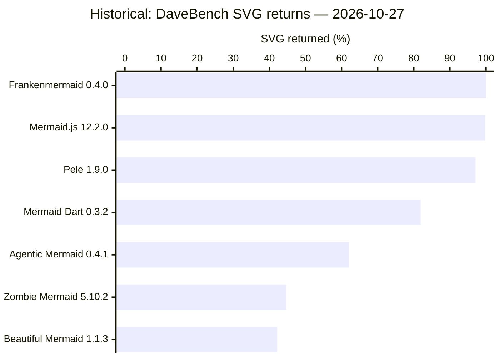
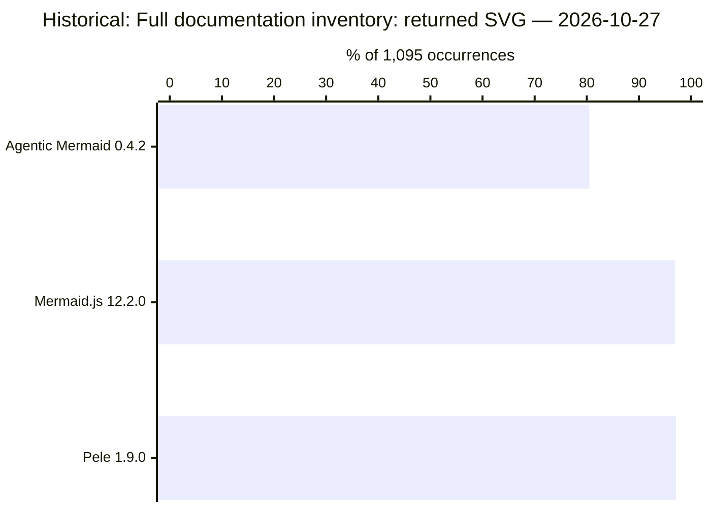
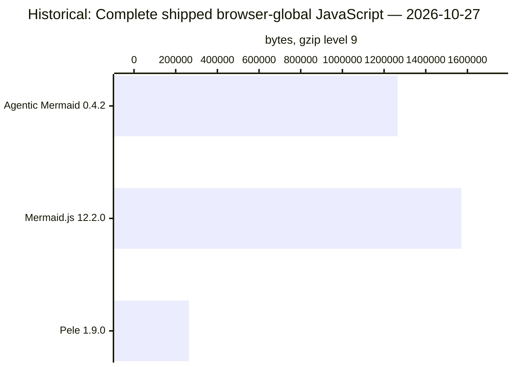
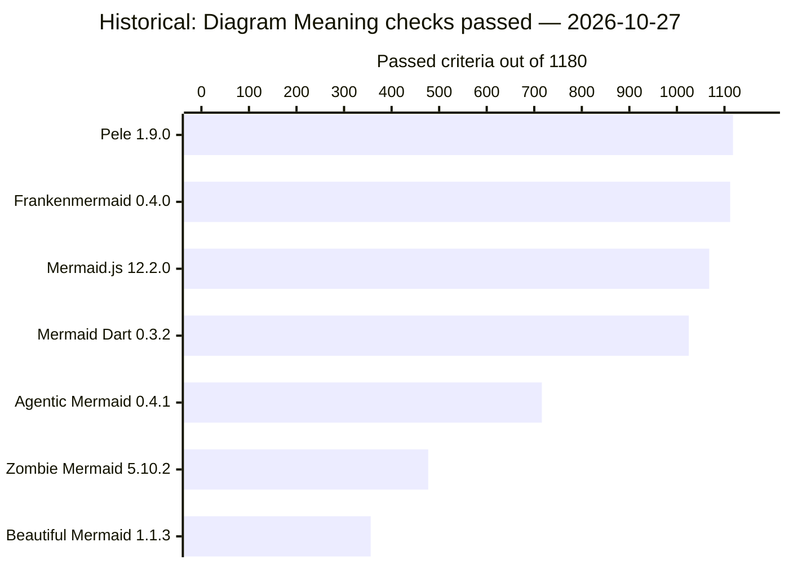

# Mermaid ecosystem benchmark results

Last recorded measurement/update: **2026-10-28**. 0 imported project/benchmark attempts; 16 retained result tables.

**Historical** marks retained measurements collected before the current reporting work. This page is a rolling view across dated runs, not one matched ecosystem experiment. No fresh benchmark was run to create this page. Dates, versions, interfaces and qualification belong to each table.

[Machine-readable results](results/latest.json) · [Benchmark methods](BENCHMARKS.md) · [Reading the tables](REPORTING.md) · [Update this page](results/README.md)

## Ecosystem overview

42 eligible projects are listed below. 46 catalog descendants/bindings are listed separately. Results are never inherited through lineage.

Each cell links its latest recorded attempt, or a dated retained table. New failed, blocked and partial attempts take precedence over earlier tables. Different suites have different units; there is no combined score. “Unmeasured” is missing evidence; “N/A” follows the declared output or reference scope, not a measured failure.

Overview order: DaveBench: Documentation Examples, highest SVG returned / Planned occurrences first (2026-10-27). Ties share a rank. Projects with no result for this measure, or a newer superseding attempt, remain unranked below. Each benchmark has its own ranking.

| Project | Overview rank | Compatibility | DaveBench | Meaning | Models / editing | Assertion replay | Reference tests | Render cost |
|---|---|---|---|---|---|---|---|---|
| Frankenmermaid | 1 | Unmeasured | [548/548 SVG returned · historical · 2026-10-27](#docs-coverage) | [1112/1180 criteria · historical · 2026-10-27](#svg-meaning) | Unmeasured: binding gap | Unmeasured: binding gap | N/A | Unmeasured: binding gap |
| Mermaid.js | 2 | [33/33 SVG inputs · historical · 2026-10-28](#community-browser-public-api) | [547/548 SVG returned · historical · 2026-10-27](#docs-coverage) | [1068/1180 criteria · historical · 2026-10-27](#svg-meaning) | [555/561 shared checks · historical · 2026-10-27](#shared-model) | [477/3995 declarations · historical · 2026-10-27](#replay-declarations) | [6677/6695 callbacks · historical · 2026-10-28](#original-runner) | Unmeasured: binding gap |
| Pele | 3 | [32/33 SVG inputs · historical · 2026-10-28](#community-browser-public-api) | [532/548 SVG returned · historical · 2026-10-27](#docs-coverage) | [1118/1180 criteria · historical · 2026-10-27](#svg-meaning) | [555/561 shared checks · historical · 2026-10-27](#shared-model) | [381/3995 declarations · historical · 2026-10-27](#replay-declarations) | N/A | [Uncalibrated · historical · 2026-10-27](#portable-times) |
| Mermaid Dart | 4 | Unmeasured | [449/548 SVG returned · historical · 2026-10-27](#docs-coverage) | [1025/1180 criteria · historical · 2026-10-27](#svg-meaning) | Unmeasured: binding gap | Unmeasured: binding gap | N/A | Unmeasured: binding gap |
| Agentic Mermaid | 5 | [14/33 SVG inputs · historical · 2026-10-28](#community-browser-public-api) | [340/548 SVG returned · historical · 2026-10-27](#docs-coverage) | [716/1180 criteria · historical · 2026-10-27](#svg-meaning) | [374/561 shared checks · historical · 2026-10-27](#shared-model) | [160/3995 declarations · historical · 2026-10-27](#replay-declarations) | N/A | [Failed · historical · 2026-10-27](#portable-times) |
| Zombie Mermaid | 6 | Unmeasured | [245/548 SVG returned · historical · 2026-10-27](#docs-coverage) | [477/1180 criteria · historical · 2026-10-27](#svg-meaning) | Unmeasured: binding gap | Unmeasured: binding gap | N/A | [Failed · historical · 2026-10-27](#portable-times) |
| Beautiful Mermaid | 7 | Unmeasured | [231/548 SVG returned · historical · 2026-10-27](#docs-coverage) | [356/1180 criteria · historical · 2026-10-27](#svg-meaning) | Unmeasured: binding gap | Unmeasured: binding gap | N/A | [Failed · historical · 2026-10-27](#portable-times) |
| 1jehuang/mermaid-rs-renderer | — | Unmeasured | Unmeasured | Unmeasured | Unmeasured: binding gap | Unmeasured: binding gap | N/A | Unmeasured: binding gap |
| aj-archipelago/merval | — | Unmeasured | N/A | N/A | Unmeasured: binding gap | Unmeasured: binding gap | N/A | N/A |
| AlexanderGrooff/mermaid-ascii | — | Unmeasured | N/A | N/A | Unmeasured: binding gap | Unmeasured: binding gap | N/A | N/A |
| anomalyco/opencode | — | Unmeasured | N/A | N/A | Unmeasured: binding gap | Unmeasured: binding gap | N/A | N/A |
| ASCII Mermaid | — | Unmeasured | N/A | N/A | Unmeasured: binding gap | Unmeasured: binding gap | N/A | N/A |
| Bezel | — | Unmeasured | Unmeasured | Unmeasured | Unmeasured: binding gap | Unmeasured: binding gap | N/A | Unmeasured: binding gap |
| chenyanchen/mermaid-formatter | — | Unmeasured | N/A | N/A | Unmeasured: binding gap | Unmeasured: binding gap | N/A | N/A |
| crafter-station/mermaid | — | Unmeasured | Unmeasured | Unmeasured | Unmeasured: binding gap | Unmeasured: binding gap | N/A | Unmeasured |
| emtyty/merslim | — | Unmeasured | Unmeasured | Unmeasured | Unmeasured: binding gap | Unmeasured: binding gap | N/A | Unmeasured |
| evangwt/xmermaid | — | Unmeasured | Unmeasured | Unmeasured | Unmeasured: binding gap | Unmeasured: binding gap | N/A | Unmeasured: binding gap |
| excalidraw/mermaid-to-excalidraw | — | Unmeasured: binding gap | N/A | N/A | Unmeasured: binding gap | Unmeasured: binding gap | N/A | N/A |
| fasouto/termaid | — | Unmeasured | N/A | N/A | Unmeasured: binding gap | Unmeasured: binding gap | N/A | N/A |
| gotoailab/modern_mermaid | — | Unmeasured: binding gap | Unmeasured: binding gap | Unmeasured: binding gap | Unmeasured: binding gap | Unmeasured: binding gap | N/A | Unmeasured: binding gap |
| inkeep/visimer | — | Unmeasured | N/A | N/A | Unmeasured: binding gap | Unmeasured: binding gap | N/A | N/A |
| justsml/rusty-mermaid | — | Unmeasured | N/A | N/A | Unmeasured: binding gap | Unmeasured: binding gap | N/A | N/A |
| kingsword09/mermansi | — | Unmeasured | N/A | N/A | Unmeasured: binding gap | Unmeasured: binding gap | N/A | N/A |
| kitlangton/merman | — | Unmeasured | N/A | N/A | Unmeasured: binding gap | Unmeasured: binding gap | N/A | N/A |
| KlangHaus/vitepress-plugin-diagram | — | Unmeasured | Unmeasured | Unmeasured | Unmeasured: binding gap | Unmeasured: binding gap | N/A | Unmeasured |
| Latias94/merman | — | Unmeasured | Unmeasured | Unmeasured | Unmeasured: binding gap | Unmeasured: binding gap | N/A | Unmeasured |
| Lovely Mermaid | — | Unmeasured | N/A | N/A | Unmeasured: binding gap | Unmeasured: binding gap | N/A | N/A |
| mdv | — | Unmeasured | Unmeasured | Unmeasured | Unmeasured: binding gap | Unmeasured: binding gap | N/A | Unmeasured |
| mermaid-js/mermaid-live-editor | — | Unmeasured: binding gap | Unmeasured: binding gap | Unmeasured: binding gap | Unmeasured: binding gap | Unmeasured: binding gap | N/A | Unmeasured: binding gap |
| MermaidText | — | Unmeasured | N/A | N/A | Unmeasured: binding gap | Unmeasured: binding gap | N/A | N/A |
| Mootikins/figurehead-rs | — | Unmeasured | N/A | N/A | Unmeasured: binding gap | Unmeasured: binding gap | N/A | N/A |
| neongreen/mermaid-ast | — | Unmeasured | N/A | N/A | Unmeasured: binding gap | Unmeasured: binding gap | N/A | N/A |
| Ondine | — | Unmeasured | Unmeasured | Unmeasured | Unmeasured: binding gap | Unmeasured: binding gap | N/A | Unmeasured |
| OpenCode Merman | — | Unmeasured | N/A | N/A | Unmeasured: binding gap | Unmeasured: binding gap | N/A | N/A |
| probelabs/maid | — | Unmeasured | N/A | N/A | Unmeasured: binding gap | Unmeasured: binding gap | N/A | N/A |
| sandyyst/dsh-plugin-mermaid-gb-svg | — | Unmeasured | Unmeasured | Unmeasured | Unmeasured: binding gap | Unmeasured: binding gap | N/A | Unmeasured |
| taoche/mermaid-reactflow-render | — | Unmeasured | N/A | N/A | Unmeasured: binding gap | Unmeasured: binding gap | N/A | N/A |
| tariqshams/mermaidtui | — | Unmeasured | N/A | N/A | Unmeasured: binding gap | Unmeasured: binding gap | N/A | N/A |
| tomoyukim/vscode-mermaid-editor | — | Unmeasured: binding gap | Unmeasured: binding gap | Unmeasured: binding gap | Unmeasured: binding gap | Unmeasured: binding gap | N/A | Unmeasured: binding gap |
| TUI Mermaid | — | Unmeasured | N/A | N/A | Unmeasured: binding gap | Unmeasured: binding gap | N/A | N/A |
| xai-org/grok-build | — | Unmeasured | N/A | N/A | Unmeasured: binding gap | Unmeasured: binding gap | N/A | N/A |
| Yassimba/loom | — | Unmeasured | N/A | N/A | Unmeasured: binding gap | Unmeasured: binding gap | N/A | N/A |

## Results by benchmark

Tables retain the full recorded populations. Charts show one named measure from the adjacent table; blocked, unavailable and failed checks remain visible in that table. Raw evidence from the retained historical runs is not hosted in this repository; the linked receipts record its original paths and hashes.

### Mermaid Compatibility

**community-node:public-api** · 2026-10-28 · Historical · unit: inputs · [evidence](docs/evidence/benchmark-examples.json)

Selected smoke campaign; public Node SVG API; one round; 33 feature inputs. Six core inputs are separate. Output admission does not establish diagram meaning.

Ranked by **Passed inputs / Planned inputs**, highest first. Equal values share a rank; unavailable values are unranked. Timing ranks describe the displayed samples and retain their qualification limits.

| Project | Rank | Version | Passed inputs | Failed | Unsupported | Blocked | Planned inputs |
| --- | --- | --- | --- | --- | --- | --- | --- |
| Pele | 1 | 1.9.0 | 32 | 0 | 1 | 0 | 33 |
| Agentic Mermaid | 2 | 0.4.1 | 14 | 1 | 18 | 0 | 33 |

**community-browser:public-api** · 2026-10-28 · Historical · unit: inputs · [evidence](docs/evidence/benchmark-examples.json)

Selected smoke campaign; browser SVG API; one round; 33 feature inputs. Six core inputs are separate. Mermaid.js is the language reference.

Ranked by **Passed inputs / Planned inputs**, highest first. Equal values share a rank; unavailable values are unranked. Timing ranks describe the displayed samples and retain their qualification limits.

| Project | Rank | Version | Passed inputs | Failed | Unsupported | Blocked | Planned inputs |
| --- | --- | --- | --- | --- | --- | --- | --- |
| Mermaid.js | 1 | 12.2.0 | 33 | 0 | 0 | 0 | 33 |
| Pele | 2 | 1.9.0 | 32 | 0 | 1 | 0 | 33 |
| Agentic Mermaid | 3 | 0.4.1 | 14 | 1 | 18 | 0 | 33 |

### DaveBench: Documentation Examples

**docs-coverage** · 2026-10-27 · Historical · unit: documentation occurrences · [evidence](docs/evidence/benchmark-examples.json)

Browser SVG; 548 documentation occurrences, 546 distinct sources, 34 pages; five rounds with identical per-round coverage. A returned SVG does not establish correct paint. Mermaid.js is the reference.

Ranked by **SVG returned / Planned occurrences**, highest first. Equal values share a rank; unavailable values are unranked. Timing ranks describe the displayed samples and retain their qualification limits.

| Project | Rank | Version | SVG returned | Failed | Planned occurrences | SVG returned (%) |
| --- | --- | --- | --- | --- | --- | --- |
| Frankenmermaid | 1 | 0.4.0 | 548 | 0 | 548 | 100.0% |
| Mermaid.js | 2 | 12.2.0 | 547 | 1 | 548 | 99.8% |
| Pele | 3 | 1.9.0 | 532 | 16 | 548 | 97.1% |
| Mermaid Dart | 4 | 0.3.2 | 449 | 99 | 548 | 81.9% |
| Agentic Mermaid | 5 | 0.4.1 | 340 | 208 | 548 | 62.0% |
| Zombie Mermaid | 6 | 5.10.2 | 245 | 303 | 548 | 44.7% |
| Beautiful Mermaid | 7 | 1.1.3 | 231 | 317 | 548 | 42.2% |

**docs-one-input-time** · 2026-10-27 · Historical · unit: milliseconds · [evidence](docs/evidence/benchmark-examples.json)

Browser SVG; one shared input: packages/mermaid/src/docs/syntax/flowchart.md:23. Median of five calls after warmup. Not calibrated; failed output withholds timing. This is not a whole-docs speed comparison.

Ranked by **Median call time (ms)**, lowest first. Equal values share a rank; unavailable values are unranked. Timing ranks describe the displayed samples and retain their qualification limits.

| Project | Rank | Version | Median call time (ms) | Successful calls | Comparison qualification |
| --- | --- | --- | --- | --- | --- |
| Frankenmermaid | 1 | 0.4.0 | 0.4 | 5/5 | Not calibrated |
| Pele | 2 | 1.9.0 | 0.6 | 5/5 | Not calibrated |
| Mermaid Dart | 3 | 0.3.2 | 3 | 5/5 | Not calibrated |
| Agentic Mermaid | 4 | 0.4.1 | 20.2 | 5/5 | Not calibrated |
| Mermaid.js | 5 | 12.2.0 | 78.3 | 5/5 | Not calibrated |
| Beautiful Mermaid | — | 1.1.3 | Withheld | 0/5 | SVG return failed |
| Zombie Mermaid | — | 5.10.2 | Withheld | 0/5 | SVG return failed |

**cfd-dave-1095** · 2026-10-27 · Historical · unit: documentation occurrences · [evidence](docs/evidence/campaign-2026-10-28/dave.json)

Six rounds, 1,095 occurrences. Full inventory; acceptance does not establish meaning. CFD Agentic 0.4.2, Pele 1.9.0, Mermaid 12.2.0. 27 October 2026.

| Project | Version | Returned SVG | No SVG return | Planned | % of 1,095 occurrences |
| --- | --- | --- | --- | --- | --- |
| Agentic Mermaid | 0.4.2 | 881 | 214 | 1095 | 80.5% |
| Mermaid.js | 12.2.0 | 1061 | 34 | 1095 | 96.9% |
| Pele | 1.9.0 | 1063 | 32 | 1095 | 97.1% |

**cfd-dave-global-gzip** · 2026-10-27 · Historical · unit: gzip bytes · [evidence](docs/evidence/campaign-2026-10-28/dave.json)

Complete shipped browser globals, level-9 gzip. Excludes focused/lazy entries, fonts and wire overhead; not startup memory.

| Project | Version | Gzip bytes |
| --- | --- | --- |
| Agentic Mermaid | 0.4.2 | 1264968 |
| Mermaid.js | 12.2.0 | 1570966 |
| Pele | 1.9.0 | 263250 |

**cfd-dave-common-cost** · 2026-10-27 · Historical · unit: call cost / Mermaid · [evidence](docs/evidence/campaign-2026-10-28/dave.json)

847 identical successful occurrences across all tools and all six rounds; public SVG return clock excludes validation and paint. Descriptive; no A/A qualification. Full 1,095-occurrence outcomes appear separately.

| Project | Version | Call cost / Mermaid |
| --- | --- | --- |
| Agentic Mermaid | 0.4.2 | 0.1386222404620205 |
| Mermaid.js | 12.2.0 | 1 |
| Pele | 1.9.0 | 0.007979263124530539 |

### Diagram Meaning

**svg-meaning** · 2026-10-27 · Historical · unit: SVG criteria · [evidence](docs/evidence/benchmark-examples.json)

Browser SVG; the same 1,180 SVG criterion identities per project. Native-model checks are excluded. The older observer needs fresh qualification; these counts are not current bug findings or an overall visual-quality score.

Ranked by **Passed criteria / Planned criteria**, highest first. Equal values share a rank; unavailable values are unranked. Timing ranks describe the displayed samples and retain their qualification limits.

| Project | Rank | Version | Passed criteria | Failed | Unsupported | Blocked | Planned criteria |
| --- | --- | --- | --- | --- | --- | --- | --- |
| Pele | 1 | 1.9.0 | 1118 | 5 | 14 | 43 | 1180 |
| Frankenmermaid | 2 | 0.4.0 | 1112 | 6 | 0 | 62 | 1180 |
| Mermaid.js | 3 | 12.2.0 | 1068 | 16 | 0 | 96 | 1180 |
| Mermaid Dart | 4 | 0.3.2 | 1025 | 45 | 0 | 110 | 1180 |
| Agentic Mermaid | 5 | 0.4.1 | 716 | 13 | 0 | 451 | 1180 |
| Zombie Mermaid | 6 | 5.10.2 | 477 | 13 | 0 | 690 | 1180 |
| Beautiful Mermaid | 7 | 1.1.3 | 356 | 18 | 0 | 806 | 1180 |

**cfd-painted-920** · 2026-10-27 · Historical · unit: Mermaid-qualified paint criteria · [evidence](docs/evidence/campaign-2026-10-28/fidelity.json)

100 cases across 25 families; fixed 920 reference-passed paint criteria. Another 150 authored criteria are reference-unqualified across all surfaces. Alias rows do not create independent wins. Historical CFD candidate, not current main.

| Project | Version | Passed | Failed | Unavailable | Planned |
| --- | --- | --- | --- | --- | --- |
| 01colyncelestine-stack/beautiful-mermaid | 0.1.3 | 116 | 11 | 793 | 920 |
| 2233admin/beautiful-mermaid | 1.1.3 | 165 | 12 | 743 | 920 |
| Agentic Mermaid | 0.4.2 | 902 | 1 | 17 | 920 |
| Beautiful Mermaid | 1.1.3 | 165 | 12 | 743 | 920 |
| Bezel | 0.2.20 | 806 | 43 | 71 | 920 |
| blackst0ne/mermaid | 7.1.0-fixed | 460 | 274 | 186 | 920 |
| crafter-station/mermaid | 0.0.3 | 169 | 25 | 726 | 920 |
| D3FEND Mermaid | 11.11.637 | 776 | 2 | 142 | 920 |
| emtyty/merslim | 0.2.3 | 243 | 29 | 648 | 920 |
| evangwt/xmermaid | 0.4.2 | 699 | 57 | 164 | 920 |
| fdotu/beautiful-mermaid | 0.1.3 | 116 | 11 | 793 | 920 |
| Frankenmermaid | 0.4.0 | 891 | 14 | 15 | 920 |
| gmh5225/beautiful-mermaid | 0.1.3 | 116 | 11 | 793 | 920 |
| HealthSamurai/beautiful-mermaid | 1.1.3 | 165 | 12 | 743 | 920 |
| jacob-lcs/mermaid | 11.9.0 | 776 | 2 | 142 | 920 |
| jgraph/mermaid | 11.14.0 | 213 | 1 | 706 | 920 |
| KlangHaus/vitepress-plugin-diagram | 0.3.2 | 71 | 16 | 833 | 920 |
| ktrysmt/beautiful-mermaid | 1.5.2 | 167 | 10 | 743 | 920 |
| Latias94/merman | 0.9.2 | 889 | 29 | 2 | 920 |
| lishid/mermaid | 8.10.2 | 223 | 10 | 687 | 920 |
| lyngai/mermaid | 8.4.8 | 63 | 9 | 848 | 920 |
| mbostock/mermaid | 9.0.0 | 220 | 0 | 700 | 920 |
| mdv | 0.1.2 | 165 | 12 | 743 | 920 |
| Mermaid Dart | 0.3.2 | 780 | 39 | 101 | 920 |
| Mermaid-Chart/mermaid-develop | 10.6.1 | 487 | 52 | 381 | 920 |
| Mermaid.js | 12.2.0 | 920 | 0 | 0 | 920 |
| Merman | 1.0.0 | 62 | 9 | 849 | 920 |
| NicolasNewman/mermaid | 11.4.1 | 654 | 1 | 265 | 920 |
| Ondine | 0.0.3 | 806 | 43 | 71 | 920 |
| Pele | 1.9.0 | 852 | 1 | 67 | 920 |
| rohitg00/beautiful-mermaid | 0.1.3 | 116 | 11 | 793 | 920 |
| sandyyst/dsh-plugin-mermaid-gb-svg | 0.1.4 | 633 | 195 | 92 | 920 |
| songshaodong/mermaid | 0.5.8 | 39 | 0 | 881 | 920 |
| Stars1233/beautiful-mermaid | 1.1.3 | 165 | 12 | 743 | 920 |
| theletterf/beautiful-mermaid | 0.1.5 | 116 | 11 | 793 | 920 |
| thepanax/beautiful-mermaid | 1.1.3 | 165 | 12 | 743 | 920 |
| toeverything/mermaid-rs-renderer | 0.1.2 | 777 | 34 | 109 | 920 |
| vercel-labs/beautiful-mermaid | 0.1.5 | 116 | 11 | 793 | 920 |
| xen3r0/mermaid | 8.0.0-rc.9 | 49 | 6 | 865 | 920 |
| xeolabs/mermaid | 10.0.2 | 471 | 1 | 448 | 920 |
| ysknsid25/beautiful-mermaid | 1.0.2 | 150 | 11 | 759 | 920 |
| zakaria-forks/mermaid | 11.0.0-alpha.7 | 487 | 52 | 381 | 920 |
| Zombie Mermaid | 5.9.1 | 217 | 7 | 696 | 920 |

### Model and Editing Contracts

**shared-model** · 2026-10-27 · Historical · unit: shared model criteria · [evidence](docs/evidence/benchmark-examples.json)

Reviewed public models; the same 561 criterion identities for each bound project. Shared identity digest: c959c18ab2dd3a76b2f4a0f4be5744ff60a3a44d7e0e80722785694df0cf01e6. A missing Trident projection does not prove a missing project API.

Ranked by **Passed criteria / Planned shared criteria**, highest first. Equal values share a rank; unavailable values are unranked. Timing ranks describe the displayed samples and retain their qualification limits.

| Project | Rank | Version | Passed criteria | Failed | Unsupported | Blocked | Planned shared criteria |
| --- | --- | --- | --- | --- | --- | --- | --- |
| Mermaid.js | 1 | 12.2.0 | 555 | 0 | 6 | 0 | 561 |
| Pele | 1 | 1.9.0 | 555 | 0 | 6 | 0 | 561 |
| Agentic Mermaid | 3 | 0.4.1 | 374 | 7 | 179 | 1 | 561 |

**additional-model** · 2026-10-27 · Historical · unit: additional API criteria · [evidence](docs/evidence/benchmark-examples.json)

Additional serializer/readback checks on the public API that exposes them. Separate from the shared-model comparison; these checks confer no comparison bonus.

Ranked by **Passed criteria / API-specific criteria**, highest first. Equal values share a rank; unavailable values are unranked. Timing ranks describe the displayed samples and retain their qualification limits.

| Project | Rank | Version | Passed criteria | Failed | Unsupported | Blocked | API-specific criteria |
| --- | --- | --- | --- | --- | --- | --- | --- |
| Agentic Mermaid | 1 | 0.4.1 | 117 | 0 | 0 | 1 | 118 |

### Mermaid Assertion Replay

**replay-declarations** · 2026-10-27 · Historical · unit: source declarations · [evidence](docs/evidence/benchmark-examples.json)

Pinned Mermaid source; 3,995 inventoried declarations across 368 files; 85 files selected for public-parser projection. Declaration dispositions are separate from expanded callbacks and raw matcher counts.

Ranked by **Passed / Planned declarations**, highest first. Equal values share a rank; unavailable values are unranked. Timing ranks describe the displayed samples and retain their qualification limits.

| Project | Rank | Version | Passed | Failed | Unavailable | Outside projection | Skipped | Unregistered | Planned declarations |
| --- | --- | --- | --- | --- | --- | --- | --- | --- | --- |
| Mermaid.js | 1 | 12.2.0 | 477 | 0 | 1047 | 2453 | 15 | 3 | 3995 |
| Pele | 2 | 1.9.0 | 381 | 16 | 1127 | 2453 | 15 | 3 | 3995 |
| Agentic Mermaid | 3 | 0.4.1 | 160 | 151 | 1213 | 2453 | 15 | 3 | 3995 |

**replay-callbacks** · 2026-10-27 · Historical · unit: expanded callbacks · [evidence](docs/evidence/benchmark-examples.json)

Expanded callbacks from the same replay inventory. Parameterization expands declarations into callbacks. Raw matcher counters include unavailable callbacks and are not a headline pass rate.

Ranked by **Passed callbacks / Recorded callbacks**, highest first. Equal values share a rank; unavailable values are unranked. Timing ranks describe the displayed samples and retain their qualification limits.

| Project | Rank | Version | Passed callbacks | Failed | Unavailable | Skipped | Recorded callbacks |
| --- | --- | --- | --- | --- | --- | --- | --- |
| Mermaid.js | 1 | 12.2.0 | 1555 | 0 | 1133 | 12 | 2700 |
| Pele | 2 | 1.9.0 | 1452 | 16 | 1220 | 12 | 2700 |
| Agentic Mermaid | 3 | 0.4.1 | 694 | 586 | 1408 | 12 | 2700 |

### Mermaid Reference Tests

**original-runner** · 2026-10-28 · Historical · unit: original callbacks · [evidence](docs/evidence/benchmark-examples.json)

Mermaid reference only; 331 files through the genuine original core Vitest runner in a sealed npm environment. Docs-site and browser/e2e tests are outside this table.

Ranked by **Passed callbacks / Total callbacks**, highest first. Equal values share a rank; unavailable values are unranked. Timing ranks describe the displayed samples and retain their qualification limits.

| Project | Rank | Version | Files | Passed callbacks | Failed | Pending | Todo | Total callbacks |
| --- | --- | --- | --- | --- | --- | --- | --- | --- |
| Mermaid.js | 1 | 12.2.0 | 331 | 6677 | 0 | 16 | 2 | 6695 |

### Render Cost and Scaling

**portable-times** · 2026-10-27 · Historical · unit: milliseconds · [evidence](docs/evidence/benchmark-examples.json)

Public Node SVG; authored family:flowchart; protocol portable-svg-processes-v3; five rounds. First calls exclude import (100 samples); repeat and new-source medians use 155 batch means each. Failed or uncalibrated campaigns: no qualified speed comparison or ratios.

Ranked by **Repeat median (ms)**, lowest first. Equal values share a rank; unavailable values are unranked. Timing ranks describe the displayed samples and retain their qualification limits.

| Project | Rank | Version | First call median (ms) | Repeat median (ms) | New-source median (ms) | Declared flowchart checks | Campaign qualification |
| --- | --- | --- | --- | --- | --- | --- | --- |
| Pele | 1 | 1.9.0 | 17.1 | 0.35 | 0.11 | Complete | Uncalibrated |
| Beautiful Mermaid | 2 | 1.1.3 | 206 | 7.46 | 4.78 | Incomplete | Failed |
| Zombie Mermaid | 3 | 5.10.2 | 326 | 8.96 | 5.72 | Incomplete | Failed |
| Agentic Mermaid | 4 | 0.4.1 | 330 | 30.5 | 20.3 | Incomplete | Failed |

**portable-resources** · 2026-10-27 · Historical · unit: MiB; CPU unavailable · [evidence](docs/evidence/benchmark-examples.json)

Same historical Pele flowchart; round 1; API-return checkpoint. Process RSS and JS heap have different scopes. CPU was unavailable; it is not zero.

Ranked by **Process RSS (MiB)**, lowest first. Equal values share a rank; unavailable values are unranked. Timing ranks describe the displayed samples and retain their qualification limits.

| Project | Rank | Version | Checkpoint | Process RSS (MiB) | JS heap used (MiB) | CPU (ms) |
| --- | --- | --- | --- | --- | --- | --- |
| Pele | 1 | 1.9.0 | At API return | 67.61 | 11.48 | Unavailable |

## Campaign attempts

Latest attempts remain visible even when collection or qualification fails. Counts below are recorded observations, not inferred whole-diagram passes. Original inventories, protocols, timing qualification and failures remain in the owning evidence.

No campaign has been imported into this snapshot yet. The tables above are explicitly dated historical evidence.

## Excluded catalog entries

These entries are omitted from normal ecosystem comparisons under the [lineage policy](LINEAGE.md). No parent score is substituted.

| Project | Reason |
| --- | --- |
| 01colyncelestine-stack/beautiful-mermaid | no-distinct-branding, zero-ahead-version |
| 2233admin/beautiful-mermaid | no-distinct-branding, zero-ahead-version |
| akashacms/mermaid-wasm-renderer | no-distinct-branding, shared-engine-runtime-binding |
| app-creative/mermaid-ascii | no-distinct-branding, zero-ahead-version |
| Aurelian-Shuttleworth/mermaid-ascii | no-distinct-branding, zero-ahead-version |
| blackst0ne/mermaid | no-distinct-branding |
| CaptainCrouton89/mermaid-ascii | no-distinct-branding |
| catdevman/mermaid-ascii | no-distinct-branding, zero-ahead-version |
| Chronostasys/mermaid-ascii | no-distinct-branding |
| ColtWindy/mermaid-ascii | no-distinct-branding, zero-ahead-version |
| D3FEND Mermaid | zero-ahead-version |
| drunkhacker/mermaid-ascii | no-distinct-branding |
| dydoc/mermaid-ascii | no-distinct-branding, zero-ahead-version |
| fdotu/beautiful-mermaid | no-distinct-branding, zero-ahead-version |
| gmh5225/beautiful-mermaid | no-distinct-branding, zero-ahead-version |
| HealthSamurai/beautiful-mermaid | no-distinct-branding, zero-ahead-version |
| jacob-lcs/mermaid | no-distinct-branding |
| jeis4wpi/mermaid-ascii | no-distinct-branding, zero-ahead-version |
| jgraph/mermaid | no-distinct-branding |
| ktrysmt/beautiful-mermaid | no-distinct-branding |
| ktrysmt/mermaid-ascii | no-distinct-branding |
| leonj1/mermaid-ascii | no-distinct-branding, zero-ahead-version |
| lishid/mermaid | no-distinct-branding, zero-ahead-version |
| lyngai/mermaid | no-distinct-branding, zero-ahead-version |
| mbostock/mermaid | no-distinct-branding, zero-ahead-version |
| Mermaid-Chart/mermaid-develop | no-distinct-branding, zero-ahead-version |
| Merman | zero-ahead-version |
| mopi1402/termaid | no-distinct-branding, zero-ahead-version |
| mopi1402/termaid-ts | no-distinct-branding |
| NicolasNewman/mermaid | no-distinct-branding |
| Orbiter/beautiful-mermaid-py | no-distinct-branding |
| pgavlin/mermaid-ascii | no-distinct-branding |
| Pi Mermaid TUI | shared-engine-runtime-binding |
| rohitg00/beautiful-mermaid | no-distinct-branding |
| sgryjp/mermaid-ascii | no-distinct-branding, zero-ahead-version |
| songshaodong/mermaid | no-distinct-branding, zero-ahead-version |
| Stars1233/beautiful-mermaid | no-distinct-branding, zero-ahead-version |
| theletterf/beautiful-mermaid | no-distinct-branding |
| thepanax/beautiful-mermaid | no-distinct-branding, zero-ahead-version |
| toeverything/mermaid-rs-renderer | no-distinct-branding |
| vercel-labs/beautiful-mermaid | no-distinct-branding |
| woxQAQ/mermaid-rs-render-js | no-distinct-branding, shared-engine-runtime-binding |
| xen3r0/mermaid | no-distinct-branding |
| xeolabs/mermaid | no-distinct-branding, zero-ahead-version |
| ysknsid25/beautiful-mermaid | no-distinct-branding |
| zakaria-forks/mermaid | no-distinct-branding, zero-ahead-version |

GitHub renders the Mermaid blocks. Tables carry the exact values and remain readable without charts. Chart syntax can be checked against GitHub’s installed Mermaid version using a `mermaid` block containing `info`.
