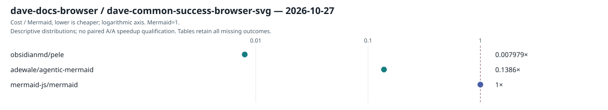
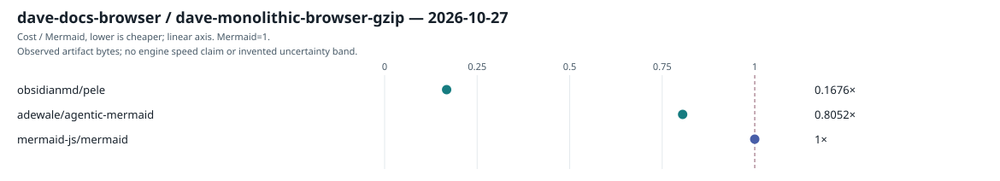
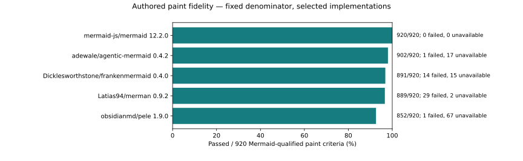
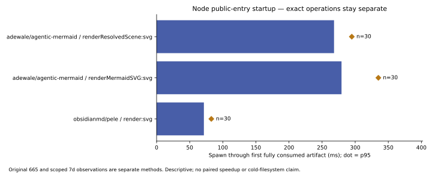
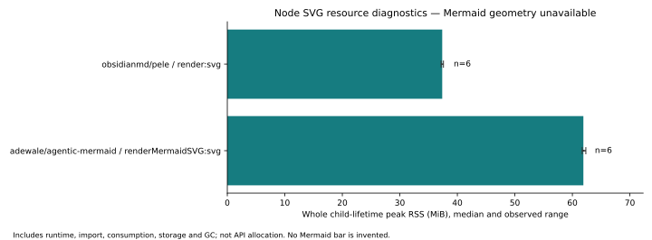
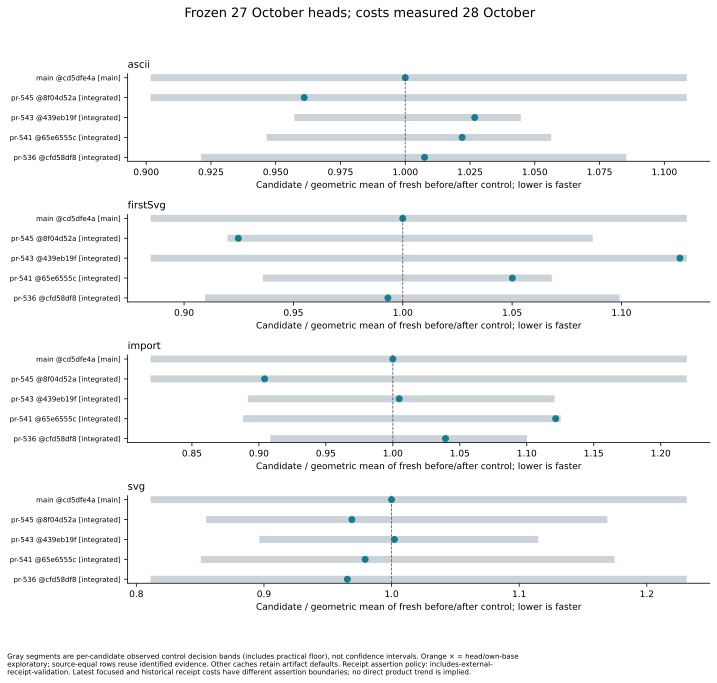

# Campaign results — 28 October 2026

The failed-suite triage, isolated font-case reruns and dated PR ordering are available here. This is a report of several named experiments, not a new complete ecosystem run. Original collection dates and producer commits remain attached to each view. Trident was rebased onto `8d5e76d70d1a6ae5e7b0f56d7378c58ff6ddf72d`; the selected-case measurement kit was built from `4036abeed0f0772dd63f62c15ba242252cdd7d98`.

The reference is Mermaid **12.2.0**; Pele is **1.9.0** throughout this campaign set. Agentic **0.4.2** has explicit frozen-main and CFD candidate artifact roles. The CFD source is `cfd58df8ab8c21ce76eb46556296a7439f231bbf`; it is not the current main `700da836a418277225e2f058a77c48dc010b050b`. Earlier rolling tables in RESULTS.md retain their own dates and versions.

[Maintained ecosystem tables](../RESULTS.md) · [Benchmark methods](../BENCHMARKS.md) · [Dated PR ordering](pr-performance-2026-10-28.md) · [Evidence manifest](evidence/campaign-2026-10-28/manifest.json)

## What changed in the benchmark

`--cases` admits an exact portable subset before artifact preparation. Explicit subsets use a separate record lane, so requalifying one case cannot replace the active full portfolio. Existing font-intent translation on main is reused; the old proposal is superseded by merged Trident #21 and subsequent main changes. No benchmark was added to CI.

Only the changed observer case ran again: one case rather than the original 54, across Pele and two frozen Agentic artifacts. That is 1,173 completed workers. The first eight-slot Pele attempt hit host EAGAIN and remains a failed attempt. The successful retry kept six rounds, 31 warm sample means and 20 fresh processes per round/replica, using one preparation slot and reduced Node thread pools. This is a separate preparation cohort; its clocks are not spliced into the old full runs.

| Artifact role | Version | Workers | Failed | Blocked | Admitted output cases | Complete semantic cases | Calibrated output timing rows / 4 |
| --- | --- | --- | --- | --- | --- | --- | --- |
| pele | 1.9.0 | 391 | 0 | 0 | 1 | 1 | 1 |
| main | 0.4.2 | 391 | 0 | 0 | 1 | 0 | 2 |
| candidate | 0.4.2 | 391 | 0 | 0 | 1 | 0 | 1 |

The former invalid mapping caused 384 failed workers in each old Agentic role. The corrected case now has zero failed or blocked workers. This is evidence of an observer repair, not a renderer improvement. Most new warm timing rows are uncalibrated. Agentic still lacks the portable observer's complete native projection; no full-fidelity or portfolio speed score is inferred.

[Selected-case checks, timing dispositions and report hashes](evidence/campaign-2026-10-28/configuration-reset.json)

## Documentation rendering versus Mermaid

Dave measures public SVG returns over all 1,095 documentation occurrences. Six rounds were collected on 27 October, 18:10–18:14 UTC. The call-time comparison uses exactly 847 inputs successful for all three tools in all rounds. It excludes inspection, cleanup and paint and has no A/A qualification.

| Tool | Version | SVG returned / 1,095 | Call cost / Mermaid on 847 shared successes | Shipped browser-global gzip bytes |
| --- | --- | --- | --- | --- |
| adewale/agentic-mermaid | 0.4.2 | 881 | 0.138622 | 1264968 |
| mermaid-js/mermaid | 12.2.0 | 1061 | 1.000000 | 1570966 |
| obsidianmd/pele | 1.9.0 | 1063 | 0.007979 | 263250 |

Agentic returns SVG for 180 fewer documentation occurrences than the pinned reference. Its retained dispositions are 212 unsupported occurrences across beta families and two Gantt errors. Pele has 32 unsupported ZenUML occurrences. The bare Mermaid browser binding also lacks those 32 ZenUML occurrences and has two asset failures. These remain in the denominator; returning SVG does not prove matching diagram meaning. The comparator-binding gap must not be described as a Mermaid language gap.

## Fixed authored-fidelity criteria

100 authored cases span 25 families and 43 attributed implementation rows. The reference passed 920 painted-meaning criteria, 268 public-browser criteria and 589 native-model criteria. Another 150 authored criteria are reference-unqualified and remain outside those denominators. Model projections, browser admission and painted meaning are separate measurements. Aliases and catalog descendants are not independent engine wins.

The following table retains all 43 measured implementation rows. Unavailable observations stay in the fixed denominator. Terminal-only outputs such as Mermaid ASCII have a different boundary and are not assigned an invented SVG-fidelity score. The evidence also retains dispositions for all 88 historical catalog entries.

| Project | Version | Paint passed / 920 | Paint failed | Paint unavailable | Browser passed / 268 | Native passed / 589 |
| --- | --- | --- | --- | --- | --- | --- |
| 01colyncelestine-stack/beautiful-mermaid | 0.1.3 | 116 | 11 | 793 | 38 | 0 |
| 2233admin/beautiful-mermaid | 1.1.3 | 165 | 12 | 743 | 43 | 0 |
| adewale/agentic-mermaid | 0.4.2 | 902 | 1 | 17 | 268 | 582 |
| blackst0ne/mermaid | 7.1.0-fixed | 460 | 274 | 186 | 166 | 0 |
| crabtalk/bezel | 0.2.20 | 806 | 43 | 71 | 257 | 0 |
| crafter-station/mermaid | 0.0.3 | 169 | 25 | 726 | 33 | 0 |
| dfadler/zombie-mermaid | 5.9.1 | 217 | 7 | 696 | 59 | 0 |
| Dicklesworthstone/frankenmermaid | 0.4.0 | 891 | 14 | 15 | 267 | 0 |
| emtyty/merslim | 0.2.3 | 243 | 29 | 648 | 70 | 0 |
| enrimr/mermaid | 1.0.0 | 62 | 9 | 849 | 17 | 0 |
| evangwt/xmermaid | 0.4.2 | 699 | 57 | 164 | 229 | 0 |
| fdotu/beautiful-mermaid (alias) | 0.1.3 | 116 | 11 | 793 | 38 | 0 |
| gmh5225/beautiful-mermaid (alias) | 0.1.3 | 116 | 11 | 793 | 38 | 0 |
| HealthSamurai/beautiful-mermaid (alias) | 1.1.3 | 165 | 12 | 743 | 43 | 0 |
| ioggstream/d3fend-mermaid | 11.11.637 | 776 | 2 | 142 | 237 | 0 |
| jacob-lcs/mermaid | 11.9.0 | 776 | 2 | 142 | 237 | 0 |
| jgraph/mermaid | 11.14.0 | 213 | 1 | 706 | 60 | 0 |
| KlangHaus/vitepress-plugin-diagram | 0.3.2 | 71 | 16 | 833 | 20 | 0 |
| ktrysmt/beautiful-mermaid | 1.5.2 | 167 | 10 | 743 | 44 | 0 |
| Latias94/merman | 0.9.2 | 889 | 29 | 2 | 268 | 0 |
| lishid/mermaid | 8.10.2 | 223 | 10 | 687 | 60 | 0 |
| lukilabs/beautiful-mermaid (alias) | 1.1.3 | 165 | 12 | 743 | 43 | 0 |
| lyngai/mermaid | 8.4.8 | 63 | 9 | 848 | 17 | 0 |
| mbostock/mermaid | 9.0.0 | 220 | 0 | 700 | 58 | 0 |
| Mermaid-Chart/mermaid-develop | 10.6.1 | 487 | 52 | 381 | 170 | 0 |
| mermaid-js/mermaid | 12.2.0 | 920 | 0 | 0 | 268 | 589 |
| NicolasNewman/mermaid | 11.4.1 | 654 | 1 | 265 | 208 | 0 |
| obsidianmd/pele | 1.9.0 | 852 | 1 | 67 | 257 | 589 |
| orestesgaolin/mermaid | 0.3.2 | 780 | 39 | 101 | 256 | 0 |
| rohitg00/beautiful-mermaid (alias) | 0.1.3 | 116 | 11 | 793 | 38 | 0 |
| sandyyst/dsh-plugin-mermaid-gb-svg | 0.1.4 | 633 | 195 | 92 | 188 | 0 |
| songshaodong/mermaid | 0.5.8 | 39 | 0 | 881 | 7 | 0 |
| Stars1233/beautiful-mermaid (alias) | 1.1.3 | 165 | 12 | 743 | 43 | 0 |
| theletterf/beautiful-mermaid | 0.1.5 | 116 | 11 | 793 | 38 | 0 |
| thepanax/beautiful-mermaid (alias) | 1.1.3 | 165 | 12 | 743 | 43 | 0 |
| toeverything/mermaid-rs-renderer | 0.1.2 | 777 | 34 | 109 | 261 | 0 |
| vercel-labs/beautiful-mermaid | 0.1.5 | 116 | 11 | 793 | 38 | 0 |
| wevm/ondine | 0.0.3 | 806 | 43 | 71 | 257 | 0 |
| xen3r0/mermaid | 8.0.0-rc.9 | 49 | 6 | 865 | 12 | 0 |
| xeolabs/mermaid | 10.0.2 | 471 | 1 | 448 | 159 | 0 |
| ysknsid25/beautiful-mermaid | 1.0.2 | 150 | 11 | 759 | 39 | 0 |
| zakaria-forks/mermaid | 11.0.0-alpha.7 | 487 | 52 | 381 | 170 | 0 |
| zhenhuaa/mdv | 0.1.2 | 165 | 12 | 743 | 43 | 0 |

## Entry startup, memory and CPU

The startup projection publishes 72 SVG groups from 545 retained groups. Whole groups keep their original producer and window; samples from different methods are never pooled. The five repair phases retain all observation dispositions. Resource-only phases supply zero latency samples. Resolved-library supplies 60 actual latency samples; resolved-browser supplies 30 first-result samples plus separate readiness/resource observations. Original failed resolved-scene groups remain historical and receive no refreshed timing credit.

Startup clocks run from parent spawn through the fully consumed first artifact, including enumerable sidecars. Fresh process does not mean cold filesystem. The chart uses 30 independent samples per row; the dot is nearest-rank p95. The resolved-scene row includes preparing its scene inside the public consumer workflow and is not a layout-only measurement. Mermaid Node SVG remains blocked because a genuine geometry adapter is not admitted.

The Node SVG diagnostics show about 61.9 MiB median peak RSS for Agentic and 37.4 MiB for Pele, six fresh diagnostics each. These include runtime, import, consumption, storage and GC. They do not measure API allocation, browser/GPU memory or the sum of JS heap and external memory. CPU counters have 10 ms resolution per field: a recorded zero is censored, not free execution. No dollar, energy or model-token cost is inferred.

Representative exact boundaries are listed below. Different public operations are not normalized into a universal speedup. Additional SVG entry/resource groups, statuses and windows remain in the compact startup evidence.

| Tool | Surface / runtime | Operation | n | Median ms | p95 ms |
| --- | --- | --- | --- | --- | --- |
| adewale/agentic-mermaid | browser:global / chromium:154.0.8037.57 | resolved-scene | 30 | 799.26 | 883.84 |
| adewale/agentic-mermaid | browser:global / chromium:154.0.8037.57 | svg | 30 | 805.11 | 985.13 |
| adewale/agentic-mermaid | browser:global / chromium:154.0.8037.57 | svg-async | 30 | 803.48 | 885.00 |
| adewale/agentic-mermaid | browser:global / chromium:154.0.8037.57 | svg-receipt | 30 | 818.51 | 963.52 |
| adewale/agentic-mermaid | browser:worker / chromium:154.0.8037.57 | preview | 30 | 721.20 | 874.20 |
| adewale/agentic-mermaid | library:. / bun | createMermaidRenderer:renderMermaidSVG:svg | 30 | 339.27 | 374.26 |
| adewale/agentic-mermaid | library:. / bun | createMermaidRenderer:renderMermaidSVGWithReceipt:svg | 30 | 307.50 | 329.66 |
| adewale/agentic-mermaid | library:. / bun | renderMermaidSVG:svg | 30 | 343.02 | 403.87 |
| adewale/agentic-mermaid | library:. / bun | renderMermaidSVGAsync:svg | 30 | 348.61 | 431.16 |
| adewale/agentic-mermaid | library:. / bun | renderMermaidSVGWithReceipt:svg | 30 | 341.93 | 418.45 |
| adewale/agentic-mermaid | library:. / bun | renderResolvedScene:svg | 30 | 300.16 | 356.88 |
| adewale/agentic-mermaid | library:. / node | createMermaidRenderer:renderMermaidSVG:svg | 30 | 270.05 | 294.24 |
| adewale/agentic-mermaid | library:. / node | createMermaidRenderer:renderMermaidSVGWithReceipt:svg | 30 | 267.53 | 294.12 |
| adewale/agentic-mermaid | library:. / node | renderMermaidSVG:svg | 30 | 279.36 | 335.01 |
| adewale/agentic-mermaid | library:. / node | renderMermaidSVGAsync:svg | 30 | 287.93 | 339.62 |
| adewale/agentic-mermaid | library:. / node | renderMermaidSVGWithReceipt:svg | 30 | 266.79 | 315.71 |
| adewale/agentic-mermaid | library:. / node | renderResolvedScene:svg | 30 | 268.04 | 294.87 |
| adewale/agentic-mermaid | library:./svg / bun | renderMermaidSVG:svg | 30 | 258.98 | 291.53 |
| adewale/agentic-mermaid | library:./svg / bun | renderMermaidSVGWithReceipt:svg | 30 | 263.69 | 296.22 |
| adewale/agentic-mermaid | library:./svg / node | renderMermaidSVG:svg | 30 | 221.79 | 254.99 |
| adewale/agentic-mermaid | library:./svg / node | renderMermaidSVGWithReceipt:svg | 30 | 216.64 | 242.33 |
| mermaid-js/mermaid | browser:module / chromium:154.0.8037.57 | svg | 30 | 910.97 | 1,017.50 |
| obsidianmd/pele | browser:global / chromium:154.0.8037.57 | svg | 30 | 467.59 | 510.13 |
| obsidianmd/pele | library:. / bun | render:svg | 30 | 113.15 | 125.30 |
| obsidianmd/pele | library:. / node | render:svg | 30 | 71.44 | 82.66 |

## Failure triage and comparison eligibility

The 46-suite source continuation completed with **34 passed, nine failed and three blocked**. That historical result is unchanged. Three failures occurred in harness setup: release baseline lock admission, endpoint-marker Git-worktree preflight, and output-identity's omitted `eval/shared/graph-fixtures.ts`. They are not renderer performance failures, and none yields usable timing. The three old suite preparations remain unrepaired in this report.

The peer qualification stage timed out after 90 minutes during its first of six rounds. It has no completed A/A qualification and no clean peer speed score. Its partial samples are not ranked. Live-agent and external-subagent suites remain blocked because no real provider/model selection or captured transcripts were supplied.

Historical product observations remain open for exact-witness reproduction: the seed-7 structural flowchart route exception (4,904 pass, one skip, one fail), and opaque-card connector certification in installed tarballs on Node22 and Node24 (13 pass, one fail each). Route enumeration records labels on shared trunks. These results do not establish a regression against a base or continued failure on current main. The strict-negative parser comparison is 109 pass, one unsupported, one generous-parser/strict-expectation divergence; verify was not measured.

The browser reference suite has 1,120 passed and 20 unsupported ZenUML rows, preserving all 1,140 observations. It needs a separately qualified complete first-party reference binding. It is not a complete Mermaid-fidelity baseline.

Strict PR449 has 1,920 historical failed workers. Only its two font-configuration cases (768 workers) are established observer errors; its class128/agentic and ER128/elk+agentic cases retain 1,152 failures. The strict operation consumes complete backend receipts in its timer. No SVG-only rerun is substituted for it, and its two strict font cases remain unrequalified.

All 54 paired PR core jobs finished by 06:54 UTC, before the known local-activity overlap. Their dated paired costs remain eligible for their core protocol. The later base547 and CFD invocation timings overlap activity and receive no timing credit. Those broad runs also have qualification failures, so repeating their clocks would not create a usable rank. Fourteen family groups failed at adapter enumeration before exercising any cases; missing adapters are benchmark gaps.

[All 46 suite dispositions](evidence/campaign-2026-10-28/suite-triage.json) · [Every PR metric, exact source commits and coverage dispositions](evidence/campaign-2026-10-28/pr-metrics.json)

## Dated PR findings

Most integrated core ratios are inside their observed control bands. #543 shows lower ASCII cost but higher agent-workflow cost; #541 shows higher import and Unicode-receipt cost but lower agent-workflow cost. These are separate metrics, not a weighted winner. The old conflicting #449 head shows larger costs against its own historical base; that is not evidence that its revised merged implementation slowed current main.

The [per-metric ordering](pr-performance-2026-10-28.md) includes both cache flags, all 13 declared metrics, exact commits, source-equivalent aliases and four separate own-base comparisons. PNG portfolios are unavailable and unranked. Current #571 has no campaign measurement.

## What remains

This delivery completes the dated reductions and selected generic font-case requalification. It does not close the three old suite-setup defects, the two strict-backend font requalifications, complete Mermaid reference-binding admission, or historical product-witness attribution. Current #571 needs its own admitted artifact before it can enter a comparable campaign. Benchmarks continue to run locally, outside CI.

The published evidence is about 400 KB of derived JSON and SVG, plus Markdown. It is not a raw campaign backup: packages, dependency trees, millions of raw criteria, and full worker arrays remain outside the repository. The compact projections reproduce these displayed values and figures; full collector replay still needs its recorded artifacts.

## Updating these records

Update one project/artifact through the normal incremental workflow described in [results/README.md](../results/README.md). Use `--cases` only for an explicitly limited repair and keep its subset lane separate. Reuse unchanged artifacts and preserve old attempts. A new observer protocol, changed input population or changed artifact creates a new cohort; do not splice its samples into a previous distribution.

The regular ecosystem page is generated by the existing `results:snapshot` command from `results/latest.json`; its new tables reference these bounded evidence files. The dated PR document is a frozen comparison, not a rolling list of current open PRs.
