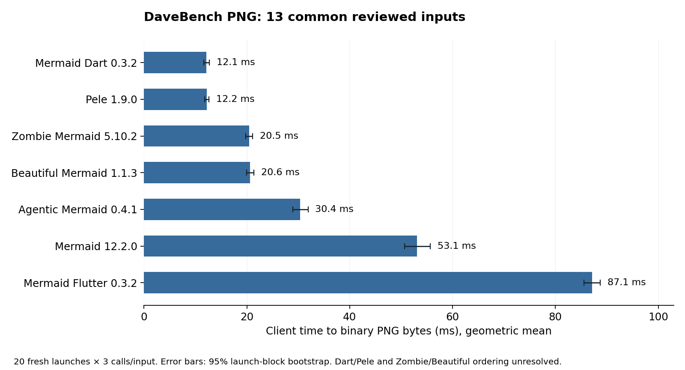
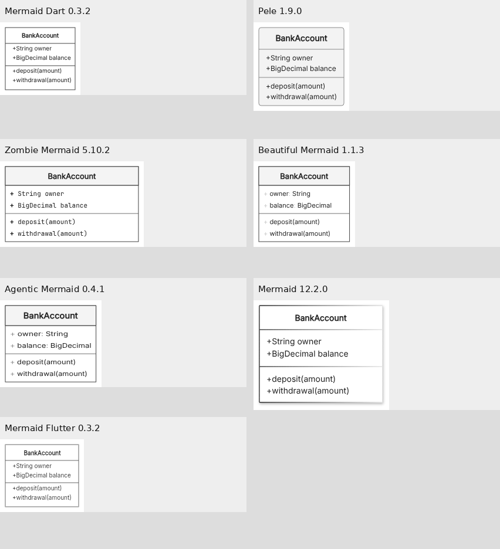

# DaveBench PNG: seven implementations

Observed warm PNG-export order: Mermaid Dart and Pele lead, followed by Zombie and Beautiful, Agentic, Mermaid, and native Flutter. The Dart/Pele and Zombie/Beautiful ordering is unresolved by the pairwise intervals.

All seven attempted the full **548-input DaveBench inventory**. Timing uses **13 common reviewed inputs**, with 20 fresh launches per implementation, two warmup passes and three measured calls per input per launch: **5,460 measurements and 3,640 warmups**. Every timed output matched its reviewed pixels; no inputs were removed after timing.

| Observed rank | Implementation | Client ms/PNG, 95% range | Relative to Dart | Median PNG KiB |
|---:|---|---:|---:|---:|
| 1 | Mermaid Dart 0.3.2 | 12.12 (11.61–12.75) | 1.00× | 32.60 |
| 2 | Pele 1.9.0 | 12.22 (11.82–12.62) | 1.01× | 32.32 |
| 3 | Zombie Mermaid 5.10.2 | 20.46 (19.81–21.14) | 1.69× | 29.67 |
| 4 | Beautiful Mermaid 1.1.3 | 20.63 (19.92–21.35) | 1.70× | 29.18 |
| 5 | Agentic Mermaid 0.4.1 | 30.35 (28.93–31.90) | 2.50× | 30.01 |
| 6 | Mermaid 12.2.0 | 53.08 (50.70–55.66) | 4.38× | 33.92 |
| 7 | Mermaid Flutter 0.3.2 | 87.11 (85.55–88.69) | 7.19× | 13.16 |

The score is the geometric mean across launches and fixed inputs of each three-call median. Intervals use 10,000 paired launch-round bootstrap draws. They describe variation across fresh launches for this profile on this host; they assume exchangeable rounds and do not model serial drift or other machines. The 21 pairwise intervals are unadjusted, and the reference was selected by its observed score. These ranks are descriptive, not a simultaneous statistical ordering.

Pele/Dart is **1.008× (0.959–1.060)**. Beautiful/Zombie is **1.009× (0.968–1.048)**. Neither close pair has an established winner or demonstrated equivalence.

The chart measures delivery of a white 1200×900 binary PNG on the same one-CPU cloud host. Mermaid Dart includes a Chromium conversion bridge; Flutter includes intrinsic PNG decoding, padding and a second encoding.

## Full DaveBench coverage

| Implementation | PNG contract successes / 548 | API/conversion errors | Fit/paint failures | Source-fact candidates passed / 20 |
|---|---:|---:|---:|---:|
| Pele 1.9.0 | 510/548 | 16 | 22 | 20/20 |
| Mermaid 12.2.0 | 492/548 | 1 | 55 | 20/20 |
| Mermaid Dart 0.3.2 | 414/548 | 99 | 35 | 20/20 |
| Mermaid Flutter 0.3.2 | 414/548 | 99 | 35 | 20/20 |
| Agentic Mermaid 0.4.1 | 320/548 | 213 | 15 | 18/20 |
| Zombie Mermaid 5.10.2 | 228/548 | 311 | 9 | 19/20 |
| Beautiful Mermaid 1.1.3 | 218/548 | 329 | 1 | 13/20 |

Full-corpus successes mean an opaque, nonblank PNG fitting this fixed canvas and margin. They are **mechanical coverage**, not a count of semantically correct diagrams. Large outputs fail this contract because resizing and clipping are prohibited. All sources, errors and returned images remain retained.

The common timing profile contains three flowcharts, four sequences, two classes, three state diagrams and one ER attribute example. Beautiful fails the two decision-loop examples, both group examples, the composition/aggregation example and an ER relationship example. Beautiful and Zombie reject the mindmap. Agentic also fails the group examples. Those candidate failures exclude the inputs for everyone. The collapsed-group negative control is excluded for all participants; several implementations expose its hidden A/B/C nodes.

The profile consists of short structural examples selected before this campaign. It does not establish speed on large diagrams, omitted features, the full corpus or production workloads.

## Actual APIs and completed work

| Participant | Runtime and public entrypoint |
|---|---|
| Mermaid | Chromium `mermaid.render()` → shared PNG converter |
| Agentic, Beautiful, Zombie | Chromium public `renderMermaidSVG()` → shared converter |
| Mermaid Dart | Native Dart AOT `Mermaid.render()` + `renderSceneToSvg()` with public `ApproximateTextMeasurer` → shared Chromium converter |
| Mermaid Flutter | Native Linux Flutter release `renderToPng()` → fixed-canvas normalization |
| Pele | Chromium public `render()` → shared converter |

The primary clock starts in Node before dispatch and ends after binary PNG bytes are consumed there. It includes request/response transport, Base64 production and one final binary decode. SVG witness retrieval, file writes and pixel inspection occur after that clock. API, normalization, raster-image creation, combined PNG readback/encoding and client decoding fields remain distinct in the raw samples. They do not isolate encoder CPU time or physical frame presentation.

Flutter’s public API produces an intrinsic PNG, so this fixed-size task requires a second encoding. Its separately aggregated API median is **8.90 ms**, normalization median **73.98 ms**, and client-overhead median **1.86 ms**. These medians are not additive and differ from the geometric score above. The result does not establish widget-frame speed or renderer-only performance.

Every final PNG is 1200×900, opaque white, with at least 30 pixels of margin, without resizing or clipping. Inter at base size 14 is requested through public options. Role defaults, layouts, painted areas and compression differ; smaller native class text remains visible in the example below. This is a completed export task with reviewed source facts and legibility, not identical typography or identical raster work.

Inspect owner:String, balance:BigDecimal, deposit(amount) and withdrawal(amount). These are unscaled crops; the original 1200×900 files are retained. This one contact sheet illustrates the task; an independent reviewer inspected all 91 common qualification outputs.

## Repeatability and verification

Each process block terminates before the next implementation starts. CPU2 affinity, a one-CPU quota, 16 GiB, a private PID namespace and disabled external networking are enforced by the container. This prevents inactive benchmark engines competing with the active participant; it does not reserve a physical CPU or prove statistical independence of successive rounds. The fixed rotated/reversed schedule and all 420 live-thread snapshots are retained.

Odd/even launch-split estimates range from 1.000 to 1.052. Four 95% intervals extend beyond the diagnostic ±10% tolerance: Dart, Beautiful, Agentic and Mermaid. These warnings remain visible in summary.json. Their intervals include 1 and do not establish replica bias; no global rule suppresses unrelated ratios.

Independent checks reconcile **11,872 PNG files**, decode **2,311 distinct encoded streams** with Pillow, and pass **110,342 checks with zero differences**. A separate statistical reviewer exactly reproduces all seven scores and 21 pairwise intervals; an output reviewer verifies the source facts in all 91 common outputs. Two admission defects found in review were fixed for future runs: missing review hashes now fail admission, and failed warmups invalidate collection. Reanalysis with those guards leaves summary.json byte-for-byte unchanged; all original warmups and review hashes were valid.

## Versions, producers and reproduction

AMD EPYC 9V74; Debian 13.6, Linux 6.18.55; Node 24.19.0; Chromium 154.0.8037.57; Playwright 1.58.2; Flutter 3.47.8 stable; Dart 3.13.7. Software GL and `LP_NUM_THREADS=1` are requested. Flutter framework `737ba8f885dc774b53b442759999a312c9461e4e`, engine `cf636b1dfb818dd6a3ff16e390e93b1a036969c8`. Inter SHA256 `1b08e7fc267a5c7e1d614100f604b83e7e8a0be241f0f288faa2b3ac93a683ba`.

Timing ran **2026-10-29 09:21:37–09:32:15 UTC**, producer `f2045b56b662231b9432937c8ed2201f0c5efb06`. Coverage ran **09:35:09–09:40:57 UTC**, producer `bd8e9b3fe933e4a9262dace5dd3d86700b12aa0f`; its later change bundles the published ZenUML addon to resolve browser imports. None of the timed inputs uses ZenUML. Keep the phase receipts separate. An earlier partial timing run with redundant browser decoding and earlier setup failures are retained as excluded history.

[Raw timing samples](https://github.com/adewale/trident/blob/c08ffddfba2efcdb226fc55a42780d6042540841/samples.jsonl) · [Summary and intervals](https://github.com/adewale/trident/blob/c08ffddfba2efcdb226fc55a42780d6042540841/summary.json) · [Full coverage calls](https://github.com/adewale/trident/blob/c08ffddfba2efcdb226fc55a42780d6042540841/coverage.jsonl) · [Environment and artifact hashes](https://github.com/adewale/trident/blob/c08ffddfba2efcdb226fc55a42780d6042540841/context.json) · [Painted-output review](https://github.com/adewale/trident/blob/c08ffddfba2efcdb226fc55a42780d6042540841/review.json) · [Independent audit](https://github.com/adewale/trident/blob/c08ffddfba2efcdb226fc55a42780d6042540841/audit.json) · [Reproduction instructions](https://github.com/adewale/trident/blob/c08ffddfba2efcdb226fc55a42780d6042540841/REPRODUCE.md) · [Statistics review](https://github.com/adewale/trident/blob/c08ffddfba2efcdb226fc55a42780d6042540841/reviewer-statistics.md) · [Output review](https://github.com/adewale/trident/blob/c08ffddfba2efcdb226fc55a42780d6042540841/reviewer-output.md)

[Immutable evidence index and archive downloads](https://github.com/adewale/trident/blob/c08ffddfba2efcdb226fc55a42780d6042540841/README.md). Archive SHA256:
`4948406f231711efb726b3a415380598ed1bd24b2f631884c59268a9bcf87017`.

[Runner and build instructions](../davebench-png/seven/README.md).
