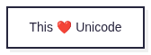
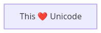

# DaveBench PNG lane qualification

Corpus: Mermaid syntax documentation at commit
`1fb7869866dd619168d840291c9c54b4f129758b`, source
`packages/mermaid/src/docs/syntax/flowchart.md:57`. This qualification selected one
source from the 548-occurrence inventory: a single node labelled “This ❤ Unicode”.
The expected label, node identity and empty edge set were committed before
collection. It is a functional check of two output paths, not a corpus-wide score.

| Rank by verified correct drawings | Participant | Version | PNG path | Correct / selected | Qualified speed |
|---:|---|---|---|---:|---|
| 1 | Mermaid.js | 12.2.0 | Public SVG call + shared PNG conversion | 1/1 | Withheld |
| 1 | Mermaid Flutter | 0.3.2 | Public native PNG API; no SVG binding | 1/1 | Withheld |

| Mermaid.js output | Mermaid Flutter output |
|---|---|
|  |  |

Codex visually checked the actual PNGs against all declared source facts. Their
different colours and styling are outside this content contract. This one-node
example establishes no general graph, typography, aesthetics or speed result.
The raw clocks are descriptive, with different invocation/conversion boundaries
and no performance calibration.

[Receipt and checksums](receipt.json) · [Source, expectation and image reviews](png-reviews.json)
· [Original invocation](invocation.json) · [Raw records and images](raw.tar.gz)

The raw archive preserves original timestamps, frozen artifact and browser
identities, worker observations, launch/runtime records and output bytes.
Collection used source `3ae7f71`; content reviews were added afterward and need no
new renderer calls. `assessDocsPng` reproduces the two reviewed verdicts after
`admitPngReviews` authenticates their source/expectation/image hashes.

The original passing native return row also contains a misleading no-transport
detail string. The collector now omits that fallback message when a real transport
observation exists, with a regression test. The original raw row is retained.
