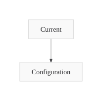
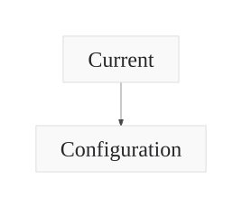

# Portable font configuration

The same authored input previously failed against Agentic Mermaid 0.4.1 because
Trident passed an unsupported top-level `fontSize`. The corrected invocation
uses its public node-style path. Pele retains its public top-level path.

The [receipt](receipt.json) records the immutable base, producer revision, target
versions/entry digests, both requested sizes and all 16 base/head invocations.
The base error is retained; no baseline image is fabricated.

| Requested 14px | Requested 24px |
|---|---|
|  |  |

Inspect Current and Configuration: both text elements declare the requested
size. `tests/portable-configuration.test.ts` rejects an unchanged 14px label even
when the SVG root says 24px, and exercises seed/edit translations in a real Node
worker. This verifies the invocation and declared label font sizes; it does not
establish glyph metrics, clipping, every CSS cascade or full painted semantics.

Beautiful Mermaid 1.1.3 and Zombie Mermaid 5.10.2 returned unchanged 13px labels
for the old option. They now report a missing configuration binding for this
case. Their other SVG cases remain available; accepting an ignored option earns
no configuration pass.
