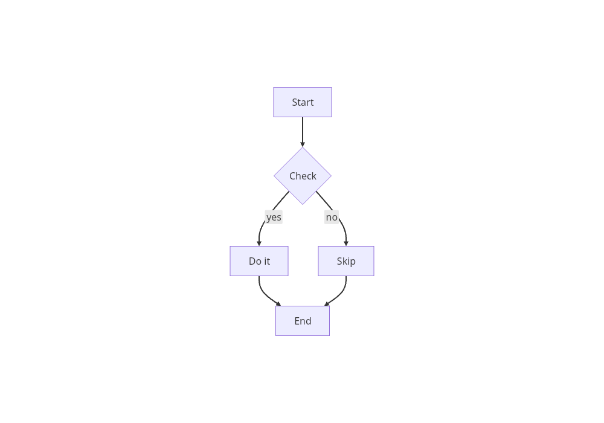

# Native entrypoint invocation witness

The baseline commit lacks the native campaign; its missing-file diagnostic is
retained in [receipt.json](receipt.json). No before image is fabricated.

These captures use the same named `core:flow5` fixture and fixed 1000×700 viewport.
They demonstrate nonblank output through the new harness, not bitmap equality,
semantic correctness or matched latency. Native capture uses MermaidDiagram in
Linux release mode; Chromium uses Pele render followed by DOM insertion.

| Native release MermaidDiagram | Chromium Pele render + DOM |
|---|---|
|  |  |

Inspect the five node labels and the two labelled branches. Production renderer
calls are unmodified; the receipt records source, input and image hashes and the
producer commit. The frozen campaign and separate invocation verification records
are available from the dated evidence publication linked in the receipt.
