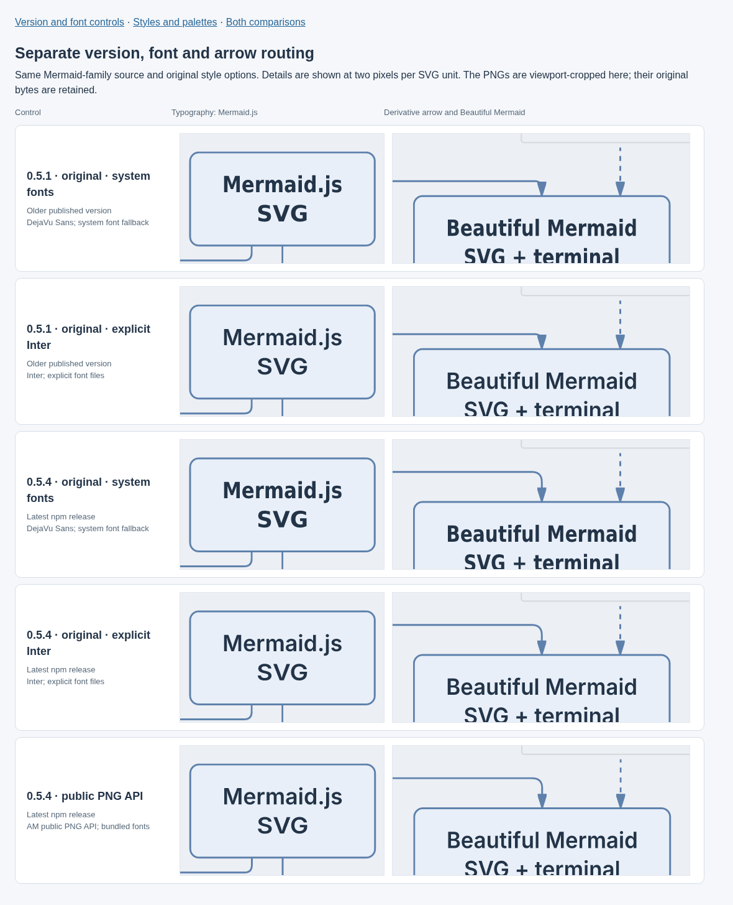
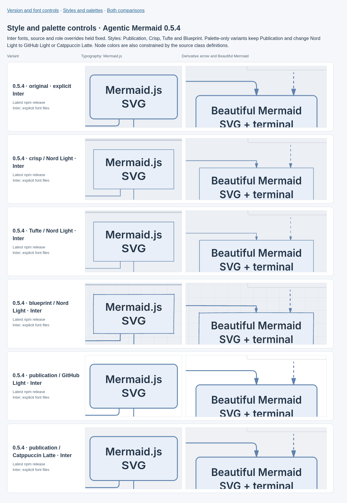

# Lineage rendering: fonts, routing and styles

The image at commit `431f9b5f52dfd127ae67b151f795332bea792cc3` used
Agentic Mermaid **0.5.1**. The npm latest release checked on 30 October 2026 was
**0.5.4**. The original SVG and PNG were reproduced byte-for-byte before changing
one factor at a time. This investigation changes documentation artwork only;
benchmark artifact versions and frozen measurements keep their identities.

## Version and font controls

| Renderer and raster path | Typography | Derivative arrow |
|---|---|---|
| 0.5.1, original system-font rasterizer | DejaVu fallback despite requesting Inter | Last bend intrudes into the arrowhead footprint |
| 0.5.1, explicit Inter | Correct requested font; sampled labels look more consistent | Same tight geometry |
| 0.5.4, system-font rasterizer | Same fallback remains | Longer straight section before the arrowhead |
| 0.5.4, explicit Inter | Correct requested font | Longer straight section |
| 0.5.4, public PNG API | Verified bundled Inter fonts | Same improved current geometry |

The latest system-font PNG is byte-identical to an explicit DejaVu Sans control.
Trident had requested Inter in its SVG but passed that SVG to a separate resvg
instance with system fonts and a DejaVu default. Inter was absent from the system
font set. AM's text fitting is calibrated for Inter, so fallback changes the
lettering, including the sampled `i` and `j` shapes and spacing.

For the full diagram, the old arrow has only **6 SVG units** of straight path
before its tip. Its nominal marker footprint is about **11.6 units**, allowing the
preceding rounded bend to enter that footprint. Version 0.5.4 gives it **16.14 units**
of straight path. These are observations of this route, not a general routing
correctness claim.

## Styles and palettes

The comparison holds the font, source and role overrides fixed. It tests
Publication Figure, Crisp, Tufte and Blueprint with Nord Light, then changes only
the Publication palette to GitHub Light and Catppuccin Latte. Palette-only changes
produce the same derivative path. Existing source class definitions constrain
node colors, so these palette controls mostly change the background and header
colors. Look changes also change component packing; the complete Crisp and Tufte
figures become very wide and lose readability when fitted to 1800 pixels.

Publication Figure with Nord Light remains the README default. The diagram uses
AM 0.5.4's public SVG API. A compact footer adds colour swatches and solid/dashed
line samples outside the graph, preserving its layout. The complete SVG is
rasterized with Trident's pinned resvg and Inter fonts checked against the
renderer bundle's SHA-256 manifest; system fonts remain disabled. The README
embeds this PNG for consistent lettering across readers. The SVG remains
available with live text and its requested font family.

The generation receipt now names the renderer version and PNG/font policy.
Use `bun scripts/render-lineage.ts --renderer-entry INSTALLED_AGENTIC_ENTRY --out FRESH.svg`
with optional `--look NAME --palette NAME` to regenerate alternatives. The installed
entry must come from the intended published package; the script does not change
benchmark pins or perform latest-version lookup.

[Source and artifact hashes, controls and geometry observations](evidence/lineage-rendering.json)
retain the experiment details. The focus sheets use the same extracted Mermaid-family
subgraph in each variant; full-source controls retain all 27 participants. Pixel
appearance and these samples do not establish complete font, layout or aesthetic
correctness.
