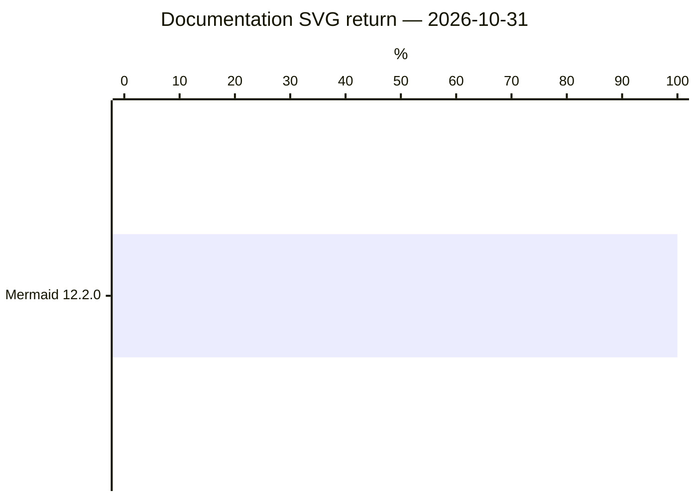
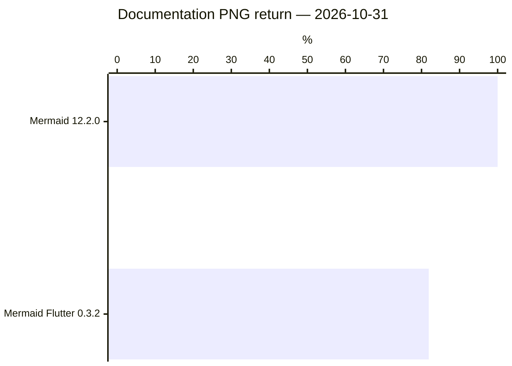

# Benchmark qualification — frozen B0

The [B0 receipt](evidence/b0/receipt.json) binds frozen inputs, actual outputs, source and observer epochs. This report is generated from [the frozen snapshot](../results/baseline.json), using the same reducers and ranker as [the rolling results](../RESULTS.md). Unknowns stay in the denominator; ranks order the named verified metric. [Scope, evidence and reproduction](evidence/b0/README.md).

Last recorded measurement/update: **2026-11-01**. 53 imported project/benchmark attempts; 12 retained result tables.

**Historical** marks retained measurements collected before the current reporting work. **Source candidates** are unreleased builds, ranked only within their own comparison tables; they do not replace release scores in the overview. B0 retains distinct dated runs; each workload keeps its own comparison scope. Regenerating it runs no benchmarks and does not qualify old outputs against newer source contracts or observers. Dates, versions, interfaces and qualification belong to each table.

[Machine-readable results](../results/latest.json) · [Benchmark methods](../BENCHMARKS.md) · [Reading the tables](../REPORTING.md) · [Update this page](../results/README.md)

## Ecosystem overview

21 originally recorded projects are listed below, including projects later excluded from regular campaigns. This archive preserves the measured selection; it does not change current benchmark eligibility.

Each cell links its latest recorded attempt, or a dated retained table. New failed, blocked and partial attempts take precedence over earlier tables. Different suites have different units; there is no combined score. “Unmeasured” is missing evidence; “N/A” follows the declared output or reference scope, not a measured failure.

Overview order: DaveBench: Documentation Examples, highest Correct first (2026-10-31). Ties share a rank. Projects with no result for this measure, or a newer superseding attempt, remain unranked below. Each benchmark has its own ranking. The overview’s ranked benchmark cell uses this same table and population.

| Project | Overview rank | Terminal Rendering | DaveBench SVG | DaveBench PNG | Render Cost and Scaling | Mermaid Public API Tests (diagnostic) |
|---|---|---|---|---|---|---|
| Mermaid | 1 | N/A | [59.9% · 2026-10-31](#run-655e65f422c8fd4dfc06c98e) | [91.0% · 2026-10-31](#run-0f56c6cfd1a4a911414d4c95) | [b0-cost-png: recorded · 2026-11-01](#b0-attempt-01e68c756a1e2e77e1726282); [b0-cost-svg: recorded · 2026-11-01](#b0-attempt-788d08f017a088a5b6324051) | [154/154 public callbacks passed · 2026-10-31](#public-tests-c3939522719cf814e30c57c5) |
| Mermaid Flutter | 2 | N/A | N/A | [54.6% · 2026-10-31](#run-0f56c6cfd1a4a911414d4c95) | [recorded · 2026-11-01](#b0-attempt-fb1efc2bf380563732294726) | Unmeasured: binding gap |
| Agentic Mermaid | — | [58/116 · 2026-10-31](#run-b752c2d303f711b51ca464f0) | Unmeasured | Unmeasured | Unmeasured | [59/154 public callbacks passed · 2026-10-31](#public-tests-c3939522719cf814e30c57c5) |
| ASCII Mermaid | — | [28/116 · 2026-10-31](#run-b752c2d303f711b51ca464f0) | N/A | N/A | N/A | Unmeasured: binding gap |
| Beautiful Mermaid | — | [35/116 · 2026-10-31](#run-b752c2d303f711b51ca464f0) | Unmeasured | Unmeasured | Unmeasured | Unmeasured: binding gap |
| Crafter Mermaid | — | [No verified terminal drawing observations · 2026-10-31](#run-b752c2d303f711b51ca464f0) | Unmeasured | Unmeasured | Unmeasured | Unmeasured: binding gap |
| Figurehead | — | [18/116 · 2026-10-31](#run-b752c2d303f711b51ca464f0) | N/A | N/A | N/A | Unmeasured: binding gap |
| Frankenmermaid | — | [0/116 · 2026-10-31](#run-b752c2d303f711b51ca464f0) | Unmeasured | Unmeasured | Unmeasured: binding gap | Unmeasured: binding gap |
| Grok renderer | — | [0/116 · 2026-10-31](#run-b752c2d303f711b51ca464f0) | N/A | N/A | N/A | Unmeasured: binding gap |
| Kitlangton Merman | — | [15/116 · 2026-10-31](#run-b752c2d303f711b51ca464f0) | N/A | N/A | N/A | Unmeasured: binding gap |
| Latias Merman | — | [No verified terminal drawing observations · 2026-10-31](#run-b752c2d303f711b51ca464f0) | Unmeasured | Unmeasured | Unmeasured | Unmeasured: binding gap |
| Loom renderer | — | [43/116 · 2026-10-31](#run-b752c2d303f711b51ca464f0) | N/A | N/A | N/A | Unmeasured: binding gap |
| Mermaid ASCII | — | [42/116 · 2026-10-31](#run-b752c2d303f711b51ca464f0) | N/A | N/A | [recorded · 2026-11-01](#b0-attempt-ba629e0813ae752105d3059e) | Unmeasured: binding gap |
| MermaidText | — | [40/116 · 2026-10-31](#run-b752c2d303f711b51ca464f0) | N/A | N/A | N/A | Unmeasured: binding gap |
| MermaidTUI | — | [7/116 · 2026-10-31](#run-b752c2d303f711b51ca464f0) | N/A | N/A | N/A | Unmeasured: binding gap |
| Merslim | — | [16/116 · 2026-10-31](#run-b752c2d303f711b51ca464f0) | Unmeasured | Unmeasured | Unmeasured | Unmeasured: binding gap |
| Ondine | — | [No verified terminal drawing observations · 2026-10-31](#run-b752c2d303f711b51ca464f0) | Unmeasured | Unmeasured | Unmeasured | Unmeasured: binding gap |
| OpenCode Merman | — | [19/116 · 2026-10-31](#run-b752c2d303f711b51ca464f0) | N/A | N/A | N/A | Unmeasured: binding gap |
| Pele | — | N/A | Unmeasured | Unmeasured | [recorded · 2026-11-01](#b0-attempt-8a5058429ae6e2615a186285) | Unmeasured: binding gap |
| Termaid | — | [65/116 · 2026-10-31](#run-b752c2d303f711b51ca464f0) | N/A | N/A | [recorded · 2026-11-01](#b0-attempt-ad0d55e6d45d3ff2ec2d82f4) | Unmeasured: binding gap |
| Zombie Mermaid | — | [60/116 · 2026-10-31](#run-b752c2d303f711b51ca464f0) | Unmeasured | Unmeasured | Unmeasured | Unmeasured: binding gap |

## Results by benchmark

Tables retain the full recorded populations. Charts show one named measure from the adjacent table; blocked, unavailable and failed checks remain visible in that table. Linked publications provide raw downloads; each table’s receipt identifies its owning evidence.

### Terminal Rendering

**run-b752c2d303f711b51ca464f0** · 2026-10-31 · unit: terminal input cases · [evidence](../docs/evidence/b0/receipt.json)

Frozen B0; exact input, contract epochs and owned outcomes are in the B0 receipt. Full planned terminal drawing corpus, retaining unmeasured and unreviewed inputs. Corpus: 116 drawings from 120 selected source inputs in pinned terminal-project research, without selection on renderer outcomes. Any authored adaptations have separate content identities and independent source review. 1 source diagnostics are retained separately and receive no drawing score. Invalid-source controls are separate from drawing accuracy. Source/review hashes and all origins remain in the owning receipt. Ranks order verified correct counts only; unknown work prevents a complete accuracy claim. Mermaid source reference is unscored; no speed or aesthetics score.

Ranked by **Correct**, highest first. Equal values share a rank; unavailable values are unranked. Timing ranks describe the displayed samples and retain their qualification limits.

Comparisons use **Correct** counts. “More verified” and “Fewer verified” mean accuracy is unresolved because either project has unknown outcomes. Mermaid has no terminal output; Mermaid ASCII is the terminal baseline.

| Project | Rank | Version | Correct | Incorrect | Unsupported | Unknown | Planned | Measured | vs Mermaid ASCII | Ranking note |
| --- | --- | --- | --- | --- | --- | --- | --- | --- | --- | --- |
| Termaid | 1 | 0.10.0 | 65 | 33 | 0 | 18 | 116 | 2026-10-31T19:49:40.725094Z | More verified (+23); accuracy unresolved |  |
| Zombie Mermaid | 2 | 5.10.2 | 60 | 12 | 0 | 44 | 116 | Unknown; recovered text, see receipt | More verified (+18); accuracy unresolved |  |
| Agentic Mermaid | 3 | 0.4.1 | 58 | 16 | 0 | 42 | 116 | 2026-10-31T19:49:41.622Z | More verified (+16); accuracy unresolved |  |
| Loom renderer | 4 | 0.10.0 | 43 | 26 | 0 | 47 | 116 | Unknown; recovered text, see receipt | More verified (+1); accuracy unresolved |  |
| Mermaid ASCII | 5 | 1.6.1 | 42 | 24 | 38 | 12 | 116 | 2026-10-31T19:49:40.519Z | Baseline |  |
| MermaidText | 6 | git-a6b0c7657b94 | 40 | 23 | 0 | 53 | 116 | Unknown; recovered text, see receipt | Fewer verified (-2); accuracy unresolved |  |
| Beautiful Mermaid | 7 | 1.1.3 | 35 | 22 | 0 | 59 | 116 | Unknown; recovered text, see receipt | Fewer verified (-7); accuracy unresolved |  |
| ASCII Mermaid | 8 | 0.1.0 | 28 | 37 | 0 | 51 | 116 | Unknown; recovered text, see receipt | Fewer verified (-14); accuracy unresolved |  |
| OpenCode Merman | 9 | 2.0.26 | 19 | 32 | 0 | 65 | 116 | Unknown; recovered text, see receipt | Fewer verified (-23); accuracy unresolved |  |
| Figurehead | 10 | v0.4.3 | 18 | 27 | 0 | 71 | 116 | Unknown; recovered text, see receipt | Fewer verified (-24); accuracy unresolved |  |
| Merslim | 11 | 0.2.3 | 16 | 47 | 0 | 53 | 116 | Unknown; recovered text, see receipt | Fewer verified (-26); accuracy unresolved |  |
| Kitlangton Merman | 12 | 0.2.1 | 15 | 31 | 0 | 70 | 116 | Unknown; recovered text, see receipt | Fewer verified (-27); accuracy unresolved |  |
| MermaidTUI | 13 | 0.0.6 | 7 | 6 | 0 | 103 | 116 | Unknown; recovered text, see receipt | Fewer verified (-35); accuracy unresolved |  |
| Crafter Mermaid | — | 0.0.3 | 0 | 0 | 0 | 116 | 116 | Unknown; recovered text, see receipt | Unresolved | No verified terminal drawing observations |
| Frankenmermaid | 14 | 0.4.0 | 0 | 1 | 0 | 115 | 116 | Unknown; recovered text, see receipt | Fewer verified (-42); accuracy unresolved |  |
| Grok renderer | 14 | git-2bdd1d6a6369 | 0 | 23 | 0 | 93 | 116 | Unknown; recovered text, see receipt | Fewer verified (-42); accuracy unresolved |  |
| Latias Merman | — | 0.9.2 | 0 | 0 | 0 | 116 | 116 | Unknown; recovered text, see receipt | Unresolved | No verified terminal drawing observations |
| Ondine | — | 0.0.3 | 0 | 0 | 0 | 116 | 116 | Unknown; recovered text, see receipt | Unresolved | No verified terminal drawing observations |

**run-e387dc3612390b84c63aeb27** · 2026-10-31 · unit: invalid-source controls · [evidence](../docs/evidence/b0/receipt.json)

Frozen B0; exact input, contract epochs and owned outcomes are in the B0 receipt. Independently invalid sources in the full terminal inventory, checked for typed public grammar rejection. Process exits, missing ink and transport failures remain unknown. This is separate from drawing correctness and supplies no speed score.

Ranked by **Correct**, highest first. Equal values share a rank; unavailable values are unranked. Timing ranks describe the displayed samples and retain their qualification limits.

Comparisons use **Correct** counts. “More verified” and “Fewer verified” mean accuracy is unresolved because either project has unknown outcomes. Mermaid has no terminal output; Mermaid ASCII is the terminal baseline.

| Project | Rank | Version | Correct | Incorrect | Unknown | Planned | vs Mermaid ASCII | Ranking note |
| --- | --- | --- | --- | --- | --- | --- | --- | --- |
| Mermaid ASCII | 1 | 1.6.1 | 2 | 0 | 2 | 4 | Baseline |  |
| Agentic Mermaid | — | 0.4.1 | 0 | 0 | 4 | 4 | Unresolved | No typed source-rejection observations |
| ASCII Mermaid | — | 0.1.0 | 0 | 0 | 4 | 4 | Unresolved | No typed source-rejection observations |
| Beautiful Mermaid | — | 1.1.3 | 0 | 0 | 4 | 4 | Unresolved | No typed source-rejection observations |
| Crafter Mermaid | — | 0.0.3 | 0 | 0 | 4 | 4 | Unresolved | No typed source-rejection observations |
| Figurehead | — | v0.4.3 | 0 | 0 | 4 | 4 | Unresolved | No typed source-rejection observations |
| Frankenmermaid | — | 0.4.0 | 0 | 0 | 4 | 4 | Unresolved | No typed source-rejection observations |
| Grok renderer | — | git-2bdd1d6a6369 | 0 | 0 | 4 | 4 | Unresolved | No typed source-rejection observations |
| Kitlangton Merman | — | 0.2.1 | 0 | 0 | 4 | 4 | Unresolved | No typed source-rejection observations |
| Latias Merman | — | 0.9.2 | 0 | 0 | 4 | 4 | Unresolved | No typed source-rejection observations |
| Loom renderer | — | 0.10.0 | 0 | 0 | 4 | 4 | Unresolved | No typed source-rejection observations |
| MermaidText | — | git-a6b0c7657b94 | 0 | 0 | 4 | 4 | Unresolved | No typed source-rejection observations |
| MermaidTUI | — | 0.0.6 | 0 | 0 | 4 | 4 | Unresolved | No typed source-rejection observations |
| Merslim | — | 0.2.3 | 0 | 0 | 4 | 4 | Unresolved | No typed source-rejection observations |
| Ondine | — | 0.0.3 | 0 | 0 | 4 | 4 | Unresolved | No typed source-rejection observations |
| OpenCode Merman | — | 2.0.26 | 0 | 0 | 4 | 4 | Unresolved | No typed source-rejection observations |
| Termaid | 2 | 0.10.0 | 0 | 4 | 0 | 4 | Fewer verified (-2); accuracy unresolved |  |
| Zombie Mermaid | — | 5.10.2 | 0 | 0 | 4 | 4 | Unresolved | No typed source-rejection observations |

### DaveBench: Documentation Examples

**run-b206851a3126313e782400b2** · 2026-10-31 · unit: documentation occurrences · [evidence](../docs/evidence/b0/receipt.json)

Frozen B0; exact input, contract epochs and owned outcomes are in the B0 receipt. Corpus: Mermaid syntax documentation at 1fb7869866dd619168d840291c9c54b4f129758b; 548 occurrences, retaining duplicates. SVG output lane. Returned means the occurrence returned SVG in all 1 declared rounds. Failures and unexecuted work retain the full inventory. Output return does not certify drawing content. Dates use the owning PNG-export calls; these companion SVGs have no independent SVG clock. Observer publication/recheck time is separate in campaignUpdatedAt.

Ranked by **Returned in all rounds / Planned**, highest first. Equal values share a rank; unavailable values are unranked. Timing ranks describe the displayed samples and retain their qualification limits.

“Higher” and “Lower” compare **Returned in all rounds** on this population. Unknown evidence remains unresolved. This is a comparison of the named metric, not overall project quality.

| Project | Rank | Version | Returned in all rounds | Failed | Unsupported | Blocked | Unexecuted | Partially observed | Planned | Measured | vs Mermaid | % |
| --- | --- | --- | --- | --- | --- | --- | --- | --- | --- | --- | --- | --- |
| Mermaid | 1 | 12.2.0 | 548 | 0 | 0 | 0 | 0 | 0 | 548 | 2026-10-31T20:31:37.517Z | Baseline | 100.0% |

**run-bfeb6b6827a69c7020371b47** · 2026-10-31 · unit: invalid-source controls · [evidence](../docs/evidence/b0/receipt.json)

Frozen B0; exact input, contract epochs and owned outcomes are in the B0 receipt. Corpus: 1 invalid-source documentation example(s), retained verbatim in the 548-occurrence inventory. A source-bound typed native rejection passes; an actual public return fails. Generic exceptions and missing evidence remain unknown. Dates use the owning PNG-export calls; these companion SVGs have no independent SVG clock. Observer publication/recheck time is separate in campaignUpdatedAt.

Ranked by **Correct rejection**, highest first. Equal values share a rank; unavailable values are unranked. Timing ranks describe the displayed samples and retain their qualification limits.

“Higher” and “Lower” compare **Correct rejection** on this population. Unknown evidence remains unresolved. This is a comparison of the named metric, not overall project quality.

| Project | Rank | Version | Correct rejection | Accepted invalid source | Unknown | Planned controls | Measured | vs Mermaid |
| --- | --- | --- | --- | --- | --- | --- | --- | --- |
| Mermaid | 1 | 12.2.0 | 0 | 1 | 0 | 1 | 2026-10-31T19:23:21.034Z | Baseline |

**run-655e65f422c8fd4dfc06c98e** · 2026-10-31 · unit: documentation drawings · [evidence](../docs/evidence/b0/receipt.json)

Frozen B0; exact input, contract epochs and owned outcomes are in the B0 receipt. Corpus: the same pinned Mermaid documentation inventory. First-round actual SVG witnesses checked against source expectations. Shared SVG paint/meaning observer. Rank counts verified correct drawings out of 546; 1 configuration example(s) and 1 independently invalid-source control(s) are separate. Unknown sources/observers remain visible. Complete accuracy requires zero unknowns; speed requires its own qualified timing evidence. Dates use the owning PNG-export calls; these companion SVGs have no independent SVG clock. Observer publication/recheck time is separate in campaignUpdatedAt.

Ranked by **Correct**, highest first. Equal values share a rank; unavailable values are unranked. Timing ranks describe the displayed samples and retain their qualification limits.

Comparisons use **Correct** counts. “More verified” and “Fewer verified” mean accuracy is unresolved because either project has unknown outcomes. This is a comparison of the named metric, not overall project quality.

| Project | Rank | Version | Correct | Incorrect | Unknown | Planned drawings | Measured | vs Mermaid |
| --- | --- | --- | --- | --- | --- | --- | --- | --- |
| Mermaid | 1 | 12.2.0 | 327 | 54 | 165 | 546 | 2026-10-31T20:31:37.517Z | Baseline |

**run-100e15cdd6fd53c4d6afd917** · 2026-10-31 · unit: documentation occurrences · [evidence](../docs/evidence/b0/receipt.json)

Frozen B0; exact input, contract epochs and owned outcomes are in the B0 receipt. Corpus: Mermaid syntax documentation at 1fb7869866dd619168d840291c9c54b4f129758b; 548 occurrences, retaining duplicates. PNG output lane. Returned means the occurrence returned PNG in all 1 declared rounds. Failures and unexecuted work retain the full inventory. Output return does not certify drawing content.

Ranked by **Returned in all rounds / Planned**, highest first. Equal values share a rank; unavailable values are unranked. Timing ranks describe the displayed samples and retain their qualification limits.

“Higher” and “Lower” compare **Returned in all rounds** on this population. Unknown evidence remains unresolved. This is a comparison of the named metric, not overall project quality.

| Project | Rank | Version | Returned in all rounds | Failed | Unsupported | Blocked | Unexecuted | Partially observed | Planned | Measured | vs Mermaid | % |
| --- | --- | --- | --- | --- | --- | --- | --- | --- | --- | --- | --- | --- |
| Mermaid | 1 | 12.2.0 | 548 | 0 | 0 | 0 | 0 | 0 | 548 | 2026-10-31T20:31:37.517Z | Baseline | 100.0% |
| Mermaid Flutter | 2 | 0.3.2 | 449 | 99 | 0 | 0 | 0 | 0 | 548 | 2026-10-31T09:01:40.231Z | Lower (-99) | 81.9% |

**run-432d8455e8681dd50e77ed27** · 2026-10-31 · unit: invalid-source controls · [evidence](../docs/evidence/b0/receipt.json)

Frozen B0; exact input, contract epochs and owned outcomes are in the B0 receipt. Corpus: 1 invalid-source documentation example(s), retained verbatim in the 548-occurrence inventory. A source-bound typed native rejection passes; an actual public return fails. Generic exceptions and missing evidence remain unknown.

Ranked by **Correct rejection**, highest first. Equal values share a rank; unavailable values are unranked. Timing ranks describe the displayed samples and retain their qualification limits.

“Higher” and “Lower” compare **Correct rejection** on this population. Unknown evidence remains unresolved. This is a comparison of the named metric, not overall project quality.

| Project | Rank | Version | Correct rejection | Accepted invalid source | Unknown | Planned controls | Measured | vs Mermaid |
| --- | --- | --- | --- | --- | --- | --- | --- | --- |
| Mermaid | 1 | 12.2.0 | 0 | 1 | 0 | 1 | 2026-10-31T19:23:21.034Z | Baseline |
| Mermaid Flutter | 1 | 0.3.2 | 0 | 1 | 0 | 1 | 2026-10-31T09:01:33.726Z | Tie |

**run-0f56c6cfd1a4a911414d4c95** · 2026-10-31 · unit: documentation drawings · [evidence](../docs/evidence/b0/receipt.json)

Frozen B0; exact input, contract epochs and owned outcomes are in the B0 receipt. Corpus: the same pinned Mermaid documentation inventory. First-round actual PNG witnesses checked against source expectations. PNG content reviews bind actual image, source and expected-fact hashes; SVG and nonblank checks supply no raster correctness credit. Rank counts verified correct drawings out of 546; 1 configuration example(s) and 1 independently invalid-source control(s) are separate. Unknown sources/observers remain visible. Complete accuracy requires zero unknowns; speed requires its own qualified timing evidence.

Ranked by **Correct**, highest first. Equal values share a rank; unavailable values are unranked. Timing ranks describe the displayed samples and retain their qualification limits.

Comparisons use **Correct** counts. “More verified” and “Fewer verified” mean accuracy is unresolved because either project has unknown outcomes. This is a comparison of the named metric, not overall project quality.

| Project | Rank | Version | Correct | Incorrect | Unknown | Planned drawings | Measured | vs Mermaid |
| --- | --- | --- | --- | --- | --- | --- | --- | --- |
| Mermaid | 1 | 12.2.0 | 497 | 44 | 5 | 546 | 2026-10-31T20:31:37.517Z | Baseline |
| Mermaid Flutter | 2 | 0.3.2 | 298 | 137 | 111 | 546 | 2026-10-31T09:01:40.231Z | Fewer verified (-199); accuracy unresolved |

### Render Cost and Scaling

**b0-cost-svg** · 2026-11-01 · unit: ms per fixed corpus · [evidence](../docs/evidence/b0/receipt.json)

Frozen B0; exact input, contract epochs and owned outcomes are in the B0 receipt. Six examples from pinned Mermaid syntax documentation (flowchart, sequence, journey, pie, packet and treemap). Host page.evaluate request through returned SVG string, including RPC serialization, shared public adapter and render cleanup; package initialization/import, browser/context startup and correctness grading excluded Six balanced rounds; every timed return qualifies. A/A envelope 0.820–1.219. Compare only this named corpus, artifacts and call boundary; no full-corpus, warm-engine or cross-format speed claim. The paired ratio need not equal the ratio of displayed medians.

Ranked by **Median corpus ms**, lowest first. Equal values share a rank; unavailable values are unranked. Timing ranks describe the displayed samples and retain their qualification limits.

| Project | Rank | Version | Correct timed returns | Planned returns | Median corpus ms | Paired time / Mermaid | 96.875% ratio interval |
| --- | --- | --- | --- | --- | --- | --- | --- |
| Pele | 1 | 1.9.0 | 36 | 36 | 130.942 | 0.113 | 0.092–0.161 |
| Mermaid | 2 | 12.2.0 | 72 | 72 | 1087.116 | 1 | reference |

**b0-cost-png** · 2026-11-01 · unit: ms per fixed corpus · [evidence](../docs/evidence/b0/receipt.json)

Frozen B0; exact input, contract epochs and owned outcomes are in the B0 receipt. Three edge-style flowcharts from pinned Mermaid syntax documentation. Host source request through fresh owned fork RPC, cold engine/process startup and complete public PNG export bytes returned through RPC; Mermaid includes public SVG render plus XML serialization, Image.decode, white canvas draw and PNG encoding; native uses public renderToPng(source,pixelRatio:1) plus its durable byte bridge. Includes required in-call source/job and returned-byte bridge, hash/receipt writes, common IPC transport. Common worker module initialization, artifact verification, engine teardown, controller retention and full grading excluded. OS/filesystem caches uncontrolled; no warm renderer; display service already running. Six balanced rounds; every timed return qualifies. A/A envelope 0.820–1.219. Compare only this named corpus, artifacts and call boundary; no full-corpus, warm-engine or cross-format speed claim. The paired ratio need not equal the ratio of displayed medians.

Ranked by **Median corpus ms**, lowest first. Equal values share a rank; unavailable values are unranked. Timing ranks describe the displayed samples and retain their qualification limits.

| Project | Rank | Version | Correct timed returns | Planned returns | Median corpus ms | Paired time / Mermaid | 96.875% ratio interval |
| --- | --- | --- | --- | --- | --- | --- | --- |
| Mermaid | 1 | 12.2.0 | 36 | 36 | 4518.16 | 1 | reference |
| Mermaid Flutter | 2 | 0.3.2 | 18 | 18 | 19669.129 | 4.365 | 4.237–4.626 |

**b0-cost-terminal** · 2026-11-01 · unit: ms per fixed corpus · [evidence](../docs/evidence/b0/receipt.json)

Frozen B0; exact input, contract epochs and owned outcomes are in the B0 receipt. Six terminal-project examples from the frozen 18-repository research corpus. Host request through fresh owned Node-worker RPC, cold public CLI process startup/import/render, complete drained stdout bytes and RPC return; worker initialization, artifact verification, retention and full output grading excluded. Filesystem/OS caches uncontrolled; frozen package bytecode caches retained; no warm renderer. Six balanced rounds; every timed return qualifies. A/A envelope 0.850–1.177. Compare only this named corpus, artifacts and call boundary; no full-corpus, warm-engine or cross-format speed claim. The paired ratio need not equal the ratio of displayed medians.

Ranked by **Median corpus ms**, lowest first. Equal values share a rank; unavailable values are unranked. Timing ranks describe the displayed samples and retain their qualification limits.

| Project | Rank | Version | Correct timed returns | Planned returns | Median corpus ms | Paired time / Mermaid ASCII | 96.875% ratio interval |
| --- | --- | --- | --- | --- | --- | --- | --- |
| Mermaid ASCII | 1 | 1.6.1 | 72 | 72 | 104.129 | 1 | reference |
| Termaid | 2 | 0.10.0 | 36 | 36 | 754.053 | 7.224 | 5.697–7.517 |

### Mermaid Public API Tests (diagnostic)

**public-tests-c3939522719cf814e30c57c5** · 2026-10-31 · **Diagnostic subset** · unit: original public test callbacks · [evidence](../docs/evidence/b0/receipt.json)

Frozen B0; exact input, contract epochs and owned outcomes are in the B0 receipt. Diagnostic public API subset: 154 expanded callbacks from 37 eligible declarations; 4060 original declarations in 368 files. Corpus: unchanged Mermaid tests at 1fb7869866dd619168d840291c9c54b4f129758b. Original and delegated public Mermaid controls both pass every selected callback. This complete selected scope joins disjoint retained callback scopes; every parent native receipt, callback, producer and public invocation is revalidated without new API calls. Original assertions retain exact diagnostic wording, configuration expectations, accessibility roles and caller-ID conventions, including upstream jsdom geometry mocks. Public parse returns/configuration are snapshotted as JSON before assertions, with explicit loss for unserializable values; invocation events are fsynced. The uninstrumented original control retains native callback outcomes. This is strict API compatibility, not drawing accuracy, speed or whole-suite conformance. Binding gaps include unavailable public fields and incomplete invocation evidence. Unmeasured projects receive no zero.

Ranked by **Passed / Planned eligible**, highest first. Equal values share a rank; unavailable values are unranked. Timing ranks describe the displayed samples and retain their qualification limits.

“Higher” and “Lower” compare **Passed** on this population. Unknown evidence remains unresolved. This is a comparison of the named metric, not overall project quality.

| Project | Rank | Version | Passed | Failed | Unsupported | Binding gaps | Planned eligible | Public scope | Total declarations | vs Mermaid |
| --- | --- | --- | --- | --- | --- | --- | --- | --- | --- | --- |
| Mermaid | 1 | 12.2.0 | 154 | 0 | 0 | 0 | 154 | 102 parse; 32 detection; 19 accessibility render; 1 generic SVG render (24 inner sources) | 4060 | Baseline |
| Agentic Mermaid | 2 | 0.4.1 | 59 | 27 | 63 | 5 | 154 | 102 parse; 32 detection; 19 accessibility render; 1 generic SVG render (24 inner sources) | 4060 | Lower (-95) |

## Campaign attempts

Latest attempts remain visible even when collection or qualification fails. Counts below are recorded observations, not inferred whole-diagram passes. Original inventories, protocols, timing qualification and failures remain in the owning evidence.

### Kitlangton Merman: Terminal Rendering (terminal-b0-v3)

Campaign invocation: 2026-10-31T19:49:41.622Z → 2026-11-01T06:09:57.406Z · **recorded** · [evidence](../docs/evidence/b0/receipt.json)

B0 publication of already retained calls and current saved-output assessments; no new renderer/API invocation or independent SVG clock. Original dates, populations, unknowns and per-lane contract epochs remain in the owning evidence.

### Mermaid: Render Cost and Scaling (b0-cost-png)

Campaign invocation: 2026-11-01T01:52:50.914Z → 2026-11-01T06:09:57.406Z · **recorded** · [evidence](../docs/evidence/b0/receipt.json)

B0 publication of already retained calls and current saved-output assessments; no new renderer/API invocation or independent SVG clock. Original dates, populations, unknowns and per-lane contract epochs remain in the owning evidence.

### OpenCode Merman: Terminal Rendering (terminal-b0-v3)

Campaign invocation: 2026-10-31T09:28:24.742Z → 2026-11-01T06:09:57.406Z · **recorded** · [evidence](../docs/evidence/b0/receipt.json)

B0 publication of already retained calls and current saved-output assessments; no new renderer/API invocation or independent SVG clock. Original dates, populations, unknowns and per-lane contract epochs remain in the owning evidence.

### Termaid: Terminal Rendering (terminal-b0-v3)

Campaign invocation: 2026-10-31T09:28:24.742Z → 2026-11-01T06:09:57.406Z · **recorded** · [evidence](../docs/evidence/b0/receipt.json)

B0 publication of already retained calls and current saved-output assessments; no new renderer/API invocation or independent SVG clock. Original dates, populations, unknowns and per-lane contract epochs remain in the owning evidence.

### Mermaid: DaveBench: Documentation Examples (b0)

Campaign invocation: 2026-10-31T20:31:37.517Z → 2026-11-01T06:09:57.406Z · **recorded** · [evidence](../docs/evidence/b0/receipt.json)

B0 publication of already retained calls and current saved-output assessments; no new renderer/API invocation or independent SVG clock. Original dates, populations, unknowns and per-lane contract epochs remain in the owning evidence.

### Mermaid: DaveBench: Documentation Examples (b0)

Campaign invocation: 2026-10-31T19:23:21.034Z → 2026-11-01T06:09:57.406Z · **recorded** · [evidence](../docs/evidence/b0/receipt.json)

B0 publication of already retained calls and current saved-output assessments; no new renderer/API invocation or independent SVG clock. Original dates, populations, unknowns and per-lane contract epochs remain in the owning evidence.

### Kitlangton Merman: Terminal Rendering (terminal-b0-v3)

Campaign invocation: 2026-10-31T09:28:24.742Z → 2026-11-01T06:09:57.406Z · **recorded** · [evidence](../docs/evidence/b0/receipt.json)

B0 publication of already retained calls and current saved-output assessments; no new renderer/API invocation or independent SVG clock. Original dates, populations, unknowns and per-lane contract epochs remain in the owning evidence.

### Beautiful Mermaid: Terminal Rendering (terminal-b0-v3)

Campaign invocation: 2026-10-31T19:49:41.622Z → 2026-11-01T06:09:57.406Z · **recorded** · [evidence](../docs/evidence/b0/receipt.json)

B0 publication of already retained calls and current saved-output assessments; no new renderer/API invocation or independent SVG clock. Original dates, populations, unknowns and per-lane contract epochs remain in the owning evidence.

### Mermaid: DaveBench: Documentation Examples (b0)

Campaign invocation: 2026-10-31T19:23:21.034Z → 2026-11-01T06:09:57.406Z · **recorded** · [evidence](../docs/evidence/b0/receipt.json)

B0 publication of already retained calls and current saved-output assessments; no new renderer/API invocation or independent SVG clock. Original dates, populations, unknowns and per-lane contract epochs remain in the owning evidence.

### Latias Merman: Terminal Rendering (terminal-b0-v3)

Campaign invocation: 2026-10-31T19:49:41.622Z → 2026-11-01T06:09:57.406Z · **recorded** · [evidence](../docs/evidence/b0/receipt.json)

B0 publication of already retained calls and current saved-output assessments; no new renderer/API invocation or independent SVG clock. Original dates, populations, unknowns and per-lane contract epochs remain in the owning evidence.

### Mermaid: Mermaid Public API Tests (diagnostic) (original-public-api-tests-v4)

Campaign invocation: 2026-10-31T19:15:43.111Z → 2026-11-01T06:09:57.406Z · **recorded** · [evidence](../docs/evidence/b0/receipt.json)

B0 publication of already retained calls and current saved-output assessments; no new renderer/API invocation or independent SVG clock. Original dates, populations, unknowns and per-lane contract epochs remain in the owning evidence.

### Latias Merman: Terminal Rendering (terminal-b0-v3)

Campaign invocation: 2026-10-31T09:28:24.742Z → 2026-11-01T06:09:57.406Z · **recorded** · [evidence](../docs/evidence/b0/receipt.json)

B0 publication of already retained calls and current saved-output assessments; no new renderer/API invocation or independent SVG clock. Original dates, populations, unknowns and per-lane contract epochs remain in the owning evidence.

### Termaid: Terminal Rendering (terminal-b0-v3)

Campaign invocation: 2026-10-31T19:49:41.622Z → 2026-11-01T06:09:57.406Z · **recorded** · [evidence](../docs/evidence/b0/receipt.json)

B0 publication of already retained calls and current saved-output assessments; no new renderer/API invocation or independent SVG clock. Original dates, populations, unknowns and per-lane contract epochs remain in the owning evidence.

### Mermaid: DaveBench: Documentation Examples (b0)

Campaign invocation: 2026-10-31T20:31:37.517Z → 2026-11-01T06:09:57.406Z · **recorded** · [evidence](../docs/evidence/b0/receipt.json)

B0 publication of already retained calls and current saved-output assessments; no new renderer/API invocation or independent SVG clock. Original dates, populations, unknowns and per-lane contract epochs remain in the owning evidence.

### Crafter Mermaid: Terminal Rendering (terminal-b0-v3)

Campaign invocation: 2026-10-31T19:49:41.622Z → 2026-11-01T06:09:57.406Z · **recorded** · [evidence](../docs/evidence/b0/receipt.json)

B0 publication of already retained calls and current saved-output assessments; no new renderer/API invocation or independent SVG clock. Original dates, populations, unknowns and per-lane contract epochs remain in the owning evidence.

### Agentic Mermaid: Terminal Rendering (terminal-b0-v3)

Campaign invocation: 2026-10-31T09:28:24.742Z → 2026-11-01T06:09:57.406Z · **recorded** · [evidence](../docs/evidence/b0/receipt.json)

B0 publication of already retained calls and current saved-output assessments; no new renderer/API invocation or independent SVG clock. Original dates, populations, unknowns and per-lane contract epochs remain in the owning evidence.

### Grok renderer: Terminal Rendering (terminal-b0-v3)

Campaign invocation: 2026-10-31T19:49:41.622Z → 2026-11-01T06:09:57.406Z · **recorded** · [evidence](../docs/evidence/b0/receipt.json)

B0 publication of already retained calls and current saved-output assessments; no new renderer/API invocation or independent SVG clock. Original dates, populations, unknowns and per-lane contract epochs remain in the owning evidence.

### Loom renderer: Terminal Rendering (terminal-b0-v3)

Campaign invocation: 2026-10-31T19:49:41.622Z → 2026-11-01T06:09:57.406Z · **recorded** · [evidence](../docs/evidence/b0/receipt.json)

B0 publication of already retained calls and current saved-output assessments; no new renderer/API invocation or independent SVG clock. Original dates, populations, unknowns and per-lane contract epochs remain in the owning evidence.

### Frankenmermaid: Terminal Rendering (terminal-b0-v3)

Campaign invocation: 2026-10-31T09:28:24.742Z → 2026-11-01T06:09:57.406Z · **recorded** · [evidence](../docs/evidence/b0/receipt.json)

B0 publication of already retained calls and current saved-output assessments; no new renderer/API invocation or independent SVG clock. Original dates, populations, unknowns and per-lane contract epochs remain in the owning evidence.

### Loom renderer: Terminal Rendering (terminal-b0-v3)

Campaign invocation: 2026-10-31T09:28:24.742Z → 2026-11-01T06:09:57.406Z · **recorded** · [evidence](../docs/evidence/b0/receipt.json)

B0 publication of already retained calls and current saved-output assessments; no new renderer/API invocation or independent SVG clock. Original dates, populations, unknowns and per-lane contract epochs remain in the owning evidence.

### MermaidText: Terminal Rendering (terminal-b0-v3)

Campaign invocation: 2026-10-31T09:28:24.742Z → 2026-11-01T06:09:57.406Z · **recorded** · [evidence](../docs/evidence/b0/receipt.json)

B0 publication of already retained calls and current saved-output assessments; no new renderer/API invocation or independent SVG clock. Original dates, populations, unknowns and per-lane contract epochs remain in the owning evidence.

### Mermaid Flutter: DaveBench: Documentation Examples (b0)

Campaign invocation: 2026-10-31T19:23:21.034Z → 2026-11-01T06:09:57.406Z · **recorded** · [evidence](../docs/evidence/b0/receipt.json)

B0 publication of already retained calls and current saved-output assessments; no new renderer/API invocation or independent SVG clock. Original dates, populations, unknowns and per-lane contract epochs remain in the owning evidence.

### Crafter Mermaid: Terminal Rendering (terminal-b0-v3)

Campaign invocation: 2026-10-31T09:28:24.742Z → 2026-11-01T06:09:57.406Z · **recorded** · [evidence](../docs/evidence/b0/receipt.json)

B0 publication of already retained calls and current saved-output assessments; no new renderer/API invocation or independent SVG clock. Original dates, populations, unknowns and per-lane contract epochs remain in the owning evidence.

### Agentic Mermaid: Mermaid Public API Tests (diagnostic) (original-public-api-tests-v4)

Campaign invocation: 2026-10-31T19:15:43.111Z → 2026-11-01T06:09:57.406Z · **recorded** · [evidence](../docs/evidence/b0/receipt.json)

B0 publication of already retained calls and current saved-output assessments; no new renderer/API invocation or independent SVG clock. Original dates, populations, unknowns and per-lane contract epochs remain in the owning evidence.

### Grok renderer: Terminal Rendering (terminal-b0-v3)

Campaign invocation: 2026-10-31T09:28:24.742Z → 2026-11-01T06:09:57.406Z · **recorded** · [evidence](../docs/evidence/b0/receipt.json)

B0 publication of already retained calls and current saved-output assessments; no new renderer/API invocation or independent SVG clock. Original dates, populations, unknowns and per-lane contract epochs remain in the owning evidence.

### Agentic Mermaid: Terminal Rendering (terminal-b0-v3)

Campaign invocation: 2026-10-31T19:49:41.622Z → 2026-11-01T06:09:57.406Z · **recorded** · [evidence](../docs/evidence/b0/receipt.json)

B0 publication of already retained calls and current saved-output assessments; no new renderer/API invocation or independent SVG clock. Original dates, populations, unknowns and per-lane contract epochs remain in the owning evidence.

### Ondine: Terminal Rendering (terminal-b0-v3)

Campaign invocation: 2026-10-31T19:49:41.622Z → 2026-11-01T06:09:57.406Z · **recorded** · [evidence](../docs/evidence/b0/receipt.json)

B0 publication of already retained calls and current saved-output assessments; no new renderer/API invocation or independent SVG clock. Original dates, populations, unknowns and per-lane contract epochs remain in the owning evidence.

### Mermaid: Render Cost and Scaling (b0-cost-svg)

Campaign invocation: 2026-11-01T00:49:20.731Z → 2026-11-01T06:09:57.406Z · **recorded** · [evidence](../docs/evidence/b0/receipt.json)

B0 publication of already retained calls and current saved-output assessments; no new renderer/API invocation or independent SVG clock. Original dates, populations, unknowns and per-lane contract epochs remain in the owning evidence.

### Mermaid ASCII: Terminal Rendering (terminal-b0-v3)

Campaign invocation: 2026-10-31T09:28:24.742Z → 2026-11-01T06:09:57.406Z · **recorded** · [evidence](../docs/evidence/b0/receipt.json)

B0 publication of already retained calls and current saved-output assessments; no new renderer/API invocation or independent SVG clock. Original dates, populations, unknowns and per-lane contract epochs remain in the owning evidence.

### Merslim: Terminal Rendering (terminal-b0-v3)

Campaign invocation: 2026-10-31T19:49:41.622Z → 2026-11-01T06:09:57.406Z · **recorded** · [evidence](../docs/evidence/b0/receipt.json)

B0 publication of already retained calls and current saved-output assessments; no new renderer/API invocation or independent SVG clock. Original dates, populations, unknowns and per-lane contract epochs remain in the owning evidence.

### Merslim: Terminal Rendering (terminal-b0-v3)

Campaign invocation: 2026-10-31T09:28:24.742Z → 2026-11-01T06:09:57.406Z · **recorded** · [evidence](../docs/evidence/b0/receipt.json)

B0 publication of already retained calls and current saved-output assessments; no new renderer/API invocation or independent SVG clock. Original dates, populations, unknowns and per-lane contract epochs remain in the owning evidence.

### Pele: Render Cost and Scaling (b0-cost-svg)

Campaign invocation: 2026-11-01T00:49:20.731Z → 2026-11-01T06:09:57.406Z · **recorded** · [evidence](../docs/evidence/b0/receipt.json)

B0 publication of already retained calls and current saved-output assessments; no new renderer/API invocation or independent SVG clock. Original dates, populations, unknowns and per-lane contract epochs remain in the owning evidence.

### Mermaid: DaveBench: Documentation Examples (b0)

Campaign invocation: 2026-10-31T20:31:37.517Z → 2026-11-01T06:09:57.406Z · **recorded** · [evidence](../docs/evidence/b0/receipt.json)

B0 publication of already retained calls and current saved-output assessments; no new renderer/API invocation or independent SVG clock. Original dates, populations, unknowns and per-lane contract epochs remain in the owning evidence.

### OpenCode Merman: Terminal Rendering (terminal-b0-v3)

Campaign invocation: 2026-10-31T19:49:41.622Z → 2026-11-01T06:09:57.406Z · **recorded** · [evidence](../docs/evidence/b0/receipt.json)

B0 publication of already retained calls and current saved-output assessments; no new renderer/API invocation or independent SVG clock. Original dates, populations, unknowns and per-lane contract epochs remain in the owning evidence.

### Zombie Mermaid: Terminal Rendering (terminal-b0-v3)

Campaign invocation: 2026-10-31T09:28:24.742Z → 2026-11-01T06:09:57.406Z · **recorded** · [evidence](../docs/evidence/b0/receipt.json)

B0 publication of already retained calls and current saved-output assessments; no new renderer/API invocation or independent SVG clock. Original dates, populations, unknowns and per-lane contract epochs remain in the owning evidence.

### Mermaid: DaveBench: Documentation Examples (b0)

Campaign invocation: 2026-10-31T20:31:37.517Z → 2026-11-01T06:09:57.406Z · **recorded** · [evidence](../docs/evidence/b0/receipt.json)

B0 publication of already retained calls and current saved-output assessments; no new renderer/API invocation or independent SVG clock. Original dates, populations, unknowns and per-lane contract epochs remain in the owning evidence.

### Ondine: Terminal Rendering (terminal-b0-v3)

Campaign invocation: 2026-10-31T09:28:24.742Z → 2026-11-01T06:09:57.406Z · **recorded** · [evidence](../docs/evidence/b0/receipt.json)

B0 publication of already retained calls and current saved-output assessments; no new renderer/API invocation or independent SVG clock. Original dates, populations, unknowns and per-lane contract epochs remain in the owning evidence.

### MermaidTUI: Terminal Rendering (terminal-b0-v3)

Campaign invocation: 2026-10-31T09:28:24.742Z → 2026-11-01T06:09:57.406Z · **recorded** · [evidence](../docs/evidence/b0/receipt.json)

B0 publication of already retained calls and current saved-output assessments; no new renderer/API invocation or independent SVG clock. Original dates, populations, unknowns and per-lane contract epochs remain in the owning evidence.

### Termaid: Render Cost and Scaling (b0-cost-terminal)

Campaign invocation: 2026-11-01T01:46:22.773Z → 2026-11-01T06:09:57.406Z · **recorded** · [evidence](../docs/evidence/b0/receipt.json)

B0 publication of already retained calls and current saved-output assessments; no new renderer/API invocation or independent SVG clock. Original dates, populations, unknowns and per-lane contract epochs remain in the owning evidence.

### Figurehead: Terminal Rendering (terminal-b0-v3)

Campaign invocation: 2026-10-31T09:28:24.742Z → 2026-11-01T06:09:57.406Z · **recorded** · [evidence](../docs/evidence/b0/receipt.json)

B0 publication of already retained calls and current saved-output assessments; no new renderer/API invocation or independent SVG clock. Original dates, populations, unknowns and per-lane contract epochs remain in the owning evidence.

### MermaidText: Terminal Rendering (terminal-b0-v3)

Campaign invocation: 2026-10-31T19:49:41.622Z → 2026-11-01T06:09:57.406Z · **recorded** · [evidence](../docs/evidence/b0/receipt.json)

B0 publication of already retained calls and current saved-output assessments; no new renderer/API invocation or independent SVG clock. Original dates, populations, unknowns and per-lane contract epochs remain in the owning evidence.

### ASCII Mermaid: Terminal Rendering (terminal-b0-v3)

Campaign invocation: 2026-10-31T19:49:41.622Z → 2026-11-01T06:09:57.406Z · **recorded** · [evidence](../docs/evidence/b0/receipt.json)

B0 publication of already retained calls and current saved-output assessments; no new renderer/API invocation or independent SVG clock. Original dates, populations, unknowns and per-lane contract epochs remain in the owning evidence.

### Zombie Mermaid: Terminal Rendering (terminal-b0-v3)

Campaign invocation: 2026-10-31T19:49:41.622Z → 2026-11-01T06:09:57.406Z · **recorded** · [evidence](../docs/evidence/b0/receipt.json)

B0 publication of already retained calls and current saved-output assessments; no new renderer/API invocation or independent SVG clock. Original dates, populations, unknowns and per-lane contract epochs remain in the owning evidence.

### Mermaid ASCII: Render Cost and Scaling (b0-cost-terminal)

Campaign invocation: 2026-11-01T01:46:22.773Z → 2026-11-01T06:09:57.406Z · **recorded** · [evidence](../docs/evidence/b0/receipt.json)

B0 publication of already retained calls and current saved-output assessments; no new renderer/API invocation or independent SVG clock. Original dates, populations, unknowns and per-lane contract epochs remain in the owning evidence.

### Mermaid Flutter: DaveBench: Documentation Examples (b0)

Campaign invocation: 2026-10-31T20:31:37.517Z → 2026-11-01T06:09:57.406Z · **recorded** · [evidence](../docs/evidence/b0/receipt.json)

B0 publication of already retained calls and current saved-output assessments; no new renderer/API invocation or independent SVG clock. Original dates, populations, unknowns and per-lane contract epochs remain in the owning evidence.

### Frankenmermaid: Terminal Rendering (terminal-b0-v3)

Campaign invocation: 2026-10-31T19:49:41.622Z → 2026-11-01T06:09:57.406Z · **recorded** · [evidence](../docs/evidence/b0/receipt.json)

B0 publication of already retained calls and current saved-output assessments; no new renderer/API invocation or independent SVG clock. Original dates, populations, unknowns and per-lane contract epochs remain in the owning evidence.

### Mermaid ASCII: Terminal Rendering (terminal-b0-v3)

Campaign invocation: 2026-10-31T19:49:41.622Z → 2026-11-01T06:09:57.406Z · **recorded** · [evidence](../docs/evidence/b0/receipt.json)

B0 publication of already retained calls and current saved-output assessments; no new renderer/API invocation or independent SVG clock. Original dates, populations, unknowns and per-lane contract epochs remain in the owning evidence.

### Beautiful Mermaid: Terminal Rendering (terminal-b0-v3)

Campaign invocation: 2026-10-31T09:28:24.742Z → 2026-11-01T06:09:57.406Z · **recorded** · [evidence](../docs/evidence/b0/receipt.json)

B0 publication of already retained calls and current saved-output assessments; no new renderer/API invocation or independent SVG clock. Original dates, populations, unknowns and per-lane contract epochs remain in the owning evidence.

### ASCII Mermaid: Terminal Rendering (terminal-b0-v3)

Campaign invocation: 2026-10-31T09:28:24.742Z → 2026-11-01T06:09:57.406Z · **recorded** · [evidence](../docs/evidence/b0/receipt.json)

B0 publication of already retained calls and current saved-output assessments; no new renderer/API invocation or independent SVG clock. Original dates, populations, unknowns and per-lane contract epochs remain in the owning evidence.

### Figurehead: Terminal Rendering (terminal-b0-v3)

Campaign invocation: 2026-10-31T19:49:41.622Z → 2026-11-01T06:09:57.406Z · **recorded** · [evidence](../docs/evidence/b0/receipt.json)

B0 publication of already retained calls and current saved-output assessments; no new renderer/API invocation or independent SVG clock. Original dates, populations, unknowns and per-lane contract epochs remain in the owning evidence.

### MermaidTUI: Terminal Rendering (terminal-b0-v3)

Campaign invocation: 2026-10-31T19:49:41.622Z → 2026-11-01T06:09:57.406Z · **recorded** · [evidence](../docs/evidence/b0/receipt.json)

B0 publication of already retained calls and current saved-output assessments; no new renderer/API invocation or independent SVG clock. Original dates, populations, unknowns and per-lane contract epochs remain in the owning evidence.

### Mermaid Flutter: DaveBench: Documentation Examples (b0)

Campaign invocation: 2026-10-31T20:31:37.517Z → 2026-11-01T06:09:57.406Z · **recorded** · [evidence](../docs/evidence/b0/receipt.json)

B0 publication of already retained calls and current saved-output assessments; no new renderer/API invocation or independent SVG clock. Original dates, populations, unknowns and per-lane contract epochs remain in the owning evidence.

### Mermaid Flutter: Render Cost and Scaling (b0-cost-png)

Campaign invocation: 2026-11-01T01:52:50.914Z → 2026-11-01T06:09:57.406Z · **recorded** · [evidence](../docs/evidence/b0/receipt.json)

B0 publication of already retained calls and current saved-output assessments; no new renderer/API invocation or independent SVG clock. Original dates, populations, unknowns and per-lane contract epochs remain in the owning evidence.

## Excluded catalog entries

These entries are omitted from normal ecosystem comparisons under the [lineage policy](../LINEAGE.md). No parent score is substituted.

| Project | Reason |
| --- | --- |
| 01colyncelestine-stack/beautiful-mermaid | no-distinct-branding, zero-ahead-version |
| 2233admin/beautiful-mermaid | no-distinct-branding, zero-ahead-version |
| aj-archipelago/merval | catalog-only |
| akashacms/mermaid-wasm-renderer | no-distinct-branding, shared-engine-runtime-binding |
| app-creative/mermaid-ascii | no-distinct-branding, zero-ahead-version |
| Aurelian-Shuttleworth/mermaid-ascii | no-distinct-branding, zero-ahead-version |
| blackst0ne/mermaid | no-distinct-branding |
| CaptainCrouton89/mermaid-ascii | no-distinct-branding |
| catdevman/mermaid-ascii | no-distinct-branding, zero-ahead-version |
| chenyanchen/mermaid-formatter | catalog-only |
| Chronostasys/mermaid-ascii | no-distinct-branding |
| ColtWindy/mermaid-ascii | no-distinct-branding, zero-ahead-version |
| D3FEND Mermaid | zero-ahead-version |
| drunkhacker/mermaid-ascii | no-distinct-branding |
| dydoc/mermaid-ascii | no-distinct-branding, zero-ahead-version |
| excalidraw/mermaid-to-excalidraw | catalog-only |
| fdotu/beautiful-mermaid | no-distinct-branding, zero-ahead-version |
| gmh5225/beautiful-mermaid | no-distinct-branding, zero-ahead-version |
| gotoailab/modern_mermaid | application-workflow |
| HealthSamurai/beautiful-mermaid | no-distinct-branding, zero-ahead-version |
| inkeep/visimer | catalog-only |
| jacob-lcs/mermaid | no-distinct-branding |
| jeis4wpi/mermaid-ascii | no-distinct-branding, zero-ahead-version |
| jgraph/mermaid | no-distinct-branding |
| justsml/rusty-mermaid | non-renderer |
| kingsword09/mermansi | catalog-only |
| ktrysmt/beautiful-mermaid | no-distinct-branding |
| ktrysmt/mermaid-ascii | no-distinct-branding |
| leonj1/mermaid-ascii | no-distinct-branding, zero-ahead-version |
| lishid/mermaid | no-distinct-branding, zero-ahead-version |
| Lovely Mermaid | catalog-only |
| lyngai/mermaid | no-distinct-branding, zero-ahead-version |
| mbostock/mermaid | no-distinct-branding, zero-ahead-version |
| mdv | catalog-only |
| Mermaid-Chart/mermaid-develop | no-distinct-branding, zero-ahead-version |
| mermaid-js/mermaid-live-editor | application-workflow |
| Merman | zero-ahead-version |
| mopi1402/termaid | no-distinct-branding, zero-ahead-version |
| mopi1402/termaid-ts | no-distinct-branding |
| neongreen/mermaid-ast | catalog-only |
| NicolasNewman/mermaid | no-distinct-branding |
| OpenCode Merman | catalog-only |
| Orbiter/beautiful-mermaid-py | no-distinct-branding |
| pgavlin/mermaid-ascii | no-distinct-branding |
| Pi Mermaid TUI | shared-engine-runtime-binding |
| probelabs/maid | catalog-only |
| rohitg00/beautiful-mermaid | no-distinct-branding |
| sgryjp/mermaid-ascii | no-distinct-branding, zero-ahead-version |
| songshaodong/mermaid | no-distinct-branding, zero-ahead-version |
| Stars1233/beautiful-mermaid | no-distinct-branding, zero-ahead-version |
| taoche/mermaid-reactflow-render | catalog-only |
| theletterf/beautiful-mermaid | no-distinct-branding |
| thepanax/beautiful-mermaid | no-distinct-branding, zero-ahead-version |
| toeverything/mermaid-rs-renderer | no-distinct-branding |
| tomoyukim/vscode-mermaid-editor | application-workflow |
| TUI Mermaid | catalog-only |
| vercel-labs/beautiful-mermaid | no-distinct-branding |
| woxQAQ/mermaid-rs-render-js | no-distinct-branding, shared-engine-runtime-binding |
| xen3r0/mermaid | no-distinct-branding |
| xeolabs/mermaid | no-distinct-branding, zero-ahead-version |
| ysknsid25/beautiful-mermaid | no-distinct-branding |
| zakaria-forks/mermaid | no-distinct-branding, zero-ahead-version |

GitHub renders the Mermaid blocks. Tables carry the exact values and remain readable without charts. Chart syntax can be checked against GitHub’s installed Mermaid version using a `mermaid` block containing `info`.
