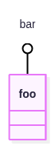
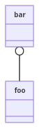
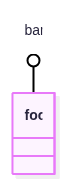

# Illustrated benchmark results — 1 November 2026

These three actual PNG outputs illustrate one documentation input. This is a selected example, not a representative sample or another benchmark. The recorded campaign grades are unchanged.

Source: [Mermaid class diagram documentation, line 362](https://github.com/mermaid-js/mermaid/blob/1fb7869866dd619168d840291c9c54b4f129758b/packages/mermaid/src/docs/syntax/classDiagram.md#L362). The source declares a lollipop interface named `bar` attached to class `foo`.

```text
classDiagram
  bar ()-- foo
```

## Mermaid 12.2.0 — Verified correct



The PNG shows `bar` as a circle interface attached to the class box `foo`, as the source requires.

## Mermaid Flutter 0.3.2 — Incorrect



The PNG draws `bar` as a second class box. The source requires a circle interface attached to `foo`.

## Latias Merman 0.9.2 — Unassessed



This PNG has not received a complete content review. A separate SVG assessment cannot establish whether this PNG is correct.

The missing review is a gap in Trident. The image has no correctness verdict; its appearance here supplies no new grade.

The correct/incorrect judgments came from the exact-image review named in [provenance](images/results-2026-11-01/provenance.json). It identifies the reviewer as an OpenAI Codex offline visual review on 31 October. This presentation adds no review. Those judgments can still be challenged against the source and actual images.

[All ranked results](../RESULTS.md) · [Benchmark definitions](../BENCHMARKS.md)

Captured outputs are copied byte for byte and checked against their SHA-256 filenames. No renderer was invoked to create these examples.
