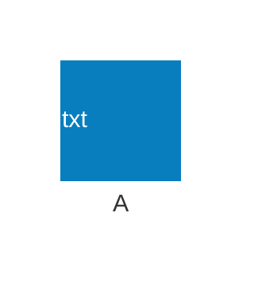
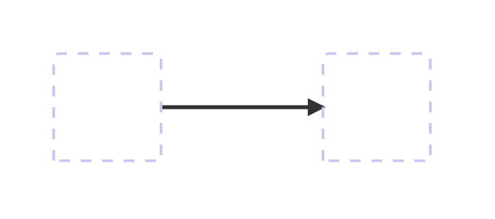
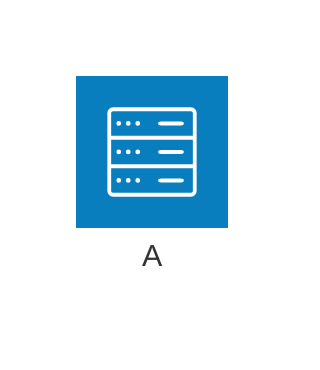

```mermaid
architecture-beta
junction j0
junction j1
j0:R<-->L:j1
junction j2
j1:R<-->L:j2
junction j3
j2:R<-->L:j3
junction j4
j3:R<-->L:j4
junction j5
j4:R<-->L:j5
junction j6
j5:R<-->L:j6
junction j7
j6:R<-->L:j7
junction j8
j7:R<-->L:j8
junction j9
j8:R<-->L:j9
junction j10
j9:R<-->L:j10
junction j11
j10:R<-->L:j11
junction j12
j11:R<-->L:j12
junction j13
j12:R<-->L:j13
junction j14
j13:R<-->L:j14
junction j15
j14:R<-->L:j15
junction j16
j15:R<-->L:j16
junction j17
j16:R<-->L:j17
junction j18
j17:R<-->L:j18
junction j19
j18:R<-->L:j19
junction j20
j19:R<-->L:j20
junction j21
j20:R<-->L:j21
junction j22
j21:R<-->L:j22
junction j23
j22:R<-->L:j23
junction j24
j23:R<-->L:j24
junction j25
j24:R<-->L:j25
junction j26
j25:R<-->L:j26
junction j27
j26:R<-->L:j27
junction j28
j27:R<-->L:j28
junction j29
j28:R<-->L:j29
junction j30
j29:R<-->L:j30
junction j31
j30:R<-->L:j31
```

```mermaid
---
config:
  architecture:
    iconSize: 40
---
architecture-beta
junction j0
junction j1
j0:R<-->L:j1
junction j2
j1:R<-->L:j2
junction j3
j2:R<-->L:j3
junction j4
j3:R<-->L:j4
junction j5
j4:R<-->L:j5
junction j6
j5:R<-->L:j6
junction j7
j6:R<-->L:j7
junction j8
j7:R<-->L:j8
junction j9
j8:R<-->L:j9
junction j10
j9:R<-->L:j10
junction j11
j10:R<-->L:j11
junction j12
j11:R<-->L:j12
junction j13
j12:R<-->L:j13
junction j14
j13:R<-->L:j14
junction j15
j14:R<-->L:j15
junction j16
j15:R<-->L:j16
junction j17
j16:R<-->L:j17
junction j18
j17:R<-->L:j18
junction j19
j18:R<-->L:j19
junction j20
j19:R<-->L:j20
junction j21
j20:R<-->L:j21
junction j22
j21:R<-->L:j22
junction j23
j22:R<-->L:j23
junction j24
j23:R<-->L:j24
junction j25
j24:R<-->L:j25
junction j26
j25:R<-->L:j26
junction j27
j26:R<-->L:j27
junction j28
j27:R<-->L:j28
junction j29
j28:R<-->L:j29
junction j30
j29:R<-->L:j30
junction j31
j30:R<-->L:j31
```

# adewale/agentic-mermaid 0.4.1: failures

563 failed observations in families the tool supports. Each shows the input, what the pinned Mermaid 12.2.0 oracle expects, and what the tool did.

[Back to the league table](../README.md)

## architecture

### scaling:architecture:16-junctions

Node API, SVG. Error: Invalid architecture edge: "j0:R<-->L:j1" — expected source:SIDE <op> SIDE:target, where SIDE is L, R, T, or B, e.g. api:R --> L:db


Expected labels: none declared

### scaling:architecture:32-junctions

Node API, SVG. Error: Invalid architecture edge: "j0:R<-->L:j1" — expected source:SIDE <op> SIDE:target, where SIDE is L, R, T, or B, e.g. api:R --> L:db



Expected labels: none declared

### scaling:architecture:32-large-junctions

Node API, SVG. Error: Invalid architecture edge: "j0:R<-->L:j1" — expected source:SIDE <op> SIDE:target, where SIDE is L, R, T, or B, e.g. api:R --> L:db



Expected labels: none declared

### corpus:mermaid-upstream-suite-bench:architecture-upstream-should-handle-accessibility-title-and-description

Node API, SVG. Error: SVG has no positive finite viewBox or explicit canvas

```mermaid
architecture-beta
            accTitle: Accessibility Title
            accDescr: Accessibility Description
```

Expected labels: none declared

Tool output: [corpus-mermaid-upstream-suite-bench-architecture-upstream-should-handle-accessibility-title-and-description-node-public-api.svg](../outputs/adewale-agentic-mermaid/corpus-mermaid-upstream-suite-bench-architecture-upstream-should-handle-accessibility-title-and-description-node-public-api.svg)

### corpus:mermaid-upstream-suite-bench:architecture-upstream-should-handle-multiline-accessibility-description

Node API, SVG. Error: SVG has no positive finite viewBox or explicit canvas

```mermaid
architecture-beta
            accDescr {
                Accessibility Description
            }
```

Expected labels: none declared

Tool output: [corpus-mermaid-upstream-suite-bench-architecture-upstream-should-handle-multiline-accessibility-description-node-public-api.svg](../outputs/adewale-agentic-mermaid/corpus-mermaid-upstream-suite-bench-architecture-upstream-should-handle-multiline-accessibility-description-node-public-api.svg)

### authored:architecture-text-icon

Node API, SVG. Error: Invalid architecture edge source "service" — expected id then side, e.g. "api:R" in "api:R -- L:db"



Expected labels: `A`

### authored:architecture-edge-no-spaces

Node API, SVG. Error: Invalid architecture edge: "a:R-->L:b" — expected source:SIDE <op> SIDE:target, where SIDE is L, R, T, or B, e.g. api:R --> L:db



Expected labels: none declared

### authored:architecture-inline-title

Node API, SVG. MermaidFamilyDetectionError: Mermaid 11.16.0 header "architecture-beta" is marked native but no installed family descriptor claimed it



Expected labels: `Hello`, `A`

### scaling:architecture:16-junctions

Node API, Terminal text. Error: Invalid architecture edge: "j0:R<-->L:j1" — expected source:SIDE <op> SIDE:target, where SIDE is L, R, T, or B, e.g. api:R --> L:db


Expected labels: none declared

### scaling:architecture:32-junctions

Node API, Terminal text. Error: Invalid architecture edge: "j0:R<-->L:j1" — expected source:SIDE <op> SIDE:target, where SIDE is L, R, T, or B, e.g. api:R --> L:db


Expected labels: none declared

### scaling:architecture:32-large-junctions

Node API, Terminal text. Error: Invalid architecture edge: "j0:R<-->L:j1" — expected source:SIDE <op> SIDE:target, where SIDE is L, R, T, or B, e.g. api:R --> L:db


Expected labels: none declared

### corpus:mermaid-upstream-suite-bench:architecture-upstream-should-handle-accessibility-title-and-description

Node API, Terminal text. Error: Expected a nonempty output string

```mermaid
architecture-beta
            accTitle: Accessibility Title
            accDescr: Accessibility Description
```

Expected labels: none declared

### corpus:mermaid-upstream-suite-bench:architecture-upstream-should-handle-multiline-accessibility-description

Node API, Terminal text. Error: Expected a nonempty output string

```mermaid
architecture-beta
            accDescr {
                Accessibility Description
            }
```

Expected labels: none declared

### authored:architecture-text-icon

Node API, Terminal text. Error: Invalid architecture edge source "service" — expected id then side, e.g. "api:R" in "api:R -- L:db"


Expected labels: `A`

### authored:architecture-edge-no-spaces

Node API, Terminal text. Error: Invalid architecture edge: "a:R-->L:b" — expected source:SIDE <op> SIDE:target, where SIDE is L, R, T, or B, e.g. api:R --> L:db


Expected labels: none declared

### authored:architecture-inline-title

Node API, Terminal text. MermaidFamilyDetectionError: Mermaid 11.16.0 header "architecture-beta" is marked native but no installed family descriptor claimed it


Expected labels: `Hello`, `A`

### scaling:architecture:16-junctions

Node API, PNG. Error: Invalid architecture edge: "j0:R<-->L:j1" — expected source:SIDE <op> SIDE:target, where SIDE is L, R, T, or B, e.g. api:R --> L:db


Expected labels: none declared

### scaling:architecture:32-junctions

Node API, PNG. Error: Invalid architecture edge: "j0:R<-->L:j1" — expected source:SIDE <op> SIDE:target, where SIDE is L, R, T, or B, e.g. api:R --> L:db


Expected labels: none declared

### scaling:architecture:32-large-junctions

Node API, PNG. Error: Invalid architecture edge: "j0:R<-->L:j1" — expected source:SIDE <op> SIDE:target, where SIDE is L, R, T, or B, e.g. api:R --> L:db


Expected labels: none declared

### corpus:mermaid-upstream-suite-bench:architecture-upstream-should-handle-accessibility-title-and-description

Node API, PNG. RangeError: SVG root viewBox must contain four finite values with positive bounds for PNG rasterization

```mermaid
architecture-beta
            accTitle: Accessibility Title
            accDescr: Accessibility Description
```

Expected labels: none declared

### corpus:mermaid-upstream-suite-bench:architecture-upstream-should-handle-multiline-accessibility-description

Node API, PNG. RangeError: SVG root viewBox must contain four finite values with positive bounds for PNG rasterization

```mermaid
architecture-beta
            accDescr {
                Accessibility Description
            }
```

Expected labels: none declared

### authored:architecture-text-icon

Node API, PNG. Error: Invalid architecture edge source "service" — expected id then side, e.g. "api:R" in "api:R -- L:db"

```mermaid
architecture-beta
service a "txt" [A]
```

Expected labels: `A`

### authored:architecture-edge-no-spaces

Node API, PNG. Error: Invalid architecture edge: "a:R-->L:b" — expected source:SIDE <op> SIDE:target, where SIDE is L, R, T, or B, e.g. api:R --> L:db

```mermaid
architecture-beta
service a
service b
a:R-->L:b
```

Expected labels: none declared

### authored:architecture-inline-title

Node API, PNG. MermaidFamilyDetectionError: Mermaid 11.16.0 header "architecture-beta" is marked native but no installed family descriptor claimed it

```mermaid
architecture-beta title Hello
service a(server)[A]
```

Expected labels: `Hello`, `A`

### scaling:architecture:16-junctions

Node API, Parser. Error: Unsupported structured parse: source-preservation fallback only

```mermaid
architecture-beta
junction j0
junction j1
j0:R<-->L:j1
junction j2
j1:R<-->L:j2
junction j3
j2:R<-->L:j3
junction j4
j3:R<-->L:j4
junction j5
j4:R<-->L:j5
junction j6
j5:R<-->L:j6
junction j7
j6:R<-->L:j7
junction j8
j7:R<-->L:j8
junction j9
j8:R<-->L:j9
junction j10
j9:R<-->L:j10
junction j11
j10:R<-->L:j11
junction j12
j11:R<-->L:j12
junction j13
j12:R<-->L:j13
junction j14
j13:R<-->L:j14
junction j15
j14:R<-->L:j15
```

Expected labels: none declared

### scaling:architecture:32-junctions

Node API, Parser. Error: Unsupported structured parse: source-preservation fallback only

```mermaid
architecture-beta
junction j0
junction j1
j0:R<-->L:j1
junction j2
j1:R<-->L:j2
junction j3
j2:R<-->L:j3
junction j4
j3:R<-->L:j4
junction j5
j4:R<-->L:j5
junction j6
j5:R<-->L:j6
junction j7
j6:R<-->L:j7
junction j8
j7:R<-->L:j8
junction j9
j8:R<-->L:j9
junction j10
j9:R<-->L:j10
junction j11
j10:R<-->L:j11
junction j12
j11:R<-->L:j12
junction j13
j12:R<-->L:j13
junction j14
j13:R<-->L:j14
junction j15
j14:R<-->L:j15
junction j16
j15:R<-->L:j16
junction j17
j16:R<-->L:j17
junction j18
j17:R<-->L:j18
junction j19
j18:R<-->L:j19
junction j20
j19:R<-->L:j20
junction j21
j20:R<-->L:j21
junction j22
j21:R<-->L:j22
junction j23
j22:R<-->L:j23
junction j24
j23:R<-->L:j24
junction j25
j24:R<-->L:j25
junction j26
j25:R<-->L:j26
junction j27
j26:R<-->L:j27
junction j28
j27:R<-->L:j28
junction j29
j28:R<-->L:j29
junction j30
j29:R<-->L:j30
junction j31
j30:R<-->L:j31
```

Expected labels: none declared

### scaling:architecture:32-large-junctions

Node API, Parser. Error: Unsupported structured parse: source-preservation fallback only

```mermaid
---
config:
  architecture:
    iconSize: 40
---
architecture-beta
junction j0
junction j1
j0:R<-->L:j1
junction j2
j1:R<-->L:j2
junction j3
j2:R<-->L:j3
junction j4
j3:R<-->L:j4
junction j5
j4:R<-->L:j5
junction j6
j5:R<-->L:j6
junction j7
j6:R<-->L:j7
junction j8
j7:R<-->L:j8
junction j9
j8:R<-->L:j9
junction j10
j9:R<-->L:j10
junction j11
j10:R<-->L:j11
junction j12
j11:R<-->L:j12
junction j13
j12:R<-->L:j13
junction j14
j13:R<-->L:j14
junction j15
j14:R<-->L:j15
junction j16
j15:R<-->L:j16
junction j17
j16:R<-->L:j17
junction j18
j17:R<-->L:j18
junction j19
j18:R<-->L:j19
junction j20
j19:R<-->L:j20
junction j21
j20:R<-->L:j21
junction j22
j21:R<-->L:j22
junction j23
j22:R<-->L:j23
junction j24
j23:R<-->L:j24
junction j25
j24:R<-->L:j25
junction j26
j25:R<-->L:j26
junction j27
j26:R<-->L:j27
junction j28
j27:R<-->L:j28
junction j29
j28:R<-->L:j29
junction j30
j29:R<-->L:j30
junction j31
j30:R<-->L:j31
```

Expected labels: none declared

### authored:architecture-text-icon

Node API, Parser. Error: Unsupported structured parse: source-preservation fallback only

```mermaid
architecture-beta
service a "txt" [A]
```

Expected labels: `A`

### authored:architecture-edge-no-spaces

Node API, Parser. Error: Unsupported structured parse: source-preservation fallback only

```mermaid
architecture-beta
service a
service b
a:R-->L:b
```

Expected labels: none declared

### authored:architecture-inline-title

Node API, Parser. Error: Unsupported structured parse: source-preservation fallback only

```mermaid
architecture-beta title Hello
service a(server)[A]
```

Expected labels: `Hello`, `A`

### scaling:architecture:16-junctions

browser API, SVG. Error: Invalid architecture edge: "j0:R<-->L:j1" — expected source:SIDE <op> SIDE:target, where SIDE is L, R, T, or B, e.g. api:R --> L:db

```mermaid
architecture-beta
junction j0
junction j1
j0:R<-->L:j1
junction j2
j1:R<-->L:j2
junction j3
j2:R<-->L:j3
junction j4
j3:R<-->L:j4
junction j5
j4:R<-->L:j5
junction j6
j5:R<-->L:j6
junction j7
j6:R<-->L:j7
junction j8
j7:R<-->L:j8
junction j9
j8:R<-->L:j9
junction j10
j9:R<-->L:j10
junction j11
j10:R<-->L:j11
junction j12
j11:R<-->L:j12
junction j13
j12:R<-->L:j13
junction j14
j13:R<-->L:j14
junction j15
j14:R<-->L:j15
```

Expected labels: none declared

### scaling:architecture:32-junctions

browser API, SVG. Error: Invalid architecture edge: "j0:R<-->L:j1" — expected source:SIDE <op> SIDE:target, where SIDE is L, R, T, or B, e.g. api:R --> L:db

```mermaid
architecture-beta
junction j0
junction j1
j0:R<-->L:j1
junction j2
j1:R<-->L:j2
junction j3
j2:R<-->L:j3
junction j4
j3:R<-->L:j4
junction j5
j4:R<-->L:j5
junction j6
j5:R<-->L:j6
junction j7
j6:R<-->L:j7
junction j8
j7:R<-->L:j8
junction j9
j8:R<-->L:j9
junction j10
j9:R<-->L:j10
junction j11
j10:R<-->L:j11
junction j12
j11:R<-->L:j12
junction j13
j12:R<-->L:j13
junction j14
j13:R<-->L:j14
junction j15
j14:R<-->L:j15
junction j16
j15:R<-->L:j16
junction j17
j16:R<-->L:j17
junction j18
j17:R<-->L:j18
junction j19
j18:R<-->L:j19
junction j20
j19:R<-->L:j20
junction j21
j20:R<-->L:j21
junction j22
j21:R<-->L:j22
junction j23
j22:R<-->L:j23
junction j24
j23:R<-->L:j24
junction j25
j24:R<-->L:j25
junction j26
j25:R<-->L:j26
junction j27
j26:R<-->L:j27
junction j28
j27:R<-->L:j28
junction j29
j28:R<-->L:j29
junction j30
j29:R<-->L:j30
junction j31
j30:R<-->L:j31
```

Expected labels: none declared

### scaling:architecture:32-large-junctions

browser API, SVG. Error: Invalid architecture edge: "j0:R<-->L:j1" — expected source:SIDE <op> SIDE:target, where SIDE is L, R, T, or B, e.g. api:R --> L:db

```mermaid
---
config:
  architecture:
    iconSize: 40
---
architecture-beta
junction j0
junction j1
j0:R<-->L:j1
junction j2
j1:R<-->L:j2
junction j3
j2:R<-->L:j3
junction j4
j3:R<-->L:j4
junction j5
j4:R<-->L:j5
junction j6
j5:R<-->L:j6
junction j7
j6:R<-->L:j7
junction j8
j7:R<-->L:j8
junction j9
j8:R<-->L:j9
junction j10
j9:R<-->L:j10
junction j11
j10:R<-->L:j11
junction j12
j11:R<-->L:j12
junction j13
j12:R<-->L:j13
junction j14
j13:R<-->L:j14
junction j15
j14:R<-->L:j15
junction j16
j15:R<-->L:j16
junction j17
j16:R<-->L:j17
junction j18
j17:R<-->L:j18
junction j19
j18:R<-->L:j19
junction j20
j19:R<-->L:j20
junction j21
j20:R<-->L:j21
junction j22
j21:R<-->L:j22
junction j23
j22:R<-->L:j23
junction j24
j23:R<-->L:j24
junction j25
j24:R<-->L:j25
junction j26
j25:R<-->L:j26
junction j27
j26:R<-->L:j27
junction j28
j27:R<-->L:j28
junction j29
j28:R<-->L:j29
junction j30
j29:R<-->L:j30
junction j31
j30:R<-->L:j31
```

Expected labels: none declared

### corpus:mermaid-upstream-suite-bench:architecture-upstream-should-handle-accessibility-title-and-description

browser API, SVG. SVG has no positive finite canvas

```mermaid
architecture-beta
            accTitle: Accessibility Title
            accDescr: Accessibility Description
```

Expected labels: none declared

Tool output: [corpus-mermaid-upstream-suite-bench-architecture-upstream-should-handle-accessibility-title-and-description-browser-public-api.svg](../outputs/adewale-agentic-mermaid/corpus-mermaid-upstream-suite-bench-architecture-upstream-should-handle-accessibility-title-and-description-browser-public-api.svg)

### corpus:mermaid-upstream-suite-bench:architecture-upstream-should-handle-multiline-accessibility-description

browser API, SVG. SVG has no positive finite canvas

```mermaid
architecture-beta
            accDescr {
                Accessibility Description
            }
```

Expected labels: none declared

Tool output: [corpus-mermaid-upstream-suite-bench-architecture-upstream-should-handle-multiline-accessibility-description-browser-public-api.svg](../outputs/adewale-agentic-mermaid/corpus-mermaid-upstream-suite-bench-architecture-upstream-should-handle-multiline-accessibility-description-browser-public-api.svg)

### authored:architecture-text-icon

browser API, SVG. Error: Invalid architecture edge source "service" — expected id then side, e.g. "api:R" in "api:R -- L:db"

```mermaid
architecture-beta
service a "txt" [A]
```

Expected labels: `A`

### authored:architecture-edge-no-spaces

browser API, SVG. Error: Invalid architecture edge: "a:R-->L:b" — expected source:SIDE <op> SIDE:target, where SIDE is L, R, T, or B, e.g. api:R --> L:db

```mermaid
architecture-beta
service a
service b
a:R-->L:b
```

Expected labels: none declared

### authored:architecture-inline-title

browser API, SVG. MermaidFamilyDetectionError: Mermaid 11.16.0 header "architecture-beta" is marked native but no installed family descriptor claimed it

```mermaid
architecture-beta title Hello
service a(server)[A]
```

Expected labels: `Hello`, `A`

## class

### portfolio:class:12

Node API, SVG. Error: Missing authored label: can fly can swim can dive can help in debugging

```mermaid
---
title: Animal example
---
classDiagram
    note "From Duck till Zebra"
    Animal <|-- Duck
    note for Duck "can fly<br>can swim<br>can dive<br>can help in debugging"
    Animal <|-- Fish
    Animal <|-- Zebra
    Animal : +int age
    Animal : +String gender
    Animal: +isMammal()
    Animal: +mate()
    class Duck{
        +String beakColor
        +swim()
        +quack()
    }
    class Fish{
        -int sizeInFeet
        -canEat()
    }
    class Zebra{
        +bool is_wild
        +run()
    }
```

Expected labels: `Animal`, `Duck`, `Fish`, `Zebra`, `From Duck till Zebra`, `can fly can swim can dive can help in debugging`

Tool output: [portfolio-class-12-node-public-api.svg](../outputs/adewale-agentic-mermaid/portfolio-class-12-node-public-api.svg)

### corpus:mermaid-upstream-suite-bench:class-upstream-should-handle-acctitle-and-accdescr

Node API, SVG. Error: SVG has no positive finite viewBox or explicit canvas

```mermaid
classDiagram
            accTitle: My Title
            accDescr: My Description
```

Expected labels: none declared

Tool output: [corpus-mermaid-upstream-suite-bench-class-upstream-should-handle-acctitle-and-accdescr-node-public-api.svg](../outputs/adewale-agentic-mermaid/corpus-mermaid-upstream-suite-bench-class-upstream-should-handle-acctitle-and-accdescr-node-public-api.svg)

### corpus:mermaid-upstream-suite-bench:class-upstream-should-handle-acctitle-and-multiline-accdescr

Node API, SVG. Error: SVG has no positive finite viewBox or explicit canvas

```mermaid
classDiagram
            accTitle: My Title
            accDescr {
              This is my multi
              line description
            }
```

Expected labels: none declared

Tool output: [corpus-mermaid-upstream-suite-bench-class-upstream-should-handle-acctitle-and-multiline-accdescr-node-public-api.svg](../outputs/adewale-agentic-mermaid/corpus-mermaid-upstream-suite-bench-class-upstream-should-handle-acctitle-and-multiline-accdescr-node-public-api.svg)

### corpus:mermaid-upstream-suite-bench:class-upstream-should-handle-an-empty-class-body-with

Node API, SVG. Error: SVG has no positive finite viewBox or explicit canvas

```mermaid
classDiagram
class EmptyClass {}
```

Expected labels: `EmptyClass`

Tool output: [corpus-mermaid-upstream-suite-bench-class-upstream-should-handle-an-empty-class-body-with-node-public-api.svg](../outputs/adewale-agentic-mermaid/corpus-mermaid-upstream-suite-bench-class-upstream-should-handle-an-empty-class-body-with-node-public-api.svg)

### corpus:mermaid-upstream-suite-bench:class-upstream-should-handle-backtick-quoted-namespace-names

Node API, SVG. Error: Missing authored label: A::B

```mermaid
classDiagram
namespace `A::B` {
	class `IPC::Sender`
}
```

Expected labels: `A::B`, `IPC::Sender`

Tool output: [corpus-mermaid-upstream-suite-bench-class-upstream-should-handle-backtick-quoted-namespace-names-node-public-api.svg](../outputs/adewale-agentic-mermaid/corpus-mermaid-upstream-suite-bench-class-upstream-should-handle-backtick-quoted-namespace-names-node-public-api.svg)

### corpus:mermaid-upstream-suite-bench:class-upstream-should-handle-namespace

Node API, SVG. Error: Missing authored label: Namespace2

```mermaid
classDiagram
namespace Namespace1 { class Class1 }
namespace Namespace2 { class Class1
}
namespace Namespace3 {
class Class1 {
int : test
string : foo
test()
foo()
}
}
namespace Namespace4 {
class Class1 {
int : test
string : foo
test()
foo()
}
class Class2 {
int : test
string : foo
test()
foo()
}
}
```

Expected labels: `Namespace1`, `Namespace2`, `Namespace3`, `Namespace4`, `Class1`, `Class2`

Tool output: [corpus-mermaid-upstream-suite-bench-class-upstream-should-handle-namespace-node-public-api.svg](../outputs/adewale-agentic-mermaid/corpus-mermaid-upstream-suite-bench-class-upstream-should-handle-namespace-node-public-api.svg)

### corpus:mermaid-upstream-suite-bench:class-upstream-should-parse-a-class-with-text-label-and-css-class-shorthand

Node API, SVG. Error: Missing authored label: Class 1 with text label

```mermaid
classDiagram
class C1["Class 1 with text label"]:::styleClass {
  +member1
}
C1 -->  C2
```

Expected labels: `Class 1 with text label`, `C2`

Tool output: [corpus-mermaid-upstream-suite-bench-class-upstream-should-parse-a-class-with-text-label-and-css-class-shorthand-node-public-api.svg](../outputs/adewale-agentic-mermaid/corpus-mermaid-upstream-suite-bench-class-upstream-should-parse-a-class-with-text-label-and-css-class-shorthand-node-public-api.svg)

### corpus:mermaid-upstream-suite-bench:class-upstream-should-parse-two-classes-with-text-labels-and-css-class-shorthands

Node API, SVG. Error: Missing authored label: Class 1 with text label; Missing authored label: Class 2 !@#$%^&*() label

```mermaid
classDiagram
class C1["Class 1 with text label"]:::styleClass1 {
  +member1
}
class C2["Class 2 !@#$%^&*() label"]:::styleClass2
C1 --> C2
```

Expected labels: `Class 1 with text label`, `Class 2 !@#$%^&*() label`

Tool output: [corpus-mermaid-upstream-suite-bench-class-upstream-should-parse-two-classes-with-text-labels-and-css-class-shorthands-node-public-api.svg](../outputs/adewale-agentic-mermaid/corpus-mermaid-upstream-suite-bench-class-upstream-should-parse-two-classes-with-text-labels-and-css-class-shorthands-node-public-api.svg)

### portfolio:class:12

Node API, Terminal text. Error: Missing authored label: From Duck till Zebra; Missing authored label: can fly can swim can dive can help in debugging

```mermaid
---
title: Animal example
---
classDiagram
    note "From Duck till Zebra"
    Animal <|-- Duck
    note for Duck "can fly<br>can swim<br>can dive<br>can help in debugging"
    Animal <|-- Fish
    Animal <|-- Zebra
    Animal : +int age
    Animal : +String gender
    Animal: +isMammal()
    Animal: +mate()
    class Duck{
        +String beakColor
        +swim()
        +quack()
    }
    class Fish{
        -int sizeInFeet
        -canEat()
    }
    class Zebra{
        +bool is_wild
        +run()
    }
```

Expected labels: `Animal`, `Duck`, `Fish`, `Zebra`, `From Duck till Zebra`, `can fly can swim can dive can help in debugging`

Tool output: [portfolio-class-12-node-public-api.txt](../outputs/adewale-agentic-mermaid/portfolio-class-12-node-public-api.txt)

### corpus:mermaid-upstream-suite-bench:class-upstream-should-handle-acctitle-and-accdescr

Node API, Terminal text. Error: Expected a nonempty output string

```mermaid
classDiagram
            accTitle: My Title
            accDescr: My Description
```

Expected labels: none declared

### corpus:mermaid-upstream-suite-bench:class-upstream-should-handle-acctitle-and-multiline-accdescr

Node API, Terminal text. Error: Expected a nonempty output string

```mermaid
classDiagram
            accTitle: My Title
            accDescr {
              This is my multi
              line description
            }
```

Expected labels: none declared

### corpus:mermaid-upstream-suite-bench:class-upstream-should-handle-an-empty-class-body-with

Node API, Terminal text. Error: Expected a nonempty output string

```mermaid
classDiagram
class EmptyClass {}
```

Expected labels: `EmptyClass`

### corpus:mermaid-upstream-suite-bench:class-upstream-should-handle-backtick-quoted-namespace-names

Node API, Terminal text. Error: Missing authored label: A::B

```mermaid
classDiagram
namespace `A::B` {
	class `IPC::Sender`
}
```

Expected labels: `A::B`, `IPC::Sender`

Tool output: [corpus-mermaid-upstream-suite-bench-class-upstream-should-handle-backtick-quoted-namespace-names-node-public-api.txt](../outputs/adewale-agentic-mermaid/corpus-mermaid-upstream-suite-bench-class-upstream-should-handle-backtick-quoted-namespace-names-node-public-api.txt)

### corpus:mermaid-upstream-suite-bench:class-upstream-should-handle-namespace

Node API, Terminal text. Error: Missing authored label: Namespace2; Missing authored label: Namespace3

```mermaid
classDiagram
namespace Namespace1 { class Class1 }
namespace Namespace2 { class Class1
}
namespace Namespace3 {
class Class1 {
int : test
string : foo
test()
foo()
}
}
namespace Namespace4 {
class Class1 {
int : test
string : foo
test()
foo()
}
class Class2 {
int : test
string : foo
test()
foo()
}
}
```

Expected labels: `Namespace1`, `Namespace2`, `Namespace3`, `Namespace4`, `Class1`, `Class2`

Tool output: [corpus-mermaid-upstream-suite-bench-class-upstream-should-handle-namespace-node-public-api.txt](../outputs/adewale-agentic-mermaid/corpus-mermaid-upstream-suite-bench-class-upstream-should-handle-namespace-node-public-api.txt)

### corpus:mermaid-upstream-suite-bench:class-upstream-should-handle-nested-namespaces-and-relationships

Node API, Terminal text. Error: Missing authored label: SubModule

```mermaid
classDiagram
        namespace Company.Project.Module.SubModule {
          class Report {
            +generatePDF(data: List)
            +generateCSV(data: List)
          }
        }
        namespace Company.Project.Module {
          class Admin {
            +generateReport()
          }
        }
        Admin --> Report : generates
```

Expected labels: `Company`, `Project`, `Module`, `SubModule`, `Report`, `Admin`, `generates`

Tool output: [corpus-mermaid-upstream-suite-bench-class-upstream-should-handle-nested-namespaces-and-relationships-node-public-api.txt](../outputs/adewale-agentic-mermaid/corpus-mermaid-upstream-suite-bench-class-upstream-should-handle-nested-namespaces-and-relationships-node-public-api.txt)

### corpus:mermaid-upstream-suite-bench:class-upstream-should-parse-a-class-with-text-label-and-css-class-shorthand

Node API, Terminal text. Error: Missing authored label: Class 1 with text label

```mermaid
classDiagram
class C1["Class 1 with text label"]:::styleClass {
  +member1
}
C1 -->  C2
```

Expected labels: `Class 1 with text label`, `C2`

Tool output: [corpus-mermaid-upstream-suite-bench-class-upstream-should-parse-a-class-with-text-label-and-css-class-shorthand-node-public-api.txt](../outputs/adewale-agentic-mermaid/corpus-mermaid-upstream-suite-bench-class-upstream-should-parse-a-class-with-text-label-and-css-class-shorthand-node-public-api.txt)

### corpus:mermaid-upstream-suite-bench:class-upstream-should-parse-diagram-with-direction

Node API, Terminal text. Error: Missing authored label: carries

```mermaid
classDiagram
          direction TB
          class Student {
            -idCard : IdCard
          }
          class IdCard{
            -id : int
            -name : string
          }
          class Bike{
            -id : int
            -name : string
          }
          Student "1" --o "1" IdCard : carries
          Student "1" --o "1" Bike : rides
```

Expected labels: `Student`, `IdCard`, `Bike`, `carries`, `rides`

Tool output: [corpus-mermaid-upstream-suite-bench-class-upstream-should-parse-diagram-with-direction-node-public-api.txt](../outputs/adewale-agentic-mermaid/corpus-mermaid-upstream-suite-bench-class-upstream-should-parse-diagram-with-direction-node-public-api.txt)

### corpus:mermaid-upstream-suite-bench:class-upstream-should-parse-two-classes-with-text-labels-and-css-class-shorthands

Node API, Terminal text. Error: Missing authored label: Class 1 with text label; Missing authored label: Class 2 !@#$%^&*() label

```mermaid
classDiagram
class C1["Class 1 with text label"]:::styleClass1 {
  +member1
}
class C2["Class 2 !@#$%^&*() label"]:::styleClass2
C1 --> C2
```

Expected labels: `Class 1 with text label`, `Class 2 !@#$%^&*() label`

Tool output: [corpus-mermaid-upstream-suite-bench-class-upstream-should-parse-two-classes-with-text-labels-and-css-class-shorthands-node-public-api.txt](../outputs/adewale-agentic-mermaid/corpus-mermaid-upstream-suite-bench-class-upstream-should-parse-two-classes-with-text-labels-and-css-class-shorthands-node-public-api.txt)

### scaling:class:80-classes

Node API, PNG. RangeError: PNG raster budget exceeded: 12600×2125 (27MP); maximum dimension is 16384px and pixel cap is 17MP

```mermaid
classDiagram
  class C0 {
    +int field0
    +method0()
  }
  class C1 {
    +int field1
    +method1()
  }
  C0 <|-- C1
  class C2 {
    +int field2
    +method2()
  }
  C0 <|-- C2
  class C3 {
    +int field3
    +method3()
  }
  C1 <|-- C3
  class C4 {
    +int field4
    +method4()
  }
  C1 <|-- C4
  class C5 {
    +int field5
    +method5()
  }
  C2 <|-- C5
  class C6 {
    +int field6
    +method6()
  }
  C2 <|-- C6
  class C7 {
    +int field7
    +method7()
  }
  C3 <|-- C7
  class C8 {
    +int field8
    +method8()
  }
  C3 <|-- C8
  class C9 {
    +int field9
    +method9()
  }
  C4 <|-- C9
  class C10 {
    +int field10
    +method10()
  }
  C4 <|-- C10
  class C11 {
    +int field11
    +method11()
  }
  C5 <|-- C11
  class C12 {
    +int field12
    +method12()
  }
  C5 <|-- C12
  class C13 {
    +int field13
    +method13()
  }
  C6 <|-- C13
  class C14 {
    +int field14
    +method14()
  }
  C6 <|-- C14
  class C15 {
    +int field15
    +method15()
  }
  C7 <|-- C15
  class C16 {
    +int field16
    +method16()
  }
  C7 <|-- C16
  class C17 {
    +int field17
    +method17()
  }
  C8 <|-- C17
  class C18 {
    +int field18
    +method18()
  }
  C8 <|-- C18
  class C19 {
    +int field19
    +method19()
  }
  C9 <|-- C19
  class C20 {
    +int field20
    +method20()
  }
  C9 <|-- C20
  class C21 {
    +int field21
    +method21()
  }
  C10 <|-- C21
  class C22 {
    +int field22
    +method22()
  }
  C10 <|-- C22
  class C23 {
    +int field23
    +method23()
  }
  C11 <|-- C23
  class C24 {
    +int field24
    +method24()
  }
  C11 <|-- C24
  class C25 {
    +int field25
    +method25()
  }
  C12 <|-- C25
  class C26 {
    +int field26
    +method26()
  }
  C12 <|-- C26
  class C27 {
    +int field27
    +method27()
  }
  C13 <|-- C27
  class C28 {
    +int field28
    +method28()
  }
  C13 <|-- C28
  class C29 {
    +int field29
    +method29()
  }
  C14 <|-- C29
  class C30 {
    +int field30
    +method30()
  }
  C14 <|-- C30
  class C31 {
    +int field31
    +method31()
  }
  C15 <|-- C31
  class C32 {
    +int field32
    +method32()
  }
  C15 <|-- C32
  class C33 {
    +int field33
    +method33()
  }
  C16 <|-- C33
  class C34 {
    +int field34
    +method34()
  }
  C16 <|-- C34
  class C35 {
    +int field35
    +method35()
  }
  C17 <|-- C35
  class C36 {
    +int field36
    +method36()
  }
  C17 <|-- C36
  class C37 {
    +int field37
    +method37()
  }
  C18 <|-- C37
  class C38 {
    +int field38
    +method38()
  }
  C18 <|-- C38
  class C39 {
    +int field39
    +method39()
  }
  C19 <|-- C39
  class C40 {
    +int field40
    +method40()
  }
  C19 <|-- C40
  class C41 {
    +int field41
    +method41()
  }
  C20 <|-- C41
  class C42 {
    +int field42
    +method42()
  }
  C20 <|-- C42
  class C43 {
    +int field43
    +method43()
  }
  C21 <|-- C43
  class C44 {
    +int field44
    +method44()
  }
  C21 <|-- C44
  class C45 {
    +int field45
    +method45()
  }
  C22 <|-- C45
  class C46 {
    +int field46
    +method46()
  }
  C22 <|-- C46
  class C47 {
    +int field47
    +method47()
  }
  C23 <|-- C47
  class C48 {
    +int field48
    +method48()
  }
  C23 <|-- C48
  class C49 {
    +int field49
    +method49()
  }
  C24 <|-- C49
  class C50 {
    +int field50
    +method50()
  }
  C24 <|-- C50
  class C51 {
    +int field51
    +method51()
  }
  C25 <|-- C51
  class C52 {
    +int field52
    +method52()
  }
  C25 <|-- C52
  class C53 {
    +int field53
    +method53()
  }
  C26 <|-- C53
  class C54 {
    +int field54
    +method54()
  }
  C26 <|-- C54
  class C55 {
    +int field55
    +method55()
  }
  C27 <|-- C55
  class C56 {
    +int field56
    +method56()
  }
  C27 <|-- C56
  class C57 {
    +int field57
    +method57()
  }
  C28 <|-- C57
  class C58 {
    +int field58
    +method58()
  }
  C28 <|-- C58
  class C59 {
    +int field59
    +method59()
  }
  C29 <|-- C59
  class C60 {
    +int field60
    +method60()
  }
  C29 <|-- C60
  class C61 {
    +int field61
    +method61()
  }
  C30 <|-- C61
  class C62 {
    +int field62
    +method62()
  }
  C30 <|-- C62
  class C63 {
    +int field63
    +method63()
  }
  C31 <|-- C63
  class C64 {
    +int field64
    +method64()
  }
  C31 <|-- C64
  class C65 {
    +int field65
    +method65()
  }
  C32 <|-- C65
  class C66 {
    +int field66
    +method66()
  }
  C32 <|-- C66
  class C67 {
    +int field67
    +method67()
  }
  C33 <|-- C67
  class C68 {
    +int field68
    +method68()
  }
  C33 <|-- C68
  class C69 {
    +int field69
    +method69()
  }
  C34 <|-- C69
  class C70 {
    +int field70
    +method70()
  }
  C34 <|-- C70
  class C71 {
    +int field71
    +method71()
  }
  C35 <|-- C71
  class C72 {
    +int field72
    +method72()
  }
  C35 <|-- C72
  class C73 {
    +int field73
    +method73()
  }
  C36 <|-- C73
  class C74 {
    +int field74
    +method74()
  }
  C36 <|-- C74
  class C75 {
    +int field75
    +method75()
  }
  C37 <|-- C75
  class C76 {
    +int field76
    +method76()
  }
  C37 <|-- C76
  class C77 {
    +int field77
    +method77()
  }
  C38 <|-- C77
  class C78 {
    +int field78
    +method78()
  }
  C38 <|-- C78
  class C79 {
    +int field79
    +method79()
  }
  C39 <|-- C79
```

Expected labels: `C0`, `C1`, `C2`, `C3`, `C4`, `C5`, `C6`, `C7`, `C8`, `C9`, `C10`, `C11`, `C12`, `C13`, `C14`, `C15`, `C16`, `C17`, `C18`, `C19`, `C20`, `C21`, `C22`, `C23`, `C24`, `C25`, `C26`, `C27`, `C28`, `C29`, `C30`, `C31`, `C32`, `C33`, `C34`, `C35`, `C36`, `C37`, `C38`, `C39`, `C40`, `C41`, `C42`, `C43`, `C44`, `C45`, `C46`, `C47`, `C48`, `C49`, `C50`, `C51`, `C52`, `C53`, `C54`, `C55`, `C56`, `C57`, `C58`, `C59`, `C60`, `C61`, `C62`, `C63`, `C64`, `C65`, `C66`, `C67`, `C68`, `C69`, `C70`, `C71`, `C72`, `C73`, `C74`, `C75`, `C76`, `C77`, `C78`, `C79`

### corpus:mermaid-upstream-suite-bench:class-upstream-should-handle-acctitle-and-accdescr

Node API, PNG. RangeError: SVG root viewBox must contain four finite values with positive bounds for PNG rasterization

```mermaid
classDiagram
            accTitle: My Title
            accDescr: My Description
```

Expected labels: none declared

### corpus:mermaid-upstream-suite-bench:class-upstream-should-handle-acctitle-and-multiline-accdescr

Node API, PNG. RangeError: SVG root viewBox must contain four finite values with positive bounds for PNG rasterization

```mermaid
classDiagram
            accTitle: My Title
            accDescr {
              This is my multi
              line description
            }
```

Expected labels: none declared

### corpus:mermaid-upstream-suite-bench:class-upstream-should-handle-an-empty-class-body-with

Node API, PNG. RangeError: SVG root viewBox must contain four finite values with positive bounds for PNG rasterization

```mermaid
classDiagram
class EmptyClass {}
```

Expected labels: `EmptyClass`

### portfolio:class:12

Node API, Parser. Error: Structured parser lost declared labels (raw source/sidecars excluded): can fly can swim can dive can help in debugging

```mermaid
---
title: Animal example
---
classDiagram
    note "From Duck till Zebra"
    Animal <|-- Duck
    note for Duck "can fly<br>can swim<br>can dive<br>can help in debugging"
    Animal <|-- Fish
    Animal <|-- Zebra
    Animal : +int age
    Animal : +String gender
    Animal: +isMammal()
    Animal: +mate()
    class Duck{
        +String beakColor
        +swim()
        +quack()
    }
    class Fish{
        -int sizeInFeet
        -canEat()
    }
    class Zebra{
        +bool is_wild
        +run()
    }
```

Expected labels: `Animal`, `Duck`, `Fish`, `Zebra`, `From Duck till Zebra`, `can fly can swim can dive can help in debugging`

### corpus:mermaid-upstream-suite-bench:class-upstream-defaults-to-hierarchical-rendering-when-hierarchicalnamespaces-is-unset

Node API, Parser. Error: Structured parser lost declared labels (raw source/sidecars excluded): A, B

```mermaid
classDiagram
        namespace A.B {
          class Foo
        }
```

Expected labels: `A`, `B`, `Foo`

### corpus:mermaid-upstream-suite-bench:class-upstream-emits-only-explicit-namespaces-from-getdata-in-compact-mode

Node API, Parser. Error: Structured parser lost declared labels (raw source/sidecars excluded): Engineering, Backend

```mermaid
classDiagram
          namespace Company.Engineering.Backend {
            class Developer {
              +writeCode()
            }
          }
          namespace Company {
            class CEO {
              +makeDecisions()
            }
          }
```

Expected labels: `Company`, `Engineering`, `Backend`, `Developer`, `CEO`

### corpus:mermaid-upstream-suite-bench:class-upstream-moves-classes-inside-implicit-namespaces-to-the-nearest-explicit-ancestor-in-compact-mode

Node API, Parser. Error: Structured parser lost declared labels (raw source/sidecars excluded): Engineering, Backend

```mermaid
classDiagram
          namespace Company.Engineering.Backend {
            class Developer
          }
          namespace Company {
            class CEO
          }
```

Expected labels: `Company`, `Engineering`, `Backend`, `Developer`, `CEO`

### corpus:mermaid-upstream-suite-bench:class-upstream-should-handle-an-empty-class-body-with

Node API, Parser. Error: Unsupported structured parse: source-preservation fallback only

```mermaid
classDiagram
class EmptyClass {}
```

Expected labels: `EmptyClass`

### corpus:mermaid-upstream-suite-bench:class-upstream-should-handle-backtick-quoted-namespace-names

Node API, Parser. Error: Unsupported structured parse: source-preservation fallback only

```mermaid
classDiagram
namespace `A::B` {
	class `IPC::Sender`
}
```

Expected labels: `A::B`, `IPC::Sender`

### corpus:mermaid-upstream-suite-bench:class-upstream-should-handle-classes-within-namespaces

Node API, Parser. Error: Structured parser lost declared labels (raw source/sidecars excluded): Company, Project, Module

```mermaid
classDiagram
        namespace Company.Project {
          class User {
            +login(username: String, password: String)
            +logout()
          }
        }
        namespace Company.Project.Module {
          class Admin {
            +addUser(user: User)
            +removeUser(user: User)
          }
        }
```

Expected labels: `Company`, `Project`, `Module`, `User`, `Admin`

### corpus:mermaid-upstream-suite-bench:class-upstream-should-handle-fully-qualified-class-names-in-relationships

Node API, Parser. Error: Structured parser lost declared labels (raw source/sidecars excluded): Company, Project, Module

```mermaid
classDiagram
        namespace Company.Project.Module {
          class User
          class Admin
        }
          Admin --> User : manages
```

Expected labels: `Company`, `Project`, `Module`, `User`, `Admin`, `manages`

### corpus:mermaid-upstream-suite-bench:class-upstream-should-handle-generic-classes-within-namespaces

Node API, Parser. Error: Structured parser lost declared labels (raw source/sidecars excluded): Company, Project, Module

```mermaid
classDiagram
    namespace Company.Project.Module {
        class GenericClass~T~ {
            +addItem(item: T)
            +getItem() T
        }
    }
```

Expected labels: `Company`, `Project`, `Module`, `GenericClass`

### corpus:mermaid-upstream-suite-bench:class-upstream-should-handle-namespace

Node API, Parser. Error: Unsupported structured parse: source-preservation fallback only

```mermaid
classDiagram
namespace Namespace1 { class Class1 }
namespace Namespace2 { class Class1
}
namespace Namespace3 {
class Class1 {
int : test
string : foo
test()
foo()
}
}
namespace Namespace4 {
class Class1 {
int : test
string : foo
test()
foo()
}
class Class2 {
int : test
string : foo
test()
foo()
}
}
```

Expected labels: `Namespace1`, `Namespace2`, `Namespace3`, `Namespace4`, `Class1`, `Class2`

### corpus:mermaid-upstream-suite-bench:class-upstream-should-handle-nested-namespaces-and-relationships

Node API, Parser. Error: Structured parser lost declared labels (raw source/sidecars excluded): Company, Project, Module, SubModule

```mermaid
classDiagram
        namespace Company.Project.Module.SubModule {
          class Report {
            +generatePDF(data: List)
            +generateCSV(data: List)
          }
        }
        namespace Company.Project.Module {
          class Admin {
            +generateReport()
          }
        }
        Admin --> Report : generates
```

Expected labels: `Company`, `Project`, `Module`, `SubModule`, `Report`, `Admin`, `generates`

### corpus:mermaid-upstream-suite-bench:class-upstream-should-handle-syntactically-nested-namespace-blocks

Node API, Parser. Error: Structured parser lost declared labels (raw source/sidecars excluded): Inner

```mermaid
classDiagram
        namespace Outer {
          namespace Inner {
            class Foo {
              +bar()
            }
          }
          class Baz {
            +qux()
          }
        }
```

Expected labels: `Outer`, `Inner`, `Foo`, `Baz`

### corpus:mermaid-upstream-suite-bench:class-upstream-should-parse-a-class-with-text-label-and-css-class-shorthand

Node API, Parser. Error: Unsupported structured parse: source-preservation fallback only

```mermaid
classDiagram
class C1["Class 1 with text label"]:::styleClass {
  +member1
}
C1 -->  C2
```

Expected labels: `Class 1 with text label`, `C2`

### corpus:mermaid-upstream-suite-bench:class-upstream-should-parse-diagram-with-direction

Node API, Parser. Error: Unsupported structured parse: source-preservation fallback only

```mermaid
classDiagram
          direction TB
          class Student {
            -idCard : IdCard
          }
          class IdCard{
            -id : int
            -name : string
          }
          class Bike{
            -id : int
            -name : string
          }
          Student "1" --o "1" IdCard : carries
          Student "1" --o "1" Bike : rides
```

Expected labels: `Student`, `IdCard`, `Bike`, `carries`, `rides`

### corpus:mermaid-upstream-suite-bench:class-upstream-should-parse-two-classes-with-text-labels-and-css-class-shorthands

Node API, Parser. Error: Unsupported structured parse: source-preservation fallback only

```mermaid
classDiagram
class C1["Class 1 with text label"]:::styleClass1 {
  +member1
}
class C2["Class 2 !@#$%^&*() label"]:::styleClass2
C1 --> C2
```

Expected labels: `Class 1 with text label`, `Class 2 !@#$%^&*() label`

### corpus:mermaid-upstream-suite-bench:class-upstream-should-revert-direction-to-default-once-direction-is-removed

Node API, Parser. Error: Unsupported structured parse: source-preservation fallback only

```mermaid
classDiagram
          direction RL
          class A
```

Expected labels: `A`

### portfolio:class:12

browser API, SVG. Missing authored label: can fly can swim can dive can help in debugging

```mermaid
---
title: Animal example
---
classDiagram
    note "From Duck till Zebra"
    Animal <|-- Duck
    note for Duck "can fly<br>can swim<br>can dive<br>can help in debugging"
    Animal <|-- Fish
    Animal <|-- Zebra
    Animal : +int age
    Animal : +String gender
    Animal: +isMammal()
    Animal: +mate()
    class Duck{
        +String beakColor
        +swim()
        +quack()
    }
    class Fish{
        -int sizeInFeet
        -canEat()
    }
    class Zebra{
        +bool is_wild
        +run()
    }
```

Expected labels: `Animal`, `Duck`, `Fish`, `Zebra`, `From Duck till Zebra`, `can fly can swim can dive can help in debugging`

Tool output: [portfolio-class-12-browser-public-api.svg](../outputs/adewale-agentic-mermaid/portfolio-class-12-browser-public-api.svg)

### corpus:mermaid-upstream-suite-bench:class-upstream-should-handle-acctitle-and-accdescr

browser API, SVG. SVG has no positive finite canvas

```mermaid
classDiagram
            accTitle: My Title
            accDescr: My Description
```

Expected labels: none declared

Tool output: [corpus-mermaid-upstream-suite-bench-class-upstream-should-handle-acctitle-and-accdescr-browser-public-api.svg](../outputs/adewale-agentic-mermaid/corpus-mermaid-upstream-suite-bench-class-upstream-should-handle-acctitle-and-accdescr-browser-public-api.svg)

### corpus:mermaid-upstream-suite-bench:class-upstream-should-handle-acctitle-and-multiline-accdescr

browser API, SVG. SVG has no positive finite canvas

```mermaid
classDiagram
            accTitle: My Title
            accDescr {
              This is my multi
              line description
            }
```

Expected labels: none declared

Tool output: [corpus-mermaid-upstream-suite-bench-class-upstream-should-handle-acctitle-and-multiline-accdescr-browser-public-api.svg](../outputs/adewale-agentic-mermaid/corpus-mermaid-upstream-suite-bench-class-upstream-should-handle-acctitle-and-multiline-accdescr-browser-public-api.svg)

### corpus:mermaid-upstream-suite-bench:class-upstream-should-handle-an-empty-class-body-with

browser API, SVG. SVG has no positive finite canvas

```mermaid
classDiagram
class EmptyClass {}
```

Expected labels: `EmptyClass`

Tool output: [corpus-mermaid-upstream-suite-bench-class-upstream-should-handle-an-empty-class-body-with-browser-public-api.svg](../outputs/adewale-agentic-mermaid/corpus-mermaid-upstream-suite-bench-class-upstream-should-handle-an-empty-class-body-with-browser-public-api.svg)

### corpus:mermaid-upstream-suite-bench:class-upstream-should-handle-backtick-quoted-namespace-names

browser API, SVG. Missing authored label: A::B

```mermaid
classDiagram
namespace `A::B` {
	class `IPC::Sender`
}
```

Expected labels: `A::B`, `IPC::Sender`

Tool output: [corpus-mermaid-upstream-suite-bench-class-upstream-should-handle-backtick-quoted-namespace-names-browser-public-api.svg](../outputs/adewale-agentic-mermaid/corpus-mermaid-upstream-suite-bench-class-upstream-should-handle-backtick-quoted-namespace-names-browser-public-api.svg)

### corpus:mermaid-upstream-suite-bench:class-upstream-should-handle-namespace

browser API, SVG. Missing authored label: Namespace2

```mermaid
classDiagram
namespace Namespace1 { class Class1 }
namespace Namespace2 { class Class1
}
namespace Namespace3 {
class Class1 {
int : test
string : foo
test()
foo()
}
}
namespace Namespace4 {
class Class1 {
int : test
string : foo
test()
foo()
}
class Class2 {
int : test
string : foo
test()
foo()
}
}
```

Expected labels: `Namespace1`, `Namespace2`, `Namespace3`, `Namespace4`, `Class1`, `Class2`

Tool output: [corpus-mermaid-upstream-suite-bench-class-upstream-should-handle-namespace-browser-public-api.svg](../outputs/adewale-agentic-mermaid/corpus-mermaid-upstream-suite-bench-class-upstream-should-handle-namespace-browser-public-api.svg)

### corpus:mermaid-upstream-suite-bench:class-upstream-should-parse-a-class-with-text-label-and-css-class-shorthand

browser API, SVG. Missing authored label: Class 1 with text label

```mermaid
classDiagram
class C1["Class 1 with text label"]:::styleClass {
  +member1
}
C1 -->  C2
```

Expected labels: `Class 1 with text label`, `C2`

Tool output: [corpus-mermaid-upstream-suite-bench-class-upstream-should-parse-a-class-with-text-label-and-css-class-shorthand-browser-public-api.svg](../outputs/adewale-agentic-mermaid/corpus-mermaid-upstream-suite-bench-class-upstream-should-parse-a-class-with-text-label-and-css-class-shorthand-browser-public-api.svg)

### corpus:mermaid-upstream-suite-bench:class-upstream-should-parse-two-classes-with-text-labels-and-css-class-shorthands

browser API, SVG. Missing authored label: Class 1 with text label; Missing authored label: Class 2 !@#$%^&*() label

```mermaid
classDiagram
class C1["Class 1 with text label"]:::styleClass1 {
  +member1
}
class C2["Class 2 !@#$%^&*() label"]:::styleClass2
C1 --> C2
```

Expected labels: `Class 1 with text label`, `Class 2 !@#$%^&*() label`

Tool output: [corpus-mermaid-upstream-suite-bench-class-upstream-should-parse-two-classes-with-text-labels-and-css-class-shorthands-browser-public-api.svg](../outputs/adewale-agentic-mermaid/corpus-mermaid-upstream-suite-bench-class-upstream-should-parse-two-classes-with-text-labels-and-css-class-shorthands-browser-public-api.svg)

## er

### corpus:mermaid-upstream-suite-bench:er-upstream-should-allow-numeric-entity-identifier-1-on-right-side-with-cardinality-1-issue-7472

Node API, SVG. Error: SVG has no positive finite viewBox or explicit canvas

```mermaid
erDiagram
a many to 1 1: label
```

Expected labels: `a`, `1`, `label`

Tool output: [corpus-mermaid-upstream-suite-bench-er-upstream-should-allow-numeric-entity-identifier-1-on-right-side-with-cardinality-1-issue-7472-node-public-api.svg](../outputs/adewale-agentic-mermaid/corpus-mermaid-upstream-suite-bench-er-upstream-should-allow-numeric-entity-identifier-1-on-right-side-with-cardinality-1-issue-7472-node-public-api.svg)

### corpus:mermaid-upstream-suite-bench:er-upstream-should-allow-numeric-entity-identifier-12-on-right-side-with-cardinality-1-issue-7472-boun

Node API, SVG. Error: SVG has no positive finite viewBox or explicit canvas

```mermaid
erDiagram
a many to 1 12: label
```

Expected labels: `a`, `12`, `label`

Tool output: [corpus-mermaid-upstream-suite-bench-er-upstream-should-allow-numeric-entity-identifier-12-on-right-side-with-cardinality-1-issue-7472-boun-node-public-api.svg](../outputs/adewale-agentic-mermaid/corpus-mermaid-upstream-suite-bench-er-upstream-should-allow-numeric-entity-identifier-12-on-right-side-with-cardinality-1-issue-7472-boun-node-public-api.svg)

### corpus:mermaid-upstream-suite-bench:er-upstream-should-correctly-parse-direction-rl-inside-a-subgraph

Node API, SVG. Error: Missing authored label: WithRL

```mermaid
erDiagram subgraph WithRL
direction RL
A
B
end
```

Expected labels: `WithRL`, `A`, `B`

Tool output: [corpus-mermaid-upstream-suite-bench-er-upstream-should-correctly-parse-direction-rl-inside-a-subgraph-node-public-api.svg](../outputs/adewale-agentic-mermaid/corpus-mermaid-upstream-suite-bench-er-upstream-should-correctly-parse-direction-rl-inside-a-subgraph-node-public-api.svg)

### corpus:mermaid-upstream-suite-bench:er-upstream-should-handle-1-alias-directly-followed-by-identifying-relationship-operator

Node API, SVG. Error: SVG has no positive finite viewBox or explicit canvas

```mermaid
erDiagram
CUSTOMER 1--one or more DELIVERY-ADDRESS : has
```

Expected labels: `CUSTOMER`, `DELIVERY-ADDRESS`, `has`

Tool output: [corpus-mermaid-upstream-suite-bench-er-upstream-should-handle-1-alias-directly-followed-by-identifying-relationship-operator-node-public-api.svg](../outputs/adewale-agentic-mermaid/corpus-mermaid-upstream-suite-bench-er-upstream-should-handle-1-alias-directly-followed-by-identifying-relationship-operator-node-public-api.svg)

### corpus:mermaid-upstream-suite-bench:er-upstream-should-handle-1-alias-directly-followed-by-mixed-relationship-operator

Node API, SVG. Error: SVG has no positive finite viewBox or explicit canvas

```mermaid
erDiagram
CUSTOMER 1.-one or more DELIVERY-ADDRESS : has
```

Expected labels: `CUSTOMER`, `DELIVERY-ADDRESS`, `has`

Tool output: [corpus-mermaid-upstream-suite-bench-er-upstream-should-handle-1-alias-directly-followed-by-mixed-relationship-operator-node-public-api.svg](../outputs/adewale-agentic-mermaid/corpus-mermaid-upstream-suite-bench-er-upstream-should-handle-1-alias-directly-followed-by-mixed-relationship-operator-node-public-api.svg)

### corpus:mermaid-upstream-suite-bench:er-upstream-should-handle-1-alias-directly-followed-by-mixed-relationship-operator-2

Node API, SVG. Error: SVG has no positive finite viewBox or explicit canvas

```mermaid
erDiagram
CUSTOMER 1-.one or more DELIVERY-ADDRESS : has
```

Expected labels: `CUSTOMER`, `DELIVERY-ADDRESS`, `has`

Tool output: [corpus-mermaid-upstream-suite-bench-er-upstream-should-handle-1-alias-directly-followed-by-mixed-relationship-operator-2-node-public-api.svg](../outputs/adewale-agentic-mermaid/corpus-mermaid-upstream-suite-bench-er-upstream-should-handle-1-alias-directly-followed-by-mixed-relationship-operator-2-node-public-api.svg)

### corpus:mermaid-upstream-suite-bench:er-upstream-should-handle-1-alias-directly-followed-by-non-identifying-relationship-operator

Node API, SVG. Error: SVG has no positive finite viewBox or explicit canvas

```mermaid
erDiagram
CUSTOMER 1..one or more DELIVERY-ADDRESS : has
```

Expected labels: `CUSTOMER`, `DELIVERY-ADDRESS`, `has`

Tool output: [corpus-mermaid-upstream-suite-bench-er-upstream-should-handle-1-alias-directly-followed-by-non-identifying-relationship-operator-node-public-api.svg](../outputs/adewale-agentic-mermaid/corpus-mermaid-upstream-suite-bench-er-upstream-should-handle-1-alias-directly-followed-by-non-identifying-relationship-operator-node-public-api.svg)

### corpus:mermaid-upstream-suite-bench:er-upstream-should-handle-one-or-more-to-zero-or-one-relationships-aliases-one-or-many-and-zero-or-one

Node API, SVG. Error: SVG has no positive finite viewBox or explicit canvas

```mermaid
erDiagram
A one or many optionally to zero or one B : has
```

Expected labels: `A`, `B`, `has`

Tool output: [corpus-mermaid-upstream-suite-bench-er-upstream-should-handle-one-or-more-to-zero-or-one-relationships-aliases-one-or-many-and-zero-or-one-node-public-api.svg](../outputs/adewale-agentic-mermaid/corpus-mermaid-upstream-suite-bench-er-upstream-should-handle-one-or-more-to-zero-or-one-relationships-aliases-one-or-many-and-zero-or-one-node-public-api.svg)

### corpus:mermaid-upstream-suite-bench:er-upstream-should-handle-only-one-to-only-one-relationships-aliases-only-one-and-1

Node API, SVG. Error: SVG has no positive finite viewBox or explicit canvas

```mermaid
erDiagram
A only one optionally to 1+ B : has
```

Expected labels: `A`, `B`, `has`

Tool output: [corpus-mermaid-upstream-suite-bench-er-upstream-should-handle-only-one-to-only-one-relationships-aliases-only-one-and-1-node-public-api.svg](../outputs/adewale-agentic-mermaid/corpus-mermaid-upstream-suite-bench-er-upstream-should-handle-only-one-to-only-one-relationships-aliases-only-one-and-1-node-public-api.svg)

### corpus:mermaid-upstream-suite-bench:er-upstream-should-handle-zero-or-more-to-one-or-more-relationships-aliases-many-0-and-many-1

Node API, SVG. Error: SVG has no positive finite viewBox or explicit canvas

```mermaid
erDiagram
A many(0) to many(1) B : has
```

Expected labels: `A`, `B`, `has`

Tool output: [corpus-mermaid-upstream-suite-bench-er-upstream-should-handle-zero-or-more-to-one-or-more-relationships-aliases-many-0-and-many-1-node-public-api.svg](../outputs/adewale-agentic-mermaid/corpus-mermaid-upstream-suite-bench-er-upstream-should-handle-zero-or-more-to-one-or-more-relationships-aliases-many-0-and-many-1-node-public-api.svg)

### corpus:mermaid-upstream-suite-bench:er-upstream-should-handle-zero-or-more-to-only-one-relationships-aliases-0-and-1

Node API, SVG. Error: SVG has no positive finite viewBox or explicit canvas

```mermaid
erDiagram
A 0+ optionally to 1 B : has
```

Expected labels: `A`, `B`, `has`

Tool output: [corpus-mermaid-upstream-suite-bench-er-upstream-should-handle-zero-or-more-to-only-one-relationships-aliases-0-and-1-node-public-api.svg](../outputs/adewale-agentic-mermaid/corpus-mermaid-upstream-suite-bench-er-upstream-should-handle-zero-or-more-to-only-one-relationships-aliases-0-and-1-node-public-api.svg)

### corpus:mermaid-upstream-suite-bench:er-upstream-should-handle-zero-or-more-to-only-one-relationships-aliases-many-0-and-many-1

Node API, SVG. Error: SVG has no positive finite viewBox or explicit canvas

```mermaid
erDiagram
A many optionally to one B : has
```

Expected labels: `A`, `B`, `has`

Tool output: [corpus-mermaid-upstream-suite-bench-er-upstream-should-handle-zero-or-more-to-only-one-relationships-aliases-many-0-and-many-1-node-public-api.svg](../outputs/adewale-agentic-mermaid/corpus-mermaid-upstream-suite-bench-er-upstream-should-handle-zero-or-more-to-only-one-relationships-aliases-many-0-and-many-1-node-public-api.svg)

### corpus:mermaid-upstream-suite-bench:er-upstream-should-handle-zero-or-more-to-zero-or-more-relationships-aliases-zero-or-more-and-zero-or-

Node API, SVG. Error: SVG has no positive finite viewBox or explicit canvas

```mermaid
erDiagram
A zero or more to zero or many B : has
```

Expected labels: `A`, `B`, `has`

Tool output: [corpus-mermaid-upstream-suite-bench-er-upstream-should-handle-zero-or-more-to-zero-or-more-relationships-aliases-zero-or-more-and-zero-or--node-public-api.svg](../outputs/adewale-agentic-mermaid/corpus-mermaid-upstream-suite-bench-er-upstream-should-handle-zero-or-more-to-zero-or-more-relationships-aliases-zero-or-more-and-zero-or--node-public-api.svg)

### corpus:mermaid-upstream-suite-bench:er-upstream-should-handle-zero-or-one-to-zero-or-more-relationships-aliases-one-or-zero-and-zero-or-ma

Node API, SVG. Error: SVG has no positive finite viewBox or explicit canvas

```mermaid
erDiagram
A one or zero to many B : has
```

Expected labels: `A`, `B`, `has`

Tool output: [corpus-mermaid-upstream-suite-bench-er-upstream-should-handle-zero-or-one-to-zero-or-more-relationships-aliases-one-or-zero-and-zero-or-ma-node-public-api.svg](../outputs/adewale-agentic-mermaid/corpus-mermaid-upstream-suite-bench-er-upstream-should-handle-zero-or-one-to-zero-or-more-relationships-aliases-one-or-zero-and-zero-or-ma-node-public-api.svg)

### corpus:mermaid-upstream-suite-bench:er-upstream-should-represent-identifying-relationships-properly-alias-to

Node API, SVG. Error: SVG has no positive finite viewBox or explicit canvas

```mermaid
erDiagram
HOUSE one to one ROOM : contains
```

Expected labels: `HOUSE`, `ROOM`, `contains`

Tool output: [corpus-mermaid-upstream-suite-bench-er-upstream-should-represent-identifying-relationships-properly-alias-to-node-public-api.svg](../outputs/adewale-agentic-mermaid/corpus-mermaid-upstream-suite-bench-er-upstream-should-represent-identifying-relationships-properly-alias-to-node-public-api.svg)

### corpus:mermaid-upstream-suite-bench:er-upstream-should-represent-non-identifying-relationships-properly-alias-optionally-to

Node API, SVG. Error: SVG has no positive finite viewBox or explicit canvas

```mermaid
erDiagram
 PERSON many optionally to many POSSESSION : owns
```

Expected labels: `PERSON`, `POSSESSION`, `owns`

Tool output: [corpus-mermaid-upstream-suite-bench-er-upstream-should-represent-non-identifying-relationships-properly-alias-optionally-to-node-public-api.svg](../outputs/adewale-agentic-mermaid/corpus-mermaid-upstream-suite-bench-er-upstream-should-represent-non-identifying-relationships-properly-alias-optionally-to-node-public-api.svg)

### corpus:mermaid-upstream-suite-bench:er-upstream-should-represent-parent-child-relationship-correctly

Node API, SVG. Error: SVG has no positive finite viewBox or explicit canvas

```mermaid
erDiagram
PROJECT u--o{ TEAM_MEMBER : "parent"
```

Expected labels: `PROJECT`, `TEAM_MEMBER`, `parent`

Tool output: [corpus-mermaid-upstream-suite-bench-er-upstream-should-represent-parent-child-relationship-correctly-node-public-api.svg](../outputs/adewale-agentic-mermaid/corpus-mermaid-upstream-suite-bench-er-upstream-should-represent-parent-child-relationship-correctly-node-public-api.svg)

### portfolio:er:16

Node API, Terminal text. Error: Missing authored label: contains

```mermaid
---
title: Order example
---
erDiagram
    CUSTOMER ||--o{ ORDER : places
    ORDER ||--|{ LINE-ITEM : contains
    CUSTOMER }|..|{ DELIVERY-ADDRESS : uses
```

Expected labels: `CUSTOMER`, `ORDER`, `LINE-ITEM`, `DELIVERY-ADDRESS`, `places`, `contains`, `uses`

Tool output: [portfolio-er-16-node-public-api.txt](../outputs/adewale-agentic-mermaid/portfolio-er-16-node-public-api.txt)

### corpus:mermaid-upstream-suite-bench:er-upstream-should-allow-numeric-entity-identifier-1-on-right-side-with-cardinality-1-issue-7472

Node API, Terminal text. Error: Expected a nonempty output string

```mermaid
erDiagram
a many to 1 1: label
```

Expected labels: `a`, `1`, `label`

### corpus:mermaid-upstream-suite-bench:er-upstream-should-allow-numeric-entity-identifier-12-on-right-side-with-cardinality-1-issue-7472-boun

Node API, Terminal text. Error: Expected a nonempty output string

```mermaid
erDiagram
a many to 1 12: label
```

Expected labels: `a`, `12`, `label`

### corpus:mermaid-upstream-suite-bench:er-upstream-should-correctly-parse-direction-rl-inside-a-subgraph

Node API, Terminal text. Error: Missing authored label: WithRL

```mermaid
erDiagram subgraph WithRL
direction RL
A
B
end
```

Expected labels: `WithRL`, `A`, `B`

Tool output: [corpus-mermaid-upstream-suite-bench-er-upstream-should-correctly-parse-direction-rl-inside-a-subgraph-node-public-api.txt](../outputs/adewale-agentic-mermaid/corpus-mermaid-upstream-suite-bench-er-upstream-should-correctly-parse-direction-rl-inside-a-subgraph-node-public-api.txt)

### corpus:mermaid-upstream-suite-bench:er-upstream-should-handle-1-alias-directly-followed-by-identifying-relationship-operator

Node API, Terminal text. Error: Expected a nonempty output string

```mermaid
erDiagram
CUSTOMER 1--one or more DELIVERY-ADDRESS : has
```

Expected labels: `CUSTOMER`, `DELIVERY-ADDRESS`, `has`

### corpus:mermaid-upstream-suite-bench:er-upstream-should-handle-1-alias-directly-followed-by-mixed-relationship-operator

Node API, Terminal text. Error: Expected a nonempty output string

```mermaid
erDiagram
CUSTOMER 1.-one or more DELIVERY-ADDRESS : has
```

Expected labels: `CUSTOMER`, `DELIVERY-ADDRESS`, `has`

### corpus:mermaid-upstream-suite-bench:er-upstream-should-handle-1-alias-directly-followed-by-mixed-relationship-operator-2

Node API, Terminal text. Error: Expected a nonempty output string

```mermaid
erDiagram
CUSTOMER 1-.one or more DELIVERY-ADDRESS : has
```

Expected labels: `CUSTOMER`, `DELIVERY-ADDRESS`, `has`

### corpus:mermaid-upstream-suite-bench:er-upstream-should-handle-1-alias-directly-followed-by-non-identifying-relationship-operator

Node API, Terminal text. Error: Expected a nonempty output string

```mermaid
erDiagram
CUSTOMER 1..one or more DELIVERY-ADDRESS : has
```

Expected labels: `CUSTOMER`, `DELIVERY-ADDRESS`, `has`

### corpus:mermaid-upstream-suite-bench:er-upstream-should-handle-empty-subgraph

Node API, Terminal text. Error: Expected a nonempty output string

```mermaid
erDiagram
subgraph empty
end
```

Expected labels: `empty`

### corpus:mermaid-upstream-suite-bench:er-upstream-should-handle-one-or-more-to-zero-or-one-relationships-aliases-one-or-many-and-zero-or-one

Node API, Terminal text. Error: Expected a nonempty output string

```mermaid
erDiagram
A one or many optionally to zero or one B : has
```

Expected labels: `A`, `B`, `has`

### corpus:mermaid-upstream-suite-bench:er-upstream-should-handle-only-one-to-only-one-relationships-aliases-only-one-and-1

Node API, Terminal text. Error: Expected a nonempty output string

```mermaid
erDiagram
A only one optionally to 1+ B : has
```

Expected labels: `A`, `B`, `has`

### corpus:mermaid-upstream-suite-bench:er-upstream-should-handle-relationship-between-entity-and-subgraph

Node API, Terminal text. Error: Missing authored label: relates to

```mermaid
erDiagram
subgraph Group
A
end
Group }|--|| B : "relates to"
```

Expected labels: `Group`, `A`, `B`, `relates to`

Tool output: [corpus-mermaid-upstream-suite-bench-er-upstream-should-handle-relationship-between-entity-and-subgraph-node-public-api.txt](../outputs/adewale-agentic-mermaid/corpus-mermaid-upstream-suite-bench-er-upstream-should-handle-relationship-between-entity-and-subgraph-node-public-api.txt)

### corpus:mermaid-upstream-suite-bench:er-upstream-should-handle-zero-or-more-to-one-or-more-relationships-aliases-many-0-and-many-1

Node API, Terminal text. Error: Expected a nonempty output string

```mermaid
erDiagram
A many(0) to many(1) B : has
```

Expected labels: `A`, `B`, `has`

### corpus:mermaid-upstream-suite-bench:er-upstream-should-handle-zero-or-more-to-only-one-relationships-aliases-0-and-1

Node API, Terminal text. Error: Expected a nonempty output string

```mermaid
erDiagram
A 0+ optionally to 1 B : has
```

Expected labels: `A`, `B`, `has`

### corpus:mermaid-upstream-suite-bench:er-upstream-should-handle-zero-or-more-to-only-one-relationships-aliases-many-0-and-many-1

Node API, Terminal text. Error: Expected a nonempty output string

```mermaid
erDiagram
A many optionally to one B : has
```

Expected labels: `A`, `B`, `has`

### corpus:mermaid-upstream-suite-bench:er-upstream-should-handle-zero-or-more-to-zero-or-more-relationships-aliases-zero-or-more-and-zero-or-

Node API, Terminal text. Error: Expected a nonempty output string

```mermaid
erDiagram
A zero or more to zero or many B : has
```

Expected labels: `A`, `B`, `has`

### corpus:mermaid-upstream-suite-bench:er-upstream-should-handle-zero-or-one-to-zero-or-more-relationships-aliases-one-or-zero-and-zero-or-ma

Node API, Terminal text. Error: Expected a nonempty output string

```mermaid
erDiagram
A one or zero to many B : has
```

Expected labels: `A`, `B`, `has`

### corpus:mermaid-upstream-suite-bench:er-upstream-should-represent-identifying-relationships-properly-alias-to

Node API, Terminal text. Error: Expected a nonempty output string

```mermaid
erDiagram
HOUSE one to one ROOM : contains
```

Expected labels: `HOUSE`, `ROOM`, `contains`

### corpus:mermaid-upstream-suite-bench:er-upstream-should-represent-non-identifying-relationships-properly-alias-optionally-to

Node API, Terminal text. Error: Expected a nonempty output string

```mermaid
erDiagram
 PERSON many optionally to many POSSESSION : owns
```

Expected labels: `PERSON`, `POSSESSION`, `owns`

### corpus:mermaid-upstream-suite-bench:er-upstream-should-represent-parent-child-relationship-correctly

Node API, Terminal text. Error: Expected a nonempty output string

```mermaid
erDiagram
PROJECT u--o{ TEAM_MEMBER : "parent"
```

Expected labels: `PROJECT`, `TEAM_MEMBER`, `parent`

### scaling:er:40-entities

Node API, PNG. RangeError: PNG raster budget exceeded: 3915×5644 (23MP); maximum dimension is 16384px and pixel cap is 17MP

```mermaid
erDiagram
  E0 {
    int id PK
    string name0
  }
  E1 {
    int id PK
    string name1
  }
  E0 ||--o{ E1 : has
  E2 {
    int id PK
    string name2
  }
  E0 ||--o{ E2 : has
  E3 {
    int id PK
    string name3
  }
  E1 ||--o{ E3 : has
  E4 {
    int id PK
    string name4
  }
  E1 ||--o{ E4 : has
  E5 {
    int id PK
    string name5
  }
  E2 ||--o{ E5 : has
  E6 {
    int id PK
    string name6
  }
  E2 ||--o{ E6 : has
  E7 {
    int id PK
    string name7
  }
  E3 ||--o{ E7 : has
  E8 {
    int id PK
    string name8
  }
  E3 ||--o{ E8 : has
  E9 {
    int id PK
    string name9
  }
  E4 ||--o{ E9 : has
  E10 {
    int id PK
    string name10
  }
  E4 ||--o{ E10 : has
  E11 {
    int id PK
    string name11
  }
  E5 ||--o{ E11 : has
  E12 {
    int id PK
    string name12
  }
  E5 ||--o{ E12 : has
  E13 {
    int id PK
    string name13
  }
  E6 ||--o{ E13 : has
  E14 {
    int id PK
    string name14
  }
  E6 ||--o{ E14 : has
  E15 {
    int id PK
    string name15
  }
  E7 ||--o{ E15 : has
  E16 {
    int id PK
    string name16
  }
  E7 ||--o{ E16 : has
  E17 {
    int id PK
    string name17
  }
  E8 ||--o{ E17 : has
  E18 {
    int id PK
    string name18
  }
  E8 ||--o{ E18 : has
  E19 {
    int id PK
    string name19
  }
  E9 ||--o{ E19 : has
  E20 {
    int id PK
    string name20
  }
  E9 ||--o{ E20 : has
  E21 {
    int id PK
    string name21
  }
  E10 ||--o{ E21 : has
  E22 {
    int id PK
    string name22
  }
  E10 ||--o{ E22 : has
  E23 {
    int id PK
    string name23
  }
  E11 ||--o{ E23 : has
  E24 {
    int id PK
    string name24
  }
  E11 ||--o{ E24 : has
  E25 {
    int id PK
    string name25
  }
  E12 ||--o{ E25 : has
  E26 {
    int id PK
    string name26
  }
  E12 ||--o{ E26 : has
  E27 {
    int id PK
    string name27
  }
  E13 ||--o{ E27 : has
  E28 {
    int id PK
    string name28
  }
  E13 ||--o{ E28 : has
  E29 {
    int id PK
    string name29
  }
  E14 ||--o{ E29 : has
  E30 {
    int id PK
    string name30
  }
  E14 ||--o{ E30 : has
  E31 {
    int id PK
    string name31
  }
  E15 ||--o{ E31 : has
  E32 {
    int id PK
    string name32
  }
  E15 ||--o{ E32 : has
  E33 {
    int id PK
    string name33
  }
  E16 ||--o{ E33 : has
  E34 {
    int id PK
    string name34
  }
  E16 ||--o{ E34 : has
  E35 {
    int id PK
    string name35
  }
  E17 ||--o{ E35 : has
  E36 {
    int id PK
    string name36
  }
  E17 ||--o{ E36 : has
  E37 {
    int id PK
    string name37
  }
  E18 ||--o{ E37 : has
  E38 {
    int id PK
    string name38
  }
  E18 ||--o{ E38 : has
  E39 {
    int id PK
    string name39
  }
  E19 ||--o{ E39 : has
```

Expected labels: `E0`, `E1`, `E2`, `E3`, `E4`, `E5`, `E6`, `E7`, `E8`, `E9`, `E10`, `E11`, `E12`, `E13`, `E14`, `E15`, `E16`, `E17`, `E18`, `E19`, `E20`, `E21`, `E22`, `E23`, `E24`, `E25`, `E26`, `E27`, `E28`, `E29`, `E30`, `E31`, `E32`, `E33`, `E34`, `E35`, `E36`, `E37`, `E38`, `E39`, `has`

### corpus:mermaid-upstream-suite-bench:er-upstream-should-allow-numeric-entity-identifier-1-on-right-side-with-cardinality-1-issue-7472

Node API, PNG. RangeError: SVG root viewBox must contain four finite values with positive bounds for PNG rasterization

```mermaid
erDiagram
a many to 1 1: label
```

Expected labels: `a`, `1`, `label`

### corpus:mermaid-upstream-suite-bench:er-upstream-should-allow-numeric-entity-identifier-12-on-right-side-with-cardinality-1-issue-7472-boun

Node API, PNG. RangeError: SVG root viewBox must contain four finite values with positive bounds for PNG rasterization

```mermaid
erDiagram
a many to 1 12: label
```

Expected labels: `a`, `12`, `label`

### corpus:mermaid-upstream-suite-bench:er-upstream-should-handle-1-alias-directly-followed-by-identifying-relationship-operator

Node API, PNG. RangeError: SVG root viewBox must contain four finite values with positive bounds for PNG rasterization

```mermaid
erDiagram
CUSTOMER 1--one or more DELIVERY-ADDRESS : has
```

Expected labels: `CUSTOMER`, `DELIVERY-ADDRESS`, `has`

### corpus:mermaid-upstream-suite-bench:er-upstream-should-handle-1-alias-directly-followed-by-mixed-relationship-operator

Node API, PNG. RangeError: SVG root viewBox must contain four finite values with positive bounds for PNG rasterization

```mermaid
erDiagram
CUSTOMER 1.-one or more DELIVERY-ADDRESS : has
```

Expected labels: `CUSTOMER`, `DELIVERY-ADDRESS`, `has`

### corpus:mermaid-upstream-suite-bench:er-upstream-should-handle-1-alias-directly-followed-by-mixed-relationship-operator-2

Node API, PNG. RangeError: SVG root viewBox must contain four finite values with positive bounds for PNG rasterization

```mermaid
erDiagram
CUSTOMER 1-.one or more DELIVERY-ADDRESS : has
```

Expected labels: `CUSTOMER`, `DELIVERY-ADDRESS`, `has`

### corpus:mermaid-upstream-suite-bench:er-upstream-should-handle-1-alias-directly-followed-by-non-identifying-relationship-operator

Node API, PNG. RangeError: SVG root viewBox must contain four finite values with positive bounds for PNG rasterization

```mermaid
erDiagram
CUSTOMER 1..one or more DELIVERY-ADDRESS : has
```

Expected labels: `CUSTOMER`, `DELIVERY-ADDRESS`, `has`

### corpus:mermaid-upstream-suite-bench:er-upstream-should-handle-one-or-more-to-zero-or-one-relationships-aliases-one-or-many-and-zero-or-one

Node API, PNG. RangeError: SVG root viewBox must contain four finite values with positive bounds for PNG rasterization

```mermaid
erDiagram
A one or many optionally to zero or one B : has
```

Expected labels: `A`, `B`, `has`

### corpus:mermaid-upstream-suite-bench:er-upstream-should-handle-only-one-to-only-one-relationships-aliases-only-one-and-1

Node API, PNG. RangeError: SVG root viewBox must contain four finite values with positive bounds for PNG rasterization

```mermaid
erDiagram
A only one optionally to 1+ B : has
```

Expected labels: `A`, `B`, `has`

### corpus:mermaid-upstream-suite-bench:er-upstream-should-handle-zero-or-more-to-one-or-more-relationships-aliases-many-0-and-many-1

Node API, PNG. RangeError: SVG root viewBox must contain four finite values with positive bounds for PNG rasterization

```mermaid
erDiagram
A many(0) to many(1) B : has
```

Expected labels: `A`, `B`, `has`

### corpus:mermaid-upstream-suite-bench:er-upstream-should-handle-zero-or-more-to-only-one-relationships-aliases-0-and-1

Node API, PNG. RangeError: SVG root viewBox must contain four finite values with positive bounds for PNG rasterization

```mermaid
erDiagram
A 0+ optionally to 1 B : has
```

Expected labels: `A`, `B`, `has`

### corpus:mermaid-upstream-suite-bench:er-upstream-should-handle-zero-or-more-to-only-one-relationships-aliases-many-0-and-many-1

Node API, PNG. RangeError: SVG root viewBox must contain four finite values with positive bounds for PNG rasterization

```mermaid
erDiagram
A many optionally to one B : has
```

Expected labels: `A`, `B`, `has`

### corpus:mermaid-upstream-suite-bench:er-upstream-should-handle-zero-or-more-to-zero-or-more-relationships-aliases-zero-or-more-and-zero-or-

Node API, PNG. RangeError: SVG root viewBox must contain four finite values with positive bounds for PNG rasterization

```mermaid
erDiagram
A zero or more to zero or many B : has
```

Expected labels: `A`, `B`, `has`

### corpus:mermaid-upstream-suite-bench:er-upstream-should-handle-zero-or-one-to-zero-or-more-relationships-aliases-one-or-zero-and-zero-or-ma

Node API, PNG. RangeError: SVG root viewBox must contain four finite values with positive bounds for PNG rasterization

```mermaid
erDiagram
A one or zero to many B : has
```

Expected labels: `A`, `B`, `has`

### corpus:mermaid-upstream-suite-bench:er-upstream-should-represent-identifying-relationships-properly-alias-to

Node API, PNG. RangeError: SVG root viewBox must contain four finite values with positive bounds for PNG rasterization

```mermaid
erDiagram
HOUSE one to one ROOM : contains
```

Expected labels: `HOUSE`, `ROOM`, `contains`

### corpus:mermaid-upstream-suite-bench:er-upstream-should-represent-non-identifying-relationships-properly-alias-optionally-to

Node API, PNG. RangeError: SVG root viewBox must contain four finite values with positive bounds for PNG rasterization

```mermaid
erDiagram
 PERSON many optionally to many POSSESSION : owns
```

Expected labels: `PERSON`, `POSSESSION`, `owns`

### corpus:mermaid-upstream-suite-bench:er-upstream-should-represent-parent-child-relationship-correctly

Node API, PNG. RangeError: SVG root viewBox must contain four finite values with positive bounds for PNG rasterization

```mermaid
erDiagram
PROJECT u--o{ TEAM_MEMBER : "parent"
```

Expected labels: `PROJECT`, `TEAM_MEMBER`, `parent`

### corpus:mermaid-upstream-suite-bench:er-upstream-should-allow-numeric-entity-identifier-1-on-right-side-with-cardinality-1-issue-7472

Node API, Parser. Error: Unsupported structured parse: source-preservation fallback only

```mermaid
erDiagram
a many to 1 1: label
```

Expected labels: `a`, `1`, `label`

### corpus:mermaid-upstream-suite-bench:er-upstream-should-allow-numeric-entity-identifier-12-on-right-side-with-cardinality-1-issue-7472-boun

Node API, Parser. Error: Unsupported structured parse: source-preservation fallback only

```mermaid
erDiagram
a many to 1 12: label
```

Expected labels: `a`, `12`, `label`

### corpus:mermaid-upstream-suite-bench:er-upstream-should-correctly-parse-direction-rl-inside-a-subgraph

Node API, Parser. Error: Unsupported structured parse: source-preservation fallback only

```mermaid
erDiagram subgraph WithRL
direction RL
A
B
end
```

Expected labels: `WithRL`, `A`, `B`

### corpus:mermaid-upstream-suite-bench:er-upstream-should-handle-1-alias-directly-followed-by-identifying-relationship-operator

Node API, Parser. Error: Unsupported structured parse: source-preservation fallback only

```mermaid
erDiagram
CUSTOMER 1--one or more DELIVERY-ADDRESS : has
```

Expected labels: `CUSTOMER`, `DELIVERY-ADDRESS`, `has`

### corpus:mermaid-upstream-suite-bench:er-upstream-should-handle-1-alias-directly-followed-by-mixed-relationship-operator

Node API, Parser. Error: Unsupported structured parse: source-preservation fallback only

```mermaid
erDiagram
CUSTOMER 1.-one or more DELIVERY-ADDRESS : has
```

Expected labels: `CUSTOMER`, `DELIVERY-ADDRESS`, `has`

### corpus:mermaid-upstream-suite-bench:er-upstream-should-handle-1-alias-directly-followed-by-mixed-relationship-operator-2

Node API, Parser. Error: Unsupported structured parse: source-preservation fallback only

```mermaid
erDiagram
CUSTOMER 1-.one or more DELIVERY-ADDRESS : has
```

Expected labels: `CUSTOMER`, `DELIVERY-ADDRESS`, `has`

### corpus:mermaid-upstream-suite-bench:er-upstream-should-handle-1-alias-directly-followed-by-non-identifying-relationship-operator

Node API, Parser. Error: Unsupported structured parse: source-preservation fallback only

```mermaid
erDiagram
CUSTOMER 1..one or more DELIVERY-ADDRESS : has
```

Expected labels: `CUSTOMER`, `DELIVERY-ADDRESS`, `has`

### corpus:mermaid-upstream-suite-bench:er-upstream-should-handle-one-or-more-to-zero-or-one-relationships-aliases-one-or-many-and-zero-or-one

Node API, Parser. Error: Unsupported structured parse: source-preservation fallback only

```mermaid
erDiagram
A one or many optionally to zero or one B : has
```

Expected labels: `A`, `B`, `has`

### corpus:mermaid-upstream-suite-bench:er-upstream-should-handle-only-one-to-only-one-relationships-aliases-only-one-and-1

Node API, Parser. Error: Unsupported structured parse: source-preservation fallback only

```mermaid
erDiagram
A only one optionally to 1+ B : has
```

Expected labels: `A`, `B`, `has`

### corpus:mermaid-upstream-suite-bench:er-upstream-should-handle-zero-or-more-to-one-or-more-relationships-aliases-many-0-and-many-1

Node API, Parser. Error: Unsupported structured parse: source-preservation fallback only

```mermaid
erDiagram
A many(0) to many(1) B : has
```

Expected labels: `A`, `B`, `has`

### corpus:mermaid-upstream-suite-bench:er-upstream-should-handle-zero-or-more-to-only-one-relationships-aliases-0-and-1

Node API, Parser. Error: Unsupported structured parse: source-preservation fallback only

```mermaid
erDiagram
A 0+ optionally to 1 B : has
```

Expected labels: `A`, `B`, `has`

### corpus:mermaid-upstream-suite-bench:er-upstream-should-handle-zero-or-more-to-only-one-relationships-aliases-many-0-and-many-1

Node API, Parser. Error: Unsupported structured parse: source-preservation fallback only

```mermaid
erDiagram
A many optionally to one B : has
```

Expected labels: `A`, `B`, `has`

### corpus:mermaid-upstream-suite-bench:er-upstream-should-handle-zero-or-more-to-zero-or-more-relationships-aliases-zero-or-more-and-zero-or-

Node API, Parser. Error: Unsupported structured parse: source-preservation fallback only

```mermaid
erDiagram
A zero or more to zero or many B : has
```

Expected labels: `A`, `B`, `has`

### corpus:mermaid-upstream-suite-bench:er-upstream-should-handle-zero-or-one-to-zero-or-more-relationships-aliases-one-or-zero-and-zero-or-ma

Node API, Parser. Error: Unsupported structured parse: source-preservation fallback only

```mermaid
erDiagram
A one or zero to many B : has
```

Expected labels: `A`, `B`, `has`

### corpus:mermaid-upstream-suite-bench:er-upstream-should-represent-identifying-relationships-properly-alias-to

Node API, Parser. Error: Unsupported structured parse: source-preservation fallback only

```mermaid
erDiagram
HOUSE one to one ROOM : contains
```

Expected labels: `HOUSE`, `ROOM`, `contains`

### corpus:mermaid-upstream-suite-bench:er-upstream-should-represent-non-identifying-relationships-properly-alias-optionally-to

Node API, Parser. Error: Unsupported structured parse: source-preservation fallback only

```mermaid
erDiagram
 PERSON many optionally to many POSSESSION : owns
```

Expected labels: `PERSON`, `POSSESSION`, `owns`

### corpus:mermaid-upstream-suite-bench:er-upstream-should-represent-parent-child-relationship-correctly

Node API, Parser. Error: Unsupported structured parse: source-preservation fallback only

```mermaid
erDiagram
PROJECT u--o{ TEAM_MEMBER : "parent"
```

Expected labels: `PROJECT`, `TEAM_MEMBER`, `parent`

### corpus:mermaid-upstream-suite-bench:er-upstream-should-allow-numeric-entity-identifier-1-on-right-side-with-cardinality-1-issue-7472

browser API, SVG. SVG has no positive finite canvas

```mermaid
erDiagram
a many to 1 1: label
```

Expected labels: `a`, `1`, `label`

Tool output: [corpus-mermaid-upstream-suite-bench-er-upstream-should-allow-numeric-entity-identifier-1-on-right-side-with-cardinality-1-issue-7472-browser-public-api.svg](../outputs/adewale-agentic-mermaid/corpus-mermaid-upstream-suite-bench-er-upstream-should-allow-numeric-entity-identifier-1-on-right-side-with-cardinality-1-issue-7472-browser-public-api.svg)

### corpus:mermaid-upstream-suite-bench:er-upstream-should-allow-numeric-entity-identifier-12-on-right-side-with-cardinality-1-issue-7472-boun

browser API, SVG. SVG has no positive finite canvas

```mermaid
erDiagram
a many to 1 12: label
```

Expected labels: `a`, `12`, `label`

Tool output: [corpus-mermaid-upstream-suite-bench-er-upstream-should-allow-numeric-entity-identifier-12-on-right-side-with-cardinality-1-issue-7472-boun-browser-public-api.svg](../outputs/adewale-agentic-mermaid/corpus-mermaid-upstream-suite-bench-er-upstream-should-allow-numeric-entity-identifier-12-on-right-side-with-cardinality-1-issue-7472-boun-browser-public-api.svg)

### corpus:mermaid-upstream-suite-bench:er-upstream-should-correctly-parse-direction-rl-inside-a-subgraph

browser API, SVG. Missing authored label: WithRL

```mermaid
erDiagram subgraph WithRL
direction RL
A
B
end
```

Expected labels: `WithRL`, `A`, `B`

Tool output: [corpus-mermaid-upstream-suite-bench-er-upstream-should-correctly-parse-direction-rl-inside-a-subgraph-browser-public-api.svg](../outputs/adewale-agentic-mermaid/corpus-mermaid-upstream-suite-bench-er-upstream-should-correctly-parse-direction-rl-inside-a-subgraph-browser-public-api.svg)

### corpus:mermaid-upstream-suite-bench:er-upstream-should-handle-1-alias-directly-followed-by-identifying-relationship-operator

browser API, SVG. SVG has no positive finite canvas

```mermaid
erDiagram
CUSTOMER 1--one or more DELIVERY-ADDRESS : has
```

Expected labels: `CUSTOMER`, `DELIVERY-ADDRESS`, `has`

Tool output: [corpus-mermaid-upstream-suite-bench-er-upstream-should-handle-1-alias-directly-followed-by-identifying-relationship-operator-browser-public-api.svg](../outputs/adewale-agentic-mermaid/corpus-mermaid-upstream-suite-bench-er-upstream-should-handle-1-alias-directly-followed-by-identifying-relationship-operator-browser-public-api.svg)

### corpus:mermaid-upstream-suite-bench:er-upstream-should-handle-1-alias-directly-followed-by-mixed-relationship-operator

browser API, SVG. SVG has no positive finite canvas

```mermaid
erDiagram
CUSTOMER 1.-one or more DELIVERY-ADDRESS : has
```

Expected labels: `CUSTOMER`, `DELIVERY-ADDRESS`, `has`

Tool output: [corpus-mermaid-upstream-suite-bench-er-upstream-should-handle-1-alias-directly-followed-by-mixed-relationship-operator-browser-public-api.svg](../outputs/adewale-agentic-mermaid/corpus-mermaid-upstream-suite-bench-er-upstream-should-handle-1-alias-directly-followed-by-mixed-relationship-operator-browser-public-api.svg)

### corpus:mermaid-upstream-suite-bench:er-upstream-should-handle-1-alias-directly-followed-by-mixed-relationship-operator-2

browser API, SVG. SVG has no positive finite canvas

```mermaid
erDiagram
CUSTOMER 1-.one or more DELIVERY-ADDRESS : has
```

Expected labels: `CUSTOMER`, `DELIVERY-ADDRESS`, `has`

Tool output: [corpus-mermaid-upstream-suite-bench-er-upstream-should-handle-1-alias-directly-followed-by-mixed-relationship-operator-2-browser-public-api.svg](../outputs/adewale-agentic-mermaid/corpus-mermaid-upstream-suite-bench-er-upstream-should-handle-1-alias-directly-followed-by-mixed-relationship-operator-2-browser-public-api.svg)

### corpus:mermaid-upstream-suite-bench:er-upstream-should-handle-1-alias-directly-followed-by-non-identifying-relationship-operator

browser API, SVG. SVG has no positive finite canvas

```mermaid
erDiagram
CUSTOMER 1..one or more DELIVERY-ADDRESS : has
```

Expected labels: `CUSTOMER`, `DELIVERY-ADDRESS`, `has`

Tool output: [corpus-mermaid-upstream-suite-bench-er-upstream-should-handle-1-alias-directly-followed-by-non-identifying-relationship-operator-browser-public-api.svg](../outputs/adewale-agentic-mermaid/corpus-mermaid-upstream-suite-bench-er-upstream-should-handle-1-alias-directly-followed-by-non-identifying-relationship-operator-browser-public-api.svg)

### corpus:mermaid-upstream-suite-bench:er-upstream-should-handle-one-or-more-to-zero-or-one-relationships-aliases-one-or-many-and-zero-or-one

browser API, SVG. SVG has no positive finite canvas

```mermaid
erDiagram
A one or many optionally to zero or one B : has
```

Expected labels: `A`, `B`, `has`

Tool output: [corpus-mermaid-upstream-suite-bench-er-upstream-should-handle-one-or-more-to-zero-or-one-relationships-aliases-one-or-many-and-zero-or-one-browser-public-api.svg](../outputs/adewale-agentic-mermaid/corpus-mermaid-upstream-suite-bench-er-upstream-should-handle-one-or-more-to-zero-or-one-relationships-aliases-one-or-many-and-zero-or-one-browser-public-api.svg)

### corpus:mermaid-upstream-suite-bench:er-upstream-should-handle-only-one-to-only-one-relationships-aliases-only-one-and-1

browser API, SVG. SVG has no positive finite canvas

```mermaid
erDiagram
A only one optionally to 1+ B : has
```

Expected labels: `A`, `B`, `has`

Tool output: [corpus-mermaid-upstream-suite-bench-er-upstream-should-handle-only-one-to-only-one-relationships-aliases-only-one-and-1-browser-public-api.svg](../outputs/adewale-agentic-mermaid/corpus-mermaid-upstream-suite-bench-er-upstream-should-handle-only-one-to-only-one-relationships-aliases-only-one-and-1-browser-public-api.svg)

### corpus:mermaid-upstream-suite-bench:er-upstream-should-handle-zero-or-more-to-one-or-more-relationships-aliases-many-0-and-many-1

browser API, SVG. SVG has no positive finite canvas

```mermaid
erDiagram
A many(0) to many(1) B : has
```

Expected labels: `A`, `B`, `has`

Tool output: [corpus-mermaid-upstream-suite-bench-er-upstream-should-handle-zero-or-more-to-one-or-more-relationships-aliases-many-0-and-many-1-browser-public-api.svg](../outputs/adewale-agentic-mermaid/corpus-mermaid-upstream-suite-bench-er-upstream-should-handle-zero-or-more-to-one-or-more-relationships-aliases-many-0-and-many-1-browser-public-api.svg)

### corpus:mermaid-upstream-suite-bench:er-upstream-should-handle-zero-or-more-to-only-one-relationships-aliases-0-and-1

browser API, SVG. SVG has no positive finite canvas

```mermaid
erDiagram
A 0+ optionally to 1 B : has
```

Expected labels: `A`, `B`, `has`

Tool output: [corpus-mermaid-upstream-suite-bench-er-upstream-should-handle-zero-or-more-to-only-one-relationships-aliases-0-and-1-browser-public-api.svg](../outputs/adewale-agentic-mermaid/corpus-mermaid-upstream-suite-bench-er-upstream-should-handle-zero-or-more-to-only-one-relationships-aliases-0-and-1-browser-public-api.svg)

### corpus:mermaid-upstream-suite-bench:er-upstream-should-handle-zero-or-more-to-only-one-relationships-aliases-many-0-and-many-1

browser API, SVG. SVG has no positive finite canvas

```mermaid
erDiagram
A many optionally to one B : has
```

Expected labels: `A`, `B`, `has`

Tool output: [corpus-mermaid-upstream-suite-bench-er-upstream-should-handle-zero-or-more-to-only-one-relationships-aliases-many-0-and-many-1-browser-public-api.svg](../outputs/adewale-agentic-mermaid/corpus-mermaid-upstream-suite-bench-er-upstream-should-handle-zero-or-more-to-only-one-relationships-aliases-many-0-and-many-1-browser-public-api.svg)

### corpus:mermaid-upstream-suite-bench:er-upstream-should-handle-zero-or-more-to-zero-or-more-relationships-aliases-zero-or-more-and-zero-or-

browser API, SVG. SVG has no positive finite canvas

```mermaid
erDiagram
A zero or more to zero or many B : has
```

Expected labels: `A`, `B`, `has`

Tool output: [corpus-mermaid-upstream-suite-bench-er-upstream-should-handle-zero-or-more-to-zero-or-more-relationships-aliases-zero-or-more-and-zero-or--browser-public-api.svg](../outputs/adewale-agentic-mermaid/corpus-mermaid-upstream-suite-bench-er-upstream-should-handle-zero-or-more-to-zero-or-more-relationships-aliases-zero-or-more-and-zero-or--browser-public-api.svg)

### corpus:mermaid-upstream-suite-bench:er-upstream-should-handle-zero-or-one-to-zero-or-more-relationships-aliases-one-or-zero-and-zero-or-ma

browser API, SVG. SVG has no positive finite canvas

```mermaid
erDiagram
A one or zero to many B : has
```

Expected labels: `A`, `B`, `has`

Tool output: [corpus-mermaid-upstream-suite-bench-er-upstream-should-handle-zero-or-one-to-zero-or-more-relationships-aliases-one-or-zero-and-zero-or-ma-browser-public-api.svg](../outputs/adewale-agentic-mermaid/corpus-mermaid-upstream-suite-bench-er-upstream-should-handle-zero-or-one-to-zero-or-more-relationships-aliases-one-or-zero-and-zero-or-ma-browser-public-api.svg)

### corpus:mermaid-upstream-suite-bench:er-upstream-should-represent-identifying-relationships-properly-alias-to

browser API, SVG. SVG has no positive finite canvas

```mermaid
erDiagram
HOUSE one to one ROOM : contains
```

Expected labels: `HOUSE`, `ROOM`, `contains`

Tool output: [corpus-mermaid-upstream-suite-bench-er-upstream-should-represent-identifying-relationships-properly-alias-to-browser-public-api.svg](../outputs/adewale-agentic-mermaid/corpus-mermaid-upstream-suite-bench-er-upstream-should-represent-identifying-relationships-properly-alias-to-browser-public-api.svg)

### corpus:mermaid-upstream-suite-bench:er-upstream-should-represent-non-identifying-relationships-properly-alias-optionally-to

browser API, SVG. SVG has no positive finite canvas

```mermaid
erDiagram
 PERSON many optionally to many POSSESSION : owns
```

Expected labels: `PERSON`, `POSSESSION`, `owns`

Tool output: [corpus-mermaid-upstream-suite-bench-er-upstream-should-represent-non-identifying-relationships-properly-alias-optionally-to-browser-public-api.svg](../outputs/adewale-agentic-mermaid/corpus-mermaid-upstream-suite-bench-er-upstream-should-represent-non-identifying-relationships-properly-alias-optionally-to-browser-public-api.svg)

### corpus:mermaid-upstream-suite-bench:er-upstream-should-represent-parent-child-relationship-correctly

browser API, SVG. SVG has no positive finite canvas

```mermaid
erDiagram
PROJECT u--o{ TEAM_MEMBER : "parent"
```

Expected labels: `PROJECT`, `TEAM_MEMBER`, `parent`

Tool output: [corpus-mermaid-upstream-suite-bench-er-upstream-should-represent-parent-child-relationship-correctly-browser-public-api.svg](../outputs/adewale-agentic-mermaid/corpus-mermaid-upstream-suite-bench-er-upstream-should-represent-parent-child-relationship-correctly-browser-public-api.svg)

## flowchart

### corpus:mermaid-upstream-suite-bench:flowchart-upstream-markdown-formatting-in-nodes-and-labels

Node API, SVG. Error: Missing authored label: The cat in **the** hat; Missing authored label: The *bat* in the chat

```mermaid
flowchart
A["`The cat in **the** hat`"]-- "`The *bat* in the chat`" -->B["The dog in the hog"] -- "The rat in the mat" -->C;
```

Expected labels: `The cat in **the** hat`, `The dog in the hog`, `C`, `The *bat* in the chat`, `The rat in the mat`

Tool output: [corpus-mermaid-upstream-suite-bench-flowchart-upstream-markdown-formatting-in-nodes-and-labels-node-public-api.svg](../outputs/adewale-agentic-mermaid/corpus-mermaid-upstream-suite-bench-flowchart-upstream-markdown-formatting-in-nodes-and-labels-node-public-api.svg)

### corpus:mermaid-upstream-suite-bench:flowchart-upstream-markdown-formatting-in-subgraphs

Node API, SVG. Error: Missing authored label: **Two**; Missing authored label: The **cat** in the hat; Missing authored label: The **dog** in the hog; Missing authored label: 1o **ipa**

```mermaid
flowchart LR
subgraph "One"
  a("`The **cat**
  in the hat`") -- "1o" --> b{{"`The **dog** in the hog`"}}
end
subgraph "`**Two**`"
  c("`The **cat**
  in the hat`") -- "`1o **ipa**`" --> d("The dog in the hog")
end
```

Expected labels: `**Two**`, `One`, `The **cat** in the hat`, `The **dog** in the hog`, `The dog in the hog`, `1o`, `1o **ipa**`

Tool output: [corpus-mermaid-upstream-suite-bench-flowchart-upstream-markdown-formatting-in-subgraphs-node-public-api.svg](../outputs/adewale-agentic-mermaid/corpus-mermaid-upstream-suite-bench-flowchart-upstream-markdown-formatting-in-subgraphs-node-public-api.svg)

### corpus:mermaid-upstream-suite-bench:flowchart-upstream-should-handle-a-nodes-and-edges-a-space-between-link-and-node-and-each-line-ending-without

Node API, SVG. Error: Missing authored label: e

```mermaid
graph TD
A --> B
 style e red
```

Expected labels: `A`, `B`, `e`

Tool output: [corpus-mermaid-upstream-suite-bench-flowchart-upstream-should-handle-a-nodes-and-edges-a-space-between-link-and-node-and-each-line-ending-without-node-public-api.svg](../outputs/adewale-agentic-mermaid/corpus-mermaid-upstream-suite-bench-flowchart-upstream-should-handle-a-nodes-and-edges-a-space-between-link-and-node-and-each-line-ending-without-node-public-api.svg)

### corpus:mermaid-upstream-suite-bench:flowchart-upstream-should-warn-when-style-targets-a-non-existent-node

Node API, SVG. Error: Missing authored label: A

```mermaid
graph TD;
AA-->BB;
style A fill:#f00;
```

Expected labels: `AA`, `BB`, `A`

Tool output: [corpus-mermaid-upstream-suite-bench-flowchart-upstream-should-warn-when-style-targets-a-non-existent-node-node-public-api.svg](../outputs/adewale-agentic-mermaid/corpus-mermaid-upstream-suite-bench-flowchart-upstream-should-warn-when-style-targets-a-non-existent-node-node-public-api.svg)

### authored:directionless-graph

Node API, SVG. Error: Invalid mermaid header: "graph". Expected "graph TD", "flowchart LR", "stateDiagram-v2", etc.

```mermaid
graph
A --> B
```

Expected labels: `A`, `B`

### authored:duplicate-subgraph-content

Node API, SVG. Error: Missing authored label: A

```mermaid
flowchart TD
subgraph a[One]
A
end
subgraph a[Two]
B
end
```

Expected labels: `A`, `B`, `One`

Tool output: [authored-duplicate-subgraph-content-node-public-api.svg](../outputs/adewale-agentic-mermaid/authored-duplicate-subgraph-content-node-public-api.svg)

### scaling:flowchart:mesh-120-labelled-40

Node API, Terminal text. Error: Missing authored label: label 1; Missing authored label: label 2; Missing authored label: label 5; Missing authored label: label 6; Missing authored label: label 7; Missing authored label: label 8; Missing authored label: label 9; Missing authored label: label 10; Missing authored label: label 11; Missing authored label: label 12; Missing authored label: label 13; Missing authored label: label 16; Missing authored label: label 19; Missing authored label: label 20; Missing authored label: label 21; Missing authored label: label 22; Missing authored label: label 23; Missing authored label: label 24; Missing authored label: label 25; Missing authored label: label 26; Missing authored label: label 27; Missing authored label: label 31; Missing authored label: label 32; Missing authored label: label 33; Missing authored label: label 34; Missing authored label: label 35; Missing authored label: label 36; Missing authored label: label 38; Missing authored label: label 39

```mermaid
flowchart TD
  n0 --> n1
  n1 --> n2
  n1 --> n3
  n3 --> n4
  n0 --> n5
  n5 --> n6
  n2 --> n7
  n0 --> n8
  n0 --> n9
  n9 --> n10
  n10 --> n11
  n6 --> n12
  n5 --> n13
  n7 --> n14
  n9 --> n15
  n12 --> n16
  n13 --> n17
  n7 --> n18
  n9 --> n19
  n17 --> n20
  n7 --> n21
  n10 --> n22
  n2 --> n23
  n17 --> n24
  n20 --> n25
  n9 --> n26
  n4 --> n27
  n27 --> n28
  n3 --> n29
  n13 --> n30
  n14 --> n31
  n3 --> n32
  n3 --> n33
  n21 --> n34
  n27 --> n35
  n3 --> n36
  n22 --> n37
  n35 --> n38
  n10 --> n39
  n23 --> n40
  n14 --> n41
  n13 --> n42
  n22 --> n43
  n31 --> n44
  n13 --> n45
  n7 --> n46
  n41 --> n47
  n30 --> n48
  n18 --> n49
  n49 --> n50
  n24 --> n51
  n9 --> n52
  n13 --> n53
  n49 --> n54
  n32 --> n55
  n27 --> n56
  n9 --> n57
  n25 --> n58
  n10 --> n59
  n0 --> n60
  n42 --> n61
  n47 --> n62
  n9 --> n63
  n34 --> n64
  n48 --> n65
  n58 --> n66
  n24 --> n67
  n27 --> n68
  n44 --> n69
  n58 --> n70
  n35 --> n71
  n34 --> n72
  n57 --> n73
  n70 --> n74
  n24 --> n75
  n67 --> n76
  n15 --> n77
  n21 --> n78
  n75 --> n79
  n57 --> n80
  n16 --> n81
  n4 --> n82
  n24 --> n83
  n69 --> n84
  n64 --> n85
  n18 --> n86
  n44 --> n87
  n66 --> n88
  n37 --> n89
  n29 --> n90
  n32 --> n91
  n18 --> n92
  n80 --> n93
  n19 --> n94
  n64 --> n95
  n67 --> n96
  n42 --> n97
  n26 --> n98
  n51 --> n99
  n33 --> n100
  n10 --> n101
  n39 --> n102
  n47 --> n103
  n78 --> n104
  n90 --> n105
  n82 --> n106
  n24 --> n107
  n74 --> n108
  n63 --> n109
  n8 --> n110
  n82 --> n111
  n92 --> n112
  n63 --> n113
  n97 --> n114
  n6 --> n115
  n86 --> n116
  n50 --> n117
  n117 --> n118
  n108 --> n119
  n23 -->|label 0| n33
  n101 -->|label 1| n97
  n118 -->|label 2| n114
  n3 -->|label 3| n106
  n28 -->|label 4| n117
  n28 -->|label 5| n110
  n100 -->|label 6| n77
  n67 -->|label 7| n44
  n22 -->|label 8| n3
  n1 -->|label 9| n16
  n91 -->|label 10| n10
  n43 -->|label 11| n58
  n119 -->|label 12| n22
  n66 -->|label 13| n60
  n48 -->|label 14| n64
  n6 -->|label 15| n81
  n28 -->|label 16| n53
  n21 -->|label 17| n89
  n89 -->|label 18| n51
  n14 -->|label 19| n109
  n10 -->|label 20| n70
  n18 -->|label 21| n101
  n44 -->|label 22| n76
  n55 -->|label 23| n32
  n41 -->|label 24| n81
  n36 -->|label 25| n1
  n94 -->|label 26| n67
  n72 -->|label 27| n91
  n63 -->|label 28| n34
  n24 -->|label 29| n114
  n94 -->|label 30| n3
  n39 -->|label 31| n62
  n7 -->|label 32| n62
  n109 -->|label 33| n51
  n110 -->|label 34| n0
  n118 -->|label 35| n29
  n51 -->|label 36| n112
  n29 -->|label 37| n16
  n113 -->|label 38| n16
  n39 -->|label 39| n3
```

Expected labels: `label 0`, `label 1`, `label 2`, `label 3`, `label 4`, `label 5`, `label 6`, `label 7`, `label 8`, `label 9`, `label 10`, `label 11`, `label 12`, `label 13`, `label 14`, `label 15`, `label 16`, `label 17`, `label 18`, `label 19`, `label 20`, `label 21`, `label 22`, `label 23`, `label 24`, `label 25`, `label 26`, `label 27`, `label 28`, `label 29`, `label 30`, `label 31`, `label 32`, `label 33`, `label 34`, `label 35`, `label 36`, `label 37`, `label 38`, `label 39`, `n0`, `n1`, `n2`, `n3`, `n4`, `n5`, `n6`, `n7`, `n8`, `n9`, `n10`, `n11`, `n12`, `n13`, `n14`, `n15`, `n16`, `n17`, `n18`, `n19`, `n20`, `n21`, `n22`, `n23`, `n24`, `n25`, `n26`, `n27`, `n28`, `n29`, `n30`, `n31`, `n32`, `n33`, `n34`, `n35`, `n36`, `n37`, `n38`, `n39`, `n40`, `n41`, `n42`, `n43`, `n44`, `n45`, `n46`, `n47`, `n48`, `n49`, `n50`, `n51`, `n52`, `n53`, `n54`, `n55`, `n56`, `n57`, `n58`, `n59`, `n60`, `n61`, `n62`, `n63`, `n64`, `n65`, `n66`, `n67`, `n68`, `n69`, `n70`, `n71`, `n72`, `n73`, `n74`, `n75`, `n76`, `n77`, `n78`, `n79`, `n80`, `n81`, `n82`, `n83`, `n84`, `n85`, `n86`, `n87`, `n88`, `n89`, `n90`, `n91`, `n92`, `n93`, `n94`, `n95`, `n96`, `n97`, `n98`, `n99`, `n100`, `n101`, `n102`, `n103`, `n104`, `n105`, `n106`, `n107`, `n108`, `n109`, `n110`, `n111`, `n112`, `n113`, `n114`, `n115`, `n116`, `n117`, `n118`, `n119`

Tool output: [scaling-flowchart-mesh-120-labelled-40-node-public-api.txt](../outputs/adewale-agentic-mermaid/scaling-flowchart-mesh-120-labelled-40-node-public-api.txt)

### scaling:flowchart:subgraphs-12x8

Node API, Terminal text. Error: Missing authored label: Group 11; Missing authored label: Group 10; Missing authored label: Group 9; Missing authored label: Group 8; Missing authored label: Group 7; Missing authored label: Group 6; Missing authored label: Group 5; Missing authored label: Group 4; Missing authored label: Group 3; Missing authored label: Group 2

```mermaid
flowchart LR
  subgraph g0[Group 0]
    g0n0[Step 0]
    g0n1[Step 1] --> g0n0
    g0n2[Step 2] --> g0n1
    g0n3[Step 3] --> g0n2
    g0n4[Step 4] --> g0n3
    g0n5[Step 5] --> g0n4
    g0n6[Step 6] --> g0n5
    g0n7[Step 7] --> g0n6
  end
  subgraph g1[Group 1]
    g1n0[Step 0]
    g1n1[Step 1] --> g1n0
    g1n2[Step 2] --> g1n1
    g1n3[Step 3] --> g1n2
    g1n4[Step 4] --> g1n3
    g1n5[Step 5] --> g1n4
    g1n6[Step 6] --> g1n5
    g1n7[Step 7] --> g1n6
  end
  g0n7 --> g1n0
  subgraph g2[Group 2]
    g2n0[Step 0]
    g2n1[Step 1] --> g2n0
    g2n2[Step 2] --> g2n1
    g2n3[Step 3] --> g2n2
    g2n4[Step 4] --> g2n3
    g2n5[Step 5] --> g2n4
    g2n6[Step 6] --> g2n5
    g2n7[Step 7] --> g2n6
  end
  g1n7 --> g2n0
  subgraph g3[Group 3]
    g3n0[Step 0]
    g3n1[Step 1] --> g3n0
    g3n2[Step 2] --> g3n1
    g3n3[Step 3] --> g3n2
    g3n4[Step 4] --> g3n3
    g3n5[Step 5] --> g3n4
    g3n6[Step 6] --> g3n5
    g3n7[Step 7] --> g3n6
  end
  g2n7 --> g3n0
  subgraph g4[Group 4]
    g4n0[Step 0]
    g4n1[Step 1] --> g4n0
    g4n2[Step 2] --> g4n1
    g4n3[Step 3] --> g4n2
    g4n4[Step 4] --> g4n3
    g4n5[Step 5] --> g4n4
    g4n6[Step 6] --> g4n5
    g4n7[Step 7] --> g4n6
  end
  g3n7 --> g4n0
  subgraph g5[Group 5]
    g5n0[Step 0]
    g5n1[Step 1] --> g5n0
    g5n2[Step 2] --> g5n1
    g5n3[Step 3] --> g5n2
    g5n4[Step 4] --> g5n3
    g5n5[Step 5] --> g5n4
    g5n6[Step 6] --> g5n5
    g5n7[Step 7] --> g5n6
  end
  g4n7 --> g5n0
  subgraph g6[Group 6]
    g6n0[Step 0]
    g6n1[Step 1] --> g6n0
    g6n2[Step 2] --> g6n1
    g6n3[Step 3] --> g6n2
    g6n4[Step 4] --> g6n3
    g6n5[Step 5] --> g6n4
    g6n6[Step 6] --> g6n5
    g6n7[Step 7] --> g6n6
  end
  g5n7 --> g6n0
  subgraph g7[Group 7]
    g7n0[Step 0]
    g7n1[Step 1] --> g7n0
    g7n2[Step 2] --> g7n1
    g7n3[Step 3] --> g7n2
    g7n4[Step 4] --> g7n3
    g7n5[Step 5] --> g7n4
    g7n6[Step 6] --> g7n5
    g7n7[Step 7] --> g7n6
  end
  g6n7 --> g7n0
  subgraph g8[Group 8]
    g8n0[Step 0]
    g8n1[Step 1] --> g8n0
    g8n2[Step 2] --> g8n1
    g8n3[Step 3] --> g8n2
    g8n4[Step 4] --> g8n3
    g8n5[Step 5] --> g8n4
    g8n6[Step 6] --> g8n5
    g8n7[Step 7] --> g8n6
  end
  g7n7 --> g8n0
  subgraph g9[Group 9]
    g9n0[Step 0]
    g9n1[Step 1] --> g9n0
    g9n2[Step 2] --> g9n1
    g9n3[Step 3] --> g9n2
    g9n4[Step 4] --> g9n3
    g9n5[Step 5] --> g9n4
    g9n6[Step 6] --> g9n5
    g9n7[Step 7] --> g9n6
  end
  g8n7 --> g9n0
  subgraph g10[Group 10]
    g10n0[Step 0]
    g10n1[Step 1] --> g10n0
    g10n2[Step 2] --> g10n1
    g10n3[Step 3] --> g10n2
    g10n4[Step 4] --> g10n3
    g10n5[Step 5] --> g10n4
    g10n6[Step 6] --> g10n5
    g10n7[Step 7] --> g10n6
  end
  g9n7 --> g10n0
  subgraph g11[Group 11]
    g11n0[Step 0]
    g11n1[Step 1] --> g11n0
    g11n2[Step 2] --> g11n1
    g11n3[Step 3] --> g11n2
    g11n4[Step 4] --> g11n3
    g11n5[Step 5] --> g11n4
    g11n6[Step 6] --> g11n5
    g11n7[Step 7] --> g11n6
  end
  g10n7 --> g11n0
```

Expected labels: `Group 11`, `Group 10`, `Group 9`, `Group 8`, `Group 7`, `Group 6`, `Group 5`, `Group 4`, `Group 3`, `Group 2`, `Group 1`, `Group 0`, `Step 0`, `Step 1`, `Step 2`, `Step 3`, `Step 4`, `Step 5`, `Step 6`, `Step 7`

Tool output: [scaling-flowchart-subgraphs-12x8-node-public-api.txt](../outputs/adewale-agentic-mermaid/scaling-flowchart-subgraphs-12x8-node-public-api.txt)

### corpus:mermaid-upstream-suite-bench:flowchart-upstream-markdown-formatting-in-nodes-and-labels

Node API, Terminal text. Error: Missing authored label: The cat in **the** hat; Missing authored label: The *bat* in the chat

```mermaid
flowchart
A["`The cat in **the** hat`"]-- "`The *bat* in the chat`" -->B["The dog in the hog"] -- "The rat in the mat" -->C;
```

Expected labels: `The cat in **the** hat`, `The dog in the hog`, `C`, `The *bat* in the chat`, `The rat in the mat`

Tool output: [corpus-mermaid-upstream-suite-bench-flowchart-upstream-markdown-formatting-in-nodes-and-labels-node-public-api.txt](../outputs/adewale-agentic-mermaid/corpus-mermaid-upstream-suite-bench-flowchart-upstream-markdown-formatting-in-nodes-and-labels-node-public-api.txt)

### corpus:mermaid-upstream-suite-bench:flowchart-upstream-markdown-formatting-in-subgraphs

Node API, Terminal text. Error: Missing authored label: **Two**; Missing authored label: The **cat** in the hat; Missing authored label: The **dog** in the hog; Missing authored label: 1o **ipa**

```mermaid
flowchart LR
subgraph "One"
  a("`The **cat**
  in the hat`") -- "1o" --> b{{"`The **dog** in the hog`"}}
end
subgraph "`**Two**`"
  c("`The **cat**
  in the hat`") -- "`1o **ipa**`" --> d("The dog in the hog")
end
```

Expected labels: `**Two**`, `One`, `The **cat** in the hat`, `The **dog** in the hog`, `The dog in the hog`, `1o`, `1o **ipa**`

Tool output: [corpus-mermaid-upstream-suite-bench-flowchart-upstream-markdown-formatting-in-subgraphs-node-public-api.txt](../outputs/adewale-agentic-mermaid/corpus-mermaid-upstream-suite-bench-flowchart-upstream-markdown-formatting-in-subgraphs-node-public-api.txt)

### corpus:mermaid-upstream-suite-bench:flowchart-upstream-should-be-possible-to-use-numbers-as-labels

Node API, Terminal text. Error: Missing authored label: number as labels

```mermaid
graph TB;subgraph "number as labels";1;end;
```

Expected labels: `number as labels`, `1`

Tool output: [corpus-mermaid-upstream-suite-bench-flowchart-upstream-should-be-possible-to-use-numbers-as-labels-node-public-api.txt](../outputs/adewale-agentic-mermaid/corpus-mermaid-upstream-suite-bench-flowchart-upstream-should-be-possible-to-use-numbers-as-labels-node-public-api.txt)

### corpus:mermaid-upstream-suite-bench:flowchart-upstream-should-handle-a-nodes-and-edges-a-space-between-link-and-node-and-each-line-ending-without

Node API, Terminal text. Error: Missing authored label: e

```mermaid
graph TD
A --> B
 style e red
```

Expected labels: `A`, `B`, `e`

Tool output: [corpus-mermaid-upstream-suite-bench-flowchart-upstream-should-handle-a-nodes-and-edges-a-space-between-link-and-node-and-each-line-ending-without-node-public-api.txt](../outputs/adewale-agentic-mermaid/corpus-mermaid-upstream-suite-bench-flowchart-upstream-should-handle-a-nodes-and-edges-a-space-between-link-and-node-and-each-line-ending-without-node-public-api.txt)

### corpus:mermaid-upstream-suite-bench:flowchart-upstream-should-handle-a-single-diamond-node-with-html-in-it-sn3

Node API, Terminal text. Error: Missing authored label: A end

```mermaid
graph TD;a{A <br> end};
```

Expected labels: `A end`

Tool output: [corpus-mermaid-upstream-suite-bench-flowchart-upstream-should-handle-a-single-diamond-node-with-html-in-it-sn3-node-public-api.txt](../outputs/adewale-agentic-mermaid/corpus-mermaid-upstream-suite-bench-flowchart-upstream-should-handle-a-single-diamond-node-with-html-in-it-sn3-node-public-api.txt)

### corpus:mermaid-upstream-suite-bench:flowchart-upstream-should-handle-a-single-double-circle-node-with-html-in-it-sn3

Node API, Terminal text. Error: Missing authored label: A end

```mermaid
graph TD;a(((A <br> end)));
```

Expected labels: `A end`

Tool output: [corpus-mermaid-upstream-suite-bench-flowchart-upstream-should-handle-a-single-double-circle-node-with-html-in-it-sn3-node-public-api.txt](../outputs/adewale-agentic-mermaid/corpus-mermaid-upstream-suite-bench-flowchart-upstream-should-handle-a-single-double-circle-node-with-html-in-it-sn3-node-public-api.txt)

### corpus:mermaid-upstream-suite-bench:flowchart-upstream-should-handle-a-single-hexagon-node-with-html-in-it

Node API, Terminal text. Error: Missing authored label: A end

```mermaid
graph TD;a{{A <br> end}};
```

Expected labels: `A end`

Tool output: [corpus-mermaid-upstream-suite-bench-flowchart-upstream-should-handle-a-single-hexagon-node-with-html-in-it-node-public-api.txt](../outputs/adewale-agentic-mermaid/corpus-mermaid-upstream-suite-bench-flowchart-upstream-should-handle-a-single-hexagon-node-with-html-in-it-node-public-api.txt)

### corpus:mermaid-upstream-suite-bench:flowchart-upstream-should-handle-a-single-round-node-with-html-in-it

Node API, Terminal text. Error: Missing authored label: A end

```mermaid
graph TD;a(A <br> end);
```

Expected labels: `A end`

Tool output: [corpus-mermaid-upstream-suite-bench-flowchart-upstream-should-handle-a-single-round-node-with-html-in-it-node-public-api.txt](../outputs/adewale-agentic-mermaid/corpus-mermaid-upstream-suite-bench-flowchart-upstream-should-handle-a-single-round-node-with-html-in-it-node-public-api.txt)

### corpus:mermaid-upstream-suite-bench:flowchart-upstream-should-handle-multiple-edges

Node API, Terminal text. Error: Missing authored label: This is the 123 s text; Missing authored label: This is the second edge

```mermaid
graph TD;A---|This is the 123 s text|B;
A---|This is the second edge|B;
```

Expected labels: `A`, `B`, `This is the 123 s text`, `This is the second edge`

Tool output: [corpus-mermaid-upstream-suite-bench-flowchart-upstream-should-handle-multiple-edges-node-public-api.txt](../outputs/adewale-agentic-mermaid/corpus-mermaid-upstream-suite-bench-flowchart-upstream-should-handle-multiple-edges-node-public-api.txt)

### corpus:mermaid-upstream-suite-bench:flowchart-upstream-should-handle-nested-subgraphs-1

Node API, Terminal text. Error: Missing authored label: B

```mermaid
flowchart TB
    subgraph A
      direction RL
      b-->B
      a
    end
    a-->c
    subgraph B
      direction LR
      c
    end
```

Expected labels: `B`, `A`, `b`, `a`, `c`

Tool output: [corpus-mermaid-upstream-suite-bench-flowchart-upstream-should-handle-nested-subgraphs-1-node-public-api.txt](../outputs/adewale-agentic-mermaid/corpus-mermaid-upstream-suite-bench-flowchart-upstream-should-handle-nested-subgraphs-1-node-public-api.txt)

### corpus:mermaid-upstream-suite-bench:flowchart-upstream-should-handle-nested-subgraphs-1-2

Node API, Terminal text. Error: Missing authored label: B

```mermaid
flowchart TB
    subgraph A
    b-->B
    a
    end
    a-->c
    subgraph B
      c
    end
```

Expected labels: `B`, `A`, `b`, `a`, `c`

Tool output: [corpus-mermaid-upstream-suite-bench-flowchart-upstream-should-handle-nested-subgraphs-1-2-node-public-api.txt](../outputs/adewale-agentic-mermaid/corpus-mermaid-upstream-suite-bench-flowchart-upstream-should-handle-nested-subgraphs-1-2-node-public-api.txt)

### corpus:mermaid-upstream-suite-bench:flowchart-upstream-should-handle-nested-subgraphs-2

Node API, Terminal text. Error: Missing authored label: A; Missing authored label: B

```mermaid
flowchart TB
    b-->B
    a-->c
    subgraph B
      c
    end
    subgraph A
        a
        b
        B
    end
```

Expected labels: `A`, `B`, `b`, `a`, `c`

Tool output: [corpus-mermaid-upstream-suite-bench-flowchart-upstream-should-handle-nested-subgraphs-2-node-public-api.txt](../outputs/adewale-agentic-mermaid/corpus-mermaid-upstream-suite-bench-flowchart-upstream-should-handle-nested-subgraphs-2-node-public-api.txt)

### corpus:mermaid-upstream-suite-bench:flowchart-upstream-should-handle-subgraph-id-starting-with-a-number

Node API, Terminal text. Error: Missing authored label: 1test

```mermaid
graph TD
    A[Christmas] -->|Get money| B(Go shopping)
    subgraph 1test
    A
    end
```

Expected labels: `1test`, `Christmas`, `Go shopping`, `Get money`

Tool output: [corpus-mermaid-upstream-suite-bench-flowchart-upstream-should-handle-subgraph-id-starting-with-a-number-node-public-api.txt](../outputs/adewale-agentic-mermaid/corpus-mermaid-upstream-suite-bench-flowchart-upstream-should-handle-subgraph-id-starting-with-a-number-node-public-api.txt)

### corpus:mermaid-upstream-suite-bench:flowchart-upstream-should-handle-subgraph-with-id-and-title-notation

Node API, Terminal text. Error: Missing authored label: Some Title

```mermaid
graph TB
subgraph some-id[Some Title]
	a1-->a2
end
```

Expected labels: `Some Title`, `a1`, `a2`

Tool output: [corpus-mermaid-upstream-suite-bench-flowchart-upstream-should-handle-subgraph-with-id-and-title-notation-node-public-api.txt](../outputs/adewale-agentic-mermaid/corpus-mermaid-upstream-suite-bench-flowchart-upstream-should-handle-subgraph-with-id-and-title-notation-node-public-api.txt)

### corpus:mermaid-upstream-suite-bench:flowchart-upstream-should-handle-subgraph-with-multiple-words-in-title

Node API, Terminal text. Error: Missing authored label: Some Title

```mermaid
graph TB
subgraph "Some Title"
	a1-->a2
end
```

Expected labels: `Some Title`, `a1`, `a2`

Tool output: [corpus-mermaid-upstream-suite-bench-flowchart-upstream-should-handle-subgraph-with-multiple-words-in-title-node-public-api.txt](../outputs/adewale-agentic-mermaid/corpus-mermaid-upstream-suite-bench-flowchart-upstream-should-handle-subgraph-with-multiple-words-in-title-node-public-api.txt)

### corpus:mermaid-upstream-suite-bench:flowchart-upstream-should-handle-subgraphs-in-old-style-that-was-broken

Node API, Terminal text. Error: Missing authored label: old style that is broken

```mermaid
graph TD;A-->B;subgraph old style that is broken;c-->d;end;
```

Expected labels: `old style that is broken`, `A`, `B`, `c`, `d`

Tool output: [corpus-mermaid-upstream-suite-bench-flowchart-upstream-should-handle-subgraphs-in-old-style-that-was-broken-node-public-api.txt](../outputs/adewale-agentic-mermaid/corpus-mermaid-upstream-suite-bench-flowchart-upstream-should-handle-subgraphs-in-old-style-that-was-broken-node-public-api.txt)

### corpus:mermaid-upstream-suite-bench:flowchart-upstream-should-handle-subgraphs-with-id-and-title-in-brackets

Node API, Terminal text. Error: Missing authored label: text of doom

```mermaid
graph TD;A-->B;subgraph uid1[text of doom];c-->d;end;
```

Expected labels: `text of doom`, `A`, `B`, `c`, `d`

Tool output: [corpus-mermaid-upstream-suite-bench-flowchart-upstream-should-handle-subgraphs-with-id-and-title-in-brackets-node-public-api.txt](../outputs/adewale-agentic-mermaid/corpus-mermaid-upstream-suite-bench-flowchart-upstream-should-handle-subgraphs-with-id-and-title-in-brackets-node-public-api.txt)

### corpus:mermaid-upstream-suite-bench:flowchart-upstream-should-handle-subgraphs-with-id-and-title-in-brackets-and-quotes

Node API, Terminal text. Error: Missing authored label: text of doom

```mermaid
graph TD;A-->B;subgraph uid2["text of doom"];c-->d;end;
```

Expected labels: `text of doom`, `A`, `B`, `c`, `d`

Tool output: [corpus-mermaid-upstream-suite-bench-flowchart-upstream-should-handle-subgraphs-with-id-and-title-in-brackets-and-quotes-node-public-api.txt](../outputs/adewale-agentic-mermaid/corpus-mermaid-upstream-suite-bench-flowchart-upstream-should-handle-subgraphs-with-id-and-title-in-brackets-and-quotes-node-public-api.txt)

### corpus:mermaid-upstream-suite-bench:flowchart-upstream-should-handle-subgraphs-with-id-and-title-in-brackets-without-spaces

Node API, Terminal text. Error: Missing authored label: textofdoom

```mermaid
graph TD;A-->B;subgraph uid2[textofdoom];c-->d;end;
```

Expected labels: `textofdoom`, `A`, `B`, `c`, `d`

Tool output: [corpus-mermaid-upstream-suite-bench-flowchart-upstream-should-handle-subgraphs-with-id-and-title-in-brackets-without-spaces-node-public-api.txt](../outputs/adewale-agentic-mermaid/corpus-mermaid-upstream-suite-bench-flowchart-upstream-should-handle-subgraphs-with-id-and-title-in-brackets-without-spaces-node-public-api.txt)

### corpus:mermaid-upstream-suite-bench:flowchart-upstream-should-handle-subgraphs-with-title-in-quotes

Node API, Terminal text. Error: Missing authored label: title in quotes

```mermaid
graph TD;A-->B;subgraph "title in quotes";c-->d;end;
```

Expected labels: `title in quotes`, `A`, `B`, `c`, `d`

Tool output: [corpus-mermaid-upstream-suite-bench-flowchart-upstream-should-handle-subgraphs-with-title-in-quotes-node-public-api.txt](../outputs/adewale-agentic-mermaid/corpus-mermaid-upstream-suite-bench-flowchart-upstream-should-handle-subgraphs-with-title-in-quotes-node-public-api.txt)

### corpus:mermaid-upstream-suite-bench:flowchart-upstream-should-handle-text-with

Node API, Terminal text. Error: Missing authored label: text with / should work

```mermaid
graph TD;A--x|text with / should work|B;
```

Expected labels: `A`, `B`, `text with / should work`

Tool output: [corpus-mermaid-upstream-suite-bench-flowchart-upstream-should-handle-text-with-node-public-api.txt](../outputs/adewale-agentic-mermaid/corpus-mermaid-upstream-suite-bench-flowchart-upstream-should-handle-text-with-node-public-api.txt)

### corpus:mermaid-upstream-suite-bench:flowchart-upstream-should-handle-text-with-2

Node API, Terminal text. Error: Missing authored label: text with / should work

```mermaid
graph TD;A -- text with / should work --x B;
```

Expected labels: `A`, `B`, `text with / should work`

Tool output: [corpus-mermaid-upstream-suite-bench-flowchart-upstream-should-handle-text-with-2-node-public-api.txt](../outputs/adewale-agentic-mermaid/corpus-mermaid-upstream-suite-bench-flowchart-upstream-should-handle-text-with-2-node-public-api.txt)

### corpus:mermaid-upstream-suite-bench:flowchart-upstream-should-handle-with-minus-and-space-and-br

Node API, Terminal text. Error: Missing authored label: Chimpansen hoppar åäö - ÅÄÖ

```mermaid
graph TD;A-->C(Chimpansen hoppar åäö  <br> -  ÅÄÖ);
```

Expected labels: `A`, `Chimpansen hoppar åäö - ÅÄÖ`

Tool output: [corpus-mermaid-upstream-suite-bench-flowchart-upstream-should-handle-with-minus-and-space-and-br-node-public-api.txt](../outputs/adewale-agentic-mermaid/corpus-mermaid-upstream-suite-bench-flowchart-upstream-should-handle-with-minus-and-space-and-br-node-public-api.txt)

### corpus:mermaid-upstream-suite-bench:flowchart-upstream-should-warn-when-style-targets-a-non-existent-node

Node API, Terminal text. Error: Missing authored label: A

```mermaid
graph TD;
AA-->BB;
style A fill:#f00;
```

Expected labels: `AA`, `BB`, `A`

Tool output: [corpus-mermaid-upstream-suite-bench-flowchart-upstream-should-warn-when-style-targets-a-non-existent-node-node-public-api.txt](../outputs/adewale-agentic-mermaid/corpus-mermaid-upstream-suite-bench-flowchart-upstream-should-warn-when-style-targets-a-non-existent-node-node-public-api.txt)

### authored:directionless-graph

Node API, Terminal text. Error: Invalid mermaid header: "graph". Expected "graph TD", "flowchart LR", "stateDiagram-v2", etc.

```mermaid
graph
A --> B
```

Expected labels: `A`, `B`

### scaling:flowchart:tree-300

Node API, PNG. RangeError: PNG raster budget exceeded: 48945×1083 (54MP); maximum dimension is 16384px and pixel cap is 17MP

```mermaid
flowchart TD
  n0[Node 0] --> n1[Node 1]
  n0[Node 0] --> n2[Node 2]
  n0[Node 0] --> n3[Node 3]
  n1[Node 1] --> n4[Node 4]
  n1[Node 1] --> n5[Node 5]
  n1[Node 1] --> n6[Node 6]
  n2[Node 2] --> n7[Node 7]
  n2[Node 2] --> n8[Node 8]
  n2[Node 2] --> n9[Node 9]
  n3[Node 3] --> n10[Node 10]
  n3[Node 3] --> n11[Node 11]
  n3[Node 3] --> n12[Node 12]
  n4[Node 4] --> n13[Node 13]
  n4[Node 4] --> n14[Node 14]
  n4[Node 4] --> n15[Node 15]
  n5[Node 5] --> n16[Node 16]
  n5[Node 5] --> n17[Node 17]
  n5[Node 5] --> n18[Node 18]
  n6[Node 6] --> n19[Node 19]
  n6[Node 6] --> n20[Node 20]
  n6[Node 6] --> n21[Node 21]
  n7[Node 7] --> n22[Node 22]
  n7[Node 7] --> n23[Node 23]
  n7[Node 7] --> n24[Node 24]
  n8[Node 8] --> n25[Node 25]
  n8[Node 8] --> n26[Node 26]
  n8[Node 8] --> n27[Node 27]
  n9[Node 9] --> n28[Node 28]
  n9[Node 9] --> n29[Node 29]
  n9[Node 9] --> n30[Node 30]
  n10[Node 10] --> n31[Node 31]
  n10[Node 10] --> n32[Node 32]
  n10[Node 10] --> n33[Node 33]
  n11[Node 11] --> n34[Node 34]
  n11[Node 11] --> n35[Node 35]
  n11[Node 11] --> n36[Node 36]
  n12[Node 12] --> n37[Node 37]
  n12[Node 12] --> n38[Node 38]
  n12[Node 12] --> n39[Node 39]
  n13[Node 13] --> n40[Node 40]
  n13[Node 13] --> n41[Node 41]
  n13[Node 13] --> n42[Node 42]
  n14[Node 14] --> n43[Node 43]
  n14[Node 14] --> n44[Node 44]
  n14[Node 14] --> n45[Node 45]
  n15[Node 15] --> n46[Node 46]
  n15[Node 15] --> n47[Node 47]
  n15[Node 15] --> n48[Node 48]
  n16[Node 16] --> n49[Node 49]
  n16[Node 16] --> n50[Node 50]
  n16[Node 16] --> n51[Node 51]
  n17[Node 17] --> n52[Node 52]
  n17[Node 17] --> n53[Node 53]
  n17[Node 17] --> n54[Node 54]
  n18[Node 18] --> n55[Node 55]
  n18[Node 18] --> n56[Node 56]
  n18[Node 18] --> n57[Node 57]
  n19[Node 19] --> n58[Node 58]
  n19[Node 19] --> n59[Node 59]
  n19[Node 19] --> n60[Node 60]
  n20[Node 20] --> n61[Node 61]
  n20[Node 20] --> n62[Node 62]
  n20[Node 20] --> n63[Node 63]
  n21[Node 21] --> n64[Node 64]
  n21[Node 21] --> n65[Node 65]
  n21[Node 21] --> n66[Node 66]
  n22[Node 22] --> n67[Node 67]
  n22[Node 22] --> n68[Node 68]
  n22[Node 22] --> n69[Node 69]
  n23[Node 23] --> n70[Node 70]
  n23[Node 23] --> n71[Node 71]
  n23[Node 23] --> n72[Node 72]
  n24[Node 24] --> n73[Node 73]
  n24[Node 24] --> n74[Node 74]
  n24[Node 24] --> n75[Node 75]
  n25[Node 25] --> n76[Node 76]
  n25[Node 25] --> n77[Node 77]
  n25[Node 25] --> n78[Node 78]
  n26[Node 26] --> n79[Node 79]
  n26[Node 26] --> n80[Node 80]
  n26[Node 26] --> n81[Node 81]
  n27[Node 27] --> n82[Node 82]
  n27[Node 27] --> n83[Node 83]
  n27[Node 27] --> n84[Node 84]
  n28[Node 28] --> n85[Node 85]
  n28[Node 28] --> n86[Node 86]
  n28[Node 28] --> n87[Node 87]
  n29[Node 29] --> n88[Node 88]
  n29[Node 29] --> n89[Node 89]
  n29[Node 29] --> n90[Node 90]
  n30[Node 30] --> n91[Node 91]
  n30[Node 30] --> n92[Node 92]
  n30[Node 30] --> n93[Node 93]
  n31[Node 31] --> n94[Node 94]
  n31[Node 31] --> n95[Node 95]
  n31[Node 31] --> n96[Node 96]
  n32[Node 32] --> n97[Node 97]
  n32[Node 32] --> n98[Node 98]
  n32[Node 32] --> n99[Node 99]
  n33[Node 33] --> n100[Node 100]
  n33[Node 33] --> n101[Node 101]
  n33[Node 33] --> n102[Node 102]
  n34[Node 34] --> n103[Node 103]
  n34[Node 34] --> n104[Node 104]
  n34[Node 34] --> n105[Node 105]
  n35[Node 35] --> n106[Node 106]
  n35[Node 35] --> n107[Node 107]
  n35[Node 35] --> n108[Node 108]
  n36[Node 36] --> n109[Node 109]
  n36[Node 36] --> n110[Node 110]
  n36[Node 36] --> n111[Node 111]
  n37[Node 37] --> n112[Node 112]
  n37[Node 37] --> n113[Node 113]
  n37[Node 37] --> n114[Node 114]
  n38[Node 38] --> n115[Node 115]
  n38[Node 38] --> n116[Node 116]
  n38[Node 38] --> n117[Node 117]
  n39[Node 39] --> n118[Node 118]
  n39[Node 39] --> n119[Node 119]
  n39[Node 39] --> n120[Node 120]
  n40[Node 40] --> n121[Node 121]
  n40[Node 40] --> n122[Node 122]
  n40[Node 40] --> n123[Node 123]
  n41[Node 41] --> n124[Node 124]
  n41[Node 41] --> n125[Node 125]
  n41[Node 41] --> n126[Node 126]
  n42[Node 42] --> n127[Node 127]
  n42[Node 42] --> n128[Node 128]
  n42[Node 42] --> n129[Node 129]
  n43[Node 43] --> n130[Node 130]
  n43[Node 43] --> n131[Node 131]
  n43[Node 43] --> n132[Node 132]
  n44[Node 44] --> n133[Node 133]
  n44[Node 44] --> n134[Node 134]
  n44[Node 44] --> n135[Node 135]
  n45[Node 45] --> n136[Node 136]
  n45[Node 45] --> n137[Node 137]
  n45[Node 45] --> n138[Node 138]
  n46[Node 46] --> n139[Node 139]
  n46[Node 46] --> n140[Node 140]
  n46[Node 46] --> n141[Node 141]
  n47[Node 47] --> n142[Node 142]
  n47[Node 47] --> n143[Node 143]
  n47[Node 47] --> n144[Node 144]
  n48[Node 48] --> n145[Node 145]
  n48[Node 48] --> n146[Node 146]
  n48[Node 48] --> n147[Node 147]
  n49[Node 49] --> n148[Node 148]
  n49[Node 49] --> n149[Node 149]
  n49[Node 49] --> n150[Node 150]
  n50[Node 50] --> n151[Node 151]
  n50[Node 50] --> n152[Node 152]
  n50[Node 50] --> n153[Node 153]
  n51[Node 51] --> n154[Node 154]
  n51[Node 51] --> n155[Node 155]
  n51[Node 51] --> n156[Node 156]
  n52[Node 52] --> n157[Node 157]
  n52[Node 52] --> n158[Node 158]
  n52[Node 52] --> n159[Node 159]
  n53[Node 53] --> n160[Node 160]
  n53[Node 53] --> n161[Node 161]
  n53[Node 53] --> n162[Node 162]
  n54[Node 54] --> n163[Node 163]
  n54[Node 54] --> n164[Node 164]
  n54[Node 54] --> n165[Node 165]
  n55[Node 55] --> n166[Node 166]
  n55[Node 55] --> n167[Node 167]
  n55[Node 55] --> n168[Node 168]
  n56[Node 56] --> n169[Node 169]
  n56[Node 56] --> n170[Node 170]
  n56[Node 56] --> n171[Node 171]
  n57[Node 57] --> n172[Node 172]
  n57[Node 57] --> n173[Node 173]
  n57[Node 57] --> n174[Node 174]
  n58[Node 58] --> n175[Node 175]
  n58[Node 58] --> n176[Node 176]
  n58[Node 58] --> n177[Node 177]
  n59[Node 59] --> n178[Node 178]
  n59[Node 59] --> n179[Node 179]
  n59[Node 59] --> n180[Node 180]
  n60[Node 60] --> n181[Node 181]
  n60[Node 60] --> n182[Node 182]
  n60[Node 60] --> n183[Node 183]
  n61[Node 61] --> n184[Node 184]
  n61[Node 61] --> n185[Node 185]
  n61[Node 61] --> n186[Node 186]
  n62[Node 62] --> n187[Node 187]
  n62[Node 62] --> n188[Node 188]
  n62[Node 62] --> n189[Node 189]
  n63[Node 63] --> n190[Node 190]
  n63[Node 63] --> n191[Node 191]
  n63[Node 63] --> n192[Node 192]
  n64[Node 64] --> n193[Node 193]
  n64[Node 64] --> n194[Node 194]
  n64[Node 64] --> n195[Node 195]
  n65[Node 65] --> n196[Node 196]
  n65[Node 65] --> n197[Node 197]
  n65[Node 65] --> n198[Node 198]
  n66[Node 66] --> n199[Node 199]
  n66[Node 66] --> n200[Node 200]
  n66[Node 66] --> n201[Node 201]
  n67[Node 67] --> n202[Node 202]
  n67[Node 67] --> n203[Node 203]
  n67[Node 67] --> n204[Node 204]
  n68[Node 68] --> n205[Node 205]
  n68[Node 68] --> n206[Node 206]
  n68[Node 68] --> n207[Node 207]
  n69[Node 69] --> n208[Node 208]
  n69[Node 69] --> n209[Node 209]
  n69[Node 69] --> n210[Node 210]
  n70[Node 70] --> n211[Node 211]
  n70[Node 70] --> n212[Node 212]
  n70[Node 70] --> n213[Node 213]
  n71[Node 71] --> n214[Node 214]
  n71[Node 71] --> n215[Node 215]
  n71[Node 71] --> n216[Node 216]
  n72[Node 72] --> n217[Node 217]
  n72[Node 72] --> n218[Node 218]
  n72[Node 72] --> n219[Node 219]
  n73[Node 73] --> n220[Node 220]
  n73[Node 73] --> n221[Node 221]
  n73[Node 73] --> n222[Node 222]
  n74[Node 74] --> n223[Node 223]
  n74[Node 74] --> n224[Node 224]
  n74[Node 74] --> n225[Node 225]
  n75[Node 75] --> n226[Node 226]
  n75[Node 75] --> n227[Node 227]
  n75[Node 75] --> n228[Node 228]
  n76[Node 76] --> n229[Node 229]
  n76[Node 76] --> n230[Node 230]
  n76[Node 76] --> n231[Node 231]
  n77[Node 77] --> n232[Node 232]
  n77[Node 77] --> n233[Node 233]
  n77[Node 77] --> n234[Node 234]
  n78[Node 78] --> n235[Node 235]
  n78[Node 78] --> n236[Node 236]
  n78[Node 78] --> n237[Node 237]
  n79[Node 79] --> n238[Node 238]
  n79[Node 79] --> n239[Node 239]
  n79[Node 79] --> n240[Node 240]
  n80[Node 80] --> n241[Node 241]
  n80[Node 80] --> n242[Node 242]
  n80[Node 80] --> n243[Node 243]
  n81[Node 81] --> n244[Node 244]
  n81[Node 81] --> n245[Node 245]
  n81[Node 81] --> n246[Node 246]
  n82[Node 82] --> n247[Node 247]
  n82[Node 82] --> n248[Node 248]
  n82[Node 82] --> n249[Node 249]
  n83[Node 83] --> n250[Node 250]
  n83[Node 83] --> n251[Node 251]
  n83[Node 83] --> n252[Node 252]
  n84[Node 84] --> n253[Node 253]
  n84[Node 84] --> n254[Node 254]
  n84[Node 84] --> n255[Node 255]
  n85[Node 85] --> n256[Node 256]
  n85[Node 85] --> n257[Node 257]
  n85[Node 85] --> n258[Node 258]
  n86[Node 86] --> n259[Node 259]
  n86[Node 86] --> n260[Node 260]
  n86[Node 86] --> n261[Node 261]
  n87[Node 87] --> n262[Node 262]
  n87[Node 87] --> n263[Node 263]
  n87[Node 87] --> n264[Node 264]
  n88[Node 88] --> n265[Node 265]
  n88[Node 88] --> n266[Node 266]
  n88[Node 88] --> n267[Node 267]
  n89[Node 89] --> n268[Node 268]
  n89[Node 89] --> n269[Node 269]
  n89[Node 89] --> n270[Node 270]
  n90[Node 90] --> n271[Node 271]
  n90[Node 90] --> n272[Node 272]
  n90[Node 90] --> n273[Node 273]
  n91[Node 91] --> n274[Node 274]
  n91[Node 91] --> n275[Node 275]
  n91[Node 91] --> n276[Node 276]
  n92[Node 92] --> n277[Node 277]
  n92[Node 92] --> n278[Node 278]
  n92[Node 92] --> n279[Node 279]
  n93[Node 93] --> n280[Node 280]
  n93[Node 93] --> n281[Node 281]
  n93[Node 93] --> n282[Node 282]
  n94[Node 94] --> n283[Node 283]
  n94[Node 94] --> n284[Node 284]
  n94[Node 94] --> n285[Node 285]
  n95[Node 95] --> n286[Node 286]
  n95[Node 95] --> n287[Node 287]
  n95[Node 95] --> n288[Node 288]
  n96[Node 96] --> n289[Node 289]
  n96[Node 96] --> n290[Node 290]
  n96[Node 96] --> n291[Node 291]
  n97[Node 97] --> n292[Node 292]
  n97[Node 97] --> n293[Node 293]
  n97[Node 97] --> n294[Node 294]
  n98[Node 98] --> n295[Node 295]
  n98[Node 98] --> n296[Node 296]
  n98[Node 98] --> n297[Node 297]
  n99[Node 99] --> n298[Node 298]
  n99[Node 99] --> n299[Node 299]
```

Expected labels: `Node 0`, `Node 1`, `Node 2`, `Node 3`, `Node 4`, `Node 5`, `Node 6`, `Node 7`, `Node 8`, `Node 9`, `Node 10`, `Node 11`, `Node 12`, `Node 13`, `Node 14`, `Node 15`, `Node 16`, `Node 17`, `Node 18`, `Node 19`, `Node 20`, `Node 21`, `Node 22`, `Node 23`, `Node 24`, `Node 25`, `Node 26`, `Node 27`, `Node 28`, `Node 29`, `Node 30`, `Node 31`, `Node 32`, `Node 33`, `Node 34`, `Node 35`, `Node 36`, `Node 37`, `Node 38`, `Node 39`, `Node 40`, `Node 41`, `Node 42`, `Node 43`, `Node 44`, `Node 45`, `Node 46`, `Node 47`, `Node 48`, `Node 49`, `Node 50`, `Node 51`, `Node 52`, `Node 53`, `Node 54`, `Node 55`, `Node 56`, `Node 57`, `Node 58`, `Node 59`, `Node 60`, `Node 61`, `Node 62`, `Node 63`, `Node 64`, `Node 65`, `Node 66`, `Node 67`, `Node 68`, `Node 69`, `Node 70`, `Node 71`, `Node 72`, `Node 73`, `Node 74`, `Node 75`, `Node 76`, `Node 77`, `Node 78`, `Node 79`, `Node 80`, `Node 81`, `Node 82`, `Node 83`, `Node 84`, `Node 85`, `Node 86`, `Node 87`, `Node 88`, `Node 89`, `Node 90`, `Node 91`, `Node 92`, `Node 93`, `Node 94`, `Node 95`, `Node 96`, `Node 97`, `Node 98`, `Node 99`, `Node 100`, `Node 101`, `Node 102`, `Node 103`, `Node 104`, `Node 105`, `Node 106`, `Node 107`, `Node 108`, `Node 109`, `Node 110`, `Node 111`, `Node 112`, `Node 113`, `Node 114`, `Node 115`, `Node 116`, `Node 117`, `Node 118`, `Node 119`, `Node 120`, `Node 121`, `Node 122`, `Node 123`, `Node 124`, `Node 125`, `Node 126`, `Node 127`, `Node 128`, `Node 129`, `Node 130`, `Node 131`, `Node 132`, `Node 133`, `Node 134`, `Node 135`, `Node 136`, `Node 137`, `Node 138`, `Node 139`, `Node 140`, `Node 141`, `Node 142`, `Node 143`, `Node 144`, `Node 145`, `Node 146`, `Node 147`, `Node 148`, `Node 149`, `Node 150`, `Node 151`, `Node 152`, `Node 153`, `Node 154`, `Node 155`, `Node 156`, `Node 157`, `Node 158`, `Node 159`, `Node 160`, `Node 161`, `Node 162`, `Node 163`, `Node 164`, `Node 165`, `Node 166`, `Node 167`, `Node 168`, `Node 169`, `Node 170`, `Node 171`, `Node 172`, `Node 173`, `Node 174`, `Node 175`, `Node 176`, `Node 177`, `Node 178`, `Node 179`, `Node 180`, `Node 181`, `Node 182`, `Node 183`, `Node 184`, `Node 185`, `Node 186`, `Node 187`, `Node 188`, `Node 189`, `Node 190`, `Node 191`, `Node 192`, `Node 193`, `Node 194`, `Node 195`, `Node 196`, `Node 197`, `Node 198`, `Node 199`, `Node 200`, `Node 201`, `Node 202`, `Node 203`, `Node 204`, `Node 205`, `Node 206`, `Node 207`, `Node 208`, `Node 209`, `Node 210`, `Node 211`, `Node 212`, `Node 213`, `Node 214`, `Node 215`, `Node 216`, `Node 217`, `Node 218`, `Node 219`, `Node 220`, `Node 221`, `Node 222`, `Node 223`, `Node 224`, `Node 225`, `Node 226`, `Node 227`, `Node 228`, `Node 229`, `Node 230`, `Node 231`, `Node 232`, `Node 233`, `Node 234`, `Node 235`, `Node 236`, `Node 237`, `Node 238`, `Node 239`, `Node 240`, `Node 241`, `Node 242`, `Node 243`, `Node 244`, `Node 245`, `Node 246`, `Node 247`, `Node 248`, `Node 249`, `Node 250`, `Node 251`, `Node 252`, `Node 253`, `Node 254`, `Node 255`, `Node 256`, `Node 257`, `Node 258`, `Node 259`, `Node 260`, `Node 261`, `Node 262`, `Node 263`, `Node 264`, `Node 265`, `Node 266`, `Node 267`, `Node 268`, `Node 269`, `Node 270`, `Node 271`, `Node 272`, `Node 273`, `Node 274`, `Node 275`, `Node 276`, `Node 277`, `Node 278`, `Node 279`, `Node 280`, `Node 281`, `Node 282`, `Node 283`, `Node 284`, `Node 285`, `Node 286`, `Node 287`, `Node 288`, `Node 289`, `Node 290`, `Node 291`, `Node 292`, `Node 293`, `Node 294`, `Node 295`, `Node 296`, `Node 297`, `Node 298`, `Node 299`

### scaling:flowchart:mesh-120-labelled-40

Node API, PNG. RangeError: PNG raster budget exceeded: 12281×4360 (54MP); maximum dimension is 16384px and pixel cap is 17MP

```mermaid
flowchart TD
  n0 --> n1
  n1 --> n2
  n1 --> n3
  n3 --> n4
  n0 --> n5
  n5 --> n6
  n2 --> n7
  n0 --> n8
  n0 --> n9
  n9 --> n10
  n10 --> n11
  n6 --> n12
  n5 --> n13
  n7 --> n14
  n9 --> n15
  n12 --> n16
  n13 --> n17
  n7 --> n18
  n9 --> n19
  n17 --> n20
  n7 --> n21
  n10 --> n22
  n2 --> n23
  n17 --> n24
  n20 --> n25
  n9 --> n26
  n4 --> n27
  n27 --> n28
  n3 --> n29
  n13 --> n30
  n14 --> n31
  n3 --> n32
  n3 --> n33
  n21 --> n34
  n27 --> n35
  n3 --> n36
  n22 --> n37
  n35 --> n38
  n10 --> n39
  n23 --> n40
  n14 --> n41
  n13 --> n42
  n22 --> n43
  n31 --> n44
  n13 --> n45
  n7 --> n46
  n41 --> n47
  n30 --> n48
  n18 --> n49
  n49 --> n50
  n24 --> n51
  n9 --> n52
  n13 --> n53
  n49 --> n54
  n32 --> n55
  n27 --> n56
  n9 --> n57
  n25 --> n58
  n10 --> n59
  n0 --> n60
  n42 --> n61
  n47 --> n62
  n9 --> n63
  n34 --> n64
  n48 --> n65
  n58 --> n66
  n24 --> n67
  n27 --> n68
  n44 --> n69
  n58 --> n70
  n35 --> n71
  n34 --> n72
  n57 --> n73
  n70 --> n74
  n24 --> n75
  n67 --> n76
  n15 --> n77
  n21 --> n78
  n75 --> n79
  n57 --> n80
  n16 --> n81
  n4 --> n82
  n24 --> n83
  n69 --> n84
  n64 --> n85
  n18 --> n86
  n44 --> n87
  n66 --> n88
  n37 --> n89
  n29 --> n90
  n32 --> n91
  n18 --> n92
  n80 --> n93
  n19 --> n94
  n64 --> n95
  n67 --> n96
  n42 --> n97
  n26 --> n98
  n51 --> n99
  n33 --> n100
  n10 --> n101
  n39 --> n102
  n47 --> n103
  n78 --> n104
  n90 --> n105
  n82 --> n106
  n24 --> n107
  n74 --> n108
  n63 --> n109
  n8 --> n110
  n82 --> n111
  n92 --> n112
  n63 --> n113
  n97 --> n114
  n6 --> n115
  n86 --> n116
  n50 --> n117
  n117 --> n118
  n108 --> n119
  n23 -->|label 0| n33
  n101 -->|label 1| n97
  n118 -->|label 2| n114
  n3 -->|label 3| n106
  n28 -->|label 4| n117
  n28 -->|label 5| n110
  n100 -->|label 6| n77
  n67 -->|label 7| n44
  n22 -->|label 8| n3
  n1 -->|label 9| n16
  n91 -->|label 10| n10
  n43 -->|label 11| n58
  n119 -->|label 12| n22
  n66 -->|label 13| n60
  n48 -->|label 14| n64
  n6 -->|label 15| n81
  n28 -->|label 16| n53
  n21 -->|label 17| n89
  n89 -->|label 18| n51
  n14 -->|label 19| n109
  n10 -->|label 20| n70
  n18 -->|label 21| n101
  n44 -->|label 22| n76
  n55 -->|label 23| n32
  n41 -->|label 24| n81
  n36 -->|label 25| n1
  n94 -->|label 26| n67
  n72 -->|label 27| n91
  n63 -->|label 28| n34
  n24 -->|label 29| n114
  n94 -->|label 30| n3
  n39 -->|label 31| n62
  n7 -->|label 32| n62
  n109 -->|label 33| n51
  n110 -->|label 34| n0
  n118 -->|label 35| n29
  n51 -->|label 36| n112
  n29 -->|label 37| n16
  n113 -->|label 38| n16
  n39 -->|label 39| n3
```

Expected labels: `label 0`, `label 1`, `label 2`, `label 3`, `label 4`, `label 5`, `label 6`, `label 7`, `label 8`, `label 9`, `label 10`, `label 11`, `label 12`, `label 13`, `label 14`, `label 15`, `label 16`, `label 17`, `label 18`, `label 19`, `label 20`, `label 21`, `label 22`, `label 23`, `label 24`, `label 25`, `label 26`, `label 27`, `label 28`, `label 29`, `label 30`, `label 31`, `label 32`, `label 33`, `label 34`, `label 35`, `label 36`, `label 37`, `label 38`, `label 39`, `n0`, `n1`, `n2`, `n3`, `n4`, `n5`, `n6`, `n7`, `n8`, `n9`, `n10`, `n11`, `n12`, `n13`, `n14`, `n15`, `n16`, `n17`, `n18`, `n19`, `n20`, `n21`, `n22`, `n23`, `n24`, `n25`, `n26`, `n27`, `n28`, `n29`, `n30`, `n31`, `n32`, `n33`, `n34`, `n35`, `n36`, `n37`, `n38`, `n39`, `n40`, `n41`, `n42`, `n43`, `n44`, `n45`, `n46`, `n47`, `n48`, `n49`, `n50`, `n51`, `n52`, `n53`, `n54`, `n55`, `n56`, `n57`, `n58`, `n59`, `n60`, `n61`, `n62`, `n63`, `n64`, `n65`, `n66`, `n67`, `n68`, `n69`, `n70`, `n71`, `n72`, `n73`, `n74`, `n75`, `n76`, `n77`, `n78`, `n79`, `n80`, `n81`, `n82`, `n83`, `n84`, `n85`, `n86`, `n87`, `n88`, `n89`, `n90`, `n91`, `n92`, `n93`, `n94`, `n95`, `n96`, `n97`, `n98`, `n99`, `n100`, `n101`, `n102`, `n103`, `n104`, `n105`, `n106`, `n107`, `n108`, `n109`, `n110`, `n111`, `n112`, `n113`, `n114`, `n115`, `n116`, `n117`, `n118`, `n119`

### scaling:flowchart:subgraphs-12x8

Node API, PNG. RangeError: PNG raster budget exceeded: 25232×1541 (39MP); maximum dimension is 16384px and pixel cap is 17MP

```mermaid
flowchart LR
  subgraph g0[Group 0]
    g0n0[Step 0]
    g0n1[Step 1] --> g0n0
    g0n2[Step 2] --> g0n1
    g0n3[Step 3] --> g0n2
    g0n4[Step 4] --> g0n3
    g0n5[Step 5] --> g0n4
    g0n6[Step 6] --> g0n5
    g0n7[Step 7] --> g0n6
  end
  subgraph g1[Group 1]
    g1n0[Step 0]
    g1n1[Step 1] --> g1n0
    g1n2[Step 2] --> g1n1
    g1n3[Step 3] --> g1n2
    g1n4[Step 4] --> g1n3
    g1n5[Step 5] --> g1n4
    g1n6[Step 6] --> g1n5
    g1n7[Step 7] --> g1n6
  end
  g0n7 --> g1n0
  subgraph g2[Group 2]
    g2n0[Step 0]
    g2n1[Step 1] --> g2n0
    g2n2[Step 2] --> g2n1
    g2n3[Step 3] --> g2n2
    g2n4[Step 4] --> g2n3
    g2n5[Step 5] --> g2n4
    g2n6[Step 6] --> g2n5
    g2n7[Step 7] --> g2n6
  end
  g1n7 --> g2n0
  subgraph g3[Group 3]
    g3n0[Step 0]
    g3n1[Step 1] --> g3n0
    g3n2[Step 2] --> g3n1
    g3n3[Step 3] --> g3n2
    g3n4[Step 4] --> g3n3
    g3n5[Step 5] --> g3n4
    g3n6[Step 6] --> g3n5
    g3n7[Step 7] --> g3n6
  end
  g2n7 --> g3n0
  subgraph g4[Group 4]
    g4n0[Step 0]
    g4n1[Step 1] --> g4n0
    g4n2[Step 2] --> g4n1
    g4n3[Step 3] --> g4n2
    g4n4[Step 4] --> g4n3
    g4n5[Step 5] --> g4n4
    g4n6[Step 6] --> g4n5
    g4n7[Step 7] --> g4n6
  end
  g3n7 --> g4n0
  subgraph g5[Group 5]
    g5n0[Step 0]
    g5n1[Step 1] --> g5n0
    g5n2[Step 2] --> g5n1
    g5n3[Step 3] --> g5n2
    g5n4[Step 4] --> g5n3
    g5n5[Step 5] --> g5n4
    g5n6[Step 6] --> g5n5
    g5n7[Step 7] --> g5n6
  end
  g4n7 --> g5n0
  subgraph g6[Group 6]
    g6n0[Step 0]
    g6n1[Step 1] --> g6n0
    g6n2[Step 2] --> g6n1
    g6n3[Step 3] --> g6n2
    g6n4[Step 4] --> g6n3
    g6n5[Step 5] --> g6n4
    g6n6[Step 6] --> g6n5
    g6n7[Step 7] --> g6n6
  end
  g5n7 --> g6n0
  subgraph g7[Group 7]
    g7n0[Step 0]
    g7n1[Step 1] --> g7n0
    g7n2[Step 2] --> g7n1
    g7n3[Step 3] --> g7n2
    g7n4[Step 4] --> g7n3
    g7n5[Step 5] --> g7n4
    g7n6[Step 6] --> g7n5
    g7n7[Step 7] --> g7n6
  end
  g6n7 --> g7n0
  subgraph g8[Group 8]
    g8n0[Step 0]
    g8n1[Step 1] --> g8n0
    g8n2[Step 2] --> g8n1
    g8n3[Step 3] --> g8n2
    g8n4[Step 4] --> g8n3
    g8n5[Step 5] --> g8n4
    g8n6[Step 6] --> g8n5
    g8n7[Step 7] --> g8n6
  end
  g7n7 --> g8n0
  subgraph g9[Group 9]
    g9n0[Step 0]
    g9n1[Step 1] --> g9n0
    g9n2[Step 2] --> g9n1
    g9n3[Step 3] --> g9n2
    g9n4[Step 4] --> g9n3
    g9n5[Step 5] --> g9n4
    g9n6[Step 6] --> g9n5
    g9n7[Step 7] --> g9n6
  end
  g8n7 --> g9n0
  subgraph g10[Group 10]
    g10n0[Step 0]
    g10n1[Step 1] --> g10n0
    g10n2[Step 2] --> g10n1
    g10n3[Step 3] --> g10n2
    g10n4[Step 4] --> g10n3
    g10n5[Step 5] --> g10n4
    g10n6[Step 6] --> g10n5
    g10n7[Step 7] --> g10n6
  end
  g9n7 --> g10n0
  subgraph g11[Group 11]
    g11n0[Step 0]
    g11n1[Step 1] --> g11n0
    g11n2[Step 2] --> g11n1
    g11n3[Step 3] --> g11n2
    g11n4[Step 4] --> g11n3
    g11n5[Step 5] --> g11n4
    g11n6[Step 6] --> g11n5
    g11n7[Step 7] --> g11n6
  end
  g10n7 --> g11n0
```

Expected labels: `Group 11`, `Group 10`, `Group 9`, `Group 8`, `Group 7`, `Group 6`, `Group 5`, `Group 4`, `Group 3`, `Group 2`, `Group 1`, `Group 0`, `Step 0`, `Step 1`, `Step 2`, `Step 3`, `Step 4`, `Step 5`, `Step 6`, `Step 7`

### authored:directionless-graph

Node API, PNG. Error: Invalid mermaid header: "graph". Expected "graph TD", "flowchart LR", "stateDiagram-v2", etc.

```mermaid
graph
A --> B
```

Expected labels: `A`, `B`

### corpus:mermaid-upstream-suite-bench:flowchart-upstream-markdown-formatting-in-nodes-and-labels

Node API, Parser. Error: Unsupported structured parse: source-preservation fallback only

```mermaid
flowchart
A["`The cat in **the** hat`"]-- "`The *bat* in the chat`" -->B["The dog in the hog"] -- "The rat in the mat" -->C;
```

Expected labels: `The cat in **the** hat`, `The dog in the hog`, `C`, `The *bat* in the chat`, `The rat in the mat`

### corpus:mermaid-upstream-suite-bench:flowchart-upstream-markdown-formatting-in-subgraphs

Node API, Parser. Error: Unsupported structured parse: source-preservation fallback only

```mermaid
flowchart LR
subgraph "One"
  a("`The **cat**
  in the hat`") -- "1o" --> b{{"`The **dog** in the hog`"}}
end
subgraph "`**Two**`"
  c("`The **cat**
  in the hat`") -- "`1o **ipa**`" --> d("The dog in the hog")
end
```

Expected labels: `**Two**`, `One`, `The **cat** in the hat`, `The **dog** in the hog`, `The dog in the hog`, `1o`, `1o **ipa**`

### corpus:mermaid-upstream-suite-bench:flowchart-upstream-should-be-possible-to-link-to-a-node-with-more-data

Node API, Parser. Error: Unsupported structured parse: source-preservation fallback only

```mermaid
flowchart TB
      A --> D@{
        shape: circle
        other: "clock"
     }
```

Expected labels: `A`, `D`

### corpus:mermaid-upstream-suite-bench:flowchart-upstream-should-be-possible-to-use-click-to-a-callback

Node API, Parser. Error: Unsupported structured parse: source-preservation fallback only

```mermaid
graph TD
A-->B
click A callback
```

Expected labels: `A`, `B`

### corpus:mermaid-upstream-suite-bench:flowchart-upstream-should-be-possible-to-use-click-to-a-callback-with-an-arbitrary-number-of-args

Node API, Parser. Error: Unsupported structured parse: source-preservation fallback only

```mermaid
graph TD
A-->B
click A call callback("test0", test1, test2)
```

Expected labels: `A`, `B`

### corpus:mermaid-upstream-suite-bench:flowchart-upstream-should-be-possible-to-use-click-to-a-callback-with-tooltip

Node API, Parser. Error: Unsupported structured parse: source-preservation fallback only

```mermaid
graph TD
A-->B
click A callback "tooltip"
```

Expected labels: `A`, `B`

### corpus:mermaid-upstream-suite-bench:flowchart-upstream-should-be-possible-to-use-click-to-a-click-and-call-callback

Node API, Parser. Error: Unsupported structured parse: source-preservation fallback only

```mermaid
graph TD
A-->B
click A call callback()
```

Expected labels: `A`, `B`

### corpus:mermaid-upstream-suite-bench:flowchart-upstream-should-be-possible-to-use-click-to-a-click-and-call-callback-with-tooltip

Node API, Parser. Error: Unsupported structured parse: source-preservation fallback only

```mermaid
graph TD
A-->B
click A call callback() "tooltip"
```

Expected labels: `A`, `B`

### corpus:mermaid-upstream-suite-bench:flowchart-upstream-should-be-possible-to-use-in-strings

Node API, Parser. Error: Unsupported structured parse: source-preservation fallback only

```mermaid
flowchart TB
      A@{
        label: "This is a string with @"
        other: "clock"
     }
```

Expected labels: `This is a string with @`

### corpus:mermaid-upstream-suite-bench:flowchart-upstream-should-be-possible-to-use-in-strings-2

Node API, Parser. Error: Unsupported structured parse: source-preservation fallback only

```mermaid
flowchart TB
      A@{
        label: "This is a string with}"
        other: "clock"
     }
```

Expected labels: `This is a string with}`

### corpus:mermaid-upstream-suite-bench:flowchart-upstream-should-be-possible-to-use-syntax-in-labels

Node API, Parser. Error: Unsupported structured parse: source-preservation fallback only

```mermaid
flowchart TD
    A["@A@"] --> B["@for@ B@"] & C@{ label: "@for@ c@"} & E{"`@for@ E@`"} & D(("@for@ D@"))
      H1{{"@for@ H@"}}
      H2{{"`@for@ H@`"}}
      Q1{"@for@ Q@"}
      Q2{"`@for@ Q@`"}
      AS1>"@for@ AS@"]
      AS2>"`@for@ AS@`"]
```

Expected labels: `@A@`, `@for@ B@`, `@for@ c@`, `@for@ E@`, `@for@ D@`, `@for@ H@`, `@for@ Q@`, `@for@ AS@`

### corpus:mermaid-upstream-suite-bench:flowchart-upstream-should-handle

Node API, Parser. Error: Unsupported structured parse: source-preservation fallback only

```mermaid
graph TD;A--x|text including `|B;
```

Expected labels: `A`, `B`, `text including '`

### corpus:mermaid-upstream-suite-bench:flowchart-upstream-should-handle-a-nodes-and-edges-a-space-between-link-and-node-and-each-line-ending-without

Node API, Parser. Error: Structured parser lost declared labels (raw source/sidecars excluded): e

```mermaid
graph TD
A --> B
 style e red
```

Expected labels: `A`, `B`, `e`

### corpus:mermaid-upstream-suite-bench:flowchart-upstream-should-handle-interaction-click-to-a-click-and-href-link

Node API, Parser. Error: Unsupported structured parse: source-preservation fallback only

```mermaid
graph TD
A-->B
click A href "click.html"
```

Expected labels: `A`, `B`

### corpus:mermaid-upstream-suite-bench:flowchart-upstream-should-handle-interaction-click-to-a-click-and-href-link-with-target

Node API, Parser. Error: Unsupported structured parse: source-preservation fallback only

```mermaid
graph TD
A-->B
click A href "click.html" _blank
```

Expected labels: `A`, `B`

### corpus:mermaid-upstream-suite-bench:flowchart-upstream-should-handle-interaction-click-to-a-click-and-href-link-with-tooltip

Node API, Parser. Error: Unsupported structured parse: source-preservation fallback only

```mermaid
graph TD
A-->B
click A href "click.html" "tooltip"
```

Expected labels: `A`, `B`

### corpus:mermaid-upstream-suite-bench:flowchart-upstream-should-handle-interaction-click-to-a-click-and-href-link-with-tooltip-and-target

Node API, Parser. Error: Unsupported structured parse: source-preservation fallback only

```mermaid
graph TD
A-->B
click A href "click.html" "tooltip" _blank
```

Expected labels: `A`, `B`

### corpus:mermaid-upstream-suite-bench:flowchart-upstream-should-handle-interaction-click-to-a-link

Node API, Parser. Error: Unsupported structured parse: source-preservation fallback only

```mermaid
graph TD
A-->B
click A "click.html"
```

Expected labels: `A`, `B`

### corpus:mermaid-upstream-suite-bench:flowchart-upstream-should-handle-interaction-click-to-a-link-with-target

Node API, Parser. Error: Unsupported structured parse: source-preservation fallback only

```mermaid
graph TD
A-->B
click A "click.html" _blank
```

Expected labels: `A`, `B`

### corpus:mermaid-upstream-suite-bench:flowchart-upstream-should-handle-interaction-click-to-a-link-with-tooltip

Node API, Parser. Error: Unsupported structured parse: source-preservation fallback only

```mermaid
graph TD
A-->B
click A "click.html" "tooltip"
```

Expected labels: `A`, `B`

### corpus:mermaid-upstream-suite-bench:flowchart-upstream-should-handle-interaction-click-to-a-link-with-tooltip-and-target

Node API, Parser. Error: Unsupported structured parse: source-preservation fallback only

```mermaid
graph TD
A-->B
click A "click.html" "tooltip" _blank
```

Expected labels: `A`, `B`

### corpus:mermaid-upstream-suite-bench:flowchart-upstream-should-handle-text-in-ellipse-vertices

Node API, Parser. Error: Structured parser lost declared labels (raw source/sidecars excluded): this is an ellipse

```mermaid
graph TD
A(-this is an ellipse-)-->B
```

Expected labels: `this is an ellipse`, `B`

### corpus:mermaid-upstream-suite-bench:flowchart-upstream-should-not-disturb-adding-multiple-nodes-after-each-other

Node API, Parser. Error: Unsupported structured parse: source-preservation fallback only

```mermaid
flowchart TB
      A[hello]
      B@{
        shape: circle
        other: "clock"
     }
      C[Hello]@{
        shape: circle
        other: "clock"
     }
```

Expected labels: `hello`, `B`, `Hello`

### corpus:mermaid-upstream-suite-bench:flowchart-upstream-should-use-handle-bracket-end-character-inside-the-shape-data

Node API, Parser. Error: Unsupported structured parse: source-preservation fallback only

```mermaid
flowchart TB
      A@{
        label: "This is }"
        other: "clock"
     }
```

Expected labels: `This is }`

### authored:directionless-graph

Node API, Parser. Error: Parser rejected source: {"ok":false,"error":[{"code":"PARSE_FAILED","message":"Invalid mermaid header: \"graph\". Expected \"graph TD\", \"flowchart LR\", \"stateDiagram-v2\", etc."}]}

```mermaid
graph
A --> B
```

Expected labels: `A`, `B`

### corpus:mermaid-upstream-suite-bench:flowchart-upstream-markdown-formatting-in-nodes-and-labels

browser API, SVG. Missing authored label: The cat in **the** hat; Missing authored label: The *bat* in the chat

```mermaid
flowchart
A["`The cat in **the** hat`"]-- "`The *bat* in the chat`" -->B["The dog in the hog"] -- "The rat in the mat" -->C;
```

Expected labels: `The cat in **the** hat`, `The dog in the hog`, `C`, `The *bat* in the chat`, `The rat in the mat`

Tool output: [corpus-mermaid-upstream-suite-bench-flowchart-upstream-markdown-formatting-in-nodes-and-labels-browser-public-api.svg](../outputs/adewale-agentic-mermaid/corpus-mermaid-upstream-suite-bench-flowchart-upstream-markdown-formatting-in-nodes-and-labels-browser-public-api.svg)

### corpus:mermaid-upstream-suite-bench:flowchart-upstream-markdown-formatting-in-subgraphs

browser API, SVG. Missing authored label: **Two**; Missing authored label: The **cat** in the hat; Missing authored label: The **dog** in the hog; Missing authored label: 1o **ipa**

```mermaid
flowchart LR
subgraph "One"
  a("`The **cat**
  in the hat`") -- "1o" --> b{{"`The **dog** in the hog`"}}
end
subgraph "`**Two**`"
  c("`The **cat**
  in the hat`") -- "`1o **ipa**`" --> d("The dog in the hog")
end
```

Expected labels: `**Two**`, `One`, `The **cat** in the hat`, `The **dog** in the hog`, `The dog in the hog`, `1o`, `1o **ipa**`

Tool output: [corpus-mermaid-upstream-suite-bench-flowchart-upstream-markdown-formatting-in-subgraphs-browser-public-api.svg](../outputs/adewale-agentic-mermaid/corpus-mermaid-upstream-suite-bench-flowchart-upstream-markdown-formatting-in-subgraphs-browser-public-api.svg)

### corpus:mermaid-upstream-suite-bench:flowchart-upstream-should-handle-a-nodes-and-edges-a-space-between-link-and-node-and-each-line-ending-without

browser API, SVG. Missing authored label: e

```mermaid
graph TD
A --> B
 style e red
```

Expected labels: `A`, `B`, `e`

Tool output: [corpus-mermaid-upstream-suite-bench-flowchart-upstream-should-handle-a-nodes-and-edges-a-space-between-link-and-node-and-each-line-ending-without-browser-public-api.svg](../outputs/adewale-agentic-mermaid/corpus-mermaid-upstream-suite-bench-flowchart-upstream-should-handle-a-nodes-and-edges-a-space-between-link-and-node-and-each-line-ending-without-browser-public-api.svg)

### corpus:mermaid-upstream-suite-bench:flowchart-upstream-should-warn-when-style-targets-a-non-existent-node

browser API, SVG. Missing authored label: A

```mermaid
graph TD;
AA-->BB;
style A fill:#f00;
```

Expected labels: `AA`, `BB`, `A`

Tool output: [corpus-mermaid-upstream-suite-bench-flowchart-upstream-should-warn-when-style-targets-a-non-existent-node-browser-public-api.svg](../outputs/adewale-agentic-mermaid/corpus-mermaid-upstream-suite-bench-flowchart-upstream-should-warn-when-style-targets-a-non-existent-node-browser-public-api.svg)

### authored:directionless-graph

browser API, SVG. Error: Invalid mermaid header: "graph". Expected "graph TD", "flowchart LR", "stateDiagram-v2", etc.

```mermaid
graph
A --> B
```

Expected labels: `A`, `B`

### authored:duplicate-subgraph-content

browser API, SVG. Missing authored label: A

```mermaid
flowchart TD
subgraph a[One]
A
end
subgraph a[Two]
B
end
```

Expected labels: `A`, `B`, `One`

Tool output: [authored-duplicate-subgraph-content-browser-public-api.svg](../outputs/adewale-agentic-mermaid/authored-duplicate-subgraph-content-browser-public-api.svg)

## gantt

### corpus:mermaid-gantt-bench:db-end-on-31st

Node API, SVG. Error: Missing authored label: Task endTime is on the 31st day of the month

```mermaid
gantt
dateFormat YYYY-MM-DD
section Task endTime is on the 31st day of the month
test1 :id1,2019-09-30,11d
test2 :id2,after id1,20d
```

Expected labels: `Task endTime is on the 31st day of the month`, `test1`, `test2`

Tool output: [corpus-mermaid-gantt-bench-db-end-on-31st-node-public-api.svg](../outputs/adewale-agentic-mermaid/corpus-mermaid-gantt-bench-db-end-on-31st-node-public-api.svg)

### corpus:mermaid-gantt-bench:pg-no-tasks-error

Node API, SVG. GanttError: GANTT_EMPTY: Gantt diagram has no tasks

```mermaid
gantt
  title Empty
```

Expected labels: `Empty`

### corpus:mermaid-gantt-bench:pg-no-tasks-error

Node API, Terminal text. GanttError: GANTT_EMPTY: Gantt diagram has no tasks

```mermaid
gantt
  title Empty
```

Expected labels: `Empty`

### corpus:mermaid-gantt-bench:pg-no-tasks-error

Node API, PNG. GanttError: GANTT_EMPTY: Gantt diagram has no tasks

```mermaid
gantt
  title Empty
```

Expected labels: `Empty`

### corpus:mermaid-gantt-bench:ps-section-multiline-br

Node API, Parser. Error: Structured parser lost declared labels (raw source/sidecars excluded): Line1 Line2 Line3</br />Line4 Line5

```mermaid
gantt
dateFormat yyyy-mm-dd
title Adding gantt diagram functionality to mermaid
excludes weekdays 2019-02-01
section Line1<br>Line2<br/>Line3</br />Line4<br	/>Line5
```

Expected labels: `Adding gantt diagram functionality to mermaid`, `Line1 Line2 Line3</br />Line4 Line5`

### corpus:mermaid-gantt-bench:db-end-on-31st

browser API, SVG. Missing authored label: Task endTime is on the 31st day of the month

```mermaid
gantt
dateFormat YYYY-MM-DD
section Task endTime is on the 31st day of the month
test1 :id1,2019-09-30,11d
test2 :id2,after id1,20d
```

Expected labels: `Task endTime is on the 31st day of the month`, `test1`, `test2`

Tool output: [corpus-mermaid-gantt-bench-db-end-on-31st-browser-public-api.svg](../outputs/adewale-agentic-mermaid/corpus-mermaid-gantt-bench-db-end-on-31st-browser-public-api.svg)

### corpus:mermaid-gantt-bench:pg-no-tasks-error

browser API, SVG. GanttError: GANTT_EMPTY: Gantt diagram has no tasks

```mermaid
gantt
  title Empty
```

Expected labels: `Empty`

## gitgraph

### registry:gitgraph

Node API, SVG. Error: Missing authored label: merge

```mermaid
gitGraph
  commit id:"base"
  branch feature
  commit id:"work"
  checkout main
  commit id:"release"
  merge feature id:"merge"
```

Expected labels: `main`, `feature`, `base`, `work`, `release`, `merge`

Tool output: [registry-gitgraph-node-public-api.svg](../outputs/adewale-agentic-mermaid/registry-gitgraph-node-public-api.svg)

### editor:gitgraph

Node API, SVG. Error: Missing authored label: ROOT; Missing authored label: RC; Missing authored label: UI; Missing authored label: HOTFIX; Missing authored label: MERGE; Missing authored label: PATCH

```mermaid
---
title: Release train with backport
config:
  gitGraph:
    mainBranchName: main
    mainBranchOrder: 0
    showBranches: true
    showCommitLabel: true
    rotateCommitLabel: true
---
gitGraph LR:
  accTitle: Release history with feature merge and backport
  accDescr: Develop and release branches diverge, main merges develop, and release cherry-picks the merge
  commit id:"ROOT" tag:"v1.0.0" msg:"Foundation"
  branch develop order:2
  commit id:"API" type:HIGHLIGHT tag:"beta" msg:"Build API"
  branch release order:3
  commit id:"RC" type:REVERSE tag:"rc.1" msg:"Cut release candidate"
  checkout develop
  commit id:"UI" msg:"Finish interface"
  checkout main
  commit id:"HOTFIX" type:REVERSE msg:"Patch production"
  merge develop id:"MERGE" tag:"v2.0.0" type:HIGHLIGHT
  checkout release
  cherry-pick id:"MERGE" parent:"UI" tag:"backport"
  commit id:"PATCH" msg:"Verify release"
```

Expected labels: `main`, `develop`, `release`, `ROOT`, `v1.0.0`, `API`, `beta`, `RC`, `rc.1`, `UI`, `HOTFIX`, `MERGE`, `v2.0.0`, `backport`, `PATCH`

Tool output: [editor-gitgraph-node-public-api.svg](../outputs/adewale-agentic-mermaid/editor-gitgraph-node-public-api.svg)

### portfolio:gitgraph:28

Node API, SVG. Error: Missing authored label: base; Missing authored label: work; Missing authored label: merge

```mermaid
gitGraph
  commit id:"base" msg:"Foundation"
  branch feature
  commit id:"work" msg:"Build"
  checkout main
  commit id:"release"
  merge feature id:"merge"
```

Expected labels: `main`, `feature`, `base`, `work`, `release`, `merge`

Tool output: [portfolio-gitgraph-28-node-public-api.svg](../outputs/adewale-agentic-mermaid/portfolio-gitgraph-28-node-public-api.svg)

### portfolio:gitgraph:29

Node API, SVG. Error: Missing authored label: base

```mermaid
gitGraph
  commit id:"base" msg:"Foundation"
  commit id:"release" msg:"Prepare release"
```

Expected labels: `main`, `base`, `release`

Tool output: [portfolio-gitgraph-29-node-public-api.svg](../outputs/adewale-agentic-mermaid/portfolio-gitgraph-29-node-public-api.svg)

### portfolio:gitgraph:30

Node API, SVG. Error: Missing authored label: develop-base; Missing authored label: login-api; Missing authored label: login-ui; Missing authored label: merge-login; Missing authored label: security-fix; Missing authored label: hotfix-merge; Missing authored label: release-merge

```mermaid
---
title: Gitflow release and emergency hotfix
config:
  gitGraph:
    mainBranchName: main
    showBranches: true
    showCommitLabel: true
---
gitGraph LR:
  accTitle: Gitflow release history
  accDescr: Develop, feature, release, and hotfix branches merge into main
  commit id:"v1" tag:"v1.0.0" msg:"Production baseline"
  branch develop order:2
  commit id:"develop-base" msg:"Open next cycle"
  branch feature/login order:3
  commit id:"login-api" msg:"Add login API"
  commit id:"login-ui" type:HIGHLIGHT msg:"Finish login UI"
  checkout develop
  merge feature/login id:"merge-login" tag:"login-integrated"
  branch release/2.0 order:4
  commit id:"rc" type:REVERSE tag:"v2.0.0-rc.1" msg:"Release candidate"
  checkout main
  branch hotfix/security order:1
  commit id:"security-fix" type:HIGHLIGHT msg:"Patch production"
  checkout main
  merge hotfix/security id:"hotfix-merge" tag:"v1.0.1"
  merge release/2.0 id:"release-merge" tag:"v2.0.0"
```

Expected labels: `main`, `hotfix/security`, `develop`, `feature/login`, `release/2.0`, `v1`, `v1.0.0`, `develop-base`, `login-api`, `login-ui`, `merge-login`, `login-integrated`, `rc`, `v2.0.0-rc.1`, `security-fix`, `hotfix-merge`, `v1.0.1`, `release-merge`, `v2.0.0`

Tool output: [portfolio-gitgraph-30-node-public-api.svg](../outputs/adewale-agentic-mermaid/portfolio-gitgraph-30-node-public-api.svg)

### portfolio:gitgraph:31

Node API, SVG. Error: Missing authored label: telemetry; Missing authored label: observability-merge

```mermaid
---
title: Long release labels in top-to-bottom history
config:
  gitGraph:
    rotateCommitLabel: false
  themeVariables:
    commitLabelFontSize: 18
---
gitGraph TB:
  accTitle: Top to bottom release history with long labels
  commit id:"foundation" tag:"release-2026.07-long-term-support" msg:"Establish a stable production foundation"
  branch feature/observability order:2
  commit id:"telemetry" tag:"observability-preview-candidate" msg:"Add traces, logs, metrics, and structured events"
  checkout main
  commit id:"policy" type:REVERSE msg:"Document compatibility and rollback policy"
  merge feature/observability id:"observability-merge" type:HIGHLIGHT tag:"release-2026.08-observability-general-availability"
```

Expected labels: `main`, `feature/observability`, `foundation`, `release-2026.07-long-term-support`, `telemetry`, `observability-preview-candidate`, `policy`, `observability-merge`, `release-2026.08-observability-general-availability`

Tool output: [portfolio-gitgraph-31-node-public-api.svg](../outputs/adewale-agentic-mermaid/portfolio-gitgraph-31-node-public-api.svg)

### registry:gitgraph

Node API, Terminal text. Error: Missing authored label: merge

```mermaid
gitGraph
  commit id:"base"
  branch feature
  commit id:"work"
  checkout main
  commit id:"release"
  merge feature id:"merge"
```

Expected labels: `main`, `feature`, `base`, `work`, `release`, `merge`

Tool output: [registry-gitgraph-node-public-api.txt](../outputs/adewale-agentic-mermaid/registry-gitgraph-node-public-api.txt)

### editor:gitgraph

Node API, Terminal text. Error: Missing authored label: ROOT; Missing authored label: v1.0.0; Missing authored label: beta; Missing authored label: RC; Missing authored label: rc.1; Missing authored label: UI; Missing authored label: HOTFIX; Missing authored label: MERGE; Missing authored label: v2.0.0; Missing authored label: PATCH

```mermaid
---
title: Release train with backport
config:
  gitGraph:
    mainBranchName: main
    mainBranchOrder: 0
    showBranches: true
    showCommitLabel: true
    rotateCommitLabel: true
---
gitGraph LR:
  accTitle: Release history with feature merge and backport
  accDescr: Develop and release branches diverge, main merges develop, and release cherry-picks the merge
  commit id:"ROOT" tag:"v1.0.0" msg:"Foundation"
  branch develop order:2
  commit id:"API" type:HIGHLIGHT tag:"beta" msg:"Build API"
  branch release order:3
  commit id:"RC" type:REVERSE tag:"rc.1" msg:"Cut release candidate"
  checkout develop
  commit id:"UI" msg:"Finish interface"
  checkout main
  commit id:"HOTFIX" type:REVERSE msg:"Patch production"
  merge develop id:"MERGE" tag:"v2.0.0" type:HIGHLIGHT
  checkout release
  cherry-pick id:"MERGE" parent:"UI" tag:"backport"
  commit id:"PATCH" msg:"Verify release"
```

Expected labels: `main`, `develop`, `release`, `ROOT`, `v1.0.0`, `API`, `beta`, `RC`, `rc.1`, `UI`, `HOTFIX`, `MERGE`, `v2.0.0`, `backport`, `PATCH`

Tool output: [editor-gitgraph-node-public-api.txt](../outputs/adewale-agentic-mermaid/editor-gitgraph-node-public-api.txt)

### portfolio:gitgraph:28

Node API, Terminal text. Error: Missing authored label: base; Missing authored label: work; Missing authored label: merge

```mermaid
gitGraph
  commit id:"base" msg:"Foundation"
  branch feature
  commit id:"work" msg:"Build"
  checkout main
  commit id:"release"
  merge feature id:"merge"
```

Expected labels: `main`, `feature`, `base`, `work`, `release`, `merge`

Tool output: [portfolio-gitgraph-28-node-public-api.txt](../outputs/adewale-agentic-mermaid/portfolio-gitgraph-28-node-public-api.txt)

### portfolio:gitgraph:29

Node API, Terminal text. Error: Missing authored label: base

```mermaid
gitGraph
  commit id:"base" msg:"Foundation"
  commit id:"release" msg:"Prepare release"
```

Expected labels: `main`, `base`, `release`

Tool output: [portfolio-gitgraph-29-node-public-api.txt](../outputs/adewale-agentic-mermaid/portfolio-gitgraph-29-node-public-api.txt)

### portfolio:gitgraph:30

Node API, Terminal text. Error: Missing authored label: v1; Missing authored label: v1.0.0; Missing authored label: develop-base; Missing authored label: login-api; Missing authored label: login-ui; Missing authored label: merge-login; Missing authored label: login-integrated; Missing authored label: rc; Missing authored label: v2.0.0-rc.1; Missing authored label: security-fix; Missing authored label: hotfix-merge; Missing authored label: v1.0.1; Missing authored label: release-merge; Missing authored label: v2.0.0

```mermaid
---
title: Gitflow release and emergency hotfix
config:
  gitGraph:
    mainBranchName: main
    showBranches: true
    showCommitLabel: true
---
gitGraph LR:
  accTitle: Gitflow release history
  accDescr: Develop, feature, release, and hotfix branches merge into main
  commit id:"v1" tag:"v1.0.0" msg:"Production baseline"
  branch develop order:2
  commit id:"develop-base" msg:"Open next cycle"
  branch feature/login order:3
  commit id:"login-api" msg:"Add login API"
  commit id:"login-ui" type:HIGHLIGHT msg:"Finish login UI"
  checkout develop
  merge feature/login id:"merge-login" tag:"login-integrated"
  branch release/2.0 order:4
  commit id:"rc" type:REVERSE tag:"v2.0.0-rc.1" msg:"Release candidate"
  checkout main
  branch hotfix/security order:1
  commit id:"security-fix" type:HIGHLIGHT msg:"Patch production"
  checkout main
  merge hotfix/security id:"hotfix-merge" tag:"v1.0.1"
  merge release/2.0 id:"release-merge" tag:"v2.0.0"
```

Expected labels: `main`, `hotfix/security`, `develop`, `feature/login`, `release/2.0`, `v1`, `v1.0.0`, `develop-base`, `login-api`, `login-ui`, `merge-login`, `login-integrated`, `rc`, `v2.0.0-rc.1`, `security-fix`, `hotfix-merge`, `v1.0.1`, `release-merge`, `v2.0.0`

Tool output: [portfolio-gitgraph-30-node-public-api.txt](../outputs/adewale-agentic-mermaid/portfolio-gitgraph-30-node-public-api.txt)

### portfolio:gitgraph:31

Node API, Terminal text. Error: Missing authored label: release-2026.07-long-term-support; Missing authored label: telemetry; Missing authored label: observability-preview-candidate; Missing authored label: observability-merge; Missing authored label: release-2026.08-observability-general-availability

```mermaid
---
title: Long release labels in top-to-bottom history
config:
  gitGraph:
    rotateCommitLabel: false
  themeVariables:
    commitLabelFontSize: 18
---
gitGraph TB:
  accTitle: Top to bottom release history with long labels
  commit id:"foundation" tag:"release-2026.07-long-term-support" msg:"Establish a stable production foundation"
  branch feature/observability order:2
  commit id:"telemetry" tag:"observability-preview-candidate" msg:"Add traces, logs, metrics, and structured events"
  checkout main
  commit id:"policy" type:REVERSE msg:"Document compatibility and rollback policy"
  merge feature/observability id:"observability-merge" type:HIGHLIGHT tag:"release-2026.08-observability-general-availability"
```

Expected labels: `main`, `feature/observability`, `foundation`, `release-2026.07-long-term-support`, `telemetry`, `observability-preview-candidate`, `policy`, `observability-merge`, `release-2026.08-observability-general-availability`

Tool output: [portfolio-gitgraph-31-node-public-api.txt](../outputs/adewale-agentic-mermaid/portfolio-gitgraph-31-node-public-api.txt)

### scaling:gitgraph:200-commits

Node API, Terminal text. Current workload exceeded 30000ms: scaling:gitgraph:200-commits

```mermaid
gitGraph
  commit id: "m0a"
  branch b0
  commit id: "b0a"
  commit id: "b0b"
  checkout main
  merge b0
  commit id: "m1a"
  branch b1
  commit id: "b1a"
  commit id: "b1b"
  checkout main
  merge b1
  commit id: "m2a"
  branch b2
  commit id: "b2a"
  commit id: "b2b"
  checkout main
  merge b2
  commit id: "m3a"
  branch b3
  commit id: "b3a"
  commit id: "b3b"
  checkout main
  merge b3
  commit id: "m4a"
  branch b4
  commit id: "b4a"
  commit id: "b4b"
  checkout main
  merge b4
  commit id: "m5a"
  branch b5
  commit id: "b5a"
  commit id: "b5b"
  checkout main
  merge b5
  commit id: "m6a"
  branch b6
  commit id: "b6a"
  commit id: "b6b"
  checkout main
  merge b6
  commit id: "m7a"
  branch b7
  commit id: "b7a"
  commit id: "b7b"
  checkout main
  merge b7
  commit id: "m8a"
  branch b8
  commit id: "b8a"
  commit id: "b8b"
  checkout main
  merge b8
  commit id: "m9a"
  branch b9
  commit id: "b9a"
  commit id: "b9b"
  checkout main
  merge b9
  commit id: "m10a"
  branch b10
  commit id: "b10a"
  commit id: "b10b"
  checkout main
  merge b10
  commit id: "m11a"
  branch b11
  commit id: "b11a"
  commit id: "b11b"
  checkout main
  merge b11
  commit id: "m12a"
  branch b12
  commit id: "b12a"
  commit id: "b12b"
  checkout main
  merge b12
  commit id: "m13a"
  branch b13
  commit id: "b13a"
  commit id: "b13b"
  checkout main
  merge b13
  commit id: "m14a"
  branch b14
  commit id: "b14a"
  commit id: "b14b"
  checkout main
  merge b14
  commit id: "m15a"
  branch b15
  commit id: "b15a"
  commit id: "b15b"
  checkout main
  merge b15
  commit id: "m16a"
  branch b16
  commit id: "b16a"
  commit id: "b16b"
  checkout main
  merge b16
  commit id: "m17a"
  branch b17
  commit id: "b17a"
  commit id: "b17b"
  checkout main
  merge b17
  commit id: "m18a"
  branch b18
  commit id: "b18a"
  commit id: "b18b"
  checkout main
  merge b18
  commit id: "m19a"
  branch b19
  commit id: "b19a"
  commit id: "b19b"
  checkout main
  merge b19
  commit id: "m20a"
  branch b20
  commit id: "b20a"
  commit id: "b20b"
  checkout main
  merge b20
  commit id: "m21a"
  branch b21
  commit id: "b21a"
  commit id: "b21b"
  checkout main
  merge b21
  commit id: "m22a"
  branch b22
  commit id: "b22a"
  commit id: "b22b"
  checkout main
  merge b22
  commit id: "m23a"
  branch b23
  commit id: "b23a"
  commit id: "b23b"
  checkout main
  merge b23
  commit id: "m24a"
  branch b24
  commit id: "b24a"
  commit id: "b24b"
  checkout main
  merge b24
  commit id: "m25a"
  branch b25
  commit id: "b25a"
  commit id: "b25b"
  checkout main
  merge b25
  commit id: "m26a"
  branch b26
  commit id: "b26a"
  commit id: "b26b"
  checkout main
  merge b26
  commit id: "m27a"
  branch b27
  commit id: "b27a"
  commit id: "b27b"
  checkout main
  merge b27
  commit id: "m28a"
  branch b28
  commit id: "b28a"
  commit id: "b28b"
  checkout main
  merge b28
  commit id: "m29a"
  branch b29
  commit id: "b29a"
  commit id: "b29b"
  checkout main
  merge b29
  commit id: "m30a"
  branch b30
  commit id: "b30a"
  commit id: "b30b"
  checkout main
  merge b30
  commit id: "m31a"
  branch b31
  commit id: "b31a"
  commit id: "b31b"
  checkout main
  merge b31
  commit id: "m32a"
  branch b32
  commit id: "b32a"
  commit id: "b32b"
  checkout main
  merge b32
  commit id: "m33a"
  branch b33
  commit id: "b33a"
  commit id: "b33b"
  checkout main
  merge b33
  commit id: "m34a"
  branch b34
  commit id: "b34a"
  commit id: "b34b"
  checkout main
  merge b34
  commit id: "m35a"
  branch b35
  commit id: "b35a"
  commit id: "b35b"
  checkout main
  merge b35
  commit id: "m36a"
  branch b36
  commit id: "b36a"
  commit id: "b36b"
  checkout main
  merge b36
  commit id: "m37a"
  branch b37
  commit id: "b37a"
  commit id: "b37b"
  checkout main
  merge b37
  commit id: "m38a"
  branch b38
  commit id: "b38a"
  commit id: "b38b"
  checkout main
  merge b38
  commit id: "m39a"
  branch b39
  commit id: "b39a"
  commit id: "b39b"
  checkout main
  merge b39
```

Expected labels: `main`, `b0`, `b1`, `b2`, `b3`, `b4`, `b5`, `b6`, `b7`, `b8`, `b9`, `b10`, `b11`, `b12`, `b13`, `b14`, `b15`, `b16`, `b17`, `b18`, `b19`, `b20`, `b21`, `b22`, `b23`, `b24`, `b25`, `b26`, `b27`, `b28`, `b29`, `b30`, `b31`, `b32`, `b33`, `b34`, `b35`, `b36`, `b37`, `b38`, `b39`, `m0a`, `b0a`, `b0b`, `m1a`, `b1a`, `b1b`, `m2a`, `b2a`, `b2b`, `m3a`, `b3a`, `b3b`, `m4a`, `b4a`, `b4b`, `m5a`, `b5a`, `b5b`, `m6a`, `b6a`, `b6b`, `m7a`, `b7a`, `b7b`, `m8a`, `b8a`, `b8b`, `m9a`, `b9a`, `b9b`, `m10a`, `b10a`, `b10b`, `m11a`, `b11a`, `b11b`, `m12a`, `b12a`, `b12b`, `m13a`, `b13a`, `b13b`, `m14a`, `b14a`, `b14b`, `m15a`, `b15a`, `b15b`, `m16a`, `b16a`, `b16b`, `m17a`, `b17a`, `b17b`, `m18a`, `b18a`, `b18b`, `m19a`, `b19a`, `b19b`, `m20a`, `b20a`, `b20b`, `m21a`, `b21a`, `b21b`, `m22a`, `b22a`, `b22b`, `m23a`, `b23a`, `b23b`, `m24a`, `b24a`, `b24b`, `m25a`, `b25a`, `b25b`, `m26a`, `b26a`, `b26b`, `m27a`, `b27a`, `b27b`, `m28a`, `b28a`, `b28b`, `m29a`, `b29a`, `b29b`, `m30a`, `b30a`, `b30b`, `m31a`, `b31a`, `b31b`, `m32a`, `b32a`, `b32b`, `m33a`, `b33a`, `b33b`, `m34a`, `b34a`, `b34b`, `m35a`, `b35a`, `b35b`, `m36a`, `b36a`, `b36b`, `m37a`, `b37a`, `b37b`, `m38a`, `b38a`, `b38b`, `m39a`, `b39a`, `b39b`

### scaling:gitgraph:200-commits

Node API, PNG. RangeError: PNG raster budget exceeded: 32239×7082 (229MP); maximum dimension is 16384px and pixel cap is 17MP

```mermaid
gitGraph
  commit id: "m0a"
  branch b0
  commit id: "b0a"
  commit id: "b0b"
  checkout main
  merge b0
  commit id: "m1a"
  branch b1
  commit id: "b1a"
  commit id: "b1b"
  checkout main
  merge b1
  commit id: "m2a"
  branch b2
  commit id: "b2a"
  commit id: "b2b"
  checkout main
  merge b2
  commit id: "m3a"
  branch b3
  commit id: "b3a"
  commit id: "b3b"
  checkout main
  merge b3
  commit id: "m4a"
  branch b4
  commit id: "b4a"
  commit id: "b4b"
  checkout main
  merge b4
  commit id: "m5a"
  branch b5
  commit id: "b5a"
  commit id: "b5b"
  checkout main
  merge b5
  commit id: "m6a"
  branch b6
  commit id: "b6a"
  commit id: "b6b"
  checkout main
  merge b6
  commit id: "m7a"
  branch b7
  commit id: "b7a"
  commit id: "b7b"
  checkout main
  merge b7
  commit id: "m8a"
  branch b8
  commit id: "b8a"
  commit id: "b8b"
  checkout main
  merge b8
  commit id: "m9a"
  branch b9
  commit id: "b9a"
  commit id: "b9b"
  checkout main
  merge b9
  commit id: "m10a"
  branch b10
  commit id: "b10a"
  commit id: "b10b"
  checkout main
  merge b10
  commit id: "m11a"
  branch b11
  commit id: "b11a"
  commit id: "b11b"
  checkout main
  merge b11
  commit id: "m12a"
  branch b12
  commit id: "b12a"
  commit id: "b12b"
  checkout main
  merge b12
  commit id: "m13a"
  branch b13
  commit id: "b13a"
  commit id: "b13b"
  checkout main
  merge b13
  commit id: "m14a"
  branch b14
  commit id: "b14a"
  commit id: "b14b"
  checkout main
  merge b14
  commit id: "m15a"
  branch b15
  commit id: "b15a"
  commit id: "b15b"
  checkout main
  merge b15
  commit id: "m16a"
  branch b16
  commit id: "b16a"
  commit id: "b16b"
  checkout main
  merge b16
  commit id: "m17a"
  branch b17
  commit id: "b17a"
  commit id: "b17b"
  checkout main
  merge b17
  commit id: "m18a"
  branch b18
  commit id: "b18a"
  commit id: "b18b"
  checkout main
  merge b18
  commit id: "m19a"
  branch b19
  commit id: "b19a"
  commit id: "b19b"
  checkout main
  merge b19
  commit id: "m20a"
  branch b20
  commit id: "b20a"
  commit id: "b20b"
  checkout main
  merge b20
  commit id: "m21a"
  branch b21
  commit id: "b21a"
  commit id: "b21b"
  checkout main
  merge b21
  commit id: "m22a"
  branch b22
  commit id: "b22a"
  commit id: "b22b"
  checkout main
  merge b22
  commit id: "m23a"
  branch b23
  commit id: "b23a"
  commit id: "b23b"
  checkout main
  merge b23
  commit id: "m24a"
  branch b24
  commit id: "b24a"
  commit id: "b24b"
  checkout main
  merge b24
  commit id: "m25a"
  branch b25
  commit id: "b25a"
  commit id: "b25b"
  checkout main
  merge b25
  commit id: "m26a"
  branch b26
  commit id: "b26a"
  commit id: "b26b"
  checkout main
  merge b26
  commit id: "m27a"
  branch b27
  commit id: "b27a"
  commit id: "b27b"
  checkout main
  merge b27
  commit id: "m28a"
  branch b28
  commit id: "b28a"
  commit id: "b28b"
  checkout main
  merge b28
  commit id: "m29a"
  branch b29
  commit id: "b29a"
  commit id: "b29b"
  checkout main
  merge b29
  commit id: "m30a"
  branch b30
  commit id: "b30a"
  commit id: "b30b"
  checkout main
  merge b30
  commit id: "m31a"
  branch b31
  commit id: "b31a"
  commit id: "b31b"
  checkout main
  merge b31
  commit id: "m32a"
  branch b32
  commit id: "b32a"
  commit id: "b32b"
  checkout main
  merge b32
  commit id: "m33a"
  branch b33
  commit id: "b33a"
  commit id: "b33b"
  checkout main
  merge b33
  commit id: "m34a"
  branch b34
  commit id: "b34a"
  commit id: "b34b"
  checkout main
  merge b34
  commit id: "m35a"
  branch b35
  commit id: "b35a"
  commit id: "b35b"
  checkout main
  merge b35
  commit id: "m36a"
  branch b36
  commit id: "b36a"
  commit id: "b36b"
  checkout main
  merge b36
  commit id: "m37a"
  branch b37
  commit id: "b37a"
  commit id: "b37b"
  checkout main
  merge b37
  commit id: "m38a"
  branch b38
  commit id: "b38a"
  commit id: "b38b"
  checkout main
  merge b38
  commit id: "m39a"
  branch b39
  commit id: "b39a"
  commit id: "b39b"
  checkout main
  merge b39
```

Expected labels: `main`, `b0`, `b1`, `b2`, `b3`, `b4`, `b5`, `b6`, `b7`, `b8`, `b9`, `b10`, `b11`, `b12`, `b13`, `b14`, `b15`, `b16`, `b17`, `b18`, `b19`, `b20`, `b21`, `b22`, `b23`, `b24`, `b25`, `b26`, `b27`, `b28`, `b29`, `b30`, `b31`, `b32`, `b33`, `b34`, `b35`, `b36`, `b37`, `b38`, `b39`, `m0a`, `b0a`, `b0b`, `m1a`, `b1a`, `b1b`, `m2a`, `b2a`, `b2b`, `m3a`, `b3a`, `b3b`, `m4a`, `b4a`, `b4b`, `m5a`, `b5a`, `b5b`, `m6a`, `b6a`, `b6b`, `m7a`, `b7a`, `b7b`, `m8a`, `b8a`, `b8b`, `m9a`, `b9a`, `b9b`, `m10a`, `b10a`, `b10b`, `m11a`, `b11a`, `b11b`, `m12a`, `b12a`, `b12b`, `m13a`, `b13a`, `b13b`, `m14a`, `b14a`, `b14b`, `m15a`, `b15a`, `b15b`, `m16a`, `b16a`, `b16b`, `m17a`, `b17a`, `b17b`, `m18a`, `b18a`, `b18b`, `m19a`, `b19a`, `b19b`, `m20a`, `b20a`, `b20b`, `m21a`, `b21a`, `b21b`, `m22a`, `b22a`, `b22b`, `m23a`, `b23a`, `b23b`, `m24a`, `b24a`, `b24b`, `m25a`, `b25a`, `b25b`, `m26a`, `b26a`, `b26b`, `m27a`, `b27a`, `b27b`, `m28a`, `b28a`, `b28b`, `m29a`, `b29a`, `b29b`, `m30a`, `b30a`, `b30b`, `m31a`, `b31a`, `b31b`, `m32a`, `b32a`, `b32b`, `m33a`, `b33a`, `b33b`, `m34a`, `b34a`, `b34b`, `m35a`, `b35a`, `b35b`, `m36a`, `b36a`, `b36b`, `m37a`, `b37a`, `b37b`, `m38a`, `b38a`, `b38b`, `m39a`, `b39a`, `b39b`

### registry:gitgraph

browser API, SVG. Missing authored label: merge

```mermaid
gitGraph
  commit id:"base"
  branch feature
  commit id:"work"
  checkout main
  commit id:"release"
  merge feature id:"merge"
```

Expected labels: `main`, `feature`, `base`, `work`, `release`, `merge`

Tool output: [registry-gitgraph-browser-public-api.svg](../outputs/adewale-agentic-mermaid/registry-gitgraph-browser-public-api.svg)

### editor:gitgraph

browser API, SVG. Missing authored label: ROOT; Missing authored label: RC; Missing authored label: UI; Missing authored label: HOTFIX; Missing authored label: MERGE; Missing authored label: PATCH

```mermaid
---
title: Release train with backport
config:
  gitGraph:
    mainBranchName: main
    mainBranchOrder: 0
    showBranches: true
    showCommitLabel: true
    rotateCommitLabel: true
---
gitGraph LR:
  accTitle: Release history with feature merge and backport
  accDescr: Develop and release branches diverge, main merges develop, and release cherry-picks the merge
  commit id:"ROOT" tag:"v1.0.0" msg:"Foundation"
  branch develop order:2
  commit id:"API" type:HIGHLIGHT tag:"beta" msg:"Build API"
  branch release order:3
  commit id:"RC" type:REVERSE tag:"rc.1" msg:"Cut release candidate"
  checkout develop
  commit id:"UI" msg:"Finish interface"
  checkout main
  commit id:"HOTFIX" type:REVERSE msg:"Patch production"
  merge develop id:"MERGE" tag:"v2.0.0" type:HIGHLIGHT
  checkout release
  cherry-pick id:"MERGE" parent:"UI" tag:"backport"
  commit id:"PATCH" msg:"Verify release"
```

Expected labels: `main`, `develop`, `release`, `ROOT`, `v1.0.0`, `API`, `beta`, `RC`, `rc.1`, `UI`, `HOTFIX`, `MERGE`, `v2.0.0`, `backport`, `PATCH`

Tool output: [editor-gitgraph-browser-public-api.svg](../outputs/adewale-agentic-mermaid/editor-gitgraph-browser-public-api.svg)

### portfolio:gitgraph:28

browser API, SVG. Missing authored label: base; Missing authored label: work; Missing authored label: merge

```mermaid
gitGraph
  commit id:"base" msg:"Foundation"
  branch feature
  commit id:"work" msg:"Build"
  checkout main
  commit id:"release"
  merge feature id:"merge"
```

Expected labels: `main`, `feature`, `base`, `work`, `release`, `merge`

Tool output: [portfolio-gitgraph-28-browser-public-api.svg](../outputs/adewale-agentic-mermaid/portfolio-gitgraph-28-browser-public-api.svg)

### portfolio:gitgraph:29

browser API, SVG. Missing authored label: base

```mermaid
gitGraph
  commit id:"base" msg:"Foundation"
  commit id:"release" msg:"Prepare release"
```

Expected labels: `main`, `base`, `release`

Tool output: [portfolio-gitgraph-29-browser-public-api.svg](../outputs/adewale-agentic-mermaid/portfolio-gitgraph-29-browser-public-api.svg)

### portfolio:gitgraph:30

browser API, SVG. Missing authored label: develop-base; Missing authored label: login-api; Missing authored label: login-ui; Missing authored label: merge-login; Missing authored label: security-fix; Missing authored label: hotfix-merge; Missing authored label: release-merge

```mermaid
---
title: Gitflow release and emergency hotfix
config:
  gitGraph:
    mainBranchName: main
    showBranches: true
    showCommitLabel: true
---
gitGraph LR:
  accTitle: Gitflow release history
  accDescr: Develop, feature, release, and hotfix branches merge into main
  commit id:"v1" tag:"v1.0.0" msg:"Production baseline"
  branch develop order:2
  commit id:"develop-base" msg:"Open next cycle"
  branch feature/login order:3
  commit id:"login-api" msg:"Add login API"
  commit id:"login-ui" type:HIGHLIGHT msg:"Finish login UI"
  checkout develop
  merge feature/login id:"merge-login" tag:"login-integrated"
  branch release/2.0 order:4
  commit id:"rc" type:REVERSE tag:"v2.0.0-rc.1" msg:"Release candidate"
  checkout main
  branch hotfix/security order:1
  commit id:"security-fix" type:HIGHLIGHT msg:"Patch production"
  checkout main
  merge hotfix/security id:"hotfix-merge" tag:"v1.0.1"
  merge release/2.0 id:"release-merge" tag:"v2.0.0"
```

Expected labels: `main`, `hotfix/security`, `develop`, `feature/login`, `release/2.0`, `v1`, `v1.0.0`, `develop-base`, `login-api`, `login-ui`, `merge-login`, `login-integrated`, `rc`, `v2.0.0-rc.1`, `security-fix`, `hotfix-merge`, `v1.0.1`, `release-merge`, `v2.0.0`

Tool output: [portfolio-gitgraph-30-browser-public-api.svg](../outputs/adewale-agentic-mermaid/portfolio-gitgraph-30-browser-public-api.svg)

### portfolio:gitgraph:31

browser API, SVG. Missing authored label: telemetry; Missing authored label: observability-merge

```mermaid
---
title: Long release labels in top-to-bottom history
config:
  gitGraph:
    rotateCommitLabel: false
  themeVariables:
    commitLabelFontSize: 18
---
gitGraph TB:
  accTitle: Top to bottom release history with long labels
  commit id:"foundation" tag:"release-2026.07-long-term-support" msg:"Establish a stable production foundation"
  branch feature/observability order:2
  commit id:"telemetry" tag:"observability-preview-candidate" msg:"Add traces, logs, metrics, and structured events"
  checkout main
  commit id:"policy" type:REVERSE msg:"Document compatibility and rollback policy"
  merge feature/observability id:"observability-merge" type:HIGHLIGHT tag:"release-2026.08-observability-general-availability"
```

Expected labels: `main`, `feature/observability`, `foundation`, `release-2026.07-long-term-support`, `telemetry`, `observability-preview-candidate`, `policy`, `observability-merge`, `release-2026.08-observability-general-availability`

Tool output: [portfolio-gitgraph-31-browser-public-api.svg](../outputs/adewale-agentic-mermaid/portfolio-gitgraph-31-browser-public-api.svg)

## journey

### scaling:journey:120-tasks

Node API, PNG. RangeError: PNG raster budget exceeded: 36496×965 (36MP); maximum dimension is 16384px and pixel cap is 17MP

```mermaid
journey
  title Product delivery
  section Stage 0
    Task 0: 1: Alice, Bob
    Task 1: 2: Alice, Bob
    Task 2: 3: Alice, Bob
    Task 3: 4: Alice, Bob
    Task 4: 5: Alice, Bob
    Task 5: 1: Alice, Bob
    Task 6: 2: Alice, Bob
    Task 7: 3: Alice, Bob
    Task 8: 4: Alice, Bob
    Task 9: 5: Alice, Bob
    Task 10: 1: Alice, Bob
    Task 11: 2: Alice, Bob
  section Stage 1
    Task 12: 3: Alice, Bob
    Task 13: 4: Alice, Bob
    Task 14: 5: Alice, Bob
    Task 15: 1: Alice, Bob
    Task 16: 2: Alice, Bob
    Task 17: 3: Alice, Bob
    Task 18: 4: Alice, Bob
    Task 19: 5: Alice, Bob
    Task 20: 1: Alice, Bob
    Task 21: 2: Alice, Bob
    Task 22: 3: Alice, Bob
    Task 23: 4: Alice, Bob
  section Stage 2
    Task 24: 5: Alice, Bob
    Task 25: 1: Alice, Bob
    Task 26: 2: Alice, Bob
    Task 27: 3: Alice, Bob
    Task 28: 4: Alice, Bob
    Task 29: 5: Alice, Bob
    Task 30: 1: Alice, Bob
    Task 31: 2: Alice, Bob
    Task 32: 3: Alice, Bob
    Task 33: 4: Alice, Bob
    Task 34: 5: Alice, Bob
    Task 35: 1: Alice, Bob
  section Stage 3
    Task 36: 2: Alice, Bob
    Task 37: 3: Alice, Bob
    Task 38: 4: Alice, Bob
    Task 39: 5: Alice, Bob
    Task 40: 1: Alice, Bob
    Task 41: 2: Alice, Bob
    Task 42: 3: Alice, Bob
    Task 43: 4: Alice, Bob
    Task 44: 5: Alice, Bob
    Task 45: 1: Alice, Bob
    Task 46: 2: Alice, Bob
    Task 47: 3: Alice, Bob
  section Stage 4
    Task 48: 4: Alice, Bob
    Task 49: 5: Alice, Bob
    Task 50: 1: Alice, Bob
    Task 51: 2: Alice, Bob
    Task 52: 3: Alice, Bob
    Task 53: 4: Alice, Bob
    Task 54: 5: Alice, Bob
    Task 55: 1: Alice, Bob
    Task 56: 2: Alice, Bob
    Task 57: 3: Alice, Bob
    Task 58: 4: Alice, Bob
    Task 59: 5: Alice, Bob
  section Stage 5
    Task 60: 1: Alice, Bob
    Task 61: 2: Alice, Bob
    Task 62: 3: Alice, Bob
    Task 63: 4: Alice, Bob
    Task 64: 5: Alice, Bob
    Task 65: 1: Alice, Bob
    Task 66: 2: Alice, Bob
    Task 67: 3: Alice, Bob
    Task 68: 4: Alice, Bob
    Task 69: 5: Alice, Bob
    Task 70: 1: Alice, Bob
    Task 71: 2: Alice, Bob
  section Stage 6
    Task 72: 3: Alice, Bob
    Task 73: 4: Alice, Bob
    Task 74: 5: Alice, Bob
    Task 75: 1: Alice, Bob
    Task 76: 2: Alice, Bob
    Task 77: 3: Alice, Bob
    Task 78: 4: Alice, Bob
    Task 79: 5: Alice, Bob
    Task 80: 1: Alice, Bob
    Task 81: 2: Alice, Bob
    Task 82: 3: Alice, Bob
    Task 83: 4: Alice, Bob
  section Stage 7
    Task 84: 5: Alice, Bob
    Task 85: 1: Alice, Bob
    Task 86: 2: Alice, Bob
    Task 87: 3: Alice, Bob
    Task 88: 4: Alice, Bob
    Task 89: 5: Alice, Bob
    Task 90: 1: Alice, Bob
    Task 91: 2: Alice, Bob
    Task 92: 3: Alice, Bob
    Task 93: 4: Alice, Bob
    Task 94: 5: Alice, Bob
    Task 95: 1: Alice, Bob
  section Stage 8
    Task 96: 2: Alice, Bob
    Task 97: 3: Alice, Bob
    Task 98: 4: Alice, Bob
    Task 99: 5: Alice, Bob
    Task 100: 1: Alice, Bob
    Task 101: 2: Alice, Bob
    Task 102: 3: Alice, Bob
    Task 103: 4: Alice, Bob
    Task 104: 5: Alice, Bob
    Task 105: 1: Alice, Bob
    Task 106: 2: Alice, Bob
    Task 107: 3: Alice, Bob
  section Stage 9
    Task 108: 4: Alice, Bob
    Task 109: 5: Alice, Bob
    Task 110: 1: Alice, Bob
    Task 111: 2: Alice, Bob
    Task 112: 3: Alice, Bob
    Task 113: 4: Alice, Bob
    Task 114: 5: Alice, Bob
    Task 115: 1: Alice, Bob
    Task 116: 2: Alice, Bob
    Task 117: 3: Alice, Bob
    Task 118: 4: Alice, Bob
    Task 119: 5: Alice, Bob
```

Expected labels: `Product delivery`, `Stage 0`, `Stage 1`, `Stage 2`, `Stage 3`, `Stage 4`, `Stage 5`, `Stage 6`, `Stage 7`, `Stage 8`, `Stage 9`, `Task 0`, `Alice`, `Bob`, `Task 1`, `Task 2`, `Task 3`, `Task 4`, `Task 5`, `Task 6`, `Task 7`, `Task 8`, `Task 9`, `Task 10`, `Task 11`, `Task 12`, `Task 13`, `Task 14`, `Task 15`, `Task 16`, `Task 17`, `Task 18`, `Task 19`, `Task 20`, `Task 21`, `Task 22`, `Task 23`, `Task 24`, `Task 25`, `Task 26`, `Task 27`, `Task 28`, `Task 29`, `Task 30`, `Task 31`, `Task 32`, `Task 33`, `Task 34`, `Task 35`, `Task 36`, `Task 37`, `Task 38`, `Task 39`, `Task 40`, `Task 41`, `Task 42`, `Task 43`, `Task 44`, `Task 45`, `Task 46`, `Task 47`, `Task 48`, `Task 49`, `Task 50`, `Task 51`, `Task 52`, `Task 53`, `Task 54`, `Task 55`, `Task 56`, `Task 57`, `Task 58`, `Task 59`, `Task 60`, `Task 61`, `Task 62`, `Task 63`, `Task 64`, `Task 65`, `Task 66`, `Task 67`, `Task 68`, `Task 69`, `Task 70`, `Task 71`, `Task 72`, `Task 73`, `Task 74`, `Task 75`, `Task 76`, `Task 77`, `Task 78`, `Task 79`, `Task 80`, `Task 81`, `Task 82`, `Task 83`, `Task 84`, `Task 85`, `Task 86`, `Task 87`, `Task 88`, `Task 89`, `Task 90`, `Task 91`, `Task 92`, `Task 93`, `Task 94`, `Task 95`, `Task 96`, `Task 97`, `Task 98`, `Task 99`, `Task 100`, `Task 101`, `Task 102`, `Task 103`, `Task 104`, `Task 105`, `Task 106`, `Task 107`, `Task 108`, `Task 109`, `Task 110`, `Task 111`, `Task 112`, `Task 113`, `Task 114`, `Task 115`, `Task 116`, `Task 117`, `Task 118`, `Task 119`

## mindmap

### editor:mindmap

Node API, SVG. Error: Missing authored label: **Evidence** across interviews, benchmarks, and Unicode naïve café

```mermaid
mindmap
  root((Agent-native release))
    discovery[Discovery]
      ::icon(fa fa-book)
      :::urgent large
      evidence["`**Evidence** across
interviews, benchmarks, and Unicode naïve café`"]
      constraints{{Constraints}}
        Security
        Determinism
    delivery(Delivery)
      beta))Beta signal((
      launch)Launch cloud(
      quality[Quality gates]
        Parser round-trip
        SVG identity
        Terminal width
    Ecosystem
      Mermaid parity
      Terminal tools
```

Expected labels: `Agent-native release`, `Discovery`, `**Evidence** across interviews, benchmarks, and Unicode naïve café`, `Constraints`, `Security`, `Determinism`, `Delivery`, `Beta signal`, `Launch cloud`, `Quality gates`, `Parser round-trip`, `SVG identity`, `Terminal width`, `Ecosystem`, `Mermaid parity`, `Terminal tools`

Tool output: [editor-mindmap-node-public-api.svg](../outputs/adewale-agentic-mermaid/editor-mindmap-node-public-api.svg)

### editor:mindmap

Node API, Terminal text. Error: Missing authored label: **Evidence** across interviews, benchmarks, and Unicode naïve café

```mermaid
mindmap
  root((Agent-native release))
    discovery[Discovery]
      ::icon(fa fa-book)
      :::urgent large
      evidence["`**Evidence** across
interviews, benchmarks, and Unicode naïve café`"]
      constraints{{Constraints}}
        Security
        Determinism
    delivery(Delivery)
      beta))Beta signal((
      launch)Launch cloud(
      quality[Quality gates]
        Parser round-trip
        SVG identity
        Terminal width
    Ecosystem
      Mermaid parity
      Terminal tools
```

Expected labels: `Agent-native release`, `Discovery`, `**Evidence** across interviews, benchmarks, and Unicode naïve café`, `Constraints`, `Security`, `Determinism`, `Delivery`, `Beta signal`, `Launch cloud`, `Quality gates`, `Parser round-trip`, `SVG identity`, `Terminal width`, `Ecosystem`, `Mermaid parity`, `Terminal tools`

Tool output: [editor-mindmap-node-public-api.txt](../outputs/adewale-agentic-mermaid/editor-mindmap-node-public-api.txt)

### editor:mindmap

Node API, Parser. Error: Structured parser lost declared labels (raw source/sidecars excluded): **Evidence** across interviews, benchmarks, and Unicode naïve café

```mermaid
mindmap
  root((Agent-native release))
    discovery[Discovery]
      ::icon(fa fa-book)
      :::urgent large
      evidence["`**Evidence** across
interviews, benchmarks, and Unicode naïve café`"]
      constraints{{Constraints}}
        Security
        Determinism
    delivery(Delivery)
      beta))Beta signal((
      launch)Launch cloud(
      quality[Quality gates]
        Parser round-trip
        SVG identity
        Terminal width
    Ecosystem
      Mermaid parity
      Terminal tools
```

Expected labels: `Agent-native release`, `Discovery`, `**Evidence** across interviews, benchmarks, and Unicode naïve café`, `Constraints`, `Security`, `Determinism`, `Delivery`, `Beta signal`, `Launch cloud`, `Quality gates`, `Parser round-trip`, `SVG identity`, `Terminal width`, `Ecosystem`, `Mermaid parity`, `Terminal tools`

### editor:mindmap

browser API, SVG. Missing authored label: **Evidence** across interviews, benchmarks, and Unicode naïve café

```mermaid
mindmap
  root((Agent-native release))
    discovery[Discovery]
      ::icon(fa fa-book)
      :::urgent large
      evidence["`**Evidence** across
interviews, benchmarks, and Unicode naïve café`"]
      constraints{{Constraints}}
        Security
        Determinism
    delivery(Delivery)
      beta))Beta signal((
      launch)Launch cloud(
      quality[Quality gates]
        Parser round-trip
        SVG identity
        Terminal width
    Ecosystem
      Mermaid parity
      Terminal tools
```

Expected labels: `Agent-native release`, `Discovery`, `**Evidence** across interviews, benchmarks, and Unicode naïve café`, `Constraints`, `Security`, `Determinism`, `Delivery`, `Beta signal`, `Launch cloud`, `Quality gates`, `Parser round-trip`, `SVG identity`, `Terminal width`, `Ecosystem`, `Mermaid parity`, `Terminal tools`

Tool output: [editor-mindmap-browser-public-api.svg](../outputs/adewale-agentic-mermaid/editor-mindmap-browser-public-api.svg)

## pie

### corpus:mermaid-upstream-suite-bench:pie-upstream-should-handle-simple-pie-with-zero-slice-value

Node API, Parser. Error: Unsupported structured parse: source-preservation fallback only

```mermaid
pie title Default text position: Animal adoption
        accTitle: simple pie char demo
        accDescr: pie chart with 3 sections: dogs, cats, rats. Most are dogs.
         "dogs" : 0
        "rats" : 40.12
```

Expected labels: `Default text position: Animal adoption`, `dogs`, `rats`

## quadrant

### corpus:mermaid-upstream-suite-bench:quadrant-upstream-should-be-able-to-parse-the-whole-chart

Node API, SVG. Error: Missing authored label: Microsoft

```mermaid
quadrantChart
      title Analytics and Business Intelligence Platforms
      x-axis "Completeness of Vision ❤" --> "x-axis-2"
      y-axis Ability to Execute --> "y-axis-2"
      quadrant-1 Leaders
      quadrant-2 Challengers
      quadrant-3 Niche
      quadrant-4 Visionaries
      Microsoft: [0.75, 0.75]
      Salesforce: [0.55, 0.60]
      IBM: [0.51, 0.40]
      Incorta: [0.20, 0.30]
```

Expected labels: `Analytics and Business Intelligence Platforms`, `Completeness of Vision ❤`, `x-axis-2`, `Ability to Execute`, `y-axis-2`, `Leaders`, `Challengers`, `Niche`, `Visionaries`, `Incorta`, `IBM`, `Salesforce`, `Microsoft`

Tool output: [corpus-mermaid-upstream-suite-bench-quadrant-upstream-should-be-able-to-parse-the-whole-chart-node-public-api.svg](../outputs/adewale-agentic-mermaid/corpus-mermaid-upstream-suite-bench-quadrant-upstream-should-be-able-to-parse-the-whole-chart-node-public-api.svg)

### corpus:mermaid-upstream-suite-bench:quadrant-upstream-should-be-able-to-parse-the-whole-chart

browser API, SVG. Missing authored label: Microsoft

```mermaid
quadrantChart
      title Analytics and Business Intelligence Platforms
      x-axis "Completeness of Vision ❤" --> "x-axis-2"
      y-axis Ability to Execute --> "y-axis-2"
      quadrant-1 Leaders
      quadrant-2 Challengers
      quadrant-3 Niche
      quadrant-4 Visionaries
      Microsoft: [0.75, 0.75]
      Salesforce: [0.55, 0.60]
      IBM: [0.51, 0.40]
      Incorta: [0.20, 0.30]
```

Expected labels: `Analytics and Business Intelligence Platforms`, `Completeness of Vision ❤`, `x-axis-2`, `Ability to Execute`, `y-axis-2`, `Leaders`, `Challengers`, `Niche`, `Visionaries`, `Incorta`, `IBM`, `Salesforce`, `Microsoft`

Tool output: [corpus-mermaid-upstream-suite-bench-quadrant-upstream-should-be-able-to-parse-the-whole-chart-browser-public-api.svg](../outputs/adewale-agentic-mermaid/corpus-mermaid-upstream-suite-bench-quadrant-upstream-should-be-able-to-parse-the-whole-chart-browser-public-api.svg)

## radar

### scaling:radar:12-series-24-axes

Node API, SVG. Error: Missing authored label: "Capability profile"

```mermaid
radar-beta
  title "Capability profile"
  axis a0["Axis 0"]
  axis a1["Axis 1"]
  axis a2["Axis 2"]
  axis a3["Axis 3"]
  axis a4["Axis 4"]
  axis a5["Axis 5"]
  axis a6["Axis 6"]
  axis a7["Axis 7"]
  axis a8["Axis 8"]
  axis a9["Axis 9"]
  axis a10["Axis 10"]
  axis a11["Axis 11"]
  axis a12["Axis 12"]
  axis a13["Axis 13"]
  axis a14["Axis 14"]
  axis a15["Axis 15"]
  axis a16["Axis 16"]
  axis a17["Axis 17"]
  axis a18["Axis 18"]
  axis a19["Axis 19"]
  axis a20["Axis 20"]
  axis a21["Axis 21"]
  axis a22["Axis 22"]
  axis a23["Axis 23"]
  curve c0["Series 0"]{1, 4, 7, 1, 4, 7, 1, 4, 7, 1, 4, 7, 1, 4, 7, 1, 4, 7, 1, 4, 7, 1, 4, 7}
  curve c1["Series 1"]{8, 2, 5, 8, 2, 5, 8, 2, 5, 8, 2, 5, 8, 2, 5, 8, 2, 5, 8, 2, 5, 8, 2, 5}
  curve c2["Series 2"]{6, 9, 3, 6, 9, 3, 6, 9, 3, 6, 9, 3, 6, 9, 3, 6, 9, 3, 6, 9, 3, 6, 9, 3}
  curve c3["Series 3"]{4, 7, 1, 4, 7, 1, 4, 7, 1, 4, 7, 1, 4, 7, 1, 4, 7, 1, 4, 7, 1, 4, 7, 1}
  curve c4["Series 4"]{2, 5, 8, 2, 5, 8, 2, 5, 8, 2, 5, 8, 2, 5, 8, 2, 5, 8, 2, 5, 8, 2, 5, 8}
  curve c5["Series 5"]{9, 3, 6, 9, 3, 6, 9, 3, 6, 9, 3, 6, 9, 3, 6, 9, 3, 6, 9, 3, 6, 9, 3, 6}
  curve c6["Series 6"]{7, 1, 4, 7, 1, 4, 7, 1, 4, 7, 1, 4, 7, 1, 4, 7, 1, 4, 7, 1, 4, 7, 1, 4}
  curve c7["Series 7"]{5, 8, 2, 5, 8, 2, 5, 8, 2, 5, 8, 2, 5, 8, 2, 5, 8, 2, 5, 8, 2, 5, 8, 2}
  curve c8["Series 8"]{3, 6, 9, 3, 6, 9, 3, 6, 9, 3, 6, 9, 3, 6, 9, 3, 6, 9, 3, 6, 9, 3, 6, 9}
  curve c9["Series 9"]{1, 4, 7, 1, 4, 7, 1, 4, 7, 1, 4, 7, 1, 4, 7, 1, 4, 7, 1, 4, 7, 1, 4, 7}
  curve c10["Series 10"]{8, 2, 5, 8, 2, 5, 8, 2, 5, 8, 2, 5, 8, 2, 5, 8, 2, 5, 8, 2, 5, 8, 2, 5}
  curve c11["Series 11"]{6, 9, 3, 6, 9, 3, 6, 9, 3, 6, 9, 3, 6, 9, 3, 6, 9, 3, 6, 9, 3, 6, 9, 3}
  max 10
```

Expected labels: `"Capability profile"`, `Axis 0`, `Axis 1`, `Axis 2`, `Axis 3`, `Axis 4`, `Axis 5`, `Axis 6`, `Axis 7`, `Axis 8`, `Axis 9`, `Axis 10`, `Axis 11`, `Axis 12`, `Axis 13`, `Axis 14`, `Axis 15`, `Axis 16`, `Axis 17`, `Axis 18`, `Axis 19`, `Axis 20`, `Axis 21`, `Axis 22`, `Axis 23`, `Series 0`, `Series 1`, `Series 2`, `Series 3`, `Series 4`, `Series 5`, `Series 6`, `Series 7`, `Series 8`, `Series 9`, `Series 10`, `Series 11`

Tool output: [scaling-radar-12-series-24-axes-node-public-api.svg](../outputs/adewale-agentic-mermaid/scaling-radar-12-series-24-axes-node-public-api.svg)

### scaling:radar:12-series-24-axes

Node API, Terminal text. Error: Missing authored label: "Capability profile"

```mermaid
radar-beta
  title "Capability profile"
  axis a0["Axis 0"]
  axis a1["Axis 1"]
  axis a2["Axis 2"]
  axis a3["Axis 3"]
  axis a4["Axis 4"]
  axis a5["Axis 5"]
  axis a6["Axis 6"]
  axis a7["Axis 7"]
  axis a8["Axis 8"]
  axis a9["Axis 9"]
  axis a10["Axis 10"]
  axis a11["Axis 11"]
  axis a12["Axis 12"]
  axis a13["Axis 13"]
  axis a14["Axis 14"]
  axis a15["Axis 15"]
  axis a16["Axis 16"]
  axis a17["Axis 17"]
  axis a18["Axis 18"]
  axis a19["Axis 19"]
  axis a20["Axis 20"]
  axis a21["Axis 21"]
  axis a22["Axis 22"]
  axis a23["Axis 23"]
  curve c0["Series 0"]{1, 4, 7, 1, 4, 7, 1, 4, 7, 1, 4, 7, 1, 4, 7, 1, 4, 7, 1, 4, 7, 1, 4, 7}
  curve c1["Series 1"]{8, 2, 5, 8, 2, 5, 8, 2, 5, 8, 2, 5, 8, 2, 5, 8, 2, 5, 8, 2, 5, 8, 2, 5}
  curve c2["Series 2"]{6, 9, 3, 6, 9, 3, 6, 9, 3, 6, 9, 3, 6, 9, 3, 6, 9, 3, 6, 9, 3, 6, 9, 3}
  curve c3["Series 3"]{4, 7, 1, 4, 7, 1, 4, 7, 1, 4, 7, 1, 4, 7, 1, 4, 7, 1, 4, 7, 1, 4, 7, 1}
  curve c4["Series 4"]{2, 5, 8, 2, 5, 8, 2, 5, 8, 2, 5, 8, 2, 5, 8, 2, 5, 8, 2, 5, 8, 2, 5, 8}
  curve c5["Series 5"]{9, 3, 6, 9, 3, 6, 9, 3, 6, 9, 3, 6, 9, 3, 6, 9, 3, 6, 9, 3, 6, 9, 3, 6}
  curve c6["Series 6"]{7, 1, 4, 7, 1, 4, 7, 1, 4, 7, 1, 4, 7, 1, 4, 7, 1, 4, 7, 1, 4, 7, 1, 4}
  curve c7["Series 7"]{5, 8, 2, 5, 8, 2, 5, 8, 2, 5, 8, 2, 5, 8, 2, 5, 8, 2, 5, 8, 2, 5, 8, 2}
  curve c8["Series 8"]{3, 6, 9, 3, 6, 9, 3, 6, 9, 3, 6, 9, 3, 6, 9, 3, 6, 9, 3, 6, 9, 3, 6, 9}
  curve c9["Series 9"]{1, 4, 7, 1, 4, 7, 1, 4, 7, 1, 4, 7, 1, 4, 7, 1, 4, 7, 1, 4, 7, 1, 4, 7}
  curve c10["Series 10"]{8, 2, 5, 8, 2, 5, 8, 2, 5, 8, 2, 5, 8, 2, 5, 8, 2, 5, 8, 2, 5, 8, 2, 5}
  curve c11["Series 11"]{6, 9, 3, 6, 9, 3, 6, 9, 3, 6, 9, 3, 6, 9, 3, 6, 9, 3, 6, 9, 3, 6, 9, 3}
  max 10
```

Expected labels: `"Capability profile"`, `Axis 0`, `Axis 1`, `Axis 2`, `Axis 3`, `Axis 4`, `Axis 5`, `Axis 6`, `Axis 7`, `Axis 8`, `Axis 9`, `Axis 10`, `Axis 11`, `Axis 12`, `Axis 13`, `Axis 14`, `Axis 15`, `Axis 16`, `Axis 17`, `Axis 18`, `Axis 19`, `Axis 20`, `Axis 21`, `Axis 22`, `Axis 23`, `Series 0`, `Series 1`, `Series 2`, `Series 3`, `Series 4`, `Series 5`, `Series 6`, `Series 7`, `Series 8`, `Series 9`, `Series 10`, `Series 11`

Tool output: [scaling-radar-12-series-24-axes-node-public-api.txt](../outputs/adewale-agentic-mermaid/scaling-radar-12-series-24-axes-node-public-api.txt)

### scaling:radar:12-series-24-axes

Node API, Parser. Error: Structured parser lost declared labels (raw source/sidecars excluded): "Capability profile"

```mermaid
radar-beta
  title "Capability profile"
  axis a0["Axis 0"]
  axis a1["Axis 1"]
  axis a2["Axis 2"]
  axis a3["Axis 3"]
  axis a4["Axis 4"]
  axis a5["Axis 5"]
  axis a6["Axis 6"]
  axis a7["Axis 7"]
  axis a8["Axis 8"]
  axis a9["Axis 9"]
  axis a10["Axis 10"]
  axis a11["Axis 11"]
  axis a12["Axis 12"]
  axis a13["Axis 13"]
  axis a14["Axis 14"]
  axis a15["Axis 15"]
  axis a16["Axis 16"]
  axis a17["Axis 17"]
  axis a18["Axis 18"]
  axis a19["Axis 19"]
  axis a20["Axis 20"]
  axis a21["Axis 21"]
  axis a22["Axis 22"]
  axis a23["Axis 23"]
  curve c0["Series 0"]{1, 4, 7, 1, 4, 7, 1, 4, 7, 1, 4, 7, 1, 4, 7, 1, 4, 7, 1, 4, 7, 1, 4, 7}
  curve c1["Series 1"]{8, 2, 5, 8, 2, 5, 8, 2, 5, 8, 2, 5, 8, 2, 5, 8, 2, 5, 8, 2, 5, 8, 2, 5}
  curve c2["Series 2"]{6, 9, 3, 6, 9, 3, 6, 9, 3, 6, 9, 3, 6, 9, 3, 6, 9, 3, 6, 9, 3, 6, 9, 3}
  curve c3["Series 3"]{4, 7, 1, 4, 7, 1, 4, 7, 1, 4, 7, 1, 4, 7, 1, 4, 7, 1, 4, 7, 1, 4, 7, 1}
  curve c4["Series 4"]{2, 5, 8, 2, 5, 8, 2, 5, 8, 2, 5, 8, 2, 5, 8, 2, 5, 8, 2, 5, 8, 2, 5, 8}
  curve c5["Series 5"]{9, 3, 6, 9, 3, 6, 9, 3, 6, 9, 3, 6, 9, 3, 6, 9, 3, 6, 9, 3, 6, 9, 3, 6}
  curve c6["Series 6"]{7, 1, 4, 7, 1, 4, 7, 1, 4, 7, 1, 4, 7, 1, 4, 7, 1, 4, 7, 1, 4, 7, 1, 4}
  curve c7["Series 7"]{5, 8, 2, 5, 8, 2, 5, 8, 2, 5, 8, 2, 5, 8, 2, 5, 8, 2, 5, 8, 2, 5, 8, 2}
  curve c8["Series 8"]{3, 6, 9, 3, 6, 9, 3, 6, 9, 3, 6, 9, 3, 6, 9, 3, 6, 9, 3, 6, 9, 3, 6, 9}
  curve c9["Series 9"]{1, 4, 7, 1, 4, 7, 1, 4, 7, 1, 4, 7, 1, 4, 7, 1, 4, 7, 1, 4, 7, 1, 4, 7}
  curve c10["Series 10"]{8, 2, 5, 8, 2, 5, 8, 2, 5, 8, 2, 5, 8, 2, 5, 8, 2, 5, 8, 2, 5, 8, 2, 5}
  curve c11["Series 11"]{6, 9, 3, 6, 9, 3, 6, 9, 3, 6, 9, 3, 6, 9, 3, 6, 9, 3, 6, 9, 3, 6, 9, 3}
  max 10
```

Expected labels: `"Capability profile"`, `Axis 0`, `Axis 1`, `Axis 2`, `Axis 3`, `Axis 4`, `Axis 5`, `Axis 6`, `Axis 7`, `Axis 8`, `Axis 9`, `Axis 10`, `Axis 11`, `Axis 12`, `Axis 13`, `Axis 14`, `Axis 15`, `Axis 16`, `Axis 17`, `Axis 18`, `Axis 19`, `Axis 20`, `Axis 21`, `Axis 22`, `Axis 23`, `Series 0`, `Series 1`, `Series 2`, `Series 3`, `Series 4`, `Series 5`, `Series 6`, `Series 7`, `Series 8`, `Series 9`, `Series 10`, `Series 11`

### scaling:radar:12-series-24-axes

browser API, SVG. Missing authored label: "Capability profile"

```mermaid
radar-beta
  title "Capability profile"
  axis a0["Axis 0"]
  axis a1["Axis 1"]
  axis a2["Axis 2"]
  axis a3["Axis 3"]
  axis a4["Axis 4"]
  axis a5["Axis 5"]
  axis a6["Axis 6"]
  axis a7["Axis 7"]
  axis a8["Axis 8"]
  axis a9["Axis 9"]
  axis a10["Axis 10"]
  axis a11["Axis 11"]
  axis a12["Axis 12"]
  axis a13["Axis 13"]
  axis a14["Axis 14"]
  axis a15["Axis 15"]
  axis a16["Axis 16"]
  axis a17["Axis 17"]
  axis a18["Axis 18"]
  axis a19["Axis 19"]
  axis a20["Axis 20"]
  axis a21["Axis 21"]
  axis a22["Axis 22"]
  axis a23["Axis 23"]
  curve c0["Series 0"]{1, 4, 7, 1, 4, 7, 1, 4, 7, 1, 4, 7, 1, 4, 7, 1, 4, 7, 1, 4, 7, 1, 4, 7}
  curve c1["Series 1"]{8, 2, 5, 8, 2, 5, 8, 2, 5, 8, 2, 5, 8, 2, 5, 8, 2, 5, 8, 2, 5, 8, 2, 5}
  curve c2["Series 2"]{6, 9, 3, 6, 9, 3, 6, 9, 3, 6, 9, 3, 6, 9, 3, 6, 9, 3, 6, 9, 3, 6, 9, 3}
  curve c3["Series 3"]{4, 7, 1, 4, 7, 1, 4, 7, 1, 4, 7, 1, 4, 7, 1, 4, 7, 1, 4, 7, 1, 4, 7, 1}
  curve c4["Series 4"]{2, 5, 8, 2, 5, 8, 2, 5, 8, 2, 5, 8, 2, 5, 8, 2, 5, 8, 2, 5, 8, 2, 5, 8}
  curve c5["Series 5"]{9, 3, 6, 9, 3, 6, 9, 3, 6, 9, 3, 6, 9, 3, 6, 9, 3, 6, 9, 3, 6, 9, 3, 6}
  curve c6["Series 6"]{7, 1, 4, 7, 1, 4, 7, 1, 4, 7, 1, 4, 7, 1, 4, 7, 1, 4, 7, 1, 4, 7, 1, 4}
  curve c7["Series 7"]{5, 8, 2, 5, 8, 2, 5, 8, 2, 5, 8, 2, 5, 8, 2, 5, 8, 2, 5, 8, 2, 5, 8, 2}
  curve c8["Series 8"]{3, 6, 9, 3, 6, 9, 3, 6, 9, 3, 6, 9, 3, 6, 9, 3, 6, 9, 3, 6, 9, 3, 6, 9}
  curve c9["Series 9"]{1, 4, 7, 1, 4, 7, 1, 4, 7, 1, 4, 7, 1, 4, 7, 1, 4, 7, 1, 4, 7, 1, 4, 7}
  curve c10["Series 10"]{8, 2, 5, 8, 2, 5, 8, 2, 5, 8, 2, 5, 8, 2, 5, 8, 2, 5, 8, 2, 5, 8, 2, 5}
  curve c11["Series 11"]{6, 9, 3, 6, 9, 3, 6, 9, 3, 6, 9, 3, 6, 9, 3, 6, 9, 3, 6, 9, 3, 6, 9, 3}
  max 10
```

Expected labels: `"Capability profile"`, `Axis 0`, `Axis 1`, `Axis 2`, `Axis 3`, `Axis 4`, `Axis 5`, `Axis 6`, `Axis 7`, `Axis 8`, `Axis 9`, `Axis 10`, `Axis 11`, `Axis 12`, `Axis 13`, `Axis 14`, `Axis 15`, `Axis 16`, `Axis 17`, `Axis 18`, `Axis 19`, `Axis 20`, `Axis 21`, `Axis 22`, `Axis 23`, `Series 0`, `Series 1`, `Series 2`, `Series 3`, `Series 4`, `Series 5`, `Series 6`, `Series 7`, `Series 8`, `Series 9`, `Series 10`, `Series 11`

Tool output: [scaling-radar-12-series-24-axes-browser-public-api.svg](../outputs/adewale-agentic-mermaid/scaling-radar-12-series-24-axes-browser-public-api.svg)

## sequence

### corpus:mermaid-upstream-suite-bench:sequence-upstream-1-should-parse

Node API, SVG. Error: Missing authored label: Hello Alice, how are you?

```mermaid
sequenceDiagram
    actor Bob
    actor Alice
        Bob -|\ Alice: Hello Alice, how are you?
        Bob -|/ Alice: Hello Alice, how are you?
        Bob -// Alice: Hello Alice, how are you?
        Bob -\\ Alice: Hello Alice, how are you?
        
        Bob \|- Alice: Hello Alice, how are you?
        Bob /|- Alice: Hello Alice, how are you?
        Bob //- Alice: Hello Alice, how are you?
        Bob \\- Alice: Hello Alice, how are you?
```

Expected labels: `Alice`, `Bob`, `Hello Alice, how are you?`

Tool output: [corpus-mermaid-upstream-suite-bench-sequence-upstream-1-should-parse-node-public-api.svg](../outputs/adewale-agentic-mermaid/corpus-mermaid-upstream-suite-bench-sequence-upstream-1-should-parse-node-public-api.svg)

### corpus:mermaid-upstream-suite-bench:sequence-upstream-2-should-parse

Node API, SVG. Error: Missing authored label: hey?

```mermaid
sequenceDiagram
    actor Bob
    actor Alice
      Alice ()<<->>() Bob: hey?
```

Expected labels: `Alice`, `Bob`, `hey?`

Tool output: [corpus-mermaid-upstream-suite-bench-sequence-upstream-2-should-parse-node-public-api.svg](../outputs/adewale-agentic-mermaid/corpus-mermaid-upstream-suite-bench-sequence-upstream-2-should-parse-node-public-api.svg)

### corpus:mermaid-upstream-suite-bench:sequence-upstream-should-handle-a-sequencediagram-definition-with-a-accessibility-title-and-description-accd

Node API, SVG. Error: Missing authored label: Diagram Title

```mermaid
sequenceDiagram
title: Diagram Title
accTitle: This is the title
accDescr: Accessibility Description
Alice->Bob:Hello Bob, how are you?
```

Expected labels: `Diagram Title`, `Alice`, `Bob`, `Hello Bob, how are you?`

Tool output: [corpus-mermaid-upstream-suite-bench-sequence-upstream-should-handle-a-sequencediagram-definition-with-a-accessibility-title-and-description-accd-node-public-api.svg](../outputs/adewale-agentic-mermaid/corpus-mermaid-upstream-suite-bench-sequence-upstream-should-handle-a-sequencediagram-definition-with-a-accessibility-title-and-description-accd-node-public-api.svg)

### corpus:mermaid-upstream-suite-bench:sequence-upstream-should-handle-a-sequencediagram-definition-with-a-title

Node API, SVG. Error: Missing authored label: Diagram Title

```mermaid
sequenceDiagram
title: Diagram Title
Alice->Bob:Hello Bob, how are you?
Note right of Bob: Bob thinks
Bob-->Alice: I am good thanks!
```

Expected labels: `Diagram Title`, `Alice`, `Bob`, `Hello Bob, how are you?`, `I am good thanks!`

Tool output: [corpus-mermaid-upstream-suite-bench-sequence-upstream-should-handle-a-sequencediagram-definition-with-a-title-node-public-api.svg](../outputs/adewale-agentic-mermaid/corpus-mermaid-upstream-suite-bench-sequence-upstream-should-handle-a-sequencediagram-definition-with-a-title-node-public-api.svg)

### corpus:mermaid-upstream-suite-bench:sequence-upstream-should-handle-a-sequencediagram-definition-with-a-title-without-a

Node API, SVG. Error: Missing authored label: Diagram Title

```mermaid
sequenceDiagram
title Diagram Title
Alice->Bob:Hello Bob, how are you?
Note right of Bob: Bob thinks
Bob-->Alice: I am good thanks!
```

Expected labels: `Diagram Title`, `Alice`, `Bob`, `Hello Bob, how are you?`, `I am good thanks!`

Tool output: [corpus-mermaid-upstream-suite-bench-sequence-upstream-should-handle-a-sequencediagram-definition-with-a-title-without-a-node-public-api.svg](../outputs/adewale-agentic-mermaid/corpus-mermaid-upstream-suite-bench-sequence-upstream-should-handle-a-sequencediagram-definition-with-a-title-without-a-node-public-api.svg)

### corpus:mermaid-upstream-suite-bench:sequence-upstream-should-handle-actor-one-line-notation-activation

Node API, SVG. Error: Missing authored label: Hello Alice, I'm fine and you?

```mermaid
sequenceDiagram
    Alice-->>+Bob:Hello Bob, how are you?
    Bob-->>- Alice:Hello Alice, I'm fine and  you?
```

Expected labels: `Alice`, `Bob`, `Hello Bob, how are you?`, `Hello Alice, I'm fine and you?`

Tool output: [corpus-mermaid-upstream-suite-bench-sequence-upstream-should-handle-actor-one-line-notation-activation-node-public-api.svg](../outputs/adewale-agentic-mermaid/corpus-mermaid-upstream-suite-bench-sequence-upstream-should-handle-actor-one-line-notation-activation-node-public-api.svg)

### corpus:mermaid-upstream-suite-bench:sequence-upstream-should-handle-central-connections-with-different-arrow-types

Node API, SVG. Error: Missing authored label: Cross message; Missing authored label: Dotted cross message

```mermaid
sequenceDiagram
        participant Alice
        participant Bob
        Alice ()-x() Bob: Cross message
        Alice ()--x() Bob: Dotted cross message
```

Expected labels: `Alice`, `Bob`, `Cross message`, `Dotted cross message`

Tool output: [corpus-mermaid-upstream-suite-bench-sequence-upstream-should-handle-central-connections-with-different-arrow-types-node-public-api.svg](../outputs/adewale-agentic-mermaid/corpus-mermaid-upstream-suite-bench-sequence-upstream-should-handle-central-connections-with-different-arrow-types-node-public-api.svg)

### corpus:mermaid-upstream-suite-bench:sequence-upstream-should-handle-multiple-central-connection-types-in-one-diagram

Node API, SVG. Error: Missing authored label: Message 1; Missing authored label: Message 2; Missing authored label: Message 3

```mermaid
sequenceDiagram
        participant Alice
        participant Bob
        participant Charlie
        Alice ()->>() Bob: Message 1
        Bob ()-->> Charlie: Message 2
        Charlie ()<<-->>() Alice: Message 3
```

Expected labels: `Alice`, `Bob`, `Charlie`, `Message 1`, `Message 2`, `Message 3`

Tool output: [corpus-mermaid-upstream-suite-bench-sequence-upstream-should-handle-multiple-central-connection-types-in-one-diagram-node-public-api.svg](../outputs/adewale-agentic-mermaid/corpus-mermaid-upstream-suite-bench-sequence-upstream-should-handle-multiple-central-connection-types-in-one-diagram-node-public-api.svg)

### corpus:mermaid-upstream-suite-bench:sequence-upstream-should-handle-semicolons

Node API, SVG. Error: SVG has no positive finite viewBox or explicit canvas

```mermaid
sequenceDiagram;Alice->Bob: Hello Bob, how are you?;Note right of Bob: Bob thinks;Bob-->Alice: I am good thanks!;
```

Expected labels: `Alice`, `Bob`, `Hello Bob, how are you?`, `I am good thanks!`

Tool output: [corpus-mermaid-upstream-suite-bench-sequence-upstream-should-handle-semicolons-node-public-api.svg](../outputs/adewale-agentic-mermaid/corpus-mermaid-upstream-suite-bench-sequence-upstream-should-handle-semicolons-node-public-api.svg)

### corpus:mermaid-upstream-suite-bench:sequence-upstream-should-handle-stacked-activations

Node API, SVG. Error: Missing authored label: Hello Alice, please meet Carol?; Missing authored label: Oh Bob, I'm so happy to be here!

```mermaid
sequenceDiagram
      Alice-->>+Bob:Hello Bob, how are you?
      Bob-->>+Carol:Carol, let me introduce Alice?
      Bob-->>- Alice:Hello Alice, please meet Carol?
      Carol->>- Bob:Oh Bob, I'm so happy to be here!
```

Expected labels: `Alice`, `Bob`, `Carol`, `Hello Bob, how are you?`, `Carol, let me introduce Alice?`, `Hello Alice, please meet Carol?`, `Oh Bob, I'm so happy to be here!`

Tool output: [corpus-mermaid-upstream-suite-bench-sequence-upstream-should-handle-stacked-activations-node-public-api.svg](../outputs/adewale-agentic-mermaid/corpus-mermaid-upstream-suite-bench-sequence-upstream-should-handle-stacked-activations-node-public-api.svg)

### corpus:mermaid-upstream-suite-bench:sequence-upstream-should-not-hang-when-as-is-used-without-a-space-before-the-alias-text

Node API, SVG. Error: SVG has no positive finite viewBox or explicit canvas

```mermaid
sequenceDiagram
          participant X_AutoPublishable asAAAAAAAAAAAAA:AAAAAAAAAAAAA
```

Expected labels: none declared

Tool output: [corpus-mermaid-upstream-suite-bench-sequence-upstream-should-not-hang-when-as-is-used-without-a-space-before-the-alias-text-node-public-api.svg](../outputs/adewale-agentic-mermaid/corpus-mermaid-upstream-suite-bench-sequence-upstream-should-not-hang-when-as-is-used-without-a-space-before-the-alias-text-node-public-api.svg)

### corpus:mermaid-upstream-suite-bench:sequence-upstream-should-parse-actor-actor-syntax-as-central-connection

Node API, SVG. Error: Missing authored label: Hello Bob, how are you?

```mermaid
sequenceDiagram
        participant Alice
        participant Bob
        Alice ->>() Bob: Hello Bob, how are you?
```

Expected labels: `Alice`, `Bob`, `Hello Bob, how are you?`

Tool output: [corpus-mermaid-upstream-suite-bench-sequence-upstream-should-parse-actor-actor-syntax-as-central-connection-node-public-api.svg](../outputs/adewale-agentic-mermaid/corpus-mermaid-upstream-suite-bench-sequence-upstream-should-parse-actor-actor-syntax-as-central-connection-node-public-api.svg)

### corpus:mermaid-upstream-suite-bench:sequence-upstream-should-parse-actor-actor-syntax-as-central-connection-dual

Node API, SVG. Error: Missing authored label: Hello Bob, how are you?

```mermaid
sequenceDiagram
        participant Alice
        participant Bob
        Alice ()->>() Bob: Hello Bob, how are you?
```

Expected labels: `Alice`, `Bob`, `Hello Bob, how are you?`

Tool output: [corpus-mermaid-upstream-suite-bench-sequence-upstream-should-parse-actor-actor-syntax-as-central-connection-dual-node-public-api.svg](../outputs/adewale-agentic-mermaid/corpus-mermaid-upstream-suite-bench-sequence-upstream-should-parse-actor-actor-syntax-as-central-connection-dual-node-public-api.svg)

### corpus:mermaid-upstream-suite-bench:sequence-upstream-should-parse-actor-actor-syntax-as-central-connection-dual-2

Node API, SVG. Error: Missing authored label: Hello Bob, how are you?

```mermaid
sequenceDiagram
        participant Alice
        participant Bob
        Alice ()-->>() Bob: Hello Bob, how are you?
```

Expected labels: `Alice`, `Bob`, `Hello Bob, how are you?`

Tool output: [corpus-mermaid-upstream-suite-bench-sequence-upstream-should-parse-actor-actor-syntax-as-central-connection-dual-2-node-public-api.svg](../outputs/adewale-agentic-mermaid/corpus-mermaid-upstream-suite-bench-sequence-upstream-should-parse-actor-actor-syntax-as-central-connection-dual-2-node-public-api.svg)

### corpus:mermaid-upstream-suite-bench:sequence-upstream-should-parse-actor-actor-syntax-as-central-connection-dual-3

Node API, SVG. Error: Missing authored label: Hello Bob, how are you?

```mermaid
sequenceDiagram
        participant Alice
        participant Bob
        Alice ()<<-->>() Bob: Hello Bob, how are you?
```

Expected labels: `Alice`, `Bob`, `Hello Bob, how are you?`

Tool output: [corpus-mermaid-upstream-suite-bench-sequence-upstream-should-parse-actor-actor-syntax-as-central-connection-dual-3-node-public-api.svg](../outputs/adewale-agentic-mermaid/corpus-mermaid-upstream-suite-bench-sequence-upstream-should-parse-actor-actor-syntax-as-central-connection-dual-3-node-public-api.svg)

### corpus:mermaid-upstream-suite-bench:sequence-upstream-should-parse-actor-actor-syntax-as-central-connection-dual-4

Node API, SVG. Error: Missing authored label: Hello Bob, how are you?

```mermaid
sequenceDiagram
        participant Alice
        participant Bob
        Alice ()<<->>() Bob: Hello Bob, how are you?
```

Expected labels: `Alice`, `Bob`, `Hello Bob, how are you?`

Tool output: [corpus-mermaid-upstream-suite-bench-sequence-upstream-should-parse-actor-actor-syntax-as-central-connection-dual-4-node-public-api.svg](../outputs/adewale-agentic-mermaid/corpus-mermaid-upstream-suite-bench-sequence-upstream-should-parse-actor-actor-syntax-as-central-connection-dual-4-node-public-api.svg)

### corpus:mermaid-upstream-suite-bench:sequence-upstream-should-parse-actor-actor-syntax-as-central-connection-reverse

Node API, SVG. Error: Missing authored label: Hello Bob, how are you?

```mermaid
sequenceDiagram
        participant Alice
        participant Bob
        Alice ()-->> Bob: Hello Bob, how are you?
```

Expected labels: `Alice`, `Bob`, `Hello Bob, how are you?`

Tool output: [corpus-mermaid-upstream-suite-bench-sequence-upstream-should-parse-actor-actor-syntax-as-central-connection-reverse-node-public-api.svg](../outputs/adewale-agentic-mermaid/corpus-mermaid-upstream-suite-bench-sequence-upstream-should-parse-actor-actor-syntax-as-central-connection-reverse-node-public-api.svg)

### corpus:mermaid-upstream-suite-bench:sequence-upstream-should-parse-actor-actor-syntax-as-central-connection-reverse-2

Node API, SVG. Error: Missing authored label: Hello Bob, how are you?

```mermaid
sequenceDiagram
        participant Alice
        participant Bob
        Alice ()->> Bob: Hello Bob, how are you?
```

Expected labels: `Alice`, `Bob`, `Hello Bob, how are you?`

Tool output: [corpus-mermaid-upstream-suite-bench-sequence-upstream-should-parse-actor-actor-syntax-as-central-connection-reverse-2-node-public-api.svg](../outputs/adewale-agentic-mermaid/corpus-mermaid-upstream-suite-bench-sequence-upstream-should-parse-actor-actor-syntax-as-central-connection-reverse-2-node-public-api.svg)

### authored:sequence-spaced-ids

Node API, SVG. Error: SVG has no positive finite viewBox or explicit canvas

```mermaid
sequenceDiagram
Alice Smith->>Bob Jones: first
```

Expected labels: `Alice Smith`, `Bob Jones`, `first`

Tool output: [authored-sequence-spaced-ids-node-public-api.svg](../outputs/adewale-agentic-mermaid/authored-sequence-spaced-ids-node-public-api.svg)

### corpus:mermaid-upstream-suite-bench:sequence-upstream-1-should-parse

Node API, Terminal text. Error: Missing authored label: Hello Alice, how are you?

```mermaid
sequenceDiagram
    actor Bob
    actor Alice
        Bob -|\ Alice: Hello Alice, how are you?
        Bob -|/ Alice: Hello Alice, how are you?
        Bob -// Alice: Hello Alice, how are you?
        Bob -\\ Alice: Hello Alice, how are you?
        
        Bob \|- Alice: Hello Alice, how are you?
        Bob /|- Alice: Hello Alice, how are you?
        Bob //- Alice: Hello Alice, how are you?
        Bob \\- Alice: Hello Alice, how are you?
```

Expected labels: `Alice`, `Bob`, `Hello Alice, how are you?`

Tool output: [corpus-mermaid-upstream-suite-bench-sequence-upstream-1-should-parse-node-public-api.txt](../outputs/adewale-agentic-mermaid/corpus-mermaid-upstream-suite-bench-sequence-upstream-1-should-parse-node-public-api.txt)

### corpus:mermaid-upstream-suite-bench:sequence-upstream-2-should-parse

Node API, Terminal text. Error: Missing authored label: hey?

```mermaid
sequenceDiagram
    actor Bob
    actor Alice
      Alice ()<<->>() Bob: hey?
```

Expected labels: `Alice`, `Bob`, `hey?`

Tool output: [corpus-mermaid-upstream-suite-bench-sequence-upstream-2-should-parse-node-public-api.txt](../outputs/adewale-agentic-mermaid/corpus-mermaid-upstream-suite-bench-sequence-upstream-2-should-parse-node-public-api.txt)

### corpus:mermaid-upstream-suite-bench:sequence-upstream-should-handle-a-sequencediagram-definition-with-a-accessibility-title-and-description-accd

Node API, Terminal text. Error: Missing authored label: Diagram Title

```mermaid
sequenceDiagram
title: Diagram Title
accTitle: This is the title
accDescr: Accessibility Description
Alice->Bob:Hello Bob, how are you?
```

Expected labels: `Diagram Title`, `Alice`, `Bob`, `Hello Bob, how are you?`

Tool output: [corpus-mermaid-upstream-suite-bench-sequence-upstream-should-handle-a-sequencediagram-definition-with-a-accessibility-title-and-description-accd-node-public-api.txt](../outputs/adewale-agentic-mermaid/corpus-mermaid-upstream-suite-bench-sequence-upstream-should-handle-a-sequencediagram-definition-with-a-accessibility-title-and-description-accd-node-public-api.txt)

### corpus:mermaid-upstream-suite-bench:sequence-upstream-should-handle-a-sequencediagram-definition-with-a-title

Node API, Terminal text. Error: Missing authored label: Diagram Title

```mermaid
sequenceDiagram
title: Diagram Title
Alice->Bob:Hello Bob, how are you?
Note right of Bob: Bob thinks
Bob-->Alice: I am good thanks!
```

Expected labels: `Diagram Title`, `Alice`, `Bob`, `Hello Bob, how are you?`, `I am good thanks!`

Tool output: [corpus-mermaid-upstream-suite-bench-sequence-upstream-should-handle-a-sequencediagram-definition-with-a-title-node-public-api.txt](../outputs/adewale-agentic-mermaid/corpus-mermaid-upstream-suite-bench-sequence-upstream-should-handle-a-sequencediagram-definition-with-a-title-node-public-api.txt)

### corpus:mermaid-upstream-suite-bench:sequence-upstream-should-handle-a-sequencediagram-definition-with-a-title-without-a

Node API, Terminal text. Error: Missing authored label: Diagram Title

```mermaid
sequenceDiagram
title Diagram Title
Alice->Bob:Hello Bob, how are you?
Note right of Bob: Bob thinks
Bob-->Alice: I am good thanks!
```

Expected labels: `Diagram Title`, `Alice`, `Bob`, `Hello Bob, how are you?`, `I am good thanks!`

Tool output: [corpus-mermaid-upstream-suite-bench-sequence-upstream-should-handle-a-sequencediagram-definition-with-a-title-without-a-node-public-api.txt](../outputs/adewale-agentic-mermaid/corpus-mermaid-upstream-suite-bench-sequence-upstream-should-handle-a-sequencediagram-definition-with-a-title-without-a-node-public-api.txt)

### corpus:mermaid-upstream-suite-bench:sequence-upstream-should-handle-actor-one-line-notation-activation

Node API, Terminal text. Error: Missing authored label: Hello Alice, I'm fine and you?

```mermaid
sequenceDiagram
    Alice-->>+Bob:Hello Bob, how are you?
    Bob-->>- Alice:Hello Alice, I'm fine and  you?
```

Expected labels: `Alice`, `Bob`, `Hello Bob, how are you?`, `Hello Alice, I'm fine and you?`

Tool output: [corpus-mermaid-upstream-suite-bench-sequence-upstream-should-handle-actor-one-line-notation-activation-node-public-api.txt](../outputs/adewale-agentic-mermaid/corpus-mermaid-upstream-suite-bench-sequence-upstream-should-handle-actor-one-line-notation-activation-node-public-api.txt)

### corpus:mermaid-upstream-suite-bench:sequence-upstream-should-handle-central-connections-with-different-arrow-types

Node API, Terminal text. Error: Missing authored label: Cross message; Missing authored label: Dotted cross message

```mermaid
sequenceDiagram
        participant Alice
        participant Bob
        Alice ()-x() Bob: Cross message
        Alice ()--x() Bob: Dotted cross message
```

Expected labels: `Alice`, `Bob`, `Cross message`, `Dotted cross message`

Tool output: [corpus-mermaid-upstream-suite-bench-sequence-upstream-should-handle-central-connections-with-different-arrow-types-node-public-api.txt](../outputs/adewale-agentic-mermaid/corpus-mermaid-upstream-suite-bench-sequence-upstream-should-handle-central-connections-with-different-arrow-types-node-public-api.txt)

### corpus:mermaid-upstream-suite-bench:sequence-upstream-should-handle-different-line-breaks

Node API, Terminal text. Error: Missing authored label: multiline text

```mermaid
sequenceDiagram
participant 1 as multiline<br>text
participant 2 as multiline<br/>text
participant 3 as multiline<br />text
participant 4 as multiline<br 	/>text
1->>2: multiline<br>text
note right of 2: multiline<br>text
2->>3: multiline<br/>text
note right of 3: multiline<br/>text
3->>4: multiline<br />text
note right of 4: multiline<br />text
4->>1: multiline<br 	/>text
note right of 1: multiline<br 	/>text
```

Expected labels: `multiline text`

Tool output: [corpus-mermaid-upstream-suite-bench-sequence-upstream-should-handle-different-line-breaks-node-public-api.txt](../outputs/adewale-agentic-mermaid/corpus-mermaid-upstream-suite-bench-sequence-upstream-should-handle-different-line-breaks-node-public-api.txt)

### corpus:mermaid-upstream-suite-bench:sequence-upstream-should-handle-multiple-central-connection-types-in-one-diagram

Node API, Terminal text. Error: Missing authored label: Message 1; Missing authored label: Message 2; Missing authored label: Message 3

```mermaid
sequenceDiagram
        participant Alice
        participant Bob
        participant Charlie
        Alice ()->>() Bob: Message 1
        Bob ()-->> Charlie: Message 2
        Charlie ()<<-->>() Alice: Message 3
```

Expected labels: `Alice`, `Bob`, `Charlie`, `Message 1`, `Message 2`, `Message 3`

Tool output: [corpus-mermaid-upstream-suite-bench-sequence-upstream-should-handle-multiple-central-connection-types-in-one-diagram-node-public-api.txt](../outputs/adewale-agentic-mermaid/corpus-mermaid-upstream-suite-bench-sequence-upstream-should-handle-multiple-central-connection-types-in-one-diagram-node-public-api.txt)

### corpus:mermaid-upstream-suite-bench:sequence-upstream-should-handle-notes-and-messages-with-wrap-specified

Node API, Terminal text. Error: Missing authored label: multiline text

```mermaid
sequenceDiagram
participant 1
participant 2
participant 3
participant 4
1->>2:wrap: single-line text
note right of 2:wrap: single-line text
2->>3:wrap: multiline<br/>text
note right of 3:wrap: multiline<br/>text
```

Expected labels: `1`, `2`, `3`, `4`, `single-line text`, `multiline text`

Tool output: [corpus-mermaid-upstream-suite-bench-sequence-upstream-should-handle-notes-and-messages-with-wrap-specified-node-public-api.txt](../outputs/adewale-agentic-mermaid/corpus-mermaid-upstream-suite-bench-sequence-upstream-should-handle-notes-and-messages-with-wrap-specified-node-public-api.txt)

### corpus:mermaid-upstream-suite-bench:sequence-upstream-should-handle-notes-and-messages-without-wrap-specified

Node API, Terminal text. Error: Missing authored label: multiline text

```mermaid
sequenceDiagram
participant 1
participant 2
participant 3
participant 4
1->>2: single-line text
note right of 2: single-line text
2->>3:nowrap: single-line text
note right of 3:nowrap: single-line text
3->>4: multiline<br/>text
note right of 4: multiline<br/>text
4->>1:nowrap: multiline<br/>text
note right of 1:nowrap: multiline<br/>text
```

Expected labels: `1`, `2`, `3`, `4`, `single-line text`, `multiline text`

Tool output: [corpus-mermaid-upstream-suite-bench-sequence-upstream-should-handle-notes-and-messages-without-wrap-specified-node-public-api.txt](../outputs/adewale-agentic-mermaid/corpus-mermaid-upstream-suite-bench-sequence-upstream-should-handle-notes-and-messages-without-wrap-specified-node-public-api.txt)

### corpus:mermaid-upstream-suite-bench:sequence-upstream-should-handle-semicolons

Node API, Terminal text. Error: Expected a nonempty output string

```mermaid
sequenceDiagram;Alice->Bob: Hello Bob, how are you?;Note right of Bob: Bob thinks;Bob-->Alice: I am good thanks!;
```

Expected labels: `Alice`, `Bob`, `Hello Bob, how are you?`, `I am good thanks!`

### corpus:mermaid-upstream-suite-bench:sequence-upstream-should-handle-stacked-activations

Node API, Terminal text. Error: Missing authored label: Hello Alice, please meet Carol?; Missing authored label: Oh Bob, I'm so happy to be here!

```mermaid
sequenceDiagram
      Alice-->>+Bob:Hello Bob, how are you?
      Bob-->>+Carol:Carol, let me introduce Alice?
      Bob-->>- Alice:Hello Alice, please meet Carol?
      Carol->>- Bob:Oh Bob, I'm so happy to be here!
```

Expected labels: `Alice`, `Bob`, `Carol`, `Hello Bob, how are you?`, `Carol, let me introduce Alice?`, `Hello Alice, please meet Carol?`, `Oh Bob, I'm so happy to be here!`

Tool output: [corpus-mermaid-upstream-suite-bench-sequence-upstream-should-handle-stacked-activations-node-public-api.txt](../outputs/adewale-agentic-mermaid/corpus-mermaid-upstream-suite-bench-sequence-upstream-should-handle-stacked-activations-node-public-api.txt)

### corpus:mermaid-upstream-suite-bench:sequence-upstream-should-not-hang-when-as-is-used-without-a-space-before-the-alias-text

Node API, Terminal text. Error: Expected a nonempty output string

```mermaid
sequenceDiagram
          participant X_AutoPublishable asAAAAAAAAAAAAA:AAAAAAAAAAAAA
```

Expected labels: none declared

### corpus:mermaid-upstream-suite-bench:sequence-upstream-should-parse-actor-actor-syntax-as-central-connection

Node API, Terminal text. Error: Missing authored label: Hello Bob, how are you?

```mermaid
sequenceDiagram
        participant Alice
        participant Bob
        Alice ->>() Bob: Hello Bob, how are you?
```

Expected labels: `Alice`, `Bob`, `Hello Bob, how are you?`

Tool output: [corpus-mermaid-upstream-suite-bench-sequence-upstream-should-parse-actor-actor-syntax-as-central-connection-node-public-api.txt](../outputs/adewale-agentic-mermaid/corpus-mermaid-upstream-suite-bench-sequence-upstream-should-parse-actor-actor-syntax-as-central-connection-node-public-api.txt)

### corpus:mermaid-upstream-suite-bench:sequence-upstream-should-parse-actor-actor-syntax-as-central-connection-dual

Node API, Terminal text. Error: Missing authored label: Hello Bob, how are you?

```mermaid
sequenceDiagram
        participant Alice
        participant Bob
        Alice ()->>() Bob: Hello Bob, how are you?
```

Expected labels: `Alice`, `Bob`, `Hello Bob, how are you?`

Tool output: [corpus-mermaid-upstream-suite-bench-sequence-upstream-should-parse-actor-actor-syntax-as-central-connection-dual-node-public-api.txt](../outputs/adewale-agentic-mermaid/corpus-mermaid-upstream-suite-bench-sequence-upstream-should-parse-actor-actor-syntax-as-central-connection-dual-node-public-api.txt)

### corpus:mermaid-upstream-suite-bench:sequence-upstream-should-parse-actor-actor-syntax-as-central-connection-dual-2

Node API, Terminal text. Error: Missing authored label: Hello Bob, how are you?

```mermaid
sequenceDiagram
        participant Alice
        participant Bob
        Alice ()-->>() Bob: Hello Bob, how are you?
```

Expected labels: `Alice`, `Bob`, `Hello Bob, how are you?`

Tool output: [corpus-mermaid-upstream-suite-bench-sequence-upstream-should-parse-actor-actor-syntax-as-central-connection-dual-2-node-public-api.txt](../outputs/adewale-agentic-mermaid/corpus-mermaid-upstream-suite-bench-sequence-upstream-should-parse-actor-actor-syntax-as-central-connection-dual-2-node-public-api.txt)

### corpus:mermaid-upstream-suite-bench:sequence-upstream-should-parse-actor-actor-syntax-as-central-connection-dual-3

Node API, Terminal text. Error: Missing authored label: Hello Bob, how are you?

```mermaid
sequenceDiagram
        participant Alice
        participant Bob
        Alice ()<<-->>() Bob: Hello Bob, how are you?
```

Expected labels: `Alice`, `Bob`, `Hello Bob, how are you?`

Tool output: [corpus-mermaid-upstream-suite-bench-sequence-upstream-should-parse-actor-actor-syntax-as-central-connection-dual-3-node-public-api.txt](../outputs/adewale-agentic-mermaid/corpus-mermaid-upstream-suite-bench-sequence-upstream-should-parse-actor-actor-syntax-as-central-connection-dual-3-node-public-api.txt)

### corpus:mermaid-upstream-suite-bench:sequence-upstream-should-parse-actor-actor-syntax-as-central-connection-dual-4

Node API, Terminal text. Error: Missing authored label: Hello Bob, how are you?

```mermaid
sequenceDiagram
        participant Alice
        participant Bob
        Alice ()<<->>() Bob: Hello Bob, how are you?
```

Expected labels: `Alice`, `Bob`, `Hello Bob, how are you?`

Tool output: [corpus-mermaid-upstream-suite-bench-sequence-upstream-should-parse-actor-actor-syntax-as-central-connection-dual-4-node-public-api.txt](../outputs/adewale-agentic-mermaid/corpus-mermaid-upstream-suite-bench-sequence-upstream-should-parse-actor-actor-syntax-as-central-connection-dual-4-node-public-api.txt)

### corpus:mermaid-upstream-suite-bench:sequence-upstream-should-parse-actor-actor-syntax-as-central-connection-reverse

Node API, Terminal text. Error: Missing authored label: Hello Bob, how are you?

```mermaid
sequenceDiagram
        participant Alice
        participant Bob
        Alice ()-->> Bob: Hello Bob, how are you?
```

Expected labels: `Alice`, `Bob`, `Hello Bob, how are you?`

Tool output: [corpus-mermaid-upstream-suite-bench-sequence-upstream-should-parse-actor-actor-syntax-as-central-connection-reverse-node-public-api.txt](../outputs/adewale-agentic-mermaid/corpus-mermaid-upstream-suite-bench-sequence-upstream-should-parse-actor-actor-syntax-as-central-connection-reverse-node-public-api.txt)

### corpus:mermaid-upstream-suite-bench:sequence-upstream-should-parse-actor-actor-syntax-as-central-connection-reverse-2

Node API, Terminal text. Error: Missing authored label: Hello Bob, how are you?

```mermaid
sequenceDiagram
        participant Alice
        participant Bob
        Alice ()->> Bob: Hello Bob, how are you?
```

Expected labels: `Alice`, `Bob`, `Hello Bob, how are you?`

Tool output: [corpus-mermaid-upstream-suite-bench-sequence-upstream-should-parse-actor-actor-syntax-as-central-connection-reverse-2-node-public-api.txt](../outputs/adewale-agentic-mermaid/corpus-mermaid-upstream-suite-bench-sequence-upstream-should-parse-actor-actor-syntax-as-central-connection-reverse-2-node-public-api.txt)

### authored:sequence-spaced-ids

Node API, Terminal text. Error: Expected a nonempty output string

```mermaid
sequenceDiagram
Alice Smith->>Bob Jones: first
```

Expected labels: `Alice Smith`, `Bob Jones`, `first`

### scaling:sequence:20-participants-300-messages

Node API, PNG. RangeError: PNG raster budget exceeded: 5600×24252 (136MP); maximum dimension is 16384px and pixel cap is 17MP

```mermaid
sequenceDiagram
  P0->>P1: message 0
  P1->>P8: message 1
  P2->>P15: message 2
  P3->>P2: message 3
  P4->>P9: message 4
  P5->>P16: message 5
  P6->>P3: message 6
  P7->>P10: message 7
  P8->>P17: message 8
  P9->>P4: message 9
  P10->>P11: message 10
  P11->>P18: message 11
  P12->>P5: message 12
  P13->>P12: message 13
  P14->>P19: message 14
  P15->>P6: message 15
  P16->>P13: message 16
  P17->>P0: message 17
  P18->>P7: message 18
  P19->>P14: message 19
  P0->>P1: message 20
  P1->>P8: message 21
  P2->>P15: message 22
  P3->>P2: message 23
  P4->>P9: message 24
  P5->>P16: message 25
  P6->>P3: message 26
  P7->>P10: message 27
  P8->>P17: message 28
  P9->>P4: message 29
  P10->>P11: message 30
  P11->>P18: message 31
  P12->>P5: message 32
  P13->>P12: message 33
  P14->>P19: message 34
  P15->>P6: message 35
  P16->>P13: message 36
  P17->>P0: message 37
  P18->>P7: message 38
  P19->>P14: message 39
  P0->>P1: message 40
  P1->>P8: message 41
  P2->>P15: message 42
  P3->>P2: message 43
  P4->>P9: message 44
  P5->>P16: message 45
  P6->>P3: message 46
  P7->>P10: message 47
  P8->>P17: message 48
  P9->>P4: message 49
  P10->>P11: message 50
  P11->>P18: message 51
  P12->>P5: message 52
  P13->>P12: message 53
  P14->>P19: message 54
  P15->>P6: message 55
  P16->>P13: message 56
  P17->>P0: message 57
  P18->>P7: message 58
  P19->>P14: message 59
  P0->>P1: message 60
  P1->>P8: message 61
  P2->>P15: message 62
  P3->>P2: message 63
  P4->>P9: message 64
  P5->>P16: message 65
  P6->>P3: message 66
  P7->>P10: message 67
  P8->>P17: message 68
  P9->>P4: message 69
  P10->>P11: message 70
  P11->>P18: message 71
  P12->>P5: message 72
  P13->>P12: message 73
  P14->>P19: message 74
  P15->>P6: message 75
  P16->>P13: message 76
  P17->>P0: message 77
  P18->>P7: message 78
  P19->>P14: message 79
  P0->>P1: message 80
  P1->>P8: message 81
  P2->>P15: message 82
  P3->>P2: message 83
  P4->>P9: message 84
  P5->>P16: message 85
  P6->>P3: message 86
  P7->>P10: message 87
  P8->>P17: message 88
  P9->>P4: message 89
  P10->>P11: message 90
  P11->>P18: message 91
  P12->>P5: message 92
  P13->>P12: message 93
  P14->>P19: message 94
  P15->>P6: message 95
  P16->>P13: message 96
  P17->>P0: message 97
  P18->>P7: message 98
  P19->>P14: message 99
  P0->>P1: message 100
  P1->>P8: message 101
  P2->>P15: message 102
  P3->>P2: message 103
  P4->>P9: message 104
  P5->>P16: message 105
  P6->>P3: message 106
  P7->>P10: message 107
  P8->>P17: message 108
  P9->>P4: message 109
  P10->>P11: message 110
  P11->>P18: message 111
  P12->>P5: message 112
  P13->>P12: message 113
  P14->>P19: message 114
  P15->>P6: message 115
  P16->>P13: message 116
  P17->>P0: message 117
  P18->>P7: message 118
  P19->>P14: message 119
  P0->>P1: message 120
  P1->>P8: message 121
  P2->>P15: message 122
  P3->>P2: message 123
  P4->>P9: message 124
  P5->>P16: message 125
  P6->>P3: message 126
  P7->>P10: message 127
  P8->>P17: message 128
  P9->>P4: message 129
  P10->>P11: message 130
  P11->>P18: message 131
  P12->>P5: message 132
  P13->>P12: message 133
  P14->>P19: message 134
  P15->>P6: message 135
  P16->>P13: message 136
  P17->>P0: message 137
  P18->>P7: message 138
  P19->>P14: message 139
  P0->>P1: message 140
  P1->>P8: message 141
  P2->>P15: message 142
  P3->>P2: message 143
  P4->>P9: message 144
  P5->>P16: message 145
  P6->>P3: message 146
  P7->>P10: message 147
  P8->>P17: message 148
  P9->>P4: message 149
  P10->>P11: message 150
  P11->>P18: message 151
  P12->>P5: message 152
  P13->>P12: message 153
  P14->>P19: message 154
  P15->>P6: message 155
  P16->>P13: message 156
  P17->>P0: message 157
  P18->>P7: message 158
  P19->>P14: message 159
  P0->>P1: message 160
  P1->>P8: message 161
  P2->>P15: message 162
  P3->>P2: message 163
  P4->>P9: message 164
  P5->>P16: message 165
  P6->>P3: message 166
  P7->>P10: message 167
  P8->>P17: message 168
  P9->>P4: message 169
  P10->>P11: message 170
  P11->>P18: message 171
  P12->>P5: message 172
  P13->>P12: message 173
  P14->>P19: message 174
  P15->>P6: message 175
  P16->>P13: message 176
  P17->>P0: message 177
  P18->>P7: message 178
  P19->>P14: message 179
  P0->>P1: message 180
  P1->>P8: message 181
  P2->>P15: message 182
  P3->>P2: message 183
  P4->>P9: message 184
  P5->>P16: message 185
  P6->>P3: message 186
  P7->>P10: message 187
  P8->>P17: message 188
  P9->>P4: message 189
  P10->>P11: message 190
  P11->>P18: message 191
  P12->>P5: message 192
  P13->>P12: message 193
  P14->>P19: message 194
  P15->>P6: message 195
  P16->>P13: message 196
  P17->>P0: message 197
  P18->>P7: message 198
  P19->>P14: message 199
  P0->>P1: message 200
  P1->>P8: message 201
  P2->>P15: message 202
  P3->>P2: message 203
  P4->>P9: message 204
  P5->>P16: message 205
  P6->>P3: message 206
  P7->>P10: message 207
  P8->>P17: message 208
  P9->>P4: message 209
  P10->>P11: message 210
  P11->>P18: message 211
  P12->>P5: message 212
  P13->>P12: message 213
  P14->>P19: message 214
  P15->>P6: message 215
  P16->>P13: message 216
  P17->>P0: message 217
  P18->>P7: message 218
  P19->>P14: message 219
  P0->>P1: message 220
  P1->>P8: message 221
  P2->>P15: message 222
  P3->>P2: message 223
  P4->>P9: message 224
  P5->>P16: message 225
  P6->>P3: message 226
  P7->>P10: message 227
  P8->>P17: message 228
  P9->>P4: message 229
  P10->>P11: message 230
  P11->>P18: message 231
  P12->>P5: message 232
  P13->>P12: message 233
  P14->>P19: message 234
  P15->>P6: message 235
  P16->>P13: message 236
  P17->>P0: message 237
  P18->>P7: message 238
  P19->>P14: message 239
  P0->>P1: message 240
  P1->>P8: message 241
  P2->>P15: message 242
  P3->>P2: message 243
  P4->>P9: message 244
  P5->>P16: message 245
  P6->>P3: message 246
  P7->>P10: message 247
  P8->>P17: message 248
  P9->>P4: message 249
  P10->>P11: message 250
  P11->>P18: message 251
  P12->>P5: message 252
  P13->>P12: message 253
  P14->>P19: message 254
  P15->>P6: message 255
  P16->>P13: message 256
  P17->>P0: message 257
  P18->>P7: message 258
  P19->>P14: message 259
  P0->>P1: message 260
  P1->>P8: message 261
  P2->>P15: message 262
  P3->>P2: message 263
  P4->>P9: message 264
  P5->>P16: message 265
  P6->>P3: message 266
  P7->>P10: message 267
  P8->>P17: message 268
  P9->>P4: message 269
  P10->>P11: message 270
  P11->>P18: message 271
  P12->>P5: message 272
  P13->>P12: message 273
  P14->>P19: message 274
  P15->>P6: message 275
  P16->>P13: message 276
  P17->>P0: message 277
  P18->>P7: message 278
  P19->>P14: message 279
  P0->>P1: message 280
  P1->>P8: message 281
  P2->>P15: message 282
  P3->>P2: message 283
  P4->>P9: message 284
  P5->>P16: message 285
  P6->>P3: message 286
  P7->>P10: message 287
  P8->>P17: message 288
  P9->>P4: message 289
  P10->>P11: message 290
  P11->>P18: message 291
  P12->>P5: message 292
  P13->>P12: message 293
  P14->>P19: message 294
  P15->>P6: message 295
  P16->>P13: message 296
  P17->>P0: message 297
  P18->>P7: message 298
  P19->>P14: message 299
```

Expected labels: `message 0`, `message 1`, `message 2`, `message 3`, `message 4`, `message 5`, `message 6`, `message 7`, `message 8`, `message 9`, `message 10`, `message 11`, `message 12`, `message 13`, `message 14`, `message 15`, `message 16`, `message 17`, `message 18`, `message 19`, `message 20`, `message 21`, `message 22`, `message 23`, `message 24`, `message 25`, `message 26`, `message 27`, `message 28`, `message 29`, `message 30`, `message 31`, `message 32`, `message 33`, `message 34`, `message 35`, `message 36`, `message 37`, `message 38`, `message 39`, `message 40`, `message 41`, `message 42`, `message 43`, `message 44`, `message 45`, `message 46`, `message 47`, `message 48`, `message 49`, `message 50`, `message 51`, `message 52`, `message 53`, `message 54`, `message 55`, `message 56`, `message 57`, `message 58`, `message 59`, `message 60`, `message 61`, `message 62`, `message 63`, `message 64`, `message 65`, `message 66`, `message 67`, `message 68`, `message 69`, `message 70`, `message 71`, `message 72`, `message 73`, `message 74`, `message 75`, `message 76`, `message 77`, `message 78`, `message 79`, `message 80`, `message 81`, `message 82`, `message 83`, `message 84`, `message 85`, `message 86`, `message 87`, `message 88`, `message 89`, `message 90`, `message 91`, `message 92`, `message 93`, `message 94`, `message 95`, `message 96`, `message 97`, `message 98`, `message 99`, `message 100`, `message 101`, `message 102`, `message 103`, `message 104`, `message 105`, `message 106`, `message 107`, `message 108`, `message 109`, `message 110`, `message 111`, `message 112`, `message 113`, `message 114`, `message 115`, `message 116`, `message 117`, `message 118`, `message 119`, `message 120`, `message 121`, `message 122`, `message 123`, `message 124`, `message 125`, `message 126`, `message 127`, `message 128`, `message 129`, `message 130`, `message 131`, `message 132`, `message 133`, `message 134`, `message 135`, `message 136`, `message 137`, `message 138`, `message 139`, `message 140`, `message 141`, `message 142`, `message 143`, `message 144`, `message 145`, `message 146`, `message 147`, `message 148`, `message 149`, `message 150`, `message 151`, `message 152`, `message 153`, `message 154`, `message 155`, `message 156`, `message 157`, `message 158`, `message 159`, `message 160`, `message 161`, `message 162`, `message 163`, `message 164`, `message 165`, `message 166`, `message 167`, `message 168`, `message 169`, `message 170`, `message 171`, `message 172`, `message 173`, `message 174`, `message 175`, `message 176`, `message 177`, `message 178`, `message 179`, `message 180`, `message 181`, `message 182`, `message 183`, `message 184`, `message 185`, `message 186`, `message 187`, `message 188`, `message 189`, `message 190`, `message 191`, `message 192`, `message 193`, `message 194`, `message 195`, `message 196`, `message 197`, `message 198`, `message 199`, `message 200`, `message 201`, `message 202`, `message 203`, `message 204`, `message 205`, `message 206`, `message 207`, `message 208`, `message 209`, `message 210`, `message 211`, `message 212`, `message 213`, `message 214`, `message 215`, `message 216`, `message 217`, `message 218`, `message 219`, `message 220`, `message 221`, `message 222`, `message 223`, `message 224`, `message 225`, `message 226`, `message 227`, `message 228`, `message 229`, `message 230`, `message 231`, `message 232`, `message 233`, `message 234`, `message 235`, `message 236`, `message 237`, `message 238`, `message 239`, `message 240`, `message 241`, `message 242`, `message 243`, `message 244`, `message 245`, `message 246`, `message 247`, `message 248`, `message 249`, `message 250`, `message 251`, `message 252`, `message 253`, `message 254`, `message 255`, `message 256`, `message 257`, `message 258`, `message 259`, `message 260`, `message 261`, `message 262`, `message 263`, `message 264`, `message 265`, `message 266`, `message 267`, `message 268`, `message 269`, `message 270`, `message 271`, `message 272`, `message 273`, `message 274`, `message 275`, `message 276`, `message 277`, `message 278`, `message 279`, `message 280`, `message 281`, `message 282`, `message 283`, `message 284`, `message 285`, `message 286`, `message 287`, `message 288`, `message 289`, `message 290`, `message 291`, `message 292`, `message 293`, `message 294`, `message 295`, `message 296`, `message 297`, `message 298`, `message 299`, `P0`, `P1`, `P10`, `P11`, `P12`, `P13`, `P14`, `P15`, `P16`, `P17`, `P18`, `P19`, `P2`, `P3`, `P4`, `P5`, `P6`, `P7`, `P8`, `P9`

### corpus:mermaid-upstream-suite-bench:sequence-upstream-should-handle-semicolons

Node API, PNG. RangeError: SVG root viewBox must contain four finite values with positive bounds for PNG rasterization

```mermaid
sequenceDiagram;Alice->Bob: Hello Bob, how are you?;Note right of Bob: Bob thinks;Bob-->Alice: I am good thanks!;
```

Expected labels: `Alice`, `Bob`, `Hello Bob, how are you?`, `I am good thanks!`

### corpus:mermaid-upstream-suite-bench:sequence-upstream-should-not-hang-when-as-is-used-without-a-space-before-the-alias-text

Node API, PNG. RangeError: SVG root viewBox must contain four finite values with positive bounds for PNG rasterization

```mermaid
sequenceDiagram
          participant X_AutoPublishable asAAAAAAAAAAAAA:AAAAAAAAAAAAA
```

Expected labels: none declared

### authored:sequence-spaced-ids

Node API, PNG. RangeError: SVG root viewBox must contain four finite values with positive bounds for PNG rasterization

```mermaid
sequenceDiagram
Alice Smith->>Bob Jones: first
```

Expected labels: `Alice Smith`, `Bob Jones`, `first`

### corpus:mermaid-upstream-suite-bench:sequence-upstream-1-should-parse

Node API, Parser. Error: Structured parser lost declared labels (raw source/sidecars excluded): Hello Alice, how are you?

```mermaid
sequenceDiagram
    actor Bob
    actor Alice
        Bob -|\ Alice: Hello Alice, how are you?
        Bob -|/ Alice: Hello Alice, how are you?
        Bob -// Alice: Hello Alice, how are you?
        Bob -\\ Alice: Hello Alice, how are you?
        
        Bob \|- Alice: Hello Alice, how are you?
        Bob /|- Alice: Hello Alice, how are you?
        Bob //- Alice: Hello Alice, how are you?
        Bob \\- Alice: Hello Alice, how are you?
```

Expected labels: `Alice`, `Bob`, `Hello Alice, how are you?`

### corpus:mermaid-upstream-suite-bench:sequence-upstream-2-should-parse

Node API, Parser. Error: Structured parser lost declared labels (raw source/sidecars excluded): hey?

```mermaid
sequenceDiagram
    actor Bob
    actor Alice
      Alice ()<<->>() Bob: hey?
```

Expected labels: `Alice`, `Bob`, `hey?`

### corpus:mermaid-upstream-suite-bench:sequence-upstream-it-should-handle-par-over-statements

Node API, Parser. Error: Unsupported structured parse: source-preservation fallback only

```mermaid
sequenceDiagram
par_over Parallel overlap
Alice ->> Bob: Message
Note left of Alice: Alice note
Note right of Bob: Bob note
end
```

Expected labels: `Alice`, `Bob`, `Message`

### corpus:mermaid-upstream-suite-bench:sequence-upstream-should-add-a-rect-around-sequence

Node API, Parser. Error: Structured parser lost declared labels (raw source/sidecars excluded): I am good thanks

```mermaid
sequenceDiagram
        Alice->Bob: Hello Bob, how are you?
        %% Comment
        rect rgb(200, 255, 200)
        Note right of Bob: Bob thinks
        Bob-->Alice: I am good thanks
        end
```

Expected labels: `Alice`, `Bob`, `Hello Bob, how are you?`, `I am good thanks`

### corpus:mermaid-upstream-suite-bench:sequence-upstream-should-allow-for-nested-rects

Node API, Parser. Error: Structured parser lost declared labels (raw source/sidecars excluded): I am good thanks

```mermaid
sequenceDiagram
        Alice->Bob: Hello Bob, how are you?
        %% Comment
        rect rgb(200, 255, 200)
        rect rgb(0, 0, 0)
        Note right of Bob: Bob thinks
        end
        Bob-->Alice: I am good thanks
        end
```

Expected labels: `Alice`, `Bob`, `Hello Bob, how are you?`, `I am good thanks`

### corpus:mermaid-upstream-suite-bench:sequence-upstream-should-draw-background-rect

Node API, Parser. Error: Structured parser lost declared labels (raw source/sidecars excluded): I feel surrounded by darkness

```mermaid
sequenceDiagram
        Alice->Bob: Hello Bob, are you alright?
        rect rgb(0, 0, 0)
          Bob->Alice: I feel surrounded by darkness
        end
```

Expected labels: `Alice`, `Bob`, `Hello Bob, are you alright?`, `I feel surrounded by darkness`

### corpus:mermaid-upstream-suite-bench:sequence-upstream-should-draw-two-actors-notes-to-the-left-with-text-wrapped-inline

Node API, Parser. Error: Structured parser lost declared labels (raw source/sidecars excluded): Hello Bob, how are you? If you are not available right now, I can leave you a message. Please get back to me as soon as you can!

```mermaid
sequenceDiagram
Alice->>Bob:wrap: Hello Bob, how are you? If you are not available right now, I can leave you a message. Please get back to me as soon as you can!
Note left of Alice: Bob thinks
Bob->>Alice: Fine!
```

Expected labels: `Alice`, `Bob`, `Hello Bob, how are you? If you are not available right now, I can leave you a message. Please get back to me as soon as you can!`, `Fine!`

### corpus:mermaid-upstream-suite-bench:sequence-upstream-should-handle-a-sequencediagram-definition-with-a-accessibility-title-and-description-accd

Node API, Parser. Error: Structured parser lost declared labels (raw source/sidecars excluded): Diagram Title

```mermaid
sequenceDiagram
title: Diagram Title
accTitle: This is the title
accDescr: Accessibility Description
Alice->Bob:Hello Bob, how are you?
```

Expected labels: `Diagram Title`, `Alice`, `Bob`, `Hello Bob, how are you?`

### corpus:mermaid-upstream-suite-bench:sequence-upstream-should-handle-a-sequencediagram-definition-with-a-title

Node API, Parser. Error: Structured parser lost declared labels (raw source/sidecars excluded): Diagram Title

```mermaid
sequenceDiagram
title: Diagram Title
Alice->Bob:Hello Bob, how are you?
Note right of Bob: Bob thinks
Bob-->Alice: I am good thanks!
```

Expected labels: `Diagram Title`, `Alice`, `Bob`, `Hello Bob, how are you?`, `I am good thanks!`

### corpus:mermaid-upstream-suite-bench:sequence-upstream-should-handle-a-sequencediagram-definition-with-a-title-without-a

Node API, Parser. Error: Structured parser lost declared labels (raw source/sidecars excluded): Diagram Title

```mermaid
sequenceDiagram
title Diagram Title
Alice->Bob:Hello Bob, how are you?
Note right of Bob: Bob thinks
Bob-->Alice: I am good thanks!
```

Expected labels: `Diagram Title`, `Alice`, `Bob`, `Hello Bob, how are you?`, `I am good thanks!`

### corpus:mermaid-upstream-suite-bench:sequence-upstream-should-handle-actor-one-line-notation-activation

Node API, Parser. Error: Structured parser lost declared labels (raw source/sidecars excluded): Hello Alice, I'm fine and you?

```mermaid
sequenceDiagram
    Alice-->>+Bob:Hello Bob, how are you?
    Bob-->>- Alice:Hello Alice, I'm fine and  you?
```

Expected labels: `Alice`, `Bob`, `Hello Bob, how are you?`, `Hello Alice, I'm fine and you?`

### corpus:mermaid-upstream-suite-bench:sequence-upstream-should-handle-box

Node API, Parser. Error: Structured parser lost declared labels (raw source/sidecars excluded): Alice, Bob

```mermaid
sequenceDiagram
box green Group 1
participant a as Alice
participant b as Bob
end
participant c as Charlie
links a: { "Repo": "https://repo.contoso.com/", "Dashboard": "https://dashboard.contoso.com/" }
links b: { "Dashboard": "https://dashboard.contoso.com/" }
links a: { "On-Call": "https://oncall.contoso.com/?svc=alice" }
link a: Endpoint @ https://alice.contoso.com
link a: Swagger @ https://swagger.contoso.com
link a: Tests @ https://tests.contoso.com/?svc=alice@contoso.com
```

Expected labels: `Alice`, `Bob`, `Charlie`

### corpus:mermaid-upstream-suite-bench:sequence-upstream-should-handle-box-without-color

Node API, Parser. Error: Structured parser lost declared labels (raw source/sidecars excluded): Alice, Bob

```mermaid
sequenceDiagram
  box Group 1
  participant a as Alice
  participant b as Bob
  end
  participant c as Charlie
  links a: { "Repo": "https://repo.contoso.com/", "Dashboard": "https://dashboard.contoso.com/" }
  links b: { "Dashboard": "https://dashboard.contoso.com/" }
  links a: { "On-Call": "https://oncall.contoso.com/?svc=alice" }
  link a: Endpoint @ https://alice.contoso.com
  link a: Swagger @ https://swagger.contoso.com
  link a: Tests @ https://tests.contoso.com/?svc=alice@contoso.com
```

Expected labels: `Alice`, `Bob`, `Charlie`

### corpus:mermaid-upstream-suite-bench:sequence-upstream-should-handle-box-without-description

Node API, Parser. Error: Structured parser lost declared labels (raw source/sidecars excluded): Alice, Bob

```mermaid
sequenceDiagram
  box aqua
  participant a as Alice
  participant b as Bob
  end
  participant c as Charlie
  links a: { "Repo": "https://repo.contoso.com/", "Dashboard": "https://dashboard.contoso.com/" }
  links b: { "Dashboard": "https://dashboard.contoso.com/" }
  links a: { "On-Call": "https://oncall.contoso.com/?svc=alice" }
  link a: Endpoint @ https://alice.contoso.com
  link a: Swagger @ https://swagger.contoso.com
  link a: Tests @ https://tests.contoso.com/?svc=alice@contoso.com
```

Expected labels: `Alice`, `Bob`, `Charlie`

### corpus:mermaid-upstream-suite-bench:sequence-upstream-should-handle-break-statements

Node API, Parser. Error: Structured parser lost declared labels (raw source/sidecars excluded): show failure

```mermaid
sequenceDiagram
    Consumer-->API: Book something
    API-->BookingService: Start booking process
    break when the booking process fails
        API-->Consumer: show failure
    end
    API-->BillingService: Start billing process
```

Expected labels: `API`, `BillingService`, `BookingService`, `Consumer`, `Book something`, `Start booking process`, `show failure`, `Start billing process`

### corpus:mermaid-upstream-suite-bench:sequence-upstream-should-handle-central-connections-with-different-arrow-types

Node API, Parser. Error: Structured parser lost declared labels (raw source/sidecars excluded): Cross message, Dotted cross message

```mermaid
sequenceDiagram
        participant Alice
        participant Bob
        Alice ()-x() Bob: Cross message
        Alice ()--x() Bob: Dotted cross message
```

Expected labels: `Alice`, `Bob`, `Cross message`, `Dotted cross message`

### corpus:mermaid-upstream-suite-bench:sequence-upstream-should-handle-critical-statements-with-options

Node API, Parser. Error: Structured parser lost declared labels (raw source/sidecars excluded): DB, Service, connect, Log error, Log different error

```mermaid
sequenceDiagram
    critical Establish a connection to the DB
        Service-->DB: connect
    option Network timeout
        Service-->Service: Log error
    option Credentials rejected
        Service-->Service: Log different error
    end
```

Expected labels: `DB`, `Service`, `connect`, `Log error`, `Log different error`

### corpus:mermaid-upstream-suite-bench:sequence-upstream-should-handle-critical-statements-without-options

Node API, Parser. Error: Structured parser lost declared labels (raw source/sidecars excluded): DB, Service, connect

```mermaid
sequenceDiagram
    critical Establish a connection to the DB
        Service-->DB: connect
    end
```

Expected labels: `DB`, `Service`, `connect`

### corpus:mermaid-upstream-suite-bench:sequence-upstream-should-handle-multiple-central-connection-types-in-one-diagram

Node API, Parser. Error: Structured parser lost declared labels (raw source/sidecars excluded): Message 1, Message 2, Message 3

```mermaid
sequenceDiagram
        participant Alice
        participant Bob
        participant Charlie
        Alice ()->>() Bob: Message 1
        Bob ()-->> Charlie: Message 2
        Charlie ()<<-->>() Alice: Message 3
```

Expected labels: `Alice`, `Bob`, `Charlie`, `Message 1`, `Message 2`, `Message 3`

### corpus:mermaid-upstream-suite-bench:sequence-upstream-should-handle-notes-and-messages-with-wrap-specified

Node API, Parser. Error: Structured parser lost declared labels (raw source/sidecars excluded): single-line text, multiline text

```mermaid
sequenceDiagram
participant 1
participant 2
participant 3
participant 4
1->>2:wrap: single-line text
note right of 2:wrap: single-line text
2->>3:wrap: multiline<br/>text
note right of 3:wrap: multiline<br/>text
```

Expected labels: `1`, `2`, `3`, `4`, `single-line text`, `multiline text`

### corpus:mermaid-upstream-suite-bench:sequence-upstream-should-handle-notes-and-messages-without-wrap-specified

Node API, Parser. Error: Structured parser lost declared labels (raw source/sidecars excluded): multiline text

```mermaid
sequenceDiagram
participant 1
participant 2
participant 3
participant 4
1->>2: single-line text
note right of 2: single-line text
2->>3:nowrap: single-line text
note right of 3:nowrap: single-line text
3->>4: multiline<br/>text
note right of 4: multiline<br/>text
4->>1:nowrap: multiline<br/>text
note right of 1:nowrap: multiline<br/>text
```

Expected labels: `1`, `2`, `3`, `4`, `single-line text`, `multiline text`

### corpus:mermaid-upstream-suite-bench:sequence-upstream-should-handle-simple-actor-creation

Node API, Parser. Error: Structured parser lost declared labels (raw source/sidecars excluded): Donald

```mermaid
sequenceDiagram
  participant a as Alice
  a ->>b: Hello Bob?
  create participant c
  b-->>c: Hello c!
  c ->> b: Hello b?
  create actor d as Donald
  a ->> d: Hello Donald?
```

Expected labels: `Alice`, `b`, `c`, `Donald`, `Hello Bob?`, `Hello c!`, `Hello b?`, `Hello Donald?`

### corpus:mermaid-upstream-suite-bench:sequence-upstream-should-handle-stacked-activations

Node API, Parser. Error: Structured parser lost declared labels (raw source/sidecars excluded): Hello Alice, please meet Carol?, Oh Bob, I'm so happy to be here!

```mermaid
sequenceDiagram
      Alice-->>+Bob:Hello Bob, how are you?
      Bob-->>+Carol:Carol, let me introduce Alice?
      Bob-->>- Alice:Hello Alice, please meet Carol?
      Carol->>- Bob:Oh Bob, I'm so happy to be here!
```

Expected labels: `Alice`, `Bob`, `Carol`, `Hello Bob, how are you?`, `Carol, let me introduce Alice?`, `Hello Alice, please meet Carol?`, `Oh Bob, I'm so happy to be here!`

### corpus:mermaid-upstream-suite-bench:sequence-upstream-should-parse-actor-actor-syntax-as-central-connection

Node API, Parser. Error: Structured parser lost declared labels (raw source/sidecars excluded): Hello Bob, how are you?

```mermaid
sequenceDiagram
        participant Alice
        participant Bob
        Alice ->>() Bob: Hello Bob, how are you?
```

Expected labels: `Alice`, `Bob`, `Hello Bob, how are you?`

### corpus:mermaid-upstream-suite-bench:sequence-upstream-should-parse-actor-actor-syntax-as-central-connection-dual

Node API, Parser. Error: Structured parser lost declared labels (raw source/sidecars excluded): Hello Bob, how are you?

```mermaid
sequenceDiagram
        participant Alice
        participant Bob
        Alice ()->>() Bob: Hello Bob, how are you?
```

Expected labels: `Alice`, `Bob`, `Hello Bob, how are you?`

### corpus:mermaid-upstream-suite-bench:sequence-upstream-should-parse-actor-actor-syntax-as-central-connection-dual-2

Node API, Parser. Error: Structured parser lost declared labels (raw source/sidecars excluded): Hello Bob, how are you?

```mermaid
sequenceDiagram
        participant Alice
        participant Bob
        Alice ()-->>() Bob: Hello Bob, how are you?
```

Expected labels: `Alice`, `Bob`, `Hello Bob, how are you?`

### corpus:mermaid-upstream-suite-bench:sequence-upstream-should-parse-actor-actor-syntax-as-central-connection-dual-3

Node API, Parser. Error: Structured parser lost declared labels (raw source/sidecars excluded): Hello Bob, how are you?

```mermaid
sequenceDiagram
        participant Alice
        participant Bob
        Alice ()<<-->>() Bob: Hello Bob, how are you?
```

Expected labels: `Alice`, `Bob`, `Hello Bob, how are you?`

### corpus:mermaid-upstream-suite-bench:sequence-upstream-should-parse-actor-actor-syntax-as-central-connection-dual-4

Node API, Parser. Error: Structured parser lost declared labels (raw source/sidecars excluded): Hello Bob, how are you?

```mermaid
sequenceDiagram
        participant Alice
        participant Bob
        Alice ()<<->>() Bob: Hello Bob, how are you?
```

Expected labels: `Alice`, `Bob`, `Hello Bob, how are you?`

### corpus:mermaid-upstream-suite-bench:sequence-upstream-should-parse-actor-actor-syntax-as-central-connection-reverse

Node API, Parser. Error: Structured parser lost declared labels (raw source/sidecars excluded): Hello Bob, how are you?

```mermaid
sequenceDiagram
        participant Alice
        participant Bob
        Alice ()-->> Bob: Hello Bob, how are you?
```

Expected labels: `Alice`, `Bob`, `Hello Bob, how are you?`

### corpus:mermaid-upstream-suite-bench:sequence-upstream-should-parse-actor-actor-syntax-as-central-connection-reverse-2

Node API, Parser. Error: Structured parser lost declared labels (raw source/sidecars excluded): Hello Bob, how are you?

```mermaid
sequenceDiagram
        participant Alice
        participant Bob
        Alice ()->> Bob: Hello Bob, how are you?
```

Expected labels: `Alice`, `Bob`, `Hello Bob, how are you?`

### authored:sequence-par-over-and

Node API, Parser. Error: Unsupported structured parse: source-preservation fallback only

```mermaid
sequenceDiagram
par_over Safe overlay
A->>B: first
and Other
B->>A: second
end
```

Expected labels: `A`, `B`, `first`, `second`

### authored:sequence-spaced-ids

Node API, Parser. Error: Structured parser lost declared labels (raw source/sidecars excluded): Alice Smith, Bob Jones, first

```mermaid
sequenceDiagram
Alice Smith->>Bob Jones: first
```

Expected labels: `Alice Smith`, `Bob Jones`, `first`

### corpus:mermaid-upstream-suite-bench:sequence-upstream-1-should-parse

browser API, SVG. Missing authored label: Hello Alice, how are you?

```mermaid
sequenceDiagram
    actor Bob
    actor Alice
        Bob -|\ Alice: Hello Alice, how are you?
        Bob -|/ Alice: Hello Alice, how are you?
        Bob -// Alice: Hello Alice, how are you?
        Bob -\\ Alice: Hello Alice, how are you?
        
        Bob \|- Alice: Hello Alice, how are you?
        Bob /|- Alice: Hello Alice, how are you?
        Bob //- Alice: Hello Alice, how are you?
        Bob \\- Alice: Hello Alice, how are you?
```

Expected labels: `Alice`, `Bob`, `Hello Alice, how are you?`

Tool output: [corpus-mermaid-upstream-suite-bench-sequence-upstream-1-should-parse-browser-public-api.svg](../outputs/adewale-agentic-mermaid/corpus-mermaid-upstream-suite-bench-sequence-upstream-1-should-parse-browser-public-api.svg)

### corpus:mermaid-upstream-suite-bench:sequence-upstream-2-should-parse

browser API, SVG. Missing authored label: hey?

```mermaid
sequenceDiagram
    actor Bob
    actor Alice
      Alice ()<<->>() Bob: hey?
```

Expected labels: `Alice`, `Bob`, `hey?`

Tool output: [corpus-mermaid-upstream-suite-bench-sequence-upstream-2-should-parse-browser-public-api.svg](../outputs/adewale-agentic-mermaid/corpus-mermaid-upstream-suite-bench-sequence-upstream-2-should-parse-browser-public-api.svg)

### corpus:mermaid-upstream-suite-bench:sequence-upstream-should-handle-a-sequencediagram-definition-with-a-accessibility-title-and-description-accd

browser API, SVG. Missing authored label: Diagram Title

```mermaid
sequenceDiagram
title: Diagram Title
accTitle: This is the title
accDescr: Accessibility Description
Alice->Bob:Hello Bob, how are you?
```

Expected labels: `Diagram Title`, `Alice`, `Bob`, `Hello Bob, how are you?`

Tool output: [corpus-mermaid-upstream-suite-bench-sequence-upstream-should-handle-a-sequencediagram-definition-with-a-accessibility-title-and-description-accd-browser-public-api.svg](../outputs/adewale-agentic-mermaid/corpus-mermaid-upstream-suite-bench-sequence-upstream-should-handle-a-sequencediagram-definition-with-a-accessibility-title-and-description-accd-browser-public-api.svg)

### corpus:mermaid-upstream-suite-bench:sequence-upstream-should-handle-a-sequencediagram-definition-with-a-title

browser API, SVG. Missing authored label: Diagram Title

```mermaid
sequenceDiagram
title: Diagram Title
Alice->Bob:Hello Bob, how are you?
Note right of Bob: Bob thinks
Bob-->Alice: I am good thanks!
```

Expected labels: `Diagram Title`, `Alice`, `Bob`, `Hello Bob, how are you?`, `I am good thanks!`

Tool output: [corpus-mermaid-upstream-suite-bench-sequence-upstream-should-handle-a-sequencediagram-definition-with-a-title-browser-public-api.svg](../outputs/adewale-agentic-mermaid/corpus-mermaid-upstream-suite-bench-sequence-upstream-should-handle-a-sequencediagram-definition-with-a-title-browser-public-api.svg)

### corpus:mermaid-upstream-suite-bench:sequence-upstream-should-handle-a-sequencediagram-definition-with-a-title-without-a

browser API, SVG. Missing authored label: Diagram Title

```mermaid
sequenceDiagram
title Diagram Title
Alice->Bob:Hello Bob, how are you?
Note right of Bob: Bob thinks
Bob-->Alice: I am good thanks!
```

Expected labels: `Diagram Title`, `Alice`, `Bob`, `Hello Bob, how are you?`, `I am good thanks!`

Tool output: [corpus-mermaid-upstream-suite-bench-sequence-upstream-should-handle-a-sequencediagram-definition-with-a-title-without-a-browser-public-api.svg](../outputs/adewale-agentic-mermaid/corpus-mermaid-upstream-suite-bench-sequence-upstream-should-handle-a-sequencediagram-definition-with-a-title-without-a-browser-public-api.svg)

### corpus:mermaid-upstream-suite-bench:sequence-upstream-should-handle-actor-one-line-notation-activation

browser API, SVG. Missing authored label: Hello Alice, I'm fine and you?

```mermaid
sequenceDiagram
    Alice-->>+Bob:Hello Bob, how are you?
    Bob-->>- Alice:Hello Alice, I'm fine and  you?
```

Expected labels: `Alice`, `Bob`, `Hello Bob, how are you?`, `Hello Alice, I'm fine and you?`

Tool output: [corpus-mermaid-upstream-suite-bench-sequence-upstream-should-handle-actor-one-line-notation-activation-browser-public-api.svg](../outputs/adewale-agentic-mermaid/corpus-mermaid-upstream-suite-bench-sequence-upstream-should-handle-actor-one-line-notation-activation-browser-public-api.svg)

### corpus:mermaid-upstream-suite-bench:sequence-upstream-should-handle-central-connections-with-different-arrow-types

browser API, SVG. Missing authored label: Cross message; Missing authored label: Dotted cross message

```mermaid
sequenceDiagram
        participant Alice
        participant Bob
        Alice ()-x() Bob: Cross message
        Alice ()--x() Bob: Dotted cross message
```

Expected labels: `Alice`, `Bob`, `Cross message`, `Dotted cross message`

Tool output: [corpus-mermaid-upstream-suite-bench-sequence-upstream-should-handle-central-connections-with-different-arrow-types-browser-public-api.svg](../outputs/adewale-agentic-mermaid/corpus-mermaid-upstream-suite-bench-sequence-upstream-should-handle-central-connections-with-different-arrow-types-browser-public-api.svg)

### corpus:mermaid-upstream-suite-bench:sequence-upstream-should-handle-multiple-central-connection-types-in-one-diagram

browser API, SVG. Missing authored label: Message 1; Missing authored label: Message 2; Missing authored label: Message 3

```mermaid
sequenceDiagram
        participant Alice
        participant Bob
        participant Charlie
        Alice ()->>() Bob: Message 1
        Bob ()-->> Charlie: Message 2
        Charlie ()<<-->>() Alice: Message 3
```

Expected labels: `Alice`, `Bob`, `Charlie`, `Message 1`, `Message 2`, `Message 3`

Tool output: [corpus-mermaid-upstream-suite-bench-sequence-upstream-should-handle-multiple-central-connection-types-in-one-diagram-browser-public-api.svg](../outputs/adewale-agentic-mermaid/corpus-mermaid-upstream-suite-bench-sequence-upstream-should-handle-multiple-central-connection-types-in-one-diagram-browser-public-api.svg)

### corpus:mermaid-upstream-suite-bench:sequence-upstream-should-handle-semicolons

browser API, SVG. SVG has no positive finite canvas

```mermaid
sequenceDiagram;Alice->Bob: Hello Bob, how are you?;Note right of Bob: Bob thinks;Bob-->Alice: I am good thanks!;
```

Expected labels: `Alice`, `Bob`, `Hello Bob, how are you?`, `I am good thanks!`

Tool output: [corpus-mermaid-upstream-suite-bench-sequence-upstream-should-handle-semicolons-browser-public-api.svg](../outputs/adewale-agentic-mermaid/corpus-mermaid-upstream-suite-bench-sequence-upstream-should-handle-semicolons-browser-public-api.svg)

### corpus:mermaid-upstream-suite-bench:sequence-upstream-should-handle-stacked-activations

browser API, SVG. Missing authored label: Hello Alice, please meet Carol?; Missing authored label: Oh Bob, I'm so happy to be here!

```mermaid
sequenceDiagram
      Alice-->>+Bob:Hello Bob, how are you?
      Bob-->>+Carol:Carol, let me introduce Alice?
      Bob-->>- Alice:Hello Alice, please meet Carol?
      Carol->>- Bob:Oh Bob, I'm so happy to be here!
```

Expected labels: `Alice`, `Bob`, `Carol`, `Hello Bob, how are you?`, `Carol, let me introduce Alice?`, `Hello Alice, please meet Carol?`, `Oh Bob, I'm so happy to be here!`

Tool output: [corpus-mermaid-upstream-suite-bench-sequence-upstream-should-handle-stacked-activations-browser-public-api.svg](../outputs/adewale-agentic-mermaid/corpus-mermaid-upstream-suite-bench-sequence-upstream-should-handle-stacked-activations-browser-public-api.svg)

### corpus:mermaid-upstream-suite-bench:sequence-upstream-should-not-hang-when-as-is-used-without-a-space-before-the-alias-text

browser API, SVG. SVG has no positive finite canvas

```mermaid
sequenceDiagram
          participant X_AutoPublishable asAAAAAAAAAAAAA:AAAAAAAAAAAAA
```

Expected labels: none declared

Tool output: [corpus-mermaid-upstream-suite-bench-sequence-upstream-should-not-hang-when-as-is-used-without-a-space-before-the-alias-text-browser-public-api.svg](../outputs/adewale-agentic-mermaid/corpus-mermaid-upstream-suite-bench-sequence-upstream-should-not-hang-when-as-is-used-without-a-space-before-the-alias-text-browser-public-api.svg)

### corpus:mermaid-upstream-suite-bench:sequence-upstream-should-parse-actor-actor-syntax-as-central-connection

browser API, SVG. Missing authored label: Hello Bob, how are you?

```mermaid
sequenceDiagram
        participant Alice
        participant Bob
        Alice ->>() Bob: Hello Bob, how are you?
```

Expected labels: `Alice`, `Bob`, `Hello Bob, how are you?`

Tool output: [corpus-mermaid-upstream-suite-bench-sequence-upstream-should-parse-actor-actor-syntax-as-central-connection-browser-public-api.svg](../outputs/adewale-agentic-mermaid/corpus-mermaid-upstream-suite-bench-sequence-upstream-should-parse-actor-actor-syntax-as-central-connection-browser-public-api.svg)

### corpus:mermaid-upstream-suite-bench:sequence-upstream-should-parse-actor-actor-syntax-as-central-connection-dual

browser API, SVG. Missing authored label: Hello Bob, how are you?

```mermaid
sequenceDiagram
        participant Alice
        participant Bob
        Alice ()->>() Bob: Hello Bob, how are you?
```

Expected labels: `Alice`, `Bob`, `Hello Bob, how are you?`

Tool output: [corpus-mermaid-upstream-suite-bench-sequence-upstream-should-parse-actor-actor-syntax-as-central-connection-dual-browser-public-api.svg](../outputs/adewale-agentic-mermaid/corpus-mermaid-upstream-suite-bench-sequence-upstream-should-parse-actor-actor-syntax-as-central-connection-dual-browser-public-api.svg)

### corpus:mermaid-upstream-suite-bench:sequence-upstream-should-parse-actor-actor-syntax-as-central-connection-dual-2

browser API, SVG. Missing authored label: Hello Bob, how are you?

```mermaid
sequenceDiagram
        participant Alice
        participant Bob
        Alice ()-->>() Bob: Hello Bob, how are you?
```

Expected labels: `Alice`, `Bob`, `Hello Bob, how are you?`

Tool output: [corpus-mermaid-upstream-suite-bench-sequence-upstream-should-parse-actor-actor-syntax-as-central-connection-dual-2-browser-public-api.svg](../outputs/adewale-agentic-mermaid/corpus-mermaid-upstream-suite-bench-sequence-upstream-should-parse-actor-actor-syntax-as-central-connection-dual-2-browser-public-api.svg)

### corpus:mermaid-upstream-suite-bench:sequence-upstream-should-parse-actor-actor-syntax-as-central-connection-dual-3

browser API, SVG. Missing authored label: Hello Bob, how are you?

```mermaid
sequenceDiagram
        participant Alice
        participant Bob
        Alice ()<<-->>() Bob: Hello Bob, how are you?
```

Expected labels: `Alice`, `Bob`, `Hello Bob, how are you?`

Tool output: [corpus-mermaid-upstream-suite-bench-sequence-upstream-should-parse-actor-actor-syntax-as-central-connection-dual-3-browser-public-api.svg](../outputs/adewale-agentic-mermaid/corpus-mermaid-upstream-suite-bench-sequence-upstream-should-parse-actor-actor-syntax-as-central-connection-dual-3-browser-public-api.svg)

### corpus:mermaid-upstream-suite-bench:sequence-upstream-should-parse-actor-actor-syntax-as-central-connection-dual-4

browser API, SVG. Missing authored label: Hello Bob, how are you?

```mermaid
sequenceDiagram
        participant Alice
        participant Bob
        Alice ()<<->>() Bob: Hello Bob, how are you?
```

Expected labels: `Alice`, `Bob`, `Hello Bob, how are you?`

Tool output: [corpus-mermaid-upstream-suite-bench-sequence-upstream-should-parse-actor-actor-syntax-as-central-connection-dual-4-browser-public-api.svg](../outputs/adewale-agentic-mermaid/corpus-mermaid-upstream-suite-bench-sequence-upstream-should-parse-actor-actor-syntax-as-central-connection-dual-4-browser-public-api.svg)

### corpus:mermaid-upstream-suite-bench:sequence-upstream-should-parse-actor-actor-syntax-as-central-connection-reverse

browser API, SVG. Missing authored label: Hello Bob, how are you?

```mermaid
sequenceDiagram
        participant Alice
        participant Bob
        Alice ()-->> Bob: Hello Bob, how are you?
```

Expected labels: `Alice`, `Bob`, `Hello Bob, how are you?`

Tool output: [corpus-mermaid-upstream-suite-bench-sequence-upstream-should-parse-actor-actor-syntax-as-central-connection-reverse-browser-public-api.svg](../outputs/adewale-agentic-mermaid/corpus-mermaid-upstream-suite-bench-sequence-upstream-should-parse-actor-actor-syntax-as-central-connection-reverse-browser-public-api.svg)

### corpus:mermaid-upstream-suite-bench:sequence-upstream-should-parse-actor-actor-syntax-as-central-connection-reverse-2

browser API, SVG. Missing authored label: Hello Bob, how are you?

```mermaid
sequenceDiagram
        participant Alice
        participant Bob
        Alice ()->> Bob: Hello Bob, how are you?
```

Expected labels: `Alice`, `Bob`, `Hello Bob, how are you?`

Tool output: [corpus-mermaid-upstream-suite-bench-sequence-upstream-should-parse-actor-actor-syntax-as-central-connection-reverse-2-browser-public-api.svg](../outputs/adewale-agentic-mermaid/corpus-mermaid-upstream-suite-bench-sequence-upstream-should-parse-actor-actor-syntax-as-central-connection-reverse-2-browser-public-api.svg)

### authored:sequence-spaced-ids

browser API, SVG. SVG has no positive finite canvas

```mermaid
sequenceDiagram
Alice Smith->>Bob Jones: first
```

Expected labels: `Alice Smith`, `Bob Jones`, `first`

Tool output: [authored-sequence-spaced-ids-browser-public-api.svg](../outputs/adewale-agentic-mermaid/authored-sequence-spaced-ids-browser-public-api.svg)

## state

### corpus:mermaid-upstream-suite-bench:state-upstream-hide-empty-description

Node API, SVG. Error: Missing authored label: this is a string

```mermaid
stateDiagram-v2

      hide empty description
      [*] --> State1
      State1 --> [*]
      State1 : this is a string
      State1 : this is another string

      State1 --> State2
      State2 --> [*]
```

Expected labels: `this is a string`, `State2`

Tool output: [corpus-mermaid-upstream-suite-bench-state-upstream-hide-empty-description-node-public-api.svg](../outputs/adewale-agentic-mermaid/corpus-mermaid-upstream-suite-bench-state-upstream-hide-empty-description-node-public-api.svg)

### corpus:mermaid-upstream-suite-bench:state-upstream-hide-empty-description-2

Node API, SVG. Error: Missing authored label: this is a string

```mermaid
stateDiagram

        hide empty description
        [*] --> State1
        State1 --> [*]
        State1 : this is a string
        State1 : this is another string

        State1 --> State2
        State2 --> [*]
```

Expected labels: `this is a string`, `State2`

Tool output: [corpus-mermaid-upstream-suite-bench-state-upstream-hide-empty-description-2-node-public-api.svg](../outputs/adewale-agentic-mermaid/corpus-mermaid-upstream-suite-bench-state-upstream-hide-empty-description-2-node-public-api.svg)

### corpus:mermaid-upstream-suite-bench:state-upstream-scale

Node API, SVG. Error: Missing authored label: this is a string with - in it

```mermaid
stateDiagram-v2

      scale 350 width
      [*] --> State1
      State1 --> [*]
      State1 : this is a string with - in it
      State1 : this is another string

      State1 --> State2
      State2 --> [*]
```

Expected labels: `this is a string with - in it`, `State2`

Tool output: [corpus-mermaid-upstream-suite-bench-state-upstream-scale-node-public-api.svg](../outputs/adewale-agentic-mermaid/corpus-mermaid-upstream-suite-bench-state-upstream-scale-node-public-api.svg)

### corpus:mermaid-upstream-suite-bench:state-upstream-scale-2

Node API, SVG. Error: Missing authored label: this is a string with - in it

```mermaid
stateDiagram

        scale 350 width
        [*] --> State1
        State1 --> [*]
        State1 : this is a string with - in it
        State1 : this is another string

        State1 --> State2
        State2 --> [*]
```

Expected labels: `this is a string with - in it`, `State2`

Tool output: [corpus-mermaid-upstream-suite-bench-state-upstream-scale-2-node-public-api.svg](../outputs/adewale-agentic-mermaid/corpus-mermaid-upstream-suite-bench-state-upstream-scale-2-node-public-api.svg)

### corpus:mermaid-upstream-suite-bench:state-upstream-should-handle-arrow-directions-definitions

Node API, SVG. Error: SVG has no positive finite viewBox or explicit canvas

```mermaid
stateDiagram-v2

    //     [*] -up-> First
    //     First -right-> Second
    //     Second --> Third
    //     Third -left-> Last
    //
```

Expected labels: none declared

Tool output: [corpus-mermaid-upstream-suite-bench-state-upstream-should-handle-arrow-directions-definitions-node-public-api.svg](../outputs/adewale-agentic-mermaid/corpus-mermaid-upstream-suite-bench-state-upstream-should-handle-arrow-directions-definitions-node-public-api.svg)

### corpus:mermaid-upstream-suite-bench:state-upstream-should-handle-arrow-directions-definitions-2

Node API, SVG. Error: SVG has no positive finite viewBox or explicit canvas

```mermaid
stateDiagram

    //     [*] -up-> First
    //     First -right-> Second
    //     Second --> Third
    //     Third -left-> Last
    //
```

Expected labels: none declared

Tool output: [corpus-mermaid-upstream-suite-bench-state-upstream-should-handle-arrow-directions-definitions-2-node-public-api.svg](../outputs/adewale-agentic-mermaid/corpus-mermaid-upstream-suite-bench-state-upstream-should-handle-arrow-directions-definitions-2-node-public-api.svg)

### corpus:mermaid-upstream-suite-bench:state-upstream-should-handle-floating-notes-2

Node API, SVG. Error: SVG has no positive finite viewBox or explicit canvas

```mermaid
stateDiagram-v2
      state foo
      note "This is a floating note" as N1
```

Expected labels: none declared

Tool output: [corpus-mermaid-upstream-suite-bench-state-upstream-should-handle-floating-notes-2-node-public-api.svg](../outputs/adewale-agentic-mermaid/corpus-mermaid-upstream-suite-bench-state-upstream-should-handle-floating-notes-2-node-public-api.svg)

### corpus:mermaid-upstream-suite-bench:state-upstream-should-handle-floating-notes-4

Node API, SVG. Error: SVG has no positive finite viewBox or explicit canvas

```mermaid
stateDiagram

        state foo
        note "This is a floating note" as N1
```

Expected labels: none declared

Tool output: [corpus-mermaid-upstream-suite-bench-state-upstream-should-handle-floating-notes-4-node-public-api.svg](../outputs/adewale-agentic-mermaid/corpus-mermaid-upstream-suite-bench-state-upstream-should-handle-floating-notes-4-node-public-api.svg)

### corpus:mermaid-upstream-suite-bench:state-upstream-should-handle-multiline-notes-with-different-line-breaks

Node API, SVG. Error: Missing authored label: Line1 Line2 Line3 Line4 Line5

```mermaid
stateDiagram-v2
      State1
      note right of State1
      Line1<br>Line2<br/>Line3<br />Line4<br	/>Line5
      end note
```

Expected labels: `State1`, `Line1 Line2 Line3 Line4 Line5`

Tool output: [corpus-mermaid-upstream-suite-bench-state-upstream-should-handle-multiline-notes-with-different-line-breaks-node-public-api.svg](../outputs/adewale-agentic-mermaid/corpus-mermaid-upstream-suite-bench-state-upstream-should-handle-multiline-notes-with-different-line-breaks-node-public-api.svg)

### corpus:mermaid-upstream-suite-bench:state-upstream-should-handle-multiline-notes-with-different-line-breaks-2

Node API, SVG. Error: Missing authored label: Line1 Line2 Line3 Line4 Line5

```mermaid
stateDiagram
        State1
        note right of State1
          Line1<br>Line2<br/>Line3<br />Line4<br	/>Line5
        end note
```

Expected labels: `State1`, `Line1 Line2 Line3 Line4 Line5`

Tool output: [corpus-mermaid-upstream-suite-bench-state-upstream-should-handle-multiline-notes-with-different-line-breaks-2-node-public-api.svg](../outputs/adewale-agentic-mermaid/corpus-mermaid-upstream-suite-bench-state-upstream-should-handle-multiline-notes-with-different-line-breaks-2-node-public-api.svg)

### corpus:mermaid-upstream-suite-bench:state-upstream-should-handle-relation-definitions

Node API, SVG. Error: Missing authored label: this is a string

```mermaid
stateDiagram-v2

      [*] --> State1
      State1 --> [*]
      State1 : this is a string
      State1 : this is another string

      State1 --> State2
      State2 --> [*]
```

Expected labels: `this is a string`, `State2`

Tool output: [corpus-mermaid-upstream-suite-bench-state-upstream-should-handle-relation-definitions-node-public-api.svg](../outputs/adewale-agentic-mermaid/corpus-mermaid-upstream-suite-bench-state-upstream-should-handle-relation-definitions-node-public-api.svg)

### corpus:mermaid-upstream-suite-bench:state-upstream-should-handle-relation-definitions-2

Node API, SVG. Error: Missing authored label: this is a string

```mermaid
stateDiagram

        [*] --> State1
        State1 --> [*]
        State1 : this is a string
        State1 : this is another string

        State1 --> State2
        State2 --> [*]
```

Expected labels: `this is a string`, `State2`

Tool output: [corpus-mermaid-upstream-suite-bench-state-upstream-should-handle-relation-definitions-2-node-public-api.svg](../outputs/adewale-agentic-mermaid/corpus-mermaid-upstream-suite-bench-state-upstream-should-handle-relation-definitions-2-node-public-api.svg)

### corpus:mermaid-upstream-suite-bench:state-upstream-should-only-accept-1-word

Node API, SVG. Error: SVG has no positive finite viewBox or explicit canvas

```mermaid
stateDiagram-v2
        state valid { X }
```

Expected labels: `valid`, `X`

Tool output: [corpus-mermaid-upstream-suite-bench-state-upstream-should-only-accept-1-word-node-public-api.svg](../outputs/adewale-agentic-mermaid/corpus-mermaid-upstream-suite-bench-state-upstream-should-only-accept-1-word-node-public-api.svg)

### corpus:mermaid-upstream-suite-bench:state-upstream-should-state-definition-with-quotes

Node API, SVG. Error: Missing authored label: Accumulate Enough Data Long State Name

```mermaid
stateDiagram-v2

      scale 600 width

      [*] --> State1
      State1 --> State2 : Succeeded
      State1 --> [*] : Aborted
      State2 --> State3 : Succeeded
      State2 --> [*] : Aborted
      state State3 {
        state "Accumulate Enough Data
Long State Name" as long1
        long1 : Just a test
        [*] --> long1
        long1 --> long1 : New Data
        long1 --> ProcessData : Enough Data
      }
      State3 --> State3 : Failed
      State3 --> [*] : Succeeded / Save Result
      State3 --> [*] : Aborted
```

Expected labels: `State1`, `State2`, `State3`, `Accumulate Enough Data Long State Name`, `ProcessData`, `Succeeded`, `Aborted`, `New Data`, `Enough Data`, `Failed`, `Succeeded / Save Result`

Tool output: [corpus-mermaid-upstream-suite-bench-state-upstream-should-state-definition-with-quotes-node-public-api.svg](../outputs/adewale-agentic-mermaid/corpus-mermaid-upstream-suite-bench-state-upstream-should-state-definition-with-quotes-node-public-api.svg)

### corpus:mermaid-upstream-suite-bench:state-upstream-should-state-definition-with-quotes-2

Node API, SVG. Error: Missing authored label: Accumulate Enough Data Long State Name

```mermaid
stateDiagram

        scale 600 width

        [*] --> State1
        State1 --> State2 : Succeeded
        State1 --> [*] : Aborted
        State2 --> State3 : Succeeded
        State2 --> [*] : Aborted
        state State3 {
          state "Accumulate Enough Data
Long State Name" as long1
          long1 : Just a test
          [*] --> long1
          long1 --> long1 : New Data
          long1 --> ProcessData : Enough Data
        }
        State3 --> State3 : Failed
        State3 --> [*] : Succeeded / Save Result
        State3 --> [*] : Aborted
```

Expected labels: `State1`, `State2`, `State3`, `Accumulate Enough Data Long State Name`, `ProcessData`, `Succeeded`, `Aborted`, `New Data`, `Enough Data`, `Failed`, `Succeeded / Save Result`

Tool output: [corpus-mermaid-upstream-suite-bench-state-upstream-should-state-definition-with-quotes-2-node-public-api.svg](../outputs/adewale-agentic-mermaid/corpus-mermaid-upstream-suite-bench-state-upstream-should-state-definition-with-quotes-2-node-public-api.svg)

### corpus:mermaid-upstream-suite-bench:state-upstream-a-composite-state-should-be-able-to-link-to-itself

Node API, Terminal text. TypeError: Cannot set properties of undefined (setting '20')

```mermaid
stateDiagram-v2
            state Active {
              Idle
            }
            Inactive --> Idle: ACT
            Active --> Active: LOG
```

Expected labels: `Active`, `Idle`, `Inactive`, `ACT`, `LOG`

### corpus:mermaid-upstream-suite-bench:state-upstream-hide-empty-description

Node API, Terminal text. Error: Missing authored label: this is a string

```mermaid
stateDiagram-v2

      hide empty description
      [*] --> State1
      State1 --> [*]
      State1 : this is a string
      State1 : this is another string

      State1 --> State2
      State2 --> [*]
```

Expected labels: `this is a string`, `State2`

Tool output: [corpus-mermaid-upstream-suite-bench-state-upstream-hide-empty-description-node-public-api.txt](../outputs/adewale-agentic-mermaid/corpus-mermaid-upstream-suite-bench-state-upstream-hide-empty-description-node-public-api.txt)

### corpus:mermaid-upstream-suite-bench:state-upstream-hide-empty-description-2

Node API, Terminal text. Error: Missing authored label: this is a string

```mermaid
stateDiagram

        hide empty description
        [*] --> State1
        State1 --> [*]
        State1 : this is a string
        State1 : this is another string

        State1 --> State2
        State2 --> [*]
```

Expected labels: `this is a string`, `State2`

Tool output: [corpus-mermaid-upstream-suite-bench-state-upstream-hide-empty-description-2-node-public-api.txt](../outputs/adewale-agentic-mermaid/corpus-mermaid-upstream-suite-bench-state-upstream-hide-empty-description-2-node-public-api.txt)

### corpus:mermaid-upstream-suite-bench:state-upstream-scale

Node API, Terminal text. Error: Missing authored label: this is a string with - in it

```mermaid
stateDiagram-v2

      scale 350 width
      [*] --> State1
      State1 --> [*]
      State1 : this is a string with - in it
      State1 : this is another string

      State1 --> State2
      State2 --> [*]
```

Expected labels: `this is a string with - in it`, `State2`

Tool output: [corpus-mermaid-upstream-suite-bench-state-upstream-scale-node-public-api.txt](../outputs/adewale-agentic-mermaid/corpus-mermaid-upstream-suite-bench-state-upstream-scale-node-public-api.txt)

### corpus:mermaid-upstream-suite-bench:state-upstream-scale-2

Node API, Terminal text. Error: Missing authored label: this is a string with - in it

```mermaid
stateDiagram

        scale 350 width
        [*] --> State1
        State1 --> [*]
        State1 : this is a string with - in it
        State1 : this is another string

        State1 --> State2
        State2 --> [*]
```

Expected labels: `this is a string with - in it`, `State2`

Tool output: [corpus-mermaid-upstream-suite-bench-state-upstream-scale-2-node-public-api.txt](../outputs/adewale-agentic-mermaid/corpus-mermaid-upstream-suite-bench-state-upstream-scale-2-node-public-api.txt)

### corpus:mermaid-upstream-suite-bench:state-upstream-should-handle-arrow-directions-definitions

Node API, Terminal text. Error: Expected a nonempty output string

```mermaid
stateDiagram-v2

    //     [*] -up-> First
    //     First -right-> Second
    //     Second --> Third
    //     Third -left-> Last
    //
```

Expected labels: none declared

Tool output: [corpus-mermaid-upstream-suite-bench-state-upstream-should-handle-arrow-directions-definitions-node-public-api.txt](../outputs/adewale-agentic-mermaid/corpus-mermaid-upstream-suite-bench-state-upstream-should-handle-arrow-directions-definitions-node-public-api.txt)

### corpus:mermaid-upstream-suite-bench:state-upstream-should-handle-arrow-directions-definitions-2

Node API, Terminal text. Error: Expected a nonempty output string

```mermaid
stateDiagram

    //     [*] -up-> First
    //     First -right-> Second
    //     Second --> Third
    //     Third -left-> Last
    //
```

Expected labels: none declared

Tool output: [corpus-mermaid-upstream-suite-bench-state-upstream-should-handle-arrow-directions-definitions-2-node-public-api.txt](../outputs/adewale-agentic-mermaid/corpus-mermaid-upstream-suite-bench-state-upstream-should-handle-arrow-directions-definitions-2-node-public-api.txt)

### corpus:mermaid-upstream-suite-bench:state-upstream-should-handle-floating-notes-2

Node API, Terminal text. Error: Expected a nonempty output string

```mermaid
stateDiagram-v2
      state foo
      note "This is a floating note" as N1
```

Expected labels: none declared

Tool output: [corpus-mermaid-upstream-suite-bench-state-upstream-should-handle-floating-notes-2-node-public-api.txt](../outputs/adewale-agentic-mermaid/corpus-mermaid-upstream-suite-bench-state-upstream-should-handle-floating-notes-2-node-public-api.txt)

### corpus:mermaid-upstream-suite-bench:state-upstream-should-handle-floating-notes-4

Node API, Terminal text. Error: Expected a nonempty output string

```mermaid
stateDiagram

        state foo
        note "This is a floating note" as N1
```

Expected labels: none declared

Tool output: [corpus-mermaid-upstream-suite-bench-state-upstream-should-handle-floating-notes-4-node-public-api.txt](../outputs/adewale-agentic-mermaid/corpus-mermaid-upstream-suite-bench-state-upstream-should-handle-floating-notes-4-node-public-api.txt)

### corpus:mermaid-upstream-suite-bench:state-upstream-should-handle-multiline-notes-with-different-line-breaks

Node API, Terminal text. Error: Missing authored label: Line1 Line2 Line3 Line4 Line5

```mermaid
stateDiagram-v2
      State1
      note right of State1
      Line1<br>Line2<br/>Line3<br />Line4<br	/>Line5
      end note
```

Expected labels: `State1`, `Line1 Line2 Line3 Line4 Line5`

Tool output: [corpus-mermaid-upstream-suite-bench-state-upstream-should-handle-multiline-notes-with-different-line-breaks-node-public-api.txt](../outputs/adewale-agentic-mermaid/corpus-mermaid-upstream-suite-bench-state-upstream-should-handle-multiline-notes-with-different-line-breaks-node-public-api.txt)

### corpus:mermaid-upstream-suite-bench:state-upstream-should-handle-multiline-notes-with-different-line-breaks-2

Node API, Terminal text. Error: Missing authored label: Line1 Line2 Line3 Line4 Line5

```mermaid
stateDiagram
        State1
        note right of State1
          Line1<br>Line2<br/>Line3<br />Line4<br	/>Line5
        end note
```

Expected labels: `State1`, `Line1 Line2 Line3 Line4 Line5`

Tool output: [corpus-mermaid-upstream-suite-bench-state-upstream-should-handle-multiline-notes-with-different-line-breaks-2-node-public-api.txt](../outputs/adewale-agentic-mermaid/corpus-mermaid-upstream-suite-bench-state-upstream-should-handle-multiline-notes-with-different-line-breaks-2-node-public-api.txt)

### corpus:mermaid-upstream-suite-bench:state-upstream-should-handle-multiple-recursive-state-definitions

Node API, Terminal text. TypeError: Cannot set properties of undefined (setting '44')

```mermaid
stateDiagram-v2

      scale 350 width
      [*] --> NotShooting

      state NotShooting {
        [*] --> Idle
        Idle --> Configuring : EvConfig
        Configuring --> Idle : EvConfig
      }

      state Configuring {
        [*] --> NewValueSelection
        NewValueSelection --> NewValuePreview : EvNewValue
        NewValuePreview --> NewValueSelection : EvNewValueRejected
        NewValuePreview --> NewValueSelection : EvNewValueSaved

        state NewValuePreview {
          State1 --> State2
        }
      }
```

Expected labels: `NotShooting`, `Idle`, `Configuring`, `NewValueSelection`, `NewValuePreview`, `State1`, `State2`, `EvConfig`, `EvNewValue`, `EvNewValueRejected`, `EvNewValueSaved`

### corpus:mermaid-upstream-suite-bench:state-upstream-should-handle-multiple-recursive-state-definitions-2

Node API, Terminal text. TypeError: Cannot set properties of undefined (setting '44')

```mermaid
stateDiagram

        scale 350 width
        [*] --> NotShooting

        state NotShooting {
          [*] --> Idle
          Idle --> Configuring : EvConfig
          Configuring --> Idle : EvConfig
        }

        state Configuring {
          [*] --> NewValueSelection
          NewValueSelection --> NewValuePreview : EvNewValue
          NewValuePreview --> NewValueSelection : EvNewValueRejected
          NewValuePreview --> NewValueSelection : EvNewValueSaved

          state NewValuePreview {
          State1 --> State2
          }
        }
```

Expected labels: `NotShooting`, `Idle`, `Configuring`, `NewValueSelection`, `NewValuePreview`, `State1`, `State2`, `EvConfig`, `EvNewValue`, `EvNewValueRejected`, `EvNewValueSaved`

### corpus:mermaid-upstream-suite-bench:state-upstream-should-handle-note-statements

Node API, Terminal text. Error: Missing authored label: this is a short note; Missing authored label: A note can also be defined on several lines

```mermaid
stateDiagram-v2

      [*] --> Active
      Active --> Inactive

      note left of Active : this is a short<br/>note

      note right of Inactive
      A note can also
      be defined on
      several lines
      end note
```

Expected labels: `Active`, `Inactive`, `this is a short note`, `A note can also be defined on several lines`

Tool output: [corpus-mermaid-upstream-suite-bench-state-upstream-should-handle-note-statements-node-public-api.txt](../outputs/adewale-agentic-mermaid/corpus-mermaid-upstream-suite-bench-state-upstream-should-handle-note-statements-node-public-api.txt)

### corpus:mermaid-upstream-suite-bench:state-upstream-should-handle-note-statements-2

Node API, Terminal text. Error: Missing authored label: this is a short note; Missing authored label: A note can also be defined on several lines

```mermaid
stateDiagram

        [*] --> Active
        Active --> Inactive

        note left of Active : this is a short<br/>note

        note right of Inactive
          A note can also
          be defined on
          several lines
        end note
```

Expected labels: `Active`, `Inactive`, `this is a short note`, `A note can also be defined on several lines`

Tool output: [corpus-mermaid-upstream-suite-bench-state-upstream-should-handle-note-statements-2-node-public-api.txt](../outputs/adewale-agentic-mermaid/corpus-mermaid-upstream-suite-bench-state-upstream-should-handle-note-statements-2-node-public-api.txt)

### corpus:mermaid-upstream-suite-bench:state-upstream-should-handle-recursive-state-definitions

Node API, Terminal text. TypeError: Cannot set properties of undefined (setting '42')

```mermaid
stateDiagram-v2

      state Configuring {
        [*] --> NewValueSelection
        NewValueSelection --> NewValuePreview : EvNewValue
        NewValuePreview --> NewValueSelection : EvNewValueRejected
        NewValuePreview --> NewValueSelection : EvNewValueSaved

        state NewValuePreview {
          State1 --> State2
        }
      }
```

Expected labels: `Configuring`, `NewValueSelection`, `NewValuePreview`, `State1`, `State2`, `EvNewValue`, `EvNewValueRejected`, `EvNewValueSaved`

### corpus:mermaid-upstream-suite-bench:state-upstream-should-handle-recursive-state-definitions-2

Node API, Terminal text. TypeError: Cannot set properties of undefined (setting '42')

```mermaid
stateDiagram

        state Configuring {
          [*] --> NewValueSelection
          NewValueSelection --> NewValuePreview : EvNewValue
          NewValuePreview --> NewValueSelection : EvNewValueRejected
          NewValuePreview --> NewValueSelection : EvNewValueSaved

          state NewValuePreview {
          State1 --> State2
          }
        }
```

Expected labels: `Configuring`, `NewValueSelection`, `NewValuePreview`, `State1`, `State2`, `EvNewValue`, `EvNewValueRejected`, `EvNewValueSaved`

### corpus:mermaid-upstream-suite-bench:state-upstream-should-handle-relation-definitions

Node API, Terminal text. Error: Missing authored label: this is a string

```mermaid
stateDiagram-v2

      [*] --> State1
      State1 --> [*]
      State1 : this is a string
      State1 : this is another string

      State1 --> State2
      State2 --> [*]
```

Expected labels: `this is a string`, `State2`

Tool output: [corpus-mermaid-upstream-suite-bench-state-upstream-should-handle-relation-definitions-node-public-api.txt](../outputs/adewale-agentic-mermaid/corpus-mermaid-upstream-suite-bench-state-upstream-should-handle-relation-definitions-node-public-api.txt)

### corpus:mermaid-upstream-suite-bench:state-upstream-should-handle-relation-definitions-2

Node API, Terminal text. Error: Missing authored label: this is a string

```mermaid
stateDiagram

        [*] --> State1
        State1 --> [*]
        State1 : this is a string
        State1 : this is another string

        State1 --> State2
        State2 --> [*]
```

Expected labels: `this is a string`, `State2`

Tool output: [corpus-mermaid-upstream-suite-bench-state-upstream-should-handle-relation-definitions-2-node-public-api.txt](../outputs/adewale-agentic-mermaid/corpus-mermaid-upstream-suite-bench-state-upstream-should-handle-relation-definitions-2-node-public-api.txt)

### corpus:mermaid-upstream-suite-bench:state-upstream-should-handle-state-statements

Node API, Terminal text. Error: Missing authored label: EvNewValueSaved1

```mermaid
stateDiagram-v2

      state Configuring {
        [*] --> NewValueSelection
        NewValueSelection --> NewValuePreview : EvNewValue
        NewValuePreview --> NewValueSelection : EvNewValueRejected
        NewValuePreview --> NewValueSelection : EvNewValueSaved1
      }
```

Expected labels: `Configuring`, `NewValueSelection`, `NewValuePreview`, `EvNewValue`, `EvNewValueRejected`, `EvNewValueSaved1`

Tool output: [corpus-mermaid-upstream-suite-bench-state-upstream-should-handle-state-statements-node-public-api.txt](../outputs/adewale-agentic-mermaid/corpus-mermaid-upstream-suite-bench-state-upstream-should-handle-state-statements-node-public-api.txt)

### corpus:mermaid-upstream-suite-bench:state-upstream-should-handle-state-statements-2

Node API, Terminal text. Error: Missing authored label: EvNewValueSaved1

```mermaid
stateDiagram

        state Configuring {
          [*] --> NewValueSelection
          NewValueSelection --> NewValuePreview : EvNewValue
          NewValuePreview --> NewValueSelection : EvNewValueRejected
          NewValuePreview --> NewValueSelection : EvNewValueSaved1
        }
```

Expected labels: `Configuring`, `NewValueSelection`, `NewValuePreview`, `EvNewValue`, `EvNewValueRejected`, `EvNewValueSaved1`

Tool output: [corpus-mermaid-upstream-suite-bench-state-upstream-should-handle-state-statements-2-node-public-api.txt](../outputs/adewale-agentic-mermaid/corpus-mermaid-upstream-suite-bench-state-upstream-should-handle-state-statements-2-node-public-api.txt)

### corpus:mermaid-upstream-suite-bench:state-upstream-should-only-accept-1-word

Node API, Terminal text. Error: Expected a nonempty output string

```mermaid
stateDiagram-v2
        state valid { X }
```

Expected labels: `valid`, `X`

Tool output: [corpus-mermaid-upstream-suite-bench-state-upstream-should-only-accept-1-word-node-public-api.txt](../outputs/adewale-agentic-mermaid/corpus-mermaid-upstream-suite-bench-state-upstream-should-only-accept-1-word-node-public-api.txt)

### corpus:mermaid-upstream-suite-bench:state-upstream-should-state-definition-with-quotes

Node API, Terminal text. Error: Missing authored label: State1; Missing authored label: State2; Missing authored label: Accumulate Enough Data Long State Name; Missing authored label: New Data; Missing authored label: Enough Data; Missing authored label: Succeeded / Save Result

```mermaid
stateDiagram-v2

      scale 600 width

      [*] --> State1
      State1 --> State2 : Succeeded
      State1 --> [*] : Aborted
      State2 --> State3 : Succeeded
      State2 --> [*] : Aborted
      state State3 {
        state "Accumulate Enough Data
Long State Name" as long1
        long1 : Just a test
        [*] --> long1
        long1 --> long1 : New Data
        long1 --> ProcessData : Enough Data
      }
      State3 --> State3 : Failed
      State3 --> [*] : Succeeded / Save Result
      State3 --> [*] : Aborted
```

Expected labels: `State1`, `State2`, `State3`, `Accumulate Enough Data Long State Name`, `ProcessData`, `Succeeded`, `Aborted`, `New Data`, `Enough Data`, `Failed`, `Succeeded / Save Result`

Tool output: [corpus-mermaid-upstream-suite-bench-state-upstream-should-state-definition-with-quotes-node-public-api.txt](../outputs/adewale-agentic-mermaid/corpus-mermaid-upstream-suite-bench-state-upstream-should-state-definition-with-quotes-node-public-api.txt)

### corpus:mermaid-upstream-suite-bench:state-upstream-should-state-definition-with-quotes-2

Node API, Terminal text. Error: Missing authored label: State1; Missing authored label: State2; Missing authored label: Accumulate Enough Data Long State Name; Missing authored label: New Data; Missing authored label: Enough Data; Missing authored label: Succeeded / Save Result

```mermaid
stateDiagram

        scale 600 width

        [*] --> State1
        State1 --> State2 : Succeeded
        State1 --> [*] : Aborted
        State2 --> State3 : Succeeded
        State2 --> [*] : Aborted
        state State3 {
          state "Accumulate Enough Data
Long State Name" as long1
          long1 : Just a test
          [*] --> long1
          long1 --> long1 : New Data
          long1 --> ProcessData : Enough Data
        }
        State3 --> State3 : Failed
        State3 --> [*] : Succeeded / Save Result
        State3 --> [*] : Aborted
```

Expected labels: `State1`, `State2`, `State3`, `Accumulate Enough Data Long State Name`, `ProcessData`, `Succeeded`, `Aborted`, `New Data`, `Enough Data`, `Failed`, `Succeeded / Save Result`

Tool output: [corpus-mermaid-upstream-suite-bench-state-upstream-should-state-definition-with-quotes-2-node-public-api.txt](../outputs/adewale-agentic-mermaid/corpus-mermaid-upstream-suite-bench-state-upstream-should-state-definition-with-quotes-2-node-public-api.txt)

### corpus:mermaid-upstream-suite-bench:state-upstream-simple-states-with-labels

Node API, Terminal text. Error: Missing authored label: Transition 2; Missing authored label: Transition 3

```mermaid
stateDiagram-v2
          [*] --> State1
          State1 --> State2 : Transition 1
          State1 --> State3 : Transition 2
          State1 --> State4 : Transition 3
          State1 --> [*]
```

Expected labels: `State1`, `State2`, `State3`, `State4`, `Transition 1`, `Transition 2`, `Transition 3`

Tool output: [corpus-mermaid-upstream-suite-bench-state-upstream-simple-states-with-labels-node-public-api.txt](../outputs/adewale-agentic-mermaid/corpus-mermaid-upstream-suite-bench-state-upstream-simple-states-with-labels-node-public-api.txt)

### corpus:mermaid-upstream-suite-bench:state-upstream-state-group-name-as-stateidentifier

Node API, Terminal text. Error: Missing authored label: should point to Big State 1 container; Missing authored label: should point to bigState2 container

```mermaid
stateDiagram-v2
        state "Small State 1" as namedState1
        %% Notice that this is named "Big State 1" with an "as"
        state "Big State 1" as bigState1 {
            bigState1InternalState
        }
        namedState1 --> bigState1: should point to \nBig State 1 container

        state "Small State 2" as namedState2
        %% Notice that bigState2 does not have a name; no "as"
        state bigState2 {
            bigState2InternalState
        }
        namedState2 --> bigState2: should point to \nbigState2 container
```

Expected labels: `Small State 1`, `Big State 1`, `bigState1InternalState`, `Small State 2`, `bigState2`, `bigState2InternalState`, `should point to Big State 1 container`, `should point to bigState2 container`

Tool output: [corpus-mermaid-upstream-suite-bench-state-upstream-state-group-name-as-stateidentifier-node-public-api.txt](../outputs/adewale-agentic-mermaid/corpus-mermaid-upstream-suite-bench-state-upstream-state-group-name-as-stateidentifier-node-public-api.txt)

### scaling:state:80-states

Node API, PNG. RangeError: PNG raster budget exceeded: 368×24770 (10MP); maximum dimension is 16384px and pixel cap is 17MP

```mermaid
stateDiagram-v2
  S0 --> S1: e0
  S1 --> S0
  S1 --> S2: e1
  S2 --> S3: e2
  S3 --> S4: e3
  S4 --> S5: e4
  S5 --> S6: e5
  S6 --> S2
  S6 --> S7: e6
  S7 --> S8: e7
  S8 --> S9: e8
  S9 --> S10: e9
  S10 --> S11: e10
  S11 --> S7
  S11 --> S12: e11
  S12 --> S13: e12
  S13 --> S14: e13
  S14 --> S15: e14
  S15 --> S16: e15
  S16 --> S12
  S16 --> S17: e16
  S17 --> S18: e17
  S18 --> S19: e18
  S19 --> S20: e19
  S20 --> S21: e20
  S21 --> S17
  S21 --> S22: e21
  S22 --> S23: e22
  S23 --> S24: e23
  S24 --> S25: e24
  S25 --> S26: e25
  S26 --> S22
  S26 --> S27: e26
  S27 --> S28: e27
  S28 --> S29: e28
  S29 --> S30: e29
  S30 --> S31: e30
  S31 --> S27
  S31 --> S32: e31
  S32 --> S33: e32
  S33 --> S34: e33
  S34 --> S35: e34
  S35 --> S36: e35
  S36 --> S32
  S36 --> S37: e36
  S37 --> S38: e37
  S38 --> S39: e38
  S39 --> S40: e39
  S40 --> S41: e40
  S41 --> S37
  S41 --> S42: e41
  S42 --> S43: e42
  S43 --> S44: e43
  S44 --> S45: e44
  S45 --> S46: e45
  S46 --> S42
  S46 --> S47: e46
  S47 --> S48: e47
  S48 --> S49: e48
  S49 --> S50: e49
  S50 --> S51: e50
  S51 --> S47
  S51 --> S52: e51
  S52 --> S53: e52
  S53 --> S54: e53
  S54 --> S55: e54
  S55 --> S56: e55
  S56 --> S52
  S56 --> S57: e56
  S57 --> S58: e57
  S58 --> S59: e58
  S59 --> S60: e59
  S60 --> S61: e60
  S61 --> S57
  S61 --> S62: e61
  S62 --> S63: e62
  S63 --> S64: e63
  S64 --> S65: e64
  S65 --> S66: e65
  S66 --> S62
  S66 --> S67: e66
  S67 --> S68: e67
  S68 --> S69: e68
  S69 --> S70: e69
  S70 --> S71: e70
  S71 --> S67
  S71 --> S72: e71
  S72 --> S73: e72
  S73 --> S74: e73
  S74 --> S75: e74
  S75 --> S76: e75
  S76 --> S72
  S76 --> S77: e76
  S77 --> S78: e77
  S78 --> S79: e78
  S79 --> S80: e79
```

Expected labels: `S0`, `S1`, `S2`, `S3`, `S4`, `S5`, `S6`, `S7`, `S8`, `S9`, `S10`, `S11`, `S12`, `S13`, `S14`, `S15`, `S16`, `S17`, `S18`, `S19`, `S20`, `S21`, `S22`, `S23`, `S24`, `S25`, `S26`, `S27`, `S28`, `S29`, `S30`, `S31`, `S32`, `S33`, `S34`, `S35`, `S36`, `S37`, `S38`, `S39`, `S40`, `S41`, `S42`, `S43`, `S44`, `S45`, `S46`, `S47`, `S48`, `S49`, `S50`, `S51`, `S52`, `S53`, `S54`, `S55`, `S56`, `S57`, `S58`, `S59`, `S60`, `S61`, `S62`, `S63`, `S64`, `S65`, `S66`, `S67`, `S68`, `S69`, `S70`, `S71`, `S72`, `S73`, `S74`, `S75`, `S76`, `S77`, `S78`, `S79`, `S80`, `e0`, `e1`, `e2`, `e3`, `e4`, `e5`, `e6`, `e7`, `e8`, `e9`, `e10`, `e11`, `e12`, `e13`, `e14`, `e15`, `e16`, `e17`, `e18`, `e19`, `e20`, `e21`, `e22`, `e23`, `e24`, `e25`, `e26`, `e27`, `e28`, `e29`, `e30`, `e31`, `e32`, `e33`, `e34`, `e35`, `e36`, `e37`, `e38`, `e39`, `e40`, `e41`, `e42`, `e43`, `e44`, `e45`, `e46`, `e47`, `e48`, `e49`, `e50`, `e51`, `e52`, `e53`, `e54`, `e55`, `e56`, `e57`, `e58`, `e59`, `e60`, `e61`, `e62`, `e63`, `e64`, `e65`, `e66`, `e67`, `e68`, `e69`, `e70`, `e71`, `e72`, `e73`, `e74`, `e75`, `e76`, `e77`, `e78`, `e79`

### corpus:mermaid-upstream-suite-bench:state-upstream-should-handle-arrow-directions-definitions

Node API, PNG. RangeError: SVG root viewBox must contain four finite values with positive bounds for PNG rasterization

```mermaid
stateDiagram-v2

    //     [*] -up-> First
    //     First -right-> Second
    //     Second --> Third
    //     Third -left-> Last
    //
```

Expected labels: none declared

### corpus:mermaid-upstream-suite-bench:state-upstream-should-handle-arrow-directions-definitions-2

Node API, PNG. RangeError: SVG root viewBox must contain four finite values with positive bounds for PNG rasterization

```mermaid
stateDiagram

    //     [*] -up-> First
    //     First -right-> Second
    //     Second --> Third
    //     Third -left-> Last
    //
```

Expected labels: none declared

### corpus:mermaid-upstream-suite-bench:state-upstream-should-handle-floating-notes-2

Node API, PNG. RangeError: SVG root viewBox must contain four finite values with positive bounds for PNG rasterization

```mermaid
stateDiagram-v2
      state foo
      note "This is a floating note" as N1
```

Expected labels: none declared

### corpus:mermaid-upstream-suite-bench:state-upstream-should-handle-floating-notes-4

Node API, PNG. RangeError: SVG root viewBox must contain four finite values with positive bounds for PNG rasterization

```mermaid
stateDiagram

        state foo
        note "This is a floating note" as N1
```

Expected labels: none declared

### corpus:mermaid-upstream-suite-bench:state-upstream-should-only-accept-1-word

Node API, PNG. RangeError: SVG root viewBox must contain four finite values with positive bounds for PNG rasterization

```mermaid
stateDiagram-v2
        state valid { X }
```

Expected labels: `valid`, `X`

### corpus:mermaid-upstream-suite-bench:state-upstream-assemble-assemblies-state-assemble-state-assemblies

Node API, Parser. Error: Unsupported structured parse: source-preservation fallback only

```mermaid
stateDiagram-v2
      assemble
      assemblies
      state assemble
      state assemblies
```

Expected labels: `assemble`, `assemblies`

### corpus:mermaid-upstream-suite-bench:state-upstream-description-after-second-state

Node API, Parser. Error: Unsupported structured parse: source-preservation fallback only

```mermaid
stateDiagram-v2

      scale 350 width
      [*] --> State1 : This is the description with - in it
      State1 --> [*]
```

Expected labels: `State1`, `This is the description with - in it`

### corpus:mermaid-upstream-suite-bench:state-upstream-description-after-second-state-2

Node API, Parser. Error: Unsupported structured parse: source-preservation fallback only

```mermaid
stateDiagram

        scale 350 width
        [*] --> State1 : This is the description with - in it
        State1 --> [*]
```

Expected labels: `State1`, `This is the description with - in it`

### corpus:mermaid-upstream-suite-bench:state-upstream-handle-as-in-state-names

Node API, Parser. Error: Unsupported structured parse: source-preservation fallback only

```mermaid
stateDiagram-v2
      assemble
      state assemble
```

Expected labels: `assemble`

### corpus:mermaid-upstream-suite-bench:state-upstream-handle-as-in-state-names-2

Node API, Parser. Error: Unsupported structured parse: source-preservation fallback only

```mermaid
stateDiagram-v2
      assemblies
      state assemblies
```

Expected labels: `assemblies`

### corpus:mermaid-upstream-suite-bench:state-upstream-handle-as-in-state-names-2-2

Node API, Parser. Error: Unsupported structured parse: source-preservation fallback only

```mermaid
stateDiagram
      assemblies
      state assemblies
```

Expected labels: `assemblies`

### corpus:mermaid-upstream-suite-bench:state-upstream-handle-as-in-state-names-3

Node API, Parser. Error: Unsupported structured parse: source-preservation fallback only

```mermaid
stateDiagram
      assemble
      state assemble
```

Expected labels: `assemble`

### corpus:mermaid-upstream-suite-bench:state-upstream-hide-empty-description

Node API, Parser. Error: Unsupported structured parse: source-preservation fallback only

```mermaid
stateDiagram-v2

      hide empty description
      [*] --> State1
      State1 --> [*]
      State1 : this is a string
      State1 : this is another string

      State1 --> State2
      State2 --> [*]
```

Expected labels: `this is a string`, `State2`

### corpus:mermaid-upstream-suite-bench:state-upstream-hide-empty-description-2

Node API, Parser. Error: Unsupported structured parse: source-preservation fallback only

```mermaid
stateDiagram

        hide empty description
        [*] --> State1
        State1 --> [*]
        State1 : this is a string
        State1 : this is another string

        State1 --> State2
        State2 --> [*]
```

Expected labels: `this is a string`, `State2`

### corpus:mermaid-upstream-suite-bench:state-upstream-scale

Node API, Parser. Error: Unsupported structured parse: source-preservation fallback only

```mermaid
stateDiagram-v2

      scale 350 width
      [*] --> State1
      State1 --> [*]
      State1 : this is a string with - in it
      State1 : this is another string

      State1 --> State2
      State2 --> [*]
```

Expected labels: `this is a string with - in it`, `State2`

### corpus:mermaid-upstream-suite-bench:state-upstream-scale-2

Node API, Parser. Error: Unsupported structured parse: source-preservation fallback only

```mermaid
stateDiagram

        scale 350 width
        [*] --> State1
        State1 --> [*]
        State1 : this is a string with - in it
        State1 : this is another string

        State1 --> State2
        State2 --> [*]
```

Expected labels: `this is a string with - in it`, `State2`

### corpus:mermaid-upstream-suite-bench:state-upstream-shall-handle-descriptions-including-minus-signs

Node API, Parser. Error: Unsupported structured parse: source-preservation fallback only

```mermaid
stateDiagram-v2

      scale 350 width
      [*] --> State1 : This is the description +-!
      State1 --> [*]
```

Expected labels: `State1`, `This is the description +-!`

### corpus:mermaid-upstream-suite-bench:state-upstream-shall-handle-descriptions-including-minus-signs-2

Node API, Parser. Error: Unsupported structured parse: source-preservation fallback only

```mermaid
stateDiagram

        scale 350 width
        [*] --> State1 : This is the description +-!
        State1 --> [*]
```

Expected labels: `State1`, `This is the description +-!`

### corpus:mermaid-upstream-suite-bench:state-upstream-should-handle-arrow-directions-definitions

Node API, Parser. Error: Unsupported structured parse: source-preservation fallback only

```mermaid
stateDiagram-v2

    //     [*] -up-> First
    //     First -right-> Second
    //     Second --> Third
    //     Third -left-> Last
    //
```

Expected labels: none declared

### corpus:mermaid-upstream-suite-bench:state-upstream-should-handle-arrow-directions-definitions-2

Node API, Parser. Error: Unsupported structured parse: source-preservation fallback only

```mermaid
stateDiagram

    //     [*] -up-> First
    //     First -right-> Second
    //     Second --> Third
    //     Third -left-> Last
    //
```

Expected labels: none declared

### corpus:mermaid-upstream-suite-bench:state-upstream-should-handle-floating-notes

Node API, Parser. Error: Unsupported structured parse: source-preservation fallback only

```mermaid
stateDiagram-v2
      foo: bar
      note "This is a floating note" as N1
```

Expected labels: `bar`

### corpus:mermaid-upstream-suite-bench:state-upstream-should-handle-floating-notes-2

Node API, Parser. Error: Unsupported structured parse: source-preservation fallback only

```mermaid
stateDiagram-v2
      state foo
      note "This is a floating note" as N1
```

Expected labels: none declared

### corpus:mermaid-upstream-suite-bench:state-upstream-should-handle-floating-notes-3

Node API, Parser. Error: Unsupported structured parse: source-preservation fallback only

```mermaid
stateDiagram
        foo: bar
        note "This is a floating note" as N1
```

Expected labels: `bar`

### corpus:mermaid-upstream-suite-bench:state-upstream-should-handle-floating-notes-4

Node API, Parser. Error: Unsupported structured parse: source-preservation fallback only

```mermaid
stateDiagram

        state foo
        note "This is a floating note" as N1
```

Expected labels: none declared

### corpus:mermaid-upstream-suite-bench:state-upstream-should-handle-multiple-recursive-state-definitions

Node API, Parser. Error: Unsupported structured parse: source-preservation fallback only

```mermaid
stateDiagram-v2

      scale 350 width
      [*] --> NotShooting

      state NotShooting {
        [*] --> Idle
        Idle --> Configuring : EvConfig
        Configuring --> Idle : EvConfig
      }

      state Configuring {
        [*] --> NewValueSelection
        NewValueSelection --> NewValuePreview : EvNewValue
        NewValuePreview --> NewValueSelection : EvNewValueRejected
        NewValuePreview --> NewValueSelection : EvNewValueSaved

        state NewValuePreview {
          State1 --> State2
        }
      }
```

Expected labels: `NotShooting`, `Idle`, `Configuring`, `NewValueSelection`, `NewValuePreview`, `State1`, `State2`, `EvConfig`, `EvNewValue`, `EvNewValueRejected`, `EvNewValueSaved`

### corpus:mermaid-upstream-suite-bench:state-upstream-should-handle-multiple-recursive-state-definitions-2

Node API, Parser. Error: Unsupported structured parse: source-preservation fallback only

```mermaid
stateDiagram

        scale 350 width
        [*] --> NotShooting

        state NotShooting {
          [*] --> Idle
          Idle --> Configuring : EvConfig
          Configuring --> Idle : EvConfig
        }

        state Configuring {
          [*] --> NewValueSelection
          NewValueSelection --> NewValuePreview : EvNewValue
          NewValuePreview --> NewValueSelection : EvNewValueRejected
          NewValuePreview --> NewValueSelection : EvNewValueSaved

          state NewValuePreview {
          State1 --> State2
          }
        }
```

Expected labels: `NotShooting`, `Idle`, `Configuring`, `NewValueSelection`, `NewValuePreview`, `State1`, `State2`, `EvConfig`, `EvNewValue`, `EvNewValueRejected`, `EvNewValueSaved`

### corpus:mermaid-upstream-suite-bench:state-upstream-should-only-accept-1-word

Node API, Parser. Error: Unsupported structured parse: source-preservation fallback only

```mermaid
stateDiagram-v2
        state valid { X }
```

Expected labels: `valid`, `X`

### corpus:mermaid-upstream-suite-bench:state-upstream-should-state-definition-with-quotes

Node API, Parser. Error: Unsupported structured parse: source-preservation fallback only

```mermaid
stateDiagram-v2

      scale 600 width

      [*] --> State1
      State1 --> State2 : Succeeded
      State1 --> [*] : Aborted
      State2 --> State3 : Succeeded
      State2 --> [*] : Aborted
      state State3 {
        state "Accumulate Enough Data
Long State Name" as long1
        long1 : Just a test
        [*] --> long1
        long1 --> long1 : New Data
        long1 --> ProcessData : Enough Data
      }
      State3 --> State3 : Failed
      State3 --> [*] : Succeeded / Save Result
      State3 --> [*] : Aborted
```

Expected labels: `State1`, `State2`, `State3`, `Accumulate Enough Data Long State Name`, `ProcessData`, `Succeeded`, `Aborted`, `New Data`, `Enough Data`, `Failed`, `Succeeded / Save Result`

### corpus:mermaid-upstream-suite-bench:state-upstream-should-state-definition-with-quotes-2

Node API, Parser. Error: Unsupported structured parse: source-preservation fallback only

```mermaid
stateDiagram

        scale 600 width

        [*] --> State1
        State1 --> State2 : Succeeded
        State1 --> [*] : Aborted
        State2 --> State3 : Succeeded
        State2 --> [*] : Aborted
        state State3 {
          state "Accumulate Enough Data
Long State Name" as long1
          long1 : Just a test
          [*] --> long1
          long1 --> long1 : New Data
          long1 --> ProcessData : Enough Data
        }
        State3 --> State3 : Failed
        State3 --> [*] : Succeeded / Save Result
        State3 --> [*] : Aborted
```

Expected labels: `State1`, `State2`, `State3`, `Accumulate Enough Data Long State Name`, `ProcessData`, `Succeeded`, `Aborted`, `New Data`, `Enough Data`, `Failed`, `Succeeded / Save Result`

### corpus:mermaid-upstream-suite-bench:state-upstream-hide-empty-description

browser API, SVG. Missing authored label: this is a string

```mermaid
stateDiagram-v2

      hide empty description
      [*] --> State1
      State1 --> [*]
      State1 : this is a string
      State1 : this is another string

      State1 --> State2
      State2 --> [*]
```

Expected labels: `this is a string`, `State2`

Tool output: [corpus-mermaid-upstream-suite-bench-state-upstream-hide-empty-description-browser-public-api.svg](../outputs/adewale-agentic-mermaid/corpus-mermaid-upstream-suite-bench-state-upstream-hide-empty-description-browser-public-api.svg)

### corpus:mermaid-upstream-suite-bench:state-upstream-hide-empty-description-2

browser API, SVG. Missing authored label: this is a string

```mermaid
stateDiagram

        hide empty description
        [*] --> State1
        State1 --> [*]
        State1 : this is a string
        State1 : this is another string

        State1 --> State2
        State2 --> [*]
```

Expected labels: `this is a string`, `State2`

Tool output: [corpus-mermaid-upstream-suite-bench-state-upstream-hide-empty-description-2-browser-public-api.svg](../outputs/adewale-agentic-mermaid/corpus-mermaid-upstream-suite-bench-state-upstream-hide-empty-description-2-browser-public-api.svg)

### corpus:mermaid-upstream-suite-bench:state-upstream-scale

browser API, SVG. Missing authored label: this is a string with - in it

```mermaid
stateDiagram-v2

      scale 350 width
      [*] --> State1
      State1 --> [*]
      State1 : this is a string with - in it
      State1 : this is another string

      State1 --> State2
      State2 --> [*]
```

Expected labels: `this is a string with - in it`, `State2`

Tool output: [corpus-mermaid-upstream-suite-bench-state-upstream-scale-browser-public-api.svg](../outputs/adewale-agentic-mermaid/corpus-mermaid-upstream-suite-bench-state-upstream-scale-browser-public-api.svg)

### corpus:mermaid-upstream-suite-bench:state-upstream-scale-2

browser API, SVG. Missing authored label: this is a string with - in it

```mermaid
stateDiagram

        scale 350 width
        [*] --> State1
        State1 --> [*]
        State1 : this is a string with - in it
        State1 : this is another string

        State1 --> State2
        State2 --> [*]
```

Expected labels: `this is a string with - in it`, `State2`

Tool output: [corpus-mermaid-upstream-suite-bench-state-upstream-scale-2-browser-public-api.svg](../outputs/adewale-agentic-mermaid/corpus-mermaid-upstream-suite-bench-state-upstream-scale-2-browser-public-api.svg)

### corpus:mermaid-upstream-suite-bench:state-upstream-should-handle-arrow-directions-definitions

browser API, SVG. SVG has no positive finite canvas

```mermaid
stateDiagram-v2

    //     [*] -up-> First
    //     First -right-> Second
    //     Second --> Third
    //     Third -left-> Last
    //
```

Expected labels: none declared

Tool output: [corpus-mermaid-upstream-suite-bench-state-upstream-should-handle-arrow-directions-definitions-browser-public-api.svg](../outputs/adewale-agentic-mermaid/corpus-mermaid-upstream-suite-bench-state-upstream-should-handle-arrow-directions-definitions-browser-public-api.svg)

### corpus:mermaid-upstream-suite-bench:state-upstream-should-handle-arrow-directions-definitions-2

browser API, SVG. SVG has no positive finite canvas

```mermaid
stateDiagram

    //     [*] -up-> First
    //     First -right-> Second
    //     Second --> Third
    //     Third -left-> Last
    //
```

Expected labels: none declared

Tool output: [corpus-mermaid-upstream-suite-bench-state-upstream-should-handle-arrow-directions-definitions-2-browser-public-api.svg](../outputs/adewale-agentic-mermaid/corpus-mermaid-upstream-suite-bench-state-upstream-should-handle-arrow-directions-definitions-2-browser-public-api.svg)

### corpus:mermaid-upstream-suite-bench:state-upstream-should-handle-floating-notes-2

browser API, SVG. SVG has no positive finite canvas

```mermaid
stateDiagram-v2
      state foo
      note "This is a floating note" as N1
```

Expected labels: none declared

Tool output: [corpus-mermaid-upstream-suite-bench-state-upstream-should-handle-floating-notes-2-browser-public-api.svg](../outputs/adewale-agentic-mermaid/corpus-mermaid-upstream-suite-bench-state-upstream-should-handle-floating-notes-2-browser-public-api.svg)

### corpus:mermaid-upstream-suite-bench:state-upstream-should-handle-floating-notes-4

browser API, SVG. SVG has no positive finite canvas

```mermaid
stateDiagram

        state foo
        note "This is a floating note" as N1
```

Expected labels: none declared

Tool output: [corpus-mermaid-upstream-suite-bench-state-upstream-should-handle-floating-notes-4-browser-public-api.svg](../outputs/adewale-agentic-mermaid/corpus-mermaid-upstream-suite-bench-state-upstream-should-handle-floating-notes-4-browser-public-api.svg)

### corpus:mermaid-upstream-suite-bench:state-upstream-should-handle-multiline-notes-with-different-line-breaks

browser API, SVG. Missing authored label: Line1 Line2 Line3 Line4 Line5

```mermaid
stateDiagram-v2
      State1
      note right of State1
      Line1<br>Line2<br/>Line3<br />Line4<br	/>Line5
      end note
```

Expected labels: `State1`, `Line1 Line2 Line3 Line4 Line5`

Tool output: [corpus-mermaid-upstream-suite-bench-state-upstream-should-handle-multiline-notes-with-different-line-breaks-browser-public-api.svg](../outputs/adewale-agentic-mermaid/corpus-mermaid-upstream-suite-bench-state-upstream-should-handle-multiline-notes-with-different-line-breaks-browser-public-api.svg)

### corpus:mermaid-upstream-suite-bench:state-upstream-should-handle-multiline-notes-with-different-line-breaks-2

browser API, SVG. Missing authored label: Line1 Line2 Line3 Line4 Line5

```mermaid
stateDiagram
        State1
        note right of State1
          Line1<br>Line2<br/>Line3<br />Line4<br	/>Line5
        end note
```

Expected labels: `State1`, `Line1 Line2 Line3 Line4 Line5`

Tool output: [corpus-mermaid-upstream-suite-bench-state-upstream-should-handle-multiline-notes-with-different-line-breaks-2-browser-public-api.svg](../outputs/adewale-agentic-mermaid/corpus-mermaid-upstream-suite-bench-state-upstream-should-handle-multiline-notes-with-different-line-breaks-2-browser-public-api.svg)

### corpus:mermaid-upstream-suite-bench:state-upstream-should-handle-relation-definitions

browser API, SVG. Missing authored label: this is a string

```mermaid
stateDiagram-v2

      [*] --> State1
      State1 --> [*]
      State1 : this is a string
      State1 : this is another string

      State1 --> State2
      State2 --> [*]
```

Expected labels: `this is a string`, `State2`

Tool output: [corpus-mermaid-upstream-suite-bench-state-upstream-should-handle-relation-definitions-browser-public-api.svg](../outputs/adewale-agentic-mermaid/corpus-mermaid-upstream-suite-bench-state-upstream-should-handle-relation-definitions-browser-public-api.svg)

### corpus:mermaid-upstream-suite-bench:state-upstream-should-handle-relation-definitions-2

browser API, SVG. Missing authored label: this is a string

```mermaid
stateDiagram

        [*] --> State1
        State1 --> [*]
        State1 : this is a string
        State1 : this is another string

        State1 --> State2
        State2 --> [*]
```

Expected labels: `this is a string`, `State2`

Tool output: [corpus-mermaid-upstream-suite-bench-state-upstream-should-handle-relation-definitions-2-browser-public-api.svg](../outputs/adewale-agentic-mermaid/corpus-mermaid-upstream-suite-bench-state-upstream-should-handle-relation-definitions-2-browser-public-api.svg)

### corpus:mermaid-upstream-suite-bench:state-upstream-should-only-accept-1-word

browser API, SVG. SVG has no positive finite canvas

```mermaid
stateDiagram-v2
        state valid { X }
```

Expected labels: `valid`, `X`

Tool output: [corpus-mermaid-upstream-suite-bench-state-upstream-should-only-accept-1-word-browser-public-api.svg](../outputs/adewale-agentic-mermaid/corpus-mermaid-upstream-suite-bench-state-upstream-should-only-accept-1-word-browser-public-api.svg)

### corpus:mermaid-upstream-suite-bench:state-upstream-should-state-definition-with-quotes

browser API, SVG. Missing authored label: Accumulate Enough Data Long State Name

```mermaid
stateDiagram-v2

      scale 600 width

      [*] --> State1
      State1 --> State2 : Succeeded
      State1 --> [*] : Aborted
      State2 --> State3 : Succeeded
      State2 --> [*] : Aborted
      state State3 {
        state "Accumulate Enough Data
Long State Name" as long1
        long1 : Just a test
        [*] --> long1
        long1 --> long1 : New Data
        long1 --> ProcessData : Enough Data
      }
      State3 --> State3 : Failed
      State3 --> [*] : Succeeded / Save Result
      State3 --> [*] : Aborted
```

Expected labels: `State1`, `State2`, `State3`, `Accumulate Enough Data Long State Name`, `ProcessData`, `Succeeded`, `Aborted`, `New Data`, `Enough Data`, `Failed`, `Succeeded / Save Result`

Tool output: [corpus-mermaid-upstream-suite-bench-state-upstream-should-state-definition-with-quotes-browser-public-api.svg](../outputs/adewale-agentic-mermaid/corpus-mermaid-upstream-suite-bench-state-upstream-should-state-definition-with-quotes-browser-public-api.svg)

### corpus:mermaid-upstream-suite-bench:state-upstream-should-state-definition-with-quotes-2

browser API, SVG. Missing authored label: Accumulate Enough Data Long State Name

```mermaid
stateDiagram

        scale 600 width

        [*] --> State1
        State1 --> State2 : Succeeded
        State1 --> [*] : Aborted
        State2 --> State3 : Succeeded
        State2 --> [*] : Aborted
        state State3 {
          state "Accumulate Enough Data
Long State Name" as long1
          long1 : Just a test
          [*] --> long1
          long1 --> long1 : New Data
          long1 --> ProcessData : Enough Data
        }
        State3 --> State3 : Failed
        State3 --> [*] : Succeeded / Save Result
        State3 --> [*] : Aborted
```

Expected labels: `State1`, `State2`, `State3`, `Accumulate Enough Data Long State Name`, `ProcessData`, `Succeeded`, `Aborted`, `New Data`, `Enough Data`, `Failed`, `Succeeded / Save Result`

Tool output: [corpus-mermaid-upstream-suite-bench-state-upstream-should-state-definition-with-quotes-2-browser-public-api.svg](../outputs/adewale-agentic-mermaid/corpus-mermaid-upstream-suite-bench-state-upstream-should-state-definition-with-quotes-2-browser-public-api.svg)

## timeline

### scaling:timeline:100-events

Node API, PNG. RangeError: PNG raster budget exceeded: 31272×665 (21MP); maximum dimension is 16384px and pixel cap is 17MP

```mermaid
timeline
  title History
  section Decade 0
    1900 : Event 0 : Detail 0
    1901 : Event 1 : Detail 1
    1902 : Event 2 : Detail 2
    1903 : Event 3 : Detail 3
    1904 : Event 4 : Detail 4
    1905 : Event 5 : Detail 5
    1906 : Event 6 : Detail 6
    1907 : Event 7 : Detail 7
    1908 : Event 8 : Detail 8
    1909 : Event 9 : Detail 9
  section Decade 1
    1910 : Event 10 : Detail 10
    1911 : Event 11 : Detail 11
    1912 : Event 12 : Detail 12
    1913 : Event 13 : Detail 13
    1914 : Event 14 : Detail 14
    1915 : Event 15 : Detail 15
    1916 : Event 16 : Detail 16
    1917 : Event 17 : Detail 17
    1918 : Event 18 : Detail 18
    1919 : Event 19 : Detail 19
  section Decade 2
    1920 : Event 20 : Detail 20
    1921 : Event 21 : Detail 21
    1922 : Event 22 : Detail 22
    1923 : Event 23 : Detail 23
    1924 : Event 24 : Detail 24
    1925 : Event 25 : Detail 25
    1926 : Event 26 : Detail 26
    1927 : Event 27 : Detail 27
    1928 : Event 28 : Detail 28
    1929 : Event 29 : Detail 29
  section Decade 3
    1930 : Event 30 : Detail 30
    1931 : Event 31 : Detail 31
    1932 : Event 32 : Detail 32
    1933 : Event 33 : Detail 33
    1934 : Event 34 : Detail 34
    1935 : Event 35 : Detail 35
    1936 : Event 36 : Detail 36
    1937 : Event 37 : Detail 37
    1938 : Event 38 : Detail 38
    1939 : Event 39 : Detail 39
  section Decade 4
    1940 : Event 40 : Detail 40
    1941 : Event 41 : Detail 41
    1942 : Event 42 : Detail 42
    1943 : Event 43 : Detail 43
    1944 : Event 44 : Detail 44
    1945 : Event 45 : Detail 45
    1946 : Event 46 : Detail 46
    1947 : Event 47 : Detail 47
    1948 : Event 48 : Detail 48
    1949 : Event 49 : Detail 49
  section Decade 5
    1950 : Event 50 : Detail 50
    1951 : Event 51 : Detail 51
    1952 : Event 52 : Detail 52
    1953 : Event 53 : Detail 53
    1954 : Event 54 : Detail 54
    1955 : Event 55 : Detail 55
    1956 : Event 56 : Detail 56
    1957 : Event 57 : Detail 57
    1958 : Event 58 : Detail 58
    1959 : Event 59 : Detail 59
  section Decade 6
    1960 : Event 60 : Detail 60
    1961 : Event 61 : Detail 61
    1962 : Event 62 : Detail 62
    1963 : Event 63 : Detail 63
    1964 : Event 64 : Detail 64
    1965 : Event 65 : Detail 65
    1966 : Event 66 : Detail 66
    1967 : Event 67 : Detail 67
    1968 : Event 68 : Detail 68
    1969 : Event 69 : Detail 69
  section Decade 7
    1970 : Event 70 : Detail 70
    1971 : Event 71 : Detail 71
    1972 : Event 72 : Detail 72
    1973 : Event 73 : Detail 73
    1974 : Event 74 : Detail 74
    1975 : Event 75 : Detail 75
    1976 : Event 76 : Detail 76
    1977 : Event 77 : Detail 77
    1978 : Event 78 : Detail 78
    1979 : Event 79 : Detail 79
  section Decade 8
    1980 : Event 80 : Detail 80
    1981 : Event 81 : Detail 81
    1982 : Event 82 : Detail 82
    1983 : Event 83 : Detail 83
    1984 : Event 84 : Detail 84
    1985 : Event 85 : Detail 85
    1986 : Event 86 : Detail 86
    1987 : Event 87 : Detail 87
    1988 : Event 88 : Detail 88
    1989 : Event 89 : Detail 89
  section Decade 9
    1990 : Event 90 : Detail 90
    1991 : Event 91 : Detail 91
    1992 : Event 92 : Detail 92
    1993 : Event 93 : Detail 93
    1994 : Event 94 : Detail 94
    1995 : Event 95 : Detail 95
    1996 : Event 96 : Detail 96
    1997 : Event 97 : Detail 97
    1998 : Event 98 : Detail 98
    1999 : Event 99 : Detail 99
```

Expected labels: `Decade 0`, `Decade 1`, `Decade 2`, `Decade 3`, `Decade 4`, `Decade 5`, `Decade 6`, `Decade 7`, `Decade 8`, `Decade 9`, `1900`, `Event 0`, `Detail 0`, `1901`, `Event 1`, `Detail 1`, `1902`, `Event 2`, `Detail 2`, `1903`, `Event 3`, `Detail 3`, `1904`, `Event 4`, `Detail 4`, `1905`, `Event 5`, `Detail 5`, `1906`, `Event 6`, `Detail 6`, `1907`, `Event 7`, `Detail 7`, `1908`, `Event 8`, `Detail 8`, `1909`, `Event 9`, `Detail 9`, `1910`, `Event 10`, `Detail 10`, `1911`, `Event 11`, `Detail 11`, `1912`, `Event 12`, `Detail 12`, `1913`, `Event 13`, `Detail 13`, `1914`, `Event 14`, `Detail 14`, `1915`, `Event 15`, `Detail 15`, `1916`, `Event 16`, `Detail 16`, `1917`, `Event 17`, `Detail 17`, `1918`, `Event 18`, `Detail 18`, `1919`, `Event 19`, `Detail 19`, `1920`, `Event 20`, `Detail 20`, `1921`, `Event 21`, `Detail 21`, `1922`, `Event 22`, `Detail 22`, `1923`, `Event 23`, `Detail 23`, `1924`, `Event 24`, `Detail 24`, `1925`, `Event 25`, `Detail 25`, `1926`, `Event 26`, `Detail 26`, `1927`, `Event 27`, `Detail 27`, `1928`, `Event 28`, `Detail 28`, `1929`, `Event 29`, `Detail 29`, `1930`, `Event 30`, `Detail 30`, `1931`, `Event 31`, `Detail 31`, `1932`, `Event 32`, `Detail 32`, `1933`, `Event 33`, `Detail 33`, `1934`, `Event 34`, `Detail 34`, `1935`, `Event 35`, `Detail 35`, `1936`, `Event 36`, `Detail 36`, `1937`, `Event 37`, `Detail 37`, `1938`, `Event 38`, `Detail 38`, `1939`, `Event 39`, `Detail 39`, `1940`, `Event 40`, `Detail 40`, `1941`, `Event 41`, `Detail 41`, `1942`, `Event 42`, `Detail 42`, `1943`, `Event 43`, `Detail 43`, `1944`, `Event 44`, `Detail 44`, `1945`, `Event 45`, `Detail 45`, `1946`, `Event 46`, `Detail 46`, `1947`, `Event 47`, `Detail 47`, `1948`, `Event 48`, `Detail 48`, `1949`, `Event 49`, `Detail 49`, `1950`, `Event 50`, `Detail 50`, `1951`, `Event 51`, `Detail 51`, `1952`, `Event 52`, `Detail 52`, `1953`, `Event 53`, `Detail 53`, `1954`, `Event 54`, `Detail 54`, `1955`, `Event 55`, `Detail 55`, `1956`, `Event 56`, `Detail 56`, `1957`, `Event 57`, `Detail 57`, `1958`, `Event 58`, `Detail 58`, `1959`, `Event 59`, `Detail 59`, `1960`, `Event 60`, `Detail 60`, `1961`, `Event 61`, `Detail 61`, `1962`, `Event 62`, `Detail 62`, `1963`, `Event 63`, `Detail 63`, `1964`, `Event 64`, `Detail 64`, `1965`, `Event 65`, `Detail 65`, `1966`, `Event 66`, `Detail 66`, `1967`, `Event 67`, `Detail 67`, `1968`, `Event 68`, `Detail 68`, `1969`, `Event 69`, `Detail 69`, `1970`, `Event 70`, `Detail 70`, `1971`, `Event 71`, `Detail 71`, `1972`, `Event 72`, `Detail 72`, `1973`, `Event 73`, `Detail 73`, `1974`, `Event 74`, `Detail 74`, `1975`, `Event 75`, `Detail 75`, `1976`, `Event 76`, `Detail 76`, `1977`, `Event 77`, `Detail 77`, `1978`, `Event 78`, `Detail 78`, `1979`, `Event 79`, `Detail 79`, `1980`, `Event 80`, `Detail 80`, `1981`, `Event 81`, `Detail 81`, `1982`, `Event 82`, `Detail 82`, `1983`, `Event 83`, `Detail 83`, `1984`, `Event 84`, `Detail 84`, `1985`, `Event 85`, `Detail 85`, `1986`, `Event 86`, `Detail 86`, `1987`, `Event 87`, `Detail 87`, `1988`, `Event 88`, `Detail 88`, `1989`, `Event 89`, `Detail 89`, `1990`, `Event 90`, `Detail 90`, `1991`, `Event 91`, `Detail 91`, `1992`, `Event 92`, `Detail 92`, `1993`, `Event 93`, `Detail 93`, `1994`, `Event 94`, `Detail 94`, `1995`, `Event 95`, `Detail 95`, `1996`, `Event 96`, `Detail 96`, `1997`, `Event 97`, `Detail 97`, `1998`, `Event 98`, `Detail 98`, `1999`, `Event 99`, `Detail 99`

## xychart

### scaling:xychart:12-series-80-points

Node API, SVG. Error: Missing authored label: Day 1; Missing authored label: Day 2; Missing authored label: Day 3; Missing authored label: Day 4; Missing authored label: Day 5; Missing authored label: Day 6; Missing authored label: Day 7; Missing authored label: Day 9; Missing authored label: Day 10; Missing authored label: Day 11; Missing authored label: Day 12; Missing authored label: Day 13; Missing authored label: Day 14; Missing authored label: Day 15; Missing authored label: Day 17; Missing authored label: Day 18; Missing authored label: Day 19; Missing authored label: Day 20; Missing authored label: Day 21; Missing authored label: Day 22; Missing authored label: Day 23; Missing authored label: Day 25; Missing authored label: Day 26; Missing authored label: Day 27; Missing authored label: Day 28; Missing authored label: Day 29; Missing authored label: Day 30; Missing authored label: Day 31; Missing authored label: Day 33; Missing authored label: Day 34; Missing authored label: Day 35; Missing authored label: Day 36; Missing authored label: Day 37; Missing authored label: Day 38; Missing authored label: Day 39; Missing authored label: Day 41; Missing authored label: Day 42; Missing authored label: Day 43; Missing authored label: Day 44; Missing authored label: Day 45; Missing authored label: Day 46; Missing authored label: Day 47; Missing authored label: Day 49; Missing authored label: Day 50; Missing authored label: Day 51; Missing authored label: Day 52; Missing authored label: Day 53; Missing authored label: Day 54; Missing authored label: Day 55; Missing authored label: Day 57; Missing authored label: Day 58; Missing authored label: Day 59; Missing authored label: Day 60; Missing authored label: Day 61; Missing authored label: Day 62; Missing authored label: Day 63; Missing authored label: Day 65; Missing authored label: Day 66; Missing authored label: Day 67; Missing authored label: Day 68; Missing authored label: Day 69; Missing authored label: Day 70; Missing authored label: Day 71; Missing authored label: Day 73; Missing authored label: Day 74; Missing authored label: Day 75; Missing authored label: Day 76; Missing authored label: Day 77; Missing authored label: Day 78; Missing authored label: Day 79

```mermaid
xychart-beta
  title "Load over time"
  x-axis ["Day 0", "Day 1", "Day 2", "Day 3", "Day 4", "Day 5", "Day 6", "Day 7", "Day 8", "Day 9", "Day 10", "Day 11", "Day 12", "Day 13", "Day 14", "Day 15", "Day 16", "Day 17", "Day 18", "Day 19", "Day 20", "Day 21", "Day 22", "Day 23", "Day 24", "Day 25", "Day 26", "Day 27", "Day 28", "Day 29", "Day 30", "Day 31", "Day 32", "Day 33", "Day 34", "Day 35", "Day 36", "Day 37", "Day 38", "Day 39", "Day 40", "Day 41", "Day 42", "Day 43", "Day 44", "Day 45", "Day 46", "Day 47", "Day 48", "Day 49", "Day 50", "Day 51", "Day 52", "Day 53", "Day 54", "Day 55", "Day 56", "Day 57", "Day 58", "Day 59", "Day 60", "Day 61", "Day 62", "Day 63", "Day 64", "Day 65", "Day 66", "Day 67", "Day 68", "Day 69", "Day 70", "Day 71", "Day 72", "Day 73", "Day 74", "Day 75", "Day 76", "Day 77", "Day 78", "Day 79"]
  y-axis "Load" 0 --> 100
  line [10, 17, 24, 31, 38, 45, 52, 59, 66, 73, 80, 87, 14, 21, 28, 35, 42, 49, 56, 63, 70, 77, 84, 11, 18, 25, 32, 39, 46, 53, 60, 67, 74, 81, 88, 15, 22, 29, 36, 43, 50, 57, 64, 71, 78, 85, 12, 19, 26, 33, 40, 47, 54, 61, 68, 75, 82, 89, 16, 23, 30, 37, 44, 51, 58, 65, 72, 79, 86, 13, 20, 27, 34, 41, 48, 55, 62, 69, 76, 83]
  line [13, 20, 27, 34, 41, 48, 55, 62, 69, 76, 83, 10, 17, 24, 31, 38, 45, 52, 59, 66, 73, 80, 87, 14, 21, 28, 35, 42, 49, 56, 63, 70, 77, 84, 11, 18, 25, 32, 39, 46, 53, 60, 67, 74, 81, 88, 15, 22, 29, 36, 43, 50, 57, 64, 71, 78, 85, 12, 19, 26, 33, 40, 47, 54, 61, 68, 75, 82, 89, 16, 23, 30, 37, 44, 51, 58, 65, 72, 79, 86]
  line [16, 23, 30, 37, 44, 51, 58, 65, 72, 79, 86, 13, 20, 27, 34, 41, 48, 55, 62, 69, 76, 83, 10, 17, 24, 31, 38, 45, 52, 59, 66, 73, 80, 87, 14, 21, 28, 35, 42, 49, 56, 63, 70, 77, 84, 11, 18, 25, 32, 39, 46, 53, 60, 67, 74, 81, 88, 15, 22, 29, 36, 43, 50, 57, 64, 71, 78, 85, 12, 19, 26, 33, 40, 47, 54, 61, 68, 75, 82, 89]
  line [19, 26, 33, 40, 47, 54, 61, 68, 75, 82, 89, 16, 23, 30, 37, 44, 51, 58, 65, 72, 79, 86, 13, 20, 27, 34, 41, 48, 55, 62, 69, 76, 83, 10, 17, 24, 31, 38, 45, 52, 59, 66, 73, 80, 87, 14, 21, 28, 35, 42, 49, 56, 63, 70, 77, 84, 11, 18, 25, 32, 39, 46, 53, 60, 67, 74, 81, 88, 15, 22, 29, 36, 43, 50, 57, 64, 71, 78, 85, 12]
  line [22, 29, 36, 43, 50, 57, 64, 71, 78, 85, 12, 19, 26, 33, 40, 47, 54, 61, 68, 75, 82, 89, 16, 23, 30, 37, 44, 51, 58, 65, 72, 79, 86, 13, 20, 27, 34, 41, 48, 55, 62, 69, 76, 83, 10, 17, 24, 31, 38, 45, 52, 59, 66, 73, 80, 87, 14, 21, 28, 35, 42, 49, 56, 63, 70, 77, 84, 11, 18, 25, 32, 39, 46, 53, 60, 67, 74, 81, 88, 15]
  line [25, 32, 39, 46, 53, 60, 67, 74, 81, 88, 15, 22, 29, 36, 43, 50, 57, 64, 71, 78, 85, 12, 19, 26, 33, 40, 47, 54, 61, 68, 75, 82, 89, 16, 23, 30, 37, 44, 51, 58, 65, 72, 79, 86, 13, 20, 27, 34, 41, 48, 55, 62, 69, 76, 83, 10, 17, 24, 31, 38, 45, 52, 59, 66, 73, 80, 87, 14, 21, 28, 35, 42, 49, 56, 63, 70, 77, 84, 11, 18]
  line [28, 35, 42, 49, 56, 63, 70, 77, 84, 11, 18, 25, 32, 39, 46, 53, 60, 67, 74, 81, 88, 15, 22, 29, 36, 43, 50, 57, 64, 71, 78, 85, 12, 19, 26, 33, 40, 47, 54, 61, 68, 75, 82, 89, 16, 23, 30, 37, 44, 51, 58, 65, 72, 79, 86, 13, 20, 27, 34, 41, 48, 55, 62, 69, 76, 83, 10, 17, 24, 31, 38, 45, 52, 59, 66, 73, 80, 87, 14, 21]
  line [31, 38, 45, 52, 59, 66, 73, 80, 87, 14, 21, 28, 35, 42, 49, 56, 63, 70, 77, 84, 11, 18, 25, 32, 39, 46, 53, 60, 67, 74, 81, 88, 15, 22, 29, 36, 43, 50, 57, 64, 71, 78, 85, 12, 19, 26, 33, 40, 47, 54, 61, 68, 75, 82, 89, 16, 23, 30, 37, 44, 51, 58, 65, 72, 79, 86, 13, 20, 27, 34, 41, 48, 55, 62, 69, 76, 83, 10, 17, 24]
  line [34, 41, 48, 55, 62, 69, 76, 83, 10, 17, 24, 31, 38, 45, 52, 59, 66, 73, 80, 87, 14, 21, 28, 35, 42, 49, 56, 63, 70, 77, 84, 11, 18, 25, 32, 39, 46, 53, 60, 67, 74, 81, 88, 15, 22, 29, 36, 43, 50, 57, 64, 71, 78, 85, 12, 19, 26, 33, 40, 47, 54, 61, 68, 75, 82, 89, 16, 23, 30, 37, 44, 51, 58, 65, 72, 79, 86, 13, 20, 27]
  line [37, 44, 51, 58, 65, 72, 79, 86, 13, 20, 27, 34, 41, 48, 55, 62, 69, 76, 83, 10, 17, 24, 31, 38, 45, 52, 59, 66, 73, 80, 87, 14, 21, 28, 35, 42, 49, 56, 63, 70, 77, 84, 11, 18, 25, 32, 39, 46, 53, 60, 67, 74, 81, 88, 15, 22, 29, 36, 43, 50, 57, 64, 71, 78, 85, 12, 19, 26, 33, 40, 47, 54, 61, 68, 75, 82, 89, 16, 23, 30]
  line [40, 47, 54, 61, 68, 75, 82, 89, 16, 23, 30, 37, 44, 51, 58, 65, 72, 79, 86, 13, 20, 27, 34, 41, 48, 55, 62, 69, 76, 83, 10, 17, 24, 31, 38, 45, 52, 59, 66, 73, 80, 87, 14, 21, 28, 35, 42, 49, 56, 63, 70, 77, 84, 11, 18, 25, 32, 39, 46, 53, 60, 67, 74, 81, 88, 15, 22, 29, 36, 43, 50, 57, 64, 71, 78, 85, 12, 19, 26, 33]
  line [43, 50, 57, 64, 71, 78, 85, 12, 19, 26, 33, 40, 47, 54, 61, 68, 75, 82, 89, 16, 23, 30, 37, 44, 51, 58, 65, 72, 79, 86, 13, 20, 27, 34, 41, 48, 55, 62, 69, 76, 83, 10, 17, 24, 31, 38, 45, 52, 59, 66, 73, 80, 87, 14, 21, 28, 35, 42, 49, 56, 63, 70, 77, 84, 11, 18, 25, 32, 39, 46, 53, 60, 67, 74, 81, 88, 15, 22, 29, 36]
```

Expected labels: `Load over time`, `Day 0`, `Day 1`, `Day 2`, `Day 3`, `Day 4`, `Day 5`, `Day 6`, `Day 7`, `Day 8`, `Day 9`, `Day 10`, `Day 11`, `Day 12`, `Day 13`, `Day 14`, `Day 15`, `Day 16`, `Day 17`, `Day 18`, `Day 19`, `Day 20`, `Day 21`, `Day 22`, `Day 23`, `Day 24`, `Day 25`, `Day 26`, `Day 27`, `Day 28`, `Day 29`, `Day 30`, `Day 31`, `Day 32`, `Day 33`, `Day 34`, `Day 35`, `Day 36`, `Day 37`, `Day 38`, `Day 39`, `Day 40`, `Day 41`, `Day 42`, `Day 43`, `Day 44`, `Day 45`, `Day 46`, `Day 47`, `Day 48`, `Day 49`, `Day 50`, `Day 51`, `Day 52`, `Day 53`, `Day 54`, `Day 55`, `Day 56`, `Day 57`, `Day 58`, `Day 59`, `Day 60`, `Day 61`, `Day 62`, `Day 63`, `Day 64`, `Day 65`, `Day 66`, `Day 67`, `Day 68`, `Day 69`, `Day 70`, `Day 71`, `Day 72`, `Day 73`, `Day 74`, `Day 75`, `Day 76`, `Day 77`, `Day 78`, `Day 79`, `Load`

Tool output: [scaling-xychart-12-series-80-points-node-public-api.svg](../outputs/adewale-agentic-mermaid/scaling-xychart-12-series-80-points-node-public-api.svg)

### corpus:mermaid-upstream-suite-bench:xychart-upstream-parse-bar-data

Node API, SVG. Error: Missing authored label: yAxisName

```mermaid
xychart
x-axis xAxisName
y-axis yAxisName
 bar barTitle [23, 45, 56.6, .22]
```

Expected labels: `xAxisName`, `yAxisName`, `barTitle`

Tool output: [corpus-mermaid-upstream-suite-bench-xychart-upstream-parse-bar-data-node-public-api.svg](../outputs/adewale-agentic-mermaid/corpus-mermaid-upstream-suite-bench-xychart-upstream-parse-bar-data-node-public-api.svg)

### corpus:mermaid-upstream-suite-bench:xychart-upstream-parse-bar-data-spaces-and-symbol

Node API, SVG. Error: Missing authored label: yAxisName

```mermaid
xychart
x-axis xAxisName
y-axis yAxisName
 bar "barTitle with space"   [  +23 , -45  , 56.6 ]
```

Expected labels: `xAxisName`, `yAxisName`, `barTitle with space`

Tool output: [corpus-mermaid-upstream-suite-bench-xychart-upstream-parse-bar-data-spaces-and-symbol-node-public-api.svg](../outputs/adewale-agentic-mermaid/corpus-mermaid-upstream-suite-bench-xychart-upstream-parse-bar-data-spaces-and-symbol-node-public-api.svg)

### corpus:mermaid-upstream-suite-bench:xychart-upstream-parse-bar-data-with-point-labels

Node API, SVG. Error: Missing authored label: yAxisName

```mermaid
xychart
x-axis xAxisName
y-axis yAxisName
 bar [10 "A", 20 "B", 30 "C"]
```

Expected labels: `xAxisName`, `yAxisName`

Tool output: [corpus-mermaid-upstream-suite-bench-xychart-upstream-parse-bar-data-with-point-labels-node-public-api.svg](../outputs/adewale-agentic-mermaid/corpus-mermaid-upstream-suite-bench-xychart-upstream-parse-bar-data-with-point-labels-node-public-api.svg)

### corpus:mermaid-upstream-suite-bench:xychart-upstream-parse-bar-data-without-plot-title

Node API, SVG. Error: Missing authored label: yAxisName

```mermaid
xychart
x-axis xAxisName
y-axis yAxisName
 bar   [  +23 , -45  , 56.6 ]
```

Expected labels: `xAxisName`, `yAxisName`

Tool output: [corpus-mermaid-upstream-suite-bench-xychart-upstream-parse-bar-data-without-plot-title-node-public-api.svg](../outputs/adewale-agentic-mermaid/corpus-mermaid-upstream-suite-bench-xychart-upstream-parse-bar-data-without-plot-title-node-public-api.svg)

### corpus:mermaid-upstream-suite-bench:xychart-upstream-parse-both-axis-at-once

Node API, SVG. Error: Missing authored label: yAxisName

```mermaid
xychart
x-axis xAxisName
y-axis yAxisName
```

Expected labels: `xAxisName`, `yAxisName`

Tool output: [corpus-mermaid-upstream-suite-bench-xychart-upstream-parse-both-axis-at-once-node-public-api.svg](../outputs/adewale-agentic-mermaid/corpus-mermaid-upstream-suite-bench-xychart-upstream-parse-both-axis-at-once-node-public-api.svg)

### corpus:mermaid-upstream-suite-bench:xychart-upstream-parse-line-data

Node API, SVG. Error: Missing authored label: yAxisName

```mermaid
xychart
x-axis xAxisName
y-axis yAxisName
 line lineTitle [23, 45, 56.6]
```

Expected labels: `xAxisName`, `yAxisName`, `lineTitle`

Tool output: [corpus-mermaid-upstream-suite-bench-xychart-upstream-parse-line-data-node-public-api.svg](../outputs/adewale-agentic-mermaid/corpus-mermaid-upstream-suite-bench-xychart-upstream-parse-line-data-node-public-api.svg)

### corpus:mermaid-upstream-suite-bench:xychart-upstream-parse-line-data-with-decimal-values-and-labels

Node API, SVG. Error: Missing authored label: yAxisName

```mermaid
xychart
x-axis xAxisName
y-axis yAxisName
 line [3.8 "Phi-3", 7 "Mistral", 540 "PaLM"]
```

Expected labels: `xAxisName`, `yAxisName`, `Phi-3`, `Mistral`, `PaLM`

Tool output: [corpus-mermaid-upstream-suite-bench-xychart-upstream-parse-line-data-with-decimal-values-and-labels-node-public-api.svg](../outputs/adewale-agentic-mermaid/corpus-mermaid-upstream-suite-bench-xychart-upstream-parse-line-data-with-decimal-values-and-labels-node-public-api.svg)

### corpus:mermaid-upstream-suite-bench:xychart-upstream-parse-line-data-with-labels-containing-spaces

Node API, SVG. Error: Missing authored label: yAxisName

```mermaid
xychart
x-axis xAxisName
y-axis yAxisName
 line [10 "Hello World", 20 "Another Label"]
```

Expected labels: `xAxisName`, `yAxisName`, `Hello World`, `Another Label`

Tool output: [corpus-mermaid-upstream-suite-bench-xychart-upstream-parse-line-data-with-labels-containing-spaces-node-public-api.svg](../outputs/adewale-agentic-mermaid/corpus-mermaid-upstream-suite-bench-xychart-upstream-parse-line-data-with-labels-containing-spaces-node-public-api.svg)

### corpus:mermaid-upstream-suite-bench:xychart-upstream-parse-line-data-with-mixed-labels-and-no-labels

Node API, SVG. Error: Missing authored label: yAxisName

```mermaid
xychart
x-axis xAxisName
y-axis yAxisName
 line [10 "Start", 20, 30 "End"]
```

Expected labels: `xAxisName`, `yAxisName`, `Start`, `End`

Tool output: [corpus-mermaid-upstream-suite-bench-xychart-upstream-parse-line-data-with-mixed-labels-and-no-labels-node-public-api.svg](../outputs/adewale-agentic-mermaid/corpus-mermaid-upstream-suite-bench-xychart-upstream-parse-line-data-with-mixed-labels-and-no-labels-node-public-api.svg)

### corpus:mermaid-upstream-suite-bench:xychart-upstream-parse-line-data-with-point-labels

Node API, SVG. Error: Missing authored label: yAxisName

```mermaid
xychart
x-axis xAxisName
y-axis yAxisName
 line [10 "First", 20 "Second", 30 "Third"]
```

Expected labels: `xAxisName`, `yAxisName`, `First`, `Second`, `Third`

Tool output: [corpus-mermaid-upstream-suite-bench-xychart-upstream-parse-line-data-with-point-labels-node-public-api.svg](../outputs/adewale-agentic-mermaid/corpus-mermaid-upstream-suite-bench-xychart-upstream-parse-line-data-with-point-labels-node-public-api.svg)

### corpus:mermaid-upstream-suite-bench:xychart-upstream-parse-line-data-with-spaces-and-symbols

Node API, SVG. Error: Missing authored label: yAxisName

```mermaid
xychart
x-axis xAxisName
y-axis yAxisName
 line "lineTitle with space"   [  +23 , -45  , 56.6 ]
```

Expected labels: `xAxisName`, `yAxisName`, `lineTitle with space`

Tool output: [corpus-mermaid-upstream-suite-bench-xychart-upstream-parse-line-data-with-spaces-and-symbols-node-public-api.svg](../outputs/adewale-agentic-mermaid/corpus-mermaid-upstream-suite-bench-xychart-upstream-parse-line-data-with-spaces-and-symbols-node-public-api.svg)

### corpus:mermaid-upstream-suite-bench:xychart-upstream-parse-line-data-with-title-and-point-labels

Node API, SVG. Error: Missing authored label: yAxisName

```mermaid
xychart
x-axis xAxisName
y-axis yAxisName
 line "My Line" [10 "A", 20 "B"]
```

Expected labels: `xAxisName`, `yAxisName`, `My Line`, `A`, `B`

Tool output: [corpus-mermaid-upstream-suite-bench-xychart-upstream-parse-line-data-with-title-and-point-labels-node-public-api.svg](../outputs/adewale-agentic-mermaid/corpus-mermaid-upstream-suite-bench-xychart-upstream-parse-line-data-with-title-and-point-labels-node-public-api.svg)

### corpus:mermaid-upstream-suite-bench:xychart-upstream-parse-line-data-without-title

Node API, SVG. Error: Missing authored label: yAxisName

```mermaid
xychart
x-axis xAxisName
y-axis yAxisName
 line [  +23 , -45  , 56.6 , .33]
```

Expected labels: `xAxisName`, `yAxisName`

Tool output: [corpus-mermaid-upstream-suite-bench-xychart-upstream-parse-line-data-without-title-node-public-api.svg](../outputs/adewale-agentic-mermaid/corpus-mermaid-upstream-suite-bench-xychart-upstream-parse-line-data-without-title-node-public-api.svg)

### corpus:mermaid-upstream-suite-bench:xychart-upstream-parse-multiple-bar-and-line-variant-1

Node API, SVG. Error: Missing authored label: yAxisName

```mermaid
xychart
x-axis xAxisName
y-axis yAxisName
 bar barTitle1 [23, 45, 56.6] 
 line lineTitle1 [11, 45.5, 67, 23] 
 bar barTitle2 [13, 42, 56.89] 
 line lineTitle2 [45, 99, 012]
```

Expected labels: `xAxisName`, `yAxisName`, `barTitle1`, `lineTitle1`, `barTitle2`, `lineTitle2`

Tool output: [corpus-mermaid-upstream-suite-bench-xychart-upstream-parse-multiple-bar-and-line-variant-1-node-public-api.svg](../outputs/adewale-agentic-mermaid/corpus-mermaid-upstream-suite-bench-xychart-upstream-parse-multiple-bar-and-line-variant-1-node-public-api.svg)

### corpus:mermaid-upstream-suite-bench:xychart-upstream-parse-x-axis-complete-variant-3

Node API, SVG. Error: Missing authored label: cat2asdf

```mermaid
xychart 
x-axis xAxisName    [  "cat1  with space"  ,   cat2 asdf , cat3]
```

Expected labels: `xAxisName`, `cat1 with space`, `cat2asdf`, `cat3`

Tool output: [corpus-mermaid-upstream-suite-bench-xychart-upstream-parse-x-axis-complete-variant-3-node-public-api.svg](../outputs/adewale-agentic-mermaid/corpus-mermaid-upstream-suite-bench-xychart-upstream-parse-x-axis-complete-variant-3-node-public-api.svg)

### corpus:mermaid-upstream-suite-bench:xychart-upstream-parse-y-axis-with-axis-name

Node API, SVG. Error: Missing authored label: yAxisName

```mermaid
xychart 
y-axis yAxisName
```

Expected labels: `yAxisName`

Tool output: [corpus-mermaid-upstream-suite-bench-xychart-upstream-parse-y-axis-with-axis-name-node-public-api.svg](../outputs/adewale-agentic-mermaid/corpus-mermaid-upstream-suite-bench-xychart-upstream-parse-y-axis-with-axis-name-node-public-api.svg)

### corpus:mermaid-upstream-suite-bench:xychart-upstream-parse-y-axis-with-axis-name-with

Node API, SVG. Error: Missing authored label: yAxisName has space

```mermaid
xychart 
    y-axis "yAxisName has space"
```

Expected labels: `yAxisName has space`

Tool output: [corpus-mermaid-upstream-suite-bench-xychart-upstream-parse-y-axis-with-axis-name-with-node-public-api.svg](../outputs/adewale-agentic-mermaid/corpus-mermaid-upstream-suite-bench-xychart-upstream-parse-y-axis-with-axis-name-with-node-public-api.svg)

### corpus:mermaid-upstream-suite-bench:xychart-upstream-parse-y-axis-with-axis-name-with-and-spaces

Node API, SVG. Error: Missing authored label: yAxisName has space

```mermaid
xychart 
   y-axis    "  yAxisName has space   "
```

Expected labels: `yAxisName has space`

Tool output: [corpus-mermaid-upstream-suite-bench-xychart-upstream-parse-y-axis-with-axis-name-with-and-spaces-node-public-api.svg](../outputs/adewale-agentic-mermaid/corpus-mermaid-upstream-suite-bench-xychart-upstream-parse-y-axis-with-axis-name-with-and-spaces-node-public-api.svg)

### corpus:mermaid-upstream-suite-bench:xychart-upstream-parse-y-axis-with-axis-name-with-spaces

Node API, SVG. Error: Missing authored label: yAxisName

```mermaid
xychart 
y-axis        yAxisName
```

Expected labels: `yAxisName`

Tool output: [corpus-mermaid-upstream-suite-bench-xychart-upstream-parse-y-axis-with-axis-name-with-spaces-node-public-api.svg](../outputs/adewale-agentic-mermaid/corpus-mermaid-upstream-suite-bench-xychart-upstream-parse-y-axis-with-axis-name-with-spaces-node-public-api.svg)

### registry:xychart

Node API, Terminal text. Error: Missing authored label: USD

```mermaid
xychart-beta
  title "Revenue"
  x-axis [Q1, Q2, Q3]
  y-axis "USD" 0 --> 100
  bar [45, 62, 80]
```

Expected labels: `Revenue`, `Q1`, `Q2`, `Q3`, `USD`

Tool output: [registry-xychart-node-public-api.txt](../outputs/adewale-agentic-mermaid/registry-xychart-node-public-api.txt)

### editor:xychart

Node API, Terminal text. Error: Missing authored label: Renders

```mermaid
xychart
  title "Weekly renders"
  x-axis [Mon, Tue, Wed, Thu, Fri]
  y-axis "Renders" 0 --> 100
  bar [25, 42, 58, 74, 88]
  line [18, 35, 52, 70, 95]
```

Expected labels: `Weekly renders`, `Mon`, `Tue`, `Wed`, `Thu`, `Fri`, `Renders`

Tool output: [editor-xychart-node-public-api.txt](../outputs/adewale-agentic-mermaid/editor-xychart-node-public-api.txt)

### portfolio:xychart:88

Node API, Terminal text. Error: Missing authored label: Revenue (in $)

```mermaid
xychart
    title "Sales Revenue"
    x-axis [jan, feb, mar, apr, may, jun, jul, aug, sep, oct, nov, dec]
    y-axis "Revenue (in $)" 4000 --> 11000
    bar [5000, 6000, 7500, 8200, 9500, 10500, 11000, 10200, 9200, 8500, 7000, 6000]
    line [5000, 6000, 7500, 8200, 9500, 10500, 11000, 10200, 9200, 8500, 7000, 6000]
```

Expected labels: `Sales Revenue`, `jan`, `feb`, `mar`, `apr`, `may`, `jun`, `jul`, `aug`, `sep`, `oct`, `nov`, `dec`, `Revenue (in $)`

Tool output: [portfolio-xychart-88-node-public-api.txt](../outputs/adewale-agentic-mermaid/portfolio-xychart-88-node-public-api.txt)

### portfolio:xychart:89

Node API, Terminal text. Error: Missing authored label: Seconds

```mermaid
xychart-beta
  title "An Example Chart"
  x-axis ["90d", "60d", "30d", "7d", "1d", "Current"]
  y-axis "Seconds" 0 --> 198.2
  line "avg" [48.1, 41.5, 45.7, 72.8, 67.7, 59.9]
  line "p50" [38.2, 36.8, 39.7, 54.5, 49.0, 38.4]
  line "p95" [112.2, 75.3, 103.0, 177.0, 180.2, 109.4]
```

Expected labels: `An Example Chart`, `90d`, `60d`, `30d`, `7d`, `1d`, `Current`, `Seconds`, `avg`, `p50`, `p95`

Tool output: [portfolio-xychart-89-node-public-api.txt](../outputs/adewale-agentic-mermaid/portfolio-xychart-89-node-public-api.txt)

### portfolio:xychart:90

Node API, Terminal text. Error: Missing authored label: Revenue (k)

```mermaid
xychart-beta
  title "Monthly revenue"
  x-axis [jan, feb, mar, apr, may]
  y-axis "Revenue (k)" 0 --> 100
  bar [30, 45, 60, 50, 80]
  line [20, 40, 55, 45, 75]
```

Expected labels: `Monthly revenue`, `jan`, `feb`, `mar`, `apr`, `may`, `Revenue (k)`

Tool output: [portfolio-xychart-90-node-public-api.txt](../outputs/adewale-agentic-mermaid/portfolio-xychart-90-node-public-api.txt)

### portfolio:xychart:91

Node API, Terminal text. Error: Missing authored label: Users

```mermaid
xychart-beta
  title "Adoption"
  x-axis [Jan, Feb, Mar]
  y-axis "Users" 0 --> 100
  bar [20, 45, 70]
```

Expected labels: `Adoption`, `Jan`, `Feb`, `Mar`, `Users`

Tool output: [portfolio-xychart-91-node-public-api.txt](../outputs/adewale-agentic-mermaid/portfolio-xychart-91-node-public-api.txt)

### scaling:xychart:12-series-80-points

Node API, Terminal text. Error: Missing authored label: Day 9; Missing authored label: Day 10; Missing authored label: Day 11; Missing authored label: Day 12; Missing authored label: Day 13; Missing authored label: Day 14; Missing authored label: Day 15; Missing authored label: Day 16; Missing authored label: Day 17; Missing authored label: Day 18; Missing authored label: Day 19; Missing authored label: Day 20; Missing authored label: Day 21; Missing authored label: Day 22; Missing authored label: Day 23; Missing authored label: Day 24; Missing authored label: Day 25; Missing authored label: Day 26; Missing authored label: Day 27; Missing authored label: Day 28; Missing authored label: Day 29; Missing authored label: Day 30; Missing authored label: Day 31; Missing authored label: Day 32; Missing authored label: Day 33; Missing authored label: Day 34; Missing authored label: Day 35; Missing authored label: Day 36; Missing authored label: Day 37; Missing authored label: Day 38; Missing authored label: Day 39; Missing authored label: Day 40; Missing authored label: Day 41; Missing authored label: Day 42; Missing authored label: Day 43; Missing authored label: Day 44; Missing authored label: Day 45; Missing authored label: Day 46; Missing authored label: Day 47; Missing authored label: Day 48; Missing authored label: Day 49; Missing authored label: Day 50; Missing authored label: Day 51; Missing authored label: Day 52; Missing authored label: Day 53; Missing authored label: Day 54; Missing authored label: Day 55; Missing authored label: Day 56; Missing authored label: Day 57; Missing authored label: Day 58; Missing authored label: Day 59; Missing authored label: Day 60; Missing authored label: Day 61; Missing authored label: Day 62; Missing authored label: Day 63; Missing authored label: Day 64; Missing authored label: Day 65; Missing authored label: Day 66; Missing authored label: Day 67; Missing authored label: Day 68; Missing authored label: Day 69; Missing authored label: Day 70; Missing authored label: Day 71; Missing authored label: Day 72; Missing authored label: Day 73; Missing authored label: Day 74; Missing authored label: Day 75; Missing authored label: Day 76; Missing authored label: Day 77; Missing authored label: Day 78; Missing authored label: Day 79

```mermaid
xychart-beta
  title "Load over time"
  x-axis ["Day 0", "Day 1", "Day 2", "Day 3", "Day 4", "Day 5", "Day 6", "Day 7", "Day 8", "Day 9", "Day 10", "Day 11", "Day 12", "Day 13", "Day 14", "Day 15", "Day 16", "Day 17", "Day 18", "Day 19", "Day 20", "Day 21", "Day 22", "Day 23", "Day 24", "Day 25", "Day 26", "Day 27", "Day 28", "Day 29", "Day 30", "Day 31", "Day 32", "Day 33", "Day 34", "Day 35", "Day 36", "Day 37", "Day 38", "Day 39", "Day 40", "Day 41", "Day 42", "Day 43", "Day 44", "Day 45", "Day 46", "Day 47", "Day 48", "Day 49", "Day 50", "Day 51", "Day 52", "Day 53", "Day 54", "Day 55", "Day 56", "Day 57", "Day 58", "Day 59", "Day 60", "Day 61", "Day 62", "Day 63", "Day 64", "Day 65", "Day 66", "Day 67", "Day 68", "Day 69", "Day 70", "Day 71", "Day 72", "Day 73", "Day 74", "Day 75", "Day 76", "Day 77", "Day 78", "Day 79"]
  y-axis "Load" 0 --> 100
  line [10, 17, 24, 31, 38, 45, 52, 59, 66, 73, 80, 87, 14, 21, 28, 35, 42, 49, 56, 63, 70, 77, 84, 11, 18, 25, 32, 39, 46, 53, 60, 67, 74, 81, 88, 15, 22, 29, 36, 43, 50, 57, 64, 71, 78, 85, 12, 19, 26, 33, 40, 47, 54, 61, 68, 75, 82, 89, 16, 23, 30, 37, 44, 51, 58, 65, 72, 79, 86, 13, 20, 27, 34, 41, 48, 55, 62, 69, 76, 83]
  line [13, 20, 27, 34, 41, 48, 55, 62, 69, 76, 83, 10, 17, 24, 31, 38, 45, 52, 59, 66, 73, 80, 87, 14, 21, 28, 35, 42, 49, 56, 63, 70, 77, 84, 11, 18, 25, 32, 39, 46, 53, 60, 67, 74, 81, 88, 15, 22, 29, 36, 43, 50, 57, 64, 71, 78, 85, 12, 19, 26, 33, 40, 47, 54, 61, 68, 75, 82, 89, 16, 23, 30, 37, 44, 51, 58, 65, 72, 79, 86]
  line [16, 23, 30, 37, 44, 51, 58, 65, 72, 79, 86, 13, 20, 27, 34, 41, 48, 55, 62, 69, 76, 83, 10, 17, 24, 31, 38, 45, 52, 59, 66, 73, 80, 87, 14, 21, 28, 35, 42, 49, 56, 63, 70, 77, 84, 11, 18, 25, 32, 39, 46, 53, 60, 67, 74, 81, 88, 15, 22, 29, 36, 43, 50, 57, 64, 71, 78, 85, 12, 19, 26, 33, 40, 47, 54, 61, 68, 75, 82, 89]
  line [19, 26, 33, 40, 47, 54, 61, 68, 75, 82, 89, 16, 23, 30, 37, 44, 51, 58, 65, 72, 79, 86, 13, 20, 27, 34, 41, 48, 55, 62, 69, 76, 83, 10, 17, 24, 31, 38, 45, 52, 59, 66, 73, 80, 87, 14, 21, 28, 35, 42, 49, 56, 63, 70, 77, 84, 11, 18, 25, 32, 39, 46, 53, 60, 67, 74, 81, 88, 15, 22, 29, 36, 43, 50, 57, 64, 71, 78, 85, 12]
  line [22, 29, 36, 43, 50, 57, 64, 71, 78, 85, 12, 19, 26, 33, 40, 47, 54, 61, 68, 75, 82, 89, 16, 23, 30, 37, 44, 51, 58, 65, 72, 79, 86, 13, 20, 27, 34, 41, 48, 55, 62, 69, 76, 83, 10, 17, 24, 31, 38, 45, 52, 59, 66, 73, 80, 87, 14, 21, 28, 35, 42, 49, 56, 63, 70, 77, 84, 11, 18, 25, 32, 39, 46, 53, 60, 67, 74, 81, 88, 15]
  line [25, 32, 39, 46, 53, 60, 67, 74, 81, 88, 15, 22, 29, 36, 43, 50, 57, 64, 71, 78, 85, 12, 19, 26, 33, 40, 47, 54, 61, 68, 75, 82, 89, 16, 23, 30, 37, 44, 51, 58, 65, 72, 79, 86, 13, 20, 27, 34, 41, 48, 55, 62, 69, 76, 83, 10, 17, 24, 31, 38, 45, 52, 59, 66, 73, 80, 87, 14, 21, 28, 35, 42, 49, 56, 63, 70, 77, 84, 11, 18]
  line [28, 35, 42, 49, 56, 63, 70, 77, 84, 11, 18, 25, 32, 39, 46, 53, 60, 67, 74, 81, 88, 15, 22, 29, 36, 43, 50, 57, 64, 71, 78, 85, 12, 19, 26, 33, 40, 47, 54, 61, 68, 75, 82, 89, 16, 23, 30, 37, 44, 51, 58, 65, 72, 79, 86, 13, 20, 27, 34, 41, 48, 55, 62, 69, 76, 83, 10, 17, 24, 31, 38, 45, 52, 59, 66, 73, 80, 87, 14, 21]
  line [31, 38, 45, 52, 59, 66, 73, 80, 87, 14, 21, 28, 35, 42, 49, 56, 63, 70, 77, 84, 11, 18, 25, 32, 39, 46, 53, 60, 67, 74, 81, 88, 15, 22, 29, 36, 43, 50, 57, 64, 71, 78, 85, 12, 19, 26, 33, 40, 47, 54, 61, 68, 75, 82, 89, 16, 23, 30, 37, 44, 51, 58, 65, 72, 79, 86, 13, 20, 27, 34, 41, 48, 55, 62, 69, 76, 83, 10, 17, 24]
  line [34, 41, 48, 55, 62, 69, 76, 83, 10, 17, 24, 31, 38, 45, 52, 59, 66, 73, 80, 87, 14, 21, 28, 35, 42, 49, 56, 63, 70, 77, 84, 11, 18, 25, 32, 39, 46, 53, 60, 67, 74, 81, 88, 15, 22, 29, 36, 43, 50, 57, 64, 71, 78, 85, 12, 19, 26, 33, 40, 47, 54, 61, 68, 75, 82, 89, 16, 23, 30, 37, 44, 51, 58, 65, 72, 79, 86, 13, 20, 27]
  line [37, 44, 51, 58, 65, 72, 79, 86, 13, 20, 27, 34, 41, 48, 55, 62, 69, 76, 83, 10, 17, 24, 31, 38, 45, 52, 59, 66, 73, 80, 87, 14, 21, 28, 35, 42, 49, 56, 63, 70, 77, 84, 11, 18, 25, 32, 39, 46, 53, 60, 67, 74, 81, 88, 15, 22, 29, 36, 43, 50, 57, 64, 71, 78, 85, 12, 19, 26, 33, 40, 47, 54, 61, 68, 75, 82, 89, 16, 23, 30]
  line [40, 47, 54, 61, 68, 75, 82, 89, 16, 23, 30, 37, 44, 51, 58, 65, 72, 79, 86, 13, 20, 27, 34, 41, 48, 55, 62, 69, 76, 83, 10, 17, 24, 31, 38, 45, 52, 59, 66, 73, 80, 87, 14, 21, 28, 35, 42, 49, 56, 63, 70, 77, 84, 11, 18, 25, 32, 39, 46, 53, 60, 67, 74, 81, 88, 15, 22, 29, 36, 43, 50, 57, 64, 71, 78, 85, 12, 19, 26, 33]
  line [43, 50, 57, 64, 71, 78, 85, 12, 19, 26, 33, 40, 47, 54, 61, 68, 75, 82, 89, 16, 23, 30, 37, 44, 51, 58, 65, 72, 79, 86, 13, 20, 27, 34, 41, 48, 55, 62, 69, 76, 83, 10, 17, 24, 31, 38, 45, 52, 59, 66, 73, 80, 87, 14, 21, 28, 35, 42, 49, 56, 63, 70, 77, 84, 11, 18, 25, 32, 39, 46, 53, 60, 67, 74, 81, 88, 15, 22, 29, 36]
```

Expected labels: `Load over time`, `Day 0`, `Day 1`, `Day 2`, `Day 3`, `Day 4`, `Day 5`, `Day 6`, `Day 7`, `Day 8`, `Day 9`, `Day 10`, `Day 11`, `Day 12`, `Day 13`, `Day 14`, `Day 15`, `Day 16`, `Day 17`, `Day 18`, `Day 19`, `Day 20`, `Day 21`, `Day 22`, `Day 23`, `Day 24`, `Day 25`, `Day 26`, `Day 27`, `Day 28`, `Day 29`, `Day 30`, `Day 31`, `Day 32`, `Day 33`, `Day 34`, `Day 35`, `Day 36`, `Day 37`, `Day 38`, `Day 39`, `Day 40`, `Day 41`, `Day 42`, `Day 43`, `Day 44`, `Day 45`, `Day 46`, `Day 47`, `Day 48`, `Day 49`, `Day 50`, `Day 51`, `Day 52`, `Day 53`, `Day 54`, `Day 55`, `Day 56`, `Day 57`, `Day 58`, `Day 59`, `Day 60`, `Day 61`, `Day 62`, `Day 63`, `Day 64`, `Day 65`, `Day 66`, `Day 67`, `Day 68`, `Day 69`, `Day 70`, `Day 71`, `Day 72`, `Day 73`, `Day 74`, `Day 75`, `Day 76`, `Day 77`, `Day 78`, `Day 79`, `Load`

Tool output: [scaling-xychart-12-series-80-points-node-public-api.txt](../outputs/adewale-agentic-mermaid/scaling-xychart-12-series-80-points-node-public-api.txt)

### corpus:mermaid-upstream-suite-bench:xychart-upstream-parse-bar-data

Node API, Terminal text. Error: Missing authored label: yAxisName

```mermaid
xychart
x-axis xAxisName
y-axis yAxisName
 bar barTitle [23, 45, 56.6, .22]
```

Expected labels: `xAxisName`, `yAxisName`, `barTitle`

Tool output: [corpus-mermaid-upstream-suite-bench-xychart-upstream-parse-bar-data-node-public-api.txt](../outputs/adewale-agentic-mermaid/corpus-mermaid-upstream-suite-bench-xychart-upstream-parse-bar-data-node-public-api.txt)

### corpus:mermaid-upstream-suite-bench:xychart-upstream-parse-bar-data-spaces-and-symbol

Node API, Terminal text. Error: Missing authored label: yAxisName

```mermaid
xychart
x-axis xAxisName
y-axis yAxisName
 bar "barTitle with space"   [  +23 , -45  , 56.6 ]
```

Expected labels: `xAxisName`, `yAxisName`, `barTitle with space`

Tool output: [corpus-mermaid-upstream-suite-bench-xychart-upstream-parse-bar-data-spaces-and-symbol-node-public-api.txt](../outputs/adewale-agentic-mermaid/corpus-mermaid-upstream-suite-bench-xychart-upstream-parse-bar-data-spaces-and-symbol-node-public-api.txt)

### corpus:mermaid-upstream-suite-bench:xychart-upstream-parse-bar-data-with-point-labels

Node API, Terminal text. Error: Missing authored label: yAxisName

```mermaid
xychart
x-axis xAxisName
y-axis yAxisName
 bar [10 "A", 20 "B", 30 "C"]
```

Expected labels: `xAxisName`, `yAxisName`

Tool output: [corpus-mermaid-upstream-suite-bench-xychart-upstream-parse-bar-data-with-point-labels-node-public-api.txt](../outputs/adewale-agentic-mermaid/corpus-mermaid-upstream-suite-bench-xychart-upstream-parse-bar-data-with-point-labels-node-public-api.txt)

### corpus:mermaid-upstream-suite-bench:xychart-upstream-parse-bar-data-without-plot-title

Node API, Terminal text. Error: Missing authored label: yAxisName

```mermaid
xychart
x-axis xAxisName
y-axis yAxisName
 bar   [  +23 , -45  , 56.6 ]
```

Expected labels: `xAxisName`, `yAxisName`

Tool output: [corpus-mermaid-upstream-suite-bench-xychart-upstream-parse-bar-data-without-plot-title-node-public-api.txt](../outputs/adewale-agentic-mermaid/corpus-mermaid-upstream-suite-bench-xychart-upstream-parse-bar-data-without-plot-title-node-public-api.txt)

### corpus:mermaid-upstream-suite-bench:xychart-upstream-parse-both-axis-at-once

Node API, Terminal text. Error: Expected a nonempty output string

```mermaid
xychart
x-axis xAxisName
y-axis yAxisName
```

Expected labels: `xAxisName`, `yAxisName`

### corpus:mermaid-upstream-suite-bench:xychart-upstream-parse-line-data

Node API, Terminal text. Error: Missing authored label: yAxisName

```mermaid
xychart
x-axis xAxisName
y-axis yAxisName
 line lineTitle [23, 45, 56.6]
```

Expected labels: `xAxisName`, `yAxisName`, `lineTitle`

Tool output: [corpus-mermaid-upstream-suite-bench-xychart-upstream-parse-line-data-node-public-api.txt](../outputs/adewale-agentic-mermaid/corpus-mermaid-upstream-suite-bench-xychart-upstream-parse-line-data-node-public-api.txt)

### corpus:mermaid-upstream-suite-bench:xychart-upstream-parse-line-data-with-decimal-values-and-labels

Node API, Terminal text. Error: Missing authored label: yAxisName

```mermaid
xychart
x-axis xAxisName
y-axis yAxisName
 line [3.8 "Phi-3", 7 "Mistral", 540 "PaLM"]
```

Expected labels: `xAxisName`, `yAxisName`, `Phi-3`, `Mistral`, `PaLM`

Tool output: [corpus-mermaid-upstream-suite-bench-xychart-upstream-parse-line-data-with-decimal-values-and-labels-node-public-api.txt](../outputs/adewale-agentic-mermaid/corpus-mermaid-upstream-suite-bench-xychart-upstream-parse-line-data-with-decimal-values-and-labels-node-public-api.txt)

### corpus:mermaid-upstream-suite-bench:xychart-upstream-parse-line-data-with-labels-containing-spaces

Node API, Terminal text. Error: Missing authored label: yAxisName

```mermaid
xychart
x-axis xAxisName
y-axis yAxisName
 line [10 "Hello World", 20 "Another Label"]
```

Expected labels: `xAxisName`, `yAxisName`, `Hello World`, `Another Label`

Tool output: [corpus-mermaid-upstream-suite-bench-xychart-upstream-parse-line-data-with-labels-containing-spaces-node-public-api.txt](../outputs/adewale-agentic-mermaid/corpus-mermaid-upstream-suite-bench-xychart-upstream-parse-line-data-with-labels-containing-spaces-node-public-api.txt)

### corpus:mermaid-upstream-suite-bench:xychart-upstream-parse-line-data-with-mixed-labels-and-no-labels

Node API, Terminal text. Error: Missing authored label: yAxisName

```mermaid
xychart
x-axis xAxisName
y-axis yAxisName
 line [10 "Start", 20, 30 "End"]
```

Expected labels: `xAxisName`, `yAxisName`, `Start`, `End`

Tool output: [corpus-mermaid-upstream-suite-bench-xychart-upstream-parse-line-data-with-mixed-labels-and-no-labels-node-public-api.txt](../outputs/adewale-agentic-mermaid/corpus-mermaid-upstream-suite-bench-xychart-upstream-parse-line-data-with-mixed-labels-and-no-labels-node-public-api.txt)

### corpus:mermaid-upstream-suite-bench:xychart-upstream-parse-line-data-with-point-labels

Node API, Terminal text. Error: Missing authored label: yAxisName

```mermaid
xychart
x-axis xAxisName
y-axis yAxisName
 line [10 "First", 20 "Second", 30 "Third"]
```

Expected labels: `xAxisName`, `yAxisName`, `First`, `Second`, `Third`

Tool output: [corpus-mermaid-upstream-suite-bench-xychart-upstream-parse-line-data-with-point-labels-node-public-api.txt](../outputs/adewale-agentic-mermaid/corpus-mermaid-upstream-suite-bench-xychart-upstream-parse-line-data-with-point-labels-node-public-api.txt)

### corpus:mermaid-upstream-suite-bench:xychart-upstream-parse-line-data-with-spaces-and-symbols

Node API, Terminal text. Error: Missing authored label: yAxisName

```mermaid
xychart
x-axis xAxisName
y-axis yAxisName
 line "lineTitle with space"   [  +23 , -45  , 56.6 ]
```

Expected labels: `xAxisName`, `yAxisName`, `lineTitle with space`

Tool output: [corpus-mermaid-upstream-suite-bench-xychart-upstream-parse-line-data-with-spaces-and-symbols-node-public-api.txt](../outputs/adewale-agentic-mermaid/corpus-mermaid-upstream-suite-bench-xychart-upstream-parse-line-data-with-spaces-and-symbols-node-public-api.txt)

### corpus:mermaid-upstream-suite-bench:xychart-upstream-parse-line-data-with-title-and-point-labels

Node API, Terminal text. Error: Missing authored label: yAxisName

```mermaid
xychart
x-axis xAxisName
y-axis yAxisName
 line "My Line" [10 "A", 20 "B"]
```

Expected labels: `xAxisName`, `yAxisName`, `My Line`, `A`, `B`

Tool output: [corpus-mermaid-upstream-suite-bench-xychart-upstream-parse-line-data-with-title-and-point-labels-node-public-api.txt](../outputs/adewale-agentic-mermaid/corpus-mermaid-upstream-suite-bench-xychart-upstream-parse-line-data-with-title-and-point-labels-node-public-api.txt)

### corpus:mermaid-upstream-suite-bench:xychart-upstream-parse-line-data-without-title

Node API, Terminal text. Error: Missing authored label: yAxisName

```mermaid
xychart
x-axis xAxisName
y-axis yAxisName
 line [  +23 , -45  , 56.6 , .33]
```

Expected labels: `xAxisName`, `yAxisName`

Tool output: [corpus-mermaid-upstream-suite-bench-xychart-upstream-parse-line-data-without-title-node-public-api.txt](../outputs/adewale-agentic-mermaid/corpus-mermaid-upstream-suite-bench-xychart-upstream-parse-line-data-without-title-node-public-api.txt)

### corpus:mermaid-upstream-suite-bench:xychart-upstream-parse-multiple-bar-and-line-variant-1

Node API, Terminal text. Error: Missing authored label: yAxisName

```mermaid
xychart
x-axis xAxisName
y-axis yAxisName
 bar barTitle1 [23, 45, 56.6] 
 line lineTitle1 [11, 45.5, 67, 23] 
 bar barTitle2 [13, 42, 56.89] 
 line lineTitle2 [45, 99, 012]
```

Expected labels: `xAxisName`, `yAxisName`, `barTitle1`, `lineTitle1`, `barTitle2`, `lineTitle2`

Tool output: [corpus-mermaid-upstream-suite-bench-xychart-upstream-parse-multiple-bar-and-line-variant-1-node-public-api.txt](../outputs/adewale-agentic-mermaid/corpus-mermaid-upstream-suite-bench-xychart-upstream-parse-multiple-bar-and-line-variant-1-node-public-api.txt)

### corpus:mermaid-upstream-suite-bench:xychart-upstream-parse-multiple-bar-and-line-variant-2

Node API, Terminal text. Error: Missing authored label: this is x axis

```mermaid
xychart horizontal
    title "Basic xychart"
    x-axis "this is x axis" [category1, "category 2", category3]
    y-axis yaxisText 10 --> 150
 bar barTitle1 [23, 45, 56.6]
 line lineTitle1 [11, 45.5, 67, 23]
 bar barTitle2 [13, 42, 56.89]
    line lineTitle2 [45, 99, 012]
```

Expected labels: `Basic xychart`, `this is x axis`, `category1`, `category 2`, `category3`, `yaxisText`, `barTitle1`, `lineTitle1`, `barTitle2`, `lineTitle2`

Tool output: [corpus-mermaid-upstream-suite-bench-xychart-upstream-parse-multiple-bar-and-line-variant-2-node-public-api.txt](../outputs/adewale-agentic-mermaid/corpus-mermaid-upstream-suite-bench-xychart-upstream-parse-multiple-bar-and-line-variant-2-node-public-api.txt)

### corpus:mermaid-upstream-suite-bench:xychart-upstream-parse-title-of-the-chart-within

Node API, Terminal text. Error: Expected a nonempty output string

```mermaid
xychart 
 title "This is a title"
```

Expected labels: `This is a title`

### corpus:mermaid-upstream-suite-bench:xychart-upstream-parse-title-of-the-chart-without

Node API, Terminal text. Error: Expected a nonempty output string

```mermaid
xychart 
 title oneLinertitle
```

Expected labels: `oneLinertitle`

### corpus:mermaid-upstream-suite-bench:xychart-upstream-parse-x-axis

Node API, Terminal text. Error: Expected a nonempty output string

```mermaid
xychart 
x-axis xAxisName
```

Expected labels: `xAxisName`

### corpus:mermaid-upstream-suite-bench:xychart-upstream-parse-x-axis-complete-variant-3

Node API, Terminal text. Error: Missing authored label: cat2asdf

```mermaid
xychart 
x-axis xAxisName    [  "cat1  with space"  ,   cat2 asdf , cat3]
```

Expected labels: `xAxisName`, `cat1 with space`, `cat2asdf`, `cat3`

Tool output: [corpus-mermaid-upstream-suite-bench-xychart-upstream-parse-x-axis-complete-variant-3-node-public-api.txt](../outputs/adewale-agentic-mermaid/corpus-mermaid-upstream-suite-bench-xychart-upstream-parse-x-axis-complete-variant-3-node-public-api.txt)

### corpus:mermaid-upstream-suite-bench:xychart-upstream-parse-x-axis-with-axis-name-and-range-data

Node API, Terminal text. Error: Expected a nonempty output string

```mermaid
xychart 
x-axis xAxisName    45.5   -->   33
```

Expected labels: `xAxisName`

### corpus:mermaid-upstream-suite-bench:xychart-upstream-parse-x-axis-with-axis-name-and-range-data-with-only-decimal-part

Node API, Terminal text. Error: Expected a nonempty output string

```mermaid
xychart 
x-axis xAxisName    45.5   -->   .34
```

Expected labels: `xAxisName`

### corpus:mermaid-upstream-suite-bench:xychart-upstream-parse-x-axis-with-axis-name-with

Node API, Terminal text. Error: Expected a nonempty output string

```mermaid
xychart 
    x-axis "xAxisName has space"
```

Expected labels: `xAxisName has space`

### corpus:mermaid-upstream-suite-bench:xychart-upstream-parse-x-axis-with-axis-name-with-with-spaces

Node API, Terminal text. Error: Expected a nonempty output string

```mermaid
xychart 
   x-axis    "  xAxisName has space   "
```

Expected labels: `xAxisName has space`

### corpus:mermaid-upstream-suite-bench:xychart-upstream-parse-x-axis-with-axis-name-without

Node API, Terminal text. Error: Expected a nonempty output string

```mermaid
xychart 
x-axis        xAxisName
```

Expected labels: `xAxisName`

### corpus:mermaid-upstream-suite-bench:xychart-upstream-parse-x-axis-without-axis-name-and-range-data

Node API, Terminal text. Error: Expected a nonempty output string

```mermaid
xychart 
x-axis   45.5   -->   1.34
```

Expected labels: none declared

### corpus:mermaid-upstream-suite-bench:xychart-upstream-parse-y-axis-with-axis-name

Node API, Terminal text. Error: Expected a nonempty output string

```mermaid
xychart 
y-axis yAxisName
```

Expected labels: `yAxisName`

### corpus:mermaid-upstream-suite-bench:xychart-upstream-parse-y-axis-with-axis-name-with

Node API, Terminal text. Error: Expected a nonempty output string

```mermaid
xychart 
    y-axis "yAxisName has space"
```

Expected labels: `yAxisName has space`

### corpus:mermaid-upstream-suite-bench:xychart-upstream-parse-y-axis-with-axis-name-with-and-spaces

Node API, Terminal text. Error: Expected a nonempty output string

```mermaid
xychart 
   y-axis    "  yAxisName has space   "
```

Expected labels: `yAxisName has space`

### corpus:mermaid-upstream-suite-bench:xychart-upstream-parse-y-axis-with-axis-name-with-range-data

Node API, Terminal text. Error: Expected a nonempty output string

```mermaid
xychart 
y-axis yAxisName    45.5   -->   33
```

Expected labels: `yAxisName`

### corpus:mermaid-upstream-suite-bench:xychart-upstream-parse-y-axis-with-axis-name-with-range-data-with-only-decimal-part

Node API, Terminal text. Error: Expected a nonempty output string

```mermaid
xychart 
y-axis yAxisName    45.5   -->   .33
```

Expected labels: `yAxisName`

### corpus:mermaid-upstream-suite-bench:xychart-upstream-parse-y-axis-with-axis-name-with-spaces

Node API, Terminal text. Error: Expected a nonempty output string

```mermaid
xychart 
y-axis        yAxisName
```

Expected labels: `yAxisName`

### corpus:mermaid-upstream-suite-bench:xychart-upstream-parse-y-axis-without-axis-name-with-range-data

Node API, Terminal text. Error: Expected a nonempty output string

```mermaid
xychart 
y-axis    45.5   -->   33
```

Expected labels: none declared

### corpus:mermaid-upstream-suite-bench:xychart-upstream-parse-both-axis-at-once

Node API, Parser. Error: Unsupported structured parse: source-preservation fallback only

```mermaid
xychart
x-axis xAxisName
y-axis yAxisName
```

Expected labels: `xAxisName`, `yAxisName`

### corpus:mermaid-upstream-suite-bench:xychart-upstream-parse-title-of-the-chart-within

Node API, Parser. Error: Unsupported structured parse: source-preservation fallback only

```mermaid
xychart 
 title "This is a title"
```

Expected labels: `This is a title`

### corpus:mermaid-upstream-suite-bench:xychart-upstream-parse-title-of-the-chart-without

Node API, Parser. Error: Unsupported structured parse: source-preservation fallback only

```mermaid
xychart 
 title oneLinertitle
```

Expected labels: `oneLinertitle`

### corpus:mermaid-upstream-suite-bench:xychart-upstream-parse-x-axis

Node API, Parser. Error: Unsupported structured parse: source-preservation fallback only

```mermaid
xychart 
x-axis xAxisName
```

Expected labels: `xAxisName`

### corpus:mermaid-upstream-suite-bench:xychart-upstream-parse-x-axis-complete-variant-1

Node API, Parser. Error: Unsupported structured parse: source-preservation fallback only

```mermaid
xychart 
 x-axis "this is x axis" [category1, "category 2", category3]
```

Expected labels: `this is x axis`, `category1`, `category 2`, `category3`

### corpus:mermaid-upstream-suite-bench:xychart-upstream-parse-x-axis-complete-variant-2

Node API, Parser. Error: Unsupported structured parse: source-preservation fallback only

```mermaid
xychart 
x-axis xAxisName    [  "cat1  with space"  ,   cat2 , cat3]
```

Expected labels: `xAxisName`, `cat1 with space`, `cat2`, `cat3`

### corpus:mermaid-upstream-suite-bench:xychart-upstream-parse-x-axis-complete-variant-3

Node API, Parser. Error: Unsupported structured parse: source-preservation fallback only

```mermaid
xychart 
x-axis xAxisName    [  "cat1  with space"  ,   cat2 asdf , cat3]
```

Expected labels: `xAxisName`, `cat1 with space`, `cat2asdf`, `cat3`

### corpus:mermaid-upstream-suite-bench:xychart-upstream-parse-x-axis-with-axis-name-and-category-data

Node API, Parser. Error: Unsupported structured parse: source-preservation fallback only

```mermaid
xychart 
x-axis xAxisName    [  "cat1"  ,   cat2a  ]
```

Expected labels: `xAxisName`, `cat1`, `cat2a`

### corpus:mermaid-upstream-suite-bench:xychart-upstream-parse-x-axis-with-axis-name-and-range-data

Node API, Parser. Error: Unsupported structured parse: source-preservation fallback only

```mermaid
xychart 
x-axis xAxisName    45.5   -->   33
```

Expected labels: `xAxisName`

### corpus:mermaid-upstream-suite-bench:xychart-upstream-parse-x-axis-with-axis-name-and-range-data-with-only-decimal-part

Node API, Parser. Error: Unsupported structured parse: source-preservation fallback only

```mermaid
xychart 
x-axis xAxisName    45.5   -->   .34
```

Expected labels: `xAxisName`

### corpus:mermaid-upstream-suite-bench:xychart-upstream-parse-x-axis-with-axis-name-with

Node API, Parser. Error: Unsupported structured parse: source-preservation fallback only

```mermaid
xychart 
    x-axis "xAxisName has space"
```

Expected labels: `xAxisName has space`

### corpus:mermaid-upstream-suite-bench:xychart-upstream-parse-x-axis-with-axis-name-with-with-spaces

Node API, Parser. Error: Unsupported structured parse: source-preservation fallback only

```mermaid
xychart 
   x-axis    "  xAxisName has space   "
```

Expected labels: `xAxisName has space`

### corpus:mermaid-upstream-suite-bench:xychart-upstream-parse-x-axis-with-axis-name-without

Node API, Parser. Error: Unsupported structured parse: source-preservation fallback only

```mermaid
xychart 
x-axis        xAxisName
```

Expected labels: `xAxisName`

### corpus:mermaid-upstream-suite-bench:xychart-upstream-parse-x-axis-without-axis-name-and-category-data

Node API, Parser. Error: Unsupported structured parse: source-preservation fallback only

```mermaid
xychart 
x-axis    [  "cat1"  ,   cat2a  ]
```

Expected labels: `cat1`, `cat2a`

### corpus:mermaid-upstream-suite-bench:xychart-upstream-parse-x-axis-without-axis-name-and-range-data

Node API, Parser. Error: Unsupported structured parse: source-preservation fallback only

```mermaid
xychart 
x-axis   45.5   -->   1.34
```

Expected labels: none declared

### corpus:mermaid-upstream-suite-bench:xychart-upstream-parse-y-axis-with-axis-name

Node API, Parser. Error: Unsupported structured parse: source-preservation fallback only

```mermaid
xychart 
y-axis yAxisName
```

Expected labels: `yAxisName`

### corpus:mermaid-upstream-suite-bench:xychart-upstream-parse-y-axis-with-axis-name-with

Node API, Parser. Error: Unsupported structured parse: source-preservation fallback only

```mermaid
xychart 
    y-axis "yAxisName has space"
```

Expected labels: `yAxisName has space`

### corpus:mermaid-upstream-suite-bench:xychart-upstream-parse-y-axis-with-axis-name-with-and-spaces

Node API, Parser. Error: Unsupported structured parse: source-preservation fallback only

```mermaid
xychart 
   y-axis    "  yAxisName has space   "
```

Expected labels: `yAxisName has space`

### corpus:mermaid-upstream-suite-bench:xychart-upstream-parse-y-axis-with-axis-name-with-range-data

Node API, Parser. Error: Unsupported structured parse: source-preservation fallback only

```mermaid
xychart 
y-axis yAxisName    45.5   -->   33
```

Expected labels: `yAxisName`

### corpus:mermaid-upstream-suite-bench:xychart-upstream-parse-y-axis-with-axis-name-with-range-data-with-only-decimal-part

Node API, Parser. Error: Unsupported structured parse: source-preservation fallback only

```mermaid
xychart 
y-axis yAxisName    45.5   -->   .33
```

Expected labels: `yAxisName`

### corpus:mermaid-upstream-suite-bench:xychart-upstream-parse-y-axis-with-axis-name-with-spaces

Node API, Parser. Error: Unsupported structured parse: source-preservation fallback only

```mermaid
xychart 
y-axis        yAxisName
```

Expected labels: `yAxisName`

### corpus:mermaid-upstream-suite-bench:xychart-upstream-parse-y-axis-without-axis-name-with-range-data

Node API, Parser. Error: Unsupported structured parse: source-preservation fallback only

```mermaid
xychart 
y-axis    45.5   -->   33
```

Expected labels: none declared

### scaling:xychart:12-series-80-points

browser API, SVG. Missing authored label: Day 1; Missing authored label: Day 2; Missing authored label: Day 3; Missing authored label: Day 4; Missing authored label: Day 5; Missing authored label: Day 6; Missing authored label: Day 7; Missing authored label: Day 9; Missing authored label: Day 10; Missing authored label: Day 11; Missing authored label: Day 12; Missing authored label: Day 13; Missing authored label: Day 14; Missing authored label: Day 15; Missing authored label: Day 17; Missing authored label: Day 18; Missing authored label: Day 19; Missing authored label: Day 20; Missing authored label: Day 21; Missing authored label: Day 22; Missing authored label: Day 23; Missing authored label: Day 25; Missing authored label: Day 26; Missing authored label: Day 27; Missing authored label: Day 28; Missing authored label: Day 29; Missing authored label: Day 30; Missing authored label: Day 31; Missing authored label: Day 33; Missing authored label: Day 34; Missing authored label: Day 35; Missing authored label: Day 36; Missing authored label: Day 37; Missing authored label: Day 38; Missing authored label: Day 39; Missing authored label: Day 41; Missing authored label: Day 42; Missing authored label: Day 43; Missing authored label: Day 44; Missing authored label: Day 45; Missing authored label: Day 46; Missing authored label: Day 47; Missing authored label: Day 49; Missing authored label: Day 50; Missing authored label: Day 51; Missing authored label: Day 52; Missing authored label: Day 53; Missing authored label: Day 54; Missing authored label: Day 55; Missing authored label: Day 57; Missing authored label: Day 58; Missing authored label: Day 59; Missing authored label: Day 60; Missing authored label: Day 61; Missing authored label: Day 62; Missing authored label: Day 63; Missing authored label: Day 65; Missing authored label: Day 66; Missing authored label: Day 67; Missing authored label: Day 68; Missing authored label: Day 69; Missing authored label: Day 70; Missing authored label: Day 71; Missing authored label: Day 73; Missing authored label: Day 74; Missing authored label: Day 75; Missing authored label: Day 76; Missing authored label: Day 77; Missing authored label: Day 78; Missing authored label: Day 79

```mermaid
xychart-beta
  title "Load over time"
  x-axis ["Day 0", "Day 1", "Day 2", "Day 3", "Day 4", "Day 5", "Day 6", "Day 7", "Day 8", "Day 9", "Day 10", "Day 11", "Day 12", "Day 13", "Day 14", "Day 15", "Day 16", "Day 17", "Day 18", "Day 19", "Day 20", "Day 21", "Day 22", "Day 23", "Day 24", "Day 25", "Day 26", "Day 27", "Day 28", "Day 29", "Day 30", "Day 31", "Day 32", "Day 33", "Day 34", "Day 35", "Day 36", "Day 37", "Day 38", "Day 39", "Day 40", "Day 41", "Day 42", "Day 43", "Day 44", "Day 45", "Day 46", "Day 47", "Day 48", "Day 49", "Day 50", "Day 51", "Day 52", "Day 53", "Day 54", "Day 55", "Day 56", "Day 57", "Day 58", "Day 59", "Day 60", "Day 61", "Day 62", "Day 63", "Day 64", "Day 65", "Day 66", "Day 67", "Day 68", "Day 69", "Day 70", "Day 71", "Day 72", "Day 73", "Day 74", "Day 75", "Day 76", "Day 77", "Day 78", "Day 79"]
  y-axis "Load" 0 --> 100
  line [10, 17, 24, 31, 38, 45, 52, 59, 66, 73, 80, 87, 14, 21, 28, 35, 42, 49, 56, 63, 70, 77, 84, 11, 18, 25, 32, 39, 46, 53, 60, 67, 74, 81, 88, 15, 22, 29, 36, 43, 50, 57, 64, 71, 78, 85, 12, 19, 26, 33, 40, 47, 54, 61, 68, 75, 82, 89, 16, 23, 30, 37, 44, 51, 58, 65, 72, 79, 86, 13, 20, 27, 34, 41, 48, 55, 62, 69, 76, 83]
  line [13, 20, 27, 34, 41, 48, 55, 62, 69, 76, 83, 10, 17, 24, 31, 38, 45, 52, 59, 66, 73, 80, 87, 14, 21, 28, 35, 42, 49, 56, 63, 70, 77, 84, 11, 18, 25, 32, 39, 46, 53, 60, 67, 74, 81, 88, 15, 22, 29, 36, 43, 50, 57, 64, 71, 78, 85, 12, 19, 26, 33, 40, 47, 54, 61, 68, 75, 82, 89, 16, 23, 30, 37, 44, 51, 58, 65, 72, 79, 86]
  line [16, 23, 30, 37, 44, 51, 58, 65, 72, 79, 86, 13, 20, 27, 34, 41, 48, 55, 62, 69, 76, 83, 10, 17, 24, 31, 38, 45, 52, 59, 66, 73, 80, 87, 14, 21, 28, 35, 42, 49, 56, 63, 70, 77, 84, 11, 18, 25, 32, 39, 46, 53, 60, 67, 74, 81, 88, 15, 22, 29, 36, 43, 50, 57, 64, 71, 78, 85, 12, 19, 26, 33, 40, 47, 54, 61, 68, 75, 82, 89]
  line [19, 26, 33, 40, 47, 54, 61, 68, 75, 82, 89, 16, 23, 30, 37, 44, 51, 58, 65, 72, 79, 86, 13, 20, 27, 34, 41, 48, 55, 62, 69, 76, 83, 10, 17, 24, 31, 38, 45, 52, 59, 66, 73, 80, 87, 14, 21, 28, 35, 42, 49, 56, 63, 70, 77, 84, 11, 18, 25, 32, 39, 46, 53, 60, 67, 74, 81, 88, 15, 22, 29, 36, 43, 50, 57, 64, 71, 78, 85, 12]
  line [22, 29, 36, 43, 50, 57, 64, 71, 78, 85, 12, 19, 26, 33, 40, 47, 54, 61, 68, 75, 82, 89, 16, 23, 30, 37, 44, 51, 58, 65, 72, 79, 86, 13, 20, 27, 34, 41, 48, 55, 62, 69, 76, 83, 10, 17, 24, 31, 38, 45, 52, 59, 66, 73, 80, 87, 14, 21, 28, 35, 42, 49, 56, 63, 70, 77, 84, 11, 18, 25, 32, 39, 46, 53, 60, 67, 74, 81, 88, 15]
  line [25, 32, 39, 46, 53, 60, 67, 74, 81, 88, 15, 22, 29, 36, 43, 50, 57, 64, 71, 78, 85, 12, 19, 26, 33, 40, 47, 54, 61, 68, 75, 82, 89, 16, 23, 30, 37, 44, 51, 58, 65, 72, 79, 86, 13, 20, 27, 34, 41, 48, 55, 62, 69, 76, 83, 10, 17, 24, 31, 38, 45, 52, 59, 66, 73, 80, 87, 14, 21, 28, 35, 42, 49, 56, 63, 70, 77, 84, 11, 18]
  line [28, 35, 42, 49, 56, 63, 70, 77, 84, 11, 18, 25, 32, 39, 46, 53, 60, 67, 74, 81, 88, 15, 22, 29, 36, 43, 50, 57, 64, 71, 78, 85, 12, 19, 26, 33, 40, 47, 54, 61, 68, 75, 82, 89, 16, 23, 30, 37, 44, 51, 58, 65, 72, 79, 86, 13, 20, 27, 34, 41, 48, 55, 62, 69, 76, 83, 10, 17, 24, 31, 38, 45, 52, 59, 66, 73, 80, 87, 14, 21]
  line [31, 38, 45, 52, 59, 66, 73, 80, 87, 14, 21, 28, 35, 42, 49, 56, 63, 70, 77, 84, 11, 18, 25, 32, 39, 46, 53, 60, 67, 74, 81, 88, 15, 22, 29, 36, 43, 50, 57, 64, 71, 78, 85, 12, 19, 26, 33, 40, 47, 54, 61, 68, 75, 82, 89, 16, 23, 30, 37, 44, 51, 58, 65, 72, 79, 86, 13, 20, 27, 34, 41, 48, 55, 62, 69, 76, 83, 10, 17, 24]
  line [34, 41, 48, 55, 62, 69, 76, 83, 10, 17, 24, 31, 38, 45, 52, 59, 66, 73, 80, 87, 14, 21, 28, 35, 42, 49, 56, 63, 70, 77, 84, 11, 18, 25, 32, 39, 46, 53, 60, 67, 74, 81, 88, 15, 22, 29, 36, 43, 50, 57, 64, 71, 78, 85, 12, 19, 26, 33, 40, 47, 54, 61, 68, 75, 82, 89, 16, 23, 30, 37, 44, 51, 58, 65, 72, 79, 86, 13, 20, 27]
  line [37, 44, 51, 58, 65, 72, 79, 86, 13, 20, 27, 34, 41, 48, 55, 62, 69, 76, 83, 10, 17, 24, 31, 38, 45, 52, 59, 66, 73, 80, 87, 14, 21, 28, 35, 42, 49, 56, 63, 70, 77, 84, 11, 18, 25, 32, 39, 46, 53, 60, 67, 74, 81, 88, 15, 22, 29, 36, 43, 50, 57, 64, 71, 78, 85, 12, 19, 26, 33, 40, 47, 54, 61, 68, 75, 82, 89, 16, 23, 30]
  line [40, 47, 54, 61, 68, 75, 82, 89, 16, 23, 30, 37, 44, 51, 58, 65, 72, 79, 86, 13, 20, 27, 34, 41, 48, 55, 62, 69, 76, 83, 10, 17, 24, 31, 38, 45, 52, 59, 66, 73, 80, 87, 14, 21, 28, 35, 42, 49, 56, 63, 70, 77, 84, 11, 18, 25, 32, 39, 46, 53, 60, 67, 74, 81, 88, 15, 22, 29, 36, 43, 50, 57, 64, 71, 78, 85, 12, 19, 26, 33]
  line [43, 50, 57, 64, 71, 78, 85, 12, 19, 26, 33, 40, 47, 54, 61, 68, 75, 82, 89, 16, 23, 30, 37, 44, 51, 58, 65, 72, 79, 86, 13, 20, 27, 34, 41, 48, 55, 62, 69, 76, 83, 10, 17, 24, 31, 38, 45, 52, 59, 66, 73, 80, 87, 14, 21, 28, 35, 42, 49, 56, 63, 70, 77, 84, 11, 18, 25, 32, 39, 46, 53, 60, 67, 74, 81, 88, 15, 22, 29, 36]
```

Expected labels: `Load over time`, `Day 0`, `Day 1`, `Day 2`, `Day 3`, `Day 4`, `Day 5`, `Day 6`, `Day 7`, `Day 8`, `Day 9`, `Day 10`, `Day 11`, `Day 12`, `Day 13`, `Day 14`, `Day 15`, `Day 16`, `Day 17`, `Day 18`, `Day 19`, `Day 20`, `Day 21`, `Day 22`, `Day 23`, `Day 24`, `Day 25`, `Day 26`, `Day 27`, `Day 28`, `Day 29`, `Day 30`, `Day 31`, `Day 32`, `Day 33`, `Day 34`, `Day 35`, `Day 36`, `Day 37`, `Day 38`, `Day 39`, `Day 40`, `Day 41`, `Day 42`, `Day 43`, `Day 44`, `Day 45`, `Day 46`, `Day 47`, `Day 48`, `Day 49`, `Day 50`, `Day 51`, `Day 52`, `Day 53`, `Day 54`, `Day 55`, `Day 56`, `Day 57`, `Day 58`, `Day 59`, `Day 60`, `Day 61`, `Day 62`, `Day 63`, `Day 64`, `Day 65`, `Day 66`, `Day 67`, `Day 68`, `Day 69`, `Day 70`, `Day 71`, `Day 72`, `Day 73`, `Day 74`, `Day 75`, `Day 76`, `Day 77`, `Day 78`, `Day 79`, `Load`

Tool output: [scaling-xychart-12-series-80-points-browser-public-api.svg](../outputs/adewale-agentic-mermaid/scaling-xychart-12-series-80-points-browser-public-api.svg)

### corpus:mermaid-upstream-suite-bench:xychart-upstream-parse-bar-data

browser API, SVG. Missing authored label: yAxisName

```mermaid
xychart
x-axis xAxisName
y-axis yAxisName
 bar barTitle [23, 45, 56.6, .22]
```

Expected labels: `xAxisName`, `yAxisName`, `barTitle`

Tool output: [corpus-mermaid-upstream-suite-bench-xychart-upstream-parse-bar-data-browser-public-api.svg](../outputs/adewale-agentic-mermaid/corpus-mermaid-upstream-suite-bench-xychart-upstream-parse-bar-data-browser-public-api.svg)

### corpus:mermaid-upstream-suite-bench:xychart-upstream-parse-bar-data-spaces-and-symbol

browser API, SVG. Missing authored label: yAxisName

```mermaid
xychart
x-axis xAxisName
y-axis yAxisName
 bar "barTitle with space"   [  +23 , -45  , 56.6 ]
```

Expected labels: `xAxisName`, `yAxisName`, `barTitle with space`

Tool output: [corpus-mermaid-upstream-suite-bench-xychart-upstream-parse-bar-data-spaces-and-symbol-browser-public-api.svg](../outputs/adewale-agentic-mermaid/corpus-mermaid-upstream-suite-bench-xychart-upstream-parse-bar-data-spaces-and-symbol-browser-public-api.svg)

### corpus:mermaid-upstream-suite-bench:xychart-upstream-parse-bar-data-with-point-labels

browser API, SVG. Missing authored label: yAxisName

```mermaid
xychart
x-axis xAxisName
y-axis yAxisName
 bar [10 "A", 20 "B", 30 "C"]
```

Expected labels: `xAxisName`, `yAxisName`

Tool output: [corpus-mermaid-upstream-suite-bench-xychart-upstream-parse-bar-data-with-point-labels-browser-public-api.svg](../outputs/adewale-agentic-mermaid/corpus-mermaid-upstream-suite-bench-xychart-upstream-parse-bar-data-with-point-labels-browser-public-api.svg)

### corpus:mermaid-upstream-suite-bench:xychart-upstream-parse-bar-data-without-plot-title

browser API, SVG. Missing authored label: yAxisName

```mermaid
xychart
x-axis xAxisName
y-axis yAxisName
 bar   [  +23 , -45  , 56.6 ]
```

Expected labels: `xAxisName`, `yAxisName`

Tool output: [corpus-mermaid-upstream-suite-bench-xychart-upstream-parse-bar-data-without-plot-title-browser-public-api.svg](../outputs/adewale-agentic-mermaid/corpus-mermaid-upstream-suite-bench-xychart-upstream-parse-bar-data-without-plot-title-browser-public-api.svg)

### corpus:mermaid-upstream-suite-bench:xychart-upstream-parse-both-axis-at-once

browser API, SVG. Missing authored label: yAxisName

```mermaid
xychart
x-axis xAxisName
y-axis yAxisName
```

Expected labels: `xAxisName`, `yAxisName`

Tool output: [corpus-mermaid-upstream-suite-bench-xychart-upstream-parse-both-axis-at-once-browser-public-api.svg](../outputs/adewale-agentic-mermaid/corpus-mermaid-upstream-suite-bench-xychart-upstream-parse-both-axis-at-once-browser-public-api.svg)

### corpus:mermaid-upstream-suite-bench:xychart-upstream-parse-line-data

browser API, SVG. Missing authored label: yAxisName

```mermaid
xychart
x-axis xAxisName
y-axis yAxisName
 line lineTitle [23, 45, 56.6]
```

Expected labels: `xAxisName`, `yAxisName`, `lineTitle`

Tool output: [corpus-mermaid-upstream-suite-bench-xychart-upstream-parse-line-data-browser-public-api.svg](../outputs/adewale-agentic-mermaid/corpus-mermaid-upstream-suite-bench-xychart-upstream-parse-line-data-browser-public-api.svg)

### corpus:mermaid-upstream-suite-bench:xychart-upstream-parse-line-data-with-decimal-values-and-labels

browser API, SVG. Missing authored label: yAxisName

```mermaid
xychart
x-axis xAxisName
y-axis yAxisName
 line [3.8 "Phi-3", 7 "Mistral", 540 "PaLM"]
```

Expected labels: `xAxisName`, `yAxisName`, `Phi-3`, `Mistral`, `PaLM`

Tool output: [corpus-mermaid-upstream-suite-bench-xychart-upstream-parse-line-data-with-decimal-values-and-labels-browser-public-api.svg](../outputs/adewale-agentic-mermaid/corpus-mermaid-upstream-suite-bench-xychart-upstream-parse-line-data-with-decimal-values-and-labels-browser-public-api.svg)

### corpus:mermaid-upstream-suite-bench:xychart-upstream-parse-line-data-with-labels-containing-spaces

browser API, SVG. Missing authored label: yAxisName

```mermaid
xychart
x-axis xAxisName
y-axis yAxisName
 line [10 "Hello World", 20 "Another Label"]
```

Expected labels: `xAxisName`, `yAxisName`, `Hello World`, `Another Label`

Tool output: [corpus-mermaid-upstream-suite-bench-xychart-upstream-parse-line-data-with-labels-containing-spaces-browser-public-api.svg](../outputs/adewale-agentic-mermaid/corpus-mermaid-upstream-suite-bench-xychart-upstream-parse-line-data-with-labels-containing-spaces-browser-public-api.svg)

### corpus:mermaid-upstream-suite-bench:xychart-upstream-parse-line-data-with-mixed-labels-and-no-labels

browser API, SVG. Missing authored label: yAxisName

```mermaid
xychart
x-axis xAxisName
y-axis yAxisName
 line [10 "Start", 20, 30 "End"]
```

Expected labels: `xAxisName`, `yAxisName`, `Start`, `End`

Tool output: [corpus-mermaid-upstream-suite-bench-xychart-upstream-parse-line-data-with-mixed-labels-and-no-labels-browser-public-api.svg](../outputs/adewale-agentic-mermaid/corpus-mermaid-upstream-suite-bench-xychart-upstream-parse-line-data-with-mixed-labels-and-no-labels-browser-public-api.svg)

### corpus:mermaid-upstream-suite-bench:xychart-upstream-parse-line-data-with-point-labels

browser API, SVG. Missing authored label: yAxisName

```mermaid
xychart
x-axis xAxisName
y-axis yAxisName
 line [10 "First", 20 "Second", 30 "Third"]
```

Expected labels: `xAxisName`, `yAxisName`, `First`, `Second`, `Third`

Tool output: [corpus-mermaid-upstream-suite-bench-xychart-upstream-parse-line-data-with-point-labels-browser-public-api.svg](../outputs/adewale-agentic-mermaid/corpus-mermaid-upstream-suite-bench-xychart-upstream-parse-line-data-with-point-labels-browser-public-api.svg)

### corpus:mermaid-upstream-suite-bench:xychart-upstream-parse-line-data-with-spaces-and-symbols

browser API, SVG. Missing authored label: yAxisName

```mermaid
xychart
x-axis xAxisName
y-axis yAxisName
 line "lineTitle with space"   [  +23 , -45  , 56.6 ]
```

Expected labels: `xAxisName`, `yAxisName`, `lineTitle with space`

Tool output: [corpus-mermaid-upstream-suite-bench-xychart-upstream-parse-line-data-with-spaces-and-symbols-browser-public-api.svg](../outputs/adewale-agentic-mermaid/corpus-mermaid-upstream-suite-bench-xychart-upstream-parse-line-data-with-spaces-and-symbols-browser-public-api.svg)

### corpus:mermaid-upstream-suite-bench:xychart-upstream-parse-line-data-with-title-and-point-labels

browser API, SVG. Missing authored label: yAxisName

```mermaid
xychart
x-axis xAxisName
y-axis yAxisName
 line "My Line" [10 "A", 20 "B"]
```

Expected labels: `xAxisName`, `yAxisName`, `My Line`, `A`, `B`

Tool output: [corpus-mermaid-upstream-suite-bench-xychart-upstream-parse-line-data-with-title-and-point-labels-browser-public-api.svg](../outputs/adewale-agentic-mermaid/corpus-mermaid-upstream-suite-bench-xychart-upstream-parse-line-data-with-title-and-point-labels-browser-public-api.svg)

### corpus:mermaid-upstream-suite-bench:xychart-upstream-parse-line-data-without-title

browser API, SVG. Missing authored label: yAxisName

```mermaid
xychart
x-axis xAxisName
y-axis yAxisName
 line [  +23 , -45  , 56.6 , .33]
```

Expected labels: `xAxisName`, `yAxisName`

Tool output: [corpus-mermaid-upstream-suite-bench-xychart-upstream-parse-line-data-without-title-browser-public-api.svg](../outputs/adewale-agentic-mermaid/corpus-mermaid-upstream-suite-bench-xychart-upstream-parse-line-data-without-title-browser-public-api.svg)

### corpus:mermaid-upstream-suite-bench:xychart-upstream-parse-multiple-bar-and-line-variant-1

browser API, SVG. Missing authored label: yAxisName

```mermaid
xychart
x-axis xAxisName
y-axis yAxisName
 bar barTitle1 [23, 45, 56.6] 
 line lineTitle1 [11, 45.5, 67, 23] 
 bar barTitle2 [13, 42, 56.89] 
 line lineTitle2 [45, 99, 012]
```

Expected labels: `xAxisName`, `yAxisName`, `barTitle1`, `lineTitle1`, `barTitle2`, `lineTitle2`

Tool output: [corpus-mermaid-upstream-suite-bench-xychart-upstream-parse-multiple-bar-and-line-variant-1-browser-public-api.svg](../outputs/adewale-agentic-mermaid/corpus-mermaid-upstream-suite-bench-xychart-upstream-parse-multiple-bar-and-line-variant-1-browser-public-api.svg)

### corpus:mermaid-upstream-suite-bench:xychart-upstream-parse-x-axis-complete-variant-3

browser API, SVG. Missing authored label: cat2asdf

```mermaid
xychart 
x-axis xAxisName    [  "cat1  with space"  ,   cat2 asdf , cat3]
```

Expected labels: `xAxisName`, `cat1 with space`, `cat2asdf`, `cat3`

Tool output: [corpus-mermaid-upstream-suite-bench-xychart-upstream-parse-x-axis-complete-variant-3-browser-public-api.svg](../outputs/adewale-agentic-mermaid/corpus-mermaid-upstream-suite-bench-xychart-upstream-parse-x-axis-complete-variant-3-browser-public-api.svg)

### corpus:mermaid-upstream-suite-bench:xychart-upstream-parse-y-axis-with-axis-name

browser API, SVG. Missing authored label: yAxisName

```mermaid
xychart 
y-axis yAxisName
```

Expected labels: `yAxisName`

Tool output: [corpus-mermaid-upstream-suite-bench-xychart-upstream-parse-y-axis-with-axis-name-browser-public-api.svg](../outputs/adewale-agentic-mermaid/corpus-mermaid-upstream-suite-bench-xychart-upstream-parse-y-axis-with-axis-name-browser-public-api.svg)

### corpus:mermaid-upstream-suite-bench:xychart-upstream-parse-y-axis-with-axis-name-with

browser API, SVG. Missing authored label: yAxisName has space

```mermaid
xychart 
    y-axis "yAxisName has space"
```

Expected labels: `yAxisName has space`

Tool output: [corpus-mermaid-upstream-suite-bench-xychart-upstream-parse-y-axis-with-axis-name-with-browser-public-api.svg](../outputs/adewale-agentic-mermaid/corpus-mermaid-upstream-suite-bench-xychart-upstream-parse-y-axis-with-axis-name-with-browser-public-api.svg)

### corpus:mermaid-upstream-suite-bench:xychart-upstream-parse-y-axis-with-axis-name-with-and-spaces

browser API, SVG. Missing authored label: yAxisName has space

```mermaid
xychart 
   y-axis    "  yAxisName has space   "
```

Expected labels: `yAxisName has space`

Tool output: [corpus-mermaid-upstream-suite-bench-xychart-upstream-parse-y-axis-with-axis-name-with-and-spaces-browser-public-api.svg](../outputs/adewale-agentic-mermaid/corpus-mermaid-upstream-suite-bench-xychart-upstream-parse-y-axis-with-axis-name-with-and-spaces-browser-public-api.svg)

### corpus:mermaid-upstream-suite-bench:xychart-upstream-parse-y-axis-with-axis-name-with-spaces

browser API, SVG. Missing authored label: yAxisName

```mermaid
xychart 
y-axis        yAxisName
```

Expected labels: `yAxisName`

Tool output: [corpus-mermaid-upstream-suite-bench-xychart-upstream-parse-y-axis-with-axis-name-with-spaces-browser-public-api.svg](../outputs/adewale-agentic-mermaid/corpus-mermaid-upstream-suite-bench-xychart-upstream-parse-y-axis-with-axis-name-with-spaces-browser-public-api.svg)

