# AlexanderGrooff/mermaid-ascii 1.6.1: failures

161 failed observations in families the tool supports. Each shows the input, what the pinned Mermaid 12.2.0 oracle expects, and what the tool did.

[Back to the league table](../README.md)

## er

### corpus:mermaid-upstream-suite-bench:er-upstream-should-correctly-parse-direction-rl-inside-a-subgraph

CLI, Terminal text. time="2026-10-26T23:32:12Z" level=fatal msg="failed to parse er diagram: line 5: er subgraphs are not supported" 

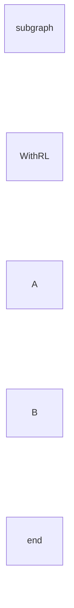

Expected labels: `WithRL`, `A`, `B`

### corpus:mermaid-upstream-suite-bench:er-upstream-should-handle-empty-lines-inside-subgraph

CLI, Terminal text. time="2026-10-26T23:32:12Z" level=fatal msg="failed to parse er diagram: line 2: er subgraphs are not supported" 

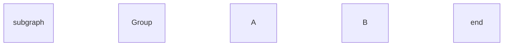

Expected labels: `Group`, `A`, `B`

### corpus:mermaid-upstream-suite-bench:er-upstream-should-handle-empty-subgraph

CLI, Terminal text. time="2026-10-26T23:32:12Z" level=fatal msg="failed to parse er diagram: line 2: er subgraphs are not supported" 

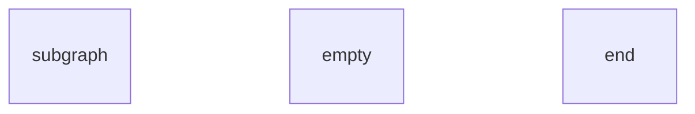

Expected labels: `empty`

### corpus:mermaid-upstream-suite-bench:er-upstream-should-handle-relationship-between-entity-and-subgraph

CLI, Terminal text. time="2026-10-26T23:32:12Z" level=fatal msg="failed to parse er diagram: line 2: er subgraphs are not supported" 

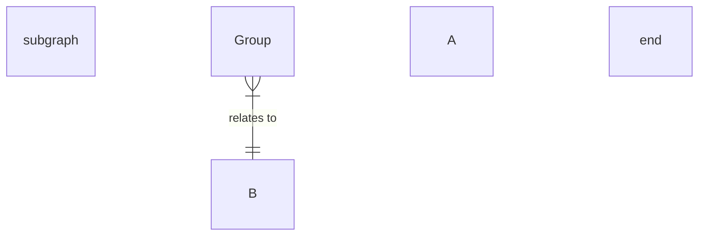

Expected labels: `Group`, `A`, `B`, `relates to`

### corpus:mermaid-upstream-suite-bench:er-upstream-should-handle-relationship-between-subgraph-entity-and-external-entity

CLI, Terminal text. time="2026-10-26T23:32:12Z" level=fatal msg="failed to parse er diagram: line 2: er subgraphs are not supported" 

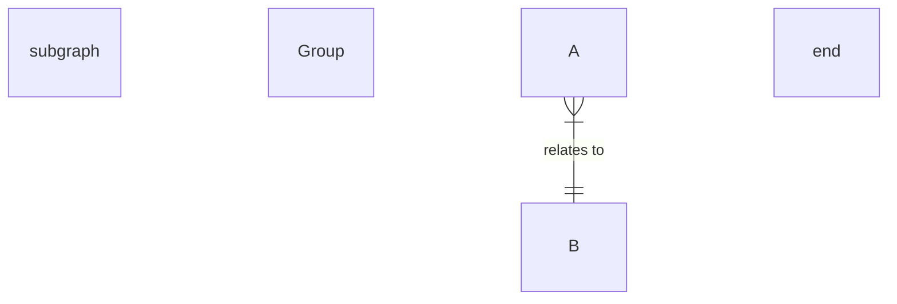

Expected labels: `Group`, `A`, `B`, `relates to`

### corpus:mermaid-upstream-suite-bench:er-upstream-should-handle-special-characters-in-subgraph-title

CLI, Terminal text. time="2026-10-26T23:32:12Z" level=fatal msg="failed to parse er diagram: line 2: er subgraphs are not supported" 

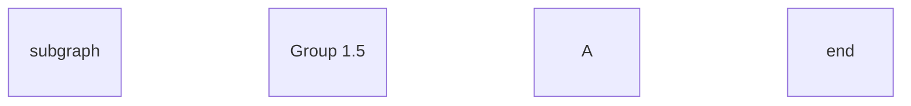

Expected labels: `Group 1.5`, `A`

### corpus:mermaid-upstream-suite-bench:er-upstream-should-handle-subgraph-with-id-and-title-notation

CLI, Terminal text. time="2026-10-26T23:32:12Z" level=fatal msg="failed to parse er diagram: line 2: er subgraphs are not supported" 

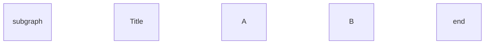

Expected labels: `Title`, `A`, `B`

### corpus:mermaid-upstream-suite-bench:er-upstream-should-ignore-redundant-whitespace-around-end

CLI, Terminal text. time="2026-10-26T23:32:12Z" level=fatal msg="failed to parse er diagram: line 2: er subgraphs are not supported" 

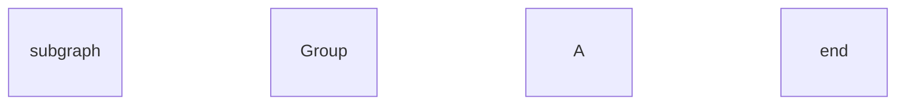

Expected labels: `Group`, `A`

### corpus:mermaid-upstream-suite-bench:er-upstream-should-include-both-endpoints-of-a-relationship-inside-a-subgraph

CLI, Terminal text. time="2026-10-26T23:32:12Z" level=fatal msg="failed to parse er diagram: line 2: er subgraphs are not supported" 


Expected labels: `Group`, `A`, `B`, `relates to`

### corpus:mermaid-upstream-suite-bench:er-upstream-should-represent-parent-child-relationship-correctly

CLI, Terminal text. time="2026-10-26T23:32:12Z" level=fatal msg="failed to parse er diagram: line 2: invalid syntax: \"PROJECT u--o{ TEAM_MEMBER : \\\"parent\\\"\"" 

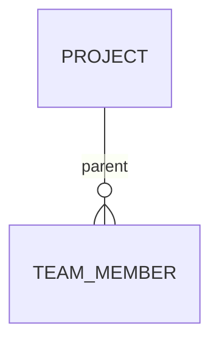

Expected labels: `PROJECT`, `TEAM_MEMBER`, `parent`

### corpus:mermaid-upstream-suite-bench:er-upstream-title

CLI, Terminal text. time="2026-10-26T23:32:12Z" level=fatal msg="failed to parse er diagram: line 2: er subgraphs are not supported" 


Expected labels: `Group`, `A`, `B`

### corpus:mermaid-upstream-suite-bench:er-upstream-title-2

CLI, Terminal text. time="2026-10-26T23:32:12Z" level=fatal msg="failed to parse er diagram: line 2: er subgraphs are not supported" 

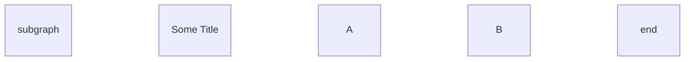

Expected labels: `Some Title`, `A`, `B`

## flowchart

### scaling:flowchart:mesh-120-labelled-40

CLI, Terminal text. Missing authored label: label 3; Missing authored label: label 4; Missing authored label: label 5; Missing authored label: label 7; Missing authored label: label 9; Missing authored label: label 10; Missing authored label: label 11; Missing authored label: label 14; Missing authored label: label 15; Missing authored label: label 16; Missing authored label: label 17; Missing authored label: label 18; Missing authored label: label 19; Missing authored label: label 20; Missing authored label: label 26; Missing authored label: label 27; Missing authored label: label 28; Missing authored label: label 29; Missing authored label: label 30; Missing authored label: label 31; Missing authored label: label 32; Missing authored label: label 33; Missing authored label: label 34; Missing authored label: label 38; Missing authored label: label 39

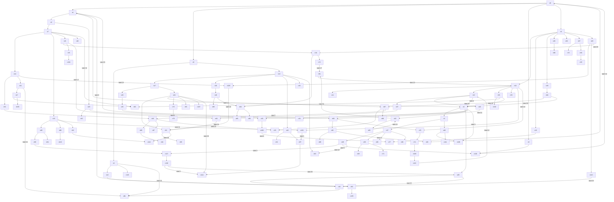

Expected labels: `label 0`, `label 1`, `label 2`, `label 3`, `label 4`, `label 5`, `label 6`, `label 7`, `label 8`, `label 9`, `label 10`, `label 11`, `label 12`, `label 13`, `label 14`, `label 15`, `label 16`, `label 17`, `label 18`, `label 19`, `label 20`, `label 21`, `label 22`, `label 23`, `label 24`, `label 25`, `label 26`, `label 27`, `label 28`, `label 29`, `label 30`, `label 31`, `label 32`, `label 33`, `label 34`, `label 35`, `label 36`, `label 37`, `label 38`, `label 39`, `n0`, `n1`, `n2`, `n3`, `n4`, `n5`, `n6`, `n7`, `n8`, `n9`, `n10`, `n11`, `n12`, `n13`, `n14`, `n15`, `n16`, `n17`, `n18`, `n19`, `n20`, `n21`, `n22`, `n23`, `n24`, `n25`, `n26`, `n27`, `n28`, `n29`, `n30`, `n31`, `n32`, `n33`, `n34`, `n35`, `n36`, `n37`, `n38`, `n39`, `n40`, `n41`, `n42`, `n43`, `n44`, `n45`, `n46`, `n47`, `n48`, `n49`, `n50`, `n51`, `n52`, `n53`, `n54`, `n55`, `n56`, `n57`, `n58`, `n59`, `n60`, `n61`, `n62`, `n63`, `n64`, `n65`, `n66`, `n67`, `n68`, `n69`, `n70`, `n71`, `n72`, `n73`, `n74`, `n75`, `n76`, `n77`, `n78`, `n79`, `n80`, `n81`, `n82`, `n83`, `n84`, `n85`, `n86`, `n87`, `n88`, `n89`, `n90`, `n91`, `n92`, `n93`, `n94`, `n95`, `n96`, `n97`, `n98`, `n99`, `n100`, `n101`, `n102`, `n103`, `n104`, `n105`, `n106`, `n107`, `n108`, `n109`, `n110`, `n111`, `n112`, `n113`, `n114`, `n115`, `n116`, `n117`, `n118`, `n119`

Tool output: [scaling-flowchart-mesh-120-labelled-40-cli-end-to-end.txt](../outputs/alexandergrooff-mermaid-ascii/scaling-flowchart-mesh-120-labelled-40-cli-end-to-end.txt)

### corpus:mermaid-upstream-suite-bench:flowchart-upstream-markdown-formatting-in-subgraphs

CLI, Terminal text. Missing authored label: The **cat** in the hat

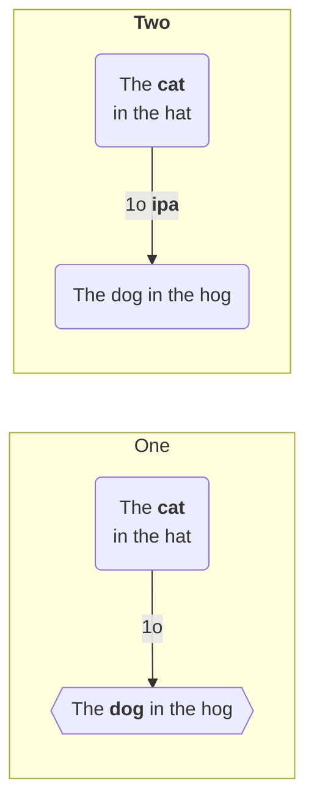

Expected labels: `**Two**`, `One`, `The **cat** in the hat`, `The **dog** in the hog`, `The dog in the hog`, `1o`, `1o **ipa**`

Tool output: [corpus-mermaid-upstream-suite-bench-flowchart-upstream-markdown-formatting-in-subgraphs-cli-end-to-end.txt](../outputs/alexandergrooff-mermaid-ascii/corpus-mermaid-upstream-suite-bench-flowchart-upstream-markdown-formatting-in-subgraphs-cli-end-to-end.txt)

### corpus:mermaid-upstream-suite-bench:flowchart-upstream-should-accept-swimlane-as-a-graph-keyword

CLI, Terminal text. time="2026-10-26T23:32:12Z" level=fatal msg="failed to parse graph diagram: unsupported graph type 'swimlane LR;A-->B;'. Supported types: 'graph' or 'flowchart' with an optional direction (TD, TB, BT, LR, RL)" 

```mermaid
swimlane LR;A-->B;
```

Expected labels: none declared

### corpus:mermaid-upstream-suite-bench:flowchart-upstream-should-allow-back-slashes-in-lean-left-vertices

CLI, Terminal text. time="2026-10-26T23:32:12Z" level=fatal msg="failed to parse graph diagram: unexpected tokens after graph direction: \"node has a \\\\ as text\\\\]\"" 

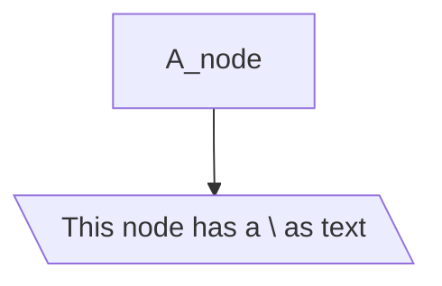

Expected labels: `A_node`, `This node has a \ as text`

### corpus:mermaid-upstream-suite-bench:flowchart-upstream-should-allow-forward-slashes-in-lean-right-vertices

CLI, Terminal text. time="2026-10-26T23:32:12Z" level=fatal msg="failed to parse graph diagram: unexpected tokens after graph direction: \"node has a / as text/]\"" 

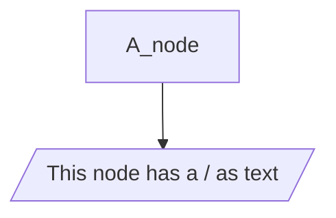

Expected labels: `A_node`, `This node has a / as text`

### corpus:mermaid-upstream-suite-bench:flowchart-upstream-should-be-forgiving-with-many-spaces-before-the-end

CLI, Terminal text. Missing authored label: D


Expected labels: `D`

Tool output: [corpus-mermaid-upstream-suite-bench-flowchart-upstream-should-be-forgiving-with-many-spaces-before-the-end-cli-end-to-end.txt](../outputs/alexandergrooff-mermaid-ascii/corpus-mermaid-upstream-suite-bench-flowchart-upstream-should-be-forgiving-with-many-spaces-before-the-end-cli-end-to-end.txt)

### corpus:mermaid-upstream-suite-bench:flowchart-upstream-should-be-possible-to-use-numbers-as-labels

CLI, Terminal text. time="2026-10-26T23:32:13Z" level=fatal msg="failed to parse graph diagram: unexpected tokens after graph direction: \"\\\"number as labels\\\";1;end\"" 

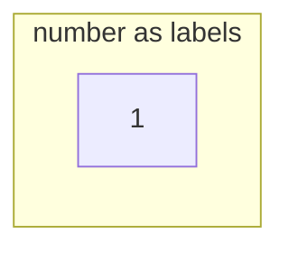

Expected labels: `number as labels`, `1`

### corpus:mermaid-upstream-suite-bench:flowchart-upstream-should-handle

CLI, Terminal text. time="2026-10-26T23:32:13Z" level=fatal msg="failed to parse graph diagram: unexpected tokens after graph direction: \"including `\|B\"" 

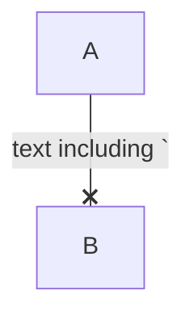

Expected labels: `A`, `B`, `text including '`

### corpus:mermaid-upstream-suite-bench:flowchart-upstream-should-handle-a-nodes-and-edges-and-a-space-between-link-and-node

CLI, Terminal text. time="2026-10-26T23:32:13Z" level=fatal msg="failed to parse graph diagram: unexpected tokens after graph direction: \"--> B\"" 

```mermaid
graph TD;A --> B;
```

Expected labels: `A`, `B`

### corpus:mermaid-upstream-suite-bench:flowchart-upstream-should-handle-a-single-circle-node

CLI, Terminal text. time="2026-10-26T23:32:13Z" level=fatal msg="failed to parse graph diagram: unsupported graph direction 'TD;a((A))'. Supported directions: TD, TB, BT, LR, RL" 

```mermaid
graph TD;a((A));
```

Expected labels: `A`

### corpus:mermaid-upstream-suite-bench:flowchart-upstream-should-handle-a-single-diamond-node

CLI, Terminal text. time="2026-10-26T23:32:13Z" level=fatal msg="failed to parse graph diagram: unsupported graph direction 'TD;a{A}'. Supported directions: TD, TB, BT, LR, RL" 

```mermaid
graph TD;a{A};
```

Expected labels: `A`

### corpus:mermaid-upstream-suite-bench:flowchart-upstream-should-handle-a-single-diamond-node-with-html-in-it-sn3

CLI, Terminal text. time="2026-10-26T23:32:13Z" level=fatal msg="failed to parse graph diagram: unexpected tokens after graph direction: \"<br> end}\"" 

```mermaid
graph TD;a{A <br> end};
```

Expected labels: `A end`

### corpus:mermaid-upstream-suite-bench:flowchart-upstream-should-handle-a-single-diamond-node-with-whitespace-after-it

CLI, Terminal text. time="2026-10-26T23:32:13Z" level=fatal msg="failed to parse graph diagram: unsupported graph direction 'TD;a{A}'. Supported directions: TD, TB, BT, LR, RL" 

```mermaid
graph TD;a{A}   ;
```

Expected labels: `A`

### corpus:mermaid-upstream-suite-bench:flowchart-upstream-should-handle-a-single-double-circle-node

CLI, Terminal text. time="2026-10-26T23:32:13Z" level=fatal msg="failed to parse graph diagram: unsupported graph direction 'TD;a(((A)))'. Supported directions: TD, TB, BT, LR, RL" 

```mermaid
graph TD;a(((A)));
```

Expected labels: `A`

### corpus:mermaid-upstream-suite-bench:flowchart-upstream-should-handle-a-single-double-circle-node-with-html-in-it-sn3

CLI, Terminal text. time="2026-10-26T23:32:13Z" level=fatal msg="failed to parse graph diagram: unexpected tokens after graph direction: \"<br> end)))\"" 

```mermaid
graph TD;a(((A <br> end)));
```

Expected labels: `A end`

### corpus:mermaid-upstream-suite-bench:flowchart-upstream-should-handle-a-single-double-circle-node-with-whitespace-after-it

CLI, Terminal text. time="2026-10-26T23:32:13Z" level=fatal msg="failed to parse graph diagram: unsupported graph direction 'TD;a(((A)))'. Supported directions: TD, TB, BT, LR, RL" 

```mermaid
graph TD;a(((A)))   ;
```

Expected labels: `A`

### corpus:mermaid-upstream-suite-bench:flowchart-upstream-should-handle-a-single-hexagon-node

CLI, Terminal text. time="2026-10-26T23:32:13Z" level=fatal msg="failed to parse graph diagram: unsupported graph direction 'TD;a{{A}}'. Supported directions: TD, TB, BT, LR, RL" 

```mermaid
graph TD;a{{A}};
```

Expected labels: `A`

### corpus:mermaid-upstream-suite-bench:flowchart-upstream-should-handle-a-single-hexagon-node-with-html-in-it

CLI, Terminal text. time="2026-10-26T23:32:13Z" level=fatal msg="failed to parse graph diagram: unexpected tokens after graph direction: \"<br> end}}\"" 

```mermaid
graph TD;a{{A <br> end}};
```

Expected labels: `A end`

### corpus:mermaid-upstream-suite-bench:flowchart-upstream-should-handle-a-single-node

CLI, Terminal text. time="2026-10-26T23:32:13Z" level=fatal msg="failed to parse graph diagram: unsupported graph direction 'TD;A'. Supported directions: TD, TB, BT, LR, RL" 

```mermaid
graph TD;A;
```

Expected labels: `A`

### corpus:mermaid-upstream-suite-bench:flowchart-upstream-should-handle-a-single-node-with-a-single-digit

CLI, Terminal text. time="2026-10-26T23:32:13Z" level=fatal msg="failed to parse graph diagram: unsupported graph direction 'TD;1'. Supported directions: TD, TB, BT, LR, RL" 

```mermaid
graph TD;1;
```

Expected labels: `1`

### corpus:mermaid-upstream-suite-bench:flowchart-upstream-should-handle-a-single-node-with-a-single-digit-in-a-subgraph

CLI, Terminal text. time="2026-10-26T23:32:13Z" level=fatal msg="failed to parse graph diagram: unexpected tokens after graph direction: \"\\\"hello\\\";1;end\"" 

```mermaid
graph TD;subgraph "hello";1;end;
```

Expected labels: `hello`, `1`

### corpus:mermaid-upstream-suite-bench:flowchart-upstream-should-handle-a-single-node-with-alphanumerics-containing-a-minus-sign

CLI, Terminal text. time="2026-10-26T23:32:13Z" level=fatal msg="failed to parse graph diagram: unsupported graph direction 'TD;i-d'. Supported directions: TD, TB, BT, LR, RL" 

```mermaid
graph TD;i-d;
```

Expected labels: `i-d`

### corpus:mermaid-upstream-suite-bench:flowchart-upstream-should-handle-a-single-node-with-alphanumerics-containing-a-underscore-sign

CLI, Terminal text. time="2026-10-26T23:32:13Z" level=fatal msg="failed to parse graph diagram: unsupported graph direction 'TD;i_d'. Supported directions: TD, TB, BT, LR, RL" 

```mermaid
graph TD;i_d;
```

Expected labels: `i_d`

### corpus:mermaid-upstream-suite-bench:flowchart-upstream-should-handle-a-single-node-with-alphanumerics-starting-on-a-char

CLI, Terminal text. time="2026-10-26T23:32:13Z" level=fatal msg="failed to parse graph diagram: unsupported graph direction 'TD;id1'. Supported directions: TD, TB, BT, LR, RL" 

```mermaid
graph TD;id1;
```

Expected labels: `id1`

### corpus:mermaid-upstream-suite-bench:flowchart-upstream-should-handle-a-single-node-with-alphanumerics-starting-on-a-num

CLI, Terminal text. time="2026-10-26T23:32:13Z" level=fatal msg="failed to parse graph diagram: unsupported graph direction 'TD;1id'. Supported directions: TD, TB, BT, LR, RL" 

```mermaid
graph TD;1id;
```

Expected labels: `1id`

### corpus:mermaid-upstream-suite-bench:flowchart-upstream-should-handle-a-single-node-with-white-space-after-it-sn1

CLI, Terminal text. time="2026-10-26T23:32:13Z" level=fatal msg="failed to parse graph diagram: unsupported graph direction 'TD;A'. Supported directions: TD, TB, BT, LR, RL" 

```mermaid
graph TD;A ;
```

Expected labels: `A`

### corpus:mermaid-upstream-suite-bench:flowchart-upstream-should-handle-a-single-odd-node

CLI, Terminal text. time="2026-10-26T23:32:13Z" level=fatal msg="failed to parse graph diagram: unsupported graph direction 'TD;a>A]'. Supported directions: TD, TB, BT, LR, RL" 

```mermaid
graph TD;a>A];
```

Expected labels: `A`

### corpus:mermaid-upstream-suite-bench:flowchart-upstream-should-handle-a-single-round-node

CLI, Terminal text. time="2026-10-26T23:32:13Z" level=fatal msg="failed to parse graph diagram: unsupported graph direction 'TD;a(A)'. Supported directions: TD, TB, BT, LR, RL" 

```mermaid
graph TD;a(A);
```

Expected labels: `A`

### corpus:mermaid-upstream-suite-bench:flowchart-upstream-should-handle-a-single-round-node-with-html-in-it

CLI, Terminal text. time="2026-10-26T23:32:13Z" level=fatal msg="failed to parse graph diagram: unexpected tokens after graph direction: \"<br> end)\"" 

```mermaid
graph TD;a(A <br> end);
```

Expected labels: `A end`

### corpus:mermaid-upstream-suite-bench:flowchart-upstream-should-handle-a-single-square-node

CLI, Terminal text. time="2026-10-26T23:32:13Z" level=fatal msg="failed to parse graph diagram: unsupported graph direction 'TD;a[A]'. Supported directions: TD, TB, BT, LR, RL" 

```mermaid
graph TD;a[A];
```

Expected labels: `A`

### corpus:mermaid-upstream-suite-bench:flowchart-upstream-should-handle-and-minus

CLI, Terminal text. time="2026-10-26T23:32:13Z" level=fatal msg="failed to parse graph diagram: unexpected tokens after graph direction: \"hoppar åäö-ÅÄÖ}\"" 

```mermaid
graph TD;A-->C{Chimpansen hoppar åäö-ÅÄÖ};
```

Expected labels: `A`, `Chimpansen hoppar åäö-ÅÄÖ`

### corpus:mermaid-upstream-suite-bench:flowchart-upstream-should-handle-angle-bracket-as-direction-lr

CLI, Terminal text. time="2026-10-26T23:32:13Z" level=fatal msg="failed to parse graph diagram: unsupported graph direction '>;A-->B'. Supported directions: TD, TB, BT, LR, RL" 

```mermaid
graph >;A-->B;
```

Expected labels: `A`, `B`

### corpus:mermaid-upstream-suite-bench:flowchart-upstream-should-handle-angle-bracket-as-direction-rl

CLI, Terminal text. time="2026-10-26T23:32:13Z" level=fatal msg="failed to parse graph diagram: unsupported graph direction '<;A-->B'. Supported directions: TD, TB, BT, LR, RL" 

```mermaid
graph <;A-->B;
```

Expected labels: `A`, `B`

### corpus:mermaid-upstream-suite-bench:flowchart-upstream-should-handle-backslash

CLI, Terminal text. time="2026-10-26T23:32:13Z" level=fatal msg="failed to parse graph diagram: unsupported graph direction 'TD;A-->C(c:\\windows)'. Supported directions: TD, TB, BT, LR, RL" 

```mermaid
graph TD;A-->C(c:\windows);
```

Expected labels: `A`, `c:\windows`

### corpus:mermaid-upstream-suite-bench:flowchart-upstream-should-handle-basic-shape-data-statements

CLI, Terminal text. Missing authored label: D

```mermaid
flowchart TB
      D@{ shape: rounded}
```

Expected labels: `D`

Tool output: [corpus-mermaid-upstream-suite-bench-flowchart-upstream-should-handle-basic-shape-data-statements-cli-end-to-end.txt](../outputs/alexandergrooff-mermaid-ascii/corpus-mermaid-upstream-suite-bench-flowchart-upstream-should-handle-basic-shape-data-statements-cli-end-to-end.txt)

### corpus:mermaid-upstream-suite-bench:flowchart-upstream-should-handle-basic-shape-data-statements-2

CLI, Terminal text. Missing authored label: D

```mermaid
flowchart TB
      D@{ shape: rounded }
```

Expected labels: `D`

Tool output: [corpus-mermaid-upstream-suite-bench-flowchart-upstream-should-handle-basic-shape-data-statements-2-cli-end-to-end.txt](../outputs/alexandergrooff-mermaid-ascii/corpus-mermaid-upstream-suite-bench-flowchart-upstream-should-handle-basic-shape-data-statements-2-cli-end-to-end.txt)

### corpus:mermaid-upstream-suite-bench:flowchart-upstream-should-handle-basic-shape-data-statements-with

CLI, Terminal text. Missing authored label: D

```mermaid
flowchart TB
      D@{ shape: rounded } & E
```

Expected labels: `D`, `E`

Tool output: [corpus-mermaid-upstream-suite-bench-flowchart-upstream-should-handle-basic-shape-data-statements-with-cli-end-to-end.txt](../outputs/alexandergrooff-mermaid-ascii/corpus-mermaid-upstream-suite-bench-flowchart-upstream-should-handle-basic-shape-data-statements-with-cli-end-to-end.txt)

### corpus:mermaid-upstream-suite-bench:flowchart-upstream-should-handle-basic-shape-data-statements-with-amp-and-edges-1

CLI, Terminal text. Missing authored label: D

```mermaid
flowchart TB
      D@{ shape: rounded } & E --> F
```

Expected labels: `D`, `E`, `F`

Tool output: [corpus-mermaid-upstream-suite-bench-flowchart-upstream-should-handle-basic-shape-data-statements-with-amp-and-edges-1-cli-end-to-end.txt](../outputs/alexandergrooff-mermaid-ascii/corpus-mermaid-upstream-suite-bench-flowchart-upstream-should-handle-basic-shape-data-statements-with-amp-and-edges-1-cli-end-to-end.txt)

### corpus:mermaid-upstream-suite-bench:flowchart-upstream-should-handle-basic-shape-data-statements-with-amp-and-edges-2

CLI, Terminal text. Missing authored label: D; Missing authored label: E

```mermaid
flowchart TB
      D@{ shape: rounded } & E@{ shape: rounded } --> F
```

Expected labels: `D`, `E`, `F`

Tool output: [corpus-mermaid-upstream-suite-bench-flowchart-upstream-should-handle-basic-shape-data-statements-with-amp-and-edges-2-cli-end-to-end.txt](../outputs/alexandergrooff-mermaid-ascii/corpus-mermaid-upstream-suite-bench-flowchart-upstream-should-handle-basic-shape-data-statements-with-amp-and-edges-2-cli-end-to-end.txt)

### corpus:mermaid-upstream-suite-bench:flowchart-upstream-should-handle-basic-shape-data-statements-with-amp-and-edges-3

CLI, Terminal text. Missing authored label: D; Missing authored label: E; Missing authored label: G

```mermaid
flowchart TB
      D@{ shape: rounded } & E@{ shape: rounded } --> F & G@{ shape: rounded }
```

Expected labels: `D`, `E`, `F`, `G`

Tool output: [corpus-mermaid-upstream-suite-bench-flowchart-upstream-should-handle-basic-shape-data-statements-with-amp-and-edges-3-cli-end-to-end.txt](../outputs/alexandergrooff-mermaid-ascii/corpus-mermaid-upstream-suite-bench-flowchart-upstream-should-handle-basic-shape-data-statements-with-amp-and-edges-3-cli-end-to-end.txt)

### corpus:mermaid-upstream-suite-bench:flowchart-upstream-should-handle-basic-shape-data-statements-with-amp-and-edges-4

CLI, Terminal text. Missing authored label: D; Missing authored label: E; Missing authored label: F; Missing authored label: G

```mermaid
flowchart TB
      D@{ shape: rounded } & E@{ shape: rounded } --> F@{ shape: rounded } & G@{ shape: rounded }
```

Expected labels: `D`, `E`, `F`, `G`

Tool output: [corpus-mermaid-upstream-suite-bench-flowchart-upstream-should-handle-basic-shape-data-statements-with-amp-and-edges-4-cli-end-to-end.txt](../outputs/alexandergrooff-mermaid-ascii/corpus-mermaid-upstream-suite-bench-flowchart-upstream-should-handle-basic-shape-data-statements-with-amp-and-edges-4-cli-end-to-end.txt)

### corpus:mermaid-upstream-suite-bench:flowchart-upstream-should-handle-basic-shape-data-statements-with-amp-and-edges-5-trailing-space

CLI, Terminal text. Missing authored label: D; Missing authored label: E

```mermaid
flowchart TB
         D@{ shape: rounded } & E@{ shape: rounded } --> F{ shape: rounded } & G{ shape: rounded }
```

Expected labels: `D`, `E`, `shape: rounded`

Tool output: [corpus-mermaid-upstream-suite-bench-flowchart-upstream-should-handle-basic-shape-data-statements-with-amp-and-edges-5-trailing-space-cli-end-to-end.txt](../outputs/alexandergrooff-mermaid-ascii/corpus-mermaid-upstream-suite-bench-flowchart-upstream-should-handle-basic-shape-data-statements-with-amp-and-edges-5-trailing-space-cli-end-to-end.txt)

### corpus:mermaid-upstream-suite-bench:flowchart-upstream-should-handle-caps

CLI, Terminal text. time="2026-10-26T23:32:13Z" level=fatal msg="failed to parse graph diagram: unexpected tokens after graph direction: \"CAPS)\"" 

```mermaid
graph TD;A-->C(some CAPS);
```

Expected labels: `A`, `some CAPS`

### corpus:mermaid-upstream-suite-bench:flowchart-upstream-should-handle-caret-as-direction-bt

CLI, Terminal text. time="2026-10-26T23:32:13Z" level=fatal msg="failed to parse graph diagram: unsupported graph direction '^;A-->B'. Supported directions: TD, TB, BT, LR, RL" 

```mermaid
graph ^;A-->B;
```

Expected labels: `A`, `B`

### corpus:mermaid-upstream-suite-bench:flowchart-upstream-should-handle-chaining-and-multiple-nodes-in-link-statement-with-extra-info-in-statements

CLI, Terminal text. time="2026-10-26T23:32:13Z" level=fatal msg="failed to parse graph diagram: Could not parse line: classDef exClass background:#bbb,border:1px solid red;" 

```mermaid
graph TD
      A[ h ] -- hello --> B[" test "]:::exClass & C --> D;
      classDef exClass background:#bbb,border:1px solid red;
```

Expected labels: `h`, `test`, `C`, `D`, `hello`

### corpus:mermaid-upstream-suite-bench:flowchart-upstream-should-handle-cross-ended-edges

CLI, Terminal text. time="2026-10-26T23:32:13Z" level=fatal msg="failed to parse graph diagram: unsupported graph direction 'TD;A--xB'. Supported directions: TD, TB, BT, LR, RL" 

```mermaid
graph TD;A--xB;
```

Expected labels: `A`, `B`

### corpus:mermaid-upstream-suite-bench:flowchart-upstream-should-handle-directions

CLI, Terminal text. time="2026-10-26T23:32:13Z" level=fatal msg="failed to parse graph diagram: unexpected tokens after graph direction: \"URL)\"" 

```mermaid
graph TD;A-->C(some URL);
```

Expected labels: `A`, `some URL`

### corpus:mermaid-upstream-suite-bench:flowchart-upstream-should-handle-dotted-lines

CLI, Terminal text. time="2026-10-26T23:32:13Z" level=fatal msg="failed to parse graph diagram: unsupported graph direction 'TD;A-.->B'. Supported directions: TD, TB, BT, LR, RL" 

```mermaid
graph TD;A-.->B;
```

Expected labels: `A`, `B`

### corpus:mermaid-upstream-suite-bench:flowchart-upstream-should-handle-dotted-lines-2

CLI, Terminal text. time="2026-10-26T23:32:13Z" level=fatal msg="failed to parse graph diagram: unsupported graph direction 'TD;A==>B'. Supported directions: TD, TB, BT, LR, RL" 

```mermaid
graph TD;A==>B;
```

Expected labels: `A`, `B`

### corpus:mermaid-upstream-suite-bench:flowchart-upstream-should-handle-dotted-text-on-lines-td3

CLI, Terminal text. time="2026-10-26T23:32:13Z" level=fatal msg="failed to parse graph diagram: unexpected tokens after graph direction: \"test text with == .->B\"" 

```mermaid
graph TD;A-. test text with == .->B;
```

Expected labels: `A`, `B`, `test text with ==`

### corpus:mermaid-upstream-suite-bench:flowchart-upstream-should-handle-edge-case-for-odd-vertex-with-node-id-ending-with-minus

CLI, Terminal text. time="2026-10-26T23:32:13Z" level=fatal msg="failed to parse graph diagram: unexpected tokens after graph direction: \"Text]\"" 

```mermaid
graph TD;A_node-->odd->Vertex Text];
```

Expected labels: `A_node`, `Vertex Text`

### corpus:mermaid-upstream-suite-bench:flowchart-upstream-should-handle-keywords

CLI, Terminal text. time="2026-10-26T23:32:13Z" level=fatal msg="failed to parse graph diagram: unexpected tokens after graph direction: \"including graph space\|B\"" 

```mermaid
graph TD;A--x|text including graph space|B;
```

Expected labels: `A`, `B`, `text including graph space`

### corpus:mermaid-upstream-suite-bench:flowchart-upstream-should-handle-keywords-2

CLI, Terminal text. time="2026-10-26T23:32:13Z" level=fatal msg="failed to parse graph diagram: unsupported graph direction 'TD;V-->a[v]'. Supported directions: TD, TB, BT, LR, RL" 

```mermaid
graph TD;V-->a[v]
```

Expected labels: `V`, `v`

### corpus:mermaid-upstream-suite-bench:flowchart-upstream-should-handle-keywords-3

CLI, Terminal text. time="2026-10-26T23:32:13Z" level=fatal msg="failed to parse graph diagram: unexpected tokens after graph direction: \"text including graph space and v --xB\"" 

```mermaid
graph TD;A-- text including graph space and v --xB;
```

Expected labels: `A`, `B`, `text including graph space and v`

### corpus:mermaid-upstream-suite-bench:flowchart-upstream-should-handle-keywords-4

CLI, Terminal text. time="2026-10-26T23:32:13Z" level=fatal msg="failed to parse graph diagram: unexpected tokens after graph direction: \"text including graph space and v --xB[blav]\"" 

```mermaid
graph TD;A-- text including graph space and v --xB[blav]
```

Expected labels: `A`, `blav`, `text including graph space and v`

### corpus:mermaid-upstream-suite-bench:flowchart-upstream-should-handle-lower-case-v-as-direction-tb

CLI, Terminal text. time="2026-10-26T23:32:13Z" level=fatal msg="failed to parse graph diagram: unsupported graph direction 'v;A-->B'. Supported directions: TD, TB, BT, LR, RL" 

```mermaid
graph v;A-->B;
```

Expected labels: `A`, `B`

### corpus:mermaid-upstream-suite-bench:flowchart-upstream-should-handle-multi-line-text

CLI, Terminal text. time="2026-10-26T23:32:13Z" level=fatal msg="failed to parse graph diagram: unexpected tokens after graph direction: \"space\|B\"" 

```mermaid
graph TD;A--o|text space|B;
 B-->|more text with space|C;
```

Expected labels: `A`, `B`, `C`, `text space`, `more text with space`

### corpus:mermaid-upstream-suite-bench:flowchart-upstream-should-handle-multiple-edges

CLI, Terminal text. time="2026-10-26T23:32:13Z" level=fatal msg="failed to parse graph diagram: unexpected tokens after graph direction: \"is the 123 s text\|B\"" 

```mermaid
graph TD;A---|This is the 123 s text|B;
A---|This is the second edge|B;
```

Expected labels: `A`, `B`, `This is the 123 s text`, `This is the second edge`

### corpus:mermaid-upstream-suite-bench:flowchart-upstream-should-handle-nested-subgraphs-2

CLI, Terminal text. Missing authored label: A

```mermaid
flowchart TB
    b-->B
    a-->c
    subgraph B
      c
    end
    subgraph A
        a
        b
        B
    end
```

Expected labels: `A`, `B`, `b`, `a`, `c`

Tool output: [corpus-mermaid-upstream-suite-bench-flowchart-upstream-should-handle-nested-subgraphs-2-cli-end-to-end.txt](../outputs/alexandergrooff-mermaid-ascii/corpus-mermaid-upstream-suite-bench-flowchart-upstream-should-handle-nested-subgraphs-2-cli-end-to-end.txt)

### corpus:mermaid-upstream-suite-bench:flowchart-upstream-should-handle-normal-text-on-lines

CLI, Terminal text. time="2026-10-26T23:32:14Z" level=fatal msg="failed to parse graph diagram: unexpected tokens after graph direction: \"test text with == -->B\"" 

```mermaid
graph TD;A-- test text with == -->B;
```

Expected labels: `A`, `B`, `test text with ==`

### corpus:mermaid-upstream-suite-bench:flowchart-upstream-should-handle-open-ended-edges

CLI, Terminal text. time="2026-10-26T23:32:14Z" level=fatal msg="failed to parse graph diagram: unsupported graph direction 'TD;A---B'. Supported directions: TD, TB, BT, LR, RL" 

```mermaid
graph TD;A---B;
```

Expected labels: `A`, `B`

### corpus:mermaid-upstream-suite-bench:flowchart-upstream-should-handle-open-ended-edges-2

CLI, Terminal text. time="2026-10-26T23:32:14Z" level=fatal msg="failed to parse graph diagram: unsupported graph direction 'TD;A--oB'. Supported directions: TD, TB, BT, LR, RL" 

```mermaid
graph TD;A--oB;
```

Expected labels: `A`, `B`

### corpus:mermaid-upstream-suite-bench:flowchart-upstream-should-handle-quoted-text

CLI, Terminal text. time="2026-10-26T23:32:14Z" level=fatal msg="failed to parse graph diagram: unexpected tokens after graph direction: \"\\\"test string()\\\" -->a[v]\"" 

```mermaid
graph TD;V-- "test string()" -->a[v]
```

Expected labels: `V`, `v`, `test string()`

### corpus:mermaid-upstream-suite-bench:flowchart-upstream-should-handle-quoted-text-in-vertices

CLI, Terminal text. time="2026-10-26T23:32:14Z" level=fatal msg="failed to parse graph diagram: unexpected tokens after graph direction: \"hoppar ()[]\\\"] --> C\"" 

```mermaid
graph TD;A["chimpansen hoppar ()[]"] --> C;
```

Expected labels: `chimpansen hoppar ()[]`, `C`

### corpus:mermaid-upstream-suite-bench:flowchart-upstream-should-handle-regular-lines

CLI, Terminal text. time="2026-10-26T23:32:14Z" level=fatal msg="failed to parse graph diagram: unsupported graph direction 'TD;A-->B'. Supported directions: TD, TB, BT, LR, RL" 

```mermaid
graph TD;A-->B;
```

Expected labels: `A`, `B`

### corpus:mermaid-upstream-suite-bench:flowchart-upstream-should-handle-shape-data-statements-with-edges

CLI, Terminal text. Missing authored label: D

```mermaid
flowchart TB
      D@{ shape: rounded } --> E
```

Expected labels: `D`, `E`

Tool output: [corpus-mermaid-upstream-suite-bench-flowchart-upstream-should-handle-shape-data-statements-with-edges-cli-end-to-end.txt](../outputs/alexandergrooff-mermaid-ascii/corpus-mermaid-upstream-suite-bench-flowchart-upstream-should-handle-shape-data-statements-with-edges-cli-end-to-end.txt)

### corpus:mermaid-upstream-suite-bench:flowchart-upstream-should-handle-space

CLI, Terminal text. time="2026-10-26T23:32:14Z" level=fatal msg="failed to parse graph diagram: unexpected tokens after graph direction: \"hoppar)\"" 

```mermaid
graph TD;A-->C(Chimpansen hoppar);
```

Expected labels: `A`, `Chimpansen hoppar`

### corpus:mermaid-upstream-suite-bench:flowchart-upstream-should-handle-space-and-caps

CLI, Terminal text. time="2026-10-26T23:32:14Z" level=fatal msg="failed to parse graph diagram: unexpected tokens after graph direction: \"including CAPS space\|B\"" 

```mermaid
graph TD;A--x|text including CAPS space|B;
```

Expected labels: `A`, `B`, `text including CAPS space`

### corpus:mermaid-upstream-suite-bench:flowchart-upstream-should-handle-space-and-caps-2

CLI, Terminal text. time="2026-10-26T23:32:14Z" level=fatal msg="failed to parse graph diagram: unexpected tokens after graph direction: \"text including CAPS space --xB\"" 

```mermaid
graph TD;A-- text including CAPS space --xB;
```

Expected labels: `A`, `B`, `text including CAPS space`

### corpus:mermaid-upstream-suite-bench:flowchart-upstream-should-handle-space-and-dir

CLI, Terminal text. time="2026-10-26T23:32:14Z" level=fatal msg="failed to parse graph diagram: unexpected tokens after graph direction: \"including URL space\|B\"" 

```mermaid
graph TD;A--x|text including URL space|B;
```

Expected labels: `A`, `B`, `text including URL space`

### corpus:mermaid-upstream-suite-bench:flowchart-upstream-should-handle-space-and-dir-2

CLI, Terminal text. time="2026-10-26T23:32:14Z" level=fatal msg="failed to parse graph diagram: unexpected tokens after graph direction: \"text including URL space --xB\"" 

```mermaid
graph TD;A-- text including URL space --xB;
```

Expected labels: `A`, `B`, `text including URL space`

### corpus:mermaid-upstream-suite-bench:flowchart-upstream-should-handle-space-and-dir-td

CLI, Terminal text. time="2026-10-26T23:32:14Z" level=fatal msg="failed to parse graph diagram: unexpected tokens after graph direction: \"including R TD space\|B\"" 

```mermaid
graph TD;A--x|text including R TD space|B;
```

Expected labels: `A`, `B`, `text including R TD space`

### corpus:mermaid-upstream-suite-bench:flowchart-upstream-should-handle-space-and-dir-td2

CLI, Terminal text. time="2026-10-26T23:32:14Z" level=fatal msg="failed to parse graph diagram: unexpected tokens after graph direction: \"text including R TD space --xB\"" 

```mermaid
graph TD;A-- text including R TD space --xB;
```

Expected labels: `A`, `B`, `text including R TD space`

### corpus:mermaid-upstream-suite-bench:flowchart-upstream-should-handle-space-and-send

CLI, Terminal text. time="2026-10-26T23:32:14Z" level=fatal msg="failed to parse graph diagram: unexpected tokens after graph direction: \"including URL space and send-->B\"" 

```mermaid
graph TD;A--text including URL space and send-->B;
```

Expected labels: `A`, `B`, `text including URL space and send`

### corpus:mermaid-upstream-suite-bench:flowchart-upstream-should-handle-space-and-send-2

CLI, Terminal text. time="2026-10-26T23:32:14Z" level=fatal msg="failed to parse graph diagram: unexpected tokens after graph direction: \"text including URL space and send -->B\"" 

```mermaid
graph TD;A-- text including URL space and send -->B;
```

Expected labels: `A`, `B`, `text including URL space and send`

### corpus:mermaid-upstream-suite-bench:flowchart-upstream-should-handle-space-and-space-between-vertices-and-link

CLI, Terminal text. time="2026-10-26T23:32:14Z" level=fatal msg="failed to parse graph diagram: unexpected tokens after graph direction: \"--x\|textNoSpace\| B\"" 

```mermaid
graph TD;A --x|textNoSpace| B;
```

Expected labels: `A`, `B`, `textNoSpace`

### corpus:mermaid-upstream-suite-bench:flowchart-upstream-should-handle-space-and-space-between-vertices-and-link-2

CLI, Terminal text. time="2026-10-26T23:32:14Z" level=fatal msg="failed to parse graph diagram: unexpected tokens after graph direction: \"-- textNoSpace --x B\"" 

```mermaid
graph TD;A -- textNoSpace --x B;
```

Expected labels: `A`, `B`, `textNoSpace`

### corpus:mermaid-upstream-suite-bench:flowchart-upstream-should-handle-styles-and-graph-definitions-in-a-graph

CLI, Terminal text. time="2026-10-26T23:32:14Z" level=fatal msg="failed to parse graph diagram: unsupported graph direction 'TD;S-->T'. Supported directions: TD, TB, BT, LR, RL" 

```mermaid
graph TD;S-->T;
style S background:#aaa;
style T background:#bbb,border:1px solid red;
```

Expected labels: `S`, `T`

### corpus:mermaid-upstream-suite-bench:flowchart-upstream-should-handle-subgraph-id-starting-with-a-number

CLI, Terminal text. Missing authored label: 1test

```mermaid
graph TD
    A[Christmas] -->|Get money| B(Go shopping)
    subgraph 1test
    A
    end
```

Expected labels: `1test`, `Christmas`, `Go shopping`, `Get money`

Tool output: [corpus-mermaid-upstream-suite-bench-flowchart-upstream-should-handle-subgraph-id-starting-with-a-number-cli-end-to-end.txt](../outputs/alexandergrooff-mermaid-ascii/corpus-mermaid-upstream-suite-bench-flowchart-upstream-should-handle-subgraph-id-starting-with-a-number-cli-end-to-end.txt)

### corpus:mermaid-upstream-suite-bench:flowchart-upstream-should-handle-subgraphs-in-old-style-that-was-broken

CLI, Terminal text. time="2026-10-26T23:32:14Z" level=fatal msg="failed to parse graph diagram: unexpected tokens after graph direction: \"old style that is broken;c-->d;end\"" 

```mermaid
graph TD;A-->B;subgraph old style that is broken;c-->d;end;
```

Expected labels: `old style that is broken`, `A`, `B`, `c`, `d`

### corpus:mermaid-upstream-suite-bench:flowchart-upstream-should-handle-subgraphs-with-dashes-in-the-title

CLI, Terminal text. time="2026-10-26T23:32:14Z" level=fatal msg="failed to parse graph diagram: unexpected tokens after graph direction: \"a-b-c;c-->d;end\"" 

```mermaid
graph TD;A-->B;subgraph a-b-c;c-->d;end;
```

Expected labels: `a-b-c`, `A`, `B`, `c`, `d`

### corpus:mermaid-upstream-suite-bench:flowchart-upstream-should-handle-subgraphs-with-id-and-title-in-brackets

CLI, Terminal text. time="2026-10-26T23:32:14Z" level=fatal msg="failed to parse graph diagram: unexpected tokens after graph direction: \"uid1[text of doom];c-->d;end\"" 

```mermaid
graph TD;A-->B;subgraph uid1[text of doom];c-->d;end;
```

Expected labels: `text of doom`, `A`, `B`, `c`, `d`

### corpus:mermaid-upstream-suite-bench:flowchart-upstream-should-handle-subgraphs-with-id-and-title-in-brackets-and-quotes

CLI, Terminal text. time="2026-10-26T23:32:14Z" level=fatal msg="failed to parse graph diagram: unexpected tokens after graph direction: \"uid2[\\\"text of doom\\\"];c-->d;end\"" 

```mermaid
graph TD;A-->B;subgraph uid2["text of doom"];c-->d;end;
```

Expected labels: `text of doom`, `A`, `B`, `c`, `d`

### corpus:mermaid-upstream-suite-bench:flowchart-upstream-should-handle-subgraphs-with-id-and-title-in-brackets-without-spaces

CLI, Terminal text. time="2026-10-26T23:32:14Z" level=fatal msg="failed to parse graph diagram: unexpected tokens after graph direction: \"uid2[textofdoom];c-->d;end\"" 

```mermaid
graph TD;A-->B;subgraph uid2[textofdoom];c-->d;end;
```

Expected labels: `textofdoom`, `A`, `B`, `c`, `d`

### corpus:mermaid-upstream-suite-bench:flowchart-upstream-should-handle-subgraphs-with-title-in-quotes

CLI, Terminal text. time="2026-10-26T23:32:14Z" level=fatal msg="failed to parse graph diagram: unexpected tokens after graph direction: \"\\\"title in quotes\\\";c-->d;end\"" 

```mermaid
graph TD;A-->B;subgraph "title in quotes";c-->d;end;
```

Expected labels: `title in quotes`, `A`, `B`, `c`, `d`

### corpus:mermaid-upstream-suite-bench:flowchart-upstream-should-handle-subgraphs1

CLI, Terminal text. time="2026-10-26T23:32:14Z" level=fatal msg="failed to parse graph diagram: unexpected tokens after graph direction: \"myTitle;c-->d;end\"" 

```mermaid
graph TD;A-->B;subgraph myTitle;c-->d;end;
```

Expected labels: `myTitle`, `A`, `B`, `c`, `d`

### corpus:mermaid-upstream-suite-bench:flowchart-upstream-should-handle-text-in-circle-vertices-with-space

CLI, Terminal text. time="2026-10-26T23:32:14Z" level=fatal msg="failed to parse graph diagram: unexpected tokens after graph direction: \"hoppar))-->C\"" 

```mermaid
graph TD;A((chimpansen hoppar))-->C;
```

Expected labels: `chimpansen hoppar`, `C`

### corpus:mermaid-upstream-suite-bench:flowchart-upstream-should-handle-text-in-diamond-vertices-with-space

CLI, Terminal text. time="2026-10-26T23:32:14Z" level=fatal msg="failed to parse graph diagram: unexpected tokens after graph direction: \"hoppar)-->C\"" 

```mermaid
graph TD;A(chimpansen hoppar)-->C;
```

Expected labels: `chimpansen hoppar`, `C`

### corpus:mermaid-upstream-suite-bench:flowchart-upstream-should-handle-text-in-vertices-with-space

CLI, Terminal text. time="2026-10-26T23:32:14Z" level=fatal msg="failed to parse graph diagram: unexpected tokens after graph direction: \"hoppar]-->C\"" 

```mermaid
graph TD;A[chimpansen hoppar]-->C;
```

Expected labels: `chimpansen hoppar`, `C`

### corpus:mermaid-upstream-suite-bench:flowchart-upstream-should-handle-text-in-vertices-with-space-with-spaces-between-vertices-and-link

CLI, Terminal text. time="2026-10-26T23:32:14Z" level=fatal msg="failed to parse graph diagram: unexpected tokens after graph direction: \"hoppar] --> C\"" 

```mermaid
graph TD;A[chimpansen hoppar] --> C;
```

Expected labels: `chimpansen hoppar`, `C`

### corpus:mermaid-upstream-suite-bench:flowchart-upstream-should-handle-text-in-with

CLI, Terminal text. time="2026-10-26T23:32:14Z" level=fatal msg="failed to parse graph diagram: unsupported graph direction 'TD;A(?)-->\|?\|C'. Supported directions: TD, TB, BT, LR, RL" 

```mermaid
graph TD;A(?)-->|?|C;
```

Expected labels: `?`, `C`

### corpus:mermaid-upstream-suite-bench:flowchart-upstream-should-handle-text-in-with-2

CLI, Terminal text. time="2026-10-26T23:32:14Z" level=fatal msg="failed to parse graph diagram: unsupported graph direction 'TD;A(éèêàçô)-->\|éèêàçô\|C'. Supported directions: TD, TB, BT, LR, RL" 

```mermaid
graph TD;A(éèêàçô)-->|éèêàçô|C;
```

Expected labels: `éèêàçô`, `C`

### corpus:mermaid-upstream-suite-bench:flowchart-upstream-should-handle-text-in-with-3

CLI, Terminal text. time="2026-10-26T23:32:14Z" level=fatal msg="failed to parse graph diagram: unsupported graph direction 'TD;A(,.?!+-*)-->\|,.?!+-*\|C'. Supported directions: TD, TB, BT, LR, RL" 

```mermaid
graph TD;A(,.?!+-*)-->|,.?!+-*|C;
```

Expected labels: `,.?!+-*`, `C`

### corpus:mermaid-upstream-suite-bench:flowchart-upstream-should-handle-text-including-in-vertices

CLI, Terminal text. time="2026-10-26T23:32:14Z" level=fatal msg="failed to parse graph diagram: unexpected tokens after graph direction: \"--> C\"" 

```mermaid
graph TD;A[chimpansen_hoppar] --> C;
```

Expected labels: `chimpansen_hoppar`, `C`

### corpus:mermaid-upstream-suite-bench:flowchart-upstream-should-handle-text-with

CLI, Terminal text. time="2026-10-26T23:32:14Z" level=fatal msg="failed to parse graph diagram: unexpected tokens after graph direction: \"with / should work\|B\"" 

```mermaid
graph TD;A--x|text with / should work|B;
```

Expected labels: `A`, `B`, `text with / should work`

### corpus:mermaid-upstream-suite-bench:flowchart-upstream-should-handle-text-with-2

CLI, Terminal text. time="2026-10-26T23:32:14Z" level=fatal msg="failed to parse graph diagram: unexpected tokens after graph direction: \"-- text with / should work --x B\"" 

```mermaid
graph TD;A -- text with / should work --x B;
```

Expected labels: `A`, `B`, `text with / should work`

### corpus:mermaid-upstream-suite-bench:flowchart-upstream-should-handle-text-with-multiple-leading-space

CLI, Terminal text. time="2026-10-26T23:32:14Z" level=fatal msg="failed to parse graph diagram: unexpected tokens after graph direction: \"textNoSpace --xB\"" 

```mermaid
graph TD;A--    textNoSpace --xB;
```

Expected labels: `A`, `B`, `textNoSpace`

### corpus:mermaid-upstream-suite-bench:flowchart-upstream-should-handle-text-without-space

CLI, Terminal text. time="2026-10-26T23:32:14Z" level=fatal msg="failed to parse graph diagram: unsupported graph direction 'TD;A--x\|textNoSpace\|B'. Supported directions: TD, TB, BT, LR, RL" 

```mermaid
graph TD;A--x|textNoSpace|B;
```

Expected labels: `A`, `B`, `textNoSpace`

### corpus:mermaid-upstream-suite-bench:flowchart-upstream-should-handle-text-without-space-2

CLI, Terminal text. time="2026-10-26T23:32:14Z" level=fatal msg="failed to parse graph diagram: unexpected tokens after graph direction: \"textNoSpace --xB\"" 

```mermaid
graph TD;A-- textNoSpace --xB;
```

Expected labels: `A`, `B`, `textNoSpace`

### corpus:mermaid-upstream-suite-bench:flowchart-upstream-should-handle-thick-text-on-lines

CLI, Terminal text. time="2026-10-26T23:32:14Z" level=fatal msg="failed to parse graph diagram: unexpected tokens after graph direction: \"test text with - ==>B\"" 

```mermaid
graph TD;A== test text with - ==>B;
```

Expected labels: `A`, `B`, `test text with -`

### corpus:mermaid-upstream-suite-bench:flowchart-upstream-should-handle-unicode-chars

CLI, Terminal text. time="2026-10-26T23:32:14Z" level=fatal msg="failed to parse graph diagram: unsupported graph direction 'TD;A-->C(Начало)'. Supported directions: TD, TB, BT, LR, RL" 

```mermaid
graph TD;A-->C(Начало);
```

Expected labels: `A`, `Начало`

### corpus:mermaid-upstream-suite-bench:flowchart-upstream-should-handle-v-in-node-ids-only-v

CLI, Terminal text. time="2026-10-26T23:32:14Z" level=fatal msg="failed to parse graph diagram: unexpected tokens after graph direction: \"text)\"" 

```mermaid
graph TD;A--xv(my text);
```

Expected labels: `A`, `my text`

### corpus:mermaid-upstream-suite-bench:flowchart-upstream-should-handle-v-in-node-ids-v-at-end

CLI, Terminal text. time="2026-10-26T23:32:14Z" level=fatal msg="failed to parse graph diagram: unexpected tokens after graph direction: \"text)\"" 

```mermaid
graph TD;A--xcsv(my text);
```

Expected labels: `A`, `my text`

### corpus:mermaid-upstream-suite-bench:flowchart-upstream-should-handle-v-in-node-ids-v-at-start

CLI, Terminal text. time="2026-10-26T23:32:14Z" level=fatal msg="failed to parse graph diagram: unexpected tokens after graph direction: \"text)\"" 

```mermaid
graph TD;A--xva(my text);
```

Expected labels: `A`, `my text`

### corpus:mermaid-upstream-suite-bench:flowchart-upstream-should-handle-v-in-node-ids-v-in-middle

CLI, Terminal text. time="2026-10-26T23:32:14Z" level=fatal msg="failed to parse graph diagram: unexpected tokens after graph direction: \"text)\"" 

```mermaid
graph TD;A--xava(my text);
```

Expected labels: `A`, `my text`

### corpus:mermaid-upstream-suite-bench:flowchart-upstream-should-handle-with-minus-and-space-and-br

CLI, Terminal text. time="2026-10-26T23:32:14Z" level=fatal msg="failed to parse graph diagram: unexpected tokens after graph direction: \"hoppar åäö <br> - ÅÄÖ)\"" 

```mermaid
graph TD;A-->C(Chimpansen hoppar åäö  <br> -  ÅÄÖ);
```

Expected labels: `A`, `Chimpansen hoppar åäö - ÅÄÖ`

### corpus:mermaid-upstream-suite-bench:flowchart-upstream-should-handle-with-space

CLI, Terminal text. time="2026-10-26T23:32:14Z" level=fatal msg="failed to parse graph diagram: unexpected tokens after graph direction: \"including space\|B\"" 

```mermaid
graph TD;A--x|text including space|B;
```

Expected labels: `A`, `B`, `text including space`

### corpus:mermaid-upstream-suite-bench:flowchart-upstream-should-handle-with-space-2

CLI, Terminal text. time="2026-10-26T23:32:14Z" level=fatal msg="failed to parse graph diagram: unexpected tokens after graph direction: \"text including space --xB\"" 

```mermaid
graph TD;A-- text including space --xB;
```

Expected labels: `A`, `B`, `text including space`

### corpus:mermaid-upstream-suite-bench:flowchart-upstream-should-keep-node-label-text-if-already-defined-when-a-style-is-applied

CLI, Terminal text. time="2026-10-26T23:32:14Z" level=fatal msg="failed to parse graph diagram: unexpected tokens after graph direction: \"));B((Test));C;style A background:#fff;style D border:1px solid red\"" 

```mermaid
graph TD;A(( ));B((Test));C;style A background:#fff;style D border:1px solid red;
```

Expected labels: none declared

### corpus:mermaid-upstream-suite-bench:flowchart-upstream-should-no-matter-of-there-are-many-leading-spaces

CLI, Terminal text. Missing authored label: D

```mermaid
flowchart TB
      D@{       shape: rounded}
```

Expected labels: `D`

Tool output: [corpus-mermaid-upstream-suite-bench-flowchart-upstream-should-no-matter-of-there-are-many-leading-spaces-cli-end-to-end.txt](../outputs/alexandergrooff-mermaid-ascii/corpus-mermaid-upstream-suite-bench-flowchart-upstream-should-no-matter-of-there-are-many-leading-spaces-cli-end-to-end.txt)

### corpus:mermaid-upstream-suite-bench:flowchart-upstream-should-no-matter-of-there-are-no-leading-spaces

CLI, Terminal text. Missing authored label: D

```mermaid
flowchart TB
      D@{shape: rounded}
```

Expected labels: `D`

Tool output: [corpus-mermaid-upstream-suite-bench-flowchart-upstream-should-no-matter-of-there-are-no-leading-spaces-cli-end-to-end.txt](../outputs/alexandergrooff-mermaid-ascii/corpus-mermaid-upstream-suite-bench-flowchart-upstream-should-no-matter-of-there-are-no-leading-spaces-cli-end-to-end.txt)

## sequence

### corpus:mermaid-upstream-suite-bench:sequence-upstream-1-should-parse

CLI, Terminal text. time="2026-10-26T23:32:14Z" level=fatal msg="failed to parse sequence diagram: line 4: invalid syntax: \"Bob -\|\\\\ Alice: Hello Alice, how are you?\"" 

```mermaid
sequenceDiagram
    actor Bob
    actor Alice
        Bob -|\ Alice: Hello Alice, how are you?
        Bob -|/ Alice: Hello Alice, how are you?
        Bob -// Alice: Hello Alice, how are you?
        Bob -\\ Alice: Hello Alice, how are you?
        
        Bob \|- Alice: Hello Alice, how are you?
        Bob /|- Alice: Hello Alice, how are you?
        Bob //- Alice: Hello Alice, how are you?
        Bob \\- Alice: Hello Alice, how are you?
```

Expected labels: `Alice`, `Bob`, `Hello Alice, how are you?`

### corpus:mermaid-upstream-suite-bench:sequence-upstream-it-should-handle-par-over-statements

CLI, Terminal text. time="2026-10-26T23:32:14Z" level=fatal msg="failed to parse sequence diagram: line 2: invalid syntax: \"par_over Parallel overlap\"" 

```mermaid
sequenceDiagram
par_over Parallel overlap
Alice ->> Bob: Message
Note left of Alice: Alice note
Note right of Bob: Bob note
end
```

Expected labels: `Alice`, `Bob`, `Message`

### corpus:mermaid-upstream-suite-bench:sequence-upstream-should-allow-sequence-numbers-to-have-decimals-up-to-the-hundredths-place

CLI, Terminal text. time="2026-10-26T23:32:14Z" level=fatal msg="failed to parse sequence diagram: line 2: invalid syntax: \"autonumber 10.1 .01\"" 

```mermaid
sequenceDiagram
        autonumber 10.1 .01
        Alice->Bob:Hello Bob, how are you?
        Note right of Bob: Bob thinks
        Bob-->Alice: I am good thanks!
```

Expected labels: `Alice`, `Bob`, `Hello Bob, how are you?`, `I am good thanks!`

### corpus:mermaid-upstream-suite-bench:sequence-upstream-should-handle-a-sequencediagram-definition-with-a-accessibility-title-and-description-accd

CLI, Terminal text. time="2026-10-26T23:32:14Z" level=fatal msg="failed to parse sequence diagram: line 2: invalid syntax: \"title: Diagram Title\"" 

```mermaid
sequenceDiagram
title: Diagram Title
accTitle: This is the title
accDescr: Accessibility Description
Alice->Bob:Hello Bob, how are you?
```

Expected labels: `Diagram Title`, `Alice`, `Bob`, `Hello Bob, how are you?`

### corpus:mermaid-upstream-suite-bench:sequence-upstream-should-handle-a-sequencediagram-definition-with-a-accessibility-title-and-multiline-descri

CLI, Terminal text. time="2026-10-26T23:32:14Z" level=fatal msg="failed to parse sequence diagram: line 2: invalid syntax: \"accTitle: This is the title\"" 

```mermaid
sequenceDiagram
accTitle: This is the title
accDescr {
Accessibility
Description
}
Alice->Bob:Hello Bob, how are you?
```

Expected labels: `Alice`, `Bob`, `Hello Bob, how are you?`

### corpus:mermaid-upstream-suite-bench:sequence-upstream-should-handle-a-sequencediagram-definition-with-a-title

CLI, Terminal text. time="2026-10-26T23:32:14Z" level=fatal msg="failed to parse sequence diagram: line 2: invalid syntax: \"title: Diagram Title\"" 

```mermaid
sequenceDiagram
title: Diagram Title
Alice->Bob:Hello Bob, how are you?
Note right of Bob: Bob thinks
Bob-->Alice: I am good thanks!
```

Expected labels: `Diagram Title`, `Alice`, `Bob`, `Hello Bob, how are you?`, `I am good thanks!`

### corpus:mermaid-upstream-suite-bench:sequence-upstream-should-handle-a-sequencediagram-definition-with-a-title-without-a

CLI, Terminal text. time="2026-10-26T23:32:14Z" level=fatal msg="failed to parse sequence diagram: line 2: invalid syntax: \"title Diagram Title\"" 

```mermaid
sequenceDiagram
title Diagram Title
Alice->Bob:Hello Bob, how are you?
Note right of Bob: Bob thinks
Bob-->Alice: I am good thanks!
```

Expected labels: `Diagram Title`, `Alice`, `Bob`, `Hello Bob, how are you?`, `I am good thanks!`

### corpus:mermaid-upstream-suite-bench:sequence-upstream-should-handle-box

CLI, Terminal text. time="2026-10-26T23:32:15Z" level=fatal msg="failed to parse sequence diagram: line 7: invalid syntax: \"links a: { \\\"Repo\\\": \\\"https://repo.contoso.com/\\\", \\\"Dashboard\\\": \\\"https://dashboard.contoso.com/\\\" }\"" 

```mermaid
sequenceDiagram
box green Group 1
participant a as Alice
participant b as Bob
end
participant c as Charlie
links a: { "Repo": "https://repo.contoso.com/", "Dashboard": "https://dashboard.contoso.com/" }
links b: { "Dashboard": "https://dashboard.contoso.com/" }
links a: { "On-Call": "https://oncall.contoso.com/?svc=alice" }
link a: Endpoint @ https://alice.contoso.com
link a: Swagger @ https://swagger.contoso.com
link a: Tests @ https://tests.contoso.com/?svc=alice@contoso.com
```

Expected labels: `Alice`, `Bob`, `Charlie`

### corpus:mermaid-upstream-suite-bench:sequence-upstream-should-handle-box-without-color

CLI, Terminal text. time="2026-10-26T23:32:15Z" level=fatal msg="failed to parse sequence diagram: line 7: invalid syntax: \"links a: { \\\"Repo\\\": \\\"https://repo.contoso.com/\\\", \\\"Dashboard\\\": \\\"https://dashboard.contoso.com/\\\" }\"" 

```mermaid
sequenceDiagram
  box Group 1
  participant a as Alice
  participant b as Bob
  end
  participant c as Charlie
  links a: { "Repo": "https://repo.contoso.com/", "Dashboard": "https://dashboard.contoso.com/" }
  links b: { "Dashboard": "https://dashboard.contoso.com/" }
  links a: { "On-Call": "https://oncall.contoso.com/?svc=alice" }
  link a: Endpoint @ https://alice.contoso.com
  link a: Swagger @ https://swagger.contoso.com
  link a: Tests @ https://tests.contoso.com/?svc=alice@contoso.com
```

Expected labels: `Alice`, `Bob`, `Charlie`

### corpus:mermaid-upstream-suite-bench:sequence-upstream-should-handle-box-without-description

CLI, Terminal text. time="2026-10-26T23:32:15Z" level=fatal msg="failed to parse sequence diagram: line 7: invalid syntax: \"links a: { \\\"Repo\\\": \\\"https://repo.contoso.com/\\\", \\\"Dashboard\\\": \\\"https://dashboard.contoso.com/\\\" }\"" 

```mermaid
sequenceDiagram
  box aqua
  participant a as Alice
  participant b as Bob
  end
  participant c as Charlie
  links a: { "Repo": "https://repo.contoso.com/", "Dashboard": "https://dashboard.contoso.com/" }
  links b: { "Dashboard": "https://dashboard.contoso.com/" }
  links a: { "On-Call": "https://oncall.contoso.com/?svc=alice" }
  link a: Endpoint @ https://alice.contoso.com
  link a: Swagger @ https://swagger.contoso.com
  link a: Tests @ https://tests.contoso.com/?svc=alice@contoso.com
```

Expected labels: `Alice`, `Bob`, `Charlie`

### corpus:mermaid-upstream-suite-bench:sequence-upstream-should-handle-links

CLI, Terminal text. time="2026-10-26T23:32:15Z" level=fatal msg="failed to parse sequence diagram: line 5: invalid syntax: \"links a: { \\\"Repo\\\": \\\"https://repo.contoso.com/\\\", \\\"Dashboard\\\": \\\"https://dashboard.contoso.com/\\\" }\"" 

```mermaid
sequenceDiagram
participant a as Alice
participant b as Bob
participant c as Charlie
links a: { "Repo": "https://repo.contoso.com/", "Dashboard": "https://dashboard.contoso.com/" }
links b: { "Dashboard": "https://dashboard.contoso.com/" }
links a: { "On-Call": "https://oncall.contoso.com/?svc=alice" }
link a: Endpoint @ https://alice.contoso.com
link a: Swagger @ https://swagger.contoso.com
link a: Tests @ https://tests.contoso.com/?svc=alice@contoso.com
```

Expected labels: `Alice`, `Bob`, `Charlie`

### corpus:mermaid-upstream-suite-bench:sequence-upstream-should-handle-mixed-inline-and-external-alias-syntax

CLI, Terminal text. time="2026-10-26T23:32:15Z" level=fatal msg="failed to parse sequence diagram: line 2: invalid participant name \"A@{ \\\"type\\\" : \\\"boundary\\\", \\\"alias\\\": \\\"Service A\\\" }\"" 

```mermaid
sequenceDiagram
      participant A@{ "type" : "boundary", "alias": "Service A" }
      participant B@{ "type" : "control" } as Service B
      participant C@{ "type" : "database" }
      A->>B: Request
      B->>C: Query
```

Expected labels: `Service A`, `Service B`, `C`, `Request`, `Query`

### corpus:mermaid-upstream-suite-bench:sequence-upstream-should-handle-participant-with-only-inline-alias-no-type

CLI, Terminal text. time="2026-10-26T23:32:15Z" level=fatal msg="failed to parse sequence diagram: line 2: invalid participant name \"API@{ \\\"alias\\\": \\\"Public API\\\" }\"" 

```mermaid
sequenceDiagram
      participant API@{ "alias": "Public API" }
      API->>API: test
```

Expected labels: `Public API`, `test`

### corpus:mermaid-upstream-suite-bench:sequence-upstream-should-handle-properties-experimental-use-with-caution

CLI, Terminal text. time="2026-10-26T23:32:15Z" level=fatal msg="failed to parse sequence diagram: line 5: invalid syntax: \"properties a: {\\\"class\\\": \\\"internal-service-actor\\\", \\\"icon\\\": \\\"@clock\\\"}\"" 

```mermaid
sequenceDiagram
participant a as Alice
participant b as Bob
participant c as Charlie
properties a: {"class": "internal-service-actor", "icon": "@clock"}
properties b: {"class": "external-service-actor", "icon": "@computer"}
```

Expected labels: `Alice`, `Bob`, `Charlie`

### corpus:mermaid-upstream-suite-bench:sequence-upstream-should-handle-same-actor-with-different-whitespace-properly

CLI, Terminal text. time="2026-10-26T23:32:15Z" level=fatal msg="failed to parse sequence diagram: line 3: duplicate participant \"Alice\"" 

```mermaid
sequenceDiagram
participant Alice
participant Alice
participant Alice
```

Expected labels: `Alice`

### corpus:mermaid-upstream-suite-bench:sequence-upstream-should-handle-semicolons

CLI, Terminal text. time="2026-10-26T23:32:15Z" level=fatal msg="failed to parse graph diagram: unsupported graph type 'sequenceDiagram;Alice->Bob: Hello Bob, how are you?;Note right of Bob: Bob thinks;Bob-->Alice: I am good thanks!;'. Supported types: 'graph' or 'flowchart' with an optional direction (TD, TB, BT, LR, RL)" 

```mermaid
sequenceDiagram;Alice->Bob: Hello Bob, how are you?;Note right of Bob: Bob thinks;Bob-->Alice: I am good thanks!;
```

Expected labels: `Alice`, `Bob`, `Hello Bob, how are you?`, `I am good thanks!`

### corpus:mermaid-upstream-suite-bench:sequence-upstream-should-increment-the-sequence-number-with-a-decimal-in-the-hundredths-place

CLI, Terminal text. time="2026-10-26T23:32:15Z" level=fatal msg="failed to parse sequence diagram: line 2: invalid syntax: \"autonumber 10.01 .01\"" 

```mermaid
sequenceDiagram
      autonumber 10.01 .01
      Alice->Bob:Hello Bob, how are you?
      Bob-->Alice: I am good thanks!
      Alice-->Bob: Have a good day!
```

Expected labels: `Alice`, `Bob`, `Hello Bob, how are you?`, `I am good thanks!`, `Have a good day!`

### corpus:mermaid-upstream-suite-bench:sequence-upstream-should-increment-the-sequence-number-with-a-decimal-in-the-tenths-place

CLI, Terminal text. time="2026-10-26T23:32:15Z" level=fatal msg="failed to parse sequence diagram: line 2: invalid syntax: \"autonumber 10.1 .1\"" 

```mermaid
sequenceDiagram
      autonumber 10.1 .1
      Alice->Bob:Hello Bob, how are you?
      Bob-->Alice: I am good thanks!
      Alice-->Bob: Have a good day!
```

Expected labels: `Alice`, `Bob`, `Hello Bob, how are you?`, `I am good thanks!`, `Have a good day!`

### corpus:mermaid-upstream-suite-bench:sequence-upstream-should-not-hang-when-as-is-used-without-a-space-before-the-alias-text

CLI, Terminal text. time="2026-10-26T23:32:15Z" level=fatal msg="failed to parse sequence diagram: line 2: invalid participant name \"X_AutoPublishable asAAAAAAAAAAAAA:AAAAAAAAAAAAA\"" 

```mermaid
sequenceDiagram
          participant X_AutoPublishable asAAAAAAAAAAAAA:AAAAAAAAAAAAA
```

Expected labels: none declared

### corpus:mermaid-upstream-suite-bench:sequence-upstream-should-parse-actor-participant

CLI, Terminal text. time="2026-10-26T23:32:15Z" level=fatal msg="failed to parse sequence diagram: line 2: invalid participant name \"A@{ \\\"type\\\" : \\\"queue\\\" }\"" 

```mermaid
sequenceDiagram
      participant A@{ "type" : "queue" }
      A->A: test
```

Expected labels: `A`, `test`

### corpus:mermaid-upstream-suite-bench:sequence-upstream-should-parse-actor-with-inline-alias-in-config-object

CLI, Terminal text. time="2026-10-26T23:32:15Z" level=fatal msg="failed to parse sequence diagram: line 2: invalid participant name \"U@{ \\\"type\\\" : \\\"actor\\\", \\\"alias\\\": \\\"End User\\\" }\"" 

```mermaid
sequenceDiagram
      actor U@{ "type" : "actor", "alias": "End User" }
      actor DB@{ "type" : "database", "alias": "User Database" }
      U->>DB: Query
      DB-->>U: Result
```

Expected labels: `User Database`, `End User`, `Query`, `Result`

### corpus:mermaid-upstream-suite-bench:sequence-upstream-should-parse-actor-with-stereotype-and-alias

CLI, Terminal text. time="2026-10-26T23:32:15Z" level=fatal msg="failed to parse sequence diagram: line 2: invalid participant name \"A@{ \\\"type\\\" : \\\"database\\\" }\"" 

```mermaid
sequenceDiagram
      actor A@{ "type" : "database" } AS Database Server
      actor B@{ "type" : "queue" } as Message Queue
      A->>B: Send message
```

Expected labels: `Database Server`, `Message Queue`, `Send message`

### corpus:mermaid-upstream-suite-bench:sequence-upstream-should-parse-boundary-participant

CLI, Terminal text. time="2026-10-26T23:32:15Z" level=fatal msg="failed to parse sequence diagram: line 2: invalid participant name \"boundary@{ \\\"type\\\" : \\\"boundary\\\" }\"" 

```mermaid
sequenceDiagram
          participant boundary@{ "type" : "boundary" }
          boundary->boundary: test
```

Expected labels: `boundary`, `test`

### corpus:mermaid-upstream-suite-bench:sequence-upstream-should-parse-boundary-using-actor-keyword

CLI, Terminal text. time="2026-10-26T23:32:15Z" level=fatal msg="failed to parse sequence diagram: line 2: invalid participant name \"Alice@{ \\\"type\\\" : \\\"collections\\\" }\"" 

```mermaid
sequenceDiagram
        participant Alice@{ "type" : "collections" }
        participant Bob@{ "type" : "control" }
        Alice->>Bob: Hello Bob, how are you?
```

Expected labels: `Alice`, `Bob`, `Hello Bob, how are you?`

### corpus:mermaid-upstream-suite-bench:sequence-upstream-should-parse-collections-participant

CLI, Terminal text. time="2026-10-26T23:32:15Z" level=fatal msg="failed to parse sequence diagram: line 2: invalid participant name \"L@{ \\\"type\\\" : \\\"collections\\\" }\"" 

```mermaid
sequenceDiagram
      participant L@{ "type" : "collections" }
      L->L: test
```

Expected labels: `L`, `test`

### corpus:mermaid-upstream-suite-bench:sequence-upstream-should-parse-control-participant

CLI, Terminal text. time="2026-10-26T23:32:15Z" level=fatal msg="failed to parse sequence diagram: line 2: invalid participant name \"C@{ \\\"type\\\" : \\\"control\\\" }\"" 

```mermaid
sequenceDiagram
         participant C@{ "type" : "control" }
        C->C: test
```

Expected labels: `C`, `test`

### corpus:mermaid-upstream-suite-bench:sequence-upstream-should-parse-control-using-participant-keyword

CLI, Terminal text. time="2026-10-26T23:32:15Z" level=fatal msg="failed to parse sequence diagram: line 2: invalid participant name \"C@{ \\\"type\\\" : \\\"control\\\" }\"" 

```mermaid
sequenceDiagram
      participant C@{ "type" : "control" }
      C->C: test
```

Expected labels: `C`, `test`

### corpus:mermaid-upstream-suite-bench:sequence-upstream-should-parse-database-participant

CLI, Terminal text. time="2026-10-26T23:32:15Z" level=fatal msg="failed to parse sequence diagram: line 2: invalid participant name \"D@{ \\\"type\\\" : \\\"database\\\" }\"" 

```mermaid
sequenceDiagram
      participant D@{ "type" : "database" }
      D->D: test
```

Expected labels: `D`, `test`

### corpus:mermaid-upstream-suite-bench:sequence-upstream-should-parse-entity-participant

CLI, Terminal text. time="2026-10-26T23:32:15Z" level=fatal msg="failed to parse sequence diagram: line 2: invalid participant name \"E@{ \\\"type\\\" : \\\"entity\\\" }\"" 

```mermaid
sequenceDiagram
      participant E@{ "type" : "entity" }
      E->E: test
```

Expected labels: `E`, `test`

### corpus:mermaid-upstream-suite-bench:sequence-upstream-should-parse-mixed-participant-types-with-extended-syntax

CLI, Terminal text. time="2026-10-26T23:32:15Z" level=fatal msg="failed to parse sequence diagram: line 3: invalid participant name \"dsa@{ \\\"type\\\" : \\\"queue\\\" }\"" 

```mermaid
sequenceDiagram
        participant lead
        participant dsa@{ "type" : "queue" }
        API->>+Database: getUserb
        Database-->>-API: userb
        dsa --> Database: hello
```

Expected labels: `API`, `Database`, `dsa`, `lead`, `getUserb`, `userb`, `hello`

### corpus:mermaid-upstream-suite-bench:sequence-upstream-should-parse-participant-participant

CLI, Terminal text. time="2026-10-26T23:32:15Z" level=fatal msg="failed to parse sequence diagram: line 2: invalid participant name \"P@{ \\\"type\\\" : \\\"database\\\" }\"" 

```mermaid
sequenceDiagram
      participant P@{ "type" : "database" }
      P->P: test
```

Expected labels: `P`, `test`

### corpus:mermaid-upstream-suite-bench:sequence-upstream-should-parse-participant-with-inline-alias-in-config-object

CLI, Terminal text. time="2026-10-26T23:32:15Z" level=fatal msg="failed to parse sequence diagram: line 2: invalid participant name \"API@{ \\\"type\\\" : \\\"boundary\\\", \\\"alias\\\": \\\"Public API\\\" }\"" 

```mermaid
sequenceDiagram
      participant API@{ "type" : "boundary", "alias": "Public API" }
      participant Auth@{ "type" : "control", "alias": "Auth Controller" }
      API->>Auth: Request
      Auth-->>API: Response
```

Expected labels: `Public API`, `Auth Controller`, `Request`, `Response`

### corpus:mermaid-upstream-suite-bench:sequence-upstream-should-parse-participant-with-stereotype-and-alias

CLI, Terminal text. time="2026-10-26T23:32:15Z" level=fatal msg="failed to parse sequence diagram: line 2: invalid participant name \"Alice@{ \\\"type\\\" : \\\"boundary\\\" }\"" 

```mermaid
sequenceDiagram
      participant Alice@{ "type" : "boundary" } as Public API
      participant Bob@{ "type" : "control" } as Controller
      Alice->>Bob: Request
      Bob-->>Alice: Response
```

Expected labels: `Public API`, `Controller`, `Request`, `Response`

### corpus:mermaid-upstream-suite-bench:sequence-upstream-should-parse-participant-with-stereotype-and-simple-alias

CLI, Terminal text. time="2026-10-26T23:32:15Z" level=fatal msg="failed to parse sequence diagram: line 2: invalid participant name \"API@{ \\\"type\\\" : \\\"boundary\\\" }\"" 

```mermaid
sequenceDiagram
      participant API@{ "type" : "boundary" } AS Public API
      API->>API: test
```

Expected labels: `Public API`, `test`

### corpus:mermaid-upstream-suite-bench:sequence-upstream-should-parse-participants-with-different-quote-styles-and-whitespace

CLI, Terminal text. time="2026-10-26T23:32:15Z" level=fatal msg="failed to parse sequence diagram: line 2: invalid participant name \"Alice@{ \\\"type\\\" : \\\"database\\\" }\"" 

```mermaid
sequenceDiagram
      participant Alice@{ "type" : "database" }
      participant Bob@{ "type" : "database" }
      participant Carl@{ type: "database" }
      participant David@{ "type" : 'database' }
      participant Eve@{ type: 'database' }
      participant Favela@{ "type" : "database"    }
      Bob->>+Alice: Hi Alice
      Alice->>+Bob: Hi Bob
```

Expected labels: `Alice`, `Bob`, `Carl`, `David`, `Eve`, `Favela`, `Hi Alice`, `Hi Bob`

### corpus:mermaid-upstream-suite-bench:sequence-upstream-should-parse-queue-participant

CLI, Terminal text. time="2026-10-26T23:32:15Z" level=fatal msg="failed to parse sequence diagram: line 2: invalid participant name \"Q@{ \\\"type\\\" : \\\"queue\\\" }\"" 

```mermaid
sequenceDiagram
      participant Q@{ "type" : "queue" }
      Q->Q: test
```

Expected labels: `Q`, `test`

### corpus:mermaid-upstream-suite-bench:sequence-upstream-should-prioritize-external-alias-over-inline-alias

CLI, Terminal text. time="2026-10-26T23:32:15Z" level=fatal msg="failed to parse sequence diagram: line 2: invalid participant name \"API@{ \\\"type\\\" : \\\"boundary\\\", \\\"alias\\\": \\\"Internal Name\\\" }\"" 

```mermaid
sequenceDiagram
      participant API@{ "type" : "boundary", "alias": "Internal Name" } as External Name
      API->>API: test
```

Expected labels: `External Name`, `test`

### authored:sequence-par-over-and

CLI, Terminal text. time="2026-10-26T23:32:15Z" level=fatal msg="failed to parse sequence diagram: line 2: invalid syntax: \"par_over Safe overlay\"" 

```mermaid
sequenceDiagram
par_over Safe overlay
A->>B: first
and Other
B->>A: second
end
```

Expected labels: `A`, `B`, `first`, `second`

