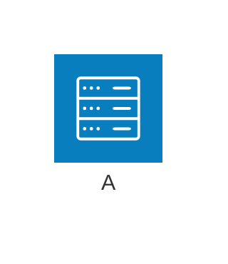
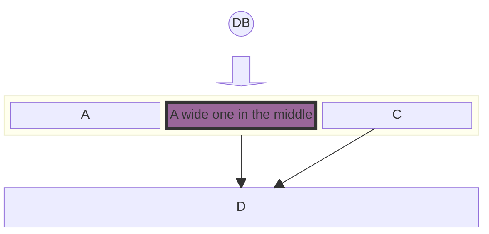
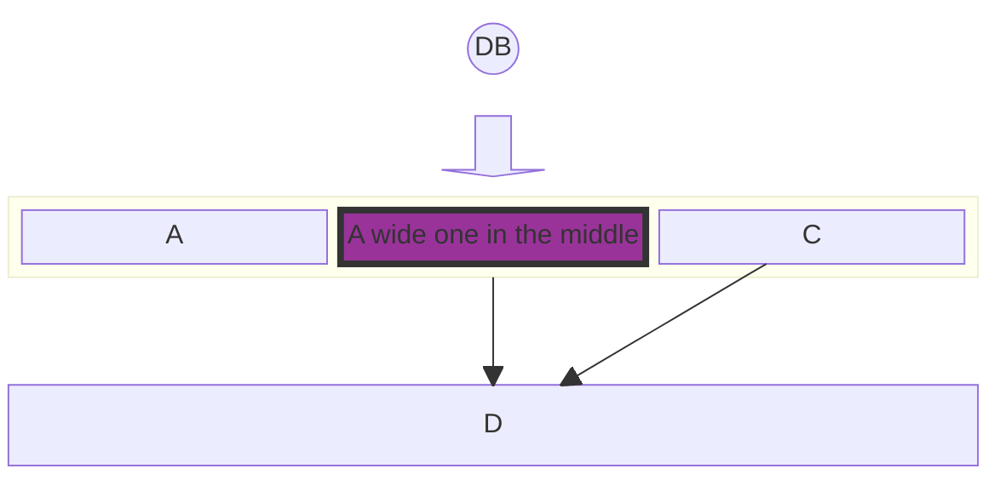
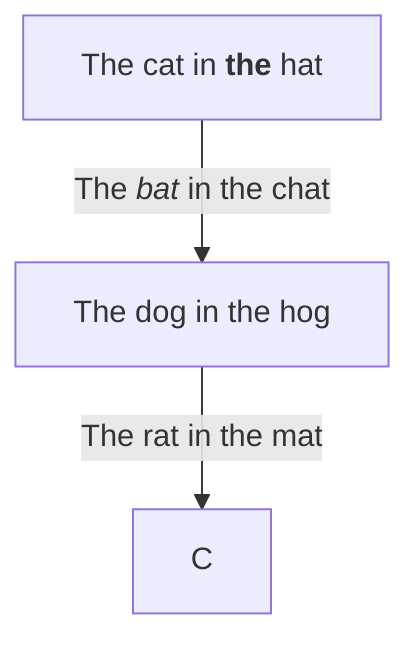
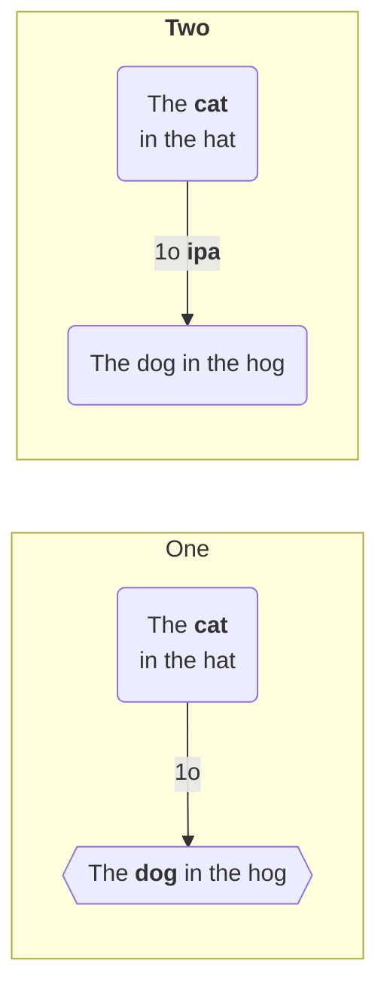
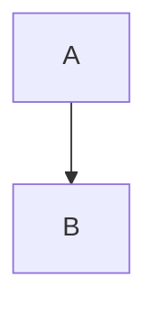

# mermaid-js/mermaid 12.2.0: failures

74 failed observations in families the tool supports. Each shows the input, what the pinned Mermaid 12.2.0 oracle expects, and what the tool did.

[Back to the league table](../README.md)

## architecture

### corpus:mermaid-upstream-suite-bench:architecture-upstream-should-handle-title-on-another-line

browser API, SVG. Missing authored label: Simple Architecture Diagram

```mermaid
architecture-beta
            title Simple Architecture Diagram
```

Expected labels: `Simple Architecture Diagram`

Tool output: [corpus-mermaid-upstream-suite-bench-architecture-upstream-should-handle-title-on-another-line-browser-public-api.svg](../outputs/mermaid-js-mermaid/corpus-mermaid-upstream-suite-bench-architecture-upstream-should-handle-title-on-another-line-browser-public-api.svg)

### authored:architecture-inline-title

browser API, SVG. Missing authored label: Hello



Expected labels: `Hello`, `A`

Tool output: [authored-architecture-inline-title-browser-public-api.svg](../outputs/mermaid-js-mermaid/authored-architecture-inline-title-browser-public-api.svg)

## block

### corpus:mermaid-block-bench:block-docs-1

browser API, SVG. Malformed SVG document or missing SVG namespace



Expected labels: `DB`, `A`, `A wide one in the middle`, `C`, `D`

Tool output: [corpus-mermaid-block-bench-block-docs-1-browser-public-api.svg](../outputs/mermaid-js-mermaid/corpus-mermaid-block-bench-block-docs-1-browser-public-api.svg)

### corpus:mermaid-block-bench:block-docs-23

browser API, SVG. Malformed SVG document or missing SVG namespace



Expected labels: `DB`, `A`, `A wide one in the middle`, `C`, `D`

Tool output: [corpus-mermaid-block-bench-block-docs-23-browser-public-api.svg](../outputs/mermaid-js-mermaid/corpus-mermaid-block-bench-block-docs-23-browser-public-api.svg)

## class

### corpus:mermaid-upstream-suite-bench:class-upstream-should-parse-classes-with-different-text-labels

browser API, SVG. Error: svg element not in render tree

```mermaid
classDiagram
class C1["OneWord"]
class C2["With, Comma"]
class C3["With (Brackets)"]
class C4["With [Brackets]"]
class C5["With {Brackets}"]
class C6[" "]
class C7["With 1 number"]
class C8["With . period..."]
class C9["With - dash"]
class C10["With _ underscore"]
class C11["With ' single quote"]
class C12["With ~!@#$%^&*()_+=-/?"]
class C13["With Città foreign language"]
```

Expected labels: `OneWord`, `With, Comma`, `With (Brackets)`, `With [Brackets]`, `With {Brackets}`, `With 1 number`, `With . period...`, `With - dash`, `With _ underscore`, `With ' single quote`, `With ~!@#$%^&*()_+=-/?`, `With Città foreign language`

## flowchart

### corpus:mermaid-upstream-suite-bench:flowchart-upstream-should-accept-swimlane-as-a-graph-keyword

Node parser API, Parser. UnknownDiagramError: No diagram type detected matching given configuration for text: swimlane LR;A-->B;

```mermaid
swimlane LR;A-->B;
```

Expected labels: none declared

### corpus:mermaid-upstream-suite-bench:flowchart-upstream-should-keep-node-label-text-if-already-defined-when-a-style-is-applied

Node parser API, Parser. Error: Parse error on line 1: ...;style A background:fl°fff¶ßstyle D borde -----------------------^ Expecting 'SEMI', 'NEWLINE', 'SPACE', 'EOF', 'COLON', 'STYLE', 'NUM', 'COMMA', 'NODE_STRING', 'UNIT', 'BRKT', 'PCT', got 'UNICODE_TEXT'

```mermaid
graph TD;A(( ));B((Test));C;style A background:#fff;style D border:1px solid red;
```

Expected labels: none declared

### corpus:mermaid-upstream-suite-bench:flowchart-upstream-markdown-formatting-in-nodes-and-labels

browser API, SVG. Missing authored label: The cat in **the** hat; Missing authored label: The *bat* in the chat



Expected labels: `The cat in **the** hat`, `The dog in the hog`, `C`, `The *bat* in the chat`, `The rat in the mat`

Tool output: [corpus-mermaid-upstream-suite-bench-flowchart-upstream-markdown-formatting-in-nodes-and-labels-browser-public-api.svg](../outputs/mermaid-js-mermaid/corpus-mermaid-upstream-suite-bench-flowchart-upstream-markdown-formatting-in-nodes-and-labels-browser-public-api.svg)

### corpus:mermaid-upstream-suite-bench:flowchart-upstream-markdown-formatting-in-subgraphs

browser API, SVG. Missing authored label: **Two**; Missing authored label: The **cat** in the hat; Missing authored label: The **dog** in the hog; Missing authored label: 1o **ipa**



Expected labels: `**Two**`, `One`, `The **cat** in the hat`, `The **dog** in the hog`, `The dog in the hog`, `1o`, `1o **ipa**`

Tool output: [corpus-mermaid-upstream-suite-bench-flowchart-upstream-markdown-formatting-in-subgraphs-browser-public-api.svg](../outputs/mermaid-js-mermaid/corpus-mermaid-upstream-suite-bench-flowchart-upstream-markdown-formatting-in-subgraphs-browser-public-api.svg)

### corpus:mermaid-upstream-suite-bench:flowchart-upstream-should-accept-swimlane-as-a-graph-keyword

browser API, SVG. UnknownDiagramError: No diagram type detected matching given configuration for text: swimlane LR;A-->B;

```mermaid
swimlane LR;A-->B;
```

Expected labels: none declared

### corpus:mermaid-upstream-suite-bench:flowchart-upstream-should-handle-interaction-click-to-a-click-and-href-link

browser API, SVG. Malformed SVG document or missing SVG namespace



Expected labels: `A`, `B`

Tool output: [corpus-mermaid-upstream-suite-bench-flowchart-upstream-should-handle-interaction-click-to-a-click-and-href-link-browser-public-api.svg](../outputs/mermaid-js-mermaid/corpus-mermaid-upstream-suite-bench-flowchart-upstream-should-handle-interaction-click-to-a-click-and-href-link-browser-public-api.svg)

### corpus:mermaid-upstream-suite-bench:flowchart-upstream-should-handle-interaction-click-to-a-click-and-href-link-with-target

browser API, SVG. Malformed SVG document or missing SVG namespace


Expected labels: `A`, `B`

Tool output: [corpus-mermaid-upstream-suite-bench-flowchart-upstream-should-handle-interaction-click-to-a-click-and-href-link-with-target-browser-public-api.svg](../outputs/mermaid-js-mermaid/corpus-mermaid-upstream-suite-bench-flowchart-upstream-should-handle-interaction-click-to-a-click-and-href-link-with-target-browser-public-api.svg)

### corpus:mermaid-upstream-suite-bench:flowchart-upstream-should-handle-interaction-click-to-a-click-and-href-link-with-tooltip

browser API, SVG. Malformed SVG document or missing SVG namespace


Expected labels: `A`, `B`

Tool output: [corpus-mermaid-upstream-suite-bench-flowchart-upstream-should-handle-interaction-click-to-a-click-and-href-link-with-tooltip-browser-public-api.svg](../outputs/mermaid-js-mermaid/corpus-mermaid-upstream-suite-bench-flowchart-upstream-should-handle-interaction-click-to-a-click-and-href-link-with-tooltip-browser-public-api.svg)

### corpus:mermaid-upstream-suite-bench:flowchart-upstream-should-handle-interaction-click-to-a-click-and-href-link-with-tooltip-and-target

browser API, SVG. Malformed SVG document or missing SVG namespace


Expected labels: `A`, `B`

Tool output: [corpus-mermaid-upstream-suite-bench-flowchart-upstream-should-handle-interaction-click-to-a-click-and-href-link-with-tooltip-and-target-browser-public-api.svg](../outputs/mermaid-js-mermaid/corpus-mermaid-upstream-suite-bench-flowchart-upstream-should-handle-interaction-click-to-a-click-and-href-link-with-tooltip-and-target-browser-public-api.svg)

### corpus:mermaid-upstream-suite-bench:flowchart-upstream-should-handle-interaction-click-to-a-link

browser API, SVG. Malformed SVG document or missing SVG namespace


Expected labels: `A`, `B`

Tool output: [corpus-mermaid-upstream-suite-bench-flowchart-upstream-should-handle-interaction-click-to-a-link-browser-public-api.svg](../outputs/mermaid-js-mermaid/corpus-mermaid-upstream-suite-bench-flowchart-upstream-should-handle-interaction-click-to-a-link-browser-public-api.svg)

### corpus:mermaid-upstream-suite-bench:flowchart-upstream-should-handle-interaction-click-to-a-link-with-target

browser API, SVG. Malformed SVG document or missing SVG namespace


Expected labels: `A`, `B`

Tool output: [corpus-mermaid-upstream-suite-bench-flowchart-upstream-should-handle-interaction-click-to-a-link-with-target-browser-public-api.svg](../outputs/mermaid-js-mermaid/corpus-mermaid-upstream-suite-bench-flowchart-upstream-should-handle-interaction-click-to-a-link-with-target-browser-public-api.svg)

### corpus:mermaid-upstream-suite-bench:flowchart-upstream-should-handle-interaction-click-to-a-link-with-tooltip

browser API, SVG. Malformed SVG document or missing SVG namespace


Expected labels: `A`, `B`

Tool output: [corpus-mermaid-upstream-suite-bench-flowchart-upstream-should-handle-interaction-click-to-a-link-with-tooltip-browser-public-api.svg](../outputs/mermaid-js-mermaid/corpus-mermaid-upstream-suite-bench-flowchart-upstream-should-handle-interaction-click-to-a-link-with-tooltip-browser-public-api.svg)

### corpus:mermaid-upstream-suite-bench:flowchart-upstream-should-handle-interaction-click-to-a-link-with-tooltip-and-target

browser API, SVG. Malformed SVG document or missing SVG namespace


Expected labels: `A`, `B`

Tool output: [corpus-mermaid-upstream-suite-bench-flowchart-upstream-should-handle-interaction-click-to-a-link-with-tooltip-and-target-browser-public-api.svg](../outputs/mermaid-js-mermaid/corpus-mermaid-upstream-suite-bench-flowchart-upstream-should-handle-interaction-click-to-a-link-with-tooltip-and-target-browser-public-api.svg)

### corpus:mermaid-upstream-suite-bench:flowchart-upstream-should-handle-text-in-ellipse-vertices

browser API, SVG. Error: No such shape: ellipse. Please check your syntax.

```mermaid
graph TD
A(-this is an ellipse-)-->B
```

Expected labels: `this is an ellipse`, `B`

### corpus:mermaid-upstream-suite-bench:flowchart-upstream-should-keep-node-label-text-if-already-defined-when-a-style-is-applied

browser API, SVG. Error: Parse error on line 1: ...;style A background:fl°fff¶ßstyle D borde -----------------------^ Expecting 'SEMI', 'NEWLINE', 'SPACE', 'EOF', 'COLON', 'STYLE', 'NUM', 'COMMA', 'NODE_STRING', 'UNIT', 'BRKT', 'PCT', got 'UNICODE_TEXT'

```mermaid
graph TD;A(( ));B((Test));C;style A background:#fff;style D border:1px solid red;
```

Expected labels: none declared

## journey

### corpus:mermaid-upstream-suite-bench:journey-upstream-should-handle-an-accessibility-title-accdescr

browser API, SVG. Missing authored label: Order from website

```mermaid
journey
    accTitle: The title
    section Order from website
```

Expected labels: `Order from website`

Tool output: [corpus-mermaid-upstream-suite-bench-journey-upstream-should-handle-an-accessibility-title-accdescr-browser-public-api.svg](../outputs/mermaid-js-mermaid/corpus-mermaid-upstream-suite-bench-journey-upstream-should-handle-an-accessibility-title-accdescr-browser-public-api.svg)

## kanban

### editor:kanban

Node parser API, Parser. Error: Parse error on line 5: ...ng[In progress]    kanban[Kanban family ----------------------^ Expecting 'SPACELINE', 'NL', 'EOF', 'ICON', 'CLASS', 'NODE_DSTART', 'NODE_ID', got 'KANBAN'

```mermaid
kanban
  todo[To do]
    packet[Packet family]@{ assigned: "Maya", priority: "High" }
  doing[In progress]
    kanban[Kanban family]@{ assigned: "Alex", ticket: "AM-409" }
  done[Done]
    research[Community research]
```

Expected labels: none declared

### editor:kanban

browser API, SVG. Error: Parse error on line 5: ...ng[In progress]    kanban[Kanban family ----------------------^ Expecting 'SPACELINE', 'NL', 'EOF', 'ICON', 'CLASS', 'NODE_DSTART', 'NODE_ID', got 'KANBAN'

```mermaid
kanban
  todo[To do]
    packet[Packet family]@{ assigned: "Maya", priority: "High" }
  doing[In progress]
    kanban[Kanban family]@{ assigned: "Alex", ticket: "AM-409" }
  done[Done]
    research[Community research]
```

Expected labels: none declared

### corpus:mermaid-kanban-bench:kanban-docs-3

browser API, SVG. Malformed SVG document or missing SVG namespace

```mermaid
---
config:
  kanban:
    ticketBaseUrl: 'https://mermaidchart.atlassian.net/browse/#TICKET#'
---
kanban
  Todo
    [Create Documentation]
    docs[Create Blog about the new diagram]
  [In progress]
    id6[Create renderer so that it works in all cases. We also add some extra text here for testing purposes. And some more just for the extra flare.]
  id9[Ready for deploy]
    id8[Design grammar]@{ assigned: 'knsv' }
  id10[Ready for test]
    id4[Create parsing tests]@{ ticket: MC-2038, assigned: 'K.Sveidqvist', priority: 'High' }
    id66[last item]@{ priority: 'Very Low', assigned: 'knsv' }
  id11[Done]
    id5[define getData]
    id2[Title of diagram is more than 100 chars when user duplicates diagram with 100 char]@{ ticket: MC-2036, priority: 'Very High'}
    id3[Update DB function]@{ ticket: MC-2037, assigned: knsv, priority: 'High' }

  id12[Can't reproduce]
    id3[Weird flickering in Firefox]

```

Expected labels: `Todo`, `Create Documentation`, `Create Blog about the new diagram`, `In progress`, `Create renderer so that it works in all cases. We also add some extra text here for testing purposes. And some more just for the extra flare.`, `Ready for deploy`, `Design grammar`, `Ready for test`, `Create parsing tests`, `last item`, `Done`, `define getData`, `Title of diagram is more than 100 chars when user duplicates diagram with 100 char`, `Update DB function`, `Can't reproduce`, `Weird flickering in Firefox`

Tool output: [corpus-mermaid-kanban-bench-kanban-docs-3-browser-public-api.svg](../outputs/mermaid-js-mermaid/corpus-mermaid-kanban-bench-kanban-docs-3-browser-public-api.svg)

## mindmap

### portfolio:mindmap:46

Node parser API, Parser. Error: There can be only one root. No parent could be found for ("accDescr: Official shapes, formatted labels, local icons, and accessible metadata")

```mermaid
mindmap
  accTitle: Documentation research map
  accDescr: Official shapes, formatted labels, local icons, and accessible metadata
  root((Research map))
    sources[Sources]
      ::icon(fa fa-book)
      :::reference important
      docs["`**Official docs** & issue reports`"]
      repos{{Repositories}}
        Mermaid
        Mermaid ASCII
        Beautiful Mermaid
    findings(Findings)
      syntax))Syntax parity((
      safety)Offline safety(
      gaps{{Named divergences}}
    evidence["`Unicode evidence: naïve café, 東京, مرحبا`"]
```

Expected labels: none declared

### portfolio:mindmap:47

Node parser API, Parser. Error: There can be only one root. No parent could be found for ("accDescr: A broad operational map with more than eleven second-level nodes")

```mermaid
mindmap
  accTitle: Incident response command map
  accDescr: A broad operational map with more than eleven second-level nodes
  root((Production incident))
    Detection
      Alerts
      Customer reports
    Triage
      Severity
      Scope
    Containment
      Feature flags
      Traffic shift
    Investigation
      Logs
      Traces
    Communications
      Status page
      Stakeholders
    Recovery
      Rollback
      Data repair
    Validation
      Synthetic checks
      Error budget
    Follow-up
      Timeline
      Action items
    Security
      Credentials
      Audit trail
    Vendors
      Cloud provider
      Payment processor
    Legal
      Notification duties
      Evidence hold
    Support
      Response macros
      Escalations
    Analytics
      Impact estimate
      Cohort analysis
```

Expected labels: none declared

### editor:mindmap

browser API, SVG. Missing authored label: **Evidence** across interviews, benchmarks, and Unicode naïve café

```mermaid
mindmap
  root((Agent-native release))
    discovery[Discovery]
      ::icon(fa fa-book)
      :::urgent large
      evidence["`**Evidence** across
interviews, benchmarks, and Unicode naïve café`"]
      constraints{{Constraints}}
        Security
        Determinism
    delivery(Delivery)
      beta))Beta signal((
      launch)Launch cloud(
      quality[Quality gates]
        Parser round-trip
        SVG identity
        Terminal width
    Ecosystem
      Mermaid parity
      Terminal tools
```

Expected labels: `Agent-native release`, `Discovery`, `**Evidence** across interviews, benchmarks, and Unicode naïve café`, `Constraints`, `Security`, `Determinism`, `Delivery`, `Beta signal`, `Launch cloud`, `Quality gates`, `Parser round-trip`, `SVG identity`, `Terminal width`, `Ecosystem`, `Mermaid parity`, `Terminal tools`

Tool output: [editor-mindmap-browser-public-api.svg](../outputs/mermaid-js-mermaid/editor-mindmap-browser-public-api.svg)

### portfolio:mindmap:46

browser API, SVG. Error: There can be only one root. No parent could be found for ("accDescr: Official shapes, formatted labels, local icons, and accessible metadata")

```mermaid
mindmap
  accTitle: Documentation research map
  accDescr: Official shapes, formatted labels, local icons, and accessible metadata
  root((Research map))
    sources[Sources]
      ::icon(fa fa-book)
      :::reference important
      docs["`**Official docs** & issue reports`"]
      repos{{Repositories}}
        Mermaid
        Mermaid ASCII
        Beautiful Mermaid
    findings(Findings)
      syntax))Syntax parity((
      safety)Offline safety(
      gaps{{Named divergences}}
    evidence["`Unicode evidence: naïve café, 東京, مرحبا`"]
```

Expected labels: none declared

### portfolio:mindmap:47

browser API, SVG. Error: There can be only one root. No parent could be found for ("accDescr: A broad operational map with more than eleven second-level nodes")

```mermaid
mindmap
  accTitle: Incident response command map
  accDescr: A broad operational map with more than eleven second-level nodes
  root((Production incident))
    Detection
      Alerts
      Customer reports
    Triage
      Severity
      Scope
    Containment
      Feature flags
      Traffic shift
    Investigation
      Logs
      Traces
    Communications
      Status page
      Stakeholders
    Recovery
      Rollback
      Data repair
    Validation
      Synthetic checks
      Error budget
    Follow-up
      Timeline
      Action items
    Security
      Credentials
      Audit trail
    Vendors
      Cloud provider
      Payment processor
    Legal
      Notification duties
      Evidence hold
    Support
      Response macros
      Escalations
    Analytics
      Impact estimate
      Cohort analysis
```

Expected labels: none declared

## quadrant

### corpus:mermaid-upstream-suite-bench:quadrant-upstream-should-be-able-to-handle-constructor-as-a-classname

Node parser API, Parser. Error: style named fill is not supported.

```mermaid
quadrantChart
    classDef constructor fill:#ff0000
    Microsoft:::constructor: [0.75, 0.75]
```

Expected labels: none declared

### corpus:mermaid-upstream-suite-bench:quadrant-upstream-should-be-able-to-handle-constructor-as-a-classname

browser API, SVG. Error: style named fill is not supported.

```mermaid
quadrantChart
    classDef constructor fill:#ff0000
    Microsoft:::constructor: [0.75, 0.75]
```

Expected labels: none declared

## requirement

### corpus:mermaid-requirement-bench:requirement-docs-4

browser API, SVG. Missing authored label: __test_req__; Missing authored label: *italicized text* **bold text**

```mermaid
requirementDiagram

requirement "__test_req__" {
    id: 1
    text: "*italicized text* **bold text**"
    risk: high
    verifymethod: test
}

```

Expected labels: `__test_req__`, `*italicized text* **bold text**`

Tool output: [corpus-mermaid-requirement-bench-requirement-docs-4-browser-public-api.svg](../outputs/mermaid-js-mermaid/corpus-mermaid-requirement-bench-requirement-docs-4-browser-public-api.svg)

## sequence

### corpus:mermaid-upstream-suite-bench:sequence-upstream-should-not-hang-when-as-is-used-without-a-space-before-the-alias-text

Node parser API, Parser. Error: Parse error on line 2: ...        participant X_AutoPublishable as... -----------------------^ Expecting 'link', 'ACTOR', got 'INVALID'

```mermaid
sequenceDiagram
          participant X_AutoPublishable asAAAAAAAAAAAAA:AAAAAAAAAAAAA
```

Expected labels: none declared

### corpus:mermaid-upstream-suite-bench:sequence-upstream-should-draw-two-actors-notes-to-the-left-with-text-wrapped-and-the-init-directive-sets-the

browser API, SVG. Missing authored label: Hello Bob, how are you? If you are not available right now, I can leave you a message. Please get back to me as soon as you can!

```mermaid
%%{init:{'theme':'dark'}}%%
sequenceDiagram
%%{wrap}%%
Alice->>Bob: Hello Bob, how are you? If you are not available right now, I can leave you a message. Please get back to me as soon as you can!
Note left of Alice: Bob thinks
Bob->>Alice: Fine!
```

Expected labels: `Alice`, `Bob`, `Hello Bob, how are you? If you are not available right now, I can leave you a message. Please get back to me as soon as you can!`, `Fine!`

Tool output: [corpus-mermaid-upstream-suite-bench-sequence-upstream-should-draw-two-actors-notes-to-the-left-with-text-wrapped-and-the-init-directive-sets-the-browser-public-api.svg](../outputs/mermaid-js-mermaid/corpus-mermaid-upstream-suite-bench-sequence-upstream-should-draw-two-actors-notes-to-the-left-with-text-wrapped-and-the-init-directive-sets-the-browser-public-api.svg)

### corpus:mermaid-upstream-suite-bench:sequence-upstream-should-draw-two-actors-notes-to-the-left-with-text-wrapped-and-the-init-directive-sets-the-2

browser API, SVG. Missing authored label: Hello Bob, how are you? If you are not available right now, I can leave you a message. Please get back to me as soon as you can!

```mermaid
%%{init: { "theme": "dark", 'config': { "fontFamily": "Menlo", "fontSize": 18, "messageFontWeight": 400, "wrap": true }}}%%
sequenceDiagram
Alice->>Bob: Hello Bob, how are you? If you are not available right now, I can leave you a message. Please get back to me as soon as you can!
Note left of Alice: Bob thinks
Bob->>Alice: Fine!
```

Expected labels: `Alice`, `Bob`, `Hello Bob, how are you? If you are not available right now, I can leave you a message. Please get back to me as soon as you can!`, `Fine!`

Tool output: [corpus-mermaid-upstream-suite-bench-sequence-upstream-should-draw-two-actors-notes-to-the-left-with-text-wrapped-and-the-init-directive-sets-the-2-browser-public-api.svg](../outputs/mermaid-js-mermaid/corpus-mermaid-upstream-suite-bench-sequence-upstream-should-draw-two-actors-notes-to-the-left-with-text-wrapped-and-the-init-directive-sets-the-2-browser-public-api.svg)

### corpus:mermaid-upstream-suite-bench:sequence-upstream-should-draw-two-actors-notes-to-the-left-with-text-wrapped-directive

browser API, SVG. Missing authored label: Hello Bob, how are you? If you are not available right now, I can leave you a message. Please get back to me as soon as you can!

```mermaid
%%{init: { 'theme': 'dark' } }%%
sequenceDiagram
%%{wrap}%%
Alice->>Bob: Hello Bob, how are you? If you are not available right now, I can leave you a message. Please get back to me as soon as you can!
Note left of Alice: Bob thinks
Bob->>Alice: Fine!
```

Expected labels: `Alice`, `Bob`, `Hello Bob, how are you? If you are not available right now, I can leave you a message. Please get back to me as soon as you can!`, `Fine!`

Tool output: [corpus-mermaid-upstream-suite-bench-sequence-upstream-should-draw-two-actors-notes-to-the-left-with-text-wrapped-directive-browser-public-api.svg](../outputs/mermaid-js-mermaid/corpus-mermaid-upstream-suite-bench-sequence-upstream-should-draw-two-actors-notes-to-the-left-with-text-wrapped-directive-browser-public-api.svg)

### corpus:mermaid-upstream-suite-bench:sequence-upstream-should-draw-two-actors-notes-to-the-left-with-text-wrapped-inline

browser API, SVG. Missing authored label: Hello Bob, how are you? If you are not available right now, I can leave you a message. Please get back to me as soon as you can!

```mermaid
sequenceDiagram
Alice->>Bob:wrap: Hello Bob, how are you? If you are not available right now, I can leave you a message. Please get back to me as soon as you can!
Note left of Alice: Bob thinks
Bob->>Alice: Fine!
```

Expected labels: `Alice`, `Bob`, `Hello Bob, how are you? If you are not available right now, I can leave you a message. Please get back to me as soon as you can!`, `Fine!`

Tool output: [corpus-mermaid-upstream-suite-bench-sequence-upstream-should-draw-two-actors-notes-to-the-left-with-text-wrapped-inline-browser-public-api.svg](../outputs/mermaid-js-mermaid/corpus-mermaid-upstream-suite-bench-sequence-upstream-should-draw-two-actors-notes-to-the-left-with-text-wrapped-inline-browser-public-api.svg)

### corpus:mermaid-upstream-suite-bench:sequence-upstream-should-handle-box

browser API, SVG. Malformed SVG document or missing SVG namespace

```mermaid
sequenceDiagram
box green Group 1
participant a as Alice
participant b as Bob
end
participant c as Charlie
links a: { "Repo": "https://repo.contoso.com/", "Dashboard": "https://dashboard.contoso.com/" }
links b: { "Dashboard": "https://dashboard.contoso.com/" }
links a: { "On-Call": "https://oncall.contoso.com/?svc=alice" }
link a: Endpoint @ https://alice.contoso.com
link a: Swagger @ https://swagger.contoso.com
link a: Tests @ https://tests.contoso.com/?svc=alice@contoso.com
```

Expected labels: `Alice`, `Bob`, `Charlie`

Tool output: [corpus-mermaid-upstream-suite-bench-sequence-upstream-should-handle-box-browser-public-api.svg](../outputs/mermaid-js-mermaid/corpus-mermaid-upstream-suite-bench-sequence-upstream-should-handle-box-browser-public-api.svg)

### corpus:mermaid-upstream-suite-bench:sequence-upstream-should-handle-box-without-color

browser API, SVG. Malformed SVG document or missing SVG namespace

```mermaid
sequenceDiagram
  box Group 1
  participant a as Alice
  participant b as Bob
  end
  participant c as Charlie
  links a: { "Repo": "https://repo.contoso.com/", "Dashboard": "https://dashboard.contoso.com/" }
  links b: { "Dashboard": "https://dashboard.contoso.com/" }
  links a: { "On-Call": "https://oncall.contoso.com/?svc=alice" }
  link a: Endpoint @ https://alice.contoso.com
  link a: Swagger @ https://swagger.contoso.com
  link a: Tests @ https://tests.contoso.com/?svc=alice@contoso.com
```

Expected labels: `Alice`, `Bob`, `Charlie`

Tool output: [corpus-mermaid-upstream-suite-bench-sequence-upstream-should-handle-box-without-color-browser-public-api.svg](../outputs/mermaid-js-mermaid/corpus-mermaid-upstream-suite-bench-sequence-upstream-should-handle-box-without-color-browser-public-api.svg)

### corpus:mermaid-upstream-suite-bench:sequence-upstream-should-handle-box-without-description

browser API, SVG. Malformed SVG document or missing SVG namespace

```mermaid
sequenceDiagram
  box aqua
  participant a as Alice
  participant b as Bob
  end
  participant c as Charlie
  links a: { "Repo": "https://repo.contoso.com/", "Dashboard": "https://dashboard.contoso.com/" }
  links b: { "Dashboard": "https://dashboard.contoso.com/" }
  links a: { "On-Call": "https://oncall.contoso.com/?svc=alice" }
  link a: Endpoint @ https://alice.contoso.com
  link a: Swagger @ https://swagger.contoso.com
  link a: Tests @ https://tests.contoso.com/?svc=alice@contoso.com
```

Expected labels: `Alice`, `Bob`, `Charlie`

Tool output: [corpus-mermaid-upstream-suite-bench-sequence-upstream-should-handle-box-without-description-browser-public-api.svg](../outputs/mermaid-js-mermaid/corpus-mermaid-upstream-suite-bench-sequence-upstream-should-handle-box-without-description-browser-public-api.svg)

### corpus:mermaid-upstream-suite-bench:sequence-upstream-should-handle-different-line-breaks

browser API, SVG. Missing authored label: multiline text

```mermaid
sequenceDiagram
participant 1 as multiline<br>text
participant 2 as multiline<br/>text
participant 3 as multiline<br />text
participant 4 as multiline<br 	/>text
1->>2: multiline<br>text
note right of 2: multiline<br>text
2->>3: multiline<br/>text
note right of 3: multiline<br/>text
3->>4: multiline<br />text
note right of 4: multiline<br />text
4->>1: multiline<br 	/>text
note right of 1: multiline<br 	/>text
```

Expected labels: `multiline text`

Tool output: [corpus-mermaid-upstream-suite-bench-sequence-upstream-should-handle-different-line-breaks-browser-public-api.svg](../outputs/mermaid-js-mermaid/corpus-mermaid-upstream-suite-bench-sequence-upstream-should-handle-different-line-breaks-browser-public-api.svg)

### corpus:mermaid-upstream-suite-bench:sequence-upstream-should-handle-links

browser API, SVG. Malformed SVG document or missing SVG namespace

```mermaid
sequenceDiagram
participant a as Alice
participant b as Bob
participant c as Charlie
links a: { "Repo": "https://repo.contoso.com/", "Dashboard": "https://dashboard.contoso.com/" }
links b: { "Dashboard": "https://dashboard.contoso.com/" }
links a: { "On-Call": "https://oncall.contoso.com/?svc=alice" }
link a: Endpoint @ https://alice.contoso.com
link a: Swagger @ https://swagger.contoso.com
link a: Tests @ https://tests.contoso.com/?svc=alice@contoso.com
```

Expected labels: `Alice`, `Bob`, `Charlie`

Tool output: [corpus-mermaid-upstream-suite-bench-sequence-upstream-should-handle-links-browser-public-api.svg](../outputs/mermaid-js-mermaid/corpus-mermaid-upstream-suite-bench-sequence-upstream-should-handle-links-browser-public-api.svg)

### corpus:mermaid-upstream-suite-bench:sequence-upstream-should-handle-notes-and-messages-with-wrap-specified

browser API, SVG. Missing authored label: multiline text

```mermaid
sequenceDiagram
participant 1
participant 2
participant 3
participant 4
1->>2:wrap: single-line text
note right of 2:wrap: single-line text
2->>3:wrap: multiline<br/>text
note right of 3:wrap: multiline<br/>text
```

Expected labels: `1`, `2`, `3`, `4`, `single-line text`, `multiline text`

Tool output: [corpus-mermaid-upstream-suite-bench-sequence-upstream-should-handle-notes-and-messages-with-wrap-specified-browser-public-api.svg](../outputs/mermaid-js-mermaid/corpus-mermaid-upstream-suite-bench-sequence-upstream-should-handle-notes-and-messages-with-wrap-specified-browser-public-api.svg)

### corpus:mermaid-upstream-suite-bench:sequence-upstream-should-handle-notes-and-messages-without-wrap-specified

browser API, SVG. Missing authored label: multiline text

```mermaid
sequenceDiagram
participant 1
participant 2
participant 3
participant 4
1->>2: single-line text
note right of 2: single-line text
2->>3:nowrap: single-line text
note right of 3:nowrap: single-line text
3->>4: multiline<br/>text
note right of 4: multiline<br/>text
4->>1:nowrap: multiline<br/>text
note right of 1:nowrap: multiline<br/>text
```

Expected labels: `1`, `2`, `3`, `4`, `single-line text`, `multiline text`

Tool output: [corpus-mermaid-upstream-suite-bench-sequence-upstream-should-handle-notes-and-messages-without-wrap-specified-browser-public-api.svg](../outputs/mermaid-js-mermaid/corpus-mermaid-upstream-suite-bench-sequence-upstream-should-handle-notes-and-messages-without-wrap-specified-browser-public-api.svg)

### corpus:mermaid-upstream-suite-bench:sequence-upstream-should-not-hang-when-as-is-used-without-a-space-before-the-alias-text

browser API, SVG. Error: Parse error on line 2: ...        participant X_AutoPublishable as... -----------------------^ Expecting 'link', 'ACTOR', got 'INVALID'

```mermaid
sequenceDiagram
          participant X_AutoPublishable asAAAAAAAAAAAAA:AAAAAAAAAAAAA
```

Expected labels: none declared

## state

### corpus:mermaid-upstream-suite-bench:state-upstream-should-handle-arrow-directions-definitions

Node parser API, Parser. Error: Parse error on line 3: ...-v2    //     [*] -up-> First    //   ---------------------^ Expecting 'SPACE', 'NL', 'DESCR', '-->', 'HIDE_EMPTY', 'scale', 'COMPOSIT_STATE', 'STRUCT_STOP', 'STATE_DESCR', 'ID', 'FORK', 'JOIN', 'CHOICE', 'CONCURRENT', 'note', 'acc_title', 'acc_descr', 'acc_descr_multiline_value', 'CLICK', 'STRING', 'HREF', 'classDef', 'style', 'class', 'direction_tb', 'direction_bt', 'direction_rl', 'direction_lr', 'EDGE_STATE', 'STYLE_SEPARATOR', got 'INVALID'

```mermaid
stateDiagram-v2

    //     [*] -up-> First
    //     First -right-> Second
    //     Second --> Third
    //     Third -left-> Last
    //
```

Expected labels: none declared

### corpus:mermaid-upstream-suite-bench:state-upstream-should-handle-arrow-directions-definitions-2

Node parser API, Parser. Error: Parse error on line 3: ...ram    //     [*] -up-> First    //   ---------------------^ Expecting 'SPACE', 'NL', 'DESCR', '-->', 'HIDE_EMPTY', 'scale', 'COMPOSIT_STATE', 'STRUCT_STOP', 'STATE_DESCR', 'ID', 'FORK', 'JOIN', 'CHOICE', 'CONCURRENT', 'note', 'acc_title', 'acc_descr', 'acc_descr_multiline_value', 'CLICK', 'STRING', 'HREF', 'classDef', 'style', 'class', 'direction_tb', 'direction_bt', 'direction_rl', 'direction_lr', 'EDGE_STATE', 'STYLE_SEPARATOR', got 'INVALID'

```mermaid
stateDiagram

    //     [*] -up-> First
    //     First -right-> Second
    //     Second --> Third
    //     Third -left-> Last
    //
```

Expected labels: none declared

### corpus:mermaid-upstream-suite-bench:state-upstream-should-handle-arrow-directions-definitions

browser API, SVG. Error: Parse error on line 3: ...-v2    //     [*] -up-> First    //   ---------------------^ Expecting 'SPACE', 'NL', 'DESCR', '-->', 'HIDE_EMPTY', 'scale', 'COMPOSIT_STATE', 'STRUCT_STOP', 'STATE_DESCR', 'ID', 'FORK', 'JOIN', 'CHOICE', 'CONCURRENT', 'note', 'acc_title', 'acc_descr', 'acc_descr_multiline_value', 'CLICK', 'STRING', 'HREF', 'classDef', 'style', 'class', 'direction_tb', 'direction_bt', 'direction_rl', 'direction_lr', 'EDGE_STATE', 'STYLE_SEPARATOR', got 'INVALID'

```mermaid
stateDiagram-v2

    //     [*] -up-> First
    //     First -right-> Second
    //     Second --> Third
    //     Third -left-> Last
    //
```

Expected labels: none declared

### corpus:mermaid-upstream-suite-bench:state-upstream-should-handle-arrow-directions-definitions-2

browser API, SVG. Error: Parse error on line 3: ...ram    //     [*] -up-> First    //   ---------------------^ Expecting 'SPACE', 'NL', 'DESCR', '-->', 'HIDE_EMPTY', 'scale', 'COMPOSIT_STATE', 'STRUCT_STOP', 'STATE_DESCR', 'ID', 'FORK', 'JOIN', 'CHOICE', 'CONCURRENT', 'note', 'acc_title', 'acc_descr', 'acc_descr_multiline_value', 'CLICK', 'STRING', 'HREF', 'classDef', 'style', 'class', 'direction_tb', 'direction_bt', 'direction_rl', 'direction_lr', 'EDGE_STATE', 'STYLE_SEPARATOR', got 'INVALID'

```mermaid
stateDiagram

    //     [*] -up-> First
    //     First -right-> Second
    //     Second --> Third
    //     Third -left-> Last
    //
```

Expected labels: none declared

### corpus:mermaid-upstream-suite-bench:state-upstream-state-group-name-as-stateidentifier

browser API, SVG. Missing authored label: should point to Big State 1 container; Missing authored label: should point to bigState2 container

```mermaid
stateDiagram-v2
        state "Small State 1" as namedState1
        %% Notice that this is named "Big State 1" with an "as"
        state "Big State 1" as bigState1 {
            bigState1InternalState
        }
        namedState1 --> bigState1: should point to \nBig State 1 container

        state "Small State 2" as namedState2
        %% Notice that bigState2 does not have a name; no "as"
        state bigState2 {
            bigState2InternalState
        }
        namedState2 --> bigState2: should point to \nbigState2 container
```

Expected labels: `Small State 1`, `Big State 1`, `bigState1InternalState`, `Small State 2`, `bigState2`, `bigState2InternalState`, `should point to Big State 1 container`, `should point to bigState2 container`

Tool output: [corpus-mermaid-upstream-suite-bench-state-upstream-state-group-name-as-stateidentifier-browser-public-api.svg](../outputs/mermaid-js-mermaid/corpus-mermaid-upstream-suite-bench-state-upstream-state-group-name-as-stateidentifier-browser-public-api.svg)

## treemap

### scaling:treemap:20-groups-240-leaves

browser API, SVG. Missing authored label: Group 19

```mermaid
treemap
title Product allocation
"Group 0"
  "Investment 0.0": 10
  "Investment 0.1": 20
  "Investment 0.2": 30
  "Investment 0.3": 40
  "Investment 0.4": 50
  "Investment 0.5": 60
  "Investment 0.6": 70
  "Investment 0.7": 80
  "Investment 0.8": 90
  "Investment 0.9": 100
  "Investment 0.10": 110
  "Investment 0.11": 120
"Group 1"
  "Investment 1.0": 10
  "Investment 1.1": 20
  "Investment 1.2": 30
  "Investment 1.3": 40
  "Investment 1.4": 50
  "Investment 1.5": 60
  "Investment 1.6": 70
  "Investment 1.7": 80
  "Investment 1.8": 90
  "Investment 1.9": 100
  "Investment 1.10": 110
  "Investment 1.11": 120
"Group 2"
  "Investment 2.0": 10
  "Investment 2.1": 20
  "Investment 2.2": 30
  "Investment 2.3": 40
  "Investment 2.4": 50
  "Investment 2.5": 60
  "Investment 2.6": 70
  "Investment 2.7": 80
  "Investment 2.8": 90
  "Investment 2.9": 100
  "Investment 2.10": 110
  "Investment 2.11": 120
"Group 3"
  "Investment 3.0": 10
  "Investment 3.1": 20
  "Investment 3.2": 30
  "Investment 3.3": 40
  "Investment 3.4": 50
  "Investment 3.5": 60
  "Investment 3.6": 70
  "Investment 3.7": 80
  "Investment 3.8": 90
  "Investment 3.9": 100
  "Investment 3.10": 110
  "Investment 3.11": 120
"Group 4"
  "Investment 4.0": 10
  "Investment 4.1": 20
  "Investment 4.2": 30
  "Investment 4.3": 40
  "Investment 4.4": 50
  "Investment 4.5": 60
  "Investment 4.6": 70
  "Investment 4.7": 80
  "Investment 4.8": 90
  "Investment 4.9": 100
  "Investment 4.10": 110
  "Investment 4.11": 120
"Group 5"
  "Investment 5.0": 10
  "Investment 5.1": 20
  "Investment 5.2": 30
  "Investment 5.3": 40
  "Investment 5.4": 50
  "Investment 5.5": 60
  "Investment 5.6": 70
  "Investment 5.7": 80
  "Investment 5.8": 90
  "Investment 5.9": 100
  "Investment 5.10": 110
  "Investment 5.11": 120
"Group 6"
  "Investment 6.0": 10
  "Investment 6.1": 20
  "Investment 6.2": 30
  "Investment 6.3": 40
  "Investment 6.4": 50
  "Investment 6.5": 60
  "Investment 6.6": 70
  "Investment 6.7": 80
  "Investment 6.8": 90
  "Investment 6.9": 100
  "Investment 6.10": 110
  "Investment 6.11": 120
"Group 7"
  "Investment 7.0": 10
  "Investment 7.1": 20
  "Investment 7.2": 30
  "Investment 7.3": 40
  "Investment 7.4": 50
  "Investment 7.5": 60
  "Investment 7.6": 70
  "Investment 7.7": 80
  "Investment 7.8": 90
  "Investment 7.9": 100
  "Investment 7.10": 110
  "Investment 7.11": 120
"Group 8"
  "Investment 8.0": 10
  "Investment 8.1": 20
  "Investment 8.2": 30
  "Investment 8.3": 40
  "Investment 8.4": 50
  "Investment 8.5": 60
  "Investment 8.6": 70
  "Investment 8.7": 80
  "Investment 8.8": 90
  "Investment 8.9": 100
  "Investment 8.10": 110
  "Investment 8.11": 120
"Group 9"
  "Investment 9.0": 10
  "Investment 9.1": 20
  "Investment 9.2": 30
  "Investment 9.3": 40
  "Investment 9.4": 50
  "Investment 9.5": 60
  "Investment 9.6": 70
  "Investment 9.7": 80
  "Investment 9.8": 90
  "Investment 9.9": 100
  "Investment 9.10": 110
  "Investment 9.11": 120
"Group 10"
  "Investment 10.0": 10
  "Investment 10.1": 20
  "Investment 10.2": 30
  "Investment 10.3": 40
  "Investment 10.4": 50
  "Investment 10.5": 60
  "Investment 10.6": 70
  "Investment 10.7": 80
  "Investment 10.8": 90
  "Investment 10.9": 100
  "Investment 10.10": 110
  "Investment 10.11": 120
"Group 11"
  "Investment 11.0": 10
  "Investment 11.1": 20
  "Investment 11.2": 30
  "Investment 11.3": 40
  "Investment 11.4": 50
  "Investment 11.5": 60
  "Investment 11.6": 70
  "Investment 11.7": 80
  "Investment 11.8": 90
  "Investment 11.9": 100
  "Investment 11.10": 110
  "Investment 11.11": 120
"Group 12"
  "Investment 12.0": 10
  "Investment 12.1": 20
  "Investment 12.2": 30
  "Investment 12.3": 40
  "Investment 12.4": 50
  "Investment 12.5": 60
  "Investment 12.6": 70
  "Investment 12.7": 80
  "Investment 12.8": 90
  "Investment 12.9": 100
  "Investment 12.10": 110
  "Investment 12.11": 120
"Group 13"
  "Investment 13.0": 10
  "Investment 13.1": 20
  "Investment 13.2": 30
  "Investment 13.3": 40
  "Investment 13.4": 50
  "Investment 13.5": 60
  "Investment 13.6": 70
  "Investment 13.7": 80
  "Investment 13.8": 90
  "Investment 13.9": 100
  "Investment 13.10": 110
  "Investment 13.11": 120
"Group 14"
  "Investment 14.0": 10
  "Investment 14.1": 20
  "Investment 14.2": 30
  "Investment 14.3": 40
  "Investment 14.4": 50
  "Investment 14.5": 60
  "Investment 14.6": 70
  "Investment 14.7": 80
  "Investment 14.8": 90
  "Investment 14.9": 100
  "Investment 14.10": 110
  "Investment 14.11": 120
"Group 15"
  "Investment 15.0": 10
  "Investment 15.1": 20
  "Investment 15.2": 30
  "Investment 15.3": 40
  "Investment 15.4": 50
  "Investment 15.5": 60
  "Investment 15.6": 70
  "Investment 15.7": 80
  "Investment 15.8": 90
  "Investment 15.9": 100
  "Investment 15.10": 110
  "Investment 15.11": 120
"Group 16"
  "Investment 16.0": 10
  "Investment 16.1": 20
  "Investment 16.2": 30
  "Investment 16.3": 40
  "Investment 16.4": 50
  "Investment 16.5": 60
  "Investment 16.6": 70
  "Investment 16.7": 80
  "Investment 16.8": 90
  "Investment 16.9": 100
  "Investment 16.10": 110
  "Investment 16.11": 120
"Group 17"
  "Investment 17.0": 10
  "Investment 17.1": 20
  "Investment 17.2": 30
  "Investment 17.3": 40
  "Investment 17.4": 50
  "Investment 17.5": 60
  "Investment 17.6": 70
  "Investment 17.7": 80
  "Investment 17.8": 90
  "Investment 17.9": 100
  "Investment 17.10": 110
  "Investment 17.11": 120
"Group 18"
  "Investment 18.0": 10
  "Investment 18.1": 20
  "Investment 18.2": 30
  "Investment 18.3": 40
  "Investment 18.4": 50
  "Investment 18.5": 60
  "Investment 18.6": 70
  "Investment 18.7": 80
  "Investment 18.8": 90
  "Investment 18.9": 100
  "Investment 18.10": 110
  "Investment 18.11": 120
"Group 19"
  "Investment 19.0": 10
  "Investment 19.1": 20
  "Investment 19.2": 30
  "Investment 19.3": 40
  "Investment 19.4": 50
  "Investment 19.5": 60
  "Investment 19.6": 70
  "Investment 19.7": 80
  "Investment 19.8": 90
  "Investment 19.9": 100
  "Investment 19.10": 110
  "Investment 19.11": 120
```

Expected labels: `Product allocation`, `Group 0`, `Investment 0.0`, `Investment 0.1`, `Investment 0.2`, `Investment 0.3`, `Investment 0.4`, `Investment 0.5`, `Investment 0.6`, `Investment 0.7`, `Investment 0.8`, `Investment 0.9`, `Investment 0.10`, `Investment 0.11`, `Group 1`, `Investment 1.0`, `Investment 1.1`, `Investment 1.2`, `Investment 1.3`, `Investment 1.4`, `Investment 1.5`, `Investment 1.6`, `Investment 1.7`, `Investment 1.8`, `Investment 1.9`, `Investment 1.10`, `Investment 1.11`, `Group 2`, `Investment 2.0`, `Investment 2.1`, `Investment 2.2`, `Investment 2.3`, `Investment 2.4`, `Investment 2.5`, `Investment 2.6`, `Investment 2.7`, `Investment 2.8`, `Investment 2.9`, `Investment 2.10`, `Investment 2.11`, `Group 3`, `Investment 3.0`, `Investment 3.1`, `Investment 3.2`, `Investment 3.3`, `Investment 3.4`, `Investment 3.5`, `Investment 3.6`, `Investment 3.7`, `Investment 3.8`, `Investment 3.9`, `Investment 3.10`, `Investment 3.11`, `Group 4`, `Investment 4.0`, `Investment 4.1`, `Investment 4.2`, `Investment 4.3`, `Investment 4.4`, `Investment 4.5`, `Investment 4.6`, `Investment 4.7`, `Investment 4.8`, `Investment 4.9`, `Investment 4.10`, `Investment 4.11`, `Group 5`, `Investment 5.0`, `Investment 5.1`, `Investment 5.2`, `Investment 5.3`, `Investment 5.4`, `Investment 5.5`, `Investment 5.6`, `Investment 5.7`, `Investment 5.8`, `Investment 5.9`, `Investment 5.10`, `Investment 5.11`, `Group 6`, `Investment 6.0`, `Investment 6.1`, `Investment 6.2`, `Investment 6.3`, `Investment 6.4`, `Investment 6.5`, `Investment 6.6`, `Investment 6.7`, `Investment 6.8`, `Investment 6.9`, `Investment 6.10`, `Investment 6.11`, `Group 7`, `Investment 7.0`, `Investment 7.1`, `Investment 7.2`, `Investment 7.3`, `Investment 7.4`, `Investment 7.5`, `Investment 7.6`, `Investment 7.7`, `Investment 7.8`, `Investment 7.9`, `Investment 7.10`, `Investment 7.11`, `Group 8`, `Investment 8.0`, `Investment 8.1`, `Investment 8.2`, `Investment 8.3`, `Investment 8.4`, `Investment 8.5`, `Investment 8.6`, `Investment 8.7`, `Investment 8.8`, `Investment 8.9`, `Investment 8.10`, `Investment 8.11`, `Group 9`, `Investment 9.0`, `Investment 9.1`, `Investment 9.2`, `Investment 9.3`, `Investment 9.4`, `Investment 9.5`, `Investment 9.6`, `Investment 9.7`, `Investment 9.8`, `Investment 9.9`, `Investment 9.10`, `Investment 9.11`, `Group 10`, `Investment 10.0`, `Investment 10.1`, `Investment 10.2`, `Investment 10.3`, `Investment 10.4`, `Investment 10.5`, `Investment 10.6`, `Investment 10.7`, `Investment 10.8`, `Investment 10.9`, `Investment 10.10`, `Investment 10.11`, `Group 11`, `Investment 11.0`, `Investment 11.1`, `Investment 11.2`, `Investment 11.3`, `Investment 11.4`, `Investment 11.5`, `Investment 11.6`, `Investment 11.7`, `Investment 11.8`, `Investment 11.9`, `Investment 11.10`, `Investment 11.11`, `Group 12`, `Investment 12.0`, `Investment 12.1`, `Investment 12.2`, `Investment 12.3`, `Investment 12.4`, `Investment 12.5`, `Investment 12.6`, `Investment 12.7`, `Investment 12.8`, `Investment 12.9`, `Investment 12.10`, `Investment 12.11`, `Group 13`, `Investment 13.0`, `Investment 13.1`, `Investment 13.2`, `Investment 13.3`, `Investment 13.4`, `Investment 13.5`, `Investment 13.6`, `Investment 13.7`, `Investment 13.8`, `Investment 13.9`, `Investment 13.10`, `Investment 13.11`, `Group 14`, `Investment 14.0`, `Investment 14.1`, `Investment 14.2`, `Investment 14.3`, `Investment 14.4`, `Investment 14.5`, `Investment 14.6`, `Investment 14.7`, `Investment 14.8`, `Investment 14.9`, `Investment 14.10`, `Investment 14.11`, `Group 15`, `Investment 15.0`, `Investment 15.1`, `Investment 15.2`, `Investment 15.3`, `Investment 15.4`, `Investment 15.5`, `Investment 15.6`, `Investment 15.7`, `Investment 15.8`, `Investment 15.9`, `Investment 15.10`, `Investment 15.11`, `Group 16`, `Investment 16.0`, `Investment 16.1`, `Investment 16.2`, `Investment 16.3`, `Investment 16.4`, `Investment 16.5`, `Investment 16.6`, `Investment 16.7`, `Investment 16.8`, `Investment 16.9`, `Investment 16.10`, `Investment 16.11`, `Group 17`, `Investment 17.0`, `Investment 17.1`, `Investment 17.2`, `Investment 17.3`, `Investment 17.4`, `Investment 17.5`, `Investment 17.6`, `Investment 17.7`, `Investment 17.8`, `Investment 17.9`, `Investment 17.10`, `Investment 17.11`, `Group 18`, `Investment 18.0`, `Investment 18.1`, `Investment 18.2`, `Investment 18.3`, `Investment 18.4`, `Investment 18.5`, `Investment 18.6`, `Investment 18.7`, `Investment 18.8`, `Investment 18.9`, `Investment 18.10`, `Investment 18.11`, `Group 19`, `Investment 19.0`, `Investment 19.1`, `Investment 19.2`, `Investment 19.3`, `Investment 19.4`, `Investment 19.5`, `Investment 19.6`, `Investment 19.7`, `Investment 19.8`, `Investment 19.9`, `Investment 19.10`, `Investment 19.11`

Tool output: [scaling-treemap-20-groups-240-leaves-browser-public-api.svg](../outputs/mermaid-js-mermaid/scaling-treemap-20-groups-240-leaves-browser-public-api.svg)

### corpus:mermaid-treemap-bench:treemap-e2e-19-should-render-labels-in-complex-treemap-with-many-nested-blocks

browser API, SVG. Missing authored label: 🟡 Low Activity (15%)

```mermaid
---
description: >-
  Large, real-world-style treemap-beta with three top-level, emoji-labeled
  sections (High/Medium/Low activity) containing dozens of nested leaf
  nodes representing package and file paths, each with numeric values and
  leaf-level classDef color classes. Exercises label rendering and layout
  for a complex, many-leaf treemap.
---
treemap-beta
  "🔴 High Activity (Top 50%)":::redContainer
    "packages/app (1115)": 15:::redleaf
    "packages/app/src (844)": 12:::redleaf
    "packages/app/src/lib (707)": 11:::redleaf
    "packages/app/src/routes (353)": 7:::redleaf
    "packages/app/tests (277)": 6:::redleaf
    "packages/app/tests/e2e (245)": 6:::redleaf
    "packages/app/tests/common (48)": 4:::redleaf
    "packages/llm-prompts (29)": 3:::redleaf
    "packages/emails (26)": 3:::redleaf
    "packages/app/tests/api (23)": 3:::redleaf
    "packages/emails/src (18)": 3:::redleaf
    "packages/emails/src/emails (17)": 3:::redleaf
    "packages/app/static (15)": 3:::redleaf
    "packages/llm-prompts/diagram-chat (15)": 3:::redleaf
    "packages/app/prisma (11)": 3:::redleaf
    "packages/app/prisma/migrations (11)": 3:::redleaf
    "packages/llm-prompts/shared (9)": 3:::redleaf
    "packages/app/static/icons (8)": 3:::redleaf
    "packages/emails/src/components (8)": 3:::redleaf
    "packages/app-observability (8)": 3:::redleaf
    "packages/mermaid-pre-render-server (8)": 3:::redleaf
  "🟠 Medium Activity (35%)":::orangeContainer
    "packages/app/tests/mobile (6)": 3:::orangeleaf
    "packages/llm-prompts/diagram-chat/tests (6)": 3:::orangeleaf
    "packages/eslint-plugin (6)": 3:::orangeleaf
    "packages/eslint-plugin/src (5)": 3:::orangeleaf
    "packages/eslint-plugin/src/rules (5)": 3:::orangeleaf
    "packages/app/static/img (4)": 3:::orangeleaf
    "packages/llm-prompts/tests (4)": 3:::orangeleaf
    "packages/llm-prompts/common (3)": 3:::orangeleaf
    "packages/mermaid-pre-render-server/tests (3)": 3:::orangeleaf
    "packages/mermaid-pre-render-server/tests/e2e (3)": 3:::orangeleaf
    "packages/app/tests/seed (2)": 3:::orangeleaf
    "packages/llm-prompts/shared/patches (2)": 3:::orangeleaf
    "packages/mermaid-pre-render-server/src (2)": 3:::orangeleaf
    "packages/app/scripts (1)": 3:::orangeleaf
  "🟡 Low Activity (15%)":::yellowContainer
    "packages/llm-prompts/regenerate-diagram (1)": 3:::yellowleaf
    "packages/llm-prompts/repair-diagram (1)": 3:::yellowleaf
    "packages/app-buildship (1)": 3:::yellowleaf
    "packages/app-buildship/src (1)": 3:::yellowleaf
    "packages/app-buildship/src/cleanupAssets (1)": 3:::yellowleaf
    "packages/icons (1)": 3:::yellowleaf

  classDef root fill:#F5BA71
  classDef redContainer fill:#F54927
  classDef orangeContainer fill:#DE8118
  classDef yellowContainer fill:#F5E514

  classDef redleaf fill:#F54927,stroke:none,color:#FFFFFF
  classDef orangeleaf fill:#DE8118,stroke:none,color:#FFFFFF
  classDef yellowleaf fill:#F5E514,stroke:none,color:#333333

```

Expected labels: `🔴 High Activity (Top 50%)`, `packages/app (1115)`, `packages/app/src (844)`, `packages/app/src/lib (707)`, `packages/app/src/routes (353)`, `packages/app/tests (277)`, `packages/app/tests/e2e (245)`, `packages/app/tests/common (48)`, `packages/llm-prompts (29)`, `packages/emails (26)`, `packages/app/tests/api (23)`, `packages/emails/src (18)`, `packages/emails/src/emails (17)`, `packages/app/static (15)`, `packages/llm-prompts/diagram-chat (15)`, `packages/app/prisma (11)`, `packages/app/prisma/migrations (11)`, `packages/llm-prompts/shared (9)`, `packages/app/static/icons (8)`, `packages/emails/src/components (8)`, `packages/app-observability (8)`, `packages/mermaid-pre-render-server (8)`, `🟠 Medium Activity (35%)`, `packages/app/tests/mobile (6)`, `packages/llm-prompts/diagram-chat/tests (6)`, `packages/eslint-plugin (6)`, `packages/eslint-plugin/src (5)`, `packages/eslint-plugin/src/rules (5)`, `packages/app/static/img (4)`, `packages/llm-prompts/tests (4)`, `packages/llm-prompts/common (3)`, `packages/mermaid-pre-render-server/tests (3)`, `packages/mermaid-pre-render-server/tests/e2e (3)`, `packages/app/tests/seed (2)`, `packages/llm-prompts/shared/patches (2)`, `packages/mermaid-pre-render-server/src (2)`, `packages/app/scripts (1)`, `🟡 Low Activity (15%)`, `packages/llm-prompts/regenerate-diagram (1)`, `packages/llm-prompts/repair-diagram (1)`, `packages/app-buildship (1)`, `packages/app-buildship/src (1)`, `packages/app-buildship/src/cleanupAssets (1)`, `packages/icons (1)`

Tool output: [corpus-mermaid-treemap-bench-treemap-e2e-19-should-render-labels-in-complex-treemap-with-many-nested-blocks-browser-public-api.svg](../outputs/mermaid-js-mermaid/corpus-mermaid-treemap-bench-treemap-e2e-19-should-render-labels-in-complex-treemap-with-many-nested-blocks-browser-public-api.svg)

## xychart

### corpus:mermaid-upstream-suite-bench:xychart-upstream-parse-both-axis-at-once

browser API, SVG. TypeError: Cannot read properties of undefined (reading 'data')

```mermaid
xychart
x-axis xAxisName
y-axis yAxisName
```

Expected labels: `xAxisName`, `yAxisName`

### corpus:mermaid-upstream-suite-bench:xychart-upstream-parse-title-of-the-chart-within

browser API, SVG. TypeError: Cannot read properties of undefined (reading 'data')

```mermaid
xychart 
 title "This is a title"
```

Expected labels: `This is a title`

### corpus:mermaid-upstream-suite-bench:xychart-upstream-parse-title-of-the-chart-without

browser API, SVG. TypeError: Cannot read properties of undefined (reading 'data')

```mermaid
xychart 
 title oneLinertitle
```

Expected labels: `oneLinertitle`

### corpus:mermaid-upstream-suite-bench:xychart-upstream-parse-x-axis

browser API, SVG. TypeError: Cannot read properties of undefined (reading 'data')

```mermaid
xychart 
x-axis xAxisName
```

Expected labels: `xAxisName`

### corpus:mermaid-upstream-suite-bench:xychart-upstream-parse-x-axis-complete-variant-1

browser API, SVG. TypeError: Cannot read properties of undefined (reading 'data')

```mermaid
xychart 
 x-axis "this is x axis" [category1, "category 2", category3]
```

Expected labels: `this is x axis`, `category1`, `category 2`, `category3`

### corpus:mermaid-upstream-suite-bench:xychart-upstream-parse-x-axis-complete-variant-2

browser API, SVG. TypeError: Cannot read properties of undefined (reading 'data')

```mermaid
xychart 
x-axis xAxisName    [  "cat1  with space"  ,   cat2 , cat3]
```

Expected labels: `xAxisName`, `cat1 with space`, `cat2`, `cat3`

### corpus:mermaid-upstream-suite-bench:xychart-upstream-parse-x-axis-complete-variant-3

browser API, SVG. TypeError: Cannot read properties of undefined (reading 'data')

```mermaid
xychart 
x-axis xAxisName    [  "cat1  with space"  ,   cat2 asdf , cat3]
```

Expected labels: `xAxisName`, `cat1 with space`, `cat2asdf`, `cat3`

### corpus:mermaid-upstream-suite-bench:xychart-upstream-parse-x-axis-with-axis-name-and-category-data

browser API, SVG. TypeError: Cannot read properties of undefined (reading 'data')

```mermaid
xychart 
x-axis xAxisName    [  "cat1"  ,   cat2a  ]
```

Expected labels: `xAxisName`, `cat1`, `cat2a`

### corpus:mermaid-upstream-suite-bench:xychart-upstream-parse-x-axis-with-axis-name-and-range-data

browser API, SVG. TypeError: Cannot read properties of undefined (reading 'data')

```mermaid
xychart 
x-axis xAxisName    45.5   -->   33
```

Expected labels: `xAxisName`

### corpus:mermaid-upstream-suite-bench:xychart-upstream-parse-x-axis-with-axis-name-and-range-data-with-only-decimal-part

browser API, SVG. TypeError: Cannot read properties of undefined (reading 'data')

```mermaid
xychart 
x-axis xAxisName    45.5   -->   .34
```

Expected labels: `xAxisName`

### corpus:mermaid-upstream-suite-bench:xychart-upstream-parse-x-axis-with-axis-name-with

browser API, SVG. TypeError: Cannot read properties of undefined (reading 'data')

```mermaid
xychart 
    x-axis "xAxisName has space"
```

Expected labels: `xAxisName has space`

### corpus:mermaid-upstream-suite-bench:xychart-upstream-parse-x-axis-with-axis-name-with-with-spaces

browser API, SVG. TypeError: Cannot read properties of undefined (reading 'data')

```mermaid
xychart 
   x-axis    "  xAxisName has space   "
```

Expected labels: `xAxisName has space`

### corpus:mermaid-upstream-suite-bench:xychart-upstream-parse-x-axis-with-axis-name-without

browser API, SVG. TypeError: Cannot read properties of undefined (reading 'data')

```mermaid
xychart 
x-axis        xAxisName
```

Expected labels: `xAxisName`

### corpus:mermaid-upstream-suite-bench:xychart-upstream-parse-x-axis-without-axis-name-and-category-data

browser API, SVG. TypeError: Cannot read properties of undefined (reading 'data')

```mermaid
xychart 
x-axis    [  "cat1"  ,   cat2a  ]
```

Expected labels: `cat1`, `cat2a`

### corpus:mermaid-upstream-suite-bench:xychart-upstream-parse-x-axis-without-axis-name-and-range-data

browser API, SVG. TypeError: Cannot read properties of undefined (reading 'data')

```mermaid
xychart 
x-axis   45.5   -->   1.34
```

Expected labels: none declared

### corpus:mermaid-upstream-suite-bench:xychart-upstream-parse-y-axis-with-axis-name

browser API, SVG. TypeError: Cannot read properties of undefined (reading 'data')

```mermaid
xychart 
y-axis yAxisName
```

Expected labels: `yAxisName`

### corpus:mermaid-upstream-suite-bench:xychart-upstream-parse-y-axis-with-axis-name-with

browser API, SVG. TypeError: Cannot read properties of undefined (reading 'data')

```mermaid
xychart 
    y-axis "yAxisName has space"
```

Expected labels: `yAxisName has space`

### corpus:mermaid-upstream-suite-bench:xychart-upstream-parse-y-axis-with-axis-name-with-and-spaces

browser API, SVG. TypeError: Cannot read properties of undefined (reading 'data')

```mermaid
xychart 
   y-axis    "  yAxisName has space   "
```

Expected labels: `yAxisName has space`

### corpus:mermaid-upstream-suite-bench:xychart-upstream-parse-y-axis-with-axis-name-with-range-data

browser API, SVG. TypeError: Cannot read properties of undefined (reading 'data')

```mermaid
xychart 
y-axis yAxisName    45.5   -->   33
```

Expected labels: `yAxisName`

### corpus:mermaid-upstream-suite-bench:xychart-upstream-parse-y-axis-with-axis-name-with-range-data-with-only-decimal-part

browser API, SVG. TypeError: Cannot read properties of undefined (reading 'data')

```mermaid
xychart 
y-axis yAxisName    45.5   -->   .33
```

Expected labels: `yAxisName`

### corpus:mermaid-upstream-suite-bench:xychart-upstream-parse-y-axis-with-axis-name-with-spaces

browser API, SVG. TypeError: Cannot read properties of undefined (reading 'data')

```mermaid
xychart 
y-axis        yAxisName
```

Expected labels: `yAxisName`

### corpus:mermaid-upstream-suite-bench:xychart-upstream-parse-y-axis-without-axis-name-with-range-data

browser API, SVG. TypeError: Cannot read properties of undefined (reading 'data')

```mermaid
xychart 
y-axis    45.5   -->   33
```

Expected labels: none declared

