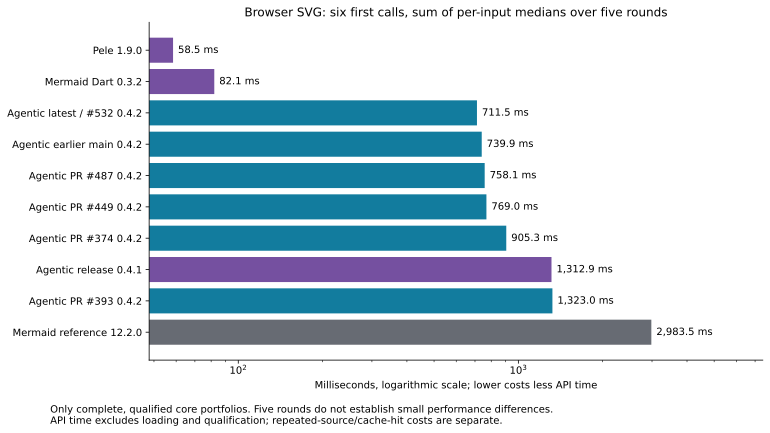
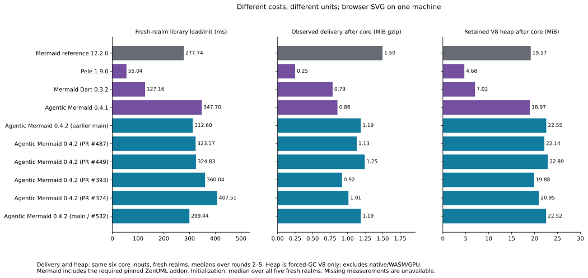
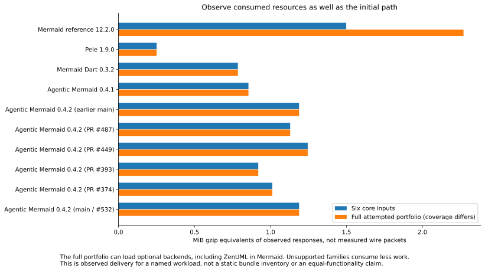
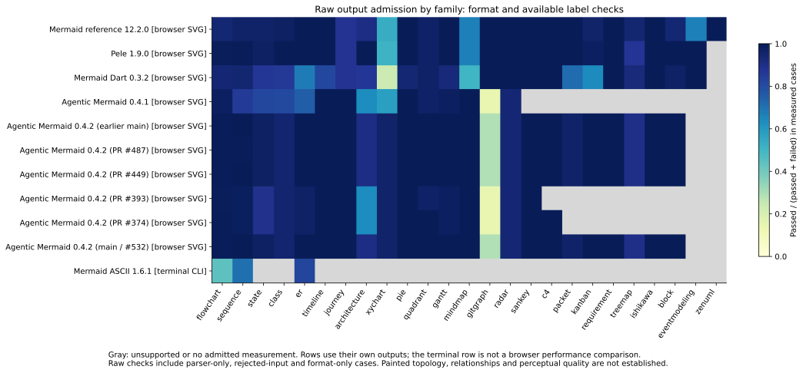

# Community and open-PR benchmark snapshot

[Beautiful Mermaid, Zombie Mermaid and Frankenmermaid additions](additions/README.md) are now available in a separate five-project host cohort with fresh Mermaid/Pele controls. Their timings are not pooled with the original campaign below.

Measured 2026-10-27T00:02:06.678Z through 2026-10-27T00:59:02.379Z. Five rounds, 1,087 fixed inputs across 33 families; 25 in the current mark and eight supplementary. Pinned Mermaid **12.2.0** is the reference; Pele is uniformly **1.9.0**. This snapshot covers five community projects, current Agentic and the five open Agentic PR heads captured in `runs.json`. It is the community suite, not a rerun of all 62 source suites or the full 88-project catalog.

These are matched protocols on one Linux machine. The other community records retain their earlier protocols and dates; they are not silently mixed into these ranks. Candidate builds stay outside the release league. Every raw record has retained failures; collection completed successfully, but these runs do not pass a complete-fidelity gate.

## Released tools: browser SVG

Order: supported families, then raw admission rate, then qualified fixed-core API time. Mermaid defines the reference and is unranked. `vs Mermaid` is reference time / tool time; values above one cost less API time.

| Rank | Tool | Families | Raw admission | Accepted-input format + labels | First-call core | vs Mermaid |
|---:|---|---:|---:|---:|---:|---:|
| reference | Mermaid reference 12.2.0 | 25/25 | 887/945 (93.9%) | 868/915 (94.9%) | 2,983.5 ms | reference |
| 1 | Pele 1.9.0 | 24/25 | 906/944 (96.0%) | 887/914 (97.0%) | 58.5 ms | 51.00× |
| 2 | Mermaid Dart 0.3.2 | 24/25 | 806/944 (85.4%) | 793/914 (86.8%) | 82.1 ms | 36.34× |
| 3 | Agentic release 0.4.1 | 15/25 | 632/732 (86.3%) | 624/711 (87.8%) | 1,312.9 ms | 2.27× |

## Captured PR heads and main snapshots: browser SVG

This separate candidate rank uses the same ordering and protocol. It compares exact artifact snapshots, including their base and resolved dependencies; it does not isolate a PR’s causal impact. #393 changes documentation only relative to its own base; #487 changes assertion tooling. This community lane does not validate those PRs’ specific features. #449 is measured through the default public API, without selecting its optional layout engine. #532 fixes architecture geometry; architecture is covered by feature admission but is outside the six timed core inputs. These figures cannot certify that geometry fix. The documentation-only #533 does not change renderer inputs and is not retimed.

| Rank | Candidate | Source head | Families | Raw admission | Accepted-input format + labels | First-call core | vs Mermaid |
|---:|---|---|---:|---:|---:|---:|---:|
| 1 | [Agentic latest / #532 0.4.2](candidate-pr-532.md) | `d3dd8adf` | 23/25 | 912/932 (97.9%) | 888/902 (98.4%) | 711.5 ms | 4.19× |
| 2 | [Agentic earlier main 0.4.2](candidate-current.md) | `aae75393` | 23/25 | 912/932 (97.9%) | 888/902 (98.4%) | 739.9 ms | 4.03× |
| 3 | [Agentic PR #449 0.4.2](candidate-pr-449.md) | `8f321774` | 23/25 | 912/932 (97.9%) | 888/902 (98.4%) | 769.0 ms | 3.88× |
| 4 | [Agentic PR #487 0.4.2](candidate-pr-487.md) | `18fd5292` | 23/25 | 911/932 (97.7%) | 887/902 (98.3%) | 758.1 ms | 3.94× |
| 5 | [Agentic PR #374 0.4.2](candidate-pr-374.md) | `2ed20a17` | 17/25 | 716/750 (95.5%) | 707/729 (97.0%) | 905.3 ms | 3.30× |
| 6 | [Agentic PR #393 0.4.2](candidate-pr-393.md) | `7c891e18` | 16/25 | 709/745 (95.2%) | 700/724 (96.7%) | 1,323.0 ms | 2.26× |

The earlier-main row is the initial local 0.4.2 capture at renderer base `b33e9efc5e3a6ade516148cc45d138af3dcfaa02`. The latest-main row retains the actual #532 measurement at `d3dd8adf`; #532 subsequently merged. A fresh build of public main `e8cb92ec` plus the launcher-only pin has **all 99 executable assets byte-identical**, each verified against the measured record, with equal exports and runtime declarations. [Equivalence proof](execution-equivalence.json). No new clocks or rewritten record claim that docs, tarballs or arbitrary dependency resolution are identical. The recorded npm consumer closure still applies. Exact source heads, archive digests and dates remain in `runs.json`.



First-call cost sums the six inputs’ per-input median first calls over five fresh realms. It excludes loading and qualification. Repeated-source/cache-hit costs are retained separately in the JSON and individual candidate reports. Five rounds do not establish small performance differences.

## Costs, delivery and memory



Heap is retained V8 heap after forced GC on the same six core inputs, medians over rounds 2–5. It excludes native, WASM and GPU memory; it is not total process memory. Startup is fresh-realm library load/init, not browser-process startup or complete entry-point time. CLI CPU/peak RSS diagnostics remain separate in `comparison.json`; no matching Mermaid CLI baseline was measured. Dollar costs are unavailable, not zero.



Gzip equivalents are computed from resources actually requested, rather than a static count of all files on disk. Full-portfolio delivery includes optional backend loading and varies with supported families. It is not an equal-functionality comparison.

## Admission across families and outputs



Mermaid ASCII is a terminal CLI and does not enter a browser-SVG speed rank. The chart keeps its output distinct. Raw admission combines format checks, available label expectations, parser-only fixtures and legacy rejected inputs. The secondary accepted-input format-and-label view excludes oracle-rejected and unlabeled cases and exposes its unavailable/blocked counts in the JSON. Unsupported coverage is a gap, not a failure or zero-cost render.

| Build | Surface | Output | Families | Raw admission | Accepted-input format + labels |
|---|---|---|---:|---:|---:|
| Mermaid ASCII 1.6.1 | cli:end-to-end | terminal | 3/25 | 234/395 (59.2%) | 234/392 (59.7%) |
| Agentic release 0.4.1 | node:public-api | terminal | 15/25 | 570/732 (77.9%) | 564/711 (79.3%) |
| Agentic earlier main 0.4.2 | node:public-api | terminal | 23/25 | 869/932 (93.2%) | 853/902 (94.6%) |
| Agentic PR #487 0.4.2 | node:public-api | terminal | 23/25 | 869/932 (93.2%) | 853/902 (94.6%) |
| Agentic PR #449 0.4.2 | node:public-api | terminal | 23/25 | 869/932 (93.2%) | 853/902 (94.6%) |
| Agentic PR #393 0.4.2 | node:public-api | terminal | 16/25 | 624/745 (83.8%) | 617/724 (85.2%) |
| Agentic PR #374 0.4.2 | node:public-api | terminal | 17/25 | 693/750 (92.4%) | 684/729 (93.8%) |
| Agentic latest / #532 0.4.2 | node:public-api | terminal | 23/25 | 869/932 (93.2%) | 853/902 (94.6%) |

## Evidence retention

Local cleanup removed 640,114 obsolete historical files and archives (28.5 GB logical bytes), plus five reproducible source-build dependency trees (5.8 GB). Compact historical summaries (73.7 MB), original source edits, current owning records, measured runtime closures and exact candidate artifacts remain. The committed snapshot is about 2 MB; no large archives or raw render directories were uploaded. [Cleanup summary](cleanup-summary.json).

## What improved and what became more expensive

Current Agentic uses **45.8% less first-call browser API time** than published 0.4.1 in this portfolio (1,312.9 ms → 711.5 ms). Measured family support rises from 15 to 23 of 25. Coverage and raw denominators differ, so the pass-rate change is not a paired all-functionality score.

The core browser payload is **39.0% larger**, and retained V8 heap is **18.7% higher**. Node parser cost also rises in the candidate report. These tradeoffs matter: the benchmark does not collapse speed, memory, coverage and delivery into one score. Many source/dependency changes separate these artifacts; these measurements do not assign causal credit to one optimization.

## Remaining limits

- The pinned Mermaid control has 67 raw failed observations: 18 rejection observations from nine legacy inputs, 24 renderer exceptions, 19 standalone-XML portability failures and six label-retention failures. Twenty-two exceptions are axis/title-only XY parser fixtures without drawable series. This is evidence about different boundaries, not 67 equivalent fidelity bugs.
- Forty-two preparation caveats are retained in each record’s input ledger: nine rejected sources, 32 without nonempty getter-derived label expectations and ZenUML without a public model getter. Independent authored ZenUML labels remain checked. Parser-only and renderable feature cases still need a stronger distinction at corpus import.
- Label admission does not establish identities, multiplicity, connectivity, painted routes, styling or perceptual fidelity. Event Modeling inline data/relationships and ZenUML native models remain gaps. Required family representatives are not exhaustive feature coverage.
- PNG admission checks signature and dimensions, not rendered text, semantic correspondence or perceptual quality.
- This run does not exercise every Agentic entry point or API-option combination. Dave, original pinned-Mermaid assertions, complete invocation, family-functionality and other source suites remain separate; see the overview and inventory.
- Total browser/native/WASM/GPU memory, statistically tight performance differences, production workloads and model-provider dollar prices remain outside this comparison.

## Reproduce and update

The figures and Markdown can be rebuilt from the committed aggregate data alone with Python, Matplotlib and NumPy:

```sh
python3 results/review-20261027/plot.py
```

To refresh this exact snapshot from its retained owning records in a Trident checkout:

```sh
bun results/review-20261027/update.ts RECORD_STORE
python3 results/review-20261027/plot.py
```

The updater verifies the exact record owners and candidate archive digests in `runs.json`; it does not render or collect timings. The committed snapshot contains compact aggregates, caveats and case-change reports. Full raw owning records and native artifacts remain local; they were not uploaded. The chart rebuild has no dependency on session paths or benchmark runtimes.

For a new measurement, install the pinned Mermaid oracle/addon with `node commands.ts mermaid:install`, prepare or bind any native artifact the catalog requires, then use `community:update --projects OWNER/TOOL --profile full --rounds 5 --records STORE --out RUN`. For an unreleased package, select one project and add `--candidate-tarball FILE --candidate-sha256 HEX`. Keep the same input, runtime and protocol settings for comparisons. `--plan` proves whether matching records will be reused; omit `--force` to avoid repeating unchanged clocks. Update `runs.json` only to select intentionally changed records and retain their new measurement dates.

The cache dry run returned reuse for all 11 exact records with zero timing lanes under the frozen producer identity. [Reuse proof](reuse-proof.json). Subsequent source-candidate code changes are a new measurement protocol; these historical timings retain their recorded producer set rather than being silently upgraded.

[Benchmark overview](../../OVERVIEW.md) · [Inventory](../../INVENTORY.md) · [Methodology](../../METHODOLOGY.md) · [Exact records and source heads](runs.json) · [Data](comparison.json)
