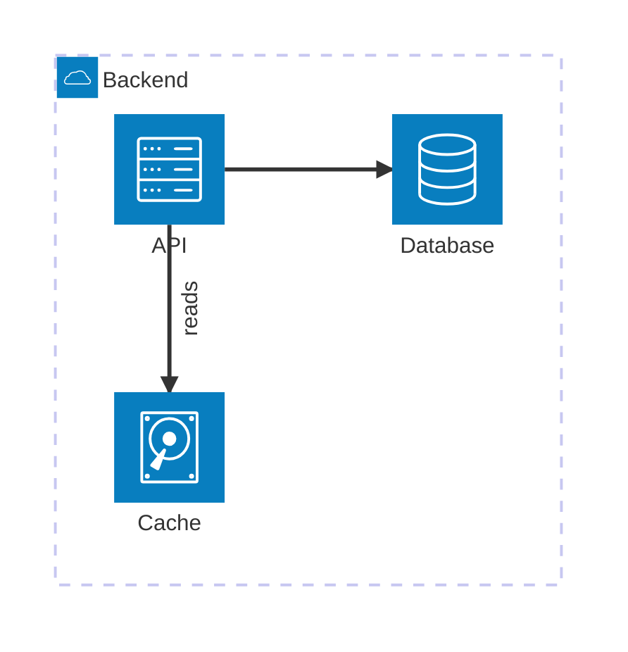
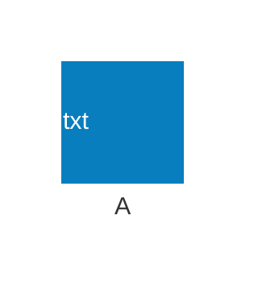
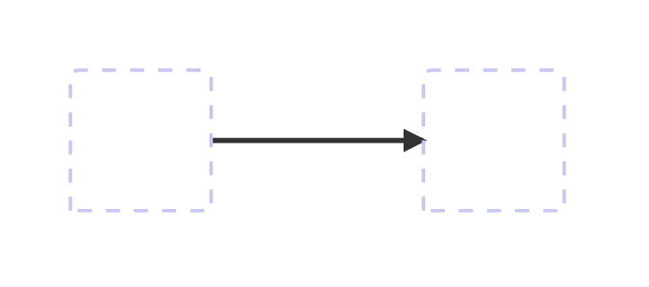
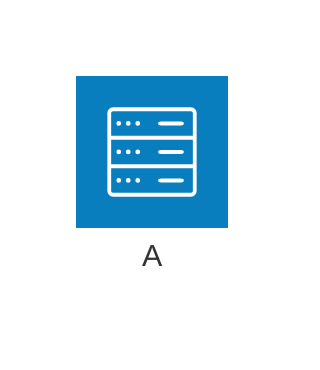

```mermaid
architecture-beta
junction j0
junction j1
j0:R<-->L:j1
junction j2
j1:R<-->L:j2
junction j3
j2:R<-->L:j3
junction j4
j3:R<-->L:j4
junction j5
j4:R<-->L:j5
junction j6
j5:R<-->L:j6
junction j7
j6:R<-->L:j7
junction j8
j7:R<-->L:j8
junction j9
j8:R<-->L:j9
junction j10
j9:R<-->L:j10
junction j11
j10:R<-->L:j11
junction j12
j11:R<-->L:j12
junction j13
j12:R<-->L:j13
junction j14
j13:R<-->L:j14
junction j15
j14:R<-->L:j15
junction j16
j15:R<-->L:j16
junction j17
j16:R<-->L:j17
junction j18
j17:R<-->L:j18
junction j19
j18:R<-->L:j19
junction j20
j19:R<-->L:j20
junction j21
j20:R<-->L:j21
junction j22
j21:R<-->L:j22
junction j23
j22:R<-->L:j23
junction j24
j23:R<-->L:j24
junction j25
j24:R<-->L:j25
junction j26
j25:R<-->L:j26
junction j27
j26:R<-->L:j27
junction j28
j27:R<-->L:j28
junction j29
j28:R<-->L:j29
junction j30
j29:R<-->L:j30
junction j31
j30:R<-->L:j31
```

```mermaid
---
config:
  architecture:
    iconSize: 40
---
architecture-beta
junction j0
junction j1
j0:R<-->L:j1
junction j2
j1:R<-->L:j2
junction j3
j2:R<-->L:j3
junction j4
j3:R<-->L:j4
junction j5
j4:R<-->L:j5
junction j6
j5:R<-->L:j6
junction j7
j6:R<-->L:j7
junction j8
j7:R<-->L:j8
junction j9
j8:R<-->L:j9
junction j10
j9:R<-->L:j10
junction j11
j10:R<-->L:j11
junction j12
j11:R<-->L:j12
junction j13
j12:R<-->L:j13
junction j14
j13:R<-->L:j14
junction j15
j14:R<-->L:j15
junction j16
j15:R<-->L:j16
junction j17
j16:R<-->L:j17
junction j18
j17:R<-->L:j18
junction j19
j18:R<-->L:j19
junction j20
j19:R<-->L:j20
junction j21
j20:R<-->L:j21
junction j22
j21:R<-->L:j22
junction j23
j22:R<-->L:j23
junction j24
j23:R<-->L:j24
junction j25
j24:R<-->L:j25
junction j26
j25:R<-->L:j26
junction j27
j26:R<-->L:j27
junction j28
j27:R<-->L:j28
junction j29
j28:R<-->L:j29
junction j30
j29:R<-->L:j30
junction j31
j30:R<-->L:j31
```

# dfadler/zombie-mermaid 5.10.2: failures

401 raw failed observations. These include parser rejections and output admission failures; they are not all fidelity defects. Each retained input and oracle caveat remains visible.

[Back to the league table](../README.md)

## architecture

### registry:architecture

Node API, SVG. MermaidParseError: Architecture diagram, line 7: unrecognized statement — "api:B -[reads]-> T:cache"

Pinned Mermaid accepted this source; authored labels are declared. Passing these checks does not establish full fidelity or native-model support.



Expected labels: `API`, `Database`, `Cache`, `Backend`, `reads`

### scaling:architecture:16-junctions

Node API, SVG. MermaidParseError: Architecture diagram, line 4: unrecognized statement — "j0:R<-->L:j1"

No nonempty authored-label expectation was recorded; a passing render can establish format admission only.

Oracle caveat: scaling:architecture:16-junctions: pinned Mermaid returned no nonempty authored label expectations


Expected labels: none declared

### scaling:architecture:32-junctions

Node API, SVG. MermaidParseError: Architecture diagram, line 4: unrecognized statement — "j0:R<-->L:j1"

No nonempty authored-label expectation was recorded; a passing render can establish format admission only.

Oracle caveat: scaling:architecture:32-junctions: pinned Mermaid returned no nonempty authored label expectations



Expected labels: none declared

### scaling:architecture:32-large-junctions

Node API, SVG. MermaidParseError: Line 1: Invalid mermaid header: "---". Supported headers: "graph <dir>"/"flowchart <dir>" (dir: TD, TB, LR, BT, RL), "stateDiagram-v2", "sequenceDiagram", "classDiagram", "erDiagram", "xychart-beta", "C4Context"/"C4Container"/"C4Component"/"C4Dynamic"/"C4Deployment", "architecture-beta", "pie".

No nonempty authored-label expectation was recorded; a passing render can establish format admission only.

Oracle caveat: scaling:architecture:32-large-junctions: pinned Mermaid returned no nonempty authored label expectations



Expected labels: none declared

### corpus:mermaid-upstream-suite-bench:architecture-upstream-should-handle-accessibility-title-and-description

Node API, SVG. Error: SVG has no positive finite viewBox or explicit canvas

No nonempty authored-label expectation was recorded; a passing render can establish format admission only.

Oracle caveat: corpus:mermaid-upstream-suite-bench:architecture-upstream-should-handle-accessibility-title-and-description: pinned Mermaid returned no nonempty authored label expectations

```mermaid
architecture-beta
            accTitle: Accessibility Title
            accDescr: Accessibility Description
```

Expected labels: none declared

Rendered output is retained in the local owning evidence and omitted from this compact snapshot.

### corpus:mermaid-upstream-suite-bench:architecture-upstream-should-handle-multiline-accessibility-description

Node API, SVG. Error: SVG has no positive finite viewBox or explicit canvas

No nonempty authored-label expectation was recorded; a passing render can establish format admission only.

Oracle caveat: corpus:mermaid-upstream-suite-bench:architecture-upstream-should-handle-multiline-accessibility-description: pinned Mermaid returned no nonempty authored label expectations

```mermaid
architecture-beta
            accDescr {
                Accessibility Description
            }
```

Expected labels: none declared

Rendered output is retained in the local owning evidence and omitted from this compact snapshot.

### corpus:mermaid-upstream-suite-bench:architecture-upstream-should-handle-title-on-another-line

Node API, SVG. MermaidParseError: Architecture diagram, line 2: unrecognized statement — "title Simple Architecture Diagram"

Pinned Mermaid accepted this source; authored labels are declared. Passing these checks does not establish full fidelity or native-model support.

```mermaid
architecture-beta
            title Simple Architecture Diagram
```

Expected labels: `Simple Architecture Diagram`

### authored:architecture-text-icon

Node API, SVG. MermaidParseError: Architecture diagram, line 2: unrecognized statement — "service a "txt" [A]"

Pinned Mermaid accepted this source; authored labels are declared. Passing these checks does not establish full fidelity or native-model support.



Expected labels: `A`

### authored:architecture-edge-no-spaces

Node API, SVG. MermaidParseError: Architecture diagram, line 4: unrecognized statement — "a:R-->L:b"

No nonempty authored-label expectation was recorded; a passing render can establish format admission only.

Oracle caveat: authored:architecture-edge-no-spaces: pinned Mermaid returned no nonempty authored label expectations



Expected labels: none declared

### authored:architecture-inline-title

Node API, SVG. MermaidParseError: Line 1: Invalid mermaid header: "architecture-beta title Hello". Supported headers: "graph <dir>"/"flowchart <dir>" (dir: TD, TB, LR, BT, RL), "stateDiagram-v2", "sequenceDiagram", "classDiagram", "erDiagram", "xychart-beta", "C4Context"/"C4Container"/"C4Component"/"C4Dynamic"/"C4Deployment", "architecture-beta", "pie".

Pinned Mermaid accepted this source; authored labels are declared. Passing these checks does not establish full fidelity or native-model support.



Expected labels: `Hello`, `A`

### registry:architecture

Node API, Terminal text. MermaidParseError: Architecture diagram, line 7: unrecognized statement — "api:B -[reads]-> T:cache"

Pinned Mermaid accepted this source; authored labels are declared. Passing these checks does not establish full fidelity or native-model support.


Expected labels: `API`, `Database`, `Cache`, `Backend`, `reads`

### scaling:architecture:16-junctions

Node API, Terminal text. MermaidParseError: Architecture diagram, line 4: unrecognized statement — "j0:R<-->L:j1"

No nonempty authored-label expectation was recorded; a passing render can establish format admission only.

Oracle caveat: scaling:architecture:16-junctions: pinned Mermaid returned no nonempty authored label expectations


Expected labels: none declared

### scaling:architecture:32-junctions

Node API, Terminal text. MermaidParseError: Architecture diagram, line 4: unrecognized statement — "j0:R<-->L:j1"

No nonempty authored-label expectation was recorded; a passing render can establish format admission only.

Oracle caveat: scaling:architecture:32-junctions: pinned Mermaid returned no nonempty authored label expectations


Expected labels: none declared

### scaling:architecture:32-large-junctions

Node API, Terminal text. MermaidParseError: Line 1: Invalid mermaid header: "---". Supported headers: "graph <dir>"/"flowchart <dir>" (dir: TD, TB, LR, BT, RL), "stateDiagram-v2", "sequenceDiagram", "classDiagram", "erDiagram", "xychart-beta", "C4Context"/"C4Container"/"C4Component"/"C4Dynamic"/"C4Deployment", "architecture-beta", "pie".

No nonempty authored-label expectation was recorded; a passing render can establish format admission only.

Oracle caveat: scaling:architecture:32-large-junctions: pinned Mermaid returned no nonempty authored label expectations


Expected labels: none declared

### corpus:mermaid-upstream-suite-bench:architecture-upstream-should-handle-accessibility-title-and-description

Node API, Terminal text. Error: Expected a nonempty output string

No nonempty authored-label expectation was recorded; a passing render can establish format admission only.

Oracle caveat: corpus:mermaid-upstream-suite-bench:architecture-upstream-should-handle-accessibility-title-and-description: pinned Mermaid returned no nonempty authored label expectations

```mermaid
architecture-beta
            accTitle: Accessibility Title
            accDescr: Accessibility Description
```

Expected labels: none declared

Rendered output is retained in the local owning evidence and omitted from this compact snapshot.

### corpus:mermaid-upstream-suite-bench:architecture-upstream-should-handle-multiline-accessibility-description

Node API, Terminal text. Error: Expected a nonempty output string

No nonempty authored-label expectation was recorded; a passing render can establish format admission only.

Oracle caveat: corpus:mermaid-upstream-suite-bench:architecture-upstream-should-handle-multiline-accessibility-description: pinned Mermaid returned no nonempty authored label expectations

```mermaid
architecture-beta
            accDescr {
                Accessibility Description
            }
```

Expected labels: none declared

Rendered output is retained in the local owning evidence and omitted from this compact snapshot.

### corpus:mermaid-upstream-suite-bench:architecture-upstream-should-handle-title-on-another-line

Node API, Terminal text. MermaidParseError: Architecture diagram, line 2: unrecognized statement — "title Simple Architecture Diagram"

Pinned Mermaid accepted this source; authored labels are declared. Passing these checks does not establish full fidelity or native-model support.

```mermaid
architecture-beta
            title Simple Architecture Diagram
```

Expected labels: `Simple Architecture Diagram`

### authored:architecture-text-icon

Node API, Terminal text. MermaidParseError: Architecture diagram, line 2: unrecognized statement — "service a "txt" [A]"

Pinned Mermaid accepted this source; authored labels are declared. Passing these checks does not establish full fidelity or native-model support.


Expected labels: `A`

### authored:architecture-edge-no-spaces

Node API, Terminal text. MermaidParseError: Architecture diagram, line 4: unrecognized statement — "a:R-->L:b"

No nonempty authored-label expectation was recorded; a passing render can establish format admission only.

Oracle caveat: authored:architecture-edge-no-spaces: pinned Mermaid returned no nonempty authored label expectations


Expected labels: none declared

### authored:architecture-inline-title

Node API, Terminal text. MermaidParseError: Line 1: Invalid mermaid header: "architecture-beta title Hello". Supported headers: "graph <dir>"/"flowchart <dir>" (dir: TD, TB, LR, BT, RL), "stateDiagram-v2", "sequenceDiagram", "classDiagram", "erDiagram", "xychart-beta", "C4Context"/"C4Container"/"C4Component"/"C4Dynamic"/"C4Deployment", "architecture-beta", "pie".

Pinned Mermaid accepted this source; authored labels are declared. Passing these checks does not establish full fidelity or native-model support.


Expected labels: `Hello`, `A`

### registry:architecture

browser API, SVG. MermaidParseError: Architecture diagram, line 7: unrecognized statement — "api:B -[reads]-> T:cache"

Pinned Mermaid accepted this source; authored labels are declared. Passing these checks does not establish full fidelity or native-model support.

```mermaid
architecture-beta
  group backend(cloud)[Backend]
  service api(server)[API] in backend
  service db(database)[Database] in backend
  service cache(disk)[Cache] in backend
  api:R --> L:db
  api:B -[reads]-> T:cache
```

Expected labels: `API`, `Database`, `Cache`, `Backend`, `reads`

### scaling:architecture:16-junctions

browser API, SVG. MermaidParseError: Architecture diagram, line 4: unrecognized statement — "j0:R<-->L:j1"

No nonempty authored-label expectation was recorded; a passing render can establish format admission only.

Oracle caveat: scaling:architecture:16-junctions: pinned Mermaid returned no nonempty authored label expectations

```mermaid
architecture-beta
junction j0
junction j1
j0:R<-->L:j1
junction j2
j1:R<-->L:j2
junction j3
j2:R<-->L:j3
junction j4
j3:R<-->L:j4
junction j5
j4:R<-->L:j5
junction j6
j5:R<-->L:j6
junction j7
j6:R<-->L:j7
junction j8
j7:R<-->L:j8
junction j9
j8:R<-->L:j9
junction j10
j9:R<-->L:j10
junction j11
j10:R<-->L:j11
junction j12
j11:R<-->L:j12
junction j13
j12:R<-->L:j13
junction j14
j13:R<-->L:j14
junction j15
j14:R<-->L:j15
```

Expected labels: none declared

### scaling:architecture:32-junctions

browser API, SVG. MermaidParseError: Architecture diagram, line 4: unrecognized statement — "j0:R<-->L:j1"

No nonempty authored-label expectation was recorded; a passing render can establish format admission only.

Oracle caveat: scaling:architecture:32-junctions: pinned Mermaid returned no nonempty authored label expectations

```mermaid
architecture-beta
junction j0
junction j1
j0:R<-->L:j1
junction j2
j1:R<-->L:j2
junction j3
j2:R<-->L:j3
junction j4
j3:R<-->L:j4
junction j5
j4:R<-->L:j5
junction j6
j5:R<-->L:j6
junction j7
j6:R<-->L:j7
junction j8
j7:R<-->L:j8
junction j9
j8:R<-->L:j9
junction j10
j9:R<-->L:j10
junction j11
j10:R<-->L:j11
junction j12
j11:R<-->L:j12
junction j13
j12:R<-->L:j13
junction j14
j13:R<-->L:j14
junction j15
j14:R<-->L:j15
junction j16
j15:R<-->L:j16
junction j17
j16:R<-->L:j17
junction j18
j17:R<-->L:j18
junction j19
j18:R<-->L:j19
junction j20
j19:R<-->L:j20
junction j21
j20:R<-->L:j21
junction j22
j21:R<-->L:j22
junction j23
j22:R<-->L:j23
junction j24
j23:R<-->L:j24
junction j25
j24:R<-->L:j25
junction j26
j25:R<-->L:j26
junction j27
j26:R<-->L:j27
junction j28
j27:R<-->L:j28
junction j29
j28:R<-->L:j29
junction j30
j29:R<-->L:j30
junction j31
j30:R<-->L:j31
```

Expected labels: none declared

### scaling:architecture:32-large-junctions

browser API, SVG. MermaidParseError: Line 1: Invalid mermaid header: "---". Supported headers: "graph <dir>"/"flowchart <dir>" (dir: TD, TB, LR, BT, RL), "stateDiagram-v2", "sequenceDiagram", "classDiagram", "erDiagram", "xychart-beta", "C4Context"/"C4Container"/"C4Component"/"C4Dynamic"/"C4Deployment", "architecture-beta", "pie".

No nonempty authored-label expectation was recorded; a passing render can establish format admission only.

Oracle caveat: scaling:architecture:32-large-junctions: pinned Mermaid returned no nonempty authored label expectations

```mermaid
---
config:
  architecture:
    iconSize: 40
---
architecture-beta
junction j0
junction j1
j0:R<-->L:j1
junction j2
j1:R<-->L:j2
junction j3
j2:R<-->L:j3
junction j4
j3:R<-->L:j4
junction j5
j4:R<-->L:j5
junction j6
j5:R<-->L:j6
junction j7
j6:R<-->L:j7
junction j8
j7:R<-->L:j8
junction j9
j8:R<-->L:j9
junction j10
j9:R<-->L:j10
junction j11
j10:R<-->L:j11
junction j12
j11:R<-->L:j12
junction j13
j12:R<-->L:j13
junction j14
j13:R<-->L:j14
junction j15
j14:R<-->L:j15
junction j16
j15:R<-->L:j16
junction j17
j16:R<-->L:j17
junction j18
j17:R<-->L:j18
junction j19
j18:R<-->L:j19
junction j20
j19:R<-->L:j20
junction j21
j20:R<-->L:j21
junction j22
j21:R<-->L:j22
junction j23
j22:R<-->L:j23
junction j24
j23:R<-->L:j24
junction j25
j24:R<-->L:j25
junction j26
j25:R<-->L:j26
junction j27
j26:R<-->L:j27
junction j28
j27:R<-->L:j28
junction j29
j28:R<-->L:j29
junction j30
j29:R<-->L:j30
junction j31
j30:R<-->L:j31
```

Expected labels: none declared

### corpus:mermaid-upstream-suite-bench:architecture-upstream-should-handle-accessibility-title-and-description

browser API, SVG. SVG has no positive finite canvas

No nonempty authored-label expectation was recorded; a passing render can establish format admission only.

Oracle caveat: corpus:mermaid-upstream-suite-bench:architecture-upstream-should-handle-accessibility-title-and-description: pinned Mermaid returned no nonempty authored label expectations

```mermaid
architecture-beta
            accTitle: Accessibility Title
            accDescr: Accessibility Description
```

Expected labels: none declared

Rendered output is retained in the local owning evidence and omitted from this compact snapshot.

### corpus:mermaid-upstream-suite-bench:architecture-upstream-should-handle-multiline-accessibility-description

browser API, SVG. SVG has no positive finite canvas

No nonempty authored-label expectation was recorded; a passing render can establish format admission only.

Oracle caveat: corpus:mermaid-upstream-suite-bench:architecture-upstream-should-handle-multiline-accessibility-description: pinned Mermaid returned no nonempty authored label expectations

```mermaid
architecture-beta
            accDescr {
                Accessibility Description
            }
```

Expected labels: none declared

Rendered output is retained in the local owning evidence and omitted from this compact snapshot.

### corpus:mermaid-upstream-suite-bench:architecture-upstream-should-handle-title-on-another-line

browser API, SVG. MermaidParseError: Architecture diagram, line 2: unrecognized statement — "title Simple Architecture Diagram"

Pinned Mermaid accepted this source; authored labels are declared. Passing these checks does not establish full fidelity or native-model support.

```mermaid
architecture-beta
            title Simple Architecture Diagram
```

Expected labels: `Simple Architecture Diagram`

### authored:architecture-text-icon

browser API, SVG. MermaidParseError: Architecture diagram, line 2: unrecognized statement — "service a "txt" [A]"

Pinned Mermaid accepted this source; authored labels are declared. Passing these checks does not establish full fidelity or native-model support.

```mermaid
architecture-beta
service a "txt" [A]
```

Expected labels: `A`

### authored:architecture-edge-no-spaces

browser API, SVG. MermaidParseError: Architecture diagram, line 4: unrecognized statement — "a:R-->L:b"

No nonempty authored-label expectation was recorded; a passing render can establish format admission only.

Oracle caveat: authored:architecture-edge-no-spaces: pinned Mermaid returned no nonempty authored label expectations

```mermaid
architecture-beta
service a
service b
a:R-->L:b
```

Expected labels: none declared

### authored:architecture-inline-title

browser API, SVG. MermaidParseError: Line 1: Invalid mermaid header: "architecture-beta title Hello". Supported headers: "graph <dir>"/"flowchart <dir>" (dir: TD, TB, LR, BT, RL), "stateDiagram-v2", "sequenceDiagram", "classDiagram", "erDiagram", "xychart-beta", "C4Context"/"C4Container"/"C4Component"/"C4Dynamic"/"C4Deployment", "architecture-beta", "pie".

Pinned Mermaid accepted this source; authored labels are declared. Passing these checks does not establish full fidelity or native-model support.

```mermaid
architecture-beta title Hello
service a(server)[A]
```

Expected labels: `Hello`, `A`

## c4

### editor:c4

Node API, Terminal text. Error: Missing authored label: Checks balances and makes payments; Missing authored label: Reads and writes

Pinned Mermaid accepted this source; authored labels are declared. Passing these checks does not establish full fidelity or native-model support.

```mermaid
C4Container
  title Internet banking
  Person(customer, "Customer", "Checks balances and makes payments")
  System_Boundary(bank, "Internet banking") {
    Container(web, "Web application", "TypeScript", "Customer portal")
    Container(api, "API", "Node.js", "Accounts and payments")
    ContainerDb(db, "Accounts", "PostgreSQL", "Balances and transactions")
  }
  Rel(customer, web, "Uses", "HTTPS")
  Rel(web, api, "Calls", "JSON/HTTPS")
  Rel(api, db, "Reads and writes", "SQL")
```

Expected labels: `Internet banking`, `Customer`, `Checks balances and makes payments`, `Web application`, `TypeScript`, `Customer portal`, `API`, `Node.js`, `Accounts and payments`, `Accounts`, `PostgreSQL`, `Balances and transactions`, `Uses`, `HTTPS`, `Calls`, `JSON/HTTPS`, `Reads and writes`, `SQL`

Rendered output is retained in the local owning evidence and omitted from this compact snapshot.

### portfolio:c4:9

Node API, Terminal text. Error: Missing authored label: Checks status

Pinned Mermaid accepted this source; authored labels are declared. Passing these checks does not establish full fidelity or native-model support.

```mermaid
C4Context
  title Shop context
  Person(customer, "Customer", "Places orders")
  System(shop, "Shop", "Processes orders")
  System_Ext(payments, "Payments", "Authorizes purchases")
  Rel(customer, shop, "Orders", "HTTPS")
  Rel(shop, payments, "Authorizes", "HTTPS")
  Rel(shop, payments, "Checks status", "HTTPS")
```

Expected labels: `Shop context`, `Customer`, `Places orders`, `Shop`, `Processes orders`, `Payments`, `Authorizes purchases`, `Orders`, `HTTPS`, `Checks status`

Rendered output is retained in the local owning evidence and omitted from this compact snapshot.

## class

### portfolio:class:12

Node API, SVG. MermaidParseError: Line 1: Invalid mermaid header: "---". Supported headers: "graph <dir>"/"flowchart <dir>" (dir: TD, TB, LR, BT, RL), "stateDiagram-v2", "sequenceDiagram", "classDiagram", "erDiagram", "xychart-beta", "C4Context"/"C4Container"/"C4Component"/"C4Dynamic"/"C4Deployment", "architecture-beta", "pie".

Pinned Mermaid accepted this source; authored labels are declared. Passing these checks does not establish full fidelity or native-model support.

```mermaid
---
title: Animal example
---
classDiagram
    note "From Duck till Zebra"
    Animal <|-- Duck
    note for Duck "can fly<br>can swim<br>can dive<br>can help in debugging"
    Animal <|-- Fish
    Animal <|-- Zebra
    Animal : +int age
    Animal : +String gender
    Animal: +isMammal()
    Animal: +mate()
    class Duck{
        +String beakColor
        +swim()
        +quack()
    }
    class Fish{
        -int sizeInFeet
        -canEat()
    }
    class Zebra{
        +bool is_wild
        +run()
    }
```

Expected labels: `Animal`, `Duck`, `Fish`, `Zebra`, `From Duck till Zebra`, `can fly can swim can dive can help in debugging`

### portfolio:class:13

Node API, SVG. MermaidParseError: Line 1: Invalid mermaid header: "---". Supported headers: "graph <dir>"/"flowchart <dir>" (dir: TD, TB, LR, BT, RL), "stateDiagram-v2", "sequenceDiagram", "classDiagram", "erDiagram", "xychart-beta", "C4Context"/"C4Container"/"C4Component"/"C4Dynamic"/"C4Deployment", "architecture-beta", "pie".

Pinned Mermaid accepted this source; authored labels are declared. Passing these checks does not establish full fidelity or native-model support.

```mermaid
---
title: Bank example
---
classDiagram
    class BankAccount
    BankAccount : +String owner
    BankAccount : +Bigdecimal balance
    BankAccount : +deposit(amount)
    BankAccount : +withdrawal(amount)
```

Expected labels: `BankAccount`

### corpus:mermaid-upstream-suite-bench:class-upstream-should-handle-acctitle-and-accdescr

Node API, SVG. Error: SVG has no positive finite viewBox or explicit canvas

No nonempty authored-label expectation was recorded; a passing render can establish format admission only.

Oracle caveat: corpus:mermaid-upstream-suite-bench:class-upstream-should-handle-acctitle-and-accdescr: pinned Mermaid returned no nonempty authored label expectations

```mermaid
classDiagram
            accTitle: My Title
            accDescr: My Description
```

Expected labels: none declared

Rendered output is retained in the local owning evidence and omitted from this compact snapshot.

### corpus:mermaid-upstream-suite-bench:class-upstream-should-handle-acctitle-and-multiline-accdescr

Node API, SVG. Error: SVG has no positive finite viewBox or explicit canvas

No nonempty authored-label expectation was recorded; a passing render can establish format admission only.

Oracle caveat: corpus:mermaid-upstream-suite-bench:class-upstream-should-handle-acctitle-and-multiline-accdescr: pinned Mermaid returned no nonempty authored label expectations

```mermaid
classDiagram
            accTitle: My Title
            accDescr {
              This is my multi
              line description
            }
```

Expected labels: none declared

Rendered output is retained in the local owning evidence and omitted from this compact snapshot.

### corpus:mermaid-upstream-suite-bench:class-upstream-should-handle-namespace

Node API, SVG. Error: Missing authored label: Namespace1; Missing authored label: Namespace2

Pinned Mermaid accepted this source; authored labels are declared. Passing these checks does not establish full fidelity or native-model support.

```mermaid
classDiagram
namespace Namespace1 { class Class1 }
namespace Namespace2 { class Class1
}
namespace Namespace3 {
class Class1 {
int : test
string : foo
test()
foo()
}
}
namespace Namespace4 {
class Class1 {
int : test
string : foo
test()
foo()
}
class Class2 {
int : test
string : foo
test()
foo()
}
}
```

Expected labels: `Namespace1`, `Namespace2`, `Namespace3`, `Namespace4`, `Class1`, `Class2`

Rendered output is retained in the local owning evidence and omitted from this compact snapshot.

### corpus:mermaid-upstream-suite-bench:class-upstream-should-handle-syntactically-nested-namespace-blocks

Node API, SVG. Error: Missing authored label: Outer

Pinned Mermaid accepted this source; authored labels are declared. Passing these checks does not establish full fidelity or native-model support.

```mermaid
classDiagram
        namespace Outer {
          namespace Inner {
            class Foo {
              +bar()
            }
          }
          class Baz {
            +qux()
          }
        }
```

Expected labels: `Outer`, `Inner`, `Foo`, `Baz`

Rendered output is retained in the local owning evidence and omitted from this compact snapshot.

### corpus:mermaid-upstream-suite-bench:class-upstream-should-parse-a-class-with-text-label-and-css-class-shorthand

Node API, SVG. Error: Missing authored label: Class 1 with text label

Pinned Mermaid accepted this source; authored labels are declared. Passing these checks does not establish full fidelity or native-model support.

```mermaid
classDiagram
class C1["Class 1 with text label"]:::styleClass {
  +member1
}
C1 -->  C2
```

Expected labels: `Class 1 with text label`, `C2`

Rendered output is retained in the local owning evidence and omitted from this compact snapshot.

### corpus:mermaid-upstream-suite-bench:class-upstream-should-parse-two-classes-with-text-labels-and-css-class-shorthands

Node API, SVG. Error: Missing authored label: Class 1 with text label; Missing authored label: Class 2 !@#$%^&*() label

Pinned Mermaid accepted this source; authored labels are declared. Passing these checks does not establish full fidelity or native-model support.

```mermaid
classDiagram
class C1["Class 1 with text label"]:::styleClass1 {
  +member1
}
class C2["Class 2 !@#$%^&*() label"]:::styleClass2
C1 --> C2
```

Expected labels: `Class 1 with text label`, `Class 2 !@#$%^&*() label`

Rendered output is retained in the local owning evidence and omitted from this compact snapshot.

### corpus:mermaid-upstream-suite-bench:class-upstream-should-support-custom-labels-on-namespaces

Node API, SVG. Error: Missing authored label: Authentication Service

Pinned Mermaid accepted this source; authored labels are declared. Passing these checks does not establish full fidelity or native-model support.

```mermaid
classDiagram
        namespace Auth["Authentication Service"] {
          class UserService {
            +login()
          }
        }
```

Expected labels: `Authentication Service`, `UserService`

Rendered output is retained in the local owning evidence and omitted from this compact snapshot.

### portfolio:class:12

Node API, Terminal text. MermaidParseError: Line 1: Invalid mermaid header: "---". Supported headers: "graph <dir>"/"flowchart <dir>" (dir: TD, TB, LR, BT, RL), "stateDiagram-v2", "sequenceDiagram", "classDiagram", "erDiagram", "xychart-beta", "C4Context"/"C4Container"/"C4Component"/"C4Dynamic"/"C4Deployment", "architecture-beta", "pie".

Pinned Mermaid accepted this source; authored labels are declared. Passing these checks does not establish full fidelity or native-model support.

```mermaid
---
title: Animal example
---
classDiagram
    note "From Duck till Zebra"
    Animal <|-- Duck
    note for Duck "can fly<br>can swim<br>can dive<br>can help in debugging"
    Animal <|-- Fish
    Animal <|-- Zebra
    Animal : +int age
    Animal : +String gender
    Animal: +isMammal()
    Animal: +mate()
    class Duck{
        +String beakColor
        +swim()
        +quack()
    }
    class Fish{
        -int sizeInFeet
        -canEat()
    }
    class Zebra{
        +bool is_wild
        +run()
    }
```

Expected labels: `Animal`, `Duck`, `Fish`, `Zebra`, `From Duck till Zebra`, `can fly can swim can dive can help in debugging`

### portfolio:class:13

Node API, Terminal text. MermaidParseError: Line 1: Invalid mermaid header: "---". Supported headers: "graph <dir>"/"flowchart <dir>" (dir: TD, TB, LR, BT, RL), "stateDiagram-v2", "sequenceDiagram", "classDiagram", "erDiagram", "xychart-beta", "C4Context"/"C4Container"/"C4Component"/"C4Dynamic"/"C4Deployment", "architecture-beta", "pie".

Pinned Mermaid accepted this source; authored labels are declared. Passing these checks does not establish full fidelity or native-model support.

```mermaid
---
title: Bank example
---
classDiagram
    class BankAccount
    BankAccount : +String owner
    BankAccount : +Bigdecimal balance
    BankAccount : +deposit(amount)
    BankAccount : +withdrawal(amount)
```

Expected labels: `BankAccount`

### corpus:mermaid-upstream-suite-bench:class-upstream-should-handle-acctitle-and-accdescr

Node API, Terminal text. Error: Expected a nonempty output string

No nonempty authored-label expectation was recorded; a passing render can establish format admission only.

Oracle caveat: corpus:mermaid-upstream-suite-bench:class-upstream-should-handle-acctitle-and-accdescr: pinned Mermaid returned no nonempty authored label expectations

```mermaid
classDiagram
            accTitle: My Title
            accDescr: My Description
```

Expected labels: none declared

### corpus:mermaid-upstream-suite-bench:class-upstream-should-handle-acctitle-and-multiline-accdescr

Node API, Terminal text. Error: Expected a nonempty output string

No nonempty authored-label expectation was recorded; a passing render can establish format admission only.

Oracle caveat: corpus:mermaid-upstream-suite-bench:class-upstream-should-handle-acctitle-and-multiline-accdescr: pinned Mermaid returned no nonempty authored label expectations

```mermaid
classDiagram
            accTitle: My Title
            accDescr {
              This is my multi
              line description
            }
```

Expected labels: none declared

### corpus:mermaid-upstream-suite-bench:class-upstream-should-handle-namespace

Node API, Terminal text. Error: Missing authored label: Namespace1; Missing authored label: Namespace2

Pinned Mermaid accepted this source; authored labels are declared. Passing these checks does not establish full fidelity or native-model support.

```mermaid
classDiagram
namespace Namespace1 { class Class1 }
namespace Namespace2 { class Class1
}
namespace Namespace3 {
class Class1 {
int : test
string : foo
test()
foo()
}
}
namespace Namespace4 {
class Class1 {
int : test
string : foo
test()
foo()
}
class Class2 {
int : test
string : foo
test()
foo()
}
}
```

Expected labels: `Namespace1`, `Namespace2`, `Namespace3`, `Namespace4`, `Class1`, `Class2`

Rendered output is retained in the local owning evidence and omitted from this compact snapshot.

### corpus:mermaid-upstream-suite-bench:class-upstream-should-handle-syntactically-nested-namespace-blocks

Node API, Terminal text. Error: Missing authored label: Outer

Pinned Mermaid accepted this source; authored labels are declared. Passing these checks does not establish full fidelity or native-model support.

```mermaid
classDiagram
        namespace Outer {
          namespace Inner {
            class Foo {
              +bar()
            }
          }
          class Baz {
            +qux()
          }
        }
```

Expected labels: `Outer`, `Inner`, `Foo`, `Baz`

Rendered output is retained in the local owning evidence and omitted from this compact snapshot.

### corpus:mermaid-upstream-suite-bench:class-upstream-should-parse-a-class-with-text-label-and-css-class-shorthand

Node API, Terminal text. Error: Missing authored label: Class 1 with text label

Pinned Mermaid accepted this source; authored labels are declared. Passing these checks does not establish full fidelity or native-model support.

```mermaid
classDiagram
class C1["Class 1 with text label"]:::styleClass {
  +member1
}
C1 -->  C2
```

Expected labels: `Class 1 with text label`, `C2`

Rendered output is retained in the local owning evidence and omitted from this compact snapshot.

### corpus:mermaid-upstream-suite-bench:class-upstream-should-parse-two-classes-with-text-labels-and-css-class-shorthands

Node API, Terminal text. Error: Missing authored label: Class 1 with text label; Missing authored label: Class 2 !@#$%^&*() label

Pinned Mermaid accepted this source; authored labels are declared. Passing these checks does not establish full fidelity or native-model support.

```mermaid
classDiagram
class C1["Class 1 with text label"]:::styleClass1 {
  +member1
}
class C2["Class 2 !@#$%^&*() label"]:::styleClass2
C1 --> C2
```

Expected labels: `Class 1 with text label`, `Class 2 !@#$%^&*() label`

Rendered output is retained in the local owning evidence and omitted from this compact snapshot.

### corpus:mermaid-upstream-suite-bench:class-upstream-should-support-custom-labels-on-namespaces

Node API, Terminal text. Error: Missing authored label: Authentication Service

Pinned Mermaid accepted this source; authored labels are declared. Passing these checks does not establish full fidelity or native-model support.

```mermaid
classDiagram
        namespace Auth["Authentication Service"] {
          class UserService {
            +login()
          }
        }
```

Expected labels: `Authentication Service`, `UserService`

Rendered output is retained in the local owning evidence and omitted from this compact snapshot.

### portfolio:class:12

browser API, SVG. MermaidParseError: Line 1: Invalid mermaid header: "---". Supported headers: "graph <dir>"/"flowchart <dir>" (dir: TD, TB, LR, BT, RL), "stateDiagram-v2", "sequenceDiagram", "classDiagram", "erDiagram", "xychart-beta", "C4Context"/"C4Container"/"C4Component"/"C4Dynamic"/"C4Deployment", "architecture-beta", "pie".

Pinned Mermaid accepted this source; authored labels are declared. Passing these checks does not establish full fidelity or native-model support.

```mermaid
---
title: Animal example
---
classDiagram
    note "From Duck till Zebra"
    Animal <|-- Duck
    note for Duck "can fly<br>can swim<br>can dive<br>can help in debugging"
    Animal <|-- Fish
    Animal <|-- Zebra
    Animal : +int age
    Animal : +String gender
    Animal: +isMammal()
    Animal: +mate()
    class Duck{
        +String beakColor
        +swim()
        +quack()
    }
    class Fish{
        -int sizeInFeet
        -canEat()
    }
    class Zebra{
        +bool is_wild
        +run()
    }
```

Expected labels: `Animal`, `Duck`, `Fish`, `Zebra`, `From Duck till Zebra`, `can fly can swim can dive can help in debugging`

### portfolio:class:13

browser API, SVG. MermaidParseError: Line 1: Invalid mermaid header: "---". Supported headers: "graph <dir>"/"flowchart <dir>" (dir: TD, TB, LR, BT, RL), "stateDiagram-v2", "sequenceDiagram", "classDiagram", "erDiagram", "xychart-beta", "C4Context"/"C4Container"/"C4Component"/"C4Dynamic"/"C4Deployment", "architecture-beta", "pie".

Pinned Mermaid accepted this source; authored labels are declared. Passing these checks does not establish full fidelity or native-model support.

```mermaid
---
title: Bank example
---
classDiagram
    class BankAccount
    BankAccount : +String owner
    BankAccount : +Bigdecimal balance
    BankAccount : +deposit(amount)
    BankAccount : +withdrawal(amount)
```

Expected labels: `BankAccount`

### corpus:mermaid-upstream-suite-bench:class-upstream-should-handle-acctitle-and-accdescr

browser API, SVG. SVG has no positive finite canvas

No nonempty authored-label expectation was recorded; a passing render can establish format admission only.

Oracle caveat: corpus:mermaid-upstream-suite-bench:class-upstream-should-handle-acctitle-and-accdescr: pinned Mermaid returned no nonempty authored label expectations

```mermaid
classDiagram
            accTitle: My Title
            accDescr: My Description
```

Expected labels: none declared

Rendered output is retained in the local owning evidence and omitted from this compact snapshot.

### corpus:mermaid-upstream-suite-bench:class-upstream-should-handle-acctitle-and-multiline-accdescr

browser API, SVG. SVG has no positive finite canvas

No nonempty authored-label expectation was recorded; a passing render can establish format admission only.

Oracle caveat: corpus:mermaid-upstream-suite-bench:class-upstream-should-handle-acctitle-and-multiline-accdescr: pinned Mermaid returned no nonempty authored label expectations

```mermaid
classDiagram
            accTitle: My Title
            accDescr {
              This is my multi
              line description
            }
```

Expected labels: none declared

Rendered output is retained in the local owning evidence and omitted from this compact snapshot.

### corpus:mermaid-upstream-suite-bench:class-upstream-should-handle-namespace

browser API, SVG. Missing authored label: Namespace1; Missing authored label: Namespace2

Pinned Mermaid accepted this source; authored labels are declared. Passing these checks does not establish full fidelity or native-model support.

```mermaid
classDiagram
namespace Namespace1 { class Class1 }
namespace Namespace2 { class Class1
}
namespace Namespace3 {
class Class1 {
int : test
string : foo
test()
foo()
}
}
namespace Namespace4 {
class Class1 {
int : test
string : foo
test()
foo()
}
class Class2 {
int : test
string : foo
test()
foo()
}
}
```

Expected labels: `Namespace1`, `Namespace2`, `Namespace3`, `Namespace4`, `Class1`, `Class2`

Rendered output is retained in the local owning evidence and omitted from this compact snapshot.

### corpus:mermaid-upstream-suite-bench:class-upstream-should-handle-syntactically-nested-namespace-blocks

browser API, SVG. Missing authored label: Outer

Pinned Mermaid accepted this source; authored labels are declared. Passing these checks does not establish full fidelity or native-model support.

```mermaid
classDiagram
        namespace Outer {
          namespace Inner {
            class Foo {
              +bar()
            }
          }
          class Baz {
            +qux()
          }
        }
```

Expected labels: `Outer`, `Inner`, `Foo`, `Baz`

Rendered output is retained in the local owning evidence and omitted from this compact snapshot.

### corpus:mermaid-upstream-suite-bench:class-upstream-should-parse-a-class-with-text-label-and-css-class-shorthand

browser API, SVG. Missing authored label: Class 1 with text label

Pinned Mermaid accepted this source; authored labels are declared. Passing these checks does not establish full fidelity or native-model support.

```mermaid
classDiagram
class C1["Class 1 with text label"]:::styleClass {
  +member1
}
C1 -->  C2
```

Expected labels: `Class 1 with text label`, `C2`

Rendered output is retained in the local owning evidence and omitted from this compact snapshot.

### corpus:mermaid-upstream-suite-bench:class-upstream-should-parse-two-classes-with-text-labels-and-css-class-shorthands

browser API, SVG. Missing authored label: Class 1 with text label; Missing authored label: Class 2 !@#$%^&*() label

Pinned Mermaid accepted this source; authored labels are declared. Passing these checks does not establish full fidelity or native-model support.

```mermaid
classDiagram
class C1["Class 1 with text label"]:::styleClass1 {
  +member1
}
class C2["Class 2 !@#$%^&*() label"]:::styleClass2
C1 --> C2
```

Expected labels: `Class 1 with text label`, `Class 2 !@#$%^&*() label`

Rendered output is retained in the local owning evidence and omitted from this compact snapshot.

### corpus:mermaid-upstream-suite-bench:class-upstream-should-support-custom-labels-on-namespaces

browser API, SVG. Missing authored label: Authentication Service

Pinned Mermaid accepted this source; authored labels are declared. Passing these checks does not establish full fidelity or native-model support.

```mermaid
classDiagram
        namespace Auth["Authentication Service"] {
          class UserService {
            +login()
          }
        }
```

Expected labels: `Authentication Service`, `UserService`

Rendered output is retained in the local owning evidence and omitted from this compact snapshot.

## er

### portfolio:er:16

Node API, SVG. MermaidParseError: Line 1: Invalid mermaid header: "---". Supported headers: "graph <dir>"/"flowchart <dir>" (dir: TD, TB, LR, BT, RL), "stateDiagram-v2", "sequenceDiagram", "classDiagram", "erDiagram", "xychart-beta", "C4Context"/"C4Container"/"C4Component"/"C4Dynamic"/"C4Deployment", "architecture-beta", "pie".

Pinned Mermaid accepted this source; authored labels are declared. Passing these checks does not establish full fidelity or native-model support.

```mermaid
---
title: Order example
---
erDiagram
    CUSTOMER ||--o{ ORDER : places
    ORDER ||--|{ LINE-ITEM : contains
    CUSTOMER }|..|{ DELIVERY-ADDRESS : uses
```

Expected labels: `CUSTOMER`, `ORDER`, `LINE-ITEM`, `DELIVERY-ADDRESS`, `places`, `contains`, `uses`

### corpus:mermaid-upstream-suite-bench:er-upstream-should-allow-character-u-as-standalone-entity

Node API, SVG. Error: Missing authored label: u

Pinned Mermaid accepted this source; authored labels are declared. Passing these checks does not establish full fidelity or native-model support.

```mermaid
erDiagram
CUSTOMER }|..|{ DELIVERY-ADDRESS : has
u
```

Expected labels: `CUSTOMER`, `DELIVERY-ADDRESS`, `u`, `has`

Rendered output is retained in the local owning evidence and omitted from this compact snapshot.

### corpus:mermaid-upstream-suite-bench:er-upstream-should-allow-decimal-numbers-as-standalone-entities

Node API, SVG. Error: Missing authored label: 2.5

Pinned Mermaid accepted this source; authored labels are declared. Passing these checks does not establish full fidelity or native-model support.

```mermaid
erDiagram
CUSTOMER }|..|{ DELIVERY-ADDRESS : has
2.5
```

Expected labels: `CUSTOMER`, `DELIVERY-ADDRESS`, `2.5`, `has`

Rendered output is retained in the local owning evidence and omitted from this compact snapshot.

### corpus:mermaid-upstream-suite-bench:er-upstream-should-allow-number-1-as-standalone-entity

Node API, SVG. Error: Missing authored label: 1

Pinned Mermaid accepted this source; authored labels are declared. Passing these checks does not establish full fidelity or native-model support.

```mermaid
erDiagram
CUSTOMER }|..|{ DELIVERY-ADDRESS : has
1
```

Expected labels: `CUSTOMER`, `DELIVERY-ADDRESS`, `1`, `has`

Rendered output is retained in the local owning evidence and omitted from this compact snapshot.

### corpus:mermaid-upstream-suite-bench:er-upstream-should-correctly-parse-direction-rl-inside-a-subgraph

Node API, SVG. MermaidParseError: Line 1: Invalid mermaid header: "erDiagram subgraph WithRL". Did you mean "erDiagram"? Supported headers: "graph <dir>"/"flowchart <dir>" (dir: TD, TB, LR, BT, RL), "stateDiagram-v2", "sequenceDiagram", "classDiagram", "erDiagram", "xychart-beta", "C4Context"/"C4Container"/"C4Component"/"C4Dynamic"/"C4Deployment", "architecture-beta", "pie".

Pinned Mermaid accepted this source; authored labels are declared. Passing these checks does not establish full fidelity or native-model support.

```mermaid
erDiagram subgraph WithRL
direction RL
A
B
end
```

Expected labels: `WithRL`, `A`, `B`

### corpus:mermaid-upstream-suite-bench:er-upstream-should-handle-empty-lines-inside-subgraph

Node API, SVG. Error: SVG has no positive finite viewBox or explicit canvas

Pinned Mermaid accepted this source; authored labels are declared. Passing these checks does not establish full fidelity or native-model support.

```mermaid
erDiagram
subgraph Group

A

B

end
```

Expected labels: `Group`, `A`, `B`

Rendered output is retained in the local owning evidence and omitted from this compact snapshot.

### corpus:mermaid-upstream-suite-bench:er-upstream-should-handle-empty-subgraph

Node API, SVG. Error: SVG has no positive finite viewBox or explicit canvas

Pinned Mermaid accepted this source; authored labels are declared. Passing these checks does not establish full fidelity or native-model support.

```mermaid
erDiagram
subgraph empty
end
```

Expected labels: `empty`

Rendered output is retained in the local owning evidence and omitted from this compact snapshot.

### corpus:mermaid-upstream-suite-bench:er-upstream-should-handle-relationship-between-entity-and-subgraph

Node API, SVG. Error: Missing authored label: A

Pinned Mermaid accepted this source; authored labels are declared. Passing these checks does not establish full fidelity or native-model support.

```mermaid
erDiagram
subgraph Group
A
end
Group }|--|| B : "relates to"
```

Expected labels: `Group`, `A`, `B`, `relates to`

Rendered output is retained in the local owning evidence and omitted from this compact snapshot.

### corpus:mermaid-upstream-suite-bench:er-upstream-should-handle-relationship-between-subgraph-entity-and-external-entity

Node API, SVG. Error: Missing authored label: Group

Pinned Mermaid accepted this source; authored labels are declared. Passing these checks does not establish full fidelity or native-model support.

```mermaid
erDiagram
subgraph Group
A
end
A }|--|| B : "relates to"
```

Expected labels: `Group`, `A`, `B`, `relates to`

Rendered output is retained in the local owning evidence and omitted from this compact snapshot.

### corpus:mermaid-upstream-suite-bench:er-upstream-should-handle-special-characters-in-subgraph-title

Node API, SVG. Error: SVG has no positive finite viewBox or explicit canvas

Pinned Mermaid accepted this source; authored labels are declared. Passing these checks does not establish full fidelity or native-model support.

```mermaid
erDiagram
subgraph "Group 1.5"
A
end
```

Expected labels: `Group 1.5`, `A`

Rendered output is retained in the local owning evidence and omitted from this compact snapshot.

### corpus:mermaid-upstream-suite-bench:er-upstream-should-handle-subgraph-with-id-and-title-notation

Node API, SVG. Error: SVG has no positive finite viewBox or explicit canvas

Pinned Mermaid accepted this source; authored labels are declared. Passing these checks does not establish full fidelity or native-model support.

```mermaid
erDiagram
subgraph id [Title]
A
B
end
```

Expected labels: `Title`, `A`, `B`

Rendered output is retained in the local owning evidence and omitted from this compact snapshot.

### corpus:mermaid-upstream-suite-bench:er-upstream-should-ignore-redundant-whitespace-around-end

Node API, SVG. Error: SVG has no positive finite viewBox or explicit canvas

Pinned Mermaid accepted this source; authored labels are declared. Passing these checks does not establish full fidelity or native-model support.

```mermaid
erDiagram
subgraph Group
A
end
```

Expected labels: `Group`, `A`

Rendered output is retained in the local owning evidence and omitted from this compact snapshot.

### corpus:mermaid-upstream-suite-bench:er-upstream-should-include-both-endpoints-of-a-relationship-inside-a-subgraph

Node API, SVG. Error: Missing authored label: Group

Pinned Mermaid accepted this source; authored labels are declared. Passing these checks does not establish full fidelity or native-model support.

```mermaid
erDiagram
subgraph Group
A }|--|| B : "relates to"
end
```

Expected labels: `Group`, `A`, `B`, `relates to`

Rendered output is retained in the local owning evidence and omitted from this compact snapshot.

### corpus:mermaid-upstream-suite-bench:er-upstream-should-represent-parent-child-relationship-correctly

Node API, SVG. MermaidParseError: Line 2: Invalid ER relationship cardinality "u--o{" in "PROJECT u--o{ TEAM_MEMBER : "parent"". Each side must be one of \|\|, \|o, }\|, }o, o\|, \|{, o{ (or a word form such as "one or more"), joined by -- or .. (e.g. "\|\|--o{").

Pinned Mermaid accepted this source; authored labels are declared. Passing these checks does not establish full fidelity or native-model support.

```mermaid
erDiagram
PROJECT u--o{ TEAM_MEMBER : "parent"
```

Expected labels: `PROJECT`, `TEAM_MEMBER`, `parent`

### corpus:mermaid-upstream-suite-bench:er-upstream-title

Node API, SVG. Error: SVG has no positive finite viewBox or explicit canvas

Pinned Mermaid accepted this source; authored labels are declared. Passing these checks does not establish full fidelity or native-model support.

```mermaid
erDiagram
subgraph Group
A
B
end
```

Expected labels: `Group`, `A`, `B`

Rendered output is retained in the local owning evidence and omitted from this compact snapshot.

### corpus:mermaid-upstream-suite-bench:er-upstream-title-2

Node API, SVG. Error: SVG has no positive finite viewBox or explicit canvas

Pinned Mermaid accepted this source; authored labels are declared. Passing these checks does not establish full fidelity or native-model support.

```mermaid
erDiagram
subgraph "Some Title"
A
B
end
```

Expected labels: `Some Title`, `A`, `B`

Rendered output is retained in the local owning evidence and omitted from this compact snapshot.

### portfolio:er:16

Node API, Terminal text. MermaidParseError: Line 1: Invalid mermaid header: "---". Supported headers: "graph <dir>"/"flowchart <dir>" (dir: TD, TB, LR, BT, RL), "stateDiagram-v2", "sequenceDiagram", "classDiagram", "erDiagram", "xychart-beta", "C4Context"/"C4Container"/"C4Component"/"C4Dynamic"/"C4Deployment", "architecture-beta", "pie".

Pinned Mermaid accepted this source; authored labels are declared. Passing these checks does not establish full fidelity or native-model support.

```mermaid
---
title: Order example
---
erDiagram
    CUSTOMER ||--o{ ORDER : places
    ORDER ||--|{ LINE-ITEM : contains
    CUSTOMER }|..|{ DELIVERY-ADDRESS : uses
```

Expected labels: `CUSTOMER`, `ORDER`, `LINE-ITEM`, `DELIVERY-ADDRESS`, `places`, `contains`, `uses`

### corpus:mermaid-upstream-suite-bench:er-upstream-should-allow-character-u-as-standalone-entity

Node API, Terminal text. Error: Missing authored label: u

Pinned Mermaid accepted this source; authored labels are declared. Passing these checks does not establish full fidelity or native-model support.

```mermaid
erDiagram
CUSTOMER }|..|{ DELIVERY-ADDRESS : has
u
```

Expected labels: `CUSTOMER`, `DELIVERY-ADDRESS`, `u`, `has`

Rendered output is retained in the local owning evidence and omitted from this compact snapshot.

### corpus:mermaid-upstream-suite-bench:er-upstream-should-allow-decimal-numbers-as-standalone-entities

Node API, Terminal text. Error: Missing authored label: 2.5

Pinned Mermaid accepted this source; authored labels are declared. Passing these checks does not establish full fidelity or native-model support.

```mermaid
erDiagram
CUSTOMER }|..|{ DELIVERY-ADDRESS : has
2.5
```

Expected labels: `CUSTOMER`, `DELIVERY-ADDRESS`, `2.5`, `has`

Rendered output is retained in the local owning evidence and omitted from this compact snapshot.

### corpus:mermaid-upstream-suite-bench:er-upstream-should-allow-number-1-as-standalone-entity

Node API, Terminal text. Error: Missing authored label: 1

Pinned Mermaid accepted this source; authored labels are declared. Passing these checks does not establish full fidelity or native-model support.

```mermaid
erDiagram
CUSTOMER }|..|{ DELIVERY-ADDRESS : has
1
```

Expected labels: `CUSTOMER`, `DELIVERY-ADDRESS`, `1`, `has`

Rendered output is retained in the local owning evidence and omitted from this compact snapshot.

### corpus:mermaid-upstream-suite-bench:er-upstream-should-correctly-parse-direction-rl-inside-a-subgraph

Node API, Terminal text. MermaidParseError: Line 1: Invalid mermaid header: "erDiagram subgraph WithRL". Did you mean "erDiagram"? Supported headers: "graph <dir>"/"flowchart <dir>" (dir: TD, TB, LR, BT, RL), "stateDiagram-v2", "sequenceDiagram", "classDiagram", "erDiagram", "xychart-beta", "C4Context"/"C4Container"/"C4Component"/"C4Dynamic"/"C4Deployment", "architecture-beta", "pie".

Pinned Mermaid accepted this source; authored labels are declared. Passing these checks does not establish full fidelity or native-model support.

```mermaid
erDiagram subgraph WithRL
direction RL
A
B
end
```

Expected labels: `WithRL`, `A`, `B`

### corpus:mermaid-upstream-suite-bench:er-upstream-should-handle-empty-lines-inside-subgraph

Node API, Terminal text. Error: Expected a nonempty output string

Pinned Mermaid accepted this source; authored labels are declared. Passing these checks does not establish full fidelity or native-model support.

```mermaid
erDiagram
subgraph Group

A

B

end
```

Expected labels: `Group`, `A`, `B`

### corpus:mermaid-upstream-suite-bench:er-upstream-should-handle-empty-subgraph

Node API, Terminal text. Error: Expected a nonempty output string

Pinned Mermaid accepted this source; authored labels are declared. Passing these checks does not establish full fidelity or native-model support.

```mermaid
erDiagram
subgraph empty
end
```

Expected labels: `empty`

### corpus:mermaid-upstream-suite-bench:er-upstream-should-handle-relationship-between-entity-and-subgraph

Node API, Terminal text. Error: Missing authored label: A

Pinned Mermaid accepted this source; authored labels are declared. Passing these checks does not establish full fidelity or native-model support.

```mermaid
erDiagram
subgraph Group
A
end
Group }|--|| B : "relates to"
```

Expected labels: `Group`, `A`, `B`, `relates to`

Rendered output is retained in the local owning evidence and omitted from this compact snapshot.

### corpus:mermaid-upstream-suite-bench:er-upstream-should-handle-relationship-between-subgraph-entity-and-external-entity

Node API, Terminal text. Error: Missing authored label: Group

Pinned Mermaid accepted this source; authored labels are declared. Passing these checks does not establish full fidelity or native-model support.

```mermaid
erDiagram
subgraph Group
A
end
A }|--|| B : "relates to"
```

Expected labels: `Group`, `A`, `B`, `relates to`

Rendered output is retained in the local owning evidence and omitted from this compact snapshot.

### corpus:mermaid-upstream-suite-bench:er-upstream-should-handle-special-characters-in-subgraph-title

Node API, Terminal text. Error: Expected a nonempty output string

Pinned Mermaid accepted this source; authored labels are declared. Passing these checks does not establish full fidelity or native-model support.

```mermaid
erDiagram
subgraph "Group 1.5"
A
end
```

Expected labels: `Group 1.5`, `A`

### corpus:mermaid-upstream-suite-bench:er-upstream-should-handle-subgraph-with-id-and-title-notation

Node API, Terminal text. Error: Expected a nonempty output string

Pinned Mermaid accepted this source; authored labels are declared. Passing these checks does not establish full fidelity or native-model support.

```mermaid
erDiagram
subgraph id [Title]
A
B
end
```

Expected labels: `Title`, `A`, `B`

### corpus:mermaid-upstream-suite-bench:er-upstream-should-ignore-redundant-whitespace-around-end

Node API, Terminal text. Error: Expected a nonempty output string

Pinned Mermaid accepted this source; authored labels are declared. Passing these checks does not establish full fidelity or native-model support.

```mermaid
erDiagram
subgraph Group
A
end
```

Expected labels: `Group`, `A`

### corpus:mermaid-upstream-suite-bench:er-upstream-should-include-both-endpoints-of-a-relationship-inside-a-subgraph

Node API, Terminal text. Error: Missing authored label: Group

Pinned Mermaid accepted this source; authored labels are declared. Passing these checks does not establish full fidelity or native-model support.

```mermaid
erDiagram
subgraph Group
A }|--|| B : "relates to"
end
```

Expected labels: `Group`, `A`, `B`, `relates to`

Rendered output is retained in the local owning evidence and omitted from this compact snapshot.

### corpus:mermaid-upstream-suite-bench:er-upstream-should-represent-parent-child-relationship-correctly

Node API, Terminal text. MermaidParseError: Line 2: Invalid ER relationship cardinality "u--o{" in "PROJECT u--o{ TEAM_MEMBER : "parent"". Each side must be one of \|\|, \|o, }\|, }o, o\|, \|{, o{ (or a word form such as "one or more"), joined by -- or .. (e.g. "\|\|--o{").

Pinned Mermaid accepted this source; authored labels are declared. Passing these checks does not establish full fidelity or native-model support.

```mermaid
erDiagram
PROJECT u--o{ TEAM_MEMBER : "parent"
```

Expected labels: `PROJECT`, `TEAM_MEMBER`, `parent`

### corpus:mermaid-upstream-suite-bench:er-upstream-title

Node API, Terminal text. Error: Expected a nonempty output string

Pinned Mermaid accepted this source; authored labels are declared. Passing these checks does not establish full fidelity or native-model support.

```mermaid
erDiagram
subgraph Group
A
B
end
```

Expected labels: `Group`, `A`, `B`

### corpus:mermaid-upstream-suite-bench:er-upstream-title-2

Node API, Terminal text. Error: Expected a nonempty output string

Pinned Mermaid accepted this source; authored labels are declared. Passing these checks does not establish full fidelity or native-model support.

```mermaid
erDiagram
subgraph "Some Title"
A
B
end
```

Expected labels: `Some Title`, `A`, `B`

### portfolio:er:16

browser API, SVG. MermaidParseError: Line 1: Invalid mermaid header: "---". Supported headers: "graph <dir>"/"flowchart <dir>" (dir: TD, TB, LR, BT, RL), "stateDiagram-v2", "sequenceDiagram", "classDiagram", "erDiagram", "xychart-beta", "C4Context"/"C4Container"/"C4Component"/"C4Dynamic"/"C4Deployment", "architecture-beta", "pie".

Pinned Mermaid accepted this source; authored labels are declared. Passing these checks does not establish full fidelity or native-model support.

```mermaid
---
title: Order example
---
erDiagram
    CUSTOMER ||--o{ ORDER : places
    ORDER ||--|{ LINE-ITEM : contains
    CUSTOMER }|..|{ DELIVERY-ADDRESS : uses
```

Expected labels: `CUSTOMER`, `ORDER`, `LINE-ITEM`, `DELIVERY-ADDRESS`, `places`, `contains`, `uses`

### corpus:mermaid-upstream-suite-bench:er-upstream-should-allow-character-u-as-standalone-entity

browser API, SVG. Missing authored label: u

Pinned Mermaid accepted this source; authored labels are declared. Passing these checks does not establish full fidelity or native-model support.

```mermaid
erDiagram
CUSTOMER }|..|{ DELIVERY-ADDRESS : has
u
```

Expected labels: `CUSTOMER`, `DELIVERY-ADDRESS`, `u`, `has`

Rendered output is retained in the local owning evidence and omitted from this compact snapshot.

### corpus:mermaid-upstream-suite-bench:er-upstream-should-allow-decimal-numbers-as-standalone-entities

browser API, SVG. Missing authored label: 2.5

Pinned Mermaid accepted this source; authored labels are declared. Passing these checks does not establish full fidelity or native-model support.

```mermaid
erDiagram
CUSTOMER }|..|{ DELIVERY-ADDRESS : has
2.5
```

Expected labels: `CUSTOMER`, `DELIVERY-ADDRESS`, `2.5`, `has`

Rendered output is retained in the local owning evidence and omitted from this compact snapshot.

### corpus:mermaid-upstream-suite-bench:er-upstream-should-allow-number-1-as-standalone-entity

browser API, SVG. Missing authored label: 1

Pinned Mermaid accepted this source; authored labels are declared. Passing these checks does not establish full fidelity or native-model support.

```mermaid
erDiagram
CUSTOMER }|..|{ DELIVERY-ADDRESS : has
1
```

Expected labels: `CUSTOMER`, `DELIVERY-ADDRESS`, `1`, `has`

Rendered output is retained in the local owning evidence and omitted from this compact snapshot.

### corpus:mermaid-upstream-suite-bench:er-upstream-should-correctly-parse-direction-rl-inside-a-subgraph

browser API, SVG. MermaidParseError: Line 1: Invalid mermaid header: "erDiagram subgraph WithRL". Did you mean "erDiagram"? Supported headers: "graph <dir>"/"flowchart <dir>" (dir: TD, TB, LR, BT, RL), "stateDiagram-v2", "sequenceDiagram", "classDiagram", "erDiagram", "xychart-beta", "C4Context"/"C4Container"/"C4Component"/"C4Dynamic"/"C4Deployment", "architecture-beta", "pie".

Pinned Mermaid accepted this source; authored labels are declared. Passing these checks does not establish full fidelity or native-model support.

```mermaid
erDiagram subgraph WithRL
direction RL
A
B
end
```

Expected labels: `WithRL`, `A`, `B`

### corpus:mermaid-upstream-suite-bench:er-upstream-should-handle-empty-lines-inside-subgraph

browser API, SVG. SVG has no positive finite canvas

Pinned Mermaid accepted this source; authored labels are declared. Passing these checks does not establish full fidelity or native-model support.

```mermaid
erDiagram
subgraph Group

A

B

end
```

Expected labels: `Group`, `A`, `B`

Rendered output is retained in the local owning evidence and omitted from this compact snapshot.

### corpus:mermaid-upstream-suite-bench:er-upstream-should-handle-empty-subgraph

browser API, SVG. SVG has no positive finite canvas

Pinned Mermaid accepted this source; authored labels are declared. Passing these checks does not establish full fidelity or native-model support.

```mermaid
erDiagram
subgraph empty
end
```

Expected labels: `empty`

Rendered output is retained in the local owning evidence and omitted from this compact snapshot.

### corpus:mermaid-upstream-suite-bench:er-upstream-should-handle-relationship-between-entity-and-subgraph

browser API, SVG. Missing authored label: A

Pinned Mermaid accepted this source; authored labels are declared. Passing these checks does not establish full fidelity or native-model support.

```mermaid
erDiagram
subgraph Group
A
end
Group }|--|| B : "relates to"
```

Expected labels: `Group`, `A`, `B`, `relates to`

Rendered output is retained in the local owning evidence and omitted from this compact snapshot.

### corpus:mermaid-upstream-suite-bench:er-upstream-should-handle-relationship-between-subgraph-entity-and-external-entity

browser API, SVG. Missing authored label: Group

Pinned Mermaid accepted this source; authored labels are declared. Passing these checks does not establish full fidelity or native-model support.

```mermaid
erDiagram
subgraph Group
A
end
A }|--|| B : "relates to"
```

Expected labels: `Group`, `A`, `B`, `relates to`

Rendered output is retained in the local owning evidence and omitted from this compact snapshot.

### corpus:mermaid-upstream-suite-bench:er-upstream-should-handle-special-characters-in-subgraph-title

browser API, SVG. SVG has no positive finite canvas

Pinned Mermaid accepted this source; authored labels are declared. Passing these checks does not establish full fidelity or native-model support.

```mermaid
erDiagram
subgraph "Group 1.5"
A
end
```

Expected labels: `Group 1.5`, `A`

Rendered output is retained in the local owning evidence and omitted from this compact snapshot.

### corpus:mermaid-upstream-suite-bench:er-upstream-should-handle-subgraph-with-id-and-title-notation

browser API, SVG. SVG has no positive finite canvas

Pinned Mermaid accepted this source; authored labels are declared. Passing these checks does not establish full fidelity or native-model support.

```mermaid
erDiagram
subgraph id [Title]
A
B
end
```

Expected labels: `Title`, `A`, `B`

Rendered output is retained in the local owning evidence and omitted from this compact snapshot.

### corpus:mermaid-upstream-suite-bench:er-upstream-should-ignore-redundant-whitespace-around-end

browser API, SVG. SVG has no positive finite canvas

Pinned Mermaid accepted this source; authored labels are declared. Passing these checks does not establish full fidelity or native-model support.

```mermaid
erDiagram
subgraph Group
A
end
```

Expected labels: `Group`, `A`

Rendered output is retained in the local owning evidence and omitted from this compact snapshot.

### corpus:mermaid-upstream-suite-bench:er-upstream-should-include-both-endpoints-of-a-relationship-inside-a-subgraph

browser API, SVG. Missing authored label: Group

Pinned Mermaid accepted this source; authored labels are declared. Passing these checks does not establish full fidelity or native-model support.

```mermaid
erDiagram
subgraph Group
A }|--|| B : "relates to"
end
```

Expected labels: `Group`, `A`, `B`, `relates to`

Rendered output is retained in the local owning evidence and omitted from this compact snapshot.

### corpus:mermaid-upstream-suite-bench:er-upstream-should-represent-parent-child-relationship-correctly

browser API, SVG. MermaidParseError: Line 2: Invalid ER relationship cardinality "u--o{" in "PROJECT u--o{ TEAM_MEMBER : "parent"". Each side must be one of \|\|, \|o, }\|, }o, o\|, \|{, o{ (or a word form such as "one or more"), joined by -- or .. (e.g. "\|\|--o{").

Pinned Mermaid accepted this source; authored labels are declared. Passing these checks does not establish full fidelity or native-model support.

```mermaid
erDiagram
PROJECT u--o{ TEAM_MEMBER : "parent"
```

Expected labels: `PROJECT`, `TEAM_MEMBER`, `parent`

### corpus:mermaid-upstream-suite-bench:er-upstream-title

browser API, SVG. SVG has no positive finite canvas

Pinned Mermaid accepted this source; authored labels are declared. Passing these checks does not establish full fidelity or native-model support.

```mermaid
erDiagram
subgraph Group
A
B
end
```

Expected labels: `Group`, `A`, `B`

Rendered output is retained in the local owning evidence and omitted from this compact snapshot.

### corpus:mermaid-upstream-suite-bench:er-upstream-title-2

browser API, SVG. SVG has no positive finite canvas

Pinned Mermaid accepted this source; authored labels are declared. Passing these checks does not establish full fidelity or native-model support.

```mermaid
erDiagram
subgraph "Some Title"
A
B
end
```

Expected labels: `Some Title`, `A`, `B`

Rendered output is retained in the local owning evidence and omitted from this compact snapshot.

## flowchart

### portfolio:flowchart:20

Node API, SVG. MermaidParseError: Line 1: Invalid mermaid header: "---". Supported headers: "graph <dir>"/"flowchart <dir>" (dir: TD, TB, LR, BT, RL), "stateDiagram-v2", "sequenceDiagram", "classDiagram", "erDiagram", "xychart-beta", "C4Context"/"C4Container"/"C4Component"/"C4Dynamic"/"C4Deployment", "architecture-beta", "pie".

Pinned Mermaid accepted this source; authored labels are declared. Passing these checks does not establish full fidelity or native-model support.

```mermaid
---
title: Node
---
flowchart LR
    id
```

Expected labels: `id`

### portfolio:flowchart:21

Node API, SVG. MermaidParseError: Line 1: Invalid mermaid header: "---". Supported headers: "graph <dir>"/"flowchart <dir>" (dir: TD, TB, LR, BT, RL), "stateDiagram-v2", "sequenceDiagram", "classDiagram", "erDiagram", "xychart-beta", "C4Context"/"C4Container"/"C4Component"/"C4Dynamic"/"C4Deployment", "architecture-beta", "pie".

Pinned Mermaid accepted this source; authored labels are declared. Passing these checks does not establish full fidelity or native-model support.

```mermaid
---
title: Node with text
---
flowchart LR
    id1[This is the text in the box]
```

Expected labels: `This is the text in the box`

### corpus:mermaid-upstream-suite-bench:flowchart-upstream-markdown-formatting-in-nodes-and-labels

Node API, SVG. MermaidParseError: Line 1: Missing direction in header "flowchart". Expected e.g. "graph TD" or "flowchart LR" — one of: TD, TB, LR, BT, RL.

Pinned Mermaid accepted this source; authored labels are declared. Passing these checks does not establish full fidelity or native-model support.

```mermaid
flowchart
A["`The cat in **the** hat`"]-- "`The *bat* in the chat`" -->B["The dog in the hog"] -- "The rat in the mat" -->C;
```

Expected labels: `The cat in **the** hat`, `The dog in the hog`, `C`, `The *bat* in the chat`, `The rat in the mat`

### corpus:mermaid-upstream-suite-bench:flowchart-upstream-markdown-formatting-in-subgraphs

Node API, SVG. Error: Missing authored label: The **cat** in the hat; Missing authored label: The **dog** in the hog; Missing authored label: The dog in the hog; Missing authored label: 1o; Missing authored label: 1o **ipa**

Pinned Mermaid accepted this source; authored labels are declared. Passing these checks does not establish full fidelity or native-model support.

```mermaid
flowchart LR
subgraph "One"
  a("`The **cat**
  in the hat`") -- "1o" --> b{{"`The **dog** in the hog`"}}
end
subgraph "`**Two**`"
  c("`The **cat**
  in the hat`") -- "`1o **ipa**`" --> d("The dog in the hog")
end
```

Expected labels: `**Two**`, `One`, `The **cat** in the hat`, `The **dog** in the hog`, `The dog in the hog`, `1o`, `1o **ipa**`

Rendered output is retained in the local owning evidence and omitted from this compact snapshot.

### corpus:mermaid-upstream-suite-bench:flowchart-upstream-should-accept-swimlane-as-a-graph-keyword

Node API, SVG. MermaidParseError: Line 1: Invalid mermaid header: "swimlane LR". Supported headers: "graph <dir>"/"flowchart <dir>" (dir: TD, TB, LR, BT, RL), "stateDiagram-v2", "sequenceDiagram", "classDiagram", "erDiagram", "xychart-beta", "C4Context"/"C4Container"/"C4Component"/"C4Dynamic"/"C4Deployment", "architecture-beta", "pie".

Pinned Mermaid rejected this source. This is a retained legacy/invalid-input outcome, excluded from the secondary positive authored-label admission score.

Oracle caveat: corpus:mermaid-upstream-suite-bench:flowchart-upstream-should-accept-swimlane-as-a-graph-keyword: pinned Mermaid rejected source (No diagram type detected matching given configuration for text: swimlane LR;A-->B;)

```mermaid
swimlane LR;A-->B;
```

Expected labels: none declared

### corpus:mermaid-upstream-suite-bench:flowchart-upstream-should-allow-back-slashes-in-lean-left-vertices

Node API, SVG. Error: Missing authored label: A_node

Pinned Mermaid accepted this source; authored labels are declared. Passing these checks does not establish full fidelity or native-model support.

```mermaid
graph TD;A_node-->B[\This node has a \ as text\];
```

Expected labels: `A_node`, `This node has a \ as text`

Rendered output is retained in the local owning evidence and omitted from this compact snapshot.

### corpus:mermaid-upstream-suite-bench:flowchart-upstream-should-allow-forward-slashes-in-lean-right-vertices

Node API, SVG. Error: Missing authored label: A_node

Pinned Mermaid accepted this source; authored labels are declared. Passing these checks does not establish full fidelity or native-model support.

```mermaid
graph TD;A_node-->B[/This node has a / as text/];
```

Expected labels: `A_node`, `This node has a / as text`

Rendered output is retained in the local owning evidence and omitted from this compact snapshot.

### corpus:mermaid-upstream-suite-bench:flowchart-upstream-should-be-possible-to-use-in-strings

Node API, SVG. Error: Missing authored label: This is a string with @

Pinned Mermaid accepted this source; authored labels are declared. Passing these checks does not establish full fidelity or native-model support.

```mermaid
flowchart TB
      A@{
        label: "This is a string with @"
        other: "clock"
     }
```

Expected labels: `This is a string with @`

Rendered output is retained in the local owning evidence and omitted from this compact snapshot.

### corpus:mermaid-upstream-suite-bench:flowchart-upstream-should-be-possible-to-use-in-strings-2

Node API, SVG. Error: Missing authored label: This is a string with}

Pinned Mermaid accepted this source; authored labels are declared. Passing these checks does not establish full fidelity or native-model support.

```mermaid
flowchart TB
      A@{
        label: "This is a string with}"
        other: "clock"
     }
```

Expected labels: `This is a string with}`

Rendered output is retained in the local owning evidence and omitted from this compact snapshot.

### corpus:mermaid-upstream-suite-bench:flowchart-upstream-should-handle-a-nodes-and-edges-a-space-between-link-and-node-and-each-line-ending-without

Node API, SVG. Error: Missing authored label: e

Pinned Mermaid accepted this source; authored labels are declared. Passing these checks does not establish full fidelity or native-model support.

```mermaid
graph TD
A --> B
 style e red
```

Expected labels: `A`, `B`, `e`

Rendered output is retained in the local owning evidence and omitted from this compact snapshot.

### corpus:mermaid-upstream-suite-bench:flowchart-upstream-should-handle-angle-bracket-as-direction-lr

Node API, SVG. MermaidParseError: Line 1: Invalid direction ">" in header "graph >". Expected one of: TD, TB, LR, BT, RL.

Pinned Mermaid accepted this source; authored labels are declared. Passing these checks does not establish full fidelity or native-model support.

```mermaid
graph >;A-->B;
```

Expected labels: `A`, `B`

### corpus:mermaid-upstream-suite-bench:flowchart-upstream-should-handle-angle-bracket-as-direction-rl

Node API, SVG. MermaidParseError: Line 1: Invalid direction "<" in header "graph <". Expected one of: TD, TB, LR, BT, RL.

Pinned Mermaid accepted this source; authored labels are declared. Passing these checks does not establish full fidelity or native-model support.

```mermaid
graph <;A-->B;
```

Expected labels: `A`, `B`

### corpus:mermaid-upstream-suite-bench:flowchart-upstream-should-handle-caret-as-direction-bt

Node API, SVG. MermaidParseError: Line 1: Invalid direction "^" in header "graph ^". Expected one of: TD, TB, LR, BT, RL.

Pinned Mermaid accepted this source; authored labels are declared. Passing these checks does not establish full fidelity or native-model support.

```mermaid
graph ^;A-->B;
```

Expected labels: `A`, `B`

### corpus:mermaid-upstream-suite-bench:flowchart-upstream-should-handle-edge-case-for-odd-vertex-with-node-id-ending-with-minus

Node API, SVG. Error: Missing authored label: A_node

Pinned Mermaid accepted this source; authored labels are declared. Passing these checks does not establish full fidelity or native-model support.

```mermaid
graph TD;A_node-->odd->Vertex Text];
```

Expected labels: `A_node`, `Vertex Text`

Rendered output is retained in the local owning evidence and omitted from this compact snapshot.

### corpus:mermaid-upstream-suite-bench:flowchart-upstream-should-handle-keywords-2

Node API, SVG. Error: Missing authored label: V

Pinned Mermaid accepted this source; authored labels are declared. Passing these checks does not establish full fidelity or native-model support.

```mermaid
graph TD;V-->a[v]
```

Expected labels: `V`, `v`

Rendered output is retained in the local owning evidence and omitted from this compact snapshot.

### corpus:mermaid-upstream-suite-bench:flowchart-upstream-should-handle-lower-case-v-as-direction-tb

Node API, SVG. MermaidParseError: Line 1: Invalid direction "v" in header "graph v". Expected one of: TD, TB, LR, BT, RL.

Pinned Mermaid accepted this source; authored labels are declared. Passing these checks does not establish full fidelity or native-model support.

```mermaid
graph v;A-->B;
```

Expected labels: `A`, `B`

### corpus:mermaid-upstream-suite-bench:flowchart-upstream-should-handle-space-and-send

Node API, SVG. Error: Missing authored label: B; Missing authored label: text including URL space and send

Pinned Mermaid accepted this source; authored labels are declared. Passing these checks does not establish full fidelity or native-model support.

```mermaid
graph TD;A--text including URL space and send-->B;
```

Expected labels: `A`, `B`, `text including URL space and send`

Rendered output is retained in the local owning evidence and omitted from this compact snapshot.

### corpus:mermaid-upstream-suite-bench:flowchart-upstream-should-handle-v-in-node-ids-only-v

Node API, SVG. Error: Missing authored label: A

Pinned Mermaid accepted this source; authored labels are declared. Passing these checks does not establish full fidelity or native-model support.

```mermaid
graph TD;A--xv(my text);
```

Expected labels: `A`, `my text`

Rendered output is retained in the local owning evidence and omitted from this compact snapshot.

### corpus:mermaid-upstream-suite-bench:flowchart-upstream-should-handle-v-in-node-ids-v-at-end

Node API, SVG. Error: Missing authored label: A

Pinned Mermaid accepted this source; authored labels are declared. Passing these checks does not establish full fidelity or native-model support.

```mermaid
graph TD;A--xcsv(my text);
```

Expected labels: `A`, `my text`

Rendered output is retained in the local owning evidence and omitted from this compact snapshot.

### corpus:mermaid-upstream-suite-bench:flowchart-upstream-should-handle-v-in-node-ids-v-at-start

Node API, SVG. Error: Missing authored label: A

Pinned Mermaid accepted this source; authored labels are declared. Passing these checks does not establish full fidelity or native-model support.

```mermaid
graph TD;A--xva(my text);
```

Expected labels: `A`, `my text`

Rendered output is retained in the local owning evidence and omitted from this compact snapshot.

### corpus:mermaid-upstream-suite-bench:flowchart-upstream-should-handle-v-in-node-ids-v-in-middle

Node API, SVG. Error: Missing authored label: A

Pinned Mermaid accepted this source; authored labels are declared. Passing these checks does not establish full fidelity or native-model support.

```mermaid
graph TD;A--xava(my text);
```

Expected labels: `A`, `my text`

Rendered output is retained in the local owning evidence and omitted from this compact snapshot.

### corpus:mermaid-upstream-suite-bench:flowchart-upstream-should-use-handle-bracket-end-character-inside-the-shape-data

Node API, SVG. Error: Missing authored label: This is }

Pinned Mermaid accepted this source; authored labels are declared. Passing these checks does not establish full fidelity or native-model support.

```mermaid
flowchart TB
      A@{
        label: "This is }"
        other: "clock"
     }
```

Expected labels: `This is }`

Rendered output is retained in the local owning evidence and omitted from this compact snapshot.

### corpus:mermaid-upstream-suite-bench:flowchart-upstream-should-warn-when-style-targets-a-non-existent-node

Node API, SVG. Error: Missing authored label: A

Pinned Mermaid accepted this source; authored labels are declared. Passing these checks does not establish full fidelity or native-model support.

```mermaid
graph TD;
AA-->BB;
style A fill:#f00;
```

Expected labels: `AA`, `BB`, `A`

Rendered output is retained in the local owning evidence and omitted from this compact snapshot.

### authored:directionless-graph

Node API, SVG. MermaidParseError: Line 1: Missing direction in header "graph". Expected e.g. "graph TD" or "flowchart LR" — one of: TD, TB, LR, BT, RL.

Pinned Mermaid accepted this source; authored labels are declared. Passing these checks does not establish full fidelity or native-model support.

```mermaid
graph
A --> B
```

Expected labels: `A`, `B`

### portfolio:flowchart:20

Node API, Terminal text. MermaidParseError: Line 1: Invalid mermaid header: "---". Supported headers: "graph <dir>"/"flowchart <dir>" (dir: TD, TB, LR, BT, RL), "stateDiagram-v2", "sequenceDiagram", "classDiagram", "erDiagram", "xychart-beta", "C4Context"/"C4Container"/"C4Component"/"C4Dynamic"/"C4Deployment", "architecture-beta", "pie".

Pinned Mermaid accepted this source; authored labels are declared. Passing these checks does not establish full fidelity or native-model support.

```mermaid
---
title: Node
---
flowchart LR
    id
```

Expected labels: `id`

### portfolio:flowchart:21

Node API, Terminal text. MermaidParseError: Line 1: Invalid mermaid header: "---". Supported headers: "graph <dir>"/"flowchart <dir>" (dir: TD, TB, LR, BT, RL), "stateDiagram-v2", "sequenceDiagram", "classDiagram", "erDiagram", "xychart-beta", "C4Context"/"C4Container"/"C4Component"/"C4Dynamic"/"C4Deployment", "architecture-beta", "pie".

Pinned Mermaid accepted this source; authored labels are declared. Passing these checks does not establish full fidelity or native-model support.

```mermaid
---
title: Node with text
---
flowchart LR
    id1[This is the text in the box]
```

Expected labels: `This is the text in the box`

### corpus:mermaid-upstream-suite-bench:flowchart-upstream-markdown-formatting-in-nodes-and-labels

Node API, Terminal text. MermaidParseError: Line 1: Missing direction in header "flowchart". Expected e.g. "graph TD" or "flowchart LR" — one of: TD, TB, LR, BT, RL.

Pinned Mermaid accepted this source; authored labels are declared. Passing these checks does not establish full fidelity or native-model support.

```mermaid
flowchart
A["`The cat in **the** hat`"]-- "`The *bat* in the chat`" -->B["The dog in the hog"] -- "The rat in the mat" -->C;
```

Expected labels: `The cat in **the** hat`, `The dog in the hog`, `C`, `The *bat* in the chat`, `The rat in the mat`

### corpus:mermaid-upstream-suite-bench:flowchart-upstream-markdown-formatting-in-subgraphs

Node API, Terminal text. Error: Missing authored label: The **cat** in the hat; Missing authored label: The **dog** in the hog; Missing authored label: The dog in the hog; Missing authored label: 1o; Missing authored label: 1o **ipa**

Pinned Mermaid accepted this source; authored labels are declared. Passing these checks does not establish full fidelity or native-model support.

```mermaid
flowchart LR
subgraph "One"
  a("`The **cat**
  in the hat`") -- "1o" --> b{{"`The **dog** in the hog`"}}
end
subgraph "`**Two**`"
  c("`The **cat**
  in the hat`") -- "`1o **ipa**`" --> d("The dog in the hog")
end
```

Expected labels: `**Two**`, `One`, `The **cat** in the hat`, `The **dog** in the hog`, `The dog in the hog`, `1o`, `1o **ipa**`

Rendered output is retained in the local owning evidence and omitted from this compact snapshot.

### corpus:mermaid-upstream-suite-bench:flowchart-upstream-should-accept-swimlane-as-a-graph-keyword

Node API, Terminal text. MermaidParseError: Line 1: Invalid mermaid header: "swimlane LR". Supported headers: "graph <dir>"/"flowchart <dir>" (dir: TD, TB, LR, BT, RL), "stateDiagram-v2", "sequenceDiagram", "classDiagram", "erDiagram", "xychart-beta", "C4Context"/"C4Container"/"C4Component"/"C4Dynamic"/"C4Deployment", "architecture-beta", "pie".

Pinned Mermaid rejected this source. This is a retained legacy/invalid-input outcome, excluded from the secondary positive authored-label admission score.

Oracle caveat: corpus:mermaid-upstream-suite-bench:flowchart-upstream-should-accept-swimlane-as-a-graph-keyword: pinned Mermaid rejected source (No diagram type detected matching given configuration for text: swimlane LR;A-->B;)

```mermaid
swimlane LR;A-->B;
```

Expected labels: none declared

### corpus:mermaid-upstream-suite-bench:flowchart-upstream-should-allow-back-slashes-in-lean-left-vertices

Node API, Terminal text. Error: Missing authored label: A_node

Pinned Mermaid accepted this source; authored labels are declared. Passing these checks does not establish full fidelity or native-model support.

```mermaid
graph TD;A_node-->B[\This node has a \ as text\];
```

Expected labels: `A_node`, `This node has a \ as text`

Rendered output is retained in the local owning evidence and omitted from this compact snapshot.

### corpus:mermaid-upstream-suite-bench:flowchart-upstream-should-allow-forward-slashes-in-lean-right-vertices

Node API, Terminal text. Error: Missing authored label: A_node

Pinned Mermaid accepted this source; authored labels are declared. Passing these checks does not establish full fidelity or native-model support.

```mermaid
graph TD;A_node-->B[/This node has a / as text/];
```

Expected labels: `A_node`, `This node has a / as text`

Rendered output is retained in the local owning evidence and omitted from this compact snapshot.

### corpus:mermaid-upstream-suite-bench:flowchart-upstream-should-be-possible-to-use-in-strings

Node API, Terminal text. Error: Missing authored label: This is a string with @

Pinned Mermaid accepted this source; authored labels are declared. Passing these checks does not establish full fidelity or native-model support.

```mermaid
flowchart TB
      A@{
        label: "This is a string with @"
        other: "clock"
     }
```

Expected labels: `This is a string with @`

Rendered output is retained in the local owning evidence and omitted from this compact snapshot.

### corpus:mermaid-upstream-suite-bench:flowchart-upstream-should-be-possible-to-use-in-strings-2

Node API, Terminal text. Error: Missing authored label: This is a string with}

Pinned Mermaid accepted this source; authored labels are declared. Passing these checks does not establish full fidelity or native-model support.

```mermaid
flowchart TB
      A@{
        label: "This is a string with}"
        other: "clock"
     }
```

Expected labels: `This is a string with}`

Rendered output is retained in the local owning evidence and omitted from this compact snapshot.

### corpus:mermaid-upstream-suite-bench:flowchart-upstream-should-handle-a-nodes-and-edges-a-space-between-link-and-node-and-each-line-ending-without

Node API, Terminal text. Error: Missing authored label: e

Pinned Mermaid accepted this source; authored labels are declared. Passing these checks does not establish full fidelity or native-model support.

```mermaid
graph TD
A --> B
 style e red
```

Expected labels: `A`, `B`, `e`

Rendered output is retained in the local owning evidence and omitted from this compact snapshot.

### corpus:mermaid-upstream-suite-bench:flowchart-upstream-should-handle-a-single-diamond-node-with-html-in-it-sn3

Node API, Terminal text. Error: Missing authored label: A end

Pinned Mermaid accepted this source; authored labels are declared. Passing these checks does not establish full fidelity or native-model support.

```mermaid
graph TD;a{A <br> end};
```

Expected labels: `A end`

Rendered output is retained in the local owning evidence and omitted from this compact snapshot.

### corpus:mermaid-upstream-suite-bench:flowchart-upstream-should-handle-a-single-double-circle-node-with-html-in-it-sn3

Node API, Terminal text. Error: Missing authored label: A end

Pinned Mermaid accepted this source; authored labels are declared. Passing these checks does not establish full fidelity or native-model support.

```mermaid
graph TD;a(((A <br> end)));
```

Expected labels: `A end`

Rendered output is retained in the local owning evidence and omitted from this compact snapshot.

### corpus:mermaid-upstream-suite-bench:flowchart-upstream-should-handle-a-single-hexagon-node-with-html-in-it

Node API, Terminal text. Error: Missing authored label: A end

Pinned Mermaid accepted this source; authored labels are declared. Passing these checks does not establish full fidelity or native-model support.

```mermaid
graph TD;a{{A <br> end}};
```

Expected labels: `A end`

Rendered output is retained in the local owning evidence and omitted from this compact snapshot.

### corpus:mermaid-upstream-suite-bench:flowchart-upstream-should-handle-a-single-round-node-with-html-in-it

Node API, Terminal text. Error: Missing authored label: A end

Pinned Mermaid accepted this source; authored labels are declared. Passing these checks does not establish full fidelity or native-model support.

```mermaid
graph TD;a(A <br> end);
```

Expected labels: `A end`

Rendered output is retained in the local owning evidence and omitted from this compact snapshot.

### corpus:mermaid-upstream-suite-bench:flowchart-upstream-should-handle-angle-bracket-as-direction-lr

Node API, Terminal text. MermaidParseError: Line 1: Invalid direction ">" in header "graph >". Expected one of: TD, TB, LR, BT, RL.

Pinned Mermaid accepted this source; authored labels are declared. Passing these checks does not establish full fidelity or native-model support.

```mermaid
graph >;A-->B;
```

Expected labels: `A`, `B`

### corpus:mermaid-upstream-suite-bench:flowchart-upstream-should-handle-angle-bracket-as-direction-rl

Node API, Terminal text. MermaidParseError: Line 1: Invalid direction "<" in header "graph <". Expected one of: TD, TB, LR, BT, RL.

Pinned Mermaid accepted this source; authored labels are declared. Passing these checks does not establish full fidelity or native-model support.

```mermaid
graph <;A-->B;
```

Expected labels: `A`, `B`

### corpus:mermaid-upstream-suite-bench:flowchart-upstream-should-handle-caret-as-direction-bt

Node API, Terminal text. MermaidParseError: Line 1: Invalid direction "^" in header "graph ^". Expected one of: TD, TB, LR, BT, RL.

Pinned Mermaid accepted this source; authored labels are declared. Passing these checks does not establish full fidelity or native-model support.

```mermaid
graph ^;A-->B;
```

Expected labels: `A`, `B`

### corpus:mermaid-upstream-suite-bench:flowchart-upstream-should-handle-edge-case-for-odd-vertex-with-node-id-ending-with-minus

Node API, Terminal text. Error: Missing authored label: A_node

Pinned Mermaid accepted this source; authored labels are declared. Passing these checks does not establish full fidelity or native-model support.

```mermaid
graph TD;A_node-->odd->Vertex Text];
```

Expected labels: `A_node`, `Vertex Text`

Rendered output is retained in the local owning evidence and omitted from this compact snapshot.

### corpus:mermaid-upstream-suite-bench:flowchart-upstream-should-handle-keywords-2

Node API, Terminal text. Error: Missing authored label: V

Pinned Mermaid accepted this source; authored labels are declared. Passing these checks does not establish full fidelity or native-model support.

```mermaid
graph TD;V-->a[v]
```

Expected labels: `V`, `v`

Rendered output is retained in the local owning evidence and omitted from this compact snapshot.

### corpus:mermaid-upstream-suite-bench:flowchart-upstream-should-handle-lower-case-v-as-direction-tb

Node API, Terminal text. MermaidParseError: Line 1: Invalid direction "v" in header "graph v". Expected one of: TD, TB, LR, BT, RL.

Pinned Mermaid accepted this source; authored labels are declared. Passing these checks does not establish full fidelity or native-model support.

```mermaid
graph v;A-->B;
```

Expected labels: `A`, `B`

### corpus:mermaid-upstream-suite-bench:flowchart-upstream-should-handle-space-and-send

Node API, Terminal text. Error: Missing authored label: B; Missing authored label: text including URL space and send

Pinned Mermaid accepted this source; authored labels are declared. Passing these checks does not establish full fidelity or native-model support.

```mermaid
graph TD;A--text including URL space and send-->B;
```

Expected labels: `A`, `B`, `text including URL space and send`

Rendered output is retained in the local owning evidence and omitted from this compact snapshot.

### corpus:mermaid-upstream-suite-bench:flowchart-upstream-should-handle-v-in-node-ids-only-v

Node API, Terminal text. Error: Missing authored label: A

Pinned Mermaid accepted this source; authored labels are declared. Passing these checks does not establish full fidelity or native-model support.

```mermaid
graph TD;A--xv(my text);
```

Expected labels: `A`, `my text`

Rendered output is retained in the local owning evidence and omitted from this compact snapshot.

### corpus:mermaid-upstream-suite-bench:flowchart-upstream-should-handle-v-in-node-ids-v-at-end

Node API, Terminal text. Error: Missing authored label: A

Pinned Mermaid accepted this source; authored labels are declared. Passing these checks does not establish full fidelity or native-model support.

```mermaid
graph TD;A--xcsv(my text);
```

Expected labels: `A`, `my text`

Rendered output is retained in the local owning evidence and omitted from this compact snapshot.

### corpus:mermaid-upstream-suite-bench:flowchart-upstream-should-handle-v-in-node-ids-v-at-start

Node API, Terminal text. Error: Missing authored label: A

Pinned Mermaid accepted this source; authored labels are declared. Passing these checks does not establish full fidelity or native-model support.

```mermaid
graph TD;A--xva(my text);
```

Expected labels: `A`, `my text`

Rendered output is retained in the local owning evidence and omitted from this compact snapshot.

### corpus:mermaid-upstream-suite-bench:flowchart-upstream-should-handle-v-in-node-ids-v-in-middle

Node API, Terminal text. Error: Missing authored label: A

Pinned Mermaid accepted this source; authored labels are declared. Passing these checks does not establish full fidelity or native-model support.

```mermaid
graph TD;A--xava(my text);
```

Expected labels: `A`, `my text`

Rendered output is retained in the local owning evidence and omitted from this compact snapshot.

### corpus:mermaid-upstream-suite-bench:flowchart-upstream-should-handle-with-minus-and-space-and-br

Node API, Terminal text. Error: Missing authored label: Chimpansen hoppar åäö - ÅÄÖ

Pinned Mermaid accepted this source; authored labels are declared. Passing these checks does not establish full fidelity or native-model support.

```mermaid
graph TD;A-->C(Chimpansen hoppar åäö  <br> -  ÅÄÖ);
```

Expected labels: `A`, `Chimpansen hoppar åäö - ÅÄÖ`

Rendered output is retained in the local owning evidence and omitted from this compact snapshot.

### corpus:mermaid-upstream-suite-bench:flowchart-upstream-should-use-handle-bracket-end-character-inside-the-shape-data

Node API, Terminal text. Error: Missing authored label: This is }

Pinned Mermaid accepted this source; authored labels are declared. Passing these checks does not establish full fidelity or native-model support.

```mermaid
flowchart TB
      A@{
        label: "This is }"
        other: "clock"
     }
```

Expected labels: `This is }`

Rendered output is retained in the local owning evidence and omitted from this compact snapshot.

### corpus:mermaid-upstream-suite-bench:flowchart-upstream-should-warn-when-style-targets-a-non-existent-node

Node API, Terminal text. Error: Missing authored label: A

Pinned Mermaid accepted this source; authored labels are declared. Passing these checks does not establish full fidelity or native-model support.

```mermaid
graph TD;
AA-->BB;
style A fill:#f00;
```

Expected labels: `AA`, `BB`, `A`

Rendered output is retained in the local owning evidence and omitted from this compact snapshot.

### authored:directionless-graph

Node API, Terminal text. MermaidParseError: Line 1: Missing direction in header "graph". Expected e.g. "graph TD" or "flowchart LR" — one of: TD, TB, LR, BT, RL.

Pinned Mermaid accepted this source; authored labels are declared. Passing these checks does not establish full fidelity or native-model support.

```mermaid
graph
A --> B
```

Expected labels: `A`, `B`

### portfolio:flowchart:20

browser API, SVG. MermaidParseError: Line 1: Invalid mermaid header: "---". Supported headers: "graph <dir>"/"flowchart <dir>" (dir: TD, TB, LR, BT, RL), "stateDiagram-v2", "sequenceDiagram", "classDiagram", "erDiagram", "xychart-beta", "C4Context"/"C4Container"/"C4Component"/"C4Dynamic"/"C4Deployment", "architecture-beta", "pie".

Pinned Mermaid accepted this source; authored labels are declared. Passing these checks does not establish full fidelity or native-model support.

```mermaid
---
title: Node
---
flowchart LR
    id
```

Expected labels: `id`

### portfolio:flowchart:21

browser API, SVG. MermaidParseError: Line 1: Invalid mermaid header: "---". Supported headers: "graph <dir>"/"flowchart <dir>" (dir: TD, TB, LR, BT, RL), "stateDiagram-v2", "sequenceDiagram", "classDiagram", "erDiagram", "xychart-beta", "C4Context"/"C4Container"/"C4Component"/"C4Dynamic"/"C4Deployment", "architecture-beta", "pie".

Pinned Mermaid accepted this source; authored labels are declared. Passing these checks does not establish full fidelity or native-model support.

```mermaid
---
title: Node with text
---
flowchart LR
    id1[This is the text in the box]
```

Expected labels: `This is the text in the box`

### corpus:mermaid-upstream-suite-bench:flowchart-upstream-markdown-formatting-in-nodes-and-labels

browser API, SVG. MermaidParseError: Line 1: Missing direction in header "flowchart". Expected e.g. "graph TD" or "flowchart LR" — one of: TD, TB, LR, BT, RL.

Pinned Mermaid accepted this source; authored labels are declared. Passing these checks does not establish full fidelity or native-model support.

```mermaid
flowchart
A["`The cat in **the** hat`"]-- "`The *bat* in the chat`" -->B["The dog in the hog"] -- "The rat in the mat" -->C;
```

Expected labels: `The cat in **the** hat`, `The dog in the hog`, `C`, `The *bat* in the chat`, `The rat in the mat`

### corpus:mermaid-upstream-suite-bench:flowchart-upstream-markdown-formatting-in-subgraphs

browser API, SVG. Missing authored label: The **cat** in the hat; Missing authored label: The **dog** in the hog; Missing authored label: The dog in the hog; Missing authored label: 1o; Missing authored label: 1o **ipa**

Pinned Mermaid accepted this source; authored labels are declared. Passing these checks does not establish full fidelity or native-model support.

```mermaid
flowchart LR
subgraph "One"
  a("`The **cat**
  in the hat`") -- "1o" --> b{{"`The **dog** in the hog`"}}
end
subgraph "`**Two**`"
  c("`The **cat**
  in the hat`") -- "`1o **ipa**`" --> d("The dog in the hog")
end
```

Expected labels: `**Two**`, `One`, `The **cat** in the hat`, `The **dog** in the hog`, `The dog in the hog`, `1o`, `1o **ipa**`

Rendered output is retained in the local owning evidence and omitted from this compact snapshot.

### corpus:mermaid-upstream-suite-bench:flowchart-upstream-should-accept-swimlane-as-a-graph-keyword

browser API, SVG. MermaidParseError: Line 1: Invalid mermaid header: "swimlane LR". Supported headers: "graph <dir>"/"flowchart <dir>" (dir: TD, TB, LR, BT, RL), "stateDiagram-v2", "sequenceDiagram", "classDiagram", "erDiagram", "xychart-beta", "C4Context"/"C4Container"/"C4Component"/"C4Dynamic"/"C4Deployment", "architecture-beta", "pie".

Pinned Mermaid rejected this source. This is a retained legacy/invalid-input outcome, excluded from the secondary positive authored-label admission score.

Oracle caveat: corpus:mermaid-upstream-suite-bench:flowchart-upstream-should-accept-swimlane-as-a-graph-keyword: pinned Mermaid rejected source (No diagram type detected matching given configuration for text: swimlane LR;A-->B;)

```mermaid
swimlane LR;A-->B;
```

Expected labels: none declared

### corpus:mermaid-upstream-suite-bench:flowchart-upstream-should-allow-back-slashes-in-lean-left-vertices

browser API, SVG. Missing authored label: A_node

Pinned Mermaid accepted this source; authored labels are declared. Passing these checks does not establish full fidelity or native-model support.

```mermaid
graph TD;A_node-->B[\This node has a \ as text\];
```

Expected labels: `A_node`, `This node has a \ as text`

Rendered output is retained in the local owning evidence and omitted from this compact snapshot.

### corpus:mermaid-upstream-suite-bench:flowchart-upstream-should-allow-forward-slashes-in-lean-right-vertices

browser API, SVG. Missing authored label: A_node

Pinned Mermaid accepted this source; authored labels are declared. Passing these checks does not establish full fidelity or native-model support.

```mermaid
graph TD;A_node-->B[/This node has a / as text/];
```

Expected labels: `A_node`, `This node has a / as text`

Rendered output is retained in the local owning evidence and omitted from this compact snapshot.

### corpus:mermaid-upstream-suite-bench:flowchart-upstream-should-be-possible-to-use-in-strings

browser API, SVG. Missing authored label: This is a string with @

Pinned Mermaid accepted this source; authored labels are declared. Passing these checks does not establish full fidelity or native-model support.

```mermaid
flowchart TB
      A@{
        label: "This is a string with @"
        other: "clock"
     }
```

Expected labels: `This is a string with @`

Rendered output is retained in the local owning evidence and omitted from this compact snapshot.

### corpus:mermaid-upstream-suite-bench:flowchart-upstream-should-be-possible-to-use-in-strings-2

browser API, SVG. Missing authored label: This is a string with}

Pinned Mermaid accepted this source; authored labels are declared. Passing these checks does not establish full fidelity or native-model support.

```mermaid
flowchart TB
      A@{
        label: "This is a string with}"
        other: "clock"
     }
```

Expected labels: `This is a string with}`

Rendered output is retained in the local owning evidence and omitted from this compact snapshot.

### corpus:mermaid-upstream-suite-bench:flowchart-upstream-should-handle-a-nodes-and-edges-a-space-between-link-and-node-and-each-line-ending-without

browser API, SVG. Missing authored label: e

Pinned Mermaid accepted this source; authored labels are declared. Passing these checks does not establish full fidelity or native-model support.

```mermaid
graph TD
A --> B
 style e red
```

Expected labels: `A`, `B`, `e`

Rendered output is retained in the local owning evidence and omitted from this compact snapshot.

### corpus:mermaid-upstream-suite-bench:flowchart-upstream-should-handle-angle-bracket-as-direction-lr

browser API, SVG. MermaidParseError: Line 1: Invalid direction ">" in header "graph >". Expected one of: TD, TB, LR, BT, RL.

Pinned Mermaid accepted this source; authored labels are declared. Passing these checks does not establish full fidelity or native-model support.

```mermaid
graph >;A-->B;
```

Expected labels: `A`, `B`

### corpus:mermaid-upstream-suite-bench:flowchart-upstream-should-handle-angle-bracket-as-direction-rl

browser API, SVG. MermaidParseError: Line 1: Invalid direction "<" in header "graph <". Expected one of: TD, TB, LR, BT, RL.

Pinned Mermaid accepted this source; authored labels are declared. Passing these checks does not establish full fidelity or native-model support.

```mermaid
graph <;A-->B;
```

Expected labels: `A`, `B`

### corpus:mermaid-upstream-suite-bench:flowchart-upstream-should-handle-caret-as-direction-bt

browser API, SVG. MermaidParseError: Line 1: Invalid direction "^" in header "graph ^". Expected one of: TD, TB, LR, BT, RL.

Pinned Mermaid accepted this source; authored labels are declared. Passing these checks does not establish full fidelity or native-model support.

```mermaid
graph ^;A-->B;
```

Expected labels: `A`, `B`

### corpus:mermaid-upstream-suite-bench:flowchart-upstream-should-handle-edge-case-for-odd-vertex-with-node-id-ending-with-minus

browser API, SVG. Missing authored label: A_node

Pinned Mermaid accepted this source; authored labels are declared. Passing these checks does not establish full fidelity or native-model support.

```mermaid
graph TD;A_node-->odd->Vertex Text];
```

Expected labels: `A_node`, `Vertex Text`

Rendered output is retained in the local owning evidence and omitted from this compact snapshot.

### corpus:mermaid-upstream-suite-bench:flowchart-upstream-should-handle-keywords-2

browser API, SVG. Missing authored label: V

Pinned Mermaid accepted this source; authored labels are declared. Passing these checks does not establish full fidelity or native-model support.

```mermaid
graph TD;V-->a[v]
```

Expected labels: `V`, `v`

Rendered output is retained in the local owning evidence and omitted from this compact snapshot.

### corpus:mermaid-upstream-suite-bench:flowchart-upstream-should-handle-lower-case-v-as-direction-tb

browser API, SVG. MermaidParseError: Line 1: Invalid direction "v" in header "graph v". Expected one of: TD, TB, LR, BT, RL.

Pinned Mermaid accepted this source; authored labels are declared. Passing these checks does not establish full fidelity or native-model support.

```mermaid
graph v;A-->B;
```

Expected labels: `A`, `B`

### corpus:mermaid-upstream-suite-bench:flowchart-upstream-should-handle-space-and-send

browser API, SVG. Missing authored label: B; Missing authored label: text including URL space and send

Pinned Mermaid accepted this source; authored labels are declared. Passing these checks does not establish full fidelity or native-model support.

```mermaid
graph TD;A--text including URL space and send-->B;
```

Expected labels: `A`, `B`, `text including URL space and send`

Rendered output is retained in the local owning evidence and omitted from this compact snapshot.

### corpus:mermaid-upstream-suite-bench:flowchart-upstream-should-handle-v-in-node-ids-only-v

browser API, SVG. Missing authored label: A

Pinned Mermaid accepted this source; authored labels are declared. Passing these checks does not establish full fidelity or native-model support.

```mermaid
graph TD;A--xv(my text);
```

Expected labels: `A`, `my text`

Rendered output is retained in the local owning evidence and omitted from this compact snapshot.

### corpus:mermaid-upstream-suite-bench:flowchart-upstream-should-handle-v-in-node-ids-v-at-end

browser API, SVG. Missing authored label: A

Pinned Mermaid accepted this source; authored labels are declared. Passing these checks does not establish full fidelity or native-model support.

```mermaid
graph TD;A--xcsv(my text);
```

Expected labels: `A`, `my text`

Rendered output is retained in the local owning evidence and omitted from this compact snapshot.

### corpus:mermaid-upstream-suite-bench:flowchart-upstream-should-handle-v-in-node-ids-v-at-start

browser API, SVG. Missing authored label: A

Pinned Mermaid accepted this source; authored labels are declared. Passing these checks does not establish full fidelity or native-model support.

```mermaid
graph TD;A--xva(my text);
```

Expected labels: `A`, `my text`

Rendered output is retained in the local owning evidence and omitted from this compact snapshot.

### corpus:mermaid-upstream-suite-bench:flowchart-upstream-should-handle-v-in-node-ids-v-in-middle

browser API, SVG. Missing authored label: A

Pinned Mermaid accepted this source; authored labels are declared. Passing these checks does not establish full fidelity or native-model support.

```mermaid
graph TD;A--xava(my text);
```

Expected labels: `A`, `my text`

Rendered output is retained in the local owning evidence and omitted from this compact snapshot.

### corpus:mermaid-upstream-suite-bench:flowchart-upstream-should-use-handle-bracket-end-character-inside-the-shape-data

browser API, SVG. Missing authored label: This is }

Pinned Mermaid accepted this source; authored labels are declared. Passing these checks does not establish full fidelity or native-model support.

```mermaid
flowchart TB
      A@{
        label: "This is }"
        other: "clock"
     }
```

Expected labels: `This is }`

Rendered output is retained in the local owning evidence and omitted from this compact snapshot.

### corpus:mermaid-upstream-suite-bench:flowchart-upstream-should-warn-when-style-targets-a-non-existent-node

browser API, SVG. Missing authored label: A

Pinned Mermaid accepted this source; authored labels are declared. Passing these checks does not establish full fidelity or native-model support.

```mermaid
graph TD;
AA-->BB;
style A fill:#f00;
```

Expected labels: `AA`, `BB`, `A`

Rendered output is retained in the local owning evidence and omitted from this compact snapshot.

### authored:directionless-graph

browser API, SVG. MermaidParseError: Line 1: Missing direction in header "graph". Expected e.g. "graph TD" or "flowchart LR" — one of: TD, TB, LR, BT, RL.

Pinned Mermaid accepted this source; authored labels are declared. Passing these checks does not establish full fidelity or native-model support.

```mermaid
graph
A --> B
```

Expected labels: `A`, `B`

## pie

### portfolio:pie:53

Node API, SVG. MermaidParseError: Line 1: Invalid mermaid header: "---". Supported headers: "graph <dir>"/"flowchart <dir>" (dir: TD, TB, LR, BT, RL), "stateDiagram-v2", "sequenceDiagram", "classDiagram", "erDiagram", "xychart-beta", "C4Context"/"C4Container"/"C4Component"/"C4Dynamic"/"C4Deployment", "architecture-beta", "pie".

Pinned Mermaid accepted this source; authored labels are declared. Passing these checks does not establish full fidelity or native-model support.

```mermaid
---
config:
  pie:
    textPosition: 0.5
    donutHole: 0.2
    highlightSlice: Potassium
  themeVariables:
    pieOuterStrokeWidth: "5px"
---
pie showData
    title Key elements in Product X
    "Calcium" : 42.96
    "Potassium" : 50.05
    "Magnesium" : 10.01
    "Iron" :  5
```

Expected labels: `Key elements in Product X`, `Calcium`, `Iron`, `Magnesium`, `Potassium`

### portfolio:pie:54

Node API, SVG. MermaidParseError: Line 1: Invalid mermaid header: "---". Supported headers: "graph <dir>"/"flowchart <dir>" (dir: TD, TB, LR, BT, RL), "stateDiagram-v2", "sequenceDiagram", "classDiagram", "erDiagram", "xychart-beta", "C4Context"/"C4Container"/"C4Component"/"C4Dynamic"/"C4Deployment", "architecture-beta", "pie".

Pinned Mermaid accepted this source; authored labels are declared. Passing these checks does not establish full fidelity or native-model support.

```mermaid
---
config:
  pie:
    highlightSlice: Images
---
pie showData
  title Storage use
  "Images" : 48.2
  "Video" : 30
  "Documents" : 12.5
  "Other" : 9.3
```

Expected labels: `Storage use`, `Documents`, `Images`, `Other`, `Video`

### portfolio:pie:53

Node API, Terminal text. MermaidParseError: Line 1: Invalid mermaid header: "---". Supported headers: "graph <dir>"/"flowchart <dir>" (dir: TD, TB, LR, BT, RL), "stateDiagram-v2", "sequenceDiagram", "classDiagram", "erDiagram", "xychart-beta", "C4Context"/"C4Container"/"C4Component"/"C4Dynamic"/"C4Deployment", "architecture-beta", "pie".

Pinned Mermaid accepted this source; authored labels are declared. Passing these checks does not establish full fidelity or native-model support.

```mermaid
---
config:
  pie:
    textPosition: 0.5
    donutHole: 0.2
    highlightSlice: Potassium
  themeVariables:
    pieOuterStrokeWidth: "5px"
---
pie showData
    title Key elements in Product X
    "Calcium" : 42.96
    "Potassium" : 50.05
    "Magnesium" : 10.01
    "Iron" :  5
```

Expected labels: `Key elements in Product X`, `Calcium`, `Iron`, `Magnesium`, `Potassium`

### portfolio:pie:54

Node API, Terminal text. MermaidParseError: Line 1: Invalid mermaid header: "---". Supported headers: "graph <dir>"/"flowchart <dir>" (dir: TD, TB, LR, BT, RL), "stateDiagram-v2", "sequenceDiagram", "classDiagram", "erDiagram", "xychart-beta", "C4Context"/"C4Container"/"C4Component"/"C4Dynamic"/"C4Deployment", "architecture-beta", "pie".

Pinned Mermaid accepted this source; authored labels are declared. Passing these checks does not establish full fidelity or native-model support.

```mermaid
---
config:
  pie:
    highlightSlice: Images
---
pie showData
  title Storage use
  "Images" : 48.2
  "Video" : 30
  "Documents" : 12.5
  "Other" : 9.3
```

Expected labels: `Storage use`, `Documents`, `Images`, `Other`, `Video`

### portfolio:pie:53

browser API, SVG. MermaidParseError: Line 1: Invalid mermaid header: "---". Supported headers: "graph <dir>"/"flowchart <dir>" (dir: TD, TB, LR, BT, RL), "stateDiagram-v2", "sequenceDiagram", "classDiagram", "erDiagram", "xychart-beta", "C4Context"/"C4Container"/"C4Component"/"C4Dynamic"/"C4Deployment", "architecture-beta", "pie".

Pinned Mermaid accepted this source; authored labels are declared. Passing these checks does not establish full fidelity or native-model support.

```mermaid
---
config:
  pie:
    textPosition: 0.5
    donutHole: 0.2
    highlightSlice: Potassium
  themeVariables:
    pieOuterStrokeWidth: "5px"
---
pie showData
    title Key elements in Product X
    "Calcium" : 42.96
    "Potassium" : 50.05
    "Magnesium" : 10.01
    "Iron" :  5
```

Expected labels: `Key elements in Product X`, `Calcium`, `Iron`, `Magnesium`, `Potassium`

### portfolio:pie:54

browser API, SVG. MermaidParseError: Line 1: Invalid mermaid header: "---". Supported headers: "graph <dir>"/"flowchart <dir>" (dir: TD, TB, LR, BT, RL), "stateDiagram-v2", "sequenceDiagram", "classDiagram", "erDiagram", "xychart-beta", "C4Context"/"C4Container"/"C4Component"/"C4Dynamic"/"C4Deployment", "architecture-beta", "pie".

Pinned Mermaid accepted this source; authored labels are declared. Passing these checks does not establish full fidelity or native-model support.

```mermaid
---
config:
  pie:
    highlightSlice: Images
---
pie showData
  title Storage use
  "Images" : 48.2
  "Video" : 30
  "Documents" : 12.5
  "Other" : 9.3
```

Expected labels: `Storage use`, `Documents`, `Images`, `Other`, `Video`

## sequence

### corpus:mermaid-upstream-suite-bench:sequence-upstream-1-should-parse

Node API, SVG. Error: Missing authored label: Hello Alice, how are you?

Pinned Mermaid accepted this source; authored labels are declared. Passing these checks does not establish full fidelity or native-model support.

```mermaid
sequenceDiagram
    actor Bob
    actor Alice
        Bob -|\ Alice: Hello Alice, how are you?
        Bob -|/ Alice: Hello Alice, how are you?
        Bob -// Alice: Hello Alice, how are you?
        Bob -\\ Alice: Hello Alice, how are you?
        
        Bob \|- Alice: Hello Alice, how are you?
        Bob /|- Alice: Hello Alice, how are you?
        Bob //- Alice: Hello Alice, how are you?
        Bob \\- Alice: Hello Alice, how are you?
```

Expected labels: `Alice`, `Bob`, `Hello Alice, how are you?`

Rendered output is retained in the local owning evidence and omitted from this compact snapshot.

### corpus:mermaid-upstream-suite-bench:sequence-upstream-it-should-handle-par-over-statements

Node API, SVG. MermaidParseError: Line 6: Sequence diagram: "end" does not match any open block ("loop"/"alt"/"opt"/"par"/"critical"/"break"/"rect") or "box" — nothing is currently open to close.

Pinned Mermaid accepted this source; authored labels are declared. Passing these checks does not establish full fidelity or native-model support.

```mermaid
sequenceDiagram
par_over Parallel overlap
Alice ->> Bob: Message
Note left of Alice: Alice note
Note right of Bob: Bob note
end
```

Expected labels: `Alice`, `Bob`, `Message`

### corpus:mermaid-upstream-suite-bench:sequence-upstream-should-handle-a-sequencediagram-definition-with-a-accessibility-title-and-description-accd

Node API, SVG. Error: Missing authored label: Diagram Title

Pinned Mermaid accepted this source; authored labels are declared. Passing these checks does not establish full fidelity or native-model support.

```mermaid
sequenceDiagram
title: Diagram Title
accTitle: This is the title
accDescr: Accessibility Description
Alice->Bob:Hello Bob, how are you?
```

Expected labels: `Diagram Title`, `Alice`, `Bob`, `Hello Bob, how are you?`

Rendered output is retained in the local owning evidence and omitted from this compact snapshot.

### corpus:mermaid-upstream-suite-bench:sequence-upstream-should-handle-a-sequencediagram-definition-with-a-title

Node API, SVG. Error: Missing authored label: Diagram Title

Pinned Mermaid accepted this source; authored labels are declared. Passing these checks does not establish full fidelity or native-model support.

```mermaid
sequenceDiagram
title: Diagram Title
Alice->Bob:Hello Bob, how are you?
Note right of Bob: Bob thinks
Bob-->Alice: I am good thanks!
```

Expected labels: `Diagram Title`, `Alice`, `Bob`, `Hello Bob, how are you?`, `I am good thanks!`

Rendered output is retained in the local owning evidence and omitted from this compact snapshot.

### corpus:mermaid-upstream-suite-bench:sequence-upstream-should-handle-a-sequencediagram-definition-with-a-title-without-a

Node API, SVG. Error: Missing authored label: Diagram Title

Pinned Mermaid accepted this source; authored labels are declared. Passing these checks does not establish full fidelity or native-model support.

```mermaid
sequenceDiagram
title Diagram Title
Alice->Bob:Hello Bob, how are you?
Note right of Bob: Bob thinks
Bob-->Alice: I am good thanks!
```

Expected labels: `Diagram Title`, `Alice`, `Bob`, `Hello Bob, how are you?`, `I am good thanks!`

Rendered output is retained in the local owning evidence and omitted from this compact snapshot.

### corpus:mermaid-upstream-suite-bench:sequence-upstream-should-not-hang-when-as-is-used-without-a-space-before-the-alias-text

Node API, SVG. Error: SVG has no positive finite viewBox or explicit canvas

Pinned Mermaid rejected this source. This is a retained legacy/invalid-input outcome, excluded from the secondary positive authored-label admission score.

Oracle caveat: corpus:mermaid-upstream-suite-bench:sequence-upstream-should-not-hang-when-as-is-used-without-a-space-before-the-alias-text: pinned Mermaid rejected source (Parse error on line 2:)

```mermaid
sequenceDiagram
          participant X_AutoPublishable asAAAAAAAAAAAAA:AAAAAAAAAAAAA
```

Expected labels: none declared

Rendered output is retained in the local owning evidence and omitted from this compact snapshot.

### corpus:mermaid-upstream-suite-bench:sequence-upstream-should-parse-actor-with-stereotype-and-alias

Node API, SVG. Error: Missing authored label: Database Server

Pinned Mermaid accepted this source; authored labels are declared. Passing these checks does not establish full fidelity or native-model support.

```mermaid
sequenceDiagram
      actor A@{ "type" : "database" } AS Database Server
      actor B@{ "type" : "queue" } as Message Queue
      A->>B: Send message
```

Expected labels: `Database Server`, `Message Queue`, `Send message`

Rendered output is retained in the local owning evidence and omitted from this compact snapshot.

### corpus:mermaid-upstream-suite-bench:sequence-upstream-should-parse-participant-with-stereotype-and-simple-alias

Node API, SVG. Error: Missing authored label: Public API

Pinned Mermaid accepted this source; authored labels are declared. Passing these checks does not establish full fidelity or native-model support.

```mermaid
sequenceDiagram
      participant API@{ "type" : "boundary" } AS Public API
      API->>API: test
```

Expected labels: `Public API`, `test`

Rendered output is retained in the local owning evidence and omitted from this compact snapshot.

### authored:sequence-par-over-and

Node API, SVG. MermaidParseError: Line 6: Sequence diagram: "end" does not match any open block ("loop"/"alt"/"opt"/"par"/"critical"/"break"/"rect") or "box" — nothing is currently open to close.

Pinned Mermaid accepted this source; authored labels are declared. Passing these checks does not establish full fidelity or native-model support.

```mermaid
sequenceDiagram
par_over Safe overlay
A->>B: first
and Other
B->>A: second
end
```

Expected labels: `A`, `B`, `first`, `second`

### corpus:mermaid-upstream-suite-bench:sequence-upstream-1-should-parse

Node API, Terminal text. Error: Missing authored label: Hello Alice, how are you?

Pinned Mermaid accepted this source; authored labels are declared. Passing these checks does not establish full fidelity or native-model support.

```mermaid
sequenceDiagram
    actor Bob
    actor Alice
        Bob -|\ Alice: Hello Alice, how are you?
        Bob -|/ Alice: Hello Alice, how are you?
        Bob -// Alice: Hello Alice, how are you?
        Bob -\\ Alice: Hello Alice, how are you?
        
        Bob \|- Alice: Hello Alice, how are you?
        Bob /|- Alice: Hello Alice, how are you?
        Bob //- Alice: Hello Alice, how are you?
        Bob \\- Alice: Hello Alice, how are you?
```

Expected labels: `Alice`, `Bob`, `Hello Alice, how are you?`

Rendered output is retained in the local owning evidence and omitted from this compact snapshot.

### corpus:mermaid-upstream-suite-bench:sequence-upstream-it-should-handle-par-over-statements

Node API, Terminal text. MermaidParseError: Line 6: Sequence diagram: "end" does not match any open block ("loop"/"alt"/"opt"/"par"/"critical"/"break"/"rect") or "box" — nothing is currently open to close.

Pinned Mermaid accepted this source; authored labels are declared. Passing these checks does not establish full fidelity or native-model support.

```mermaid
sequenceDiagram
par_over Parallel overlap
Alice ->> Bob: Message
Note left of Alice: Alice note
Note right of Bob: Bob note
end
```

Expected labels: `Alice`, `Bob`, `Message`

### corpus:mermaid-upstream-suite-bench:sequence-upstream-should-handle-a-sequencediagram-definition-with-a-accessibility-title-and-description-accd

Node API, Terminal text. Error: Missing authored label: Diagram Title

Pinned Mermaid accepted this source; authored labels are declared. Passing these checks does not establish full fidelity or native-model support.

```mermaid
sequenceDiagram
title: Diagram Title
accTitle: This is the title
accDescr: Accessibility Description
Alice->Bob:Hello Bob, how are you?
```

Expected labels: `Diagram Title`, `Alice`, `Bob`, `Hello Bob, how are you?`

Rendered output is retained in the local owning evidence and omitted from this compact snapshot.

### corpus:mermaid-upstream-suite-bench:sequence-upstream-should-handle-a-sequencediagram-definition-with-a-title

Node API, Terminal text. Error: Missing authored label: Diagram Title

Pinned Mermaid accepted this source; authored labels are declared. Passing these checks does not establish full fidelity or native-model support.

```mermaid
sequenceDiagram
title: Diagram Title
Alice->Bob:Hello Bob, how are you?
Note right of Bob: Bob thinks
Bob-->Alice: I am good thanks!
```

Expected labels: `Diagram Title`, `Alice`, `Bob`, `Hello Bob, how are you?`, `I am good thanks!`

Rendered output is retained in the local owning evidence and omitted from this compact snapshot.

### corpus:mermaid-upstream-suite-bench:sequence-upstream-should-handle-a-sequencediagram-definition-with-a-title-without-a

Node API, Terminal text. Error: Missing authored label: Diagram Title

Pinned Mermaid accepted this source; authored labels are declared. Passing these checks does not establish full fidelity or native-model support.

```mermaid
sequenceDiagram
title Diagram Title
Alice->Bob:Hello Bob, how are you?
Note right of Bob: Bob thinks
Bob-->Alice: I am good thanks!
```

Expected labels: `Diagram Title`, `Alice`, `Bob`, `Hello Bob, how are you?`, `I am good thanks!`

Rendered output is retained in the local owning evidence and omitted from this compact snapshot.

### corpus:mermaid-upstream-suite-bench:sequence-upstream-should-handle-different-line-breaks

Node API, Terminal text. Error: Missing authored label: multiline text

Pinned Mermaid accepted this source; authored labels are declared. Passing these checks does not establish full fidelity or native-model support.

```mermaid
sequenceDiagram
participant 1 as multiline<br>text
participant 2 as multiline<br/>text
participant 3 as multiline<br />text
participant 4 as multiline<br 	/>text
1->>2: multiline<br>text
note right of 2: multiline<br>text
2->>3: multiline<br/>text
note right of 3: multiline<br/>text
3->>4: multiline<br />text
note right of 4: multiline<br />text
4->>1: multiline<br 	/>text
note right of 1: multiline<br 	/>text
```

Expected labels: `multiline text`

Rendered output is retained in the local owning evidence and omitted from this compact snapshot.

### corpus:mermaid-upstream-suite-bench:sequence-upstream-should-handle-notes-and-messages-with-wrap-specified

Node API, Terminal text. Error: Missing authored label: multiline text

Pinned Mermaid accepted this source; authored labels are declared. Passing these checks does not establish full fidelity or native-model support.

```mermaid
sequenceDiagram
participant 1
participant 2
participant 3
participant 4
1->>2:wrap: single-line text
note right of 2:wrap: single-line text
2->>3:wrap: multiline<br/>text
note right of 3:wrap: multiline<br/>text
```

Expected labels: `1`, `2`, `3`, `4`, `single-line text`, `multiline text`

Rendered output is retained in the local owning evidence and omitted from this compact snapshot.

### corpus:mermaid-upstream-suite-bench:sequence-upstream-should-handle-notes-and-messages-without-wrap-specified

Node API, Terminal text. Error: Missing authored label: multiline text

Pinned Mermaid accepted this source; authored labels are declared. Passing these checks does not establish full fidelity or native-model support.

```mermaid
sequenceDiagram
participant 1
participant 2
participant 3
participant 4
1->>2: single-line text
note right of 2: single-line text
2->>3:nowrap: single-line text
note right of 3:nowrap: single-line text
3->>4: multiline<br/>text
note right of 4: multiline<br/>text
4->>1:nowrap: multiline<br/>text
note right of 1:nowrap: multiline<br/>text
```

Expected labels: `1`, `2`, `3`, `4`, `single-line text`, `multiline text`

Rendered output is retained in the local owning evidence and omitted from this compact snapshot.

### corpus:mermaid-upstream-suite-bench:sequence-upstream-should-not-hang-when-as-is-used-without-a-space-before-the-alias-text

Node API, Terminal text. Error: Expected a nonempty output string

Pinned Mermaid rejected this source. This is a retained legacy/invalid-input outcome, excluded from the secondary positive authored-label admission score.

Oracle caveat: corpus:mermaid-upstream-suite-bench:sequence-upstream-should-not-hang-when-as-is-used-without-a-space-before-the-alias-text: pinned Mermaid rejected source (Parse error on line 2:)

```mermaid
sequenceDiagram
          participant X_AutoPublishable asAAAAAAAAAAAAA:AAAAAAAAAAAAA
```

Expected labels: none declared

### corpus:mermaid-upstream-suite-bench:sequence-upstream-should-parse-actor-with-stereotype-and-alias

Node API, Terminal text. Error: Missing authored label: Database Server

Pinned Mermaid accepted this source; authored labels are declared. Passing these checks does not establish full fidelity or native-model support.

```mermaid
sequenceDiagram
      actor A@{ "type" : "database" } AS Database Server
      actor B@{ "type" : "queue" } as Message Queue
      A->>B: Send message
```

Expected labels: `Database Server`, `Message Queue`, `Send message`

Rendered output is retained in the local owning evidence and omitted from this compact snapshot.

### corpus:mermaid-upstream-suite-bench:sequence-upstream-should-parse-participant-with-stereotype-and-simple-alias

Node API, Terminal text. Error: Missing authored label: Public API

Pinned Mermaid accepted this source; authored labels are declared. Passing these checks does not establish full fidelity or native-model support.

```mermaid
sequenceDiagram
      participant API@{ "type" : "boundary" } AS Public API
      API->>API: test
```

Expected labels: `Public API`, `test`

Rendered output is retained in the local owning evidence and omitted from this compact snapshot.

### authored:sequence-par-over-and

Node API, Terminal text. MermaidParseError: Line 6: Sequence diagram: "end" does not match any open block ("loop"/"alt"/"opt"/"par"/"critical"/"break"/"rect") or "box" — nothing is currently open to close.

Pinned Mermaid accepted this source; authored labels are declared. Passing these checks does not establish full fidelity or native-model support.

```mermaid
sequenceDiagram
par_over Safe overlay
A->>B: first
and Other
B->>A: second
end
```

Expected labels: `A`, `B`, `first`, `second`

### corpus:mermaid-upstream-suite-bench:sequence-upstream-1-should-parse

browser API, SVG. Missing authored label: Hello Alice, how are you?

Pinned Mermaid accepted this source; authored labels are declared. Passing these checks does not establish full fidelity or native-model support.

```mermaid
sequenceDiagram
    actor Bob
    actor Alice
        Bob -|\ Alice: Hello Alice, how are you?
        Bob -|/ Alice: Hello Alice, how are you?
        Bob -// Alice: Hello Alice, how are you?
        Bob -\\ Alice: Hello Alice, how are you?
        
        Bob \|- Alice: Hello Alice, how are you?
        Bob /|- Alice: Hello Alice, how are you?
        Bob //- Alice: Hello Alice, how are you?
        Bob \\- Alice: Hello Alice, how are you?
```

Expected labels: `Alice`, `Bob`, `Hello Alice, how are you?`

Rendered output is retained in the local owning evidence and omitted from this compact snapshot.

### corpus:mermaid-upstream-suite-bench:sequence-upstream-it-should-handle-par-over-statements

browser API, SVG. MermaidParseError: Line 6: Sequence diagram: "end" does not match any open block ("loop"/"alt"/"opt"/"par"/"critical"/"break"/"rect") or "box" — nothing is currently open to close.

Pinned Mermaid accepted this source; authored labels are declared. Passing these checks does not establish full fidelity or native-model support.

```mermaid
sequenceDiagram
par_over Parallel overlap
Alice ->> Bob: Message
Note left of Alice: Alice note
Note right of Bob: Bob note
end
```

Expected labels: `Alice`, `Bob`, `Message`

### corpus:mermaid-upstream-suite-bench:sequence-upstream-should-handle-a-sequencediagram-definition-with-a-accessibility-title-and-description-accd

browser API, SVG. Missing authored label: Diagram Title

Pinned Mermaid accepted this source; authored labels are declared. Passing these checks does not establish full fidelity or native-model support.

```mermaid
sequenceDiagram
title: Diagram Title
accTitle: This is the title
accDescr: Accessibility Description
Alice->Bob:Hello Bob, how are you?
```

Expected labels: `Diagram Title`, `Alice`, `Bob`, `Hello Bob, how are you?`

Rendered output is retained in the local owning evidence and omitted from this compact snapshot.

### corpus:mermaid-upstream-suite-bench:sequence-upstream-should-handle-a-sequencediagram-definition-with-a-title

browser API, SVG. Missing authored label: Diagram Title

Pinned Mermaid accepted this source; authored labels are declared. Passing these checks does not establish full fidelity or native-model support.

```mermaid
sequenceDiagram
title: Diagram Title
Alice->Bob:Hello Bob, how are you?
Note right of Bob: Bob thinks
Bob-->Alice: I am good thanks!
```

Expected labels: `Diagram Title`, `Alice`, `Bob`, `Hello Bob, how are you?`, `I am good thanks!`

Rendered output is retained in the local owning evidence and omitted from this compact snapshot.

### corpus:mermaid-upstream-suite-bench:sequence-upstream-should-handle-a-sequencediagram-definition-with-a-title-without-a

browser API, SVG. Missing authored label: Diagram Title

Pinned Mermaid accepted this source; authored labels are declared. Passing these checks does not establish full fidelity or native-model support.

```mermaid
sequenceDiagram
title Diagram Title
Alice->Bob:Hello Bob, how are you?
Note right of Bob: Bob thinks
Bob-->Alice: I am good thanks!
```

Expected labels: `Diagram Title`, `Alice`, `Bob`, `Hello Bob, how are you?`, `I am good thanks!`

Rendered output is retained in the local owning evidence and omitted from this compact snapshot.

### corpus:mermaid-upstream-suite-bench:sequence-upstream-should-not-hang-when-as-is-used-without-a-space-before-the-alias-text

browser API, SVG. SVG has no positive finite canvas

Pinned Mermaid rejected this source. This is a retained legacy/invalid-input outcome, excluded from the secondary positive authored-label admission score.

Oracle caveat: corpus:mermaid-upstream-suite-bench:sequence-upstream-should-not-hang-when-as-is-used-without-a-space-before-the-alias-text: pinned Mermaid rejected source (Parse error on line 2:)

```mermaid
sequenceDiagram
          participant X_AutoPublishable asAAAAAAAAAAAAA:AAAAAAAAAAAAA
```

Expected labels: none declared

Rendered output is retained in the local owning evidence and omitted from this compact snapshot.

### corpus:mermaid-upstream-suite-bench:sequence-upstream-should-parse-actor-with-stereotype-and-alias

browser API, SVG. Missing authored label: Database Server

Pinned Mermaid accepted this source; authored labels are declared. Passing these checks does not establish full fidelity or native-model support.

```mermaid
sequenceDiagram
      actor A@{ "type" : "database" } AS Database Server
      actor B@{ "type" : "queue" } as Message Queue
      A->>B: Send message
```

Expected labels: `Database Server`, `Message Queue`, `Send message`

Rendered output is retained in the local owning evidence and omitted from this compact snapshot.

### corpus:mermaid-upstream-suite-bench:sequence-upstream-should-parse-participant-with-stereotype-and-simple-alias

browser API, SVG. Missing authored label: Public API

Pinned Mermaid accepted this source; authored labels are declared. Passing these checks does not establish full fidelity or native-model support.

```mermaid
sequenceDiagram
      participant API@{ "type" : "boundary" } AS Public API
      API->>API: test
```

Expected labels: `Public API`, `test`

Rendered output is retained in the local owning evidence and omitted from this compact snapshot.

### authored:sequence-par-over-and

browser API, SVG. MermaidParseError: Line 6: Sequence diagram: "end" does not match any open block ("loop"/"alt"/"opt"/"par"/"critical"/"break"/"rect") or "box" — nothing is currently open to close.

Pinned Mermaid accepted this source; authored labels are declared. Passing these checks does not establish full fidelity or native-model support.

```mermaid
sequenceDiagram
par_over Safe overlay
A->>B: first
and Other
B->>A: second
end
```

Expected labels: `A`, `B`, `first`, `second`

## state

### portfolio:state:76

Node API, SVG. MermaidParseError: Line 1: Invalid mermaid header: "---". Supported headers: "graph <dir>"/"flowchart <dir>" (dir: TD, TB, LR, BT, RL), "stateDiagram-v2", "sequenceDiagram", "classDiagram", "erDiagram", "xychart-beta", "C4Context"/"C4Container"/"C4Component"/"C4Dynamic"/"C4Deployment", "architecture-beta", "pie".

Pinned Mermaid accepted this source; authored labels are declared. Passing these checks does not establish full fidelity or native-model support.

```mermaid
---
title: Simple sample
---
stateDiagram-v2
    [*] --> Still
    Still --> [*]

    Still --> Moving
    Moving --> Still
    Moving --> Crash
    Crash --> [*]
```

Expected labels: `Still`, `Moving`, `Crash`

### corpus:mermaid-upstream-suite-bench:state-upstream-a-composite-state-should-be-able-to-link-to-itself

Node API, SVG. Error: Missing authored label: LOG

Pinned Mermaid accepted this source; authored labels are declared. Passing these checks does not establish full fidelity or native-model support.

```mermaid
stateDiagram-v2
            state Active {
              Idle
            }
            Inactive --> Idle: ACT
            Active --> Active: LOG
```

Expected labels: `Active`, `Idle`, `Inactive`, `ACT`, `LOG`

Rendered output is retained in the local owning evidence and omitted from this compact snapshot.

### corpus:mermaid-upstream-suite-bench:state-upstream-assemble-assemblies-state-assemble-state-assemblies

Node API, SVG. Error: SVG has no positive finite viewBox or explicit canvas

Pinned Mermaid accepted this source; authored labels are declared. Passing these checks does not establish full fidelity or native-model support.

```mermaid
stateDiagram-v2
      assemble
      assemblies
      state assemble
      state assemblies
```

Expected labels: `assemble`, `assemblies`

Rendered output is retained in the local owning evidence and omitted from this compact snapshot.

### corpus:mermaid-upstream-suite-bench:state-upstream-can-define-multiple-attributes-separated-by-commas-2

Node API, SVG. Error: SVG has no positive finite viewBox or explicit canvas

Pinned Mermaid accepted this source; authored labels are declared. Passing these checks does not establish full fidelity or native-model support.

```mermaid
stateDiagram-v2
        id1
        id2
        style id1,id2 background:#bbb, font-weight:bold, font-style:italic;
```

Expected labels: `id1`, `id2`

Rendered output is retained in the local owning evidence and omitted from this compact snapshot.

### corpus:mermaid-upstream-suite-bench:state-upstream-handle-as-in-state-names

Node API, SVG. Error: SVG has no positive finite viewBox or explicit canvas

Pinned Mermaid accepted this source; authored labels are declared. Passing these checks does not establish full fidelity or native-model support.

```mermaid
stateDiagram-v2
      assemble
      state assemble
```

Expected labels: `assemble`

Rendered output is retained in the local owning evidence and omitted from this compact snapshot.

### corpus:mermaid-upstream-suite-bench:state-upstream-handle-as-in-state-names-2

Node API, SVG. Error: SVG has no positive finite viewBox or explicit canvas

Pinned Mermaid accepted this source; authored labels are declared. Passing these checks does not establish full fidelity or native-model support.

```mermaid
stateDiagram-v2
      assemblies
      state assemblies
```

Expected labels: `assemblies`

Rendered output is retained in the local owning evidence and omitted from this compact snapshot.

### corpus:mermaid-upstream-suite-bench:state-upstream-handle-as-in-state-names-2-2

Node API, SVG. Error: SVG has no positive finite viewBox or explicit canvas

Pinned Mermaid accepted this source; authored labels are declared. Passing these checks does not establish full fidelity or native-model support.

```mermaid
stateDiagram
      assemblies
      state assemblies
```

Expected labels: `assemblies`

Rendered output is retained in the local owning evidence and omitted from this compact snapshot.

### corpus:mermaid-upstream-suite-bench:state-upstream-handle-as-in-state-names-3

Node API, SVG. Error: SVG has no positive finite viewBox or explicit canvas

Pinned Mermaid accepted this source; authored labels are declared. Passing these checks does not establish full fidelity or native-model support.

```mermaid
stateDiagram
      assemble
      state assemble
```

Expected labels: `assemble`

Rendered output is retained in the local owning evidence and omitted from this compact snapshot.

### corpus:mermaid-upstream-suite-bench:state-upstream-has-style-as-a-keyword-an-id-and-can-set-a-css-style-attribute

Node API, SVG. Error: SVG has no positive finite viewBox or explicit canvas

Pinned Mermaid accepted this source; authored labels are declared. Passing these checks does not establish full fidelity or native-model support.

```mermaid
stateDiagram-v2
        id1
        style id1 background:#bbb
```

Expected labels: `id1`

Rendered output is retained in the local owning evidence and omitted from this compact snapshot.

### corpus:mermaid-upstream-suite-bench:state-upstream-has-style-as-a-keyword-an-id-and-can-set-a-css-style-attribute-2

Node API, SVG. Error: SVG has no positive finite viewBox or explicit canvas

Pinned Mermaid accepted this source; authored labels are declared. Passing these checks does not establish full fidelity or native-model support.

```mermaid
stateDiagram-v2
        id1
        id2
        style id1,id2 background:#bbb
```

Expected labels: `id1`, `id2`

Rendered output is retained in the local owning evidence and omitted from this compact snapshot.

### corpus:mermaid-upstream-suite-bench:state-upstream-hide-empty-description

Node API, SVG. Error: Missing authored label: this is a string

Pinned Mermaid accepted this source; authored labels are declared. Passing these checks does not establish full fidelity or native-model support.

```mermaid
stateDiagram-v2

      hide empty description
      [*] --> State1
      State1 --> [*]
      State1 : this is a string
      State1 : this is another string

      State1 --> State2
      State2 --> [*]
```

Expected labels: `this is a string`, `State2`

Rendered output is retained in the local owning evidence and omitted from this compact snapshot.

### corpus:mermaid-upstream-suite-bench:state-upstream-hide-empty-description-2

Node API, SVG. Error: Missing authored label: this is a string

Pinned Mermaid accepted this source; authored labels are declared. Passing these checks does not establish full fidelity or native-model support.

```mermaid
stateDiagram

        hide empty description
        [*] --> State1
        State1 --> [*]
        State1 : this is a string
        State1 : this is another string

        State1 --> State2
        State2 --> [*]
```

Expected labels: `this is a string`, `State2`

Rendered output is retained in the local owning evidence and omitted from this compact snapshot.

### corpus:mermaid-upstream-suite-bench:state-upstream-scale

Node API, SVG. Error: Missing authored label: this is a string with - in it

Pinned Mermaid accepted this source; authored labels are declared. Passing these checks does not establish full fidelity or native-model support.

```mermaid
stateDiagram-v2

      scale 350 width
      [*] --> State1
      State1 --> [*]
      State1 : this is a string with - in it
      State1 : this is another string

      State1 --> State2
      State2 --> [*]
```

Expected labels: `this is a string with - in it`, `State2`

Rendered output is retained in the local owning evidence and omitted from this compact snapshot.

### corpus:mermaid-upstream-suite-bench:state-upstream-scale-2

Node API, SVG. Error: Missing authored label: this is a string with - in it

Pinned Mermaid accepted this source; authored labels are declared. Passing these checks does not establish full fidelity or native-model support.

```mermaid
stateDiagram

        scale 350 width
        [*] --> State1
        State1 --> [*]
        State1 : this is a string with - in it
        State1 : this is another string

        State1 --> State2
        State2 --> [*]
```

Expected labels: `this is a string with - in it`, `State2`

Rendered output is retained in the local owning evidence and omitted from this compact snapshot.

### corpus:mermaid-upstream-suite-bench:state-upstream-should-handle-arrow-directions-definitions

Node API, SVG. Error: SVG has no positive finite viewBox or explicit canvas

Pinned Mermaid rejected this source. This is a retained legacy/invalid-input outcome, excluded from the secondary positive authored-label admission score.

Oracle caveat: corpus:mermaid-upstream-suite-bench:state-upstream-should-handle-arrow-directions-definitions: pinned Mermaid rejected source (Parse error on line 3:)

```mermaid
stateDiagram-v2

    //     [*] -up-> First
    //     First -right-> Second
    //     Second --> Third
    //     Third -left-> Last
    //
```

Expected labels: none declared

Rendered output is retained in the local owning evidence and omitted from this compact snapshot.

### corpus:mermaid-upstream-suite-bench:state-upstream-should-handle-arrow-directions-definitions-2

Node API, SVG. Error: SVG has no positive finite viewBox or explicit canvas

Pinned Mermaid rejected this source. This is a retained legacy/invalid-input outcome, excluded from the secondary positive authored-label admission score.

Oracle caveat: corpus:mermaid-upstream-suite-bench:state-upstream-should-handle-arrow-directions-definitions-2: pinned Mermaid rejected source (Parse error on line 3:)

```mermaid
stateDiagram

    //     [*] -up-> First
    //     First -right-> Second
    //     Second --> Third
    //     Third -left-> Last
    //
```

Expected labels: none declared

Rendered output is retained in the local owning evidence and omitted from this compact snapshot.

### corpus:mermaid-upstream-suite-bench:state-upstream-should-handle-floating-notes-2

Node API, SVG. Error: SVG has no positive finite viewBox or explicit canvas

No nonempty authored-label expectation was recorded; a passing render can establish format admission only.

Oracle caveat: corpus:mermaid-upstream-suite-bench:state-upstream-should-handle-floating-notes-2: pinned Mermaid returned no nonempty authored label expectations

```mermaid
stateDiagram-v2
      state foo
      note "This is a floating note" as N1
```

Expected labels: none declared

Rendered output is retained in the local owning evidence and omitted from this compact snapshot.

### corpus:mermaid-upstream-suite-bench:state-upstream-should-handle-floating-notes-4

Node API, SVG. Error: SVG has no positive finite viewBox or explicit canvas

No nonempty authored-label expectation was recorded; a passing render can establish format admission only.

Oracle caveat: corpus:mermaid-upstream-suite-bench:state-upstream-should-handle-floating-notes-4: pinned Mermaid returned no nonempty authored label expectations

```mermaid
stateDiagram

        state foo
        note "This is a floating note" as N1
```

Expected labels: none declared

Rendered output is retained in the local owning evidence and omitted from this compact snapshot.

### corpus:mermaid-upstream-suite-bench:state-upstream-should-handle-relation-definitions

Node API, SVG. Error: Missing authored label: this is a string

Pinned Mermaid accepted this source; authored labels are declared. Passing these checks does not establish full fidelity or native-model support.

```mermaid
stateDiagram-v2

      [*] --> State1
      State1 --> [*]
      State1 : this is a string
      State1 : this is another string

      State1 --> State2
      State2 --> [*]
```

Expected labels: `this is a string`, `State2`

Rendered output is retained in the local owning evidence and omitted from this compact snapshot.

### corpus:mermaid-upstream-suite-bench:state-upstream-should-handle-relation-definitions-2

Node API, SVG. Error: Missing authored label: this is a string

Pinned Mermaid accepted this source; authored labels are declared. Passing these checks does not establish full fidelity or native-model support.

```mermaid
stateDiagram

        [*] --> State1
        State1 --> [*]
        State1 : this is a string
        State1 : this is another string

        State1 --> State2
        State2 --> [*]
```

Expected labels: `this is a string`, `State2`

Rendered output is retained in the local owning evidence and omitted from this compact snapshot.

### corpus:mermaid-upstream-suite-bench:state-upstream-should-only-accept-1-word

Node API, SVG. Error: SVG has no positive finite viewBox or explicit canvas

Pinned Mermaid accepted this source; authored labels are declared. Passing these checks does not establish full fidelity or native-model support.

```mermaid
stateDiagram-v2
        state valid { X }
```

Expected labels: `valid`, `X`

Rendered output is retained in the local owning evidence and omitted from this compact snapshot.

### corpus:mermaid-upstream-suite-bench:state-upstream-should-state-definition-with-quotes

Node API, SVG. Error: Missing authored label: Accumulate Enough Data Long State Name; Missing authored label: Failed

Pinned Mermaid accepted this source; authored labels are declared. Passing these checks does not establish full fidelity or native-model support.

```mermaid
stateDiagram-v2

      scale 600 width

      [*] --> State1
      State1 --> State2 : Succeeded
      State1 --> [*] : Aborted
      State2 --> State3 : Succeeded
      State2 --> [*] : Aborted
      state State3 {
        state "Accumulate Enough Data
Long State Name" as long1
        long1 : Just a test
        [*] --> long1
        long1 --> long1 : New Data
        long1 --> ProcessData : Enough Data
      }
      State3 --> State3 : Failed
      State3 --> [*] : Succeeded / Save Result
      State3 --> [*] : Aborted
```

Expected labels: `State1`, `State2`, `State3`, `Accumulate Enough Data Long State Name`, `ProcessData`, `Succeeded`, `Aborted`, `New Data`, `Enough Data`, `Failed`, `Succeeded / Save Result`

Rendered output is retained in the local owning evidence and omitted from this compact snapshot.

### corpus:mermaid-upstream-suite-bench:state-upstream-should-state-definition-with-quotes-2

Node API, SVG. Error: Missing authored label: Accumulate Enough Data Long State Name; Missing authored label: Failed

Pinned Mermaid accepted this source; authored labels are declared. Passing these checks does not establish full fidelity or native-model support.

```mermaid
stateDiagram

        scale 600 width

        [*] --> State1
        State1 --> State2 : Succeeded
        State1 --> [*] : Aborted
        State2 --> State3 : Succeeded
        State2 --> [*] : Aborted
        state State3 {
          state "Accumulate Enough Data
Long State Name" as long1
          long1 : Just a test
          [*] --> long1
          long1 --> long1 : New Data
          long1 --> ProcessData : Enough Data
        }
        State3 --> State3 : Failed
        State3 --> [*] : Succeeded / Save Result
        State3 --> [*] : Aborted
```

Expected labels: `State1`, `State2`, `State3`, `Accumulate Enough Data Long State Name`, `ProcessData`, `Succeeded`, `Aborted`, `New Data`, `Enough Data`, `Failed`, `Succeeded / Save Result`

Rendered output is retained in the local owning evidence and omitted from this compact snapshot.

### corpus:mermaid-upstream-suite-bench:state-upstream-state-group-name-as-stateidentifier

Node API, SVG. Error: Missing authored label: bigState1InternalState; Missing authored label: bigState2InternalState

Pinned Mermaid accepted this source; authored labels are declared. Passing these checks does not establish full fidelity or native-model support.

```mermaid
stateDiagram-v2
        state "Small State 1" as namedState1
        %% Notice that this is named "Big State 1" with an "as"
        state "Big State 1" as bigState1 {
            bigState1InternalState
        }
        namedState1 --> bigState1: should point to \nBig State 1 container

        state "Small State 2" as namedState2
        %% Notice that bigState2 does not have a name; no "as"
        state bigState2 {
            bigState2InternalState
        }
        namedState2 --> bigState2: should point to \nbigState2 container
```

Expected labels: `Small State 1`, `Big State 1`, `bigState1InternalState`, `Small State 2`, `bigState2`, `bigState2InternalState`, `should point to Big State 1 container`, `should point to bigState2 container`

Rendered output is retained in the local owning evidence and omitted from this compact snapshot.

### portfolio:state:76

Node API, Terminal text. MermaidParseError: Line 1: Invalid mermaid header: "---". Supported headers: "graph <dir>"/"flowchart <dir>" (dir: TD, TB, LR, BT, RL), "stateDiagram-v2", "sequenceDiagram", "classDiagram", "erDiagram", "xychart-beta", "C4Context"/"C4Container"/"C4Component"/"C4Dynamic"/"C4Deployment", "architecture-beta", "pie".

Pinned Mermaid accepted this source; authored labels are declared. Passing these checks does not establish full fidelity or native-model support.

```mermaid
---
title: Simple sample
---
stateDiagram-v2
    [*] --> Still
    Still --> [*]

    Still --> Moving
    Moving --> Still
    Moving --> Crash
    Crash --> [*]
```

Expected labels: `Still`, `Moving`, `Crash`

### corpus:mermaid-upstream-suite-bench:state-upstream-a-composite-state-should-be-able-to-link-to-itself

Node API, Terminal text. Error: Missing authored label: Active; Missing authored label: LOG

Pinned Mermaid accepted this source; authored labels are declared. Passing these checks does not establish full fidelity or native-model support.

```mermaid
stateDiagram-v2
            state Active {
              Idle
            }
            Inactive --> Idle: ACT
            Active --> Active: LOG
```

Expected labels: `Active`, `Idle`, `Inactive`, `ACT`, `LOG`

Rendered output is retained in the local owning evidence and omitted from this compact snapshot.

### corpus:mermaid-upstream-suite-bench:state-upstream-assemble-assemblies-state-assemble-state-assemblies

Node API, Terminal text. Error: Expected a nonempty output string

Pinned Mermaid accepted this source; authored labels are declared. Passing these checks does not establish full fidelity or native-model support.

```mermaid
stateDiagram-v2
      assemble
      assemblies
      state assemble
      state assemblies
```

Expected labels: `assemble`, `assemblies`

Rendered output is retained in the local owning evidence and omitted from this compact snapshot.

### corpus:mermaid-upstream-suite-bench:state-upstream-can-define-multiple-attributes-separated-by-commas-2

Node API, Terminal text. Error: Expected a nonempty output string

Pinned Mermaid accepted this source; authored labels are declared. Passing these checks does not establish full fidelity or native-model support.

```mermaid
stateDiagram-v2
        id1
        id2
        style id1,id2 background:#bbb, font-weight:bold, font-style:italic;
```

Expected labels: `id1`, `id2`

Rendered output is retained in the local owning evidence and omitted from this compact snapshot.

### corpus:mermaid-upstream-suite-bench:state-upstream-handle-as-in-state-names

Node API, Terminal text. Error: Expected a nonempty output string

Pinned Mermaid accepted this source; authored labels are declared. Passing these checks does not establish full fidelity or native-model support.

```mermaid
stateDiagram-v2
      assemble
      state assemble
```

Expected labels: `assemble`

Rendered output is retained in the local owning evidence and omitted from this compact snapshot.

### corpus:mermaid-upstream-suite-bench:state-upstream-handle-as-in-state-names-2

Node API, Terminal text. Error: Expected a nonempty output string

Pinned Mermaid accepted this source; authored labels are declared. Passing these checks does not establish full fidelity or native-model support.

```mermaid
stateDiagram-v2
      assemblies
      state assemblies
```

Expected labels: `assemblies`

Rendered output is retained in the local owning evidence and omitted from this compact snapshot.

### corpus:mermaid-upstream-suite-bench:state-upstream-handle-as-in-state-names-2-2

Node API, Terminal text. Error: Expected a nonempty output string

Pinned Mermaid accepted this source; authored labels are declared. Passing these checks does not establish full fidelity or native-model support.

```mermaid
stateDiagram
      assemblies
      state assemblies
```

Expected labels: `assemblies`

Rendered output is retained in the local owning evidence and omitted from this compact snapshot.

### corpus:mermaid-upstream-suite-bench:state-upstream-handle-as-in-state-names-3

Node API, Terminal text. Error: Expected a nonempty output string

Pinned Mermaid accepted this source; authored labels are declared. Passing these checks does not establish full fidelity or native-model support.

```mermaid
stateDiagram
      assemble
      state assemble
```

Expected labels: `assemble`

Rendered output is retained in the local owning evidence and omitted from this compact snapshot.

### corpus:mermaid-upstream-suite-bench:state-upstream-has-style-as-a-keyword-an-id-and-can-set-a-css-style-attribute

Node API, Terminal text. Error: Expected a nonempty output string

Pinned Mermaid accepted this source; authored labels are declared. Passing these checks does not establish full fidelity or native-model support.

```mermaid
stateDiagram-v2
        id1
        style id1 background:#bbb
```

Expected labels: `id1`

Rendered output is retained in the local owning evidence and omitted from this compact snapshot.

### corpus:mermaid-upstream-suite-bench:state-upstream-has-style-as-a-keyword-an-id-and-can-set-a-css-style-attribute-2

Node API, Terminal text. Error: Expected a nonempty output string

Pinned Mermaid accepted this source; authored labels are declared. Passing these checks does not establish full fidelity or native-model support.

```mermaid
stateDiagram-v2
        id1
        id2
        style id1,id2 background:#bbb
```

Expected labels: `id1`, `id2`

Rendered output is retained in the local owning evidence and omitted from this compact snapshot.

### corpus:mermaid-upstream-suite-bench:state-upstream-hide-empty-description

Node API, Terminal text. Error: Missing authored label: this is a string

Pinned Mermaid accepted this source; authored labels are declared. Passing these checks does not establish full fidelity or native-model support.

```mermaid
stateDiagram-v2

      hide empty description
      [*] --> State1
      State1 --> [*]
      State1 : this is a string
      State1 : this is another string

      State1 --> State2
      State2 --> [*]
```

Expected labels: `this is a string`, `State2`

Rendered output is retained in the local owning evidence and omitted from this compact snapshot.

### corpus:mermaid-upstream-suite-bench:state-upstream-hide-empty-description-2

Node API, Terminal text. Error: Missing authored label: this is a string

Pinned Mermaid accepted this source; authored labels are declared. Passing these checks does not establish full fidelity or native-model support.

```mermaid
stateDiagram

        hide empty description
        [*] --> State1
        State1 --> [*]
        State1 : this is a string
        State1 : this is another string

        State1 --> State2
        State2 --> [*]
```

Expected labels: `this is a string`, `State2`

Rendered output is retained in the local owning evidence and omitted from this compact snapshot.

### corpus:mermaid-upstream-suite-bench:state-upstream-scale

Node API, Terminal text. Error: Missing authored label: this is a string with - in it

Pinned Mermaid accepted this source; authored labels are declared. Passing these checks does not establish full fidelity or native-model support.

```mermaid
stateDiagram-v2

      scale 350 width
      [*] --> State1
      State1 --> [*]
      State1 : this is a string with - in it
      State1 : this is another string

      State1 --> State2
      State2 --> [*]
```

Expected labels: `this is a string with - in it`, `State2`

Rendered output is retained in the local owning evidence and omitted from this compact snapshot.

### corpus:mermaid-upstream-suite-bench:state-upstream-scale-2

Node API, Terminal text. Error: Missing authored label: this is a string with - in it

Pinned Mermaid accepted this source; authored labels are declared. Passing these checks does not establish full fidelity or native-model support.

```mermaid
stateDiagram

        scale 350 width
        [*] --> State1
        State1 --> [*]
        State1 : this is a string with - in it
        State1 : this is another string

        State1 --> State2
        State2 --> [*]
```

Expected labels: `this is a string with - in it`, `State2`

Rendered output is retained in the local owning evidence and omitted from this compact snapshot.

### corpus:mermaid-upstream-suite-bench:state-upstream-should-handle-arrow-directions-definitions

Node API, Terminal text. Error: Expected a nonempty output string

Pinned Mermaid rejected this source. This is a retained legacy/invalid-input outcome, excluded from the secondary positive authored-label admission score.

Oracle caveat: corpus:mermaid-upstream-suite-bench:state-upstream-should-handle-arrow-directions-definitions: pinned Mermaid rejected source (Parse error on line 3:)

```mermaid
stateDiagram-v2

    //     [*] -up-> First
    //     First -right-> Second
    //     Second --> Third
    //     Third -left-> Last
    //
```

Expected labels: none declared

Rendered output is retained in the local owning evidence and omitted from this compact snapshot.

### corpus:mermaid-upstream-suite-bench:state-upstream-should-handle-arrow-directions-definitions-2

Node API, Terminal text. Error: Expected a nonempty output string

Pinned Mermaid rejected this source. This is a retained legacy/invalid-input outcome, excluded from the secondary positive authored-label admission score.

Oracle caveat: corpus:mermaid-upstream-suite-bench:state-upstream-should-handle-arrow-directions-definitions-2: pinned Mermaid rejected source (Parse error on line 3:)

```mermaid
stateDiagram

    //     [*] -up-> First
    //     First -right-> Second
    //     Second --> Third
    //     Third -left-> Last
    //
```

Expected labels: none declared

Rendered output is retained in the local owning evidence and omitted from this compact snapshot.

### corpus:mermaid-upstream-suite-bench:state-upstream-should-handle-floating-notes-2

Node API, Terminal text. Error: Expected a nonempty output string

No nonempty authored-label expectation was recorded; a passing render can establish format admission only.

Oracle caveat: corpus:mermaid-upstream-suite-bench:state-upstream-should-handle-floating-notes-2: pinned Mermaid returned no nonempty authored label expectations

```mermaid
stateDiagram-v2
      state foo
      note "This is a floating note" as N1
```

Expected labels: none declared

Rendered output is retained in the local owning evidence and omitted from this compact snapshot.

### corpus:mermaid-upstream-suite-bench:state-upstream-should-handle-floating-notes-4

Node API, Terminal text. Error: Expected a nonempty output string

No nonempty authored-label expectation was recorded; a passing render can establish format admission only.

Oracle caveat: corpus:mermaid-upstream-suite-bench:state-upstream-should-handle-floating-notes-4: pinned Mermaid returned no nonempty authored label expectations

```mermaid
stateDiagram

        state foo
        note "This is a floating note" as N1
```

Expected labels: none declared

Rendered output is retained in the local owning evidence and omitted from this compact snapshot.

### corpus:mermaid-upstream-suite-bench:state-upstream-should-handle-multiline-notes-with-different-line-breaks

Node API, Terminal text. Error: Missing authored label: Line1 Line2 Line3 Line4 Line5

Pinned Mermaid accepted this source; authored labels are declared. Passing these checks does not establish full fidelity or native-model support.

```mermaid
stateDiagram-v2
      State1
      note right of State1
      Line1<br>Line2<br/>Line3<br />Line4<br	/>Line5
      end note
```

Expected labels: `State1`, `Line1 Line2 Line3 Line4 Line5`

Rendered output is retained in the local owning evidence and omitted from this compact snapshot.

### corpus:mermaid-upstream-suite-bench:state-upstream-should-handle-multiline-notes-with-different-line-breaks-2

Node API, Terminal text. Error: Missing authored label: Line1 Line2 Line3 Line4 Line5

Pinned Mermaid accepted this source; authored labels are declared. Passing these checks does not establish full fidelity or native-model support.

```mermaid
stateDiagram
        State1
        note right of State1
          Line1<br>Line2<br/>Line3<br />Line4<br	/>Line5
        end note
```

Expected labels: `State1`, `Line1 Line2 Line3 Line4 Line5`

Rendered output is retained in the local owning evidence and omitted from this compact snapshot.

### corpus:mermaid-upstream-suite-bench:state-upstream-should-handle-multiple-recursive-state-definitions

Node API, Terminal text. Worker stopped during workload (exit null):  <--- Last few GCs --->  [56284:0x30126000]    26147 ms: Scavenge (interleaved) 4076.5 (4086.1) -> 4076.5 (4109.1) MB, pooled: 0 MB, 17.18 / 0.00 ms  (average mu = 0.172, current mu = 0.195) allocation failure;  [56284:0x30126000]    27394 ms: Mark-Compact (reduce) 4076.6 (4109.1) -> 4076.6 (4079.3) MB, pooled: 0 MB, 1131.09 / 0.00 ms  (+ 3.4 ms in 1 steps since start of marking, biggest step 3.4 ms, walltime since start of marking 1140 ms) (average mu = 0.164, c FATAL ERROR: Ineffective mark-compacts near heap limit Allocation failed - JavaScript heap out of memory ----- Native stack trace -----   1: 0x75356c node::OOMErrorHandler(char const*, v8::OOMDetails const&) [node]  2: 0xc52cd0  [node]  3: 0xc52dbf  [node]  4: 0xef6695  [node]  5: 0xef66c2  [node]  6: 0xef69ba  [node]  7: 0xf076ba  [node]  8: 0xf0ba60  [node]  9: 0x199e0d1  [node] 

Pinned Mermaid accepted this source; authored labels are declared. Passing these checks does not establish full fidelity or native-model support.

```mermaid
stateDiagram-v2

      scale 350 width
      [*] --> NotShooting

      state NotShooting {
        [*] --> Idle
        Idle --> Configuring : EvConfig
        Configuring --> Idle : EvConfig
      }

      state Configuring {
        [*] --> NewValueSelection
        NewValueSelection --> NewValuePreview : EvNewValue
        NewValuePreview --> NewValueSelection : EvNewValueRejected
        NewValuePreview --> NewValueSelection : EvNewValueSaved

        state NewValuePreview {
          State1 --> State2
        }
      }
```

Expected labels: `NotShooting`, `Idle`, `Configuring`, `NewValueSelection`, `NewValuePreview`, `State1`, `State2`, `EvConfig`, `EvNewValue`, `EvNewValueRejected`, `EvNewValueSaved`

### corpus:mermaid-upstream-suite-bench:state-upstream-should-handle-multiple-recursive-state-definitions-2

Node API, Terminal text. Worker stopped during workload (exit null):  <--- Last few GCs --->  [56293:0x3810c000]    17975 ms: Scavenge 4009.0 (4042.2) -> 4008.9 (4138.2) MB, pooled: 0 MB, 17.70 / 0.00 ms  (average mu = 0.302, current mu = 0.223) allocation failure;  [56293:0x3810c000]    19581 ms: Mark-Compact (reduce) 4009.0 (4138.2) -> 4008.9 (4011.4) MB, pooled: 0 MB, 1597.78 / 0.00 ms  (+ 2.1 ms in 1 steps since start of marking, biggest step 2.1 ms, walltime since start of marking 1606 ms) (average mu = 0.225, c FATAL ERROR: Ineffective mark-compacts near heap limit Allocation failed - JavaScript heap out of memory ----- Native stack trace -----   1: 0x75356c node::OOMErrorHandler(char const*, v8::OOMDetails const&) [node]  2: 0xc52cd0  [node]  3: 0xc52dbf  [node]  4: 0xef6695  [node]  5: 0xef66c2  [node]  6: 0xef69ba  [node]  7: 0xf076ba  [node]  8: 0xf0ba60  [node]  9: 0x199e0d1  [node] 

Pinned Mermaid accepted this source; authored labels are declared. Passing these checks does not establish full fidelity or native-model support.

```mermaid
stateDiagram

        scale 350 width
        [*] --> NotShooting

        state NotShooting {
          [*] --> Idle
          Idle --> Configuring : EvConfig
          Configuring --> Idle : EvConfig
        }

        state Configuring {
          [*] --> NewValueSelection
          NewValueSelection --> NewValuePreview : EvNewValue
          NewValuePreview --> NewValueSelection : EvNewValueRejected
          NewValuePreview --> NewValueSelection : EvNewValueSaved

          state NewValuePreview {
          State1 --> State2
          }
        }
```

Expected labels: `NotShooting`, `Idle`, `Configuring`, `NewValueSelection`, `NewValuePreview`, `State1`, `State2`, `EvConfig`, `EvNewValue`, `EvNewValueRejected`, `EvNewValueSaved`

### corpus:mermaid-upstream-suite-bench:state-upstream-should-handle-note-statements

Node API, Terminal text. Error: Missing authored label: this is a short note; Missing authored label: A note can also be defined on several lines

Pinned Mermaid accepted this source; authored labels are declared. Passing these checks does not establish full fidelity or native-model support.

```mermaid
stateDiagram-v2

      [*] --> Active
      Active --> Inactive

      note left of Active : this is a short<br/>note

      note right of Inactive
      A note can also
      be defined on
      several lines
      end note
```

Expected labels: `Active`, `Inactive`, `this is a short note`, `A note can also be defined on several lines`

Rendered output is retained in the local owning evidence and omitted from this compact snapshot.

### corpus:mermaid-upstream-suite-bench:state-upstream-should-handle-note-statements-2

Node API, Terminal text. Error: Missing authored label: this is a short note; Missing authored label: A note can also be defined on several lines

Pinned Mermaid accepted this source; authored labels are declared. Passing these checks does not establish full fidelity or native-model support.

```mermaid
stateDiagram

        [*] --> Active
        Active --> Inactive

        note left of Active : this is a short<br/>note

        note right of Inactive
          A note can also
          be defined on
          several lines
        end note
```

Expected labels: `Active`, `Inactive`, `this is a short note`, `A note can also be defined on several lines`

Rendered output is retained in the local owning evidence and omitted from this compact snapshot.

### corpus:mermaid-upstream-suite-bench:state-upstream-should-handle-relation-definitions

Node API, Terminal text. Error: Missing authored label: this is a string

Pinned Mermaid accepted this source; authored labels are declared. Passing these checks does not establish full fidelity or native-model support.

```mermaid
stateDiagram-v2

      [*] --> State1
      State1 --> [*]
      State1 : this is a string
      State1 : this is another string

      State1 --> State2
      State2 --> [*]
```

Expected labels: `this is a string`, `State2`

Rendered output is retained in the local owning evidence and omitted from this compact snapshot.

### corpus:mermaid-upstream-suite-bench:state-upstream-should-handle-relation-definitions-2

Node API, Terminal text. Error: Missing authored label: this is a string

Pinned Mermaid accepted this source; authored labels are declared. Passing these checks does not establish full fidelity or native-model support.

```mermaid
stateDiagram

        [*] --> State1
        State1 --> [*]
        State1 : this is a string
        State1 : this is another string

        State1 --> State2
        State2 --> [*]
```

Expected labels: `this is a string`, `State2`

Rendered output is retained in the local owning evidence and omitted from this compact snapshot.

### corpus:mermaid-upstream-suite-bench:state-upstream-should-only-accept-1-word

Node API, Terminal text. Error: Expected a nonempty output string

Pinned Mermaid accepted this source; authored labels are declared. Passing these checks does not establish full fidelity or native-model support.

```mermaid
stateDiagram-v2
        state valid { X }
```

Expected labels: `valid`, `X`

Rendered output is retained in the local owning evidence and omitted from this compact snapshot.

### corpus:mermaid-upstream-suite-bench:state-upstream-should-state-definition-with-quotes

Node API, Terminal text. Error: Missing authored label: Accumulate Enough Data Long State Name

Pinned Mermaid accepted this source; authored labels are declared. Passing these checks does not establish full fidelity or native-model support.

```mermaid
stateDiagram-v2

      scale 600 width

      [*] --> State1
      State1 --> State2 : Succeeded
      State1 --> [*] : Aborted
      State2 --> State3 : Succeeded
      State2 --> [*] : Aborted
      state State3 {
        state "Accumulate Enough Data
Long State Name" as long1
        long1 : Just a test
        [*] --> long1
        long1 --> long1 : New Data
        long1 --> ProcessData : Enough Data
      }
      State3 --> State3 : Failed
      State3 --> [*] : Succeeded / Save Result
      State3 --> [*] : Aborted
```

Expected labels: `State1`, `State2`, `State3`, `Accumulate Enough Data Long State Name`, `ProcessData`, `Succeeded`, `Aborted`, `New Data`, `Enough Data`, `Failed`, `Succeeded / Save Result`

Rendered output is retained in the local owning evidence and omitted from this compact snapshot.

### corpus:mermaid-upstream-suite-bench:state-upstream-should-state-definition-with-quotes-2

Node API, Terminal text. Error: Missing authored label: Accumulate Enough Data Long State Name

Pinned Mermaid accepted this source; authored labels are declared. Passing these checks does not establish full fidelity or native-model support.

```mermaid
stateDiagram

        scale 600 width

        [*] --> State1
        State1 --> State2 : Succeeded
        State1 --> [*] : Aborted
        State2 --> State3 : Succeeded
        State2 --> [*] : Aborted
        state State3 {
          state "Accumulate Enough Data
Long State Name" as long1
          long1 : Just a test
          [*] --> long1
          long1 --> long1 : New Data
          long1 --> ProcessData : Enough Data
        }
        State3 --> State3 : Failed
        State3 --> [*] : Succeeded / Save Result
        State3 --> [*] : Aborted
```

Expected labels: `State1`, `State2`, `State3`, `Accumulate Enough Data Long State Name`, `ProcessData`, `Succeeded`, `Aborted`, `New Data`, `Enough Data`, `Failed`, `Succeeded / Save Result`

Rendered output is retained in the local owning evidence and omitted from this compact snapshot.

### corpus:mermaid-upstream-suite-bench:state-upstream-state-group-name-as-stateidentifier

Node API, Terminal text. Error: Missing authored label: Big State 1; Missing authored label: bigState1InternalState; Missing authored label: bigState2; Missing authored label: bigState2InternalState; Missing authored label: should point to Big State 1 container; Missing authored label: should point to bigState2 container

Pinned Mermaid accepted this source; authored labels are declared. Passing these checks does not establish full fidelity or native-model support.

```mermaid
stateDiagram-v2
        state "Small State 1" as namedState1
        %% Notice that this is named "Big State 1" with an "as"
        state "Big State 1" as bigState1 {
            bigState1InternalState
        }
        namedState1 --> bigState1: should point to \nBig State 1 container

        state "Small State 2" as namedState2
        %% Notice that bigState2 does not have a name; no "as"
        state bigState2 {
            bigState2InternalState
        }
        namedState2 --> bigState2: should point to \nbigState2 container
```

Expected labels: `Small State 1`, `Big State 1`, `bigState1InternalState`, `Small State 2`, `bigState2`, `bigState2InternalState`, `should point to Big State 1 container`, `should point to bigState2 container`

Rendered output is retained in the local owning evidence and omitted from this compact snapshot.

### portfolio:state:76

browser API, SVG. MermaidParseError: Line 1: Invalid mermaid header: "---". Supported headers: "graph <dir>"/"flowchart <dir>" (dir: TD, TB, LR, BT, RL), "stateDiagram-v2", "sequenceDiagram", "classDiagram", "erDiagram", "xychart-beta", "C4Context"/"C4Container"/"C4Component"/"C4Dynamic"/"C4Deployment", "architecture-beta", "pie".

Pinned Mermaid accepted this source; authored labels are declared. Passing these checks does not establish full fidelity or native-model support.

```mermaid
---
title: Simple sample
---
stateDiagram-v2
    [*] --> Still
    Still --> [*]

    Still --> Moving
    Moving --> Still
    Moving --> Crash
    Crash --> [*]
```

Expected labels: `Still`, `Moving`, `Crash`

### corpus:mermaid-upstream-suite-bench:state-upstream-a-composite-state-should-be-able-to-link-to-itself

browser API, SVG. Missing authored label: LOG

Pinned Mermaid accepted this source; authored labels are declared. Passing these checks does not establish full fidelity or native-model support.

```mermaid
stateDiagram-v2
            state Active {
              Idle
            }
            Inactive --> Idle: ACT
            Active --> Active: LOG
```

Expected labels: `Active`, `Idle`, `Inactive`, `ACT`, `LOG`

Rendered output is retained in the local owning evidence and omitted from this compact snapshot.

### corpus:mermaid-upstream-suite-bench:state-upstream-assemble-assemblies-state-assemble-state-assemblies

browser API, SVG. SVG has no positive finite canvas

Pinned Mermaid accepted this source; authored labels are declared. Passing these checks does not establish full fidelity or native-model support.

```mermaid
stateDiagram-v2
      assemble
      assemblies
      state assemble
      state assemblies
```

Expected labels: `assemble`, `assemblies`

Rendered output is retained in the local owning evidence and omitted from this compact snapshot.

### corpus:mermaid-upstream-suite-bench:state-upstream-can-define-multiple-attributes-separated-by-commas-2

browser API, SVG. SVG has no positive finite canvas

Pinned Mermaid accepted this source; authored labels are declared. Passing these checks does not establish full fidelity or native-model support.

```mermaid
stateDiagram-v2
        id1
        id2
        style id1,id2 background:#bbb, font-weight:bold, font-style:italic;
```

Expected labels: `id1`, `id2`

Rendered output is retained in the local owning evidence and omitted from this compact snapshot.

### corpus:mermaid-upstream-suite-bench:state-upstream-handle-as-in-state-names

browser API, SVG. SVG has no positive finite canvas

Pinned Mermaid accepted this source; authored labels are declared. Passing these checks does not establish full fidelity or native-model support.

```mermaid
stateDiagram-v2
      assemble
      state assemble
```

Expected labels: `assemble`

Rendered output is retained in the local owning evidence and omitted from this compact snapshot.

### corpus:mermaid-upstream-suite-bench:state-upstream-handle-as-in-state-names-2

browser API, SVG. SVG has no positive finite canvas

Pinned Mermaid accepted this source; authored labels are declared. Passing these checks does not establish full fidelity or native-model support.

```mermaid
stateDiagram-v2
      assemblies
      state assemblies
```

Expected labels: `assemblies`

Rendered output is retained in the local owning evidence and omitted from this compact snapshot.

### corpus:mermaid-upstream-suite-bench:state-upstream-handle-as-in-state-names-2-2

browser API, SVG. SVG has no positive finite canvas

Pinned Mermaid accepted this source; authored labels are declared. Passing these checks does not establish full fidelity or native-model support.

```mermaid
stateDiagram
      assemblies
      state assemblies
```

Expected labels: `assemblies`

Rendered output is retained in the local owning evidence and omitted from this compact snapshot.

### corpus:mermaid-upstream-suite-bench:state-upstream-handle-as-in-state-names-3

browser API, SVG. SVG has no positive finite canvas

Pinned Mermaid accepted this source; authored labels are declared. Passing these checks does not establish full fidelity or native-model support.

```mermaid
stateDiagram
      assemble
      state assemble
```

Expected labels: `assemble`

Rendered output is retained in the local owning evidence and omitted from this compact snapshot.

### corpus:mermaid-upstream-suite-bench:state-upstream-has-style-as-a-keyword-an-id-and-can-set-a-css-style-attribute

browser API, SVG. SVG has no positive finite canvas

Pinned Mermaid accepted this source; authored labels are declared. Passing these checks does not establish full fidelity or native-model support.

```mermaid
stateDiagram-v2
        id1
        style id1 background:#bbb
```

Expected labels: `id1`

Rendered output is retained in the local owning evidence and omitted from this compact snapshot.

### corpus:mermaid-upstream-suite-bench:state-upstream-has-style-as-a-keyword-an-id-and-can-set-a-css-style-attribute-2

browser API, SVG. SVG has no positive finite canvas

Pinned Mermaid accepted this source; authored labels are declared. Passing these checks does not establish full fidelity or native-model support.

```mermaid
stateDiagram-v2
        id1
        id2
        style id1,id2 background:#bbb
```

Expected labels: `id1`, `id2`

Rendered output is retained in the local owning evidence and omitted from this compact snapshot.

### corpus:mermaid-upstream-suite-bench:state-upstream-hide-empty-description

browser API, SVG. Missing authored label: this is a string

Pinned Mermaid accepted this source; authored labels are declared. Passing these checks does not establish full fidelity or native-model support.

```mermaid
stateDiagram-v2

      hide empty description
      [*] --> State1
      State1 --> [*]
      State1 : this is a string
      State1 : this is another string

      State1 --> State2
      State2 --> [*]
```

Expected labels: `this is a string`, `State2`

Rendered output is retained in the local owning evidence and omitted from this compact snapshot.

### corpus:mermaid-upstream-suite-bench:state-upstream-hide-empty-description-2

browser API, SVG. Missing authored label: this is a string

Pinned Mermaid accepted this source; authored labels are declared. Passing these checks does not establish full fidelity or native-model support.

```mermaid
stateDiagram

        hide empty description
        [*] --> State1
        State1 --> [*]
        State1 : this is a string
        State1 : this is another string

        State1 --> State2
        State2 --> [*]
```

Expected labels: `this is a string`, `State2`

Rendered output is retained in the local owning evidence and omitted from this compact snapshot.

### corpus:mermaid-upstream-suite-bench:state-upstream-scale

browser API, SVG. Missing authored label: this is a string with - in it

Pinned Mermaid accepted this source; authored labels are declared. Passing these checks does not establish full fidelity or native-model support.

```mermaid
stateDiagram-v2

      scale 350 width
      [*] --> State1
      State1 --> [*]
      State1 : this is a string with - in it
      State1 : this is another string

      State1 --> State2
      State2 --> [*]
```

Expected labels: `this is a string with - in it`, `State2`

Rendered output is retained in the local owning evidence and omitted from this compact snapshot.

### corpus:mermaid-upstream-suite-bench:state-upstream-scale-2

browser API, SVG. Missing authored label: this is a string with - in it

Pinned Mermaid accepted this source; authored labels are declared. Passing these checks does not establish full fidelity or native-model support.

```mermaid
stateDiagram

        scale 350 width
        [*] --> State1
        State1 --> [*]
        State1 : this is a string with - in it
        State1 : this is another string

        State1 --> State2
        State2 --> [*]
```

Expected labels: `this is a string with - in it`, `State2`

Rendered output is retained in the local owning evidence and omitted from this compact snapshot.

### corpus:mermaid-upstream-suite-bench:state-upstream-should-handle-arrow-directions-definitions

browser API, SVG. SVG has no positive finite canvas

Pinned Mermaid rejected this source. This is a retained legacy/invalid-input outcome, excluded from the secondary positive authored-label admission score.

Oracle caveat: corpus:mermaid-upstream-suite-bench:state-upstream-should-handle-arrow-directions-definitions: pinned Mermaid rejected source (Parse error on line 3:)

```mermaid
stateDiagram-v2

    //     [*] -up-> First
    //     First -right-> Second
    //     Second --> Third
    //     Third -left-> Last
    //
```

Expected labels: none declared

Rendered output is retained in the local owning evidence and omitted from this compact snapshot.

### corpus:mermaid-upstream-suite-bench:state-upstream-should-handle-arrow-directions-definitions-2

browser API, SVG. SVG has no positive finite canvas

Pinned Mermaid rejected this source. This is a retained legacy/invalid-input outcome, excluded from the secondary positive authored-label admission score.

Oracle caveat: corpus:mermaid-upstream-suite-bench:state-upstream-should-handle-arrow-directions-definitions-2: pinned Mermaid rejected source (Parse error on line 3:)

```mermaid
stateDiagram

    //     [*] -up-> First
    //     First -right-> Second
    //     Second --> Third
    //     Third -left-> Last
    //
```

Expected labels: none declared

Rendered output is retained in the local owning evidence and omitted from this compact snapshot.

### corpus:mermaid-upstream-suite-bench:state-upstream-should-handle-floating-notes-2

browser API, SVG. SVG has no positive finite canvas

No nonempty authored-label expectation was recorded; a passing render can establish format admission only.

Oracle caveat: corpus:mermaid-upstream-suite-bench:state-upstream-should-handle-floating-notes-2: pinned Mermaid returned no nonempty authored label expectations

```mermaid
stateDiagram-v2
      state foo
      note "This is a floating note" as N1
```

Expected labels: none declared

Rendered output is retained in the local owning evidence and omitted from this compact snapshot.

### corpus:mermaid-upstream-suite-bench:state-upstream-should-handle-floating-notes-4

browser API, SVG. SVG has no positive finite canvas

No nonempty authored-label expectation was recorded; a passing render can establish format admission only.

Oracle caveat: corpus:mermaid-upstream-suite-bench:state-upstream-should-handle-floating-notes-4: pinned Mermaid returned no nonempty authored label expectations

```mermaid
stateDiagram

        state foo
        note "This is a floating note" as N1
```

Expected labels: none declared

Rendered output is retained in the local owning evidence and omitted from this compact snapshot.

### corpus:mermaid-upstream-suite-bench:state-upstream-should-handle-relation-definitions

browser API, SVG. Missing authored label: this is a string

Pinned Mermaid accepted this source; authored labels are declared. Passing these checks does not establish full fidelity or native-model support.

```mermaid
stateDiagram-v2

      [*] --> State1
      State1 --> [*]
      State1 : this is a string
      State1 : this is another string

      State1 --> State2
      State2 --> [*]
```

Expected labels: `this is a string`, `State2`

Rendered output is retained in the local owning evidence and omitted from this compact snapshot.

### corpus:mermaid-upstream-suite-bench:state-upstream-should-handle-relation-definitions-2

browser API, SVG. Missing authored label: this is a string

Pinned Mermaid accepted this source; authored labels are declared. Passing these checks does not establish full fidelity or native-model support.

```mermaid
stateDiagram

        [*] --> State1
        State1 --> [*]
        State1 : this is a string
        State1 : this is another string

        State1 --> State2
        State2 --> [*]
```

Expected labels: `this is a string`, `State2`

Rendered output is retained in the local owning evidence and omitted from this compact snapshot.

### corpus:mermaid-upstream-suite-bench:state-upstream-should-only-accept-1-word

browser API, SVG. SVG has no positive finite canvas

Pinned Mermaid accepted this source; authored labels are declared. Passing these checks does not establish full fidelity or native-model support.

```mermaid
stateDiagram-v2
        state valid { X }
```

Expected labels: `valid`, `X`

Rendered output is retained in the local owning evidence and omitted from this compact snapshot.

### corpus:mermaid-upstream-suite-bench:state-upstream-should-state-definition-with-quotes

browser API, SVG. Missing authored label: Accumulate Enough Data Long State Name; Missing authored label: Failed

Pinned Mermaid accepted this source; authored labels are declared. Passing these checks does not establish full fidelity or native-model support.

```mermaid
stateDiagram-v2

      scale 600 width

      [*] --> State1
      State1 --> State2 : Succeeded
      State1 --> [*] : Aborted
      State2 --> State3 : Succeeded
      State2 --> [*] : Aborted
      state State3 {
        state "Accumulate Enough Data
Long State Name" as long1
        long1 : Just a test
        [*] --> long1
        long1 --> long1 : New Data
        long1 --> ProcessData : Enough Data
      }
      State3 --> State3 : Failed
      State3 --> [*] : Succeeded / Save Result
      State3 --> [*] : Aborted
```

Expected labels: `State1`, `State2`, `State3`, `Accumulate Enough Data Long State Name`, `ProcessData`, `Succeeded`, `Aborted`, `New Data`, `Enough Data`, `Failed`, `Succeeded / Save Result`

Rendered output is retained in the local owning evidence and omitted from this compact snapshot.

### corpus:mermaid-upstream-suite-bench:state-upstream-should-state-definition-with-quotes-2

browser API, SVG. Missing authored label: Accumulate Enough Data Long State Name; Missing authored label: Failed

Pinned Mermaid accepted this source; authored labels are declared. Passing these checks does not establish full fidelity or native-model support.

```mermaid
stateDiagram

        scale 600 width

        [*] --> State1
        State1 --> State2 : Succeeded
        State1 --> [*] : Aborted
        State2 --> State3 : Succeeded
        State2 --> [*] : Aborted
        state State3 {
          state "Accumulate Enough Data
Long State Name" as long1
          long1 : Just a test
          [*] --> long1
          long1 --> long1 : New Data
          long1 --> ProcessData : Enough Data
        }
        State3 --> State3 : Failed
        State3 --> [*] : Succeeded / Save Result
        State3 --> [*] : Aborted
```

Expected labels: `State1`, `State2`, `State3`, `Accumulate Enough Data Long State Name`, `ProcessData`, `Succeeded`, `Aborted`, `New Data`, `Enough Data`, `Failed`, `Succeeded / Save Result`

Rendered output is retained in the local owning evidence and omitted from this compact snapshot.

### corpus:mermaid-upstream-suite-bench:state-upstream-state-group-name-as-stateidentifier

browser API, SVG. Missing authored label: bigState1InternalState; Missing authored label: bigState2InternalState

Pinned Mermaid accepted this source; authored labels are declared. Passing these checks does not establish full fidelity or native-model support.

```mermaid
stateDiagram-v2
        state "Small State 1" as namedState1
        %% Notice that this is named "Big State 1" with an "as"
        state "Big State 1" as bigState1 {
            bigState1InternalState
        }
        namedState1 --> bigState1: should point to \nBig State 1 container

        state "Small State 2" as namedState2
        %% Notice that bigState2 does not have a name; no "as"
        state bigState2 {
            bigState2InternalState
        }
        namedState2 --> bigState2: should point to \nbigState2 container
```

Expected labels: `Small State 1`, `Big State 1`, `bigState1InternalState`, `Small State 2`, `bigState2`, `bigState2InternalState`, `should point to Big State 1 container`, `should point to bigState2 container`

Rendered output is retained in the local owning evidence and omitted from this compact snapshot.

## xychart

### portfolio:xychart:89

Node API, SVG. MermaidParseError: Line 5: Malformed xychart-beta "line" directive: "line "avg" [48.1, 41.5, 45.7, 72.8, 67.7, 59.9]". Expected: line [10, 20, 30] — a comma-separated numeric array in square brackets.

Pinned Mermaid accepted this source; authored labels are declared. Passing these checks does not establish full fidelity or native-model support.

```mermaid
xychart-beta
  title "An Example Chart"
  x-axis ["90d", "60d", "30d", "7d", "1d", "Current"]
  y-axis "Seconds" 0 --> 198.2
  line "avg" [48.1, 41.5, 45.7, 72.8, 67.7, 59.9]
  line "p50" [38.2, 36.8, 39.7, 54.5, 49.0, 38.4]
  line "p95" [112.2, 75.3, 103.0, 177.0, 180.2, 109.4]
```

Expected labels: `An Example Chart`, `90d`, `60d`, `30d`, `7d`, `1d`, `Current`, `Seconds`, `avg`, `p50`, `p95`

### scaling:xychart:12-series-80-points

Node API, SVG. Error: Missing authored label: Day 1; Missing authored label: Day 2; Missing authored label: Day 3; Missing authored label: Day 4; Missing authored label: Day 5; Missing authored label: Day 6; Missing authored label: Day 7; Missing authored label: Day 9; Missing authored label: Day 10; Missing authored label: Day 11; Missing authored label: Day 12; Missing authored label: Day 13; Missing authored label: Day 14; Missing authored label: Day 15; Missing authored label: Day 17; Missing authored label: Day 18; Missing authored label: Day 19; Missing authored label: Day 20; Missing authored label: Day 21; Missing authored label: Day 22; Missing authored label: Day 23; Missing authored label: Day 25; Missing authored label: Day 26; Missing authored label: Day 27; Missing authored label: Day 28; Missing authored label: Day 29; Missing authored label: Day 30; Missing authored label: Day 31; Missing authored label: Day 33; Missing authored label: Day 34; Missing authored label: Day 35; Missing authored label: Day 36; Missing authored label: Day 37; Missing authored label: Day 38; Missing authored label: Day 39; Missing authored label: Day 41; Missing authored label: Day 42; Missing authored label: Day 43; Missing authored label: Day 44; Missing authored label: Day 45; Missing authored label: Day 46; Missing authored label: Day 47; Missing authored label: Day 49; Missing authored label: Day 50; Missing authored label: Day 51; Missing authored label: Day 52; Missing authored label: Day 53; Missing authored label: Day 54; Missing authored label: Day 55; Missing authored label: Day 57; Missing authored label: Day 58; Missing authored label: Day 59; Missing authored label: Day 60; Missing authored label: Day 61; Missing authored label: Day 62; Missing authored label: Day 63; Missing authored label: Day 65; Missing authored label: Day 66; Missing authored label: Day 67; Missing authored label: Day 68; Missing authored label: Day 69; Missing authored label: Day 70; Missing authored label: Day 71; Missing authored label: Day 73; Missing authored label: Day 74; Missing authored label: Day 75; Missing authored label: Day 76; Missing authored label: Day 77; Missing authored label: Day 78; Missing authored label: Day 79

Pinned Mermaid accepted this source; authored labels are declared. Passing these checks does not establish full fidelity or native-model support.

```mermaid
xychart-beta
  title "Load over time"
  x-axis ["Day 0", "Day 1", "Day 2", "Day 3", "Day 4", "Day 5", "Day 6", "Day 7", "Day 8", "Day 9", "Day 10", "Day 11", "Day 12", "Day 13", "Day 14", "Day 15", "Day 16", "Day 17", "Day 18", "Day 19", "Day 20", "Day 21", "Day 22", "Day 23", "Day 24", "Day 25", "Day 26", "Day 27", "Day 28", "Day 29", "Day 30", "Day 31", "Day 32", "Day 33", "Day 34", "Day 35", "Day 36", "Day 37", "Day 38", "Day 39", "Day 40", "Day 41", "Day 42", "Day 43", "Day 44", "Day 45", "Day 46", "Day 47", "Day 48", "Day 49", "Day 50", "Day 51", "Day 52", "Day 53", "Day 54", "Day 55", "Day 56", "Day 57", "Day 58", "Day 59", "Day 60", "Day 61", "Day 62", "Day 63", "Day 64", "Day 65", "Day 66", "Day 67", "Day 68", "Day 69", "Day 70", "Day 71", "Day 72", "Day 73", "Day 74", "Day 75", "Day 76", "Day 77", "Day 78", "Day 79"]
  y-axis "Load" 0 --> 100
  line [10, 17, 24, 31, 38, 45, 52, 59, 66, 73, 80, 87, 14, 21, 28, 35, 42, 49, 56, 63, 70, 77, 84, 11, 18, 25, 32, 39, 46, 53, 60, 67, 74, 81, 88, 15, 22, 29, 36, 43, 50, 57, 64, 71, 78, 85, 12, 19, 26, 33, 40, 47, 54, 61, 68, 75, 82, 89, 16, 23, 30, 37, 44, 51, 58, 65, 72, 79, 86, 13, 20, 27, 34, 41, 48, 55, 62, 69, 76, 83]
  line [13, 20, 27, 34, 41, 48, 55, 62, 69, 76, 83, 10, 17, 24, 31, 38, 45, 52, 59, 66, 73, 80, 87, 14, 21, 28, 35, 42, 49, 56, 63, 70, 77, 84, 11, 18, 25, 32, 39, 46, 53, 60, 67, 74, 81, 88, 15, 22, 29, 36, 43, 50, 57, 64, 71, 78, 85, 12, 19, 26, 33, 40, 47, 54, 61, 68, 75, 82, 89, 16, 23, 30, 37, 44, 51, 58, 65, 72, 79, 86]
  line [16, 23, 30, 37, 44, 51, 58, 65, 72, 79, 86, 13, 20, 27, 34, 41, 48, 55, 62, 69, 76, 83, 10, 17, 24, 31, 38, 45, 52, 59, 66, 73, 80, 87, 14, 21, 28, 35, 42, 49, 56, 63, 70, 77, 84, 11, 18, 25, 32, 39, 46, 53, 60, 67, 74, 81, 88, 15, 22, 29, 36, 43, 50, 57, 64, 71, 78, 85, 12, 19, 26, 33, 40, 47, 54, 61, 68, 75, 82, 89]
  line [19, 26, 33, 40, 47, 54, 61, 68, 75, 82, 89, 16, 23, 30, 37, 44, 51, 58, 65, 72, 79, 86, 13, 20, 27, 34, 41, 48, 55, 62, 69, 76, 83, 10, 17, 24, 31, 38, 45, 52, 59, 66, 73, 80, 87, 14, 21, 28, 35, 42, 49, 56, 63, 70, 77, 84, 11, 18, 25, 32, 39, 46, 53, 60, 67, 74, 81, 88, 15, 22, 29, 36, 43, 50, 57, 64, 71, 78, 85, 12]
  line [22, 29, 36, 43, 50, 57, 64, 71, 78, 85, 12, 19, 26, 33, 40, 47, 54, 61, 68, 75, 82, 89, 16, 23, 30, 37, 44, 51, 58, 65, 72, 79, 86, 13, 20, 27, 34, 41, 48, 55, 62, 69, 76, 83, 10, 17, 24, 31, 38, 45, 52, 59, 66, 73, 80, 87, 14, 21, 28, 35, 42, 49, 56, 63, 70, 77, 84, 11, 18, 25, 32, 39, 46, 53, 60, 67, 74, 81, 88, 15]
  line [25, 32, 39, 46, 53, 60, 67, 74, 81, 88, 15, 22, 29, 36, 43, 50, 57, 64, 71, 78, 85, 12, 19, 26, 33, 40, 47, 54, 61, 68, 75, 82, 89, 16, 23, 30, 37, 44, 51, 58, 65, 72, 79, 86, 13, 20, 27, 34, 41, 48, 55, 62, 69, 76, 83, 10, 17, 24, 31, 38, 45, 52, 59, 66, 73, 80, 87, 14, 21, 28, 35, 42, 49, 56, 63, 70, 77, 84, 11, 18]
  line [28, 35, 42, 49, 56, 63, 70, 77, 84, 11, 18, 25, 32, 39, 46, 53, 60, 67, 74, 81, 88, 15, 22, 29, 36, 43, 50, 57, 64, 71, 78, 85, 12, 19, 26, 33, 40, 47, 54, 61, 68, 75, 82, 89, 16, 23, 30, 37, 44, 51, 58, 65, 72, 79, 86, 13, 20, 27, 34, 41, 48, 55, 62, 69, 76, 83, 10, 17, 24, 31, 38, 45, 52, 59, 66, 73, 80, 87, 14, 21]
  line [31, 38, 45, 52, 59, 66, 73, 80, 87, 14, 21, 28, 35, 42, 49, 56, 63, 70, 77, 84, 11, 18, 25, 32, 39, 46, 53, 60, 67, 74, 81, 88, 15, 22, 29, 36, 43, 50, 57, 64, 71, 78, 85, 12, 19, 26, 33, 40, 47, 54, 61, 68, 75, 82, 89, 16, 23, 30, 37, 44, 51, 58, 65, 72, 79, 86, 13, 20, 27, 34, 41, 48, 55, 62, 69, 76, 83, 10, 17, 24]
  line [34, 41, 48, 55, 62, 69, 76, 83, 10, 17, 24, 31, 38, 45, 52, 59, 66, 73, 80, 87, 14, 21, 28, 35, 42, 49, 56, 63, 70, 77, 84, 11, 18, 25, 32, 39, 46, 53, 60, 67, 74, 81, 88, 15, 22, 29, 36, 43, 50, 57, 64, 71, 78, 85, 12, 19, 26, 33, 40, 47, 54, 61, 68, 75, 82, 89, 16, 23, 30, 37, 44, 51, 58, 65, 72, 79, 86, 13, 20, 27]
  line [37, 44, 51, 58, 65, 72, 79, 86, 13, 20, 27, 34, 41, 48, 55, 62, 69, 76, 83, 10, 17, 24, 31, 38, 45, 52, 59, 66, 73, 80, 87, 14, 21, 28, 35, 42, 49, 56, 63, 70, 77, 84, 11, 18, 25, 32, 39, 46, 53, 60, 67, 74, 81, 88, 15, 22, 29, 36, 43, 50, 57, 64, 71, 78, 85, 12, 19, 26, 33, 40, 47, 54, 61, 68, 75, 82, 89, 16, 23, 30]
  line [40, 47, 54, 61, 68, 75, 82, 89, 16, 23, 30, 37, 44, 51, 58, 65, 72, 79, 86, 13, 20, 27, 34, 41, 48, 55, 62, 69, 76, 83, 10, 17, 24, 31, 38, 45, 52, 59, 66, 73, 80, 87, 14, 21, 28, 35, 42, 49, 56, 63, 70, 77, 84, 11, 18, 25, 32, 39, 46, 53, 60, 67, 74, 81, 88, 15, 22, 29, 36, 43, 50, 57, 64, 71, 78, 85, 12, 19, 26, 33]
  line [43, 50, 57, 64, 71, 78, 85, 12, 19, 26, 33, 40, 47, 54, 61, 68, 75, 82, 89, 16, 23, 30, 37, 44, 51, 58, 65, 72, 79, 86, 13, 20, 27, 34, 41, 48, 55, 62, 69, 76, 83, 10, 17, 24, 31, 38, 45, 52, 59, 66, 73, 80, 87, 14, 21, 28, 35, 42, 49, 56, 63, 70, 77, 84, 11, 18, 25, 32, 39, 46, 53, 60, 67, 74, 81, 88, 15, 22, 29, 36]
```

Expected labels: `Load over time`, `Day 0`, `Day 1`, `Day 2`, `Day 3`, `Day 4`, `Day 5`, `Day 6`, `Day 7`, `Day 8`, `Day 9`, `Day 10`, `Day 11`, `Day 12`, `Day 13`, `Day 14`, `Day 15`, `Day 16`, `Day 17`, `Day 18`, `Day 19`, `Day 20`, `Day 21`, `Day 22`, `Day 23`, `Day 24`, `Day 25`, `Day 26`, `Day 27`, `Day 28`, `Day 29`, `Day 30`, `Day 31`, `Day 32`, `Day 33`, `Day 34`, `Day 35`, `Day 36`, `Day 37`, `Day 38`, `Day 39`, `Day 40`, `Day 41`, `Day 42`, `Day 43`, `Day 44`, `Day 45`, `Day 46`, `Day 47`, `Day 48`, `Day 49`, `Day 50`, `Day 51`, `Day 52`, `Day 53`, `Day 54`, `Day 55`, `Day 56`, `Day 57`, `Day 58`, `Day 59`, `Day 60`, `Day 61`, `Day 62`, `Day 63`, `Day 64`, `Day 65`, `Day 66`, `Day 67`, `Day 68`, `Day 69`, `Day 70`, `Day 71`, `Day 72`, `Day 73`, `Day 74`, `Day 75`, `Day 76`, `Day 77`, `Day 78`, `Day 79`, `Load`

Tool output (183893 bytes) remains in the local owning evidence; omitted from this portable report's 128 KiB per-file / 1 MiB per-project output budget. The failure and its original measurement remain recorded.

### corpus:mermaid-upstream-suite-bench:xychart-upstream-parse-bar-data

Node API, SVG. MermaidParseError: Line 2: Malformed xychart-beta "x-axis" directive: "x-axis xAxisName". Expected: x-axis [A, B, C] (categories) or x-axis 0 --> 100 (numeric range), either optionally preceded by a quoted title.

Pinned Mermaid accepted this source; authored labels are declared. Passing these checks does not establish full fidelity or native-model support.

```mermaid
xychart
x-axis xAxisName
y-axis yAxisName
 bar barTitle [23, 45, 56.6, .22]
```

Expected labels: `xAxisName`, `yAxisName`, `barTitle`

### corpus:mermaid-upstream-suite-bench:xychart-upstream-parse-bar-data-spaces-and-symbol

Node API, SVG. MermaidParseError: Line 2: Malformed xychart-beta "x-axis" directive: "x-axis xAxisName". Expected: x-axis [A, B, C] (categories) or x-axis 0 --> 100 (numeric range), either optionally preceded by a quoted title.

Pinned Mermaid accepted this source; authored labels are declared. Passing these checks does not establish full fidelity or native-model support.

```mermaid
xychart
x-axis xAxisName
y-axis yAxisName
 bar "barTitle with space"   [  +23 , -45  , 56.6 ]
```

Expected labels: `xAxisName`, `yAxisName`, `barTitle with space`

### corpus:mermaid-upstream-suite-bench:xychart-upstream-parse-bar-data-with-point-labels

Node API, SVG. MermaidParseError: Line 2: Malformed xychart-beta "x-axis" directive: "x-axis xAxisName". Expected: x-axis [A, B, C] (categories) or x-axis 0 --> 100 (numeric range), either optionally preceded by a quoted title.

Pinned Mermaid accepted this source; authored labels are declared. Passing these checks does not establish full fidelity or native-model support.

```mermaid
xychart
x-axis xAxisName
y-axis yAxisName
 bar [10 "A", 20 "B", 30 "C"]
```

Expected labels: `xAxisName`, `yAxisName`

### corpus:mermaid-upstream-suite-bench:xychart-upstream-parse-bar-data-without-plot-title

Node API, SVG. MermaidParseError: Line 2: Malformed xychart-beta "x-axis" directive: "x-axis xAxisName". Expected: x-axis [A, B, C] (categories) or x-axis 0 --> 100 (numeric range), either optionally preceded by a quoted title.

Pinned Mermaid accepted this source; authored labels are declared. Passing these checks does not establish full fidelity or native-model support.

```mermaid
xychart
x-axis xAxisName
y-axis yAxisName
 bar   [  +23 , -45  , 56.6 ]
```

Expected labels: `xAxisName`, `yAxisName`

### corpus:mermaid-upstream-suite-bench:xychart-upstream-parse-both-axis-at-once

Node API, SVG. MermaidParseError: Line 2: Malformed xychart-beta "x-axis" directive: "x-axis xAxisName". Expected: x-axis [A, B, C] (categories) or x-axis 0 --> 100 (numeric range), either optionally preceded by a quoted title.

Pinned Mermaid accepted this source; authored labels are declared. Passing these checks does not establish full fidelity or native-model support.

```mermaid
xychart
x-axis xAxisName
y-axis yAxisName
```

Expected labels: `xAxisName`, `yAxisName`

### corpus:mermaid-upstream-suite-bench:xychart-upstream-parse-line-data

Node API, SVG. MermaidParseError: Line 2: Malformed xychart-beta "x-axis" directive: "x-axis xAxisName". Expected: x-axis [A, B, C] (categories) or x-axis 0 --> 100 (numeric range), either optionally preceded by a quoted title.

Pinned Mermaid accepted this source; authored labels are declared. Passing these checks does not establish full fidelity or native-model support.

```mermaid
xychart
x-axis xAxisName
y-axis yAxisName
 line lineTitle [23, 45, 56.6]
```

Expected labels: `xAxisName`, `yAxisName`, `lineTitle`

### corpus:mermaid-upstream-suite-bench:xychart-upstream-parse-line-data-with-decimal-values-and-labels

Node API, SVG. MermaidParseError: Line 2: Malformed xychart-beta "x-axis" directive: "x-axis xAxisName". Expected: x-axis [A, B, C] (categories) or x-axis 0 --> 100 (numeric range), either optionally preceded by a quoted title.

Pinned Mermaid accepted this source; authored labels are declared. Passing these checks does not establish full fidelity or native-model support.

```mermaid
xychart
x-axis xAxisName
y-axis yAxisName
 line [3.8 "Phi-3", 7 "Mistral", 540 "PaLM"]
```

Expected labels: `xAxisName`, `yAxisName`, `Phi-3`, `Mistral`, `PaLM`

### corpus:mermaid-upstream-suite-bench:xychart-upstream-parse-line-data-with-labels-containing-spaces

Node API, SVG. MermaidParseError: Line 2: Malformed xychart-beta "x-axis" directive: "x-axis xAxisName". Expected: x-axis [A, B, C] (categories) or x-axis 0 --> 100 (numeric range), either optionally preceded by a quoted title.

Pinned Mermaid accepted this source; authored labels are declared. Passing these checks does not establish full fidelity or native-model support.

```mermaid
xychart
x-axis xAxisName
y-axis yAxisName
 line [10 "Hello World", 20 "Another Label"]
```

Expected labels: `xAxisName`, `yAxisName`, `Hello World`, `Another Label`

### corpus:mermaid-upstream-suite-bench:xychart-upstream-parse-line-data-with-mixed-labels-and-no-labels

Node API, SVG. MermaidParseError: Line 2: Malformed xychart-beta "x-axis" directive: "x-axis xAxisName". Expected: x-axis [A, B, C] (categories) or x-axis 0 --> 100 (numeric range), either optionally preceded by a quoted title.

Pinned Mermaid accepted this source; authored labels are declared. Passing these checks does not establish full fidelity or native-model support.

```mermaid
xychart
x-axis xAxisName
y-axis yAxisName
 line [10 "Start", 20, 30 "End"]
```

Expected labels: `xAxisName`, `yAxisName`, `Start`, `End`

### corpus:mermaid-upstream-suite-bench:xychart-upstream-parse-line-data-with-point-labels

Node API, SVG. MermaidParseError: Line 2: Malformed xychart-beta "x-axis" directive: "x-axis xAxisName". Expected: x-axis [A, B, C] (categories) or x-axis 0 --> 100 (numeric range), either optionally preceded by a quoted title.

Pinned Mermaid accepted this source; authored labels are declared. Passing these checks does not establish full fidelity or native-model support.

```mermaid
xychart
x-axis xAxisName
y-axis yAxisName
 line [10 "First", 20 "Second", 30 "Third"]
```

Expected labels: `xAxisName`, `yAxisName`, `First`, `Second`, `Third`

### corpus:mermaid-upstream-suite-bench:xychart-upstream-parse-line-data-with-spaces-and-symbols

Node API, SVG. MermaidParseError: Line 2: Malformed xychart-beta "x-axis" directive: "x-axis xAxisName". Expected: x-axis [A, B, C] (categories) or x-axis 0 --> 100 (numeric range), either optionally preceded by a quoted title.

Pinned Mermaid accepted this source; authored labels are declared. Passing these checks does not establish full fidelity or native-model support.

```mermaid
xychart
x-axis xAxisName
y-axis yAxisName
 line "lineTitle with space"   [  +23 , -45  , 56.6 ]
```

Expected labels: `xAxisName`, `yAxisName`, `lineTitle with space`

### corpus:mermaid-upstream-suite-bench:xychart-upstream-parse-line-data-with-title-and-point-labels

Node API, SVG. MermaidParseError: Line 2: Malformed xychart-beta "x-axis" directive: "x-axis xAxisName". Expected: x-axis [A, B, C] (categories) or x-axis 0 --> 100 (numeric range), either optionally preceded by a quoted title.

Pinned Mermaid accepted this source; authored labels are declared. Passing these checks does not establish full fidelity or native-model support.

```mermaid
xychart
x-axis xAxisName
y-axis yAxisName
 line "My Line" [10 "A", 20 "B"]
```

Expected labels: `xAxisName`, `yAxisName`, `My Line`, `A`, `B`

### corpus:mermaid-upstream-suite-bench:xychart-upstream-parse-line-data-without-title

Node API, SVG. MermaidParseError: Line 2: Malformed xychart-beta "x-axis" directive: "x-axis xAxisName". Expected: x-axis [A, B, C] (categories) or x-axis 0 --> 100 (numeric range), either optionally preceded by a quoted title.

Pinned Mermaid accepted this source; authored labels are declared. Passing these checks does not establish full fidelity or native-model support.

```mermaid
xychart
x-axis xAxisName
y-axis yAxisName
 line [  +23 , -45  , 56.6 , .33]
```

Expected labels: `xAxisName`, `yAxisName`

### corpus:mermaid-upstream-suite-bench:xychart-upstream-parse-multiple-bar-and-line-variant-1

Node API, SVG. MermaidParseError: Line 2: Malformed xychart-beta "x-axis" directive: "x-axis xAxisName". Expected: x-axis [A, B, C] (categories) or x-axis 0 --> 100 (numeric range), either optionally preceded by a quoted title.

Pinned Mermaid accepted this source; authored labels are declared. Passing these checks does not establish full fidelity or native-model support.

```mermaid
xychart
x-axis xAxisName
y-axis yAxisName
 bar barTitle1 [23, 45, 56.6] 
 line lineTitle1 [11, 45.5, 67, 23] 
 bar barTitle2 [13, 42, 56.89] 
 line lineTitle2 [45, 99, 012]
```

Expected labels: `xAxisName`, `yAxisName`, `barTitle1`, `lineTitle1`, `barTitle2`, `lineTitle2`

### corpus:mermaid-upstream-suite-bench:xychart-upstream-parse-multiple-bar-and-line-variant-2

Node API, SVG. MermaidParseError: Line 4: Malformed xychart-beta "y-axis" directive: "y-axis yaxisText 10 --> 150". Expected: y-axis 0 --> 100 (numeric range) or y-axis "Title" (title only), optionally preceded by a quoted title before a range.

Pinned Mermaid accepted this source; authored labels are declared. Passing these checks does not establish full fidelity or native-model support.

```mermaid
xychart horizontal
    title "Basic xychart"
    x-axis "this is x axis" [category1, "category 2", category3]
    y-axis yaxisText 10 --> 150
 bar barTitle1 [23, 45, 56.6]
 line lineTitle1 [11, 45.5, 67, 23]
 bar barTitle2 [13, 42, 56.89]
    line lineTitle2 [45, 99, 012]
```

Expected labels: `Basic xychart`, `this is x axis`, `category1`, `category 2`, `category3`, `yaxisText`, `barTitle1`, `lineTitle1`, `barTitle2`, `lineTitle2`

### corpus:mermaid-upstream-suite-bench:xychart-upstream-parse-title-of-the-chart-without

Node API, SVG. MermaidParseError: Line 2: Malformed xychart-beta "title" directive: "title oneLinertitle". Expected: title "Chart Title" — a double-quoted string.

Pinned Mermaid accepted this source; authored labels are declared. Passing these checks does not establish full fidelity or native-model support.

```mermaid
xychart 
 title oneLinertitle
```

Expected labels: `oneLinertitle`

### corpus:mermaid-upstream-suite-bench:xychart-upstream-parse-x-axis

Node API, SVG. MermaidParseError: Line 2: Malformed xychart-beta "x-axis" directive: "x-axis xAxisName". Expected: x-axis [A, B, C] (categories) or x-axis 0 --> 100 (numeric range), either optionally preceded by a quoted title.

Pinned Mermaid accepted this source; authored labels are declared. Passing these checks does not establish full fidelity or native-model support.

```mermaid
xychart 
x-axis xAxisName
```

Expected labels: `xAxisName`

### corpus:mermaid-upstream-suite-bench:xychart-upstream-parse-x-axis-complete-variant-2

Node API, SVG. MermaidParseError: Line 2: Malformed xychart-beta "x-axis" directive: "x-axis xAxisName    [  "cat1  with space"  ,   cat2 , cat3]". Expected: x-axis [A, B, C] (categories) or x-axis 0 --> 100 (numeric range), either optionally preceded by a quoted title.

Pinned Mermaid accepted this source; authored labels are declared. Passing these checks does not establish full fidelity or native-model support.

```mermaid
xychart 
x-axis xAxisName    [  "cat1  with space"  ,   cat2 , cat3]
```

Expected labels: `xAxisName`, `cat1 with space`, `cat2`, `cat3`

### corpus:mermaid-upstream-suite-bench:xychart-upstream-parse-x-axis-complete-variant-3

Node API, SVG. MermaidParseError: Line 2: Malformed xychart-beta "x-axis" directive: "x-axis xAxisName    [  "cat1  with space"  ,   cat2 asdf , cat3]". Expected: x-axis [A, B, C] (categories) or x-axis 0 --> 100 (numeric range), either optionally preceded by a quoted title.

Pinned Mermaid accepted this source; authored labels are declared. Passing these checks does not establish full fidelity or native-model support.

```mermaid
xychart 
x-axis xAxisName    [  "cat1  with space"  ,   cat2 asdf , cat3]
```

Expected labels: `xAxisName`, `cat1 with space`, `cat2asdf`, `cat3`

### corpus:mermaid-upstream-suite-bench:xychart-upstream-parse-x-axis-with-axis-name-and-category-data

Node API, SVG. MermaidParseError: Line 2: Malformed xychart-beta "x-axis" directive: "x-axis xAxisName    [  "cat1"  ,   cat2a  ]". Expected: x-axis [A, B, C] (categories) or x-axis 0 --> 100 (numeric range), either optionally preceded by a quoted title.

Pinned Mermaid accepted this source; authored labels are declared. Passing these checks does not establish full fidelity or native-model support.

```mermaid
xychart 
x-axis xAxisName    [  "cat1"  ,   cat2a  ]
```

Expected labels: `xAxisName`, `cat1`, `cat2a`

### corpus:mermaid-upstream-suite-bench:xychart-upstream-parse-x-axis-with-axis-name-and-range-data

Node API, SVG. MermaidParseError: Line 2: Malformed xychart-beta "x-axis" directive: "x-axis xAxisName    45.5   -->   33". Expected: x-axis [A, B, C] (categories) or x-axis 0 --> 100 (numeric range), either optionally preceded by a quoted title.

Pinned Mermaid accepted this source; authored labels are declared. Passing these checks does not establish full fidelity or native-model support.

```mermaid
xychart 
x-axis xAxisName    45.5   -->   33
```

Expected labels: `xAxisName`

### corpus:mermaid-upstream-suite-bench:xychart-upstream-parse-x-axis-with-axis-name-and-range-data-with-only-decimal-part

Node API, SVG. MermaidParseError: Line 2: Malformed xychart-beta "x-axis" directive: "x-axis xAxisName    45.5   -->   .34". Expected: x-axis [A, B, C] (categories) or x-axis 0 --> 100 (numeric range), either optionally preceded by a quoted title.

Pinned Mermaid accepted this source; authored labels are declared. Passing these checks does not establish full fidelity or native-model support.

```mermaid
xychart 
x-axis xAxisName    45.5   -->   .34
```

Expected labels: `xAxisName`

### corpus:mermaid-upstream-suite-bench:xychart-upstream-parse-x-axis-with-axis-name-with

Node API, SVG. MermaidParseError: Line 2: Malformed xychart-beta "x-axis" directive: "x-axis "xAxisName has space"". Expected: x-axis [A, B, C] (categories) or x-axis 0 --> 100 (numeric range), either optionally preceded by a quoted title.

Pinned Mermaid accepted this source; authored labels are declared. Passing these checks does not establish full fidelity or native-model support.

```mermaid
xychart 
    x-axis "xAxisName has space"
```

Expected labels: `xAxisName has space`

### corpus:mermaid-upstream-suite-bench:xychart-upstream-parse-x-axis-with-axis-name-with-with-spaces

Node API, SVG. MermaidParseError: Line 2: Malformed xychart-beta "x-axis" directive: "x-axis    "  xAxisName has space   "". Expected: x-axis [A, B, C] (categories) or x-axis 0 --> 100 (numeric range), either optionally preceded by a quoted title.

Pinned Mermaid accepted this source; authored labels are declared. Passing these checks does not establish full fidelity or native-model support.

```mermaid
xychart 
   x-axis    "  xAxisName has space   "
```

Expected labels: `xAxisName has space`

### corpus:mermaid-upstream-suite-bench:xychart-upstream-parse-x-axis-with-axis-name-without

Node API, SVG. MermaidParseError: Line 2: Malformed xychart-beta "x-axis" directive: "x-axis        xAxisName". Expected: x-axis [A, B, C] (categories) or x-axis 0 --> 100 (numeric range), either optionally preceded by a quoted title.

Pinned Mermaid accepted this source; authored labels are declared. Passing these checks does not establish full fidelity or native-model support.

```mermaid
xychart 
x-axis        xAxisName
```

Expected labels: `xAxisName`

### corpus:mermaid-upstream-suite-bench:xychart-upstream-parse-y-axis-with-axis-name

Node API, SVG. MermaidParseError: Line 2: Malformed xychart-beta "y-axis" directive: "y-axis yAxisName". Expected: y-axis 0 --> 100 (numeric range) or y-axis "Title" (title only), optionally preceded by a quoted title before a range.

Pinned Mermaid accepted this source; authored labels are declared. Passing these checks does not establish full fidelity or native-model support.

```mermaid
xychart 
y-axis yAxisName
```

Expected labels: `yAxisName`

### corpus:mermaid-upstream-suite-bench:xychart-upstream-parse-y-axis-with-axis-name-with-range-data

Node API, SVG. MermaidParseError: Line 2: Malformed xychart-beta "y-axis" directive: "y-axis yAxisName    45.5   -->   33". Expected: y-axis 0 --> 100 (numeric range) or y-axis "Title" (title only), optionally preceded by a quoted title before a range.

Pinned Mermaid accepted this source; authored labels are declared. Passing these checks does not establish full fidelity or native-model support.

```mermaid
xychart 
y-axis yAxisName    45.5   -->   33
```

Expected labels: `yAxisName`

### corpus:mermaid-upstream-suite-bench:xychart-upstream-parse-y-axis-with-axis-name-with-range-data-with-only-decimal-part

Node API, SVG. MermaidParseError: Line 2: Malformed xychart-beta "y-axis" directive: "y-axis yAxisName    45.5   -->   .33". Expected: y-axis 0 --> 100 (numeric range) or y-axis "Title" (title only), optionally preceded by a quoted title before a range.

Pinned Mermaid accepted this source; authored labels are declared. Passing these checks does not establish full fidelity or native-model support.

```mermaid
xychart 
y-axis yAxisName    45.5   -->   .33
```

Expected labels: `yAxisName`

### corpus:mermaid-upstream-suite-bench:xychart-upstream-parse-y-axis-with-axis-name-with-spaces

Node API, SVG. MermaidParseError: Line 2: Malformed xychart-beta "y-axis" directive: "y-axis        yAxisName". Expected: y-axis 0 --> 100 (numeric range) or y-axis "Title" (title only), optionally preceded by a quoted title before a range.

Pinned Mermaid accepted this source; authored labels are declared. Passing these checks does not establish full fidelity or native-model support.

```mermaid
xychart 
y-axis        yAxisName
```

Expected labels: `yAxisName`

### registry:xychart

Node API, Terminal text. Error: Missing authored label: USD

Pinned Mermaid accepted this source; authored labels are declared. Passing these checks does not establish full fidelity or native-model support.

```mermaid
xychart-beta
  title "Revenue"
  x-axis [Q1, Q2, Q3]
  y-axis "USD" 0 --> 100
  bar [45, 62, 80]
```

Expected labels: `Revenue`, `Q1`, `Q2`, `Q3`, `USD`

Rendered output is retained in the local owning evidence and omitted from this compact snapshot.

### editor:xychart

Node API, Terminal text. Error: Missing authored label: Renders

Pinned Mermaid accepted this source; authored labels are declared. Passing these checks does not establish full fidelity or native-model support.

```mermaid
xychart
  title "Weekly renders"
  x-axis [Mon, Tue, Wed, Thu, Fri]
  y-axis "Renders" 0 --> 100
  bar [25, 42, 58, 74, 88]
  line [18, 35, 52, 70, 95]
```

Expected labels: `Weekly renders`, `Mon`, `Tue`, `Wed`, `Thu`, `Fri`, `Renders`

Rendered output is retained in the local owning evidence and omitted from this compact snapshot.

### portfolio:xychart:88

Node API, Terminal text. Error: Missing authored label: Revenue (in $)

Pinned Mermaid accepted this source; authored labels are declared. Passing these checks does not establish full fidelity or native-model support.

```mermaid
xychart
    title "Sales Revenue"
    x-axis [jan, feb, mar, apr, may, jun, jul, aug, sep, oct, nov, dec]
    y-axis "Revenue (in $)" 4000 --> 11000
    bar [5000, 6000, 7500, 8200, 9500, 10500, 11000, 10200, 9200, 8500, 7000, 6000]
    line [5000, 6000, 7500, 8200, 9500, 10500, 11000, 10200, 9200, 8500, 7000, 6000]
```

Expected labels: `Sales Revenue`, `jan`, `feb`, `mar`, `apr`, `may`, `jun`, `jul`, `aug`, `sep`, `oct`, `nov`, `dec`, `Revenue (in $)`

Rendered output is retained in the local owning evidence and omitted from this compact snapshot.

### portfolio:xychart:89

Node API, Terminal text. MermaidParseError: Line 5: Malformed xychart-beta "line" directive: "line "avg" [48.1, 41.5, 45.7, 72.8, 67.7, 59.9]". Expected: line [10, 20, 30] — a comma-separated numeric array in square brackets.

Pinned Mermaid accepted this source; authored labels are declared. Passing these checks does not establish full fidelity or native-model support.

```mermaid
xychart-beta
  title "An Example Chart"
  x-axis ["90d", "60d", "30d", "7d", "1d", "Current"]
  y-axis "Seconds" 0 --> 198.2
  line "avg" [48.1, 41.5, 45.7, 72.8, 67.7, 59.9]
  line "p50" [38.2, 36.8, 39.7, 54.5, 49.0, 38.4]
  line "p95" [112.2, 75.3, 103.0, 177.0, 180.2, 109.4]
```

Expected labels: `An Example Chart`, `90d`, `60d`, `30d`, `7d`, `1d`, `Current`, `Seconds`, `avg`, `p50`, `p95`

### portfolio:xychart:90

Node API, Terminal text. Error: Missing authored label: Revenue (k)

Pinned Mermaid accepted this source; authored labels are declared. Passing these checks does not establish full fidelity or native-model support.

```mermaid
xychart-beta
  title "Monthly revenue"
  x-axis [jan, feb, mar, apr, may]
  y-axis "Revenue (k)" 0 --> 100
  bar [30, 45, 60, 50, 80]
  line [20, 40, 55, 45, 75]
```

Expected labels: `Monthly revenue`, `jan`, `feb`, `mar`, `apr`, `may`, `Revenue (k)`

Rendered output is retained in the local owning evidence and omitted from this compact snapshot.

### portfolio:xychart:91

Node API, Terminal text. Error: Missing authored label: Users

Pinned Mermaid accepted this source; authored labels are declared. Passing these checks does not establish full fidelity or native-model support.

```mermaid
xychart-beta
  title "Adoption"
  x-axis [Jan, Feb, Mar]
  y-axis "Users" 0 --> 100
  bar [20, 45, 70]
```

Expected labels: `Adoption`, `Jan`, `Feb`, `Mar`, `Users`

Rendered output is retained in the local owning evidence and omitted from this compact snapshot.

### scaling:xychart:12-series-80-points

Node API, Terminal text. Error: Missing authored label: Day 10; Missing authored label: Day 11; Missing authored label: Day 12; Missing authored label: Day 13; Missing authored label: Day 14; Missing authored label: Day 15; Missing authored label: Day 16; Missing authored label: Day 17; Missing authored label: Day 18; Missing authored label: Day 19; Missing authored label: Day 20; Missing authored label: Day 21; Missing authored label: Day 22; Missing authored label: Day 23; Missing authored label: Day 24; Missing authored label: Day 25; Missing authored label: Day 26; Missing authored label: Day 27; Missing authored label: Day 28; Missing authored label: Day 29; Missing authored label: Day 30; Missing authored label: Day 31; Missing authored label: Day 32; Missing authored label: Day 33; Missing authored label: Day 34; Missing authored label: Day 35; Missing authored label: Day 36; Missing authored label: Day 37; Missing authored label: Day 38; Missing authored label: Day 39; Missing authored label: Day 40; Missing authored label: Day 41; Missing authored label: Day 42; Missing authored label: Day 43; Missing authored label: Day 44; Missing authored label: Day 45; Missing authored label: Day 46; Missing authored label: Day 47; Missing authored label: Day 48; Missing authored label: Day 49; Missing authored label: Day 50; Missing authored label: Day 51; Missing authored label: Day 52; Missing authored label: Day 53; Missing authored label: Day 54; Missing authored label: Day 55; Missing authored label: Day 56; Missing authored label: Day 57; Missing authored label: Day 58; Missing authored label: Day 59; Missing authored label: Day 60; Missing authored label: Day 61; Missing authored label: Day 62; Missing authored label: Day 63; Missing authored label: Day 64; Missing authored label: Day 65; Missing authored label: Day 66; Missing authored label: Day 67; Missing authored label: Day 68; Missing authored label: Day 69; Missing authored label: Day 70; Missing authored label: Day 71; Missing authored label: Day 72; Missing authored label: Day 73; Missing authored label: Day 74; Missing authored label: Day 75; Missing authored label: Day 76; Missing authored label: Day 77; Missing authored label: Day 78; Missing authored label: Day 79

Pinned Mermaid accepted this source; authored labels are declared. Passing these checks does not establish full fidelity or native-model support.

```mermaid
xychart-beta
  title "Load over time"
  x-axis ["Day 0", "Day 1", "Day 2", "Day 3", "Day 4", "Day 5", "Day 6", "Day 7", "Day 8", "Day 9", "Day 10", "Day 11", "Day 12", "Day 13", "Day 14", "Day 15", "Day 16", "Day 17", "Day 18", "Day 19", "Day 20", "Day 21", "Day 22", "Day 23", "Day 24", "Day 25", "Day 26", "Day 27", "Day 28", "Day 29", "Day 30", "Day 31", "Day 32", "Day 33", "Day 34", "Day 35", "Day 36", "Day 37", "Day 38", "Day 39", "Day 40", "Day 41", "Day 42", "Day 43", "Day 44", "Day 45", "Day 46", "Day 47", "Day 48", "Day 49", "Day 50", "Day 51", "Day 52", "Day 53", "Day 54", "Day 55", "Day 56", "Day 57", "Day 58", "Day 59", "Day 60", "Day 61", "Day 62", "Day 63", "Day 64", "Day 65", "Day 66", "Day 67", "Day 68", "Day 69", "Day 70", "Day 71", "Day 72", "Day 73", "Day 74", "Day 75", "Day 76", "Day 77", "Day 78", "Day 79"]
  y-axis "Load" 0 --> 100
  line [10, 17, 24, 31, 38, 45, 52, 59, 66, 73, 80, 87, 14, 21, 28, 35, 42, 49, 56, 63, 70, 77, 84, 11, 18, 25, 32, 39, 46, 53, 60, 67, 74, 81, 88, 15, 22, 29, 36, 43, 50, 57, 64, 71, 78, 85, 12, 19, 26, 33, 40, 47, 54, 61, 68, 75, 82, 89, 16, 23, 30, 37, 44, 51, 58, 65, 72, 79, 86, 13, 20, 27, 34, 41, 48, 55, 62, 69, 76, 83]
  line [13, 20, 27, 34, 41, 48, 55, 62, 69, 76, 83, 10, 17, 24, 31, 38, 45, 52, 59, 66, 73, 80, 87, 14, 21, 28, 35, 42, 49, 56, 63, 70, 77, 84, 11, 18, 25, 32, 39, 46, 53, 60, 67, 74, 81, 88, 15, 22, 29, 36, 43, 50, 57, 64, 71, 78, 85, 12, 19, 26, 33, 40, 47, 54, 61, 68, 75, 82, 89, 16, 23, 30, 37, 44, 51, 58, 65, 72, 79, 86]
  line [16, 23, 30, 37, 44, 51, 58, 65, 72, 79, 86, 13, 20, 27, 34, 41, 48, 55, 62, 69, 76, 83, 10, 17, 24, 31, 38, 45, 52, 59, 66, 73, 80, 87, 14, 21, 28, 35, 42, 49, 56, 63, 70, 77, 84, 11, 18, 25, 32, 39, 46, 53, 60, 67, 74, 81, 88, 15, 22, 29, 36, 43, 50, 57, 64, 71, 78, 85, 12, 19, 26, 33, 40, 47, 54, 61, 68, 75, 82, 89]
  line [19, 26, 33, 40, 47, 54, 61, 68, 75, 82, 89, 16, 23, 30, 37, 44, 51, 58, 65, 72, 79, 86, 13, 20, 27, 34, 41, 48, 55, 62, 69, 76, 83, 10, 17, 24, 31, 38, 45, 52, 59, 66, 73, 80, 87, 14, 21, 28, 35, 42, 49, 56, 63, 70, 77, 84, 11, 18, 25, 32, 39, 46, 53, 60, 67, 74, 81, 88, 15, 22, 29, 36, 43, 50, 57, 64, 71, 78, 85, 12]
  line [22, 29, 36, 43, 50, 57, 64, 71, 78, 85, 12, 19, 26, 33, 40, 47, 54, 61, 68, 75, 82, 89, 16, 23, 30, 37, 44, 51, 58, 65, 72, 79, 86, 13, 20, 27, 34, 41, 48, 55, 62, 69, 76, 83, 10, 17, 24, 31, 38, 45, 52, 59, 66, 73, 80, 87, 14, 21, 28, 35, 42, 49, 56, 63, 70, 77, 84, 11, 18, 25, 32, 39, 46, 53, 60, 67, 74, 81, 88, 15]
  line [25, 32, 39, 46, 53, 60, 67, 74, 81, 88, 15, 22, 29, 36, 43, 50, 57, 64, 71, 78, 85, 12, 19, 26, 33, 40, 47, 54, 61, 68, 75, 82, 89, 16, 23, 30, 37, 44, 51, 58, 65, 72, 79, 86, 13, 20, 27, 34, 41, 48, 55, 62, 69, 76, 83, 10, 17, 24, 31, 38, 45, 52, 59, 66, 73, 80, 87, 14, 21, 28, 35, 42, 49, 56, 63, 70, 77, 84, 11, 18]
  line [28, 35, 42, 49, 56, 63, 70, 77, 84, 11, 18, 25, 32, 39, 46, 53, 60, 67, 74, 81, 88, 15, 22, 29, 36, 43, 50, 57, 64, 71, 78, 85, 12, 19, 26, 33, 40, 47, 54, 61, 68, 75, 82, 89, 16, 23, 30, 37, 44, 51, 58, 65, 72, 79, 86, 13, 20, 27, 34, 41, 48, 55, 62, 69, 76, 83, 10, 17, 24, 31, 38, 45, 52, 59, 66, 73, 80, 87, 14, 21]
  line [31, 38, 45, 52, 59, 66, 73, 80, 87, 14, 21, 28, 35, 42, 49, 56, 63, 70, 77, 84, 11, 18, 25, 32, 39, 46, 53, 60, 67, 74, 81, 88, 15, 22, 29, 36, 43, 50, 57, 64, 71, 78, 85, 12, 19, 26, 33, 40, 47, 54, 61, 68, 75, 82, 89, 16, 23, 30, 37, 44, 51, 58, 65, 72, 79, 86, 13, 20, 27, 34, 41, 48, 55, 62, 69, 76, 83, 10, 17, 24]
  line [34, 41, 48, 55, 62, 69, 76, 83, 10, 17, 24, 31, 38, 45, 52, 59, 66, 73, 80, 87, 14, 21, 28, 35, 42, 49, 56, 63, 70, 77, 84, 11, 18, 25, 32, 39, 46, 53, 60, 67, 74, 81, 88, 15, 22, 29, 36, 43, 50, 57, 64, 71, 78, 85, 12, 19, 26, 33, 40, 47, 54, 61, 68, 75, 82, 89, 16, 23, 30, 37, 44, 51, 58, 65, 72, 79, 86, 13, 20, 27]
  line [37, 44, 51, 58, 65, 72, 79, 86, 13, 20, 27, 34, 41, 48, 55, 62, 69, 76, 83, 10, 17, 24, 31, 38, 45, 52, 59, 66, 73, 80, 87, 14, 21, 28, 35, 42, 49, 56, 63, 70, 77, 84, 11, 18, 25, 32, 39, 46, 53, 60, 67, 74, 81, 88, 15, 22, 29, 36, 43, 50, 57, 64, 71, 78, 85, 12, 19, 26, 33, 40, 47, 54, 61, 68, 75, 82, 89, 16, 23, 30]
  line [40, 47, 54, 61, 68, 75, 82, 89, 16, 23, 30, 37, 44, 51, 58, 65, 72, 79, 86, 13, 20, 27, 34, 41, 48, 55, 62, 69, 76, 83, 10, 17, 24, 31, 38, 45, 52, 59, 66, 73, 80, 87, 14, 21, 28, 35, 42, 49, 56, 63, 70, 77, 84, 11, 18, 25, 32, 39, 46, 53, 60, 67, 74, 81, 88, 15, 22, 29, 36, 43, 50, 57, 64, 71, 78, 85, 12, 19, 26, 33]
  line [43, 50, 57, 64, 71, 78, 85, 12, 19, 26, 33, 40, 47, 54, 61, 68, 75, 82, 89, 16, 23, 30, 37, 44, 51, 58, 65, 72, 79, 86, 13, 20, 27, 34, 41, 48, 55, 62, 69, 76, 83, 10, 17, 24, 31, 38, 45, 52, 59, 66, 73, 80, 87, 14, 21, 28, 35, 42, 49, 56, 63, 70, 77, 84, 11, 18, 25, 32, 39, 46, 53, 60, 67, 74, 81, 88, 15, 22, 29, 36]
```

Expected labels: `Load over time`, `Day 0`, `Day 1`, `Day 2`, `Day 3`, `Day 4`, `Day 5`, `Day 6`, `Day 7`, `Day 8`, `Day 9`, `Day 10`, `Day 11`, `Day 12`, `Day 13`, `Day 14`, `Day 15`, `Day 16`, `Day 17`, `Day 18`, `Day 19`, `Day 20`, `Day 21`, `Day 22`, `Day 23`, `Day 24`, `Day 25`, `Day 26`, `Day 27`, `Day 28`, `Day 29`, `Day 30`, `Day 31`, `Day 32`, `Day 33`, `Day 34`, `Day 35`, `Day 36`, `Day 37`, `Day 38`, `Day 39`, `Day 40`, `Day 41`, `Day 42`, `Day 43`, `Day 44`, `Day 45`, `Day 46`, `Day 47`, `Day 48`, `Day 49`, `Day 50`, `Day 51`, `Day 52`, `Day 53`, `Day 54`, `Day 55`, `Day 56`, `Day 57`, `Day 58`, `Day 59`, `Day 60`, `Day 61`, `Day 62`, `Day 63`, `Day 64`, `Day 65`, `Day 66`, `Day 67`, `Day 68`, `Day 69`, `Day 70`, `Day 71`, `Day 72`, `Day 73`, `Day 74`, `Day 75`, `Day 76`, `Day 77`, `Day 78`, `Day 79`, `Load`

Rendered output is retained in the local owning evidence and omitted from this compact snapshot.

### corpus:mermaid-upstream-suite-bench:xychart-upstream-parse-bar-data

Node API, Terminal text. MermaidParseError: Line 2: Malformed xychart-beta "x-axis" directive: "x-axis xAxisName". Expected: x-axis [A, B, C] (categories) or x-axis 0 --> 100 (numeric range), either optionally preceded by a quoted title.

Pinned Mermaid accepted this source; authored labels are declared. Passing these checks does not establish full fidelity or native-model support.

```mermaid
xychart
x-axis xAxisName
y-axis yAxisName
 bar barTitle [23, 45, 56.6, .22]
```

Expected labels: `xAxisName`, `yAxisName`, `barTitle`

### corpus:mermaid-upstream-suite-bench:xychart-upstream-parse-bar-data-spaces-and-symbol

Node API, Terminal text. MermaidParseError: Line 2: Malformed xychart-beta "x-axis" directive: "x-axis xAxisName". Expected: x-axis [A, B, C] (categories) or x-axis 0 --> 100 (numeric range), either optionally preceded by a quoted title.

Pinned Mermaid accepted this source; authored labels are declared. Passing these checks does not establish full fidelity or native-model support.

```mermaid
xychart
x-axis xAxisName
y-axis yAxisName
 bar "barTitle with space"   [  +23 , -45  , 56.6 ]
```

Expected labels: `xAxisName`, `yAxisName`, `barTitle with space`

### corpus:mermaid-upstream-suite-bench:xychart-upstream-parse-bar-data-with-point-labels

Node API, Terminal text. MermaidParseError: Line 2: Malformed xychart-beta "x-axis" directive: "x-axis xAxisName". Expected: x-axis [A, B, C] (categories) or x-axis 0 --> 100 (numeric range), either optionally preceded by a quoted title.

Pinned Mermaid accepted this source; authored labels are declared. Passing these checks does not establish full fidelity or native-model support.

```mermaid
xychart
x-axis xAxisName
y-axis yAxisName
 bar [10 "A", 20 "B", 30 "C"]
```

Expected labels: `xAxisName`, `yAxisName`

### corpus:mermaid-upstream-suite-bench:xychart-upstream-parse-bar-data-without-plot-title

Node API, Terminal text. MermaidParseError: Line 2: Malformed xychart-beta "x-axis" directive: "x-axis xAxisName". Expected: x-axis [A, B, C] (categories) or x-axis 0 --> 100 (numeric range), either optionally preceded by a quoted title.

Pinned Mermaid accepted this source; authored labels are declared. Passing these checks does not establish full fidelity or native-model support.

```mermaid
xychart
x-axis xAxisName
y-axis yAxisName
 bar   [  +23 , -45  , 56.6 ]
```

Expected labels: `xAxisName`, `yAxisName`

### corpus:mermaid-upstream-suite-bench:xychart-upstream-parse-both-axis-at-once

Node API, Terminal text. MermaidParseError: Line 2: Malformed xychart-beta "x-axis" directive: "x-axis xAxisName". Expected: x-axis [A, B, C] (categories) or x-axis 0 --> 100 (numeric range), either optionally preceded by a quoted title.

Pinned Mermaid accepted this source; authored labels are declared. Passing these checks does not establish full fidelity or native-model support.

```mermaid
xychart
x-axis xAxisName
y-axis yAxisName
```

Expected labels: `xAxisName`, `yAxisName`

### corpus:mermaid-upstream-suite-bench:xychart-upstream-parse-line-data

Node API, Terminal text. MermaidParseError: Line 2: Malformed xychart-beta "x-axis" directive: "x-axis xAxisName". Expected: x-axis [A, B, C] (categories) or x-axis 0 --> 100 (numeric range), either optionally preceded by a quoted title.

Pinned Mermaid accepted this source; authored labels are declared. Passing these checks does not establish full fidelity or native-model support.

```mermaid
xychart
x-axis xAxisName
y-axis yAxisName
 line lineTitle [23, 45, 56.6]
```

Expected labels: `xAxisName`, `yAxisName`, `lineTitle`

### corpus:mermaid-upstream-suite-bench:xychart-upstream-parse-line-data-with-decimal-values-and-labels

Node API, Terminal text. MermaidParseError: Line 2: Malformed xychart-beta "x-axis" directive: "x-axis xAxisName". Expected: x-axis [A, B, C] (categories) or x-axis 0 --> 100 (numeric range), either optionally preceded by a quoted title.

Pinned Mermaid accepted this source; authored labels are declared. Passing these checks does not establish full fidelity or native-model support.

```mermaid
xychart
x-axis xAxisName
y-axis yAxisName
 line [3.8 "Phi-3", 7 "Mistral", 540 "PaLM"]
```

Expected labels: `xAxisName`, `yAxisName`, `Phi-3`, `Mistral`, `PaLM`

### corpus:mermaid-upstream-suite-bench:xychart-upstream-parse-line-data-with-labels-containing-spaces

Node API, Terminal text. MermaidParseError: Line 2: Malformed xychart-beta "x-axis" directive: "x-axis xAxisName". Expected: x-axis [A, B, C] (categories) or x-axis 0 --> 100 (numeric range), either optionally preceded by a quoted title.

Pinned Mermaid accepted this source; authored labels are declared. Passing these checks does not establish full fidelity or native-model support.

```mermaid
xychart
x-axis xAxisName
y-axis yAxisName
 line [10 "Hello World", 20 "Another Label"]
```

Expected labels: `xAxisName`, `yAxisName`, `Hello World`, `Another Label`

### corpus:mermaid-upstream-suite-bench:xychart-upstream-parse-line-data-with-mixed-labels-and-no-labels

Node API, Terminal text. MermaidParseError: Line 2: Malformed xychart-beta "x-axis" directive: "x-axis xAxisName". Expected: x-axis [A, B, C] (categories) or x-axis 0 --> 100 (numeric range), either optionally preceded by a quoted title.

Pinned Mermaid accepted this source; authored labels are declared. Passing these checks does not establish full fidelity or native-model support.

```mermaid
xychart
x-axis xAxisName
y-axis yAxisName
 line [10 "Start", 20, 30 "End"]
```

Expected labels: `xAxisName`, `yAxisName`, `Start`, `End`

### corpus:mermaid-upstream-suite-bench:xychart-upstream-parse-line-data-with-point-labels

Node API, Terminal text. MermaidParseError: Line 2: Malformed xychart-beta "x-axis" directive: "x-axis xAxisName". Expected: x-axis [A, B, C] (categories) or x-axis 0 --> 100 (numeric range), either optionally preceded by a quoted title.

Pinned Mermaid accepted this source; authored labels are declared. Passing these checks does not establish full fidelity or native-model support.

```mermaid
xychart
x-axis xAxisName
y-axis yAxisName
 line [10 "First", 20 "Second", 30 "Third"]
```

Expected labels: `xAxisName`, `yAxisName`, `First`, `Second`, `Third`

### corpus:mermaid-upstream-suite-bench:xychart-upstream-parse-line-data-with-spaces-and-symbols

Node API, Terminal text. MermaidParseError: Line 2: Malformed xychart-beta "x-axis" directive: "x-axis xAxisName". Expected: x-axis [A, B, C] (categories) or x-axis 0 --> 100 (numeric range), either optionally preceded by a quoted title.

Pinned Mermaid accepted this source; authored labels are declared. Passing these checks does not establish full fidelity or native-model support.

```mermaid
xychart
x-axis xAxisName
y-axis yAxisName
 line "lineTitle with space"   [  +23 , -45  , 56.6 ]
```

Expected labels: `xAxisName`, `yAxisName`, `lineTitle with space`

### corpus:mermaid-upstream-suite-bench:xychart-upstream-parse-line-data-with-title-and-point-labels

Node API, Terminal text. MermaidParseError: Line 2: Malformed xychart-beta "x-axis" directive: "x-axis xAxisName". Expected: x-axis [A, B, C] (categories) or x-axis 0 --> 100 (numeric range), either optionally preceded by a quoted title.

Pinned Mermaid accepted this source; authored labels are declared. Passing these checks does not establish full fidelity or native-model support.

```mermaid
xychart
x-axis xAxisName
y-axis yAxisName
 line "My Line" [10 "A", 20 "B"]
```

Expected labels: `xAxisName`, `yAxisName`, `My Line`, `A`, `B`

### corpus:mermaid-upstream-suite-bench:xychart-upstream-parse-line-data-without-title

Node API, Terminal text. MermaidParseError: Line 2: Malformed xychart-beta "x-axis" directive: "x-axis xAxisName". Expected: x-axis [A, B, C] (categories) or x-axis 0 --> 100 (numeric range), either optionally preceded by a quoted title.

Pinned Mermaid accepted this source; authored labels are declared. Passing these checks does not establish full fidelity or native-model support.

```mermaid
xychart
x-axis xAxisName
y-axis yAxisName
 line [  +23 , -45  , 56.6 , .33]
```

Expected labels: `xAxisName`, `yAxisName`

### corpus:mermaid-upstream-suite-bench:xychart-upstream-parse-multiple-bar-and-line-variant-1

Node API, Terminal text. MermaidParseError: Line 2: Malformed xychart-beta "x-axis" directive: "x-axis xAxisName". Expected: x-axis [A, B, C] (categories) or x-axis 0 --> 100 (numeric range), either optionally preceded by a quoted title.

Pinned Mermaid accepted this source; authored labels are declared. Passing these checks does not establish full fidelity or native-model support.

```mermaid
xychart
x-axis xAxisName
y-axis yAxisName
 bar barTitle1 [23, 45, 56.6] 
 line lineTitle1 [11, 45.5, 67, 23] 
 bar barTitle2 [13, 42, 56.89] 
 line lineTitle2 [45, 99, 012]
```

Expected labels: `xAxisName`, `yAxisName`, `barTitle1`, `lineTitle1`, `barTitle2`, `lineTitle2`

### corpus:mermaid-upstream-suite-bench:xychart-upstream-parse-multiple-bar-and-line-variant-2

Node API, Terminal text. MermaidParseError: Line 4: Malformed xychart-beta "y-axis" directive: "y-axis yaxisText 10 --> 150". Expected: y-axis 0 --> 100 (numeric range) or y-axis "Title" (title only), optionally preceded by a quoted title before a range.

Pinned Mermaid accepted this source; authored labels are declared. Passing these checks does not establish full fidelity or native-model support.

```mermaid
xychart horizontal
    title "Basic xychart"
    x-axis "this is x axis" [category1, "category 2", category3]
    y-axis yaxisText 10 --> 150
 bar barTitle1 [23, 45, 56.6]
 line lineTitle1 [11, 45.5, 67, 23]
 bar barTitle2 [13, 42, 56.89]
    line lineTitle2 [45, 99, 012]
```

Expected labels: `Basic xychart`, `this is x axis`, `category1`, `category 2`, `category3`, `yaxisText`, `barTitle1`, `lineTitle1`, `barTitle2`, `lineTitle2`

### corpus:mermaid-upstream-suite-bench:xychart-upstream-parse-title-of-the-chart-within

Node API, Terminal text. Error: Expected a nonempty output string

Pinned Mermaid accepted this source; authored labels are declared. Passing these checks does not establish full fidelity or native-model support.

```mermaid
xychart 
 title "This is a title"
```

Expected labels: `This is a title`

### corpus:mermaid-upstream-suite-bench:xychart-upstream-parse-title-of-the-chart-without

Node API, Terminal text. MermaidParseError: Line 2: Malformed xychart-beta "title" directive: "title oneLinertitle". Expected: title "Chart Title" — a double-quoted string.

Pinned Mermaid accepted this source; authored labels are declared. Passing these checks does not establish full fidelity or native-model support.

```mermaid
xychart 
 title oneLinertitle
```

Expected labels: `oneLinertitle`

### corpus:mermaid-upstream-suite-bench:xychart-upstream-parse-x-axis

Node API, Terminal text. MermaidParseError: Line 2: Malformed xychart-beta "x-axis" directive: "x-axis xAxisName". Expected: x-axis [A, B, C] (categories) or x-axis 0 --> 100 (numeric range), either optionally preceded by a quoted title.

Pinned Mermaid accepted this source; authored labels are declared. Passing these checks does not establish full fidelity or native-model support.

```mermaid
xychart 
x-axis xAxisName
```

Expected labels: `xAxisName`

### corpus:mermaid-upstream-suite-bench:xychart-upstream-parse-x-axis-complete-variant-2

Node API, Terminal text. MermaidParseError: Line 2: Malformed xychart-beta "x-axis" directive: "x-axis xAxisName    [  "cat1  with space"  ,   cat2 , cat3]". Expected: x-axis [A, B, C] (categories) or x-axis 0 --> 100 (numeric range), either optionally preceded by a quoted title.

Pinned Mermaid accepted this source; authored labels are declared. Passing these checks does not establish full fidelity or native-model support.

```mermaid
xychart 
x-axis xAxisName    [  "cat1  with space"  ,   cat2 , cat3]
```

Expected labels: `xAxisName`, `cat1 with space`, `cat2`, `cat3`

### corpus:mermaid-upstream-suite-bench:xychart-upstream-parse-x-axis-complete-variant-3

Node API, Terminal text. MermaidParseError: Line 2: Malformed xychart-beta "x-axis" directive: "x-axis xAxisName    [  "cat1  with space"  ,   cat2 asdf , cat3]". Expected: x-axis [A, B, C] (categories) or x-axis 0 --> 100 (numeric range), either optionally preceded by a quoted title.

Pinned Mermaid accepted this source; authored labels are declared. Passing these checks does not establish full fidelity or native-model support.

```mermaid
xychart 
x-axis xAxisName    [  "cat1  with space"  ,   cat2 asdf , cat3]
```

Expected labels: `xAxisName`, `cat1 with space`, `cat2asdf`, `cat3`

### corpus:mermaid-upstream-suite-bench:xychart-upstream-parse-x-axis-with-axis-name-and-category-data

Node API, Terminal text. MermaidParseError: Line 2: Malformed xychart-beta "x-axis" directive: "x-axis xAxisName    [  "cat1"  ,   cat2a  ]". Expected: x-axis [A, B, C] (categories) or x-axis 0 --> 100 (numeric range), either optionally preceded by a quoted title.

Pinned Mermaid accepted this source; authored labels are declared. Passing these checks does not establish full fidelity or native-model support.

```mermaid
xychart 
x-axis xAxisName    [  "cat1"  ,   cat2a  ]
```

Expected labels: `xAxisName`, `cat1`, `cat2a`

### corpus:mermaid-upstream-suite-bench:xychart-upstream-parse-x-axis-with-axis-name-and-range-data

Node API, Terminal text. MermaidParseError: Line 2: Malformed xychart-beta "x-axis" directive: "x-axis xAxisName    45.5   -->   33". Expected: x-axis [A, B, C] (categories) or x-axis 0 --> 100 (numeric range), either optionally preceded by a quoted title.

Pinned Mermaid accepted this source; authored labels are declared. Passing these checks does not establish full fidelity or native-model support.

```mermaid
xychart 
x-axis xAxisName    45.5   -->   33
```

Expected labels: `xAxisName`

### corpus:mermaid-upstream-suite-bench:xychart-upstream-parse-x-axis-with-axis-name-and-range-data-with-only-decimal-part

Node API, Terminal text. MermaidParseError: Line 2: Malformed xychart-beta "x-axis" directive: "x-axis xAxisName    45.5   -->   .34". Expected: x-axis [A, B, C] (categories) or x-axis 0 --> 100 (numeric range), either optionally preceded by a quoted title.

Pinned Mermaid accepted this source; authored labels are declared. Passing these checks does not establish full fidelity or native-model support.

```mermaid
xychart 
x-axis xAxisName    45.5   -->   .34
```

Expected labels: `xAxisName`

### corpus:mermaid-upstream-suite-bench:xychart-upstream-parse-x-axis-with-axis-name-with

Node API, Terminal text. MermaidParseError: Line 2: Malformed xychart-beta "x-axis" directive: "x-axis "xAxisName has space"". Expected: x-axis [A, B, C] (categories) or x-axis 0 --> 100 (numeric range), either optionally preceded by a quoted title.

Pinned Mermaid accepted this source; authored labels are declared. Passing these checks does not establish full fidelity or native-model support.

```mermaid
xychart 
    x-axis "xAxisName has space"
```

Expected labels: `xAxisName has space`

### corpus:mermaid-upstream-suite-bench:xychart-upstream-parse-x-axis-with-axis-name-with-with-spaces

Node API, Terminal text. MermaidParseError: Line 2: Malformed xychart-beta "x-axis" directive: "x-axis    "  xAxisName has space   "". Expected: x-axis [A, B, C] (categories) or x-axis 0 --> 100 (numeric range), either optionally preceded by a quoted title.

Pinned Mermaid accepted this source; authored labels are declared. Passing these checks does not establish full fidelity or native-model support.

```mermaid
xychart 
   x-axis    "  xAxisName has space   "
```

Expected labels: `xAxisName has space`

### corpus:mermaid-upstream-suite-bench:xychart-upstream-parse-x-axis-with-axis-name-without

Node API, Terminal text. MermaidParseError: Line 2: Malformed xychart-beta "x-axis" directive: "x-axis        xAxisName". Expected: x-axis [A, B, C] (categories) or x-axis 0 --> 100 (numeric range), either optionally preceded by a quoted title.

Pinned Mermaid accepted this source; authored labels are declared. Passing these checks does not establish full fidelity or native-model support.

```mermaid
xychart 
x-axis        xAxisName
```

Expected labels: `xAxisName`

### corpus:mermaid-upstream-suite-bench:xychart-upstream-parse-x-axis-without-axis-name-and-range-data

Node API, Terminal text. Error: Expected a nonempty output string

No nonempty authored-label expectation was recorded; a passing render can establish format admission only.

Oracle caveat: corpus:mermaid-upstream-suite-bench:xychart-upstream-parse-x-axis-without-axis-name-and-range-data: pinned Mermaid returned no nonempty authored label expectations

```mermaid
xychart 
x-axis   45.5   -->   1.34
```

Expected labels: none declared

### corpus:mermaid-upstream-suite-bench:xychart-upstream-parse-y-axis-with-axis-name

Node API, Terminal text. MermaidParseError: Line 2: Malformed xychart-beta "y-axis" directive: "y-axis yAxisName". Expected: y-axis 0 --> 100 (numeric range) or y-axis "Title" (title only), optionally preceded by a quoted title before a range.

Pinned Mermaid accepted this source; authored labels are declared. Passing these checks does not establish full fidelity or native-model support.

```mermaid
xychart 
y-axis yAxisName
```

Expected labels: `yAxisName`

### corpus:mermaid-upstream-suite-bench:xychart-upstream-parse-y-axis-with-axis-name-with

Node API, Terminal text. Error: Expected a nonempty output string

Pinned Mermaid accepted this source; authored labels are declared. Passing these checks does not establish full fidelity or native-model support.

```mermaid
xychart 
    y-axis "yAxisName has space"
```

Expected labels: `yAxisName has space`

### corpus:mermaid-upstream-suite-bench:xychart-upstream-parse-y-axis-with-axis-name-with-and-spaces

Node API, Terminal text. Error: Expected a nonempty output string

Pinned Mermaid accepted this source; authored labels are declared. Passing these checks does not establish full fidelity or native-model support.

```mermaid
xychart 
   y-axis    "  yAxisName has space   "
```

Expected labels: `yAxisName has space`

### corpus:mermaid-upstream-suite-bench:xychart-upstream-parse-y-axis-with-axis-name-with-range-data

Node API, Terminal text. MermaidParseError: Line 2: Malformed xychart-beta "y-axis" directive: "y-axis yAxisName    45.5   -->   33". Expected: y-axis 0 --> 100 (numeric range) or y-axis "Title" (title only), optionally preceded by a quoted title before a range.

Pinned Mermaid accepted this source; authored labels are declared. Passing these checks does not establish full fidelity or native-model support.

```mermaid
xychart 
y-axis yAxisName    45.5   -->   33
```

Expected labels: `yAxisName`

### corpus:mermaid-upstream-suite-bench:xychart-upstream-parse-y-axis-with-axis-name-with-range-data-with-only-decimal-part

Node API, Terminal text. MermaidParseError: Line 2: Malformed xychart-beta "y-axis" directive: "y-axis yAxisName    45.5   -->   .33". Expected: y-axis 0 --> 100 (numeric range) or y-axis "Title" (title only), optionally preceded by a quoted title before a range.

Pinned Mermaid accepted this source; authored labels are declared. Passing these checks does not establish full fidelity or native-model support.

```mermaid
xychart 
y-axis yAxisName    45.5   -->   .33
```

Expected labels: `yAxisName`

### corpus:mermaid-upstream-suite-bench:xychart-upstream-parse-y-axis-with-axis-name-with-spaces

Node API, Terminal text. MermaidParseError: Line 2: Malformed xychart-beta "y-axis" directive: "y-axis        yAxisName". Expected: y-axis 0 --> 100 (numeric range) or y-axis "Title" (title only), optionally preceded by a quoted title before a range.

Pinned Mermaid accepted this source; authored labels are declared. Passing these checks does not establish full fidelity or native-model support.

```mermaid
xychart 
y-axis        yAxisName
```

Expected labels: `yAxisName`

### corpus:mermaid-upstream-suite-bench:xychart-upstream-parse-y-axis-without-axis-name-with-range-data

Node API, Terminal text. Error: Expected a nonempty output string

No nonempty authored-label expectation was recorded; a passing render can establish format admission only.

Oracle caveat: corpus:mermaid-upstream-suite-bench:xychart-upstream-parse-y-axis-without-axis-name-with-range-data: pinned Mermaid returned no nonempty authored label expectations

```mermaid
xychart 
y-axis    45.5   -->   33
```

Expected labels: none declared

### portfolio:xychart:89

browser API, SVG. MermaidParseError: Line 5: Malformed xychart-beta "line" directive: "line "avg" [48.1, 41.5, 45.7, 72.8, 67.7, 59.9]". Expected: line [10, 20, 30] — a comma-separated numeric array in square brackets.

Pinned Mermaid accepted this source; authored labels are declared. Passing these checks does not establish full fidelity or native-model support.

```mermaid
xychart-beta
  title "An Example Chart"
  x-axis ["90d", "60d", "30d", "7d", "1d", "Current"]
  y-axis "Seconds" 0 --> 198.2
  line "avg" [48.1, 41.5, 45.7, 72.8, 67.7, 59.9]
  line "p50" [38.2, 36.8, 39.7, 54.5, 49.0, 38.4]
  line "p95" [112.2, 75.3, 103.0, 177.0, 180.2, 109.4]
```

Expected labels: `An Example Chart`, `90d`, `60d`, `30d`, `7d`, `1d`, `Current`, `Seconds`, `avg`, `p50`, `p95`

### scaling:xychart:12-series-80-points

browser API, SVG. Missing authored label: Day 1; Missing authored label: Day 2; Missing authored label: Day 3; Missing authored label: Day 4; Missing authored label: Day 5; Missing authored label: Day 6; Missing authored label: Day 7; Missing authored label: Day 9; Missing authored label: Day 10; Missing authored label: Day 11; Missing authored label: Day 12; Missing authored label: Day 13; Missing authored label: Day 14; Missing authored label: Day 15; Missing authored label: Day 17; Missing authored label: Day 18; Missing authored label: Day 19; Missing authored label: Day 20; Missing authored label: Day 21; Missing authored label: Day 22; Missing authored label: Day 23; Missing authored label: Day 25; Missing authored label: Day 26; Missing authored label: Day 27; Missing authored label: Day 28; Missing authored label: Day 29; Missing authored label: Day 30; Missing authored label: Day 31; Missing authored label: Day 33; Missing authored label: Day 34; Missing authored label: Day 35; Missing authored label: Day 36; Missing authored label: Day 37; Missing authored label: Day 38; Missing authored label: Day 39; Missing authored label: Day 41; Missing authored label: Day 42; Missing authored label: Day 43; Missing authored label: Day 44; Missing authored label: Day 45; Missing authored label: Day 46; Missing authored label: Day 47; Missing authored label: Day 49; Missing authored label: Day 50; Missing authored label: Day 51; Missing authored label: Day 52; Missing authored label: Day 53; Missing authored label: Day 54; Missing authored label: Day 55; Missing authored label: Day 57; Missing authored label: Day 58; Missing authored label: Day 59; Missing authored label: Day 60; Missing authored label: Day 61; Missing authored label: Day 62; Missing authored label: Day 63; Missing authored label: Day 65; Missing authored label: Day 66; Missing authored label: Day 67; Missing authored label: Day 68; Missing authored label: Day 69; Missing authored label: Day 70; Missing authored label: Day 71; Missing authored label: Day 73; Missing authored label: Day 74; Missing authored label: Day 75; Missing authored label: Day 76; Missing authored label: Day 77; Missing authored label: Day 78; Missing authored label: Day 79

Pinned Mermaid accepted this source; authored labels are declared. Passing these checks does not establish full fidelity or native-model support.

```mermaid
xychart-beta
  title "Load over time"
  x-axis ["Day 0", "Day 1", "Day 2", "Day 3", "Day 4", "Day 5", "Day 6", "Day 7", "Day 8", "Day 9", "Day 10", "Day 11", "Day 12", "Day 13", "Day 14", "Day 15", "Day 16", "Day 17", "Day 18", "Day 19", "Day 20", "Day 21", "Day 22", "Day 23", "Day 24", "Day 25", "Day 26", "Day 27", "Day 28", "Day 29", "Day 30", "Day 31", "Day 32", "Day 33", "Day 34", "Day 35", "Day 36", "Day 37", "Day 38", "Day 39", "Day 40", "Day 41", "Day 42", "Day 43", "Day 44", "Day 45", "Day 46", "Day 47", "Day 48", "Day 49", "Day 50", "Day 51", "Day 52", "Day 53", "Day 54", "Day 55", "Day 56", "Day 57", "Day 58", "Day 59", "Day 60", "Day 61", "Day 62", "Day 63", "Day 64", "Day 65", "Day 66", "Day 67", "Day 68", "Day 69", "Day 70", "Day 71", "Day 72", "Day 73", "Day 74", "Day 75", "Day 76", "Day 77", "Day 78", "Day 79"]
  y-axis "Load" 0 --> 100
  line [10, 17, 24, 31, 38, 45, 52, 59, 66, 73, 80, 87, 14, 21, 28, 35, 42, 49, 56, 63, 70, 77, 84, 11, 18, 25, 32, 39, 46, 53, 60, 67, 74, 81, 88, 15, 22, 29, 36, 43, 50, 57, 64, 71, 78, 85, 12, 19, 26, 33, 40, 47, 54, 61, 68, 75, 82, 89, 16, 23, 30, 37, 44, 51, 58, 65, 72, 79, 86, 13, 20, 27, 34, 41, 48, 55, 62, 69, 76, 83]
  line [13, 20, 27, 34, 41, 48, 55, 62, 69, 76, 83, 10, 17, 24, 31, 38, 45, 52, 59, 66, 73, 80, 87, 14, 21, 28, 35, 42, 49, 56, 63, 70, 77, 84, 11, 18, 25, 32, 39, 46, 53, 60, 67, 74, 81, 88, 15, 22, 29, 36, 43, 50, 57, 64, 71, 78, 85, 12, 19, 26, 33, 40, 47, 54, 61, 68, 75, 82, 89, 16, 23, 30, 37, 44, 51, 58, 65, 72, 79, 86]
  line [16, 23, 30, 37, 44, 51, 58, 65, 72, 79, 86, 13, 20, 27, 34, 41, 48, 55, 62, 69, 76, 83, 10, 17, 24, 31, 38, 45, 52, 59, 66, 73, 80, 87, 14, 21, 28, 35, 42, 49, 56, 63, 70, 77, 84, 11, 18, 25, 32, 39, 46, 53, 60, 67, 74, 81, 88, 15, 22, 29, 36, 43, 50, 57, 64, 71, 78, 85, 12, 19, 26, 33, 40, 47, 54, 61, 68, 75, 82, 89]
  line [19, 26, 33, 40, 47, 54, 61, 68, 75, 82, 89, 16, 23, 30, 37, 44, 51, 58, 65, 72, 79, 86, 13, 20, 27, 34, 41, 48, 55, 62, 69, 76, 83, 10, 17, 24, 31, 38, 45, 52, 59, 66, 73, 80, 87, 14, 21, 28, 35, 42, 49, 56, 63, 70, 77, 84, 11, 18, 25, 32, 39, 46, 53, 60, 67, 74, 81, 88, 15, 22, 29, 36, 43, 50, 57, 64, 71, 78, 85, 12]
  line [22, 29, 36, 43, 50, 57, 64, 71, 78, 85, 12, 19, 26, 33, 40, 47, 54, 61, 68, 75, 82, 89, 16, 23, 30, 37, 44, 51, 58, 65, 72, 79, 86, 13, 20, 27, 34, 41, 48, 55, 62, 69, 76, 83, 10, 17, 24, 31, 38, 45, 52, 59, 66, 73, 80, 87, 14, 21, 28, 35, 42, 49, 56, 63, 70, 77, 84, 11, 18, 25, 32, 39, 46, 53, 60, 67, 74, 81, 88, 15]
  line [25, 32, 39, 46, 53, 60, 67, 74, 81, 88, 15, 22, 29, 36, 43, 50, 57, 64, 71, 78, 85, 12, 19, 26, 33, 40, 47, 54, 61, 68, 75, 82, 89, 16, 23, 30, 37, 44, 51, 58, 65, 72, 79, 86, 13, 20, 27, 34, 41, 48, 55, 62, 69, 76, 83, 10, 17, 24, 31, 38, 45, 52, 59, 66, 73, 80, 87, 14, 21, 28, 35, 42, 49, 56, 63, 70, 77, 84, 11, 18]
  line [28, 35, 42, 49, 56, 63, 70, 77, 84, 11, 18, 25, 32, 39, 46, 53, 60, 67, 74, 81, 88, 15, 22, 29, 36, 43, 50, 57, 64, 71, 78, 85, 12, 19, 26, 33, 40, 47, 54, 61, 68, 75, 82, 89, 16, 23, 30, 37, 44, 51, 58, 65, 72, 79, 86, 13, 20, 27, 34, 41, 48, 55, 62, 69, 76, 83, 10, 17, 24, 31, 38, 45, 52, 59, 66, 73, 80, 87, 14, 21]
  line [31, 38, 45, 52, 59, 66, 73, 80, 87, 14, 21, 28, 35, 42, 49, 56, 63, 70, 77, 84, 11, 18, 25, 32, 39, 46, 53, 60, 67, 74, 81, 88, 15, 22, 29, 36, 43, 50, 57, 64, 71, 78, 85, 12, 19, 26, 33, 40, 47, 54, 61, 68, 75, 82, 89, 16, 23, 30, 37, 44, 51, 58, 65, 72, 79, 86, 13, 20, 27, 34, 41, 48, 55, 62, 69, 76, 83, 10, 17, 24]
  line [34, 41, 48, 55, 62, 69, 76, 83, 10, 17, 24, 31, 38, 45, 52, 59, 66, 73, 80, 87, 14, 21, 28, 35, 42, 49, 56, 63, 70, 77, 84, 11, 18, 25, 32, 39, 46, 53, 60, 67, 74, 81, 88, 15, 22, 29, 36, 43, 50, 57, 64, 71, 78, 85, 12, 19, 26, 33, 40, 47, 54, 61, 68, 75, 82, 89, 16, 23, 30, 37, 44, 51, 58, 65, 72, 79, 86, 13, 20, 27]
  line [37, 44, 51, 58, 65, 72, 79, 86, 13, 20, 27, 34, 41, 48, 55, 62, 69, 76, 83, 10, 17, 24, 31, 38, 45, 52, 59, 66, 73, 80, 87, 14, 21, 28, 35, 42, 49, 56, 63, 70, 77, 84, 11, 18, 25, 32, 39, 46, 53, 60, 67, 74, 81, 88, 15, 22, 29, 36, 43, 50, 57, 64, 71, 78, 85, 12, 19, 26, 33, 40, 47, 54, 61, 68, 75, 82, 89, 16, 23, 30]
  line [40, 47, 54, 61, 68, 75, 82, 89, 16, 23, 30, 37, 44, 51, 58, 65, 72, 79, 86, 13, 20, 27, 34, 41, 48, 55, 62, 69, 76, 83, 10, 17, 24, 31, 38, 45, 52, 59, 66, 73, 80, 87, 14, 21, 28, 35, 42, 49, 56, 63, 70, 77, 84, 11, 18, 25, 32, 39, 46, 53, 60, 67, 74, 81, 88, 15, 22, 29, 36, 43, 50, 57, 64, 71, 78, 85, 12, 19, 26, 33]
  line [43, 50, 57, 64, 71, 78, 85, 12, 19, 26, 33, 40, 47, 54, 61, 68, 75, 82, 89, 16, 23, 30, 37, 44, 51, 58, 65, 72, 79, 86, 13, 20, 27, 34, 41, 48, 55, 62, 69, 76, 83, 10, 17, 24, 31, 38, 45, 52, 59, 66, 73, 80, 87, 14, 21, 28, 35, 42, 49, 56, 63, 70, 77, 84, 11, 18, 25, 32, 39, 46, 53, 60, 67, 74, 81, 88, 15, 22, 29, 36]
```

Expected labels: `Load over time`, `Day 0`, `Day 1`, `Day 2`, `Day 3`, `Day 4`, `Day 5`, `Day 6`, `Day 7`, `Day 8`, `Day 9`, `Day 10`, `Day 11`, `Day 12`, `Day 13`, `Day 14`, `Day 15`, `Day 16`, `Day 17`, `Day 18`, `Day 19`, `Day 20`, `Day 21`, `Day 22`, `Day 23`, `Day 24`, `Day 25`, `Day 26`, `Day 27`, `Day 28`, `Day 29`, `Day 30`, `Day 31`, `Day 32`, `Day 33`, `Day 34`, `Day 35`, `Day 36`, `Day 37`, `Day 38`, `Day 39`, `Day 40`, `Day 41`, `Day 42`, `Day 43`, `Day 44`, `Day 45`, `Day 46`, `Day 47`, `Day 48`, `Day 49`, `Day 50`, `Day 51`, `Day 52`, `Day 53`, `Day 54`, `Day 55`, `Day 56`, `Day 57`, `Day 58`, `Day 59`, `Day 60`, `Day 61`, `Day 62`, `Day 63`, `Day 64`, `Day 65`, `Day 66`, `Day 67`, `Day 68`, `Day 69`, `Day 70`, `Day 71`, `Day 72`, `Day 73`, `Day 74`, `Day 75`, `Day 76`, `Day 77`, `Day 78`, `Day 79`, `Load`

Tool output (183893 bytes) remains in the local owning evidence; omitted from this portable report's 128 KiB per-file / 1 MiB per-project output budget. The failure and its original measurement remain recorded.

### corpus:mermaid-upstream-suite-bench:xychart-upstream-parse-bar-data

browser API, SVG. MermaidParseError: Line 2: Malformed xychart-beta "x-axis" directive: "x-axis xAxisName". Expected: x-axis [A, B, C] (categories) or x-axis 0 --> 100 (numeric range), either optionally preceded by a quoted title.

Pinned Mermaid accepted this source; authored labels are declared. Passing these checks does not establish full fidelity or native-model support.

```mermaid
xychart
x-axis xAxisName
y-axis yAxisName
 bar barTitle [23, 45, 56.6, .22]
```

Expected labels: `xAxisName`, `yAxisName`, `barTitle`

### corpus:mermaid-upstream-suite-bench:xychart-upstream-parse-bar-data-spaces-and-symbol

browser API, SVG. MermaidParseError: Line 2: Malformed xychart-beta "x-axis" directive: "x-axis xAxisName". Expected: x-axis [A, B, C] (categories) or x-axis 0 --> 100 (numeric range), either optionally preceded by a quoted title.

Pinned Mermaid accepted this source; authored labels are declared. Passing these checks does not establish full fidelity or native-model support.

```mermaid
xychart
x-axis xAxisName
y-axis yAxisName
 bar "barTitle with space"   [  +23 , -45  , 56.6 ]
```

Expected labels: `xAxisName`, `yAxisName`, `barTitle with space`

### corpus:mermaid-upstream-suite-bench:xychart-upstream-parse-bar-data-with-point-labels

browser API, SVG. MermaidParseError: Line 2: Malformed xychart-beta "x-axis" directive: "x-axis xAxisName". Expected: x-axis [A, B, C] (categories) or x-axis 0 --> 100 (numeric range), either optionally preceded by a quoted title.

Pinned Mermaid accepted this source; authored labels are declared. Passing these checks does not establish full fidelity or native-model support.

```mermaid
xychart
x-axis xAxisName
y-axis yAxisName
 bar [10 "A", 20 "B", 30 "C"]
```

Expected labels: `xAxisName`, `yAxisName`

### corpus:mermaid-upstream-suite-bench:xychart-upstream-parse-bar-data-without-plot-title

browser API, SVG. MermaidParseError: Line 2: Malformed xychart-beta "x-axis" directive: "x-axis xAxisName". Expected: x-axis [A, B, C] (categories) or x-axis 0 --> 100 (numeric range), either optionally preceded by a quoted title.

Pinned Mermaid accepted this source; authored labels are declared. Passing these checks does not establish full fidelity or native-model support.

```mermaid
xychart
x-axis xAxisName
y-axis yAxisName
 bar   [  +23 , -45  , 56.6 ]
```

Expected labels: `xAxisName`, `yAxisName`

### corpus:mermaid-upstream-suite-bench:xychart-upstream-parse-both-axis-at-once

browser API, SVG. MermaidParseError: Line 2: Malformed xychart-beta "x-axis" directive: "x-axis xAxisName". Expected: x-axis [A, B, C] (categories) or x-axis 0 --> 100 (numeric range), either optionally preceded by a quoted title.

Pinned Mermaid accepted this source; authored labels are declared. Passing these checks does not establish full fidelity or native-model support.

```mermaid
xychart
x-axis xAxisName
y-axis yAxisName
```

Expected labels: `xAxisName`, `yAxisName`

### corpus:mermaid-upstream-suite-bench:xychart-upstream-parse-line-data

browser API, SVG. MermaidParseError: Line 2: Malformed xychart-beta "x-axis" directive: "x-axis xAxisName". Expected: x-axis [A, B, C] (categories) or x-axis 0 --> 100 (numeric range), either optionally preceded by a quoted title.

Pinned Mermaid accepted this source; authored labels are declared. Passing these checks does not establish full fidelity or native-model support.

```mermaid
xychart
x-axis xAxisName
y-axis yAxisName
 line lineTitle [23, 45, 56.6]
```

Expected labels: `xAxisName`, `yAxisName`, `lineTitle`

### corpus:mermaid-upstream-suite-bench:xychart-upstream-parse-line-data-with-decimal-values-and-labels

browser API, SVG. MermaidParseError: Line 2: Malformed xychart-beta "x-axis" directive: "x-axis xAxisName". Expected: x-axis [A, B, C] (categories) or x-axis 0 --> 100 (numeric range), either optionally preceded by a quoted title.

Pinned Mermaid accepted this source; authored labels are declared. Passing these checks does not establish full fidelity or native-model support.

```mermaid
xychart
x-axis xAxisName
y-axis yAxisName
 line [3.8 "Phi-3", 7 "Mistral", 540 "PaLM"]
```

Expected labels: `xAxisName`, `yAxisName`, `Phi-3`, `Mistral`, `PaLM`

### corpus:mermaid-upstream-suite-bench:xychart-upstream-parse-line-data-with-labels-containing-spaces

browser API, SVG. MermaidParseError: Line 2: Malformed xychart-beta "x-axis" directive: "x-axis xAxisName". Expected: x-axis [A, B, C] (categories) or x-axis 0 --> 100 (numeric range), either optionally preceded by a quoted title.

Pinned Mermaid accepted this source; authored labels are declared. Passing these checks does not establish full fidelity or native-model support.

```mermaid
xychart
x-axis xAxisName
y-axis yAxisName
 line [10 "Hello World", 20 "Another Label"]
```

Expected labels: `xAxisName`, `yAxisName`, `Hello World`, `Another Label`

### corpus:mermaid-upstream-suite-bench:xychart-upstream-parse-line-data-with-mixed-labels-and-no-labels

browser API, SVG. MermaidParseError: Line 2: Malformed xychart-beta "x-axis" directive: "x-axis xAxisName". Expected: x-axis [A, B, C] (categories) or x-axis 0 --> 100 (numeric range), either optionally preceded by a quoted title.

Pinned Mermaid accepted this source; authored labels are declared. Passing these checks does not establish full fidelity or native-model support.

```mermaid
xychart
x-axis xAxisName
y-axis yAxisName
 line [10 "Start", 20, 30 "End"]
```

Expected labels: `xAxisName`, `yAxisName`, `Start`, `End`

### corpus:mermaid-upstream-suite-bench:xychart-upstream-parse-line-data-with-point-labels

browser API, SVG. MermaidParseError: Line 2: Malformed xychart-beta "x-axis" directive: "x-axis xAxisName". Expected: x-axis [A, B, C] (categories) or x-axis 0 --> 100 (numeric range), either optionally preceded by a quoted title.

Pinned Mermaid accepted this source; authored labels are declared. Passing these checks does not establish full fidelity or native-model support.

```mermaid
xychart
x-axis xAxisName
y-axis yAxisName
 line [10 "First", 20 "Second", 30 "Third"]
```

Expected labels: `xAxisName`, `yAxisName`, `First`, `Second`, `Third`

### corpus:mermaid-upstream-suite-bench:xychart-upstream-parse-line-data-with-spaces-and-symbols

browser API, SVG. MermaidParseError: Line 2: Malformed xychart-beta "x-axis" directive: "x-axis xAxisName". Expected: x-axis [A, B, C] (categories) or x-axis 0 --> 100 (numeric range), either optionally preceded by a quoted title.

Pinned Mermaid accepted this source; authored labels are declared. Passing these checks does not establish full fidelity or native-model support.

```mermaid
xychart
x-axis xAxisName
y-axis yAxisName
 line "lineTitle with space"   [  +23 , -45  , 56.6 ]
```

Expected labels: `xAxisName`, `yAxisName`, `lineTitle with space`

### corpus:mermaid-upstream-suite-bench:xychart-upstream-parse-line-data-with-title-and-point-labels

browser API, SVG. MermaidParseError: Line 2: Malformed xychart-beta "x-axis" directive: "x-axis xAxisName". Expected: x-axis [A, B, C] (categories) or x-axis 0 --> 100 (numeric range), either optionally preceded by a quoted title.

Pinned Mermaid accepted this source; authored labels are declared. Passing these checks does not establish full fidelity or native-model support.

```mermaid
xychart
x-axis xAxisName
y-axis yAxisName
 line "My Line" [10 "A", 20 "B"]
```

Expected labels: `xAxisName`, `yAxisName`, `My Line`, `A`, `B`

### corpus:mermaid-upstream-suite-bench:xychart-upstream-parse-line-data-without-title

browser API, SVG. MermaidParseError: Line 2: Malformed xychart-beta "x-axis" directive: "x-axis xAxisName". Expected: x-axis [A, B, C] (categories) or x-axis 0 --> 100 (numeric range), either optionally preceded by a quoted title.

Pinned Mermaid accepted this source; authored labels are declared. Passing these checks does not establish full fidelity or native-model support.

```mermaid
xychart
x-axis xAxisName
y-axis yAxisName
 line [  +23 , -45  , 56.6 , .33]
```

Expected labels: `xAxisName`, `yAxisName`

### corpus:mermaid-upstream-suite-bench:xychart-upstream-parse-multiple-bar-and-line-variant-1

browser API, SVG. MermaidParseError: Line 2: Malformed xychart-beta "x-axis" directive: "x-axis xAxisName". Expected: x-axis [A, B, C] (categories) or x-axis 0 --> 100 (numeric range), either optionally preceded by a quoted title.

Pinned Mermaid accepted this source; authored labels are declared. Passing these checks does not establish full fidelity or native-model support.

```mermaid
xychart
x-axis xAxisName
y-axis yAxisName
 bar barTitle1 [23, 45, 56.6] 
 line lineTitle1 [11, 45.5, 67, 23] 
 bar barTitle2 [13, 42, 56.89] 
 line lineTitle2 [45, 99, 012]
```

Expected labels: `xAxisName`, `yAxisName`, `barTitle1`, `lineTitle1`, `barTitle2`, `lineTitle2`

### corpus:mermaid-upstream-suite-bench:xychart-upstream-parse-multiple-bar-and-line-variant-2

browser API, SVG. MermaidParseError: Line 4: Malformed xychart-beta "y-axis" directive: "y-axis yaxisText 10 --> 150". Expected: y-axis 0 --> 100 (numeric range) or y-axis "Title" (title only), optionally preceded by a quoted title before a range.

Pinned Mermaid accepted this source; authored labels are declared. Passing these checks does not establish full fidelity or native-model support.

```mermaid
xychart horizontal
    title "Basic xychart"
    x-axis "this is x axis" [category1, "category 2", category3]
    y-axis yaxisText 10 --> 150
 bar barTitle1 [23, 45, 56.6]
 line lineTitle1 [11, 45.5, 67, 23]
 bar barTitle2 [13, 42, 56.89]
    line lineTitle2 [45, 99, 012]
```

Expected labels: `Basic xychart`, `this is x axis`, `category1`, `category 2`, `category3`, `yaxisText`, `barTitle1`, `lineTitle1`, `barTitle2`, `lineTitle2`

### corpus:mermaid-upstream-suite-bench:xychart-upstream-parse-title-of-the-chart-without

browser API, SVG. MermaidParseError: Line 2: Malformed xychart-beta "title" directive: "title oneLinertitle". Expected: title "Chart Title" — a double-quoted string.

Pinned Mermaid accepted this source; authored labels are declared. Passing these checks does not establish full fidelity or native-model support.

```mermaid
xychart 
 title oneLinertitle
```

Expected labels: `oneLinertitle`

### corpus:mermaid-upstream-suite-bench:xychart-upstream-parse-x-axis

browser API, SVG. MermaidParseError: Line 2: Malformed xychart-beta "x-axis" directive: "x-axis xAxisName". Expected: x-axis [A, B, C] (categories) or x-axis 0 --> 100 (numeric range), either optionally preceded by a quoted title.

Pinned Mermaid accepted this source; authored labels are declared. Passing these checks does not establish full fidelity or native-model support.

```mermaid
xychart 
x-axis xAxisName
```

Expected labels: `xAxisName`

### corpus:mermaid-upstream-suite-bench:xychart-upstream-parse-x-axis-complete-variant-2

browser API, SVG. MermaidParseError: Line 2: Malformed xychart-beta "x-axis" directive: "x-axis xAxisName    [  "cat1  with space"  ,   cat2 , cat3]". Expected: x-axis [A, B, C] (categories) or x-axis 0 --> 100 (numeric range), either optionally preceded by a quoted title.

Pinned Mermaid accepted this source; authored labels are declared. Passing these checks does not establish full fidelity or native-model support.

```mermaid
xychart 
x-axis xAxisName    [  "cat1  with space"  ,   cat2 , cat3]
```

Expected labels: `xAxisName`, `cat1 with space`, `cat2`, `cat3`

### corpus:mermaid-upstream-suite-bench:xychart-upstream-parse-x-axis-complete-variant-3

browser API, SVG. MermaidParseError: Line 2: Malformed xychart-beta "x-axis" directive: "x-axis xAxisName    [  "cat1  with space"  ,   cat2 asdf , cat3]". Expected: x-axis [A, B, C] (categories) or x-axis 0 --> 100 (numeric range), either optionally preceded by a quoted title.

Pinned Mermaid accepted this source; authored labels are declared. Passing these checks does not establish full fidelity or native-model support.

```mermaid
xychart 
x-axis xAxisName    [  "cat1  with space"  ,   cat2 asdf , cat3]
```

Expected labels: `xAxisName`, `cat1 with space`, `cat2asdf`, `cat3`

### corpus:mermaid-upstream-suite-bench:xychart-upstream-parse-x-axis-with-axis-name-and-category-data

browser API, SVG. MermaidParseError: Line 2: Malformed xychart-beta "x-axis" directive: "x-axis xAxisName    [  "cat1"  ,   cat2a  ]". Expected: x-axis [A, B, C] (categories) or x-axis 0 --> 100 (numeric range), either optionally preceded by a quoted title.

Pinned Mermaid accepted this source; authored labels are declared. Passing these checks does not establish full fidelity or native-model support.

```mermaid
xychart 
x-axis xAxisName    [  "cat1"  ,   cat2a  ]
```

Expected labels: `xAxisName`, `cat1`, `cat2a`

### corpus:mermaid-upstream-suite-bench:xychart-upstream-parse-x-axis-with-axis-name-and-range-data

browser API, SVG. MermaidParseError: Line 2: Malformed xychart-beta "x-axis" directive: "x-axis xAxisName    45.5   -->   33". Expected: x-axis [A, B, C] (categories) or x-axis 0 --> 100 (numeric range), either optionally preceded by a quoted title.

Pinned Mermaid accepted this source; authored labels are declared. Passing these checks does not establish full fidelity or native-model support.

```mermaid
xychart 
x-axis xAxisName    45.5   -->   33
```

Expected labels: `xAxisName`

### corpus:mermaid-upstream-suite-bench:xychart-upstream-parse-x-axis-with-axis-name-and-range-data-with-only-decimal-part

browser API, SVG. MermaidParseError: Line 2: Malformed xychart-beta "x-axis" directive: "x-axis xAxisName    45.5   -->   .34". Expected: x-axis [A, B, C] (categories) or x-axis 0 --> 100 (numeric range), either optionally preceded by a quoted title.

Pinned Mermaid accepted this source; authored labels are declared. Passing these checks does not establish full fidelity or native-model support.

```mermaid
xychart 
x-axis xAxisName    45.5   -->   .34
```

Expected labels: `xAxisName`

### corpus:mermaid-upstream-suite-bench:xychart-upstream-parse-x-axis-with-axis-name-with

browser API, SVG. MermaidParseError: Line 2: Malformed xychart-beta "x-axis" directive: "x-axis "xAxisName has space"". Expected: x-axis [A, B, C] (categories) or x-axis 0 --> 100 (numeric range), either optionally preceded by a quoted title.

Pinned Mermaid accepted this source; authored labels are declared. Passing these checks does not establish full fidelity or native-model support.

```mermaid
xychart 
    x-axis "xAxisName has space"
```

Expected labels: `xAxisName has space`

### corpus:mermaid-upstream-suite-bench:xychart-upstream-parse-x-axis-with-axis-name-with-with-spaces

browser API, SVG. MermaidParseError: Line 2: Malformed xychart-beta "x-axis" directive: "x-axis    "  xAxisName has space   "". Expected: x-axis [A, B, C] (categories) or x-axis 0 --> 100 (numeric range), either optionally preceded by a quoted title.

Pinned Mermaid accepted this source; authored labels are declared. Passing these checks does not establish full fidelity or native-model support.

```mermaid
xychart 
   x-axis    "  xAxisName has space   "
```

Expected labels: `xAxisName has space`

### corpus:mermaid-upstream-suite-bench:xychart-upstream-parse-x-axis-with-axis-name-without

browser API, SVG. MermaidParseError: Line 2: Malformed xychart-beta "x-axis" directive: "x-axis        xAxisName". Expected: x-axis [A, B, C] (categories) or x-axis 0 --> 100 (numeric range), either optionally preceded by a quoted title.

Pinned Mermaid accepted this source; authored labels are declared. Passing these checks does not establish full fidelity or native-model support.

```mermaid
xychart 
x-axis        xAxisName
```

Expected labels: `xAxisName`

### corpus:mermaid-upstream-suite-bench:xychart-upstream-parse-y-axis-with-axis-name

browser API, SVG. MermaidParseError: Line 2: Malformed xychart-beta "y-axis" directive: "y-axis yAxisName". Expected: y-axis 0 --> 100 (numeric range) or y-axis "Title" (title only), optionally preceded by a quoted title before a range.

Pinned Mermaid accepted this source; authored labels are declared. Passing these checks does not establish full fidelity or native-model support.

```mermaid
xychart 
y-axis yAxisName
```

Expected labels: `yAxisName`

### corpus:mermaid-upstream-suite-bench:xychart-upstream-parse-y-axis-with-axis-name-with-range-data

browser API, SVG. MermaidParseError: Line 2: Malformed xychart-beta "y-axis" directive: "y-axis yAxisName    45.5   -->   33". Expected: y-axis 0 --> 100 (numeric range) or y-axis "Title" (title only), optionally preceded by a quoted title before a range.

Pinned Mermaid accepted this source; authored labels are declared. Passing these checks does not establish full fidelity or native-model support.

```mermaid
xychart 
y-axis yAxisName    45.5   -->   33
```

Expected labels: `yAxisName`

### corpus:mermaid-upstream-suite-bench:xychart-upstream-parse-y-axis-with-axis-name-with-range-data-with-only-decimal-part

browser API, SVG. MermaidParseError: Line 2: Malformed xychart-beta "y-axis" directive: "y-axis yAxisName    45.5   -->   .33". Expected: y-axis 0 --> 100 (numeric range) or y-axis "Title" (title only), optionally preceded by a quoted title before a range.

Pinned Mermaid accepted this source; authored labels are declared. Passing these checks does not establish full fidelity or native-model support.

```mermaid
xychart 
y-axis yAxisName    45.5   -->   .33
```

Expected labels: `yAxisName`

### corpus:mermaid-upstream-suite-bench:xychart-upstream-parse-y-axis-with-axis-name-with-spaces

browser API, SVG. MermaidParseError: Line 2: Malformed xychart-beta "y-axis" directive: "y-axis        yAxisName". Expected: y-axis 0 --> 100 (numeric range) or y-axis "Title" (title only), optionally preceded by a quoted title before a range.

Pinned Mermaid accepted this source; authored labels are declared. Passing these checks does not establish full fidelity or native-model support.

```mermaid
xychart 
y-axis        yAxisName
```

Expected labels: `yAxisName`

