# lukilabs/beautiful-mermaid 1.1.3: failures

996 raw failed observations. These include parser rejections and output admission failures; they are not all fidelity defects. Each retained input and oracle caveat remains visible.

[Back to the league table](../README.md)

## class

### portfolio:class:12

Node API, SVG. Error: Invalid mermaid header: "---". Expected "graph TD", "flowchart LR", "stateDiagram-v2", etc.

Pinned Mermaid accepted this source; authored labels are declared. Passing these checks does not establish full fidelity or native-model support.

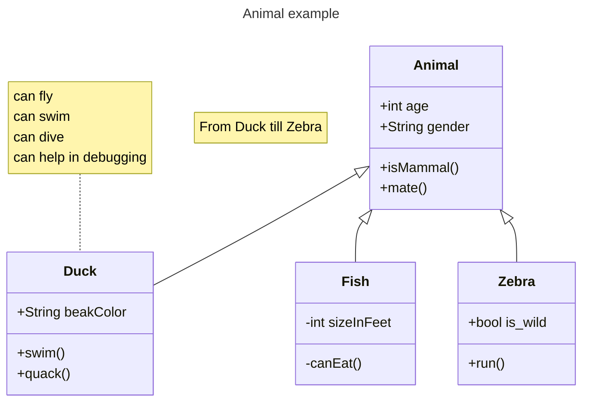

Expected labels: `Animal`, `Duck`, `Fish`, `Zebra`, `From Duck till Zebra`, `can fly can swim can dive can help in debugging`

### portfolio:class:13

Node API, SVG. Error: Invalid mermaid header: "---". Expected "graph TD", "flowchart LR", "stateDiagram-v2", etc.

Pinned Mermaid accepted this source; authored labels are declared. Passing these checks does not establish full fidelity or native-model support.

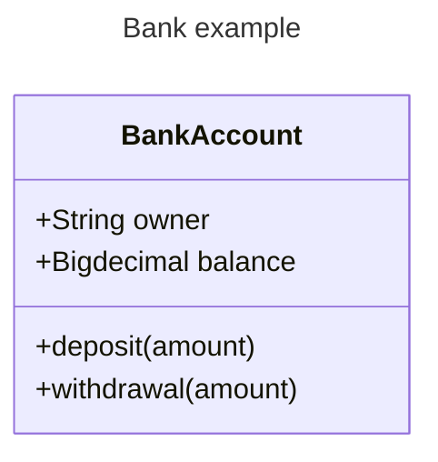

Expected labels: `BankAccount`

### corpus:mermaid-upstream-suite-bench:class-upstream-defaults-to-hierarchical-rendering-when-hierarchicalnamespaces-is-unset

Node API, SVG. Error: Missing authored label: A; Missing authored label: B

Pinned Mermaid accepted this source; authored labels are declared. Passing these checks does not establish full fidelity or native-model support.

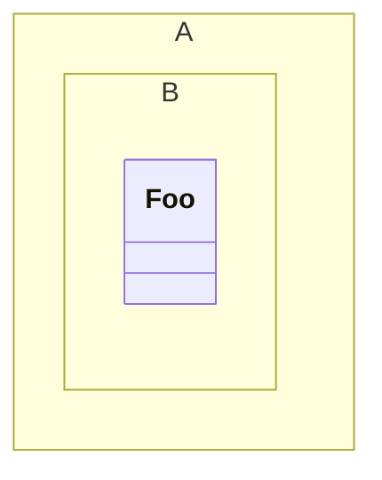

Expected labels: `A`, `B`, `Foo`

Rendered output is retained in the local owning evidence and omitted from this compact snapshot.

### corpus:mermaid-upstream-suite-bench:class-upstream-emits-only-explicit-namespaces-from-getdata-in-compact-mode

Node API, SVG. Error: Missing authored label: Company; Missing authored label: Engineering; Missing authored label: Backend

Pinned Mermaid accepted this source; authored labels are declared. Passing these checks does not establish full fidelity or native-model support.

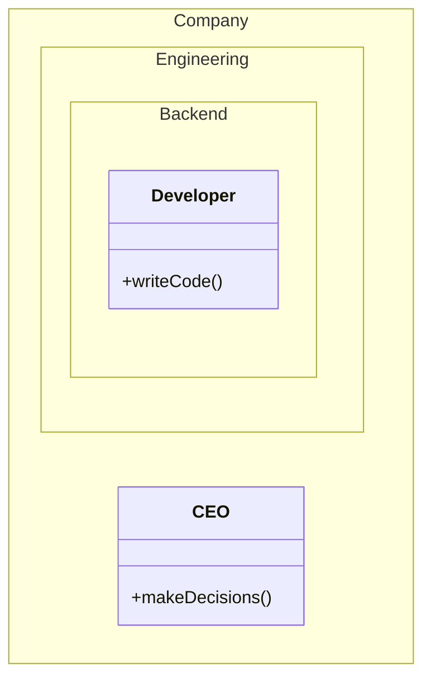

Expected labels: `Company`, `Engineering`, `Backend`, `Developer`, `CEO`

Rendered output is retained in the local owning evidence and omitted from this compact snapshot.

### corpus:mermaid-upstream-suite-bench:class-upstream-moves-classes-inside-implicit-namespaces-to-the-nearest-explicit-ancestor-in-compact-mode

Node API, SVG. Error: Missing authored label: Company; Missing authored label: Engineering; Missing authored label: Backend

Pinned Mermaid accepted this source; authored labels are declared. Passing these checks does not establish full fidelity or native-model support.

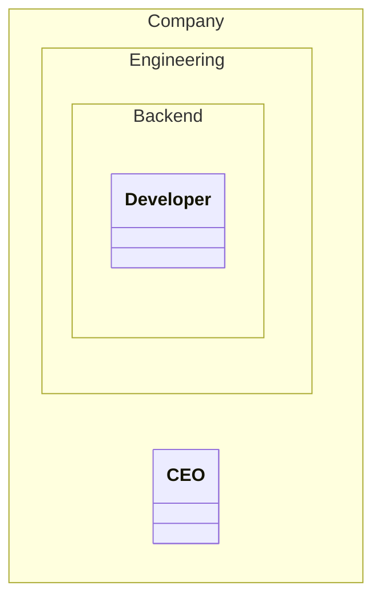

Expected labels: `Company`, `Engineering`, `Backend`, `Developer`, `CEO`

Rendered output is retained in the local owning evidence and omitted from this compact snapshot.

### corpus:mermaid-upstream-suite-bench:class-upstream-should-add-classes-namespaces

Node API, SVG. Error: Missing authored label: Namespace1

Pinned Mermaid accepted this source; authored labels are declared. Passing these checks does not establish full fidelity or native-model support.

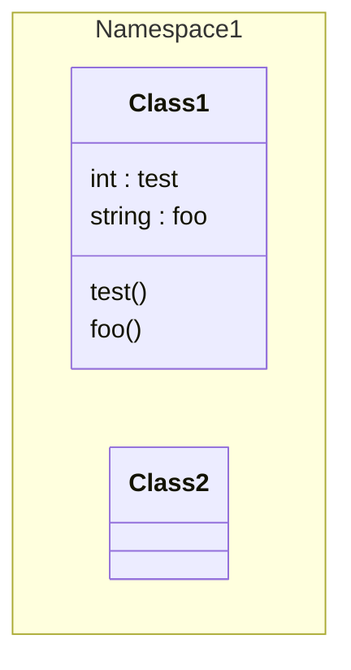

Expected labels: `Namespace1`, `Class1`, `Class2`

Rendered output is retained in the local owning evidence and omitted from this compact snapshot.

### corpus:mermaid-upstream-suite-bench:class-upstream-should-add-relations-between-classes-of-different-namespaces

Node API, SVG. Error: Missing authored label: A; Missing authored label: B

Pinned Mermaid accepted this source; authored labels are declared. Passing these checks does not establish full fidelity or native-model support.

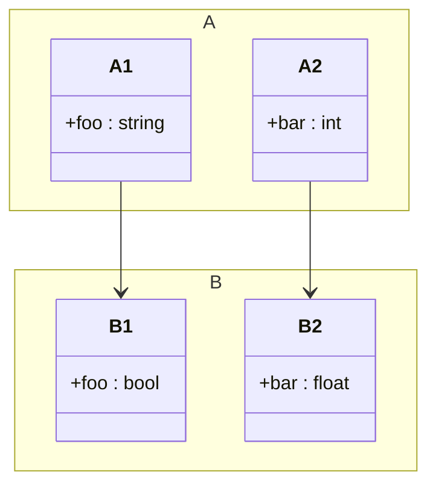

Expected labels: `A`, `B`, `A1`, `B1`, `A2`, `B2`

Rendered output is retained in the local owning evidence and omitted from this compact snapshot.

### corpus:mermaid-upstream-suite-bench:class-upstream-should-handle-an-empty-class-body-with

Node API, SVG. Error: SVG has no positive finite viewBox or explicit canvas

Pinned Mermaid accepted this source; authored labels are declared. Passing these checks does not establish full fidelity or native-model support.

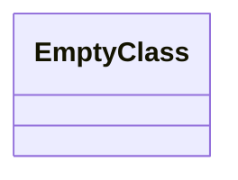

Expected labels: `EmptyClass`

Rendered output is retained in the local owning evidence and omitted from this compact snapshot.

### corpus:mermaid-upstream-suite-bench:class-upstream-should-handle-backtick-quoted-namespace-names

Node API, SVG. Error: Missing authored label: A::B

Pinned Mermaid accepted this source; authored labels are declared. Passing these checks does not establish full fidelity or native-model support.

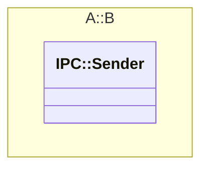

Expected labels: `A::B`, `IPC::Sender`

Rendered output is retained in the local owning evidence and omitted from this compact snapshot.

### corpus:mermaid-upstream-suite-bench:class-upstream-should-handle-classes-within-namespaces

Node API, SVG. Error: Missing authored label: Company; Missing authored label: Project; Missing authored label: Module

Pinned Mermaid accepted this source; authored labels are declared. Passing these checks does not establish full fidelity or native-model support.

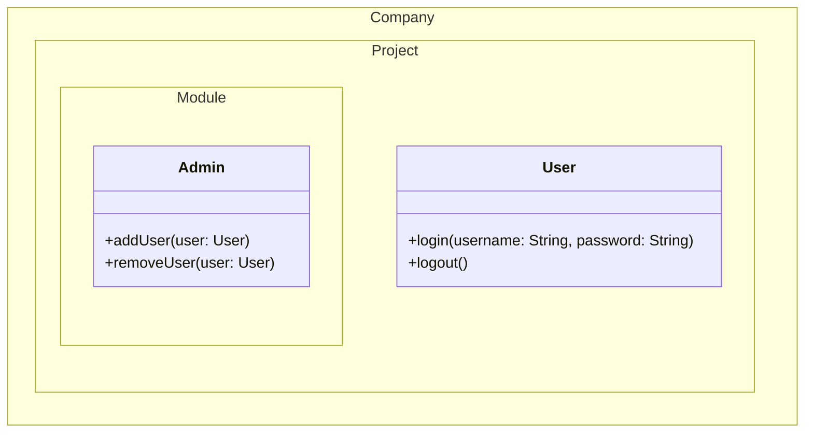

Expected labels: `Company`, `Project`, `Module`, `User`, `Admin`

Rendered output is retained in the local owning evidence and omitted from this compact snapshot.

### corpus:mermaid-upstream-suite-bench:class-upstream-should-handle-comments-at-the-start

Node API, SVG. Error: Invalid mermaid header: "classDiagram". Expected "graph TD", "flowchart LR", "stateDiagram-v2", etc.

Pinned Mermaid accepted this source; authored labels are declared. Passing these checks does not establish full fidelity or native-model support.

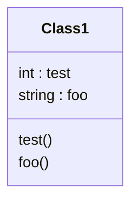

Expected labels: `Class1`

### corpus:mermaid-upstream-suite-bench:class-upstream-should-handle-fully-qualified-class-names-in-relationships

Node API, SVG. Error: Missing authored label: Company; Missing authored label: Project; Missing authored label: Module

Pinned Mermaid accepted this source; authored labels are declared. Passing these checks does not establish full fidelity or native-model support.

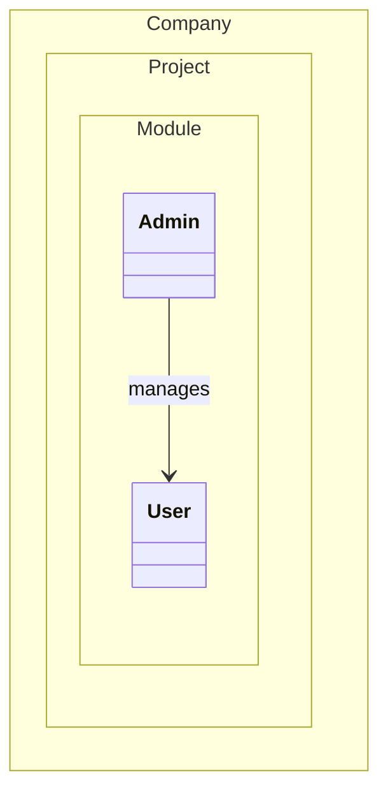

Expected labels: `Company`, `Project`, `Module`, `User`, `Admin`, `manages`

Rendered output is retained in the local owning evidence and omitted from this compact snapshot.

### corpus:mermaid-upstream-suite-bench:class-upstream-should-handle-generic-classes-within-namespaces

Node API, SVG. Error: Missing authored label: Company; Missing authored label: Project; Missing authored label: Module

Pinned Mermaid accepted this source; authored labels are declared. Passing these checks does not establish full fidelity or native-model support.

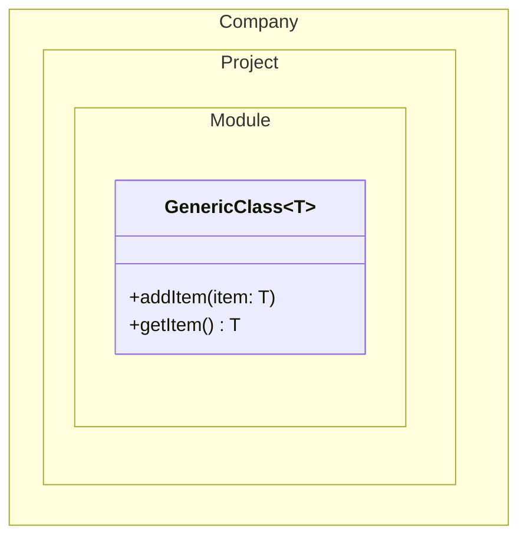

Expected labels: `Company`, `Project`, `Module`, `GenericClass`

Rendered output is retained in the local owning evidence and omitted from this compact snapshot.

### corpus:mermaid-upstream-suite-bench:class-upstream-should-handle-namespace

Node API, SVG. Error: Missing authored label: Namespace1; Missing authored label: Namespace2; Missing authored label: Namespace3; Missing authored label: Namespace4

Pinned Mermaid accepted this source; authored labels are declared. Passing these checks does not establish full fidelity or native-model support.

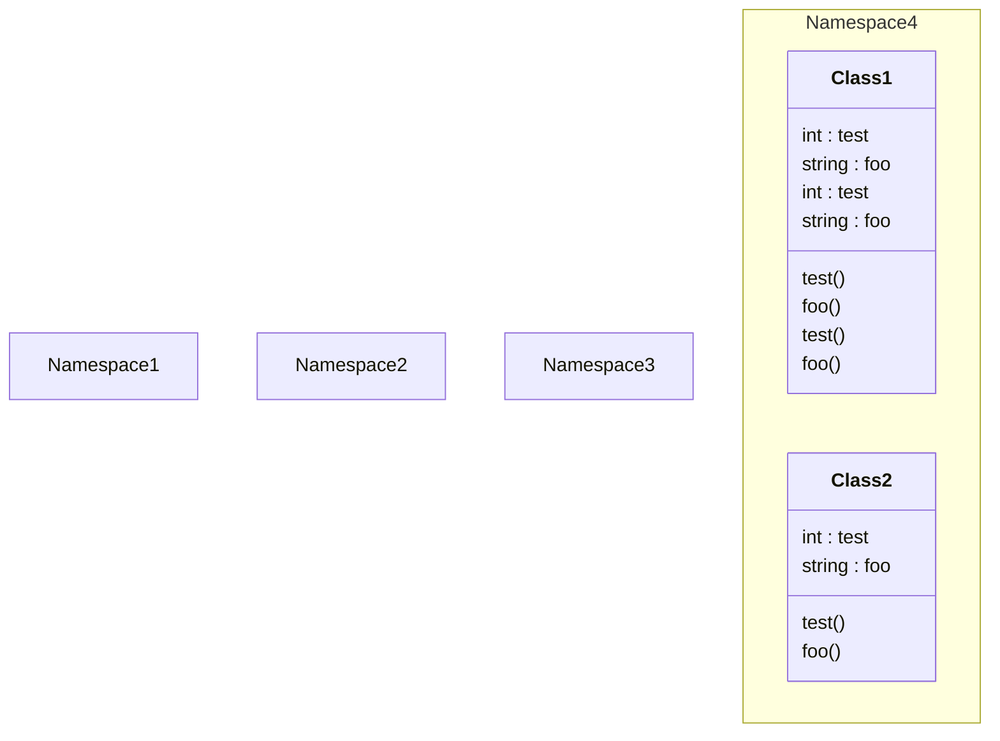

Expected labels: `Namespace1`, `Namespace2`, `Namespace3`, `Namespace4`, `Class1`, `Class2`

Rendered output is retained in the local owning evidence and omitted from this compact snapshot.

### corpus:mermaid-upstream-suite-bench:class-upstream-should-handle-namespace-with-generic-types

Node API, SVG. Error: Missing authored label: space

Pinned Mermaid accepted this source; authored labels are declared. Passing these checks does not establish full fidelity or native-model support.

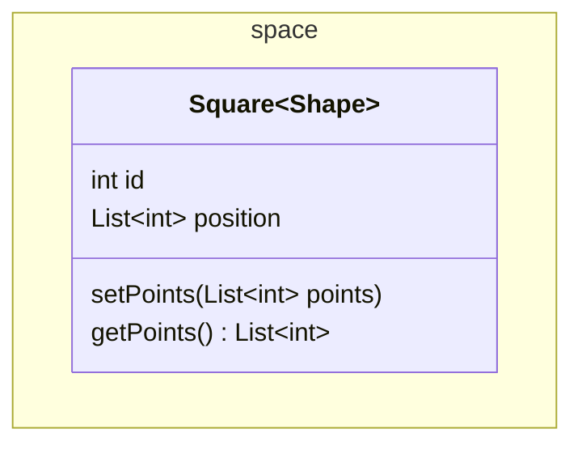

Expected labels: `space`, `Square`

Rendered output is retained in the local owning evidence and omitted from this compact snapshot.

### corpus:mermaid-upstream-suite-bench:class-upstream-should-handle-nested-namespaces-and-relationships

Node API, SVG. Error: Missing authored label: Company; Missing authored label: Project; Missing authored label: Module; Missing authored label: SubModule

Pinned Mermaid accepted this source; authored labels are declared. Passing these checks does not establish full fidelity or native-model support.

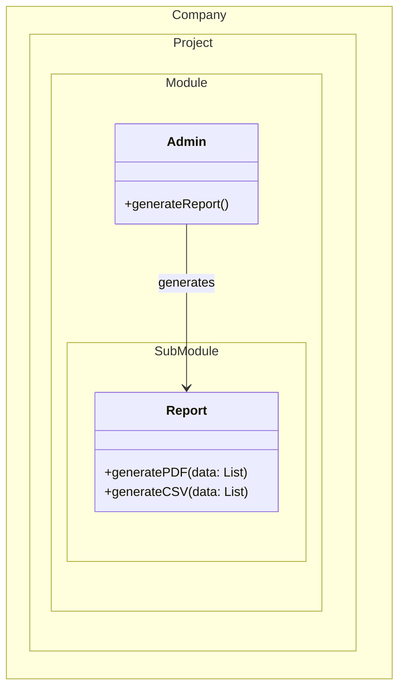

Expected labels: `Company`, `Project`, `Module`, `SubModule`, `Report`, `Admin`, `generates`

Rendered output is retained in the local owning evidence and omitted from this compact snapshot.

### corpus:mermaid-upstream-suite-bench:class-upstream-should-handle-syntactically-nested-namespace-blocks

Node API, SVG. Error: Missing authored label: Outer; Missing authored label: Inner

Pinned Mermaid accepted this source; authored labels are declared. Passing these checks does not establish full fidelity or native-model support.

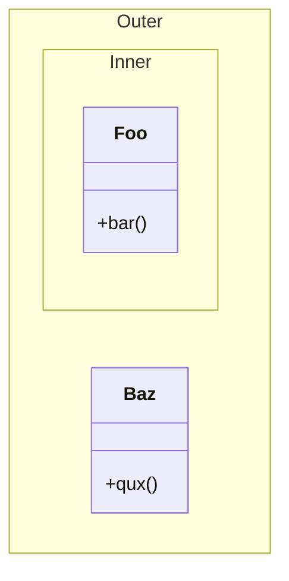

Expected labels: `Outer`, `Inner`, `Foo`, `Baz`

Rendered output is retained in the local owning evidence and omitted from this compact snapshot.

### corpus:mermaid-upstream-suite-bench:class-upstream-should-parse-a-class-with-a-text-label

Node API, SVG. Error: Missing authored label: Class 1 with text label

Pinned Mermaid accepted this source; authored labels are declared. Passing these checks does not establish full fidelity or native-model support.

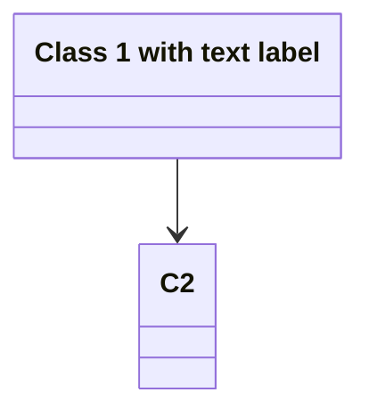

Expected labels: `Class 1 with text label`, `C2`

Rendered output is retained in the local owning evidence and omitted from this compact snapshot.

### corpus:mermaid-upstream-suite-bench:class-upstream-should-parse-a-class-with-a-text-label-and-members

Node API, SVG. Error: Missing authored label: Class 1 with text label

Pinned Mermaid accepted this source; authored labels are declared. Passing these checks does not establish full fidelity or native-model support.

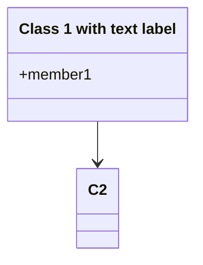

Expected labels: `Class 1 with text label`, `C2`

Rendered output is retained in the local owning evidence and omitted from this compact snapshot.

### corpus:mermaid-upstream-suite-bench:class-upstream-should-parse-a-class-with-a-text-label-members-and-annotation

Node API, SVG. Error: Missing authored label: Class 1 with text label

Pinned Mermaid accepted this source; authored labels are declared. Passing these checks does not establish full fidelity or native-model support.

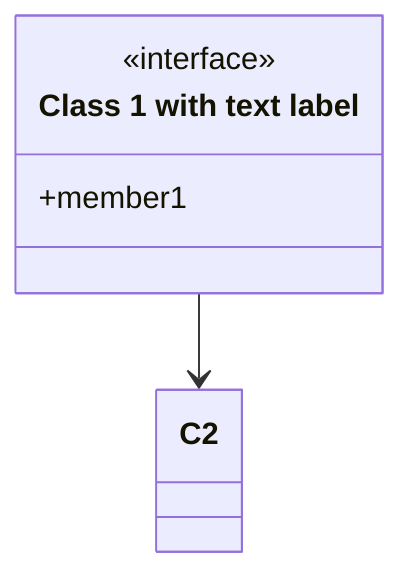

Expected labels: `Class 1 with text label`, `C2`

Rendered output is retained in the local owning evidence and omitted from this compact snapshot.

### corpus:mermaid-upstream-suite-bench:class-upstream-should-parse-a-class-with-text-label-and-css-class

Node API, SVG. Error: Missing authored label: Class 1 with text label

Pinned Mermaid accepted this source; authored labels are declared. Passing these checks does not establish full fidelity or native-model support.

```mermaid
classDiagram
class C1["Class 1 with text label"] {
  +member1
}
C1 --> C2
cssClass "C1" styleClass
```

Expected labels: `Class 1 with text label`, `C2`

Rendered output is retained in the local owning evidence and omitted from this compact snapshot.

### corpus:mermaid-upstream-suite-bench:class-upstream-should-parse-a-class-with-text-label-and-css-class-shorthand

Node API, SVG. Error: Missing authored label: Class 1 with text label

Pinned Mermaid accepted this source; authored labels are declared. Passing these checks does not establish full fidelity or native-model support.

```mermaid
classDiagram
class C1["Class 1 with text label"]:::styleClass {
  +member1
}
C1 -->  C2
```

Expected labels: `Class 1 with text label`, `C2`

Rendered output is retained in the local owning evidence and omitted from this compact snapshot.

### corpus:mermaid-upstream-suite-bench:class-upstream-should-parse-classes-with-different-text-labels

Node API, SVG. Error: Missing authored label: With, Comma; Missing authored label: With (Brackets); Missing authored label: With [Brackets]; Missing authored label: With {Brackets}; Missing authored label: With 1 number; Missing authored label: With . period...; Missing authored label: With - dash; Missing authored label: With _ underscore; Missing authored label: With ' single quote; Missing authored label: With ~!@#$%^&*()_+=-/?; Missing authored label: With Città foreign language

Pinned Mermaid accepted this source; authored labels are declared. Passing these checks does not establish full fidelity or native-model support.

```mermaid
classDiagram
class C1["OneWord"]
class C2["With, Comma"]
class C3["With (Brackets)"]
class C4["With [Brackets]"]
class C5["With {Brackets}"]
class C6[" "]
class C7["With 1 number"]
class C8["With . period..."]
class C9["With - dash"]
class C10["With _ underscore"]
class C11["With ' single quote"]
class C12["With ~!@#$%^&*()_+=-/?"]
class C13["With Città foreign language"]
```

Expected labels: `OneWord`, `With, Comma`, `With (Brackets)`, `With [Brackets]`, `With {Brackets}`, `With 1 number`, `With . period...`, `With - dash`, `With _ underscore`, `With ' single quote`, `With ~!@#$%^&*()_+=-/?`, `With Città foreign language`

Rendered output is retained in the local owning evidence and omitted from this compact snapshot.

### corpus:mermaid-upstream-suite-bench:class-upstream-should-parse-multiple-classes-with-same-text-labels

Node API, SVG. Error: SVG has no positive finite viewBox or explicit canvas

Pinned Mermaid accepted this source; authored labels are declared. Passing these checks does not establish full fidelity or native-model support.

```mermaid
classDiagram
class C1["Class with text label"]
class C2["Class with text label"]
class C3["Class with text label"]
```

Expected labels: `Class with text label`

Rendered output is retained in the local owning evidence and omitted from this compact snapshot.

### corpus:mermaid-upstream-suite-bench:class-upstream-should-parse-multiple-classes-with-same-text-labels-2

Node API, SVG. Error: Missing authored label: Class with text label

Pinned Mermaid accepted this source; authored labels are declared. Passing these checks does not establish full fidelity or native-model support.

```mermaid
classDiagram
class C1["Class with text label"]
class C2["Class with text label"]
class C3["Class with text label"]
C1 --> C2
C3 ..> C2
```

Expected labels: `Class with text label`

Rendered output is retained in the local owning evidence and omitted from this compact snapshot.

### corpus:mermaid-upstream-suite-bench:class-upstream-should-parse-two-classes-with-text-labels

Node API, SVG. Error: Missing authored label: Class 1 with text label; Missing authored label: Class 2 with chars @?

Pinned Mermaid accepted this source; authored labels are declared. Passing these checks does not establish full fidelity or native-model support.

```mermaid
classDiagram
  class C1["Class 1 with text label"]
  class C2["Class 2 with chars @?"]
  C1 -->  C2
```

Expected labels: `Class 1 with text label`, `Class 2 with chars @?`

Rendered output is retained in the local owning evidence and omitted from this compact snapshot.

### corpus:mermaid-upstream-suite-bench:class-upstream-should-parse-two-classes-with-text-labels-and-css-class-shorthands

Node API, SVG. Error: Missing authored label: Class 1 with text label; Missing authored label: Class 2 !@#$%^&*() label

Pinned Mermaid accepted this source; authored labels are declared. Passing these checks does not establish full fidelity or native-model support.

```mermaid
classDiagram
class C1["Class 1 with text label"]:::styleClass1 {
  +member1
}
class C2["Class 2 !@#$%^&*() label"]:::styleClass2
C1 --> C2
```

Expected labels: `Class 1 with text label`, `Class 2 !@#$%^&*() label`

Rendered output is retained in the local owning evidence and omitted from this compact snapshot.

### corpus:mermaid-upstream-suite-bench:class-upstream-should-parse-two-classes-with-text-labels-and-css-classes

Node API, SVG. Error: Missing authored label: Class 1 with text label; Missing authored label: Long long long long long long long long long long label

Pinned Mermaid accepted this source; authored labels are declared. Passing these checks does not establish full fidelity or native-model support.

```mermaid
classDiagram
class C1["Class 1 with text label"] {
  +member1
}
class C2["Long long long long long long long long long long label"]
C1 --> C2
cssClass "C1,C2" styleClass
```

Expected labels: `Class 1 with text label`, `Long long long long long long long long long long label`

Rendered output is retained in the local owning evidence and omitted from this compact snapshot.

### corpus:mermaid-upstream-suite-bench:class-upstream-should-support-custom-labels-on-namespaces

Node API, SVG. Error: Missing authored label: Authentication Service

Pinned Mermaid accepted this source; authored labels are declared. Passing these checks does not establish full fidelity or native-model support.

```mermaid
classDiagram
        namespace Auth["Authentication Service"] {
          class UserService {
            +login()
          }
        }
```

Expected labels: `Authentication Service`, `UserService`

Rendered output is retained in the local owning evidence and omitted from this compact snapshot.

### portfolio:class:12

Node API, Terminal text. Error: Invalid mermaid header: "---". Expected "graph TD", "flowchart LR", "stateDiagram-v2", etc.

Pinned Mermaid accepted this source; authored labels are declared. Passing these checks does not establish full fidelity or native-model support.

```mermaid
---
title: Animal example
---
classDiagram
    note "From Duck till Zebra"
    Animal <|-- Duck
    note for Duck "can fly<br>can swim<br>can dive<br>can help in debugging"
    Animal <|-- Fish
    Animal <|-- Zebra
    Animal : +int age
    Animal : +String gender
    Animal: +isMammal()
    Animal: +mate()
    class Duck{
        +String beakColor
        +swim()
        +quack()
    }
    class Fish{
        -int sizeInFeet
        -canEat()
    }
    class Zebra{
        +bool is_wild
        +run()
    }
```

Expected labels: `Animal`, `Duck`, `Fish`, `Zebra`, `From Duck till Zebra`, `can fly can swim can dive can help in debugging`

### portfolio:class:13

Node API, Terminal text. Error: Invalid mermaid header: "---". Expected "graph TD", "flowchart LR", "stateDiagram-v2", etc.

Pinned Mermaid accepted this source; authored labels are declared. Passing these checks does not establish full fidelity or native-model support.

```mermaid
---
title: Bank example
---
classDiagram
    class BankAccount
    BankAccount : +String owner
    BankAccount : +Bigdecimal balance
    BankAccount : +deposit(amount)
    BankAccount : +withdrawal(amount)
```

Expected labels: `BankAccount`

### corpus:mermaid-upstream-suite-bench:class-upstream-defaults-to-hierarchical-rendering-when-hierarchicalnamespaces-is-unset

Node API, Terminal text. Error: Missing authored label: A; Missing authored label: B

Pinned Mermaid accepted this source; authored labels are declared. Passing these checks does not establish full fidelity or native-model support.

```mermaid
classDiagram
        namespace A.B {
          class Foo
        }
```

Expected labels: `A`, `B`, `Foo`

Rendered output is retained in the local owning evidence and omitted from this compact snapshot.

### corpus:mermaid-upstream-suite-bench:class-upstream-emits-only-explicit-namespaces-from-getdata-in-compact-mode

Node API, Terminal text. Error: Missing authored label: Company; Missing authored label: Engineering; Missing authored label: Backend

Pinned Mermaid accepted this source; authored labels are declared. Passing these checks does not establish full fidelity or native-model support.

```mermaid
classDiagram
          namespace Company.Engineering.Backend {
            class Developer {
              +writeCode()
            }
          }
          namespace Company {
            class CEO {
              +makeDecisions()
            }
          }
```

Expected labels: `Company`, `Engineering`, `Backend`, `Developer`, `CEO`

Rendered output is retained in the local owning evidence and omitted from this compact snapshot.

### corpus:mermaid-upstream-suite-bench:class-upstream-moves-classes-inside-implicit-namespaces-to-the-nearest-explicit-ancestor-in-compact-mode

Node API, Terminal text. Error: Missing authored label: Company; Missing authored label: Engineering; Missing authored label: Backend

Pinned Mermaid accepted this source; authored labels are declared. Passing these checks does not establish full fidelity or native-model support.

```mermaid
classDiagram
          namespace Company.Engineering.Backend {
            class Developer
          }
          namespace Company {
            class CEO
          }
```

Expected labels: `Company`, `Engineering`, `Backend`, `Developer`, `CEO`

Rendered output is retained in the local owning evidence and omitted from this compact snapshot.

### corpus:mermaid-upstream-suite-bench:class-upstream-should-add-classes-namespaces

Node API, Terminal text. Error: Missing authored label: Namespace1

Pinned Mermaid accepted this source; authored labels are declared. Passing these checks does not establish full fidelity or native-model support.

```mermaid
classDiagram
namespace Namespace1 {
class Class1 {
int : test
string : foo
test()
foo()
}
class Class2
}
```

Expected labels: `Namespace1`, `Class1`, `Class2`

Rendered output is retained in the local owning evidence and omitted from this compact snapshot.

### corpus:mermaid-upstream-suite-bench:class-upstream-should-add-relations-between-classes-of-different-namespaces

Node API, Terminal text. Error: Missing authored label: A; Missing authored label: B

Pinned Mermaid accepted this source; authored labels are declared. Passing these checks does not establish full fidelity or native-model support.

```mermaid
classDiagram
      A1 --> B1
      namespace A {
        class A1 {
          +foo : string
        }
        class A2 {
          +bar : int
        }
      }
      namespace B {
        class B1 {
          +foo : bool
        }
        class B2 {
          +bar : float
        }
      }
      A2 --> B2
```

Expected labels: `A`, `B`, `A1`, `B1`, `A2`, `B2`

Rendered output is retained in the local owning evidence and omitted from this compact snapshot.

### corpus:mermaid-upstream-suite-bench:class-upstream-should-handle-an-empty-class-body-with

Node API, Terminal text. Error: Expected a nonempty output string

Pinned Mermaid accepted this source; authored labels are declared. Passing these checks does not establish full fidelity or native-model support.

```mermaid
classDiagram
class EmptyClass {}
```

Expected labels: `EmptyClass`

### corpus:mermaid-upstream-suite-bench:class-upstream-should-handle-backtick-quoted-namespace-names

Node API, Terminal text. Error: Missing authored label: A::B

Pinned Mermaid accepted this source; authored labels are declared. Passing these checks does not establish full fidelity or native-model support.

```mermaid
classDiagram
namespace `A::B` {
	class `IPC::Sender`
}
```

Expected labels: `A::B`, `IPC::Sender`

Rendered output is retained in the local owning evidence and omitted from this compact snapshot.

### corpus:mermaid-upstream-suite-bench:class-upstream-should-handle-classes-within-namespaces

Node API, Terminal text. Error: Missing authored label: Company; Missing authored label: Project; Missing authored label: Module

Pinned Mermaid accepted this source; authored labels are declared. Passing these checks does not establish full fidelity or native-model support.

```mermaid
classDiagram
        namespace Company.Project {
          class User {
            +login(username: String, password: String)
            +logout()
          }
        }
        namespace Company.Project.Module {
          class Admin {
            +addUser(user: User)
            +removeUser(user: User)
          }
        }
```

Expected labels: `Company`, `Project`, `Module`, `User`, `Admin`

Rendered output is retained in the local owning evidence and omitted from this compact snapshot.

### corpus:mermaid-upstream-suite-bench:class-upstream-should-handle-comments-at-the-start

Node API, Terminal text. Error: Invalid mermaid header: "classDiagram". Expected "graph TD", "flowchart LR", "stateDiagram-v2", etc.

Pinned Mermaid accepted this source; authored labels are declared. Passing these checks does not establish full fidelity or native-model support.

```mermaid
%% Comment
        classDiagram
        class Class1 {
          int : test
          string : foo
          test()
          foo()
        }
```

Expected labels: `Class1`

### corpus:mermaid-upstream-suite-bench:class-upstream-should-handle-fully-qualified-class-names-in-relationships

Node API, Terminal text. Error: Missing authored label: Company; Missing authored label: Project; Missing authored label: Module

Pinned Mermaid accepted this source; authored labels are declared. Passing these checks does not establish full fidelity or native-model support.

```mermaid
classDiagram
        namespace Company.Project.Module {
          class User
          class Admin
        }
          Admin --> User : manages
```

Expected labels: `Company`, `Project`, `Module`, `User`, `Admin`, `manages`

Rendered output is retained in the local owning evidence and omitted from this compact snapshot.

### corpus:mermaid-upstream-suite-bench:class-upstream-should-handle-generic-classes-within-namespaces

Node API, Terminal text. Error: Missing authored label: Company; Missing authored label: Project; Missing authored label: Module

Pinned Mermaid accepted this source; authored labels are declared. Passing these checks does not establish full fidelity or native-model support.

```mermaid
classDiagram
    namespace Company.Project.Module {
        class GenericClass~T~ {
            +addItem(item: T)
            +getItem() T
        }
    }
```

Expected labels: `Company`, `Project`, `Module`, `GenericClass`

Rendered output is retained in the local owning evidence and omitted from this compact snapshot.

### corpus:mermaid-upstream-suite-bench:class-upstream-should-handle-namespace

Node API, Terminal text. Error: Missing authored label: Namespace1; Missing authored label: Namespace2; Missing authored label: Namespace3; Missing authored label: Namespace4

Pinned Mermaid accepted this source; authored labels are declared. Passing these checks does not establish full fidelity or native-model support.

```mermaid
classDiagram
namespace Namespace1 { class Class1 }
namespace Namespace2 { class Class1
}
namespace Namespace3 {
class Class1 {
int : test
string : foo
test()
foo()
}
}
namespace Namespace4 {
class Class1 {
int : test
string : foo
test()
foo()
}
class Class2 {
int : test
string : foo
test()
foo()
}
}
```

Expected labels: `Namespace1`, `Namespace2`, `Namespace3`, `Namespace4`, `Class1`, `Class2`

Rendered output is retained in the local owning evidence and omitted from this compact snapshot.

### corpus:mermaid-upstream-suite-bench:class-upstream-should-handle-namespace-with-generic-types

Node API, Terminal text. Error: Missing authored label: space

Pinned Mermaid accepted this source; authored labels are declared. Passing these checks does not establish full fidelity or native-model support.

```mermaid
classDiagram

namespace space {
    class Square~Shape~{
        int id
        List~int~ position
        setPoints(List~int~ points)
        getPoints() List~int~
    }
}
```

Expected labels: `space`, `Square`

Rendered output is retained in the local owning evidence and omitted from this compact snapshot.

### corpus:mermaid-upstream-suite-bench:class-upstream-should-handle-nested-namespaces-and-relationships

Node API, Terminal text. Error: Missing authored label: Company; Missing authored label: Project; Missing authored label: Module; Missing authored label: SubModule

Pinned Mermaid accepted this source; authored labels are declared. Passing these checks does not establish full fidelity or native-model support.

```mermaid
classDiagram
        namespace Company.Project.Module.SubModule {
          class Report {
            +generatePDF(data: List)
            +generateCSV(data: List)
          }
        }
        namespace Company.Project.Module {
          class Admin {
            +generateReport()
          }
        }
        Admin --> Report : generates
```

Expected labels: `Company`, `Project`, `Module`, `SubModule`, `Report`, `Admin`, `generates`

Rendered output is retained in the local owning evidence and omitted from this compact snapshot.

### corpus:mermaid-upstream-suite-bench:class-upstream-should-handle-syntactically-nested-namespace-blocks

Node API, Terminal text. Error: Missing authored label: Outer; Missing authored label: Inner

Pinned Mermaid accepted this source; authored labels are declared. Passing these checks does not establish full fidelity or native-model support.

```mermaid
classDiagram
        namespace Outer {
          namespace Inner {
            class Foo {
              +bar()
            }
          }
          class Baz {
            +qux()
          }
        }
```

Expected labels: `Outer`, `Inner`, `Foo`, `Baz`

Rendered output is retained in the local owning evidence and omitted from this compact snapshot.

### corpus:mermaid-upstream-suite-bench:class-upstream-should-parse-a-class-with-a-text-label

Node API, Terminal text. Error: Missing authored label: Class 1 with text label

Pinned Mermaid accepted this source; authored labels are declared. Passing these checks does not establish full fidelity or native-model support.

```mermaid
classDiagram
  class C1["Class 1 with text label"]
  C1 -->  C2
```

Expected labels: `Class 1 with text label`, `C2`

Rendered output is retained in the local owning evidence and omitted from this compact snapshot.

### corpus:mermaid-upstream-suite-bench:class-upstream-should-parse-a-class-with-a-text-label-and-members

Node API, Terminal text. Error: Missing authored label: Class 1 with text label

Pinned Mermaid accepted this source; authored labels are declared. Passing these checks does not establish full fidelity or native-model support.

```mermaid
classDiagram
  class C1["Class 1 with text label"] {
    +member1
  }
  C1 -->  C2
```

Expected labels: `Class 1 with text label`, `C2`

Rendered output is retained in the local owning evidence and omitted from this compact snapshot.

### corpus:mermaid-upstream-suite-bench:class-upstream-should-parse-a-class-with-a-text-label-members-and-annotation

Node API, Terminal text. Error: Missing authored label: Class 1 with text label

Pinned Mermaid accepted this source; authored labels are declared. Passing these checks does not establish full fidelity or native-model support.

```mermaid
classDiagram
  class C1["Class 1 with text label"] {
    <<interface>>
    +member1
  }
  C1 -->  C2
```

Expected labels: `Class 1 with text label`, `C2`

Rendered output is retained in the local owning evidence and omitted from this compact snapshot.

### corpus:mermaid-upstream-suite-bench:class-upstream-should-parse-a-class-with-text-label-and-css-class

Node API, Terminal text. Error: Missing authored label: Class 1 with text label

Pinned Mermaid accepted this source; authored labels are declared. Passing these checks does not establish full fidelity or native-model support.

```mermaid
classDiagram
class C1["Class 1 with text label"] {
  +member1
}
C1 --> C2
cssClass "C1" styleClass
```

Expected labels: `Class 1 with text label`, `C2`

Rendered output is retained in the local owning evidence and omitted from this compact snapshot.

### corpus:mermaid-upstream-suite-bench:class-upstream-should-parse-a-class-with-text-label-and-css-class-shorthand

Node API, Terminal text. Error: Missing authored label: Class 1 with text label

Pinned Mermaid accepted this source; authored labels are declared. Passing these checks does not establish full fidelity or native-model support.

```mermaid
classDiagram
class C1["Class 1 with text label"]:::styleClass {
  +member1
}
C1 -->  C2
```

Expected labels: `Class 1 with text label`, `C2`

Rendered output is retained in the local owning evidence and omitted from this compact snapshot.

### corpus:mermaid-upstream-suite-bench:class-upstream-should-parse-classes-with-different-text-labels

Node API, Terminal text. Error: Missing authored label: With, Comma; Missing authored label: With (Brackets); Missing authored label: With [Brackets]; Missing authored label: With {Brackets}; Missing authored label: With 1 number; Missing authored label: With . period...; Missing authored label: With - dash; Missing authored label: With _ underscore; Missing authored label: With ' single quote; Missing authored label: With ~!@#$%^&*()_+=-/?; Missing authored label: With Città foreign language

Pinned Mermaid accepted this source; authored labels are declared. Passing these checks does not establish full fidelity or native-model support.

```mermaid
classDiagram
class C1["OneWord"]
class C2["With, Comma"]
class C3["With (Brackets)"]
class C4["With [Brackets]"]
class C5["With {Brackets}"]
class C6[" "]
class C7["With 1 number"]
class C8["With . period..."]
class C9["With - dash"]
class C10["With _ underscore"]
class C11["With ' single quote"]
class C12["With ~!@#$%^&*()_+=-/?"]
class C13["With Città foreign language"]
```

Expected labels: `OneWord`, `With, Comma`, `With (Brackets)`, `With [Brackets]`, `With {Brackets}`, `With 1 number`, `With . period...`, `With - dash`, `With _ underscore`, `With ' single quote`, `With ~!@#$%^&*()_+=-/?`, `With Città foreign language`

Rendered output is retained in the local owning evidence and omitted from this compact snapshot.

### corpus:mermaid-upstream-suite-bench:class-upstream-should-parse-diagram-with-direction

Node API, Terminal text. Error: Missing authored label: carries

Pinned Mermaid accepted this source; authored labels are declared. Passing these checks does not establish full fidelity or native-model support.

```mermaid
classDiagram
          direction TB
          class Student {
            -idCard : IdCard
          }
          class IdCard{
            -id : int
            -name : string
          }
          class Bike{
            -id : int
            -name : string
          }
          Student "1" --o "1" IdCard : carries
          Student "1" --o "1" Bike : rides
```

Expected labels: `Student`, `IdCard`, `Bike`, `carries`, `rides`

Rendered output is retained in the local owning evidence and omitted from this compact snapshot.

### corpus:mermaid-upstream-suite-bench:class-upstream-should-parse-multiple-classes-with-same-text-labels

Node API, Terminal text. Error: Expected a nonempty output string

Pinned Mermaid accepted this source; authored labels are declared. Passing these checks does not establish full fidelity or native-model support.

```mermaid
classDiagram
class C1["Class with text label"]
class C2["Class with text label"]
class C3["Class with text label"]
```

Expected labels: `Class with text label`

### corpus:mermaid-upstream-suite-bench:class-upstream-should-parse-multiple-classes-with-same-text-labels-2

Node API, Terminal text. Error: Missing authored label: Class with text label

Pinned Mermaid accepted this source; authored labels are declared. Passing these checks does not establish full fidelity or native-model support.

```mermaid
classDiagram
class C1["Class with text label"]
class C2["Class with text label"]
class C3["Class with text label"]
C1 --> C2
C3 ..> C2
```

Expected labels: `Class with text label`

Rendered output is retained in the local owning evidence and omitted from this compact snapshot.

### corpus:mermaid-upstream-suite-bench:class-upstream-should-parse-two-classes-with-text-labels

Node API, Terminal text. Error: Missing authored label: Class 1 with text label; Missing authored label: Class 2 with chars @?

Pinned Mermaid accepted this source; authored labels are declared. Passing these checks does not establish full fidelity or native-model support.

```mermaid
classDiagram
  class C1["Class 1 with text label"]
  class C2["Class 2 with chars @?"]
  C1 -->  C2
```

Expected labels: `Class 1 with text label`, `Class 2 with chars @?`

Rendered output is retained in the local owning evidence and omitted from this compact snapshot.

### corpus:mermaid-upstream-suite-bench:class-upstream-should-parse-two-classes-with-text-labels-and-css-class-shorthands

Node API, Terminal text. Error: Missing authored label: Class 1 with text label; Missing authored label: Class 2 !@#$%^&*() label

Pinned Mermaid accepted this source; authored labels are declared. Passing these checks does not establish full fidelity or native-model support.

```mermaid
classDiagram
class C1["Class 1 with text label"]:::styleClass1 {
  +member1
}
class C2["Class 2 !@#$%^&*() label"]:::styleClass2
C1 --> C2
```

Expected labels: `Class 1 with text label`, `Class 2 !@#$%^&*() label`

Rendered output is retained in the local owning evidence and omitted from this compact snapshot.

### corpus:mermaid-upstream-suite-bench:class-upstream-should-parse-two-classes-with-text-labels-and-css-classes

Node API, Terminal text. Error: Missing authored label: Class 1 with text label; Missing authored label: Long long long long long long long long long long label

Pinned Mermaid accepted this source; authored labels are declared. Passing these checks does not establish full fidelity or native-model support.

```mermaid
classDiagram
class C1["Class 1 with text label"] {
  +member1
}
class C2["Long long long long long long long long long long label"]
C1 --> C2
cssClass "C1,C2" styleClass
```

Expected labels: `Class 1 with text label`, `Long long long long long long long long long long label`

Rendered output is retained in the local owning evidence and omitted from this compact snapshot.

### corpus:mermaid-upstream-suite-bench:class-upstream-should-support-custom-labels-on-namespaces

Node API, Terminal text. Error: Missing authored label: Authentication Service

Pinned Mermaid accepted this source; authored labels are declared. Passing these checks does not establish full fidelity or native-model support.

```mermaid
classDiagram
        namespace Auth["Authentication Service"] {
          class UserService {
            +login()
          }
        }
```

Expected labels: `Authentication Service`, `UserService`

Rendered output is retained in the local owning evidence and omitted from this compact snapshot.

### portfolio:class:12

browser API, SVG. Error: Invalid mermaid header: "---". Expected "graph TD", "flowchart LR", "stateDiagram-v2", etc.

Pinned Mermaid accepted this source; authored labels are declared. Passing these checks does not establish full fidelity or native-model support.

```mermaid
---
title: Animal example
---
classDiagram
    note "From Duck till Zebra"
    Animal <|-- Duck
    note for Duck "can fly<br>can swim<br>can dive<br>can help in debugging"
    Animal <|-- Fish
    Animal <|-- Zebra
    Animal : +int age
    Animal : +String gender
    Animal: +isMammal()
    Animal: +mate()
    class Duck{
        +String beakColor
        +swim()
        +quack()
    }
    class Fish{
        -int sizeInFeet
        -canEat()
    }
    class Zebra{
        +bool is_wild
        +run()
    }
```

Expected labels: `Animal`, `Duck`, `Fish`, `Zebra`, `From Duck till Zebra`, `can fly can swim can dive can help in debugging`

### portfolio:class:13

browser API, SVG. Error: Invalid mermaid header: "---". Expected "graph TD", "flowchart LR", "stateDiagram-v2", etc.

Pinned Mermaid accepted this source; authored labels are declared. Passing these checks does not establish full fidelity or native-model support.

```mermaid
---
title: Bank example
---
classDiagram
    class BankAccount
    BankAccount : +String owner
    BankAccount : +Bigdecimal balance
    BankAccount : +deposit(amount)
    BankAccount : +withdrawal(amount)
```

Expected labels: `BankAccount`

### corpus:mermaid-upstream-suite-bench:class-upstream-defaults-to-hierarchical-rendering-when-hierarchicalnamespaces-is-unset

browser API, SVG. Missing authored label: A; Missing authored label: B

Pinned Mermaid accepted this source; authored labels are declared. Passing these checks does not establish full fidelity or native-model support.

```mermaid
classDiagram
        namespace A.B {
          class Foo
        }
```

Expected labels: `A`, `B`, `Foo`

Rendered output is retained in the local owning evidence and omitted from this compact snapshot.

### corpus:mermaid-upstream-suite-bench:class-upstream-emits-only-explicit-namespaces-from-getdata-in-compact-mode

browser API, SVG. Missing authored label: Company; Missing authored label: Engineering; Missing authored label: Backend

Pinned Mermaid accepted this source; authored labels are declared. Passing these checks does not establish full fidelity or native-model support.

```mermaid
classDiagram
          namespace Company.Engineering.Backend {
            class Developer {
              +writeCode()
            }
          }
          namespace Company {
            class CEO {
              +makeDecisions()
            }
          }
```

Expected labels: `Company`, `Engineering`, `Backend`, `Developer`, `CEO`

Rendered output is retained in the local owning evidence and omitted from this compact snapshot.

### corpus:mermaid-upstream-suite-bench:class-upstream-moves-classes-inside-implicit-namespaces-to-the-nearest-explicit-ancestor-in-compact-mode

browser API, SVG. Missing authored label: Company; Missing authored label: Engineering; Missing authored label: Backend

Pinned Mermaid accepted this source; authored labels are declared. Passing these checks does not establish full fidelity or native-model support.

```mermaid
classDiagram
          namespace Company.Engineering.Backend {
            class Developer
          }
          namespace Company {
            class CEO
          }
```

Expected labels: `Company`, `Engineering`, `Backend`, `Developer`, `CEO`

Rendered output is retained in the local owning evidence and omitted from this compact snapshot.

### corpus:mermaid-upstream-suite-bench:class-upstream-should-add-classes-namespaces

browser API, SVG. Missing authored label: Namespace1

Pinned Mermaid accepted this source; authored labels are declared. Passing these checks does not establish full fidelity or native-model support.

```mermaid
classDiagram
namespace Namespace1 {
class Class1 {
int : test
string : foo
test()
foo()
}
class Class2
}
```

Expected labels: `Namespace1`, `Class1`, `Class2`

Rendered output is retained in the local owning evidence and omitted from this compact snapshot.

### corpus:mermaid-upstream-suite-bench:class-upstream-should-add-relations-between-classes-of-different-namespaces

browser API, SVG. Missing authored label: A; Missing authored label: B

Pinned Mermaid accepted this source; authored labels are declared. Passing these checks does not establish full fidelity or native-model support.

```mermaid
classDiagram
      A1 --> B1
      namespace A {
        class A1 {
          +foo : string
        }
        class A2 {
          +bar : int
        }
      }
      namespace B {
        class B1 {
          +foo : bool
        }
        class B2 {
          +bar : float
        }
      }
      A2 --> B2
```

Expected labels: `A`, `B`, `A1`, `B1`, `A2`, `B2`

Rendered output is retained in the local owning evidence and omitted from this compact snapshot.

### corpus:mermaid-upstream-suite-bench:class-upstream-should-handle-an-empty-class-body-with

browser API, SVG. SVG has no positive finite canvas

Pinned Mermaid accepted this source; authored labels are declared. Passing these checks does not establish full fidelity or native-model support.

```mermaid
classDiagram
class EmptyClass {}
```

Expected labels: `EmptyClass`

Rendered output is retained in the local owning evidence and omitted from this compact snapshot.

### corpus:mermaid-upstream-suite-bench:class-upstream-should-handle-backtick-quoted-namespace-names

browser API, SVG. Missing authored label: A::B

Pinned Mermaid accepted this source; authored labels are declared. Passing these checks does not establish full fidelity or native-model support.

```mermaid
classDiagram
namespace `A::B` {
	class `IPC::Sender`
}
```

Expected labels: `A::B`, `IPC::Sender`

Rendered output is retained in the local owning evidence and omitted from this compact snapshot.

### corpus:mermaid-upstream-suite-bench:class-upstream-should-handle-classes-within-namespaces

browser API, SVG. Missing authored label: Company; Missing authored label: Project; Missing authored label: Module

Pinned Mermaid accepted this source; authored labels are declared. Passing these checks does not establish full fidelity or native-model support.

```mermaid
classDiagram
        namespace Company.Project {
          class User {
            +login(username: String, password: String)
            +logout()
          }
        }
        namespace Company.Project.Module {
          class Admin {
            +addUser(user: User)
            +removeUser(user: User)
          }
        }
```

Expected labels: `Company`, `Project`, `Module`, `User`, `Admin`

Rendered output is retained in the local owning evidence and omitted from this compact snapshot.

### corpus:mermaid-upstream-suite-bench:class-upstream-should-handle-comments-at-the-start

browser API, SVG. Error: Invalid mermaid header: "classDiagram". Expected "graph TD", "flowchart LR", "stateDiagram-v2", etc.

Pinned Mermaid accepted this source; authored labels are declared. Passing these checks does not establish full fidelity or native-model support.

```mermaid
%% Comment
        classDiagram
        class Class1 {
          int : test
          string : foo
          test()
          foo()
        }
```

Expected labels: `Class1`

### corpus:mermaid-upstream-suite-bench:class-upstream-should-handle-fully-qualified-class-names-in-relationships

browser API, SVG. Missing authored label: Company; Missing authored label: Project; Missing authored label: Module

Pinned Mermaid accepted this source; authored labels are declared. Passing these checks does not establish full fidelity or native-model support.

```mermaid
classDiagram
        namespace Company.Project.Module {
          class User
          class Admin
        }
          Admin --> User : manages
```

Expected labels: `Company`, `Project`, `Module`, `User`, `Admin`, `manages`

Rendered output is retained in the local owning evidence and omitted from this compact snapshot.

### corpus:mermaid-upstream-suite-bench:class-upstream-should-handle-generic-classes-within-namespaces

browser API, SVG. Missing authored label: Company; Missing authored label: Project; Missing authored label: Module

Pinned Mermaid accepted this source; authored labels are declared. Passing these checks does not establish full fidelity or native-model support.

```mermaid
classDiagram
    namespace Company.Project.Module {
        class GenericClass~T~ {
            +addItem(item: T)
            +getItem() T
        }
    }
```

Expected labels: `Company`, `Project`, `Module`, `GenericClass`

Rendered output is retained in the local owning evidence and omitted from this compact snapshot.

### corpus:mermaid-upstream-suite-bench:class-upstream-should-handle-namespace

browser API, SVG. Missing authored label: Namespace1; Missing authored label: Namespace2; Missing authored label: Namespace3; Missing authored label: Namespace4

Pinned Mermaid accepted this source; authored labels are declared. Passing these checks does not establish full fidelity or native-model support.

```mermaid
classDiagram
namespace Namespace1 { class Class1 }
namespace Namespace2 { class Class1
}
namespace Namespace3 {
class Class1 {
int : test
string : foo
test()
foo()
}
}
namespace Namespace4 {
class Class1 {
int : test
string : foo
test()
foo()
}
class Class2 {
int : test
string : foo
test()
foo()
}
}
```

Expected labels: `Namespace1`, `Namespace2`, `Namespace3`, `Namespace4`, `Class1`, `Class2`

Rendered output is retained in the local owning evidence and omitted from this compact snapshot.

### corpus:mermaid-upstream-suite-bench:class-upstream-should-handle-namespace-with-generic-types

browser API, SVG. Missing authored label: space

Pinned Mermaid accepted this source; authored labels are declared. Passing these checks does not establish full fidelity or native-model support.

```mermaid
classDiagram

namespace space {
    class Square~Shape~{
        int id
        List~int~ position
        setPoints(List~int~ points)
        getPoints() List~int~
    }
}
```

Expected labels: `space`, `Square`

Rendered output is retained in the local owning evidence and omitted from this compact snapshot.

### corpus:mermaid-upstream-suite-bench:class-upstream-should-handle-nested-namespaces-and-relationships

browser API, SVG. Missing authored label: Company; Missing authored label: Project; Missing authored label: Module; Missing authored label: SubModule

Pinned Mermaid accepted this source; authored labels are declared. Passing these checks does not establish full fidelity or native-model support.

```mermaid
classDiagram
        namespace Company.Project.Module.SubModule {
          class Report {
            +generatePDF(data: List)
            +generateCSV(data: List)
          }
        }
        namespace Company.Project.Module {
          class Admin {
            +generateReport()
          }
        }
        Admin --> Report : generates
```

Expected labels: `Company`, `Project`, `Module`, `SubModule`, `Report`, `Admin`, `generates`

Rendered output is retained in the local owning evidence and omitted from this compact snapshot.

### corpus:mermaid-upstream-suite-bench:class-upstream-should-handle-syntactically-nested-namespace-blocks

browser API, SVG. Missing authored label: Outer; Missing authored label: Inner

Pinned Mermaid accepted this source; authored labels are declared. Passing these checks does not establish full fidelity or native-model support.

```mermaid
classDiagram
        namespace Outer {
          namespace Inner {
            class Foo {
              +bar()
            }
          }
          class Baz {
            +qux()
          }
        }
```

Expected labels: `Outer`, `Inner`, `Foo`, `Baz`

Rendered output is retained in the local owning evidence and omitted from this compact snapshot.

### corpus:mermaid-upstream-suite-bench:class-upstream-should-parse-a-class-with-a-text-label

browser API, SVG. Missing authored label: Class 1 with text label

Pinned Mermaid accepted this source; authored labels are declared. Passing these checks does not establish full fidelity or native-model support.

```mermaid
classDiagram
  class C1["Class 1 with text label"]
  C1 -->  C2
```

Expected labels: `Class 1 with text label`, `C2`

Rendered output is retained in the local owning evidence and omitted from this compact snapshot.

### corpus:mermaid-upstream-suite-bench:class-upstream-should-parse-a-class-with-a-text-label-and-members

browser API, SVG. Missing authored label: Class 1 with text label

Pinned Mermaid accepted this source; authored labels are declared. Passing these checks does not establish full fidelity or native-model support.

```mermaid
classDiagram
  class C1["Class 1 with text label"] {
    +member1
  }
  C1 -->  C2
```

Expected labels: `Class 1 with text label`, `C2`

Rendered output is retained in the local owning evidence and omitted from this compact snapshot.

### corpus:mermaid-upstream-suite-bench:class-upstream-should-parse-a-class-with-a-text-label-members-and-annotation

browser API, SVG. Missing authored label: Class 1 with text label

Pinned Mermaid accepted this source; authored labels are declared. Passing these checks does not establish full fidelity or native-model support.

```mermaid
classDiagram
  class C1["Class 1 with text label"] {
    <<interface>>
    +member1
  }
  C1 -->  C2
```

Expected labels: `Class 1 with text label`, `C2`

Rendered output is retained in the local owning evidence and omitted from this compact snapshot.

### corpus:mermaid-upstream-suite-bench:class-upstream-should-parse-a-class-with-text-label-and-css-class

browser API, SVG. Missing authored label: Class 1 with text label

Pinned Mermaid accepted this source; authored labels are declared. Passing these checks does not establish full fidelity or native-model support.

```mermaid
classDiagram
class C1["Class 1 with text label"] {
  +member1
}
C1 --> C2
cssClass "C1" styleClass
```

Expected labels: `Class 1 with text label`, `C2`

Rendered output is retained in the local owning evidence and omitted from this compact snapshot.

### corpus:mermaid-upstream-suite-bench:class-upstream-should-parse-a-class-with-text-label-and-css-class-shorthand

browser API, SVG. Missing authored label: Class 1 with text label

Pinned Mermaid accepted this source; authored labels are declared. Passing these checks does not establish full fidelity or native-model support.

```mermaid
classDiagram
class C1["Class 1 with text label"]:::styleClass {
  +member1
}
C1 -->  C2
```

Expected labels: `Class 1 with text label`, `C2`

Rendered output is retained in the local owning evidence and omitted from this compact snapshot.

### corpus:mermaid-upstream-suite-bench:class-upstream-should-parse-classes-with-different-text-labels

browser API, SVG. Missing authored label: With, Comma; Missing authored label: With (Brackets); Missing authored label: With [Brackets]; Missing authored label: With {Brackets}; Missing authored label: With 1 number; Missing authored label: With . period...; Missing authored label: With - dash; Missing authored label: With _ underscore; Missing authored label: With ' single quote; Missing authored label: With ~!@#$%^&*()_+=-/?; Missing authored label: With Città foreign language

Pinned Mermaid accepted this source; authored labels are declared. Passing these checks does not establish full fidelity or native-model support.

```mermaid
classDiagram
class C1["OneWord"]
class C2["With, Comma"]
class C3["With (Brackets)"]
class C4["With [Brackets]"]
class C5["With {Brackets}"]
class C6[" "]
class C7["With 1 number"]
class C8["With . period..."]
class C9["With - dash"]
class C10["With _ underscore"]
class C11["With ' single quote"]
class C12["With ~!@#$%^&*()_+=-/?"]
class C13["With Città foreign language"]
```

Expected labels: `OneWord`, `With, Comma`, `With (Brackets)`, `With [Brackets]`, `With {Brackets}`, `With 1 number`, `With . period...`, `With - dash`, `With _ underscore`, `With ' single quote`, `With ~!@#$%^&*()_+=-/?`, `With Città foreign language`

Rendered output is retained in the local owning evidence and omitted from this compact snapshot.

### corpus:mermaid-upstream-suite-bench:class-upstream-should-parse-multiple-classes-with-same-text-labels

browser API, SVG. SVG has no positive finite canvas

Pinned Mermaid accepted this source; authored labels are declared. Passing these checks does not establish full fidelity or native-model support.

```mermaid
classDiagram
class C1["Class with text label"]
class C2["Class with text label"]
class C3["Class with text label"]
```

Expected labels: `Class with text label`

Rendered output is retained in the local owning evidence and omitted from this compact snapshot.

### corpus:mermaid-upstream-suite-bench:class-upstream-should-parse-multiple-classes-with-same-text-labels-2

browser API, SVG. Missing authored label: Class with text label

Pinned Mermaid accepted this source; authored labels are declared. Passing these checks does not establish full fidelity or native-model support.

```mermaid
classDiagram
class C1["Class with text label"]
class C2["Class with text label"]
class C3["Class with text label"]
C1 --> C2
C3 ..> C2
```

Expected labels: `Class with text label`

Rendered output is retained in the local owning evidence and omitted from this compact snapshot.

### corpus:mermaid-upstream-suite-bench:class-upstream-should-parse-two-classes-with-text-labels

browser API, SVG. Missing authored label: Class 1 with text label; Missing authored label: Class 2 with chars @?

Pinned Mermaid accepted this source; authored labels are declared. Passing these checks does not establish full fidelity or native-model support.

```mermaid
classDiagram
  class C1["Class 1 with text label"]
  class C2["Class 2 with chars @?"]
  C1 -->  C2
```

Expected labels: `Class 1 with text label`, `Class 2 with chars @?`

Rendered output is retained in the local owning evidence and omitted from this compact snapshot.

### corpus:mermaid-upstream-suite-bench:class-upstream-should-parse-two-classes-with-text-labels-and-css-class-shorthands

browser API, SVG. Missing authored label: Class 1 with text label; Missing authored label: Class 2 !@#$%^&*() label

Pinned Mermaid accepted this source; authored labels are declared. Passing these checks does not establish full fidelity or native-model support.

```mermaid
classDiagram
class C1["Class 1 with text label"]:::styleClass1 {
  +member1
}
class C2["Class 2 !@#$%^&*() label"]:::styleClass2
C1 --> C2
```

Expected labels: `Class 1 with text label`, `Class 2 !@#$%^&*() label`

Rendered output is retained in the local owning evidence and omitted from this compact snapshot.

### corpus:mermaid-upstream-suite-bench:class-upstream-should-parse-two-classes-with-text-labels-and-css-classes

browser API, SVG. Missing authored label: Class 1 with text label; Missing authored label: Long long long long long long long long long long label

Pinned Mermaid accepted this source; authored labels are declared. Passing these checks does not establish full fidelity or native-model support.

```mermaid
classDiagram
class C1["Class 1 with text label"] {
  +member1
}
class C2["Long long long long long long long long long long label"]
C1 --> C2
cssClass "C1,C2" styleClass
```

Expected labels: `Class 1 with text label`, `Long long long long long long long long long long label`

Rendered output is retained in the local owning evidence and omitted from this compact snapshot.

### corpus:mermaid-upstream-suite-bench:class-upstream-should-support-custom-labels-on-namespaces

browser API, SVG. Missing authored label: Authentication Service

Pinned Mermaid accepted this source; authored labels are declared. Passing these checks does not establish full fidelity or native-model support.

```mermaid
classDiagram
        namespace Auth["Authentication Service"] {
          class UserService {
            +login()
          }
        }
```

Expected labels: `Authentication Service`, `UserService`

Rendered output is retained in the local owning evidence and omitted from this compact snapshot.

## er

### portfolio:er:16

Node API, SVG. Error: Invalid mermaid header: "---". Expected "graph TD", "flowchart LR", "stateDiagram-v2", etc.

Pinned Mermaid accepted this source; authored labels are declared. Passing these checks does not establish full fidelity or native-model support.

```mermaid
---
title: Order example
---
erDiagram
    CUSTOMER ||--o{ ORDER : places
    ORDER ||--|{ LINE-ITEM : contains
    CUSTOMER }|..|{ DELIVERY-ADDRESS : uses
```

Expected labels: `CUSTOMER`, `ORDER`, `LINE-ITEM`, `DELIVERY-ADDRESS`, `places`, `contains`, `uses`

### corpus:mermaid-upstream-suite-bench:er-upstream-should-allow-character-u-as-standalone-entity

Node API, SVG. Error: Missing authored label: u

Pinned Mermaid accepted this source; authored labels are declared. Passing these checks does not establish full fidelity or native-model support.

```mermaid
erDiagram
CUSTOMER }|..|{ DELIVERY-ADDRESS : has
u
```

Expected labels: `CUSTOMER`, `DELIVERY-ADDRESS`, `u`, `has`

Rendered output is retained in the local owning evidence and omitted from this compact snapshot.

### corpus:mermaid-upstream-suite-bench:er-upstream-should-allow-decimal-numbers-as-standalone-entities

Node API, SVG. Error: Missing authored label: 2.5

Pinned Mermaid accepted this source; authored labels are declared. Passing these checks does not establish full fidelity or native-model support.

```mermaid
erDiagram
CUSTOMER }|..|{ DELIVERY-ADDRESS : has
2.5
```

Expected labels: `CUSTOMER`, `DELIVERY-ADDRESS`, `2.5`, `has`

Rendered output is retained in the local owning evidence and omitted from this compact snapshot.

### corpus:mermaid-upstream-suite-bench:er-upstream-should-allow-number-1-as-standalone-entity

Node API, SVG. Error: Missing authored label: 1

Pinned Mermaid accepted this source; authored labels are declared. Passing these checks does not establish full fidelity or native-model support.

```mermaid
erDiagram
CUSTOMER }|..|{ DELIVERY-ADDRESS : has
1
```

Expected labels: `CUSTOMER`, `DELIVERY-ADDRESS`, `1`, `has`

Rendered output is retained in the local owning evidence and omitted from this compact snapshot.

### corpus:mermaid-upstream-suite-bench:er-upstream-should-allow-numeric-entity-identifier-1-on-right-side-with-cardinality-1-issue-7472

Node API, SVG. Error: SVG has no positive finite viewBox or explicit canvas

Pinned Mermaid accepted this source; authored labels are declared. Passing these checks does not establish full fidelity or native-model support.

```mermaid
erDiagram
a many to 1 1: label
```

Expected labels: `a`, `1`, `label`

Rendered output is retained in the local owning evidence and omitted from this compact snapshot.

### corpus:mermaid-upstream-suite-bench:er-upstream-should-allow-numeric-entity-identifier-12-on-right-side-with-cardinality-1-issue-7472-boun

Node API, SVG. Error: SVG has no positive finite viewBox or explicit canvas

Pinned Mermaid accepted this source; authored labels are declared. Passing these checks does not establish full fidelity or native-model support.

```mermaid
erDiagram
a many to 1 12: label
```

Expected labels: `a`, `12`, `label`

Rendered output is retained in the local owning evidence and omitted from this compact snapshot.

### corpus:mermaid-upstream-suite-bench:er-upstream-should-correctly-parse-direction-rl-inside-a-subgraph

Node API, SVG. Error: Invalid mermaid header: "erDiagram subgraph WithRL". Expected "graph TD", "flowchart LR", "stateDiagram-v2", etc.

Pinned Mermaid accepted this source; authored labels are declared. Passing these checks does not establish full fidelity or native-model support.

```mermaid
erDiagram subgraph WithRL
direction RL
A
B
end
```

Expected labels: `WithRL`, `A`, `B`

### corpus:mermaid-upstream-suite-bench:er-upstream-should-handle-1-alias-directly-followed-by-identifying-relationship-operator

Node API, SVG. Error: SVG has no positive finite viewBox or explicit canvas

Pinned Mermaid accepted this source; authored labels are declared. Passing these checks does not establish full fidelity or native-model support.

```mermaid
erDiagram
CUSTOMER 1--one or more DELIVERY-ADDRESS : has
```

Expected labels: `CUSTOMER`, `DELIVERY-ADDRESS`, `has`

Rendered output is retained in the local owning evidence and omitted from this compact snapshot.

### corpus:mermaid-upstream-suite-bench:er-upstream-should-handle-1-alias-directly-followed-by-mixed-relationship-operator

Node API, SVG. Error: SVG has no positive finite viewBox or explicit canvas

Pinned Mermaid accepted this source; authored labels are declared. Passing these checks does not establish full fidelity or native-model support.

```mermaid
erDiagram
CUSTOMER 1.-one or more DELIVERY-ADDRESS : has
```

Expected labels: `CUSTOMER`, `DELIVERY-ADDRESS`, `has`

Rendered output is retained in the local owning evidence and omitted from this compact snapshot.

### corpus:mermaid-upstream-suite-bench:er-upstream-should-handle-1-alias-directly-followed-by-mixed-relationship-operator-2

Node API, SVG. Error: SVG has no positive finite viewBox or explicit canvas

Pinned Mermaid accepted this source; authored labels are declared. Passing these checks does not establish full fidelity or native-model support.

```mermaid
erDiagram
CUSTOMER 1-.one or more DELIVERY-ADDRESS : has
```

Expected labels: `CUSTOMER`, `DELIVERY-ADDRESS`, `has`

Rendered output is retained in the local owning evidence and omitted from this compact snapshot.

### corpus:mermaid-upstream-suite-bench:er-upstream-should-handle-1-alias-directly-followed-by-non-identifying-relationship-operator

Node API, SVG. Error: SVG has no positive finite viewBox or explicit canvas

Pinned Mermaid accepted this source; authored labels are declared. Passing these checks does not establish full fidelity or native-model support.

```mermaid
erDiagram
CUSTOMER 1..one or more DELIVERY-ADDRESS : has
```

Expected labels: `CUSTOMER`, `DELIVERY-ADDRESS`, `has`

Rendered output is retained in the local owning evidence and omitted from this compact snapshot.

### corpus:mermaid-upstream-suite-bench:er-upstream-should-handle-empty-lines-inside-subgraph

Node API, SVG. Error: SVG has no positive finite viewBox or explicit canvas

Pinned Mermaid accepted this source; authored labels are declared. Passing these checks does not establish full fidelity or native-model support.

```mermaid
erDiagram
subgraph Group

A

B

end
```

Expected labels: `Group`, `A`, `B`

Rendered output is retained in the local owning evidence and omitted from this compact snapshot.

### corpus:mermaid-upstream-suite-bench:er-upstream-should-handle-empty-subgraph

Node API, SVG. Error: SVG has no positive finite viewBox or explicit canvas

Pinned Mermaid accepted this source; authored labels are declared. Passing these checks does not establish full fidelity or native-model support.

```mermaid
erDiagram
subgraph empty
end
```

Expected labels: `empty`

Rendered output is retained in the local owning evidence and omitted from this compact snapshot.

### corpus:mermaid-upstream-suite-bench:er-upstream-should-handle-one-or-more-to-zero-or-one-relationships-aliases-one-or-many-and-zero-or-one

Node API, SVG. Error: SVG has no positive finite viewBox or explicit canvas

Pinned Mermaid accepted this source; authored labels are declared. Passing these checks does not establish full fidelity or native-model support.

```mermaid
erDiagram
A one or many optionally to zero or one B : has
```

Expected labels: `A`, `B`, `has`

Rendered output is retained in the local owning evidence and omitted from this compact snapshot.

### corpus:mermaid-upstream-suite-bench:er-upstream-should-handle-only-one-to-only-one-relationships-aliases-only-one-and-1

Node API, SVG. Error: SVG has no positive finite viewBox or explicit canvas

Pinned Mermaid accepted this source; authored labels are declared. Passing these checks does not establish full fidelity or native-model support.

```mermaid
erDiagram
A only one optionally to 1+ B : has
```

Expected labels: `A`, `B`, `has`

Rendered output is retained in the local owning evidence and omitted from this compact snapshot.

### corpus:mermaid-upstream-suite-bench:er-upstream-should-handle-relationship-between-entity-and-subgraph

Node API, SVG. Error: Missing authored label: A

Pinned Mermaid accepted this source; authored labels are declared. Passing these checks does not establish full fidelity or native-model support.

```mermaid
erDiagram
subgraph Group
A
end
Group }|--|| B : "relates to"
```

Expected labels: `Group`, `A`, `B`, `relates to`

Rendered output is retained in the local owning evidence and omitted from this compact snapshot.

### corpus:mermaid-upstream-suite-bench:er-upstream-should-handle-relationship-between-subgraph-entity-and-external-entity

Node API, SVG. Error: Missing authored label: Group

Pinned Mermaid accepted this source; authored labels are declared. Passing these checks does not establish full fidelity or native-model support.

```mermaid
erDiagram
subgraph Group
A
end
A }|--|| B : "relates to"
```

Expected labels: `Group`, `A`, `B`, `relates to`

Rendered output is retained in the local owning evidence and omitted from this compact snapshot.

### corpus:mermaid-upstream-suite-bench:er-upstream-should-handle-special-characters-in-subgraph-title

Node API, SVG. Error: SVG has no positive finite viewBox or explicit canvas

Pinned Mermaid accepted this source; authored labels are declared. Passing these checks does not establish full fidelity or native-model support.

```mermaid
erDiagram
subgraph "Group 1.5"
A
end
```

Expected labels: `Group 1.5`, `A`

Rendered output is retained in the local owning evidence and omitted from this compact snapshot.

### corpus:mermaid-upstream-suite-bench:er-upstream-should-handle-subgraph-with-id-and-title-notation

Node API, SVG. Error: SVG has no positive finite viewBox or explicit canvas

Pinned Mermaid accepted this source; authored labels are declared. Passing these checks does not establish full fidelity or native-model support.

```mermaid
erDiagram
subgraph id [Title]
A
B
end
```

Expected labels: `Title`, `A`, `B`

Rendered output is retained in the local owning evidence and omitted from this compact snapshot.

### corpus:mermaid-upstream-suite-bench:er-upstream-should-handle-zero-or-more-to-one-or-more-relationships

Node API, SVG. Error: SVG has no positive finite viewBox or explicit canvas

Pinned Mermaid accepted this source; authored labels are declared. Passing these checks does not establish full fidelity or native-model support.

```mermaid
erDiagram
A }o--|{ B : has
```

Expected labels: `A`, `B`, `has`

Rendered output is retained in the local owning evidence and omitted from this compact snapshot.

### corpus:mermaid-upstream-suite-bench:er-upstream-should-handle-zero-or-more-to-one-or-more-relationships-aliases-many-0-and-many-1

Node API, SVG. Error: SVG has no positive finite viewBox or explicit canvas

Pinned Mermaid accepted this source; authored labels are declared. Passing these checks does not establish full fidelity or native-model support.

```mermaid
erDiagram
A many(0) to many(1) B : has
```

Expected labels: `A`, `B`, `has`

Rendered output is retained in the local owning evidence and omitted from this compact snapshot.

### corpus:mermaid-upstream-suite-bench:er-upstream-should-handle-zero-or-more-to-only-one-relationships

Node API, SVG. Error: SVG has no positive finite viewBox or explicit canvas

Pinned Mermaid accepted this source; authored labels are declared. Passing these checks does not establish full fidelity or native-model support.

```mermaid
erDiagram
A }o--|| B : has
```

Expected labels: `A`, `B`, `has`

Rendered output is retained in the local owning evidence and omitted from this compact snapshot.

### corpus:mermaid-upstream-suite-bench:er-upstream-should-handle-zero-or-more-to-only-one-relationships-aliases-0-and-1

Node API, SVG. Error: SVG has no positive finite viewBox or explicit canvas

Pinned Mermaid accepted this source; authored labels are declared. Passing these checks does not establish full fidelity or native-model support.

```mermaid
erDiagram
A 0+ optionally to 1 B : has
```

Expected labels: `A`, `B`, `has`

Rendered output is retained in the local owning evidence and omitted from this compact snapshot.

### corpus:mermaid-upstream-suite-bench:er-upstream-should-handle-zero-or-more-to-only-one-relationships-aliases-many-0-and-many-1

Node API, SVG. Error: SVG has no positive finite viewBox or explicit canvas

Pinned Mermaid accepted this source; authored labels are declared. Passing these checks does not establish full fidelity or native-model support.

```mermaid
erDiagram
A many optionally to one B : has
```

Expected labels: `A`, `B`, `has`

Rendered output is retained in the local owning evidence and omitted from this compact snapshot.

### corpus:mermaid-upstream-suite-bench:er-upstream-should-handle-zero-or-more-to-zero-or-more-relationships

Node API, SVG. Error: SVG has no positive finite viewBox or explicit canvas

Pinned Mermaid accepted this source; authored labels are declared. Passing these checks does not establish full fidelity or native-model support.

```mermaid
erDiagram
A }o--o{ B : has
```

Expected labels: `A`, `B`, `has`

Rendered output is retained in the local owning evidence and omitted from this compact snapshot.

### corpus:mermaid-upstream-suite-bench:er-upstream-should-handle-zero-or-more-to-zero-or-more-relationships-aliases-zero-or-more-and-zero-or-

Node API, SVG. Error: SVG has no positive finite viewBox or explicit canvas

Pinned Mermaid accepted this source; authored labels are declared. Passing these checks does not establish full fidelity or native-model support.

```mermaid
erDiagram
A zero or more to zero or many B : has
```

Expected labels: `A`, `B`, `has`

Rendered output is retained in the local owning evidence and omitted from this compact snapshot.

### corpus:mermaid-upstream-suite-bench:er-upstream-should-handle-zero-or-more-to-zero-or-one-relationships

Node API, SVG. Error: SVG has no positive finite viewBox or explicit canvas

Pinned Mermaid accepted this source; authored labels are declared. Passing these checks does not establish full fidelity or native-model support.

```mermaid
erDiagram
A }o..o| B : has
```

Expected labels: `A`, `B`, `has`

Rendered output is retained in the local owning evidence and omitted from this compact snapshot.

### corpus:mermaid-upstream-suite-bench:er-upstream-should-handle-zero-or-one-to-zero-or-more-relationships-aliases-one-or-zero-and-zero-or-ma

Node API, SVG. Error: SVG has no positive finite viewBox or explicit canvas

Pinned Mermaid accepted this source; authored labels are declared. Passing these checks does not establish full fidelity or native-model support.

```mermaid
erDiagram
A one or zero to many B : has
```

Expected labels: `A`, `B`, `has`

Rendered output is retained in the local owning evidence and omitted from this compact snapshot.

### corpus:mermaid-upstream-suite-bench:er-upstream-should-ignore-redundant-whitespace-around-end

Node API, SVG. Error: SVG has no positive finite viewBox or explicit canvas

Pinned Mermaid accepted this source; authored labels are declared. Passing these checks does not establish full fidelity or native-model support.

```mermaid
erDiagram
subgraph Group
A
end
```

Expected labels: `Group`, `A`

Rendered output is retained in the local owning evidence and omitted from this compact snapshot.

### corpus:mermaid-upstream-suite-bench:er-upstream-should-include-both-endpoints-of-a-relationship-inside-a-subgraph

Node API, SVG. Error: Missing authored label: Group

Pinned Mermaid accepted this source; authored labels are declared. Passing these checks does not establish full fidelity or native-model support.

```mermaid
erDiagram
subgraph Group
A }|--|| B : "relates to"
end
```

Expected labels: `Group`, `A`, `B`, `relates to`

Rendered output is retained in the local owning evidence and omitted from this compact snapshot.

### corpus:mermaid-upstream-suite-bench:er-upstream-should-represent-identifying-relationships-properly-alias-to

Node API, SVG. Error: SVG has no positive finite viewBox or explicit canvas

Pinned Mermaid accepted this source; authored labels are declared. Passing these checks does not establish full fidelity or native-model support.

```mermaid
erDiagram
HOUSE one to one ROOM : contains
```

Expected labels: `HOUSE`, `ROOM`, `contains`

Rendered output is retained in the local owning evidence and omitted from this compact snapshot.

### corpus:mermaid-upstream-suite-bench:er-upstream-should-represent-non-identifying-relationships-properly-alias-optionally-to

Node API, SVG. Error: SVG has no positive finite viewBox or explicit canvas

Pinned Mermaid accepted this source; authored labels are declared. Passing these checks does not establish full fidelity or native-model support.

```mermaid
erDiagram
 PERSON many optionally to many POSSESSION : owns
```

Expected labels: `PERSON`, `POSSESSION`, `owns`

Rendered output is retained in the local owning evidence and omitted from this compact snapshot.

### corpus:mermaid-upstream-suite-bench:er-upstream-should-represent-parent-child-relationship-correctly

Node API, SVG. Error: SVG has no positive finite viewBox or explicit canvas

Pinned Mermaid accepted this source; authored labels are declared. Passing these checks does not establish full fidelity or native-model support.

```mermaid
erDiagram
PROJECT u--o{ TEAM_MEMBER : "parent"
```

Expected labels: `PROJECT`, `TEAM_MEMBER`, `parent`

Rendered output is retained in the local owning evidence and omitted from this compact snapshot.

### corpus:mermaid-upstream-suite-bench:er-upstream-title

Node API, SVG. Error: SVG has no positive finite viewBox or explicit canvas

Pinned Mermaid accepted this source; authored labels are declared. Passing these checks does not establish full fidelity or native-model support.

```mermaid
erDiagram
subgraph Group
A
B
end
```

Expected labels: `Group`, `A`, `B`

Rendered output is retained in the local owning evidence and omitted from this compact snapshot.

### corpus:mermaid-upstream-suite-bench:er-upstream-title-2

Node API, SVG. Error: SVG has no positive finite viewBox or explicit canvas

Pinned Mermaid accepted this source; authored labels are declared. Passing these checks does not establish full fidelity or native-model support.

```mermaid
erDiagram
subgraph "Some Title"
A
B
end
```

Expected labels: `Some Title`, `A`, `B`

Rendered output is retained in the local owning evidence and omitted from this compact snapshot.

### portfolio:er:16

Node API, Terminal text. Error: Invalid mermaid header: "---". Expected "graph TD", "flowchart LR", "stateDiagram-v2", etc.

Pinned Mermaid accepted this source; authored labels are declared. Passing these checks does not establish full fidelity or native-model support.

```mermaid
---
title: Order example
---
erDiagram
    CUSTOMER ||--o{ ORDER : places
    ORDER ||--|{ LINE-ITEM : contains
    CUSTOMER }|..|{ DELIVERY-ADDRESS : uses
```

Expected labels: `CUSTOMER`, `ORDER`, `LINE-ITEM`, `DELIVERY-ADDRESS`, `places`, `contains`, `uses`

### corpus:mermaid-upstream-suite-bench:er-upstream-should-allow-character-u-as-standalone-entity

Node API, Terminal text. Error: Missing authored label: u

Pinned Mermaid accepted this source; authored labels are declared. Passing these checks does not establish full fidelity or native-model support.

```mermaid
erDiagram
CUSTOMER }|..|{ DELIVERY-ADDRESS : has
u
```

Expected labels: `CUSTOMER`, `DELIVERY-ADDRESS`, `u`, `has`

Rendered output is retained in the local owning evidence and omitted from this compact snapshot.

### corpus:mermaid-upstream-suite-bench:er-upstream-should-allow-decimal-numbers-as-standalone-entities

Node API, Terminal text. Error: Missing authored label: 2.5

Pinned Mermaid accepted this source; authored labels are declared. Passing these checks does not establish full fidelity or native-model support.

```mermaid
erDiagram
CUSTOMER }|..|{ DELIVERY-ADDRESS : has
2.5
```

Expected labels: `CUSTOMER`, `DELIVERY-ADDRESS`, `2.5`, `has`

Rendered output is retained in the local owning evidence and omitted from this compact snapshot.

### corpus:mermaid-upstream-suite-bench:er-upstream-should-allow-number-1-as-standalone-entity

Node API, Terminal text. Error: Missing authored label: 1

Pinned Mermaid accepted this source; authored labels are declared. Passing these checks does not establish full fidelity or native-model support.

```mermaid
erDiagram
CUSTOMER }|..|{ DELIVERY-ADDRESS : has
1
```

Expected labels: `CUSTOMER`, `DELIVERY-ADDRESS`, `1`, `has`

Rendered output is retained in the local owning evidence and omitted from this compact snapshot.

### corpus:mermaid-upstream-suite-bench:er-upstream-should-allow-numeric-entity-identifier-1-on-right-side-with-cardinality-1-issue-7472

Node API, Terminal text. Error: Expected a nonempty output string

Pinned Mermaid accepted this source; authored labels are declared. Passing these checks does not establish full fidelity or native-model support.

```mermaid
erDiagram
a many to 1 1: label
```

Expected labels: `a`, `1`, `label`

### corpus:mermaid-upstream-suite-bench:er-upstream-should-allow-numeric-entity-identifier-12-on-right-side-with-cardinality-1-issue-7472-boun

Node API, Terminal text. Error: Expected a nonempty output string

Pinned Mermaid accepted this source; authored labels are declared. Passing these checks does not establish full fidelity or native-model support.

```mermaid
erDiagram
a many to 1 12: label
```

Expected labels: `a`, `12`, `label`

### corpus:mermaid-upstream-suite-bench:er-upstream-should-allow-recursive-relationships

Node API, Terminal text. Error: Missing authored label: leads to

Pinned Mermaid accepted this source; authored labels are declared. Passing these checks does not establish full fidelity or native-model support.

```mermaid
erDiagram
NODE ||--o{ NODE : "leads to"
```

Expected labels: `NODE`, `leads to`

Rendered output is retained in the local owning evidence and omitted from this compact snapshot.

### corpus:mermaid-upstream-suite-bench:er-upstream-should-associate-two-entities-correctly

Node API, Terminal text. Error: Missing authored label: insured for

Pinned Mermaid accepted this source; authored labels are declared. Passing these checks does not establish full fidelity or native-model support.

```mermaid
erDiagram
CAR ||--o{ DRIVER : "insured for"
```

Expected labels: `CAR`, `DRIVER`, `insured for`

Rendered output is retained in the local owning evidence and omitted from this compact snapshot.

### corpus:mermaid-upstream-suite-bench:er-upstream-should-correctly-parse-direction-rl-inside-a-subgraph

Node API, Terminal text. Error: Invalid mermaid header: "erDiagram subgraph WithRL". Expected "graph TD", "flowchart LR", "stateDiagram-v2", etc.

Pinned Mermaid accepted this source; authored labels are declared. Passing these checks does not establish full fidelity or native-model support.

```mermaid
erDiagram subgraph WithRL
direction RL
A
B
end
```

Expected labels: `WithRL`, `A`, `B`

### corpus:mermaid-upstream-suite-bench:er-upstream-should-handle-1-alias-directly-followed-by-identifying-relationship-operator

Node API, Terminal text. Error: Expected a nonempty output string

Pinned Mermaid accepted this source; authored labels are declared. Passing these checks does not establish full fidelity or native-model support.

```mermaid
erDiagram
CUSTOMER 1--one or more DELIVERY-ADDRESS : has
```

Expected labels: `CUSTOMER`, `DELIVERY-ADDRESS`, `has`

### corpus:mermaid-upstream-suite-bench:er-upstream-should-handle-1-alias-directly-followed-by-mixed-relationship-operator

Node API, Terminal text. Error: Expected a nonempty output string

Pinned Mermaid accepted this source; authored labels are declared. Passing these checks does not establish full fidelity or native-model support.

```mermaid
erDiagram
CUSTOMER 1.-one or more DELIVERY-ADDRESS : has
```

Expected labels: `CUSTOMER`, `DELIVERY-ADDRESS`, `has`

### corpus:mermaid-upstream-suite-bench:er-upstream-should-handle-1-alias-directly-followed-by-mixed-relationship-operator-2

Node API, Terminal text. Error: Expected a nonempty output string

Pinned Mermaid accepted this source; authored labels are declared. Passing these checks does not establish full fidelity or native-model support.

```mermaid
erDiagram
CUSTOMER 1-.one or more DELIVERY-ADDRESS : has
```

Expected labels: `CUSTOMER`, `DELIVERY-ADDRESS`, `has`

### corpus:mermaid-upstream-suite-bench:er-upstream-should-handle-1-alias-directly-followed-by-non-identifying-relationship-operator

Node API, Terminal text. Error: Expected a nonempty output string

Pinned Mermaid accepted this source; authored labels are declared. Passing these checks does not establish full fidelity or native-model support.

```mermaid
erDiagram
CUSTOMER 1..one or more DELIVERY-ADDRESS : has
```

Expected labels: `CUSTOMER`, `DELIVERY-ADDRESS`, `has`

### corpus:mermaid-upstream-suite-bench:er-upstream-should-handle-complex-diagram-with-special-entity-names

Node API, Terminal text. Error: Missing authored label: processes

Pinned Mermaid accepted this source; authored labels are declared. Passing these checks does not establish full fidelity or native-model support.

```mermaid
erDiagram
              CUSTOMER ||--o{ 1 : places
              1 ||--|{ u : contains
              u {
                string name
                int quantity
              }
              "2.5" ||--|| ORDER : processes
              ORDER {
                int id
                date created
              }
```

Expected labels: `CUSTOMER`, `1`, `u`, `2.5`, `ORDER`, `places`, `contains`, `processes`

Rendered output is retained in the local owning evidence and omitted from this compact snapshot.

### corpus:mermaid-upstream-suite-bench:er-upstream-should-handle-empty-lines-inside-subgraph

Node API, Terminal text. Error: Expected a nonempty output string

Pinned Mermaid accepted this source; authored labels are declared. Passing these checks does not establish full fidelity or native-model support.

```mermaid
erDiagram
subgraph Group

A

B

end
```

Expected labels: `Group`, `A`, `B`

### corpus:mermaid-upstream-suite-bench:er-upstream-should-handle-empty-subgraph

Node API, Terminal text. Error: Expected a nonempty output string

Pinned Mermaid accepted this source; authored labels are declared. Passing these checks does not establish full fidelity or native-model support.

```mermaid
erDiagram
subgraph empty
end
```

Expected labels: `empty`

### corpus:mermaid-upstream-suite-bench:er-upstream-should-handle-one-or-more-to-zero-or-one-relationships-aliases-one-or-many-and-zero-or-one

Node API, Terminal text. Error: Expected a nonempty output string

Pinned Mermaid accepted this source; authored labels are declared. Passing these checks does not establish full fidelity or native-model support.

```mermaid
erDiagram
A one or many optionally to zero or one B : has
```

Expected labels: `A`, `B`, `has`

### corpus:mermaid-upstream-suite-bench:er-upstream-should-handle-only-one-to-only-one-relationships-aliases-only-one-and-1

Node API, Terminal text. Error: Expected a nonempty output string

Pinned Mermaid accepted this source; authored labels are declared. Passing these checks does not establish full fidelity or native-model support.

```mermaid
erDiagram
A only one optionally to 1+ B : has
```

Expected labels: `A`, `B`, `has`

### corpus:mermaid-upstream-suite-bench:er-upstream-should-handle-relationship-between-entity-and-subgraph

Node API, Terminal text. Error: Missing authored label: A; Missing authored label: relates to

Pinned Mermaid accepted this source; authored labels are declared. Passing these checks does not establish full fidelity or native-model support.

```mermaid
erDiagram
subgraph Group
A
end
Group }|--|| B : "relates to"
```

Expected labels: `Group`, `A`, `B`, `relates to`

Rendered output is retained in the local owning evidence and omitted from this compact snapshot.

### corpus:mermaid-upstream-suite-bench:er-upstream-should-handle-relationship-between-subgraph-entity-and-external-entity

Node API, Terminal text. Error: Missing authored label: Group; Missing authored label: relates to

Pinned Mermaid accepted this source; authored labels are declared. Passing these checks does not establish full fidelity or native-model support.

```mermaid
erDiagram
subgraph Group
A
end
A }|--|| B : "relates to"
```

Expected labels: `Group`, `A`, `B`, `relates to`

Rendered output is retained in the local owning evidence and omitted from this compact snapshot.

### corpus:mermaid-upstream-suite-bench:er-upstream-should-handle-special-characters-in-subgraph-title

Node API, Terminal text. Error: Expected a nonempty output string

Pinned Mermaid accepted this source; authored labels are declared. Passing these checks does not establish full fidelity or native-model support.

```mermaid
erDiagram
subgraph "Group 1.5"
A
end
```

Expected labels: `Group 1.5`, `A`

### corpus:mermaid-upstream-suite-bench:er-upstream-should-handle-subgraph-with-id-and-title-notation

Node API, Terminal text. Error: Expected a nonempty output string

Pinned Mermaid accepted this source; authored labels are declared. Passing these checks does not establish full fidelity or native-model support.

```mermaid
erDiagram
subgraph id [Title]
A
B
end
```

Expected labels: `Title`, `A`, `B`

### corpus:mermaid-upstream-suite-bench:er-upstream-should-handle-zero-or-more-to-one-or-more-relationships

Node API, Terminal text. Error: Expected a nonempty output string

Pinned Mermaid accepted this source; authored labels are declared. Passing these checks does not establish full fidelity or native-model support.

```mermaid
erDiagram
A }o--|{ B : has
```

Expected labels: `A`, `B`, `has`

### corpus:mermaid-upstream-suite-bench:er-upstream-should-handle-zero-or-more-to-one-or-more-relationships-aliases-many-0-and-many-1

Node API, Terminal text. Error: Expected a nonempty output string

Pinned Mermaid accepted this source; authored labels are declared. Passing these checks does not establish full fidelity or native-model support.

```mermaid
erDiagram
A many(0) to many(1) B : has
```

Expected labels: `A`, `B`, `has`

### corpus:mermaid-upstream-suite-bench:er-upstream-should-handle-zero-or-more-to-only-one-relationships

Node API, Terminal text. Error: Expected a nonempty output string

Pinned Mermaid accepted this source; authored labels are declared. Passing these checks does not establish full fidelity or native-model support.

```mermaid
erDiagram
A }o--|| B : has
```

Expected labels: `A`, `B`, `has`

### corpus:mermaid-upstream-suite-bench:er-upstream-should-handle-zero-or-more-to-only-one-relationships-aliases-0-and-1

Node API, Terminal text. Error: Expected a nonempty output string

Pinned Mermaid accepted this source; authored labels are declared. Passing these checks does not establish full fidelity or native-model support.

```mermaid
erDiagram
A 0+ optionally to 1 B : has
```

Expected labels: `A`, `B`, `has`

### corpus:mermaid-upstream-suite-bench:er-upstream-should-handle-zero-or-more-to-only-one-relationships-aliases-many-0-and-many-1

Node API, Terminal text. Error: Expected a nonempty output string

Pinned Mermaid accepted this source; authored labels are declared. Passing these checks does not establish full fidelity or native-model support.

```mermaid
erDiagram
A many optionally to one B : has
```

Expected labels: `A`, `B`, `has`

### corpus:mermaid-upstream-suite-bench:er-upstream-should-handle-zero-or-more-to-zero-or-more-relationships

Node API, Terminal text. Error: Expected a nonempty output string

Pinned Mermaid accepted this source; authored labels are declared. Passing these checks does not establish full fidelity or native-model support.

```mermaid
erDiagram
A }o--o{ B : has
```

Expected labels: `A`, `B`, `has`

### corpus:mermaid-upstream-suite-bench:er-upstream-should-handle-zero-or-more-to-zero-or-more-relationships-aliases-zero-or-more-and-zero-or-

Node API, Terminal text. Error: Expected a nonempty output string

Pinned Mermaid accepted this source; authored labels are declared. Passing these checks does not establish full fidelity or native-model support.

```mermaid
erDiagram
A zero or more to zero or many B : has
```

Expected labels: `A`, `B`, `has`

### corpus:mermaid-upstream-suite-bench:er-upstream-should-handle-zero-or-more-to-zero-or-one-relationships

Node API, Terminal text. Error: Expected a nonempty output string

Pinned Mermaid accepted this source; authored labels are declared. Passing these checks does not establish full fidelity or native-model support.

```mermaid
erDiagram
A }o..o| B : has
```

Expected labels: `A`, `B`, `has`

### corpus:mermaid-upstream-suite-bench:er-upstream-should-handle-zero-or-one-to-zero-or-more-relationships-aliases-one-or-zero-and-zero-or-ma

Node API, Terminal text. Error: Expected a nonempty output string

Pinned Mermaid accepted this source; authored labels are declared. Passing these checks does not establish full fidelity or native-model support.

```mermaid
erDiagram
A one or zero to many B : has
```

Expected labels: `A`, `B`, `has`

### corpus:mermaid-upstream-suite-bench:er-upstream-should-ignore-redundant-whitespace-around-end

Node API, Terminal text. Error: Expected a nonempty output string

Pinned Mermaid accepted this source; authored labels are declared. Passing these checks does not establish full fidelity or native-model support.

```mermaid
erDiagram
subgraph Group
A
end
```

Expected labels: `Group`, `A`

### corpus:mermaid-upstream-suite-bench:er-upstream-should-include-both-endpoints-of-a-relationship-inside-a-subgraph

Node API, Terminal text. Error: Missing authored label: Group; Missing authored label: relates to

Pinned Mermaid accepted this source; authored labels are declared. Passing these checks does not establish full fidelity or native-model support.

```mermaid
erDiagram
subgraph Group
A }|--|| B : "relates to"
end
```

Expected labels: `Group`, `A`, `B`, `relates to`

Rendered output is retained in the local owning evidence and omitted from this compact snapshot.

### corpus:mermaid-upstream-suite-bench:er-upstream-should-represent-identifying-relationships-properly

Node API, Terminal text. Error: Missing authored label: contains

Pinned Mermaid accepted this source; authored labels are declared. Passing these checks does not establish full fidelity or native-model support.

```mermaid
erDiagram
HOUSE ||--|{ ROOM : contains
```

Expected labels: `HOUSE`, `ROOM`, `contains`

Rendered output is retained in the local owning evidence and omitted from this compact snapshot.

### corpus:mermaid-upstream-suite-bench:er-upstream-should-represent-identifying-relationships-properly-alias-to

Node API, Terminal text. Error: Expected a nonempty output string

Pinned Mermaid accepted this source; authored labels are declared. Passing these checks does not establish full fidelity or native-model support.

```mermaid
erDiagram
HOUSE one to one ROOM : contains
```

Expected labels: `HOUSE`, `ROOM`, `contains`

### corpus:mermaid-upstream-suite-bench:er-upstream-should-represent-non-identifying-relationships-properly-alias-optionally-to

Node API, Terminal text. Error: Expected a nonempty output string

Pinned Mermaid accepted this source; authored labels are declared. Passing these checks does not establish full fidelity or native-model support.

```mermaid
erDiagram
 PERSON many optionally to many POSSESSION : owns
```

Expected labels: `PERSON`, `POSSESSION`, `owns`

### corpus:mermaid-upstream-suite-bench:er-upstream-should-represent-parent-child-relationship-correctly

Node API, Terminal text. Error: Expected a nonempty output string

Pinned Mermaid accepted this source; authored labels are declared. Passing these checks does not establish full fidelity or native-model support.

```mermaid
erDiagram
PROJECT u--o{ TEAM_MEMBER : "parent"
```

Expected labels: `PROJECT`, `TEAM_MEMBER`, `parent`

### corpus:mermaid-upstream-suite-bench:er-upstream-title

Node API, Terminal text. Error: Expected a nonempty output string

Pinned Mermaid accepted this source; authored labels are declared. Passing these checks does not establish full fidelity or native-model support.

```mermaid
erDiagram
subgraph Group
A
B
end
```

Expected labels: `Group`, `A`, `B`

### corpus:mermaid-upstream-suite-bench:er-upstream-title-2

Node API, Terminal text. Error: Expected a nonempty output string

Pinned Mermaid accepted this source; authored labels are declared. Passing these checks does not establish full fidelity or native-model support.

```mermaid
erDiagram
subgraph "Some Title"
A
B
end
```

Expected labels: `Some Title`, `A`, `B`

### portfolio:er:16

browser API, SVG. Error: Invalid mermaid header: "---". Expected "graph TD", "flowchart LR", "stateDiagram-v2", etc.

Pinned Mermaid accepted this source; authored labels are declared. Passing these checks does not establish full fidelity or native-model support.

```mermaid
---
title: Order example
---
erDiagram
    CUSTOMER ||--o{ ORDER : places
    ORDER ||--|{ LINE-ITEM : contains
    CUSTOMER }|..|{ DELIVERY-ADDRESS : uses
```

Expected labels: `CUSTOMER`, `ORDER`, `LINE-ITEM`, `DELIVERY-ADDRESS`, `places`, `contains`, `uses`

### corpus:mermaid-upstream-suite-bench:er-upstream-should-allow-character-u-as-standalone-entity

browser API, SVG. Missing authored label: u

Pinned Mermaid accepted this source; authored labels are declared. Passing these checks does not establish full fidelity or native-model support.

```mermaid
erDiagram
CUSTOMER }|..|{ DELIVERY-ADDRESS : has
u
```

Expected labels: `CUSTOMER`, `DELIVERY-ADDRESS`, `u`, `has`

Rendered output is retained in the local owning evidence and omitted from this compact snapshot.

### corpus:mermaid-upstream-suite-bench:er-upstream-should-allow-decimal-numbers-as-standalone-entities

browser API, SVG. Missing authored label: 2.5

Pinned Mermaid accepted this source; authored labels are declared. Passing these checks does not establish full fidelity or native-model support.

```mermaid
erDiagram
CUSTOMER }|..|{ DELIVERY-ADDRESS : has
2.5
```

Expected labels: `CUSTOMER`, `DELIVERY-ADDRESS`, `2.5`, `has`

Rendered output is retained in the local owning evidence and omitted from this compact snapshot.

### corpus:mermaid-upstream-suite-bench:er-upstream-should-allow-number-1-as-standalone-entity

browser API, SVG. Missing authored label: 1

Pinned Mermaid accepted this source; authored labels are declared. Passing these checks does not establish full fidelity or native-model support.

```mermaid
erDiagram
CUSTOMER }|..|{ DELIVERY-ADDRESS : has
1
```

Expected labels: `CUSTOMER`, `DELIVERY-ADDRESS`, `1`, `has`

Rendered output is retained in the local owning evidence and omitted from this compact snapshot.

### corpus:mermaid-upstream-suite-bench:er-upstream-should-allow-numeric-entity-identifier-1-on-right-side-with-cardinality-1-issue-7472

browser API, SVG. SVG has no positive finite canvas

Pinned Mermaid accepted this source; authored labels are declared. Passing these checks does not establish full fidelity or native-model support.

```mermaid
erDiagram
a many to 1 1: label
```

Expected labels: `a`, `1`, `label`

Rendered output is retained in the local owning evidence and omitted from this compact snapshot.

### corpus:mermaid-upstream-suite-bench:er-upstream-should-allow-numeric-entity-identifier-12-on-right-side-with-cardinality-1-issue-7472-boun

browser API, SVG. SVG has no positive finite canvas

Pinned Mermaid accepted this source; authored labels are declared. Passing these checks does not establish full fidelity or native-model support.

```mermaid
erDiagram
a many to 1 12: label
```

Expected labels: `a`, `12`, `label`

Rendered output is retained in the local owning evidence and omitted from this compact snapshot.

### corpus:mermaid-upstream-suite-bench:er-upstream-should-correctly-parse-direction-rl-inside-a-subgraph

browser API, SVG. Error: Invalid mermaid header: "erDiagram subgraph WithRL". Expected "graph TD", "flowchart LR", "stateDiagram-v2", etc.

Pinned Mermaid accepted this source; authored labels are declared. Passing these checks does not establish full fidelity or native-model support.

```mermaid
erDiagram subgraph WithRL
direction RL
A
B
end
```

Expected labels: `WithRL`, `A`, `B`

### corpus:mermaid-upstream-suite-bench:er-upstream-should-handle-1-alias-directly-followed-by-identifying-relationship-operator

browser API, SVG. SVG has no positive finite canvas

Pinned Mermaid accepted this source; authored labels are declared. Passing these checks does not establish full fidelity or native-model support.

```mermaid
erDiagram
CUSTOMER 1--one or more DELIVERY-ADDRESS : has
```

Expected labels: `CUSTOMER`, `DELIVERY-ADDRESS`, `has`

Rendered output is retained in the local owning evidence and omitted from this compact snapshot.

### corpus:mermaid-upstream-suite-bench:er-upstream-should-handle-1-alias-directly-followed-by-mixed-relationship-operator

browser API, SVG. SVG has no positive finite canvas

Pinned Mermaid accepted this source; authored labels are declared. Passing these checks does not establish full fidelity or native-model support.

```mermaid
erDiagram
CUSTOMER 1.-one or more DELIVERY-ADDRESS : has
```

Expected labels: `CUSTOMER`, `DELIVERY-ADDRESS`, `has`

Rendered output is retained in the local owning evidence and omitted from this compact snapshot.

### corpus:mermaid-upstream-suite-bench:er-upstream-should-handle-1-alias-directly-followed-by-mixed-relationship-operator-2

browser API, SVG. SVG has no positive finite canvas

Pinned Mermaid accepted this source; authored labels are declared. Passing these checks does not establish full fidelity or native-model support.

```mermaid
erDiagram
CUSTOMER 1-.one or more DELIVERY-ADDRESS : has
```

Expected labels: `CUSTOMER`, `DELIVERY-ADDRESS`, `has`

Rendered output is retained in the local owning evidence and omitted from this compact snapshot.

### corpus:mermaid-upstream-suite-bench:er-upstream-should-handle-1-alias-directly-followed-by-non-identifying-relationship-operator

browser API, SVG. SVG has no positive finite canvas

Pinned Mermaid accepted this source; authored labels are declared. Passing these checks does not establish full fidelity or native-model support.

```mermaid
erDiagram
CUSTOMER 1..one or more DELIVERY-ADDRESS : has
```

Expected labels: `CUSTOMER`, `DELIVERY-ADDRESS`, `has`

Rendered output is retained in the local owning evidence and omitted from this compact snapshot.

### corpus:mermaid-upstream-suite-bench:er-upstream-should-handle-empty-lines-inside-subgraph

browser API, SVG. SVG has no positive finite canvas

Pinned Mermaid accepted this source; authored labels are declared. Passing these checks does not establish full fidelity or native-model support.

```mermaid
erDiagram
subgraph Group

A

B

end
```

Expected labels: `Group`, `A`, `B`

Rendered output is retained in the local owning evidence and omitted from this compact snapshot.

### corpus:mermaid-upstream-suite-bench:er-upstream-should-handle-empty-subgraph

browser API, SVG. SVG has no positive finite canvas

Pinned Mermaid accepted this source; authored labels are declared. Passing these checks does not establish full fidelity or native-model support.

```mermaid
erDiagram
subgraph empty
end
```

Expected labels: `empty`

Rendered output is retained in the local owning evidence and omitted from this compact snapshot.

### corpus:mermaid-upstream-suite-bench:er-upstream-should-handle-one-or-more-to-zero-or-one-relationships-aliases-one-or-many-and-zero-or-one

browser API, SVG. SVG has no positive finite canvas

Pinned Mermaid accepted this source; authored labels are declared. Passing these checks does not establish full fidelity or native-model support.

```mermaid
erDiagram
A one or many optionally to zero or one B : has
```

Expected labels: `A`, `B`, `has`

Rendered output is retained in the local owning evidence and omitted from this compact snapshot.

### corpus:mermaid-upstream-suite-bench:er-upstream-should-handle-only-one-to-only-one-relationships-aliases-only-one-and-1

browser API, SVG. SVG has no positive finite canvas

Pinned Mermaid accepted this source; authored labels are declared. Passing these checks does not establish full fidelity or native-model support.

```mermaid
erDiagram
A only one optionally to 1+ B : has
```

Expected labels: `A`, `B`, `has`

Rendered output is retained in the local owning evidence and omitted from this compact snapshot.

### corpus:mermaid-upstream-suite-bench:er-upstream-should-handle-relationship-between-entity-and-subgraph

browser API, SVG. Missing authored label: A

Pinned Mermaid accepted this source; authored labels are declared. Passing these checks does not establish full fidelity or native-model support.

```mermaid
erDiagram
subgraph Group
A
end
Group }|--|| B : "relates to"
```

Expected labels: `Group`, `A`, `B`, `relates to`

Rendered output is retained in the local owning evidence and omitted from this compact snapshot.

### corpus:mermaid-upstream-suite-bench:er-upstream-should-handle-relationship-between-subgraph-entity-and-external-entity

browser API, SVG. Missing authored label: Group

Pinned Mermaid accepted this source; authored labels are declared. Passing these checks does not establish full fidelity or native-model support.

```mermaid
erDiagram
subgraph Group
A
end
A }|--|| B : "relates to"
```

Expected labels: `Group`, `A`, `B`, `relates to`

Rendered output is retained in the local owning evidence and omitted from this compact snapshot.

### corpus:mermaid-upstream-suite-bench:er-upstream-should-handle-special-characters-in-subgraph-title

browser API, SVG. SVG has no positive finite canvas

Pinned Mermaid accepted this source; authored labels are declared. Passing these checks does not establish full fidelity or native-model support.

```mermaid
erDiagram
subgraph "Group 1.5"
A
end
```

Expected labels: `Group 1.5`, `A`

Rendered output is retained in the local owning evidence and omitted from this compact snapshot.

### corpus:mermaid-upstream-suite-bench:er-upstream-should-handle-subgraph-with-id-and-title-notation

browser API, SVG. SVG has no positive finite canvas

Pinned Mermaid accepted this source; authored labels are declared. Passing these checks does not establish full fidelity or native-model support.

```mermaid
erDiagram
subgraph id [Title]
A
B
end
```

Expected labels: `Title`, `A`, `B`

Rendered output is retained in the local owning evidence and omitted from this compact snapshot.

### corpus:mermaid-upstream-suite-bench:er-upstream-should-handle-zero-or-more-to-one-or-more-relationships

browser API, SVG. SVG has no positive finite canvas

Pinned Mermaid accepted this source; authored labels are declared. Passing these checks does not establish full fidelity or native-model support.

```mermaid
erDiagram
A }o--|{ B : has
```

Expected labels: `A`, `B`, `has`

Rendered output is retained in the local owning evidence and omitted from this compact snapshot.

### corpus:mermaid-upstream-suite-bench:er-upstream-should-handle-zero-or-more-to-one-or-more-relationships-aliases-many-0-and-many-1

browser API, SVG. SVG has no positive finite canvas

Pinned Mermaid accepted this source; authored labels are declared. Passing these checks does not establish full fidelity or native-model support.

```mermaid
erDiagram
A many(0) to many(1) B : has
```

Expected labels: `A`, `B`, `has`

Rendered output is retained in the local owning evidence and omitted from this compact snapshot.

### corpus:mermaid-upstream-suite-bench:er-upstream-should-handle-zero-or-more-to-only-one-relationships

browser API, SVG. SVG has no positive finite canvas

Pinned Mermaid accepted this source; authored labels are declared. Passing these checks does not establish full fidelity or native-model support.

```mermaid
erDiagram
A }o--|| B : has
```

Expected labels: `A`, `B`, `has`

Rendered output is retained in the local owning evidence and omitted from this compact snapshot.

### corpus:mermaid-upstream-suite-bench:er-upstream-should-handle-zero-or-more-to-only-one-relationships-aliases-0-and-1

browser API, SVG. SVG has no positive finite canvas

Pinned Mermaid accepted this source; authored labels are declared. Passing these checks does not establish full fidelity or native-model support.

```mermaid
erDiagram
A 0+ optionally to 1 B : has
```

Expected labels: `A`, `B`, `has`

Rendered output is retained in the local owning evidence and omitted from this compact snapshot.

### corpus:mermaid-upstream-suite-bench:er-upstream-should-handle-zero-or-more-to-only-one-relationships-aliases-many-0-and-many-1

browser API, SVG. SVG has no positive finite canvas

Pinned Mermaid accepted this source; authored labels are declared. Passing these checks does not establish full fidelity or native-model support.

```mermaid
erDiagram
A many optionally to one B : has
```

Expected labels: `A`, `B`, `has`

Rendered output is retained in the local owning evidence and omitted from this compact snapshot.

### corpus:mermaid-upstream-suite-bench:er-upstream-should-handle-zero-or-more-to-zero-or-more-relationships

browser API, SVG. SVG has no positive finite canvas

Pinned Mermaid accepted this source; authored labels are declared. Passing these checks does not establish full fidelity or native-model support.

```mermaid
erDiagram
A }o--o{ B : has
```

Expected labels: `A`, `B`, `has`

Rendered output is retained in the local owning evidence and omitted from this compact snapshot.

### corpus:mermaid-upstream-suite-bench:er-upstream-should-handle-zero-or-more-to-zero-or-more-relationships-aliases-zero-or-more-and-zero-or-

browser API, SVG. SVG has no positive finite canvas

Pinned Mermaid accepted this source; authored labels are declared. Passing these checks does not establish full fidelity or native-model support.

```mermaid
erDiagram
A zero or more to zero or many B : has
```

Expected labels: `A`, `B`, `has`

Rendered output is retained in the local owning evidence and omitted from this compact snapshot.

### corpus:mermaid-upstream-suite-bench:er-upstream-should-handle-zero-or-more-to-zero-or-one-relationships

browser API, SVG. SVG has no positive finite canvas

Pinned Mermaid accepted this source; authored labels are declared. Passing these checks does not establish full fidelity or native-model support.

```mermaid
erDiagram
A }o..o| B : has
```

Expected labels: `A`, `B`, `has`

Rendered output is retained in the local owning evidence and omitted from this compact snapshot.

### corpus:mermaid-upstream-suite-bench:er-upstream-should-handle-zero-or-one-to-zero-or-more-relationships-aliases-one-or-zero-and-zero-or-ma

browser API, SVG. SVG has no positive finite canvas

Pinned Mermaid accepted this source; authored labels are declared. Passing these checks does not establish full fidelity or native-model support.

```mermaid
erDiagram
A one or zero to many B : has
```

Expected labels: `A`, `B`, `has`

Rendered output is retained in the local owning evidence and omitted from this compact snapshot.

### corpus:mermaid-upstream-suite-bench:er-upstream-should-ignore-redundant-whitespace-around-end

browser API, SVG. SVG has no positive finite canvas

Pinned Mermaid accepted this source; authored labels are declared. Passing these checks does not establish full fidelity or native-model support.

```mermaid
erDiagram
subgraph Group
A
end
```

Expected labels: `Group`, `A`

Rendered output is retained in the local owning evidence and omitted from this compact snapshot.

### corpus:mermaid-upstream-suite-bench:er-upstream-should-include-both-endpoints-of-a-relationship-inside-a-subgraph

browser API, SVG. Missing authored label: Group

Pinned Mermaid accepted this source; authored labels are declared. Passing these checks does not establish full fidelity or native-model support.

```mermaid
erDiagram
subgraph Group
A }|--|| B : "relates to"
end
```

Expected labels: `Group`, `A`, `B`, `relates to`

Rendered output is retained in the local owning evidence and omitted from this compact snapshot.

### corpus:mermaid-upstream-suite-bench:er-upstream-should-represent-identifying-relationships-properly-alias-to

browser API, SVG. SVG has no positive finite canvas

Pinned Mermaid accepted this source; authored labels are declared. Passing these checks does not establish full fidelity or native-model support.

```mermaid
erDiagram
HOUSE one to one ROOM : contains
```

Expected labels: `HOUSE`, `ROOM`, `contains`

Rendered output is retained in the local owning evidence and omitted from this compact snapshot.

### corpus:mermaid-upstream-suite-bench:er-upstream-should-represent-non-identifying-relationships-properly-alias-optionally-to

browser API, SVG. SVG has no positive finite canvas

Pinned Mermaid accepted this source; authored labels are declared. Passing these checks does not establish full fidelity or native-model support.

```mermaid
erDiagram
 PERSON many optionally to many POSSESSION : owns
```

Expected labels: `PERSON`, `POSSESSION`, `owns`

Rendered output is retained in the local owning evidence and omitted from this compact snapshot.

### corpus:mermaid-upstream-suite-bench:er-upstream-should-represent-parent-child-relationship-correctly

browser API, SVG. SVG has no positive finite canvas

Pinned Mermaid accepted this source; authored labels are declared. Passing these checks does not establish full fidelity or native-model support.

```mermaid
erDiagram
PROJECT u--o{ TEAM_MEMBER : "parent"
```

Expected labels: `PROJECT`, `TEAM_MEMBER`, `parent`

Rendered output is retained in the local owning evidence and omitted from this compact snapshot.

### corpus:mermaid-upstream-suite-bench:er-upstream-title

browser API, SVG. SVG has no positive finite canvas

Pinned Mermaid accepted this source; authored labels are declared. Passing these checks does not establish full fidelity or native-model support.

```mermaid
erDiagram
subgraph Group
A
B
end
```

Expected labels: `Group`, `A`, `B`

Rendered output is retained in the local owning evidence and omitted from this compact snapshot.

### corpus:mermaid-upstream-suite-bench:er-upstream-title-2

browser API, SVG. SVG has no positive finite canvas

Pinned Mermaid accepted this source; authored labels are declared. Passing these checks does not establish full fidelity or native-model support.

```mermaid
erDiagram
subgraph "Some Title"
A
B
end
```

Expected labels: `Some Title`, `A`, `B`

Rendered output is retained in the local owning evidence and omitted from this compact snapshot.

## flowchart

### portfolio:flowchart:20

Node API, SVG. Error: Invalid mermaid header: "---". Expected "graph TD", "flowchart LR", "stateDiagram-v2", etc.

Pinned Mermaid accepted this source; authored labels are declared. Passing these checks does not establish full fidelity or native-model support.

```mermaid
---
title: Node
---
flowchart LR
    id
```

Expected labels: `id`

### portfolio:flowchart:21

Node API, SVG. Error: Invalid mermaid header: "---". Expected "graph TD", "flowchart LR", "stateDiagram-v2", etc.

Pinned Mermaid accepted this source; authored labels are declared. Passing these checks does not establish full fidelity or native-model support.

```mermaid
---
title: Node with text
---
flowchart LR
    id1[This is the text in the box]
```

Expected labels: `This is the text in the box`

### corpus:mermaid-upstream-suite-bench:flowchart-upstream-link

Node API, SVG. Error: Missing authored label: for c; Missing authored label: for E; Missing authored label: for D

Pinned Mermaid accepted this source; authored labels are declared. Passing these checks does not establish full fidelity or native-model support.

```mermaid
flowchart TD
    A["A"] --> B["for B"] &    C@{ label: "for c"} & E@{label : "for E"}
    D@{label: "for D"}
```

Expected labels: `A`, `for B`, `for c`, `for E`, `for D`

Rendered output is retained in the local owning evidence and omitted from this compact snapshot.

### corpus:mermaid-upstream-suite-bench:flowchart-upstream-markdown-formatting-in-nodes-and-labels

Node API, SVG. Error: Invalid mermaid header: "flowchart". Expected "graph TD", "flowchart LR", "stateDiagram-v2", etc.

Pinned Mermaid accepted this source; authored labels are declared. Passing these checks does not establish full fidelity or native-model support.

```mermaid
flowchart
A["`The cat in **the** hat`"]-- "`The *bat* in the chat`" -->B["The dog in the hog"] -- "The rat in the mat" -->C;
```

Expected labels: `The cat in **the** hat`, `The dog in the hog`, `C`, `The *bat* in the chat`, `The rat in the mat`

### corpus:mermaid-upstream-suite-bench:flowchart-upstream-markdown-formatting-in-subgraphs

Node API, SVG. Error: Missing authored label: The **cat** in the hat; Missing authored label: The **dog** in the hog; Missing authored label: The dog in the hog; Missing authored label: 1o; Missing authored label: 1o **ipa**

Pinned Mermaid accepted this source; authored labels are declared. Passing these checks does not establish full fidelity or native-model support.

```mermaid
flowchart LR
subgraph "One"
  a("`The **cat**
  in the hat`") -- "1o" --> b{{"`The **dog** in the hog`"}}
end
subgraph "`**Two**`"
  c("`The **cat**
  in the hat`") -- "`1o **ipa**`" --> d("The dog in the hog")
end
```

Expected labels: `**Two**`, `One`, `The **cat** in the hat`, `The **dog** in the hog`, `The dog in the hog`, `1o`, `1o **ipa**`

Rendered output is retained in the local owning evidence and omitted from this compact snapshot.

### corpus:mermaid-upstream-suite-bench:flowchart-upstream-should-accept-swimlane-as-a-graph-keyword

Node API, SVG. Error: Invalid mermaid header: "swimlane LR;A-->B;". Expected "graph TD", "flowchart LR", "stateDiagram-v2", etc.

Pinned Mermaid rejected this source. This is a retained legacy/invalid-input outcome, excluded from the secondary positive authored-label admission score.

Oracle caveat: corpus:mermaid-upstream-suite-bench:flowchart-upstream-should-accept-swimlane-as-a-graph-keyword: pinned Mermaid rejected source (No diagram type detected matching given configuration for text: swimlane LR;A-->B;)

```mermaid
swimlane LR;A-->B;
```

Expected labels: none declared

### corpus:mermaid-upstream-suite-bench:flowchart-upstream-should-allow-back-slashes-in-lean-left-vertices

Node API, SVG. Error: Invalid mermaid header: "graph TD;A_node-->B[\This node has a \ as text\];". Expected "graph TD", "flowchart LR", "stateDiagram-v2", etc.

Pinned Mermaid accepted this source; authored labels are declared. Passing these checks does not establish full fidelity or native-model support.

```mermaid
graph TD;A_node-->B[\This node has a \ as text\];
```

Expected labels: `A_node`, `This node has a \ as text`

### corpus:mermaid-upstream-suite-bench:flowchart-upstream-should-allow-forward-slashes-in-lean-right-vertices

Node API, SVG. Error: Invalid mermaid header: "graph TD;A_node-->B[/This node has a / as text/];". Expected "graph TD", "flowchart LR", "stateDiagram-v2", etc.

Pinned Mermaid accepted this source; authored labels are declared. Passing these checks does not establish full fidelity or native-model support.

```mermaid
graph TD;A_node-->B[/This node has a / as text/];
```

Expected labels: `A_node`, `This node has a / as text`

### corpus:mermaid-upstream-suite-bench:flowchart-upstream-should-be-possible-to-add-multiple-properties-on-the-same-line

Node API, SVG. Error: Missing authored label: DD

Pinned Mermaid accepted this source; authored labels are declared. Passing these checks does not establish full fidelity or native-model support.

```mermaid
flowchart TB
      D@{ shape: rounded , label: "DD"}
```

Expected labels: `DD`

Rendered output is retained in the local owning evidence and omitted from this compact snapshot.

### corpus:mermaid-upstream-suite-bench:flowchart-upstream-should-be-possible-to-use-click-to-a-callback

Node API, SVG. Error: Missing authored label: B

Pinned Mermaid accepted this source; authored labels are declared. Passing these checks does not establish full fidelity or native-model support.

```mermaid
graph TD
A-->B
click A callback
```

Expected labels: `A`, `B`

Rendered output is retained in the local owning evidence and omitted from this compact snapshot.

### corpus:mermaid-upstream-suite-bench:flowchart-upstream-should-be-possible-to-use-click-to-a-callback-with-an-arbitrary-number-of-args

Node API, SVG. Error: Missing authored label: B

Pinned Mermaid accepted this source; authored labels are declared. Passing these checks does not establish full fidelity or native-model support.

```mermaid
graph TD
A-->B
click A call callback("test0", test1, test2)
```

Expected labels: `A`, `B`

Rendered output is retained in the local owning evidence and omitted from this compact snapshot.

### corpus:mermaid-upstream-suite-bench:flowchart-upstream-should-be-possible-to-use-click-to-a-callback-with-tooltip

Node API, SVG. Error: Missing authored label: B

Pinned Mermaid accepted this source; authored labels are declared. Passing these checks does not establish full fidelity or native-model support.

```mermaid
graph TD
A-->B
click A callback "tooltip"
```

Expected labels: `A`, `B`

Rendered output is retained in the local owning evidence and omitted from this compact snapshot.

### corpus:mermaid-upstream-suite-bench:flowchart-upstream-should-be-possible-to-use-click-to-a-click-and-call-callback

Node API, SVG. Error: Missing authored label: B

Pinned Mermaid accepted this source; authored labels are declared. Passing these checks does not establish full fidelity or native-model support.

```mermaid
graph TD
A-->B
click A call callback()
```

Expected labels: `A`, `B`

Rendered output is retained in the local owning evidence and omitted from this compact snapshot.

### corpus:mermaid-upstream-suite-bench:flowchart-upstream-should-be-possible-to-use-click-to-a-click-and-call-callback-with-tooltip

Node API, SVG. Error: Missing authored label: B

Pinned Mermaid accepted this source; authored labels are declared. Passing these checks does not establish full fidelity or native-model support.

```mermaid
graph TD
A-->B
click A call callback() "tooltip"
```

Expected labels: `A`, `B`

Rendered output is retained in the local owning evidence and omitted from this compact snapshot.

### corpus:mermaid-upstream-suite-bench:flowchart-upstream-should-be-possible-to-use-in-strings

Node API, SVG. Error: Missing authored label: This is a string with @

Pinned Mermaid accepted this source; authored labels are declared. Passing these checks does not establish full fidelity or native-model support.

```mermaid
flowchart TB
      A@{
        label: "This is a string with @"
        other: "clock"
     }
```

Expected labels: `This is a string with @`

Rendered output is retained in the local owning evidence and omitted from this compact snapshot.

### corpus:mermaid-upstream-suite-bench:flowchart-upstream-should-be-possible-to-use-in-strings-2

Node API, SVG. Error: Missing authored label: This is a string with}

Pinned Mermaid accepted this source; authored labels are declared. Passing these checks does not establish full fidelity or native-model support.

```mermaid
flowchart TB
      A@{
        label: "This is a string with}"
        other: "clock"
     }
```

Expected labels: `This is a string with}`

Rendered output is retained in the local owning evidence and omitted from this compact snapshot.

### corpus:mermaid-upstream-suite-bench:flowchart-upstream-should-be-possible-to-use-numbers-as-labels

Node API, SVG. Error: Invalid mermaid header: "graph TB;subgraph "number as labels";1;end;". Expected "graph TD", "flowchart LR", "stateDiagram-v2", etc.

Pinned Mermaid accepted this source; authored labels are declared. Passing these checks does not establish full fidelity or native-model support.

```mermaid
graph TB;subgraph "number as labels";1;end;
```

Expected labels: `number as labels`, `1`

### corpus:mermaid-upstream-suite-bench:flowchart-upstream-should-be-possible-to-use-syntax-in-labels

Node API, SVG. Error: Missing authored label: @for@ c@; Missing authored label: @for@ E@; Missing authored label: @for@ D@

Pinned Mermaid accepted this source; authored labels are declared. Passing these checks does not establish full fidelity or native-model support.

```mermaid
flowchart TD
    A["@A@"] --> B["@for@ B@"] & C@{ label: "@for@ c@"} & E{"`@for@ E@`"} & D(("@for@ D@"))
      H1{{"@for@ H@"}}
      H2{{"`@for@ H@`"}}
      Q1{"@for@ Q@"}
      Q2{"`@for@ Q@`"}
      AS1>"@for@ AS@"]
      AS2>"`@for@ AS@`"]
```

Expected labels: `@A@`, `@for@ B@`, `@for@ c@`, `@for@ E@`, `@for@ D@`, `@for@ H@`, `@for@ Q@`, `@for@ AS@`

Rendered output is retained in the local owning evidence and omitted from this compact snapshot.

### corpus:mermaid-upstream-suite-bench:flowchart-upstream-should-be-possible-to-use-syntax-to-add-labels-on-multi-nodes

Node API, SVG. Error: Missing authored label: label for n4; Missing authored label: label for n5

Pinned Mermaid accepted this source; authored labels are declared. Passing these checks does not establish full fidelity or native-model support.

```mermaid
flowchart TB
       n2["label for n2"] &   n4@{ label: "label for n4"}   & n5@{ label: "label for n5"}
```

Expected labels: `label for n2`, `label for n4`, `label for n5`

Rendered output is retained in the local owning evidence and omitted from this compact snapshot.

### corpus:mermaid-upstream-suite-bench:flowchart-upstream-should-handle

Node API, SVG. Error: Invalid mermaid header: "graph TD;A--x\|text including `\|B;". Expected "graph TD", "flowchart LR", "stateDiagram-v2", etc.

Pinned Mermaid accepted this source; authored labels are declared. Passing these checks does not establish full fidelity or native-model support.

```mermaid
graph TD;A--x|text including `|B;
```

Expected labels: `A`, `B`, `text including '`

### corpus:mermaid-upstream-suite-bench:flowchart-upstream-should-handle-a-comment-with-blank-rows-in-between

Node API, SVG. Error: Invalid mermaid header: "graph TD;". Expected "graph TD", "flowchart LR", "stateDiagram-v2", etc.

Pinned Mermaid accepted this source; authored labels are declared. Passing these checks does not establish full fidelity or native-model support.

```mermaid
graph TD;


 %% Comment
 A-->B;
```

Expected labels: `A`, `B`

### corpus:mermaid-upstream-suite-bench:flowchart-upstream-should-handle-a-comment-with-mermaid-flowchart-code-in-them

Node API, SVG. Error: Invalid mermaid header: "graph TD;". Expected "graph TD", "flowchart LR", "stateDiagram-v2", etc.

Pinned Mermaid accepted this source; authored labels are declared. Passing these checks does not establish full fidelity or native-model support.

```mermaid
graph TD;


 %% Test od>Odd shape]-->|Two line<br>edge comment|ro;
 A-->B;
```

Expected labels: `A`, `B`

### corpus:mermaid-upstream-suite-bench:flowchart-upstream-should-handle-a-nodes-and-edges

Node API, SVG. Error: Invalid mermaid header: "graph TD;". Expected "graph TD", "flowchart LR", "stateDiagram-v2", etc.

Pinned Mermaid accepted this source; authored labels are declared. Passing these checks does not establish full fidelity or native-model support.

```mermaid
graph TD;
A-->B;
```

Expected labels: `A`, `B`

### corpus:mermaid-upstream-suite-bench:flowchart-upstream-should-handle-a-nodes-and-edges-a-space-between-link-and-node-and-each-line-ending-without

Node API, SVG. Error: Missing authored label: e

Pinned Mermaid accepted this source; authored labels are declared. Passing these checks does not establish full fidelity or native-model support.

```mermaid
graph TD
A --> B
 style e red
```

Expected labels: `A`, `B`, `e`

Rendered output is retained in the local owning evidence and omitted from this compact snapshot.

### corpus:mermaid-upstream-suite-bench:flowchart-upstream-should-handle-a-nodes-and-edges-and-a-space-between-link-and-node

Node API, SVG. Error: Invalid mermaid header: "graph TD;A --> B;". Expected "graph TD", "flowchart LR", "stateDiagram-v2", etc.

Pinned Mermaid accepted this source; authored labels are declared. Passing these checks does not establish full fidelity or native-model support.

```mermaid
graph TD;A --> B;
```

Expected labels: `A`, `B`

### corpus:mermaid-upstream-suite-bench:flowchart-upstream-should-handle-a-single-circle-node

Node API, SVG. Error: Invalid mermaid header: "graph TD;a((A));". Expected "graph TD", "flowchart LR", "stateDiagram-v2", etc.

Pinned Mermaid accepted this source; authored labels are declared. Passing these checks does not establish full fidelity or native-model support.

```mermaid
graph TD;a((A));
```

Expected labels: `A`

### corpus:mermaid-upstream-suite-bench:flowchart-upstream-should-handle-a-single-diamond-node

Node API, SVG. Error: Invalid mermaid header: "graph TD;a{A};". Expected "graph TD", "flowchart LR", "stateDiagram-v2", etc.

Pinned Mermaid accepted this source; authored labels are declared. Passing these checks does not establish full fidelity or native-model support.

```mermaid
graph TD;a{A};
```

Expected labels: `A`

### corpus:mermaid-upstream-suite-bench:flowchart-upstream-should-handle-a-single-diamond-node-with-html-in-it-sn3

Node API, SVG. Error: Invalid mermaid header: "graph TD;a{A <br> end};". Expected "graph TD", "flowchart LR", "stateDiagram-v2", etc.

Pinned Mermaid accepted this source; authored labels are declared. Passing these checks does not establish full fidelity or native-model support.

```mermaid
graph TD;a{A <br> end};
```

Expected labels: `A end`

### corpus:mermaid-upstream-suite-bench:flowchart-upstream-should-handle-a-single-diamond-node-with-whitespace-after-it

Node API, SVG. Error: Invalid mermaid header: "graph TD;a{A}   ;". Expected "graph TD", "flowchart LR", "stateDiagram-v2", etc.

Pinned Mermaid accepted this source; authored labels are declared. Passing these checks does not establish full fidelity or native-model support.

```mermaid
graph TD;a{A}   ;
```

Expected labels: `A`

### corpus:mermaid-upstream-suite-bench:flowchart-upstream-should-handle-a-single-double-circle-node

Node API, SVG. Error: Invalid mermaid header: "graph TD;a(((A)));". Expected "graph TD", "flowchart LR", "stateDiagram-v2", etc.

Pinned Mermaid accepted this source; authored labels are declared. Passing these checks does not establish full fidelity or native-model support.

```mermaid
graph TD;a(((A)));
```

Expected labels: `A`

### corpus:mermaid-upstream-suite-bench:flowchart-upstream-should-handle-a-single-double-circle-node-with-html-in-it-sn3

Node API, SVG. Error: Invalid mermaid header: "graph TD;a(((A <br> end)));". Expected "graph TD", "flowchart LR", "stateDiagram-v2", etc.

Pinned Mermaid accepted this source; authored labels are declared. Passing these checks does not establish full fidelity or native-model support.

```mermaid
graph TD;a(((A <br> end)));
```

Expected labels: `A end`

### corpus:mermaid-upstream-suite-bench:flowchart-upstream-should-handle-a-single-double-circle-node-with-whitespace-after-it

Node API, SVG. Error: Invalid mermaid header: "graph TD;a(((A)))   ;". Expected "graph TD", "flowchart LR", "stateDiagram-v2", etc.

Pinned Mermaid accepted this source; authored labels are declared. Passing these checks does not establish full fidelity or native-model support.

```mermaid
graph TD;a(((A)))   ;
```

Expected labels: `A`

### corpus:mermaid-upstream-suite-bench:flowchart-upstream-should-handle-a-single-hexagon-node

Node API, SVG. Error: Invalid mermaid header: "graph TD;a{{A}};". Expected "graph TD", "flowchart LR", "stateDiagram-v2", etc.

Pinned Mermaid accepted this source; authored labels are declared. Passing these checks does not establish full fidelity or native-model support.

```mermaid
graph TD;a{{A}};
```

Expected labels: `A`

### corpus:mermaid-upstream-suite-bench:flowchart-upstream-should-handle-a-single-hexagon-node-with-html-in-it

Node API, SVG. Error: Invalid mermaid header: "graph TD;a{{A <br> end}};". Expected "graph TD", "flowchart LR", "stateDiagram-v2", etc.

Pinned Mermaid accepted this source; authored labels are declared. Passing these checks does not establish full fidelity or native-model support.

```mermaid
graph TD;a{{A <br> end}};
```

Expected labels: `A end`

### corpus:mermaid-upstream-suite-bench:flowchart-upstream-should-handle-a-single-node

Node API, SVG. Error: Invalid mermaid header: "graph TD;A;". Expected "graph TD", "flowchart LR", "stateDiagram-v2", etc.

Pinned Mermaid accepted this source; authored labels are declared. Passing these checks does not establish full fidelity or native-model support.

```mermaid
graph TD;A;
```

Expected labels: `A`

### corpus:mermaid-upstream-suite-bench:flowchart-upstream-should-handle-a-single-node-with-a-single-digit

Node API, SVG. Error: Invalid mermaid header: "graph TD;1;". Expected "graph TD", "flowchart LR", "stateDiagram-v2", etc.

Pinned Mermaid accepted this source; authored labels are declared. Passing these checks does not establish full fidelity or native-model support.

```mermaid
graph TD;1;
```

Expected labels: `1`

### corpus:mermaid-upstream-suite-bench:flowchart-upstream-should-handle-a-single-node-with-a-single-digit-in-a-subgraph

Node API, SVG. Error: Invalid mermaid header: "graph TD;subgraph "hello";1;end;". Expected "graph TD", "flowchart LR", "stateDiagram-v2", etc.

Pinned Mermaid accepted this source; authored labels are declared. Passing these checks does not establish full fidelity or native-model support.

```mermaid
graph TD;subgraph "hello";1;end;
```

Expected labels: `hello`, `1`

### corpus:mermaid-upstream-suite-bench:flowchart-upstream-should-handle-a-single-node-with-alphanumerics-containing-a-minus-sign

Node API, SVG. Error: Invalid mermaid header: "graph TD;i-d;". Expected "graph TD", "flowchart LR", "stateDiagram-v2", etc.

Pinned Mermaid accepted this source; authored labels are declared. Passing these checks does not establish full fidelity or native-model support.

```mermaid
graph TD;i-d;
```

Expected labels: `i-d`

### corpus:mermaid-upstream-suite-bench:flowchart-upstream-should-handle-a-single-node-with-alphanumerics-containing-a-underscore-sign

Node API, SVG. Error: Invalid mermaid header: "graph TD;i_d;". Expected "graph TD", "flowchart LR", "stateDiagram-v2", etc.

Pinned Mermaid accepted this source; authored labels are declared. Passing these checks does not establish full fidelity or native-model support.

```mermaid
graph TD;i_d;
```

Expected labels: `i_d`

### corpus:mermaid-upstream-suite-bench:flowchart-upstream-should-handle-a-single-node-with-alphanumerics-starting-on-a-char

Node API, SVG. Error: Invalid mermaid header: "graph TD;id1;". Expected "graph TD", "flowchart LR", "stateDiagram-v2", etc.

Pinned Mermaid accepted this source; authored labels are declared. Passing these checks does not establish full fidelity or native-model support.

```mermaid
graph TD;id1;
```

Expected labels: `id1`

### corpus:mermaid-upstream-suite-bench:flowchart-upstream-should-handle-a-single-node-with-alphanumerics-starting-on-a-num

Node API, SVG. Error: Invalid mermaid header: "graph TD;1id;". Expected "graph TD", "flowchart LR", "stateDiagram-v2", etc.

Pinned Mermaid accepted this source; authored labels are declared. Passing these checks does not establish full fidelity or native-model support.

```mermaid
graph TD;1id;
```

Expected labels: `1id`

### corpus:mermaid-upstream-suite-bench:flowchart-upstream-should-handle-a-single-node-with-white-space-after-it-sn1

Node API, SVG. Error: Invalid mermaid header: "graph TD;A ;". Expected "graph TD", "flowchart LR", "stateDiagram-v2", etc.

Pinned Mermaid accepted this source; authored labels are declared. Passing these checks does not establish full fidelity or native-model support.

```mermaid
graph TD;A ;
```

Expected labels: `A`

### corpus:mermaid-upstream-suite-bench:flowchart-upstream-should-handle-a-single-odd-node

Node API, SVG. Error: Invalid mermaid header: "graph TD;a>A];". Expected "graph TD", "flowchart LR", "stateDiagram-v2", etc.

Pinned Mermaid accepted this source; authored labels are declared. Passing these checks does not establish full fidelity or native-model support.

```mermaid
graph TD;a>A];
```

Expected labels: `A`

### corpus:mermaid-upstream-suite-bench:flowchart-upstream-should-handle-a-single-round-node

Node API, SVG. Error: Invalid mermaid header: "graph TD;a(A);". Expected "graph TD", "flowchart LR", "stateDiagram-v2", etc.

Pinned Mermaid accepted this source; authored labels are declared. Passing these checks does not establish full fidelity or native-model support.

```mermaid
graph TD;a(A);
```

Expected labels: `A`

### corpus:mermaid-upstream-suite-bench:flowchart-upstream-should-handle-a-single-round-node-with-html-in-it

Node API, SVG. Error: Invalid mermaid header: "graph TD;a(A <br> end);". Expected "graph TD", "flowchart LR", "stateDiagram-v2", etc.

Pinned Mermaid accepted this source; authored labels are declared. Passing these checks does not establish full fidelity or native-model support.

```mermaid
graph TD;a(A <br> end);
```

Expected labels: `A end`

### corpus:mermaid-upstream-suite-bench:flowchart-upstream-should-handle-a-single-square-node

Node API, SVG. Error: Invalid mermaid header: "graph TD;a[A];". Expected "graph TD", "flowchart LR", "stateDiagram-v2", etc.

Pinned Mermaid accepted this source; authored labels are declared. Passing these checks does not establish full fidelity or native-model support.

```mermaid
graph TD;a[A];
```

Expected labels: `A`

### corpus:mermaid-upstream-suite-bench:flowchart-upstream-should-handle-a-trailing-whitespaces-after-statements

Node API, SVG. Error: Invalid mermaid header: "graph TD;". Expected "graph TD", "flowchart LR", "stateDiagram-v2", etc.

Pinned Mermaid accepted this source; authored labels are declared. Passing these checks does not establish full fidelity or native-model support.

```mermaid
graph TD;


 %% Comment
 A-->B; 
 B-->C;
```

Expected labels: `A`, `B`, `C`

### corpus:mermaid-upstream-suite-bench:flowchart-upstream-should-handle-and-minus

Node API, SVG. Error: Invalid mermaid header: "graph TD;A-->C{Chimpansen hoppar åäö-ÅÄÖ};". Expected "graph TD", "flowchart LR", "stateDiagram-v2", etc.

Pinned Mermaid accepted this source; authored labels are declared. Passing these checks does not establish full fidelity or native-model support.

```mermaid
graph TD;A-->C{Chimpansen hoppar åäö-ÅÄÖ};
```

Expected labels: `A`, `Chimpansen hoppar åäö-ÅÄÖ`

### corpus:mermaid-upstream-suite-bench:flowchart-upstream-should-handle-angle-bracket-as-direction-lr

Node API, SVG. Error: Invalid mermaid header: "graph >;A-->B;". Expected "graph TD", "flowchart LR", "stateDiagram-v2", etc.

Pinned Mermaid accepted this source; authored labels are declared. Passing these checks does not establish full fidelity or native-model support.

```mermaid
graph >;A-->B;
```

Expected labels: `A`, `B`

### corpus:mermaid-upstream-suite-bench:flowchart-upstream-should-handle-angle-bracket-as-direction-rl

Node API, SVG. Error: Invalid mermaid header: "graph <;A-->B;". Expected "graph TD", "flowchart LR", "stateDiagram-v2", etc.

Pinned Mermaid accepted this source; authored labels are declared. Passing these checks does not establish full fidelity or native-model support.

```mermaid
graph <;A-->B;
```

Expected labels: `A`, `B`

### corpus:mermaid-upstream-suite-bench:flowchart-upstream-should-handle-backslash

Node API, SVG. Error: Invalid mermaid header: "graph TD;A-->C(c:\windows);". Expected "graph TD", "flowchart LR", "stateDiagram-v2", etc.

Pinned Mermaid accepted this source; authored labels are declared. Passing these checks does not establish full fidelity or native-model support.

```mermaid
graph TD;A-->C(c:\windows);
```

Expected labels: `A`, `c:\windows`

### corpus:mermaid-upstream-suite-bench:flowchart-upstream-should-handle-basic-shape-data-statements-with

Node API, SVG. Error: Missing authored label: E

Pinned Mermaid accepted this source; authored labels are declared. Passing these checks does not establish full fidelity or native-model support.

```mermaid
flowchart TB
      D@{ shape: rounded } & E
```

Expected labels: `D`, `E`

Rendered output is retained in the local owning evidence and omitted from this compact snapshot.

### corpus:mermaid-upstream-suite-bench:flowchart-upstream-should-handle-basic-shape-data-statements-with-amp-and-edges-1

Node API, SVG. Error: Missing authored label: E; Missing authored label: F

Pinned Mermaid accepted this source; authored labels are declared. Passing these checks does not establish full fidelity or native-model support.

```mermaid
flowchart TB
      D@{ shape: rounded } & E --> F
```

Expected labels: `D`, `E`, `F`

Rendered output is retained in the local owning evidence and omitted from this compact snapshot.

### corpus:mermaid-upstream-suite-bench:flowchart-upstream-should-handle-basic-shape-data-statements-with-amp-and-edges-2

Node API, SVG. Error: Missing authored label: E; Missing authored label: F

Pinned Mermaid accepted this source; authored labels are declared. Passing these checks does not establish full fidelity or native-model support.

```mermaid
flowchart TB
      D@{ shape: rounded } & E@{ shape: rounded } --> F
```

Expected labels: `D`, `E`, `F`

Rendered output is retained in the local owning evidence and omitted from this compact snapshot.

### corpus:mermaid-upstream-suite-bench:flowchart-upstream-should-handle-basic-shape-data-statements-with-amp-and-edges-3

Node API, SVG. Error: Missing authored label: E; Missing authored label: F; Missing authored label: G

Pinned Mermaid accepted this source; authored labels are declared. Passing these checks does not establish full fidelity or native-model support.

```mermaid
flowchart TB
      D@{ shape: rounded } & E@{ shape: rounded } --> F & G@{ shape: rounded }
```

Expected labels: `D`, `E`, `F`, `G`

Rendered output is retained in the local owning evidence and omitted from this compact snapshot.

### corpus:mermaid-upstream-suite-bench:flowchart-upstream-should-handle-basic-shape-data-statements-with-amp-and-edges-4

Node API, SVG. Error: Missing authored label: E; Missing authored label: F; Missing authored label: G

Pinned Mermaid accepted this source; authored labels are declared. Passing these checks does not establish full fidelity or native-model support.

```mermaid
flowchart TB
      D@{ shape: rounded } & E@{ shape: rounded } --> F@{ shape: rounded } & G@{ shape: rounded }
```

Expected labels: `D`, `E`, `F`, `G`

Rendered output is retained in the local owning evidence and omitted from this compact snapshot.

### corpus:mermaid-upstream-suite-bench:flowchart-upstream-should-handle-basic-shape-data-statements-with-amp-and-edges-5-trailing-space

Node API, SVG. Error: Missing authored label: E; Missing authored label: shape: rounded

Pinned Mermaid accepted this source; authored labels are declared. Passing these checks does not establish full fidelity or native-model support.

```mermaid
flowchart TB
         D@{ shape: rounded } & E@{ shape: rounded } --> F{ shape: rounded } & G{ shape: rounded }
```

Expected labels: `D`, `E`, `shape: rounded`

Rendered output is retained in the local owning evidence and omitted from this compact snapshot.

### corpus:mermaid-upstream-suite-bench:flowchart-upstream-should-handle-caps

Node API, SVG. Error: Invalid mermaid header: "graph TD;A-->C(some CAPS);". Expected "graph TD", "flowchart LR", "stateDiagram-v2", etc.

Pinned Mermaid accepted this source; authored labels are declared. Passing these checks does not establish full fidelity or native-model support.

```mermaid
graph TD;A-->C(some CAPS);
```

Expected labels: `A`, `some CAPS`

### corpus:mermaid-upstream-suite-bench:flowchart-upstream-should-handle-caret-as-direction-bt

Node API, SVG. Error: Invalid mermaid header: "graph ^;A-->B;". Expected "graph TD", "flowchart LR", "stateDiagram-v2", etc.

Pinned Mermaid accepted this source; authored labels are declared. Passing these checks does not establish full fidelity or native-model support.

```mermaid
graph ^;A-->B;
```

Expected labels: `A`, `B`

### corpus:mermaid-upstream-suite-bench:flowchart-upstream-should-handle-chaining-of-vertices

Node API, SVG. Error: Missing authored label: B; Missing authored label: C

Pinned Mermaid accepted this source; authored labels are declared. Passing these checks does not establish full fidelity or native-model support.

```mermaid
graph TD
      A-->B-->C;
```

Expected labels: `A`, `B`, `C`

Rendered output is retained in the local owning evidence and omitted from this compact snapshot.

### corpus:mermaid-upstream-suite-bench:flowchart-upstream-should-handle-classdefs-with-in-classes

Node API, SVG. Error: Missing authored label: B

Pinned Mermaid accepted this source; authored labels are declared. Passing these checks does not establish full fidelity or native-model support.

```mermaid
graph TD
A-->B
classDef exClass fill:#f96,stroke:#333,stroke-width:4px,font-size:50%,font-style:bold;
```

Expected labels: `A`, `B`

Rendered output is retained in the local owning evidence and omitted from this compact snapshot.

### corpus:mermaid-upstream-suite-bench:flowchart-upstream-should-handle-classdefs-with-style-in-classes

Node API, SVG. Error: Missing authored label: B

Pinned Mermaid accepted this source; authored labels are declared. Passing these checks does not establish full fidelity or native-model support.

```mermaid
graph TD
A-->B
classDef exClass font-style:bold;
```

Expected labels: `A`, `B`

Rendered output is retained in the local owning evidence and omitted from this compact snapshot.

### corpus:mermaid-upstream-suite-bench:flowchart-upstream-should-handle-comments

Node API, SVG. Error: Invalid mermaid header: "graph TD;". Expected "graph TD", "flowchart LR", "stateDiagram-v2", etc.

Pinned Mermaid accepted this source; authored labels are declared. Passing these checks does not establish full fidelity or native-model support.

```mermaid
graph TD;
%% Comment
 A-->B;
```

Expected labels: `A`, `B`

### corpus:mermaid-upstream-suite-bench:flowchart-upstream-should-handle-comments-at-the-end

Node API, SVG. Error: Invalid mermaid header: "graph TD;". Expected "graph TD", "flowchart LR", "stateDiagram-v2", etc.

Pinned Mermaid accepted this source; authored labels are declared. Passing these checks does not establish full fidelity or native-model support.

```mermaid
graph TD;
 A-->B
 %% Comment at the end
```

Expected labels: `A`, `B`

### corpus:mermaid-upstream-suite-bench:flowchart-upstream-should-handle-comments-at-the-end-no-trailing-newline

Node API, SVG. Error: Invalid mermaid header: "graph TD;". Expected "graph TD", "flowchart LR", "stateDiagram-v2", etc.

Pinned Mermaid accepted this source; authored labels are declared. Passing these checks does not establish full fidelity or native-model support.

```mermaid
graph TD;
 A-->B
%% Comment
```

Expected labels: `A`, `B`

### corpus:mermaid-upstream-suite-bench:flowchart-upstream-should-handle-comments-at-the-start

Node API, SVG. Error: Invalid mermaid header: "graph TD;". Expected "graph TD", "flowchart LR", "stateDiagram-v2", etc.

Pinned Mermaid accepted this source; authored labels are declared. Passing these checks does not establish full fidelity or native-model support.

```mermaid
%% Comment
graph TD;
 A-->B;
```

Expected labels: `A`, `B`

### corpus:mermaid-upstream-suite-bench:flowchart-upstream-should-handle-cross-ended-edges

Node API, SVG. Error: Invalid mermaid header: "graph TD;A--xB;". Expected "graph TD", "flowchart LR", "stateDiagram-v2", etc.

Pinned Mermaid accepted this source; authored labels are declared. Passing these checks does not establish full fidelity or native-model support.

```mermaid
graph TD;A--xB;
```

Expected labels: `A`, `B`

### corpus:mermaid-upstream-suite-bench:flowchart-upstream-should-handle-directions

Node API, SVG. Error: Invalid mermaid header: "graph TD;A-->C(some URL);". Expected "graph TD", "flowchart LR", "stateDiagram-v2", etc.

Pinned Mermaid accepted this source; authored labels are declared. Passing these checks does not establish full fidelity or native-model support.

```mermaid
graph TD;A-->C(some URL);
```

Expected labels: `A`, `some URL`

### corpus:mermaid-upstream-suite-bench:flowchart-upstream-should-handle-dotted-lines

Node API, SVG. Error: Invalid mermaid header: "graph TD;A-.->B;". Expected "graph TD", "flowchart LR", "stateDiagram-v2", etc.

Pinned Mermaid accepted this source; authored labels are declared. Passing these checks does not establish full fidelity or native-model support.

```mermaid
graph TD;A-.->B;
```

Expected labels: `A`, `B`

### corpus:mermaid-upstream-suite-bench:flowchart-upstream-should-handle-dotted-lines-2

Node API, SVG. Error: Invalid mermaid header: "graph TD;A==>B;". Expected "graph TD", "flowchart LR", "stateDiagram-v2", etc.

Pinned Mermaid accepted this source; authored labels are declared. Passing these checks does not establish full fidelity or native-model support.

```mermaid
graph TD;A==>B;
```

Expected labels: `A`, `B`

### corpus:mermaid-upstream-suite-bench:flowchart-upstream-should-handle-dotted-text-on-lines-td3

Node API, SVG. Error: Invalid mermaid header: "graph TD;A-. test text with == .->B;". Expected "graph TD", "flowchart LR", "stateDiagram-v2", etc.

Pinned Mermaid accepted this source; authored labels are declared. Passing these checks does not establish full fidelity or native-model support.

```mermaid
graph TD;A-. test text with == .->B;
```

Expected labels: `A`, `B`, `test text with ==`

### corpus:mermaid-upstream-suite-bench:flowchart-upstream-should-handle-double-edged-nodes-and-edges

Node API, SVG. Error: Invalid mermaid header: "graph TD;". Expected "graph TD", "flowchart LR", "stateDiagram-v2", etc.

Pinned Mermaid accepted this source; authored labels are declared. Passing these checks does not establish full fidelity or native-model support.

```mermaid
graph TD;
A<-->B;
```

Expected labels: `A`, `B`

### corpus:mermaid-upstream-suite-bench:flowchart-upstream-should-handle-double-edged-nodes-and-edges-on-dotted-arrows

Node API, SVG. Error: Invalid mermaid header: "graph TD;". Expected "graph TD", "flowchart LR", "stateDiagram-v2", etc.

Pinned Mermaid accepted this source; authored labels are declared. Passing these checks does not establish full fidelity or native-model support.

```mermaid
graph TD;
A<-.->B;
```

Expected labels: `A`, `B`

### corpus:mermaid-upstream-suite-bench:flowchart-upstream-should-handle-double-edged-nodes-and-edges-on-thick-arrows

Node API, SVG. Error: Invalid mermaid header: "graph TD;". Expected "graph TD", "flowchart LR", "stateDiagram-v2", etc.

Pinned Mermaid accepted this source; authored labels are declared. Passing these checks does not establish full fidelity or native-model support.

```mermaid
graph TD;
A<==>B;
```

Expected labels: `A`, `B`

### corpus:mermaid-upstream-suite-bench:flowchart-upstream-should-handle-double-edged-nodes-with-text

Node API, SVG. Error: Invalid mermaid header: "graph TD;". Expected "graph TD", "flowchart LR", "stateDiagram-v2", etc.

Pinned Mermaid accepted this source; authored labels are declared. Passing these checks does not establish full fidelity or native-model support.

```mermaid
graph TD;
A<-- text -->B;
```

Expected labels: `A`, `B`, `text`

### corpus:mermaid-upstream-suite-bench:flowchart-upstream-should-handle-double-edged-nodes-with-text-on-dotted-arrows

Node API, SVG. Error: Invalid mermaid header: "graph TD;". Expected "graph TD", "flowchart LR", "stateDiagram-v2", etc.

Pinned Mermaid accepted this source; authored labels are declared. Passing these checks does not establish full fidelity or native-model support.

```mermaid
graph TD;
A<-. text .->B;
```

Expected labels: `A`, `B`, `text`

### corpus:mermaid-upstream-suite-bench:flowchart-upstream-should-handle-double-edged-nodes-with-text-on-thick-arrows

Node API, SVG. Error: Invalid mermaid header: "graph TD;". Expected "graph TD", "flowchart LR", "stateDiagram-v2", etc.

Pinned Mermaid accepted this source; authored labels are declared. Passing these checks does not establish full fidelity or native-model support.

```mermaid
graph TD;
A<== text ==>B;
```

Expected labels: `A`, `B`, `text`

### corpus:mermaid-upstream-suite-bench:flowchart-upstream-should-handle-edge-case-for-odd-vertex-with-node-id-ending-with-minus

Node API, SVG. Error: Invalid mermaid header: "graph TD;A_node-->odd->Vertex Text];". Expected "graph TD", "flowchart LR", "stateDiagram-v2", etc.

Pinned Mermaid accepted this source; authored labels are declared. Passing these checks does not establish full fidelity or native-model support.

```mermaid
graph TD;A_node-->odd->Vertex Text];
```

Expected labels: `A_node`, `Vertex Text`

### corpus:mermaid-upstream-suite-bench:flowchart-upstream-should-handle-interaction-click-to-a-click-and-href-link

Node API, SVG. Error: Missing authored label: B

Pinned Mermaid accepted this source; authored labels are declared. Passing these checks does not establish full fidelity or native-model support.

```mermaid
graph TD
A-->B
click A href "click.html"
```

Expected labels: `A`, `B`

Rendered output is retained in the local owning evidence and omitted from this compact snapshot.

### corpus:mermaid-upstream-suite-bench:flowchart-upstream-should-handle-interaction-click-to-a-click-and-href-link-with-target

Node API, SVG. Error: Missing authored label: B

Pinned Mermaid accepted this source; authored labels are declared. Passing these checks does not establish full fidelity or native-model support.

```mermaid
graph TD
A-->B
click A href "click.html" _blank
```

Expected labels: `A`, `B`

Rendered output is retained in the local owning evidence and omitted from this compact snapshot.

### corpus:mermaid-upstream-suite-bench:flowchart-upstream-should-handle-interaction-click-to-a-click-and-href-link-with-tooltip

Node API, SVG. Error: Missing authored label: B

Pinned Mermaid accepted this source; authored labels are declared. Passing these checks does not establish full fidelity or native-model support.

```mermaid
graph TD
A-->B
click A href "click.html" "tooltip"
```

Expected labels: `A`, `B`

Rendered output is retained in the local owning evidence and omitted from this compact snapshot.

### corpus:mermaid-upstream-suite-bench:flowchart-upstream-should-handle-interaction-click-to-a-click-and-href-link-with-tooltip-and-target

Node API, SVG. Error: Missing authored label: B

Pinned Mermaid accepted this source; authored labels are declared. Passing these checks does not establish full fidelity or native-model support.

```mermaid
graph TD
A-->B
click A href "click.html" "tooltip" _blank
```

Expected labels: `A`, `B`

Rendered output is retained in the local owning evidence and omitted from this compact snapshot.

### corpus:mermaid-upstream-suite-bench:flowchart-upstream-should-handle-interaction-click-to-a-link

Node API, SVG. Error: Missing authored label: B

Pinned Mermaid accepted this source; authored labels are declared. Passing these checks does not establish full fidelity or native-model support.

```mermaid
graph TD
A-->B
click A "click.html"
```

Expected labels: `A`, `B`

Rendered output is retained in the local owning evidence and omitted from this compact snapshot.

### corpus:mermaid-upstream-suite-bench:flowchart-upstream-should-handle-interaction-click-to-a-link-with-target

Node API, SVG. Error: Missing authored label: B

Pinned Mermaid accepted this source; authored labels are declared. Passing these checks does not establish full fidelity or native-model support.

```mermaid
graph TD
A-->B
click A "click.html" _blank
```

Expected labels: `A`, `B`

Rendered output is retained in the local owning evidence and omitted from this compact snapshot.

### corpus:mermaid-upstream-suite-bench:flowchart-upstream-should-handle-interaction-click-to-a-link-with-tooltip

Node API, SVG. Error: Missing authored label: B

Pinned Mermaid accepted this source; authored labels are declared. Passing these checks does not establish full fidelity or native-model support.

```mermaid
graph TD
A-->B
click A "click.html" "tooltip"
```

Expected labels: `A`, `B`

Rendered output is retained in the local owning evidence and omitted from this compact snapshot.

### corpus:mermaid-upstream-suite-bench:flowchart-upstream-should-handle-interaction-click-to-a-link-with-tooltip-and-target

Node API, SVG. Error: Missing authored label: B

Pinned Mermaid accepted this source; authored labels are declared. Passing these checks does not establish full fidelity or native-model support.

```mermaid
graph TD
A-->B
click A "click.html" "tooltip" _blank
```

Expected labels: `A`, `B`

Rendered output is retained in the local owning evidence and omitted from this compact snapshot.

### corpus:mermaid-upstream-suite-bench:flowchart-upstream-should-handle-keywords

Node API, SVG. Error: Invalid mermaid header: "graph TD;A--x\|text including graph space\|B;". Expected "graph TD", "flowchart LR", "stateDiagram-v2", etc.

Pinned Mermaid accepted this source; authored labels are declared. Passing these checks does not establish full fidelity or native-model support.

```mermaid
graph TD;A--x|text including graph space|B;
```

Expected labels: `A`, `B`, `text including graph space`

### corpus:mermaid-upstream-suite-bench:flowchart-upstream-should-handle-keywords-2

Node API, SVG. Error: Invalid mermaid header: "graph TD;V-->a[v]". Expected "graph TD", "flowchart LR", "stateDiagram-v2", etc.

Pinned Mermaid accepted this source; authored labels are declared. Passing these checks does not establish full fidelity or native-model support.

```mermaid
graph TD;V-->a[v]
```

Expected labels: `V`, `v`

### corpus:mermaid-upstream-suite-bench:flowchart-upstream-should-handle-keywords-3

Node API, SVG. Error: Invalid mermaid header: "graph TD;A-- text including graph space and v --xB;". Expected "graph TD", "flowchart LR", "stateDiagram-v2", etc.

Pinned Mermaid accepted this source; authored labels are declared. Passing these checks does not establish full fidelity or native-model support.

```mermaid
graph TD;A-- text including graph space and v --xB;
```

Expected labels: `A`, `B`, `text including graph space and v`

### corpus:mermaid-upstream-suite-bench:flowchart-upstream-should-handle-keywords-4

Node API, SVG. Error: Invalid mermaid header: "graph TD;A-- text including graph space and v --xB[blav]". Expected "graph TD", "flowchart LR", "stateDiagram-v2", etc.

Pinned Mermaid accepted this source; authored labels are declared. Passing these checks does not establish full fidelity or native-model support.

```mermaid
graph TD;A-- text including graph space and v --xB[blav]
```

Expected labels: `A`, `blav`, `text including graph space and v`

### corpus:mermaid-upstream-suite-bench:flowchart-upstream-should-handle-lower-case-v-as-direction-tb

Node API, SVG. Error: Invalid mermaid header: "graph v;A-->B;". Expected "graph TD", "flowchart LR", "stateDiagram-v2", etc.

Pinned Mermaid accepted this source; authored labels are declared. Passing these checks does not establish full fidelity or native-model support.

```mermaid
graph v;A-->B;
```

Expected labels: `A`, `B`

### corpus:mermaid-upstream-suite-bench:flowchart-upstream-should-handle-multi-line-text

Node API, SVG. Error: Invalid mermaid header: "graph TD;A--o\|text space\|B;". Expected "graph TD", "flowchart LR", "stateDiagram-v2", etc.

Pinned Mermaid accepted this source; authored labels are declared. Passing these checks does not establish full fidelity or native-model support.

```mermaid
graph TD;A--o|text space|B;
 B-->|more text with space|C;
```

Expected labels: `A`, `B`, `C`, `text space`, `more text with space`

### corpus:mermaid-upstream-suite-bench:flowchart-upstream-should-handle-multiple-edges

Node API, SVG. Error: Invalid mermaid header: "graph TD;A---\|This is the 123 s text\|B;". Expected "graph TD", "flowchart LR", "stateDiagram-v2", etc.

Pinned Mermaid accepted this source; authored labels are declared. Passing these checks does not establish full fidelity or native-model support.

```mermaid
graph TD;A---|This is the 123 s text|B;
A---|This is the second edge|B;
```

Expected labels: `A`, `B`, `This is the 123 s text`, `This is the second edge`

### corpus:mermaid-upstream-suite-bench:flowchart-upstream-should-handle-no-trailing-newlines

Node API, SVG. Error: Invalid mermaid header: "graph TD;". Expected "graph TD", "flowchart LR", "stateDiagram-v2", etc.

Pinned Mermaid accepted this source; authored labels are declared. Passing these checks does not establish full fidelity or native-model support.

```mermaid
graph TD;
 A-->B
```

Expected labels: `A`, `B`

### corpus:mermaid-upstream-suite-bench:flowchart-upstream-should-handle-normal-edges-where-you-also-have-a-node-with-metadata

Node API, SVG. Error: Missing authored label: B

Pinned Mermaid accepted this source; authored labels are declared. Passing these checks does not establish full fidelity or native-model support.

```mermaid
flowchart LR
A id1@-->B
A@{ shape: 'rect' }
```

Expected labels: `A`, `B`

Rendered output is retained in the local owning evidence and omitted from this compact snapshot.

### corpus:mermaid-upstream-suite-bench:flowchart-upstream-should-handle-normal-text-on-lines

Node API, SVG. Error: Invalid mermaid header: "graph TD;A-- test text with == -->B;". Expected "graph TD", "flowchart LR", "stateDiagram-v2", etc.

Pinned Mermaid accepted this source; authored labels are declared. Passing these checks does not establish full fidelity or native-model support.

```mermaid
graph TD;A-- test text with == -->B;
```

Expected labels: `A`, `B`, `test text with ==`

### corpus:mermaid-upstream-suite-bench:flowchart-upstream-should-handle-open-ended-edges

Node API, SVG. Error: Invalid mermaid header: "graph TD;A---B;". Expected "graph TD", "flowchart LR", "stateDiagram-v2", etc.

Pinned Mermaid accepted this source; authored labels are declared. Passing these checks does not establish full fidelity or native-model support.

```mermaid
graph TD;A---B;
```

Expected labels: `A`, `B`

### corpus:mermaid-upstream-suite-bench:flowchart-upstream-should-handle-open-ended-edges-2

Node API, SVG. Error: Invalid mermaid header: "graph TD;A--oB;". Expected "graph TD", "flowchart LR", "stateDiagram-v2", etc.

Pinned Mermaid accepted this source; authored labels are declared. Passing these checks does not establish full fidelity or native-model support.

```mermaid
graph TD;A--oB;
```

Expected labels: `A`, `B`

### corpus:mermaid-upstream-suite-bench:flowchart-upstream-should-handle-overriding-edge-animate-again

Node API, SVG. Error: Missing authored label: B; Missing authored label: D; Missing authored label: F

Pinned Mermaid accepted this source; authored labels are declared. Passing these checks does not establish full fidelity or native-model support.

```mermaid
flowchart TD
     A e1@--> B
     C e2@--> D
     E e3@--> F
    e1@{ animate: true }
    e2@{ animate: false }
    e3@{ animate: true }
    e3@{ animate: false }
```

Expected labels: `A`, `B`, `C`, `D`, `E`, `F`

Rendered output is retained in the local owning evidence and omitted from this compact snapshot.

### corpus:mermaid-upstream-suite-bench:flowchart-upstream-should-handle-quoted-text

Node API, SVG. Error: Invalid mermaid header: "graph TD;V-- "test string()" -->a[v]". Expected "graph TD", "flowchart LR", "stateDiagram-v2", etc.

Pinned Mermaid accepted this source; authored labels are declared. Passing these checks does not establish full fidelity or native-model support.

```mermaid
graph TD;V-- "test string()" -->a[v]
```

Expected labels: `V`, `v`, `test string()`

### corpus:mermaid-upstream-suite-bench:flowchart-upstream-should-handle-quoted-text-in-vertices

Node API, SVG. Error: Invalid mermaid header: "graph TD;A["chimpansen hoppar ()[]"] --> C;". Expected "graph TD", "flowchart LR", "stateDiagram-v2", etc.

Pinned Mermaid accepted this source; authored labels are declared. Passing these checks does not establish full fidelity or native-model support.

```mermaid
graph TD;A["chimpansen hoppar ()[]"] --> C;
```

Expected labels: `chimpansen hoppar ()[]`, `C`

### corpus:mermaid-upstream-suite-bench:flowchart-upstream-should-handle-redefine-same-edge-ids-again

Node API, SVG. Error: Missing authored label: C; Missing authored label: D; Missing authored label: C1; Missing authored label: D1

Pinned Mermaid accepted this source; authored labels are declared. Passing these checks does not establish full fidelity or native-model support.

```mermaid
flowchart TD
     A & B e1@--> C & D
        A1 e1@--> C1 & D1
```

Expected labels: `A`, `B`, `C`, `D`, `A1`, `C1`, `D1`

Rendered output is retained in the local owning evidence and omitted from this compact snapshot.

### corpus:mermaid-upstream-suite-bench:flowchart-upstream-should-handle-regular-lines

Node API, SVG. Error: Invalid mermaid header: "graph TD;A-->B;". Expected "graph TD", "flowchart LR", "stateDiagram-v2", etc.

Pinned Mermaid accepted this source; authored labels are declared. Passing these checks does not establish full fidelity or native-model support.

```mermaid
graph TD;A-->B;
```

Expected labels: `A`, `B`

### corpus:mermaid-upstream-suite-bench:flowchart-upstream-should-handle-shape-data-statements-with-edges

Node API, SVG. Error: Missing authored label: E

Pinned Mermaid accepted this source; authored labels are declared. Passing these checks does not establish full fidelity or native-model support.

```mermaid
flowchart TB
      D@{ shape: rounded } --> E
```

Expected labels: `D`, `E`

Rendered output is retained in the local owning evidence and omitted from this compact snapshot.

### corpus:mermaid-upstream-suite-bench:flowchart-upstream-should-handle-space

Node API, SVG. Error: Invalid mermaid header: "graph TD;A-->C(Chimpansen hoppar);". Expected "graph TD", "flowchart LR", "stateDiagram-v2", etc.

Pinned Mermaid accepted this source; authored labels are declared. Passing these checks does not establish full fidelity or native-model support.

```mermaid
graph TD;A-->C(Chimpansen hoppar);
```

Expected labels: `A`, `Chimpansen hoppar`

### corpus:mermaid-upstream-suite-bench:flowchart-upstream-should-handle-space-and-caps

Node API, SVG. Error: Invalid mermaid header: "graph TD;A--x\|text including CAPS space\|B;". Expected "graph TD", "flowchart LR", "stateDiagram-v2", etc.

Pinned Mermaid accepted this source; authored labels are declared. Passing these checks does not establish full fidelity or native-model support.

```mermaid
graph TD;A--x|text including CAPS space|B;
```

Expected labels: `A`, `B`, `text including CAPS space`

### corpus:mermaid-upstream-suite-bench:flowchart-upstream-should-handle-space-and-caps-2

Node API, SVG. Error: Invalid mermaid header: "graph TD;A-- text including CAPS space --xB;". Expected "graph TD", "flowchart LR", "stateDiagram-v2", etc.

Pinned Mermaid accepted this source; authored labels are declared. Passing these checks does not establish full fidelity or native-model support.

```mermaid
graph TD;A-- text including CAPS space --xB;
```

Expected labels: `A`, `B`, `text including CAPS space`

### corpus:mermaid-upstream-suite-bench:flowchart-upstream-should-handle-space-and-dir

Node API, SVG. Error: Invalid mermaid header: "graph TD;A--x\|text including URL space\|B;". Expected "graph TD", "flowchart LR", "stateDiagram-v2", etc.

Pinned Mermaid accepted this source; authored labels are declared. Passing these checks does not establish full fidelity or native-model support.

```mermaid
graph TD;A--x|text including URL space|B;
```

Expected labels: `A`, `B`, `text including URL space`

### corpus:mermaid-upstream-suite-bench:flowchart-upstream-should-handle-space-and-dir-2

Node API, SVG. Error: Invalid mermaid header: "graph TD;A-- text including URL space --xB;". Expected "graph TD", "flowchart LR", "stateDiagram-v2", etc.

Pinned Mermaid accepted this source; authored labels are declared. Passing these checks does not establish full fidelity or native-model support.

```mermaid
graph TD;A-- text including URL space --xB;
```

Expected labels: `A`, `B`, `text including URL space`

### corpus:mermaid-upstream-suite-bench:flowchart-upstream-should-handle-space-and-dir-td

Node API, SVG. Error: Invalid mermaid header: "graph TD;A--x\|text including R TD space\|B;". Expected "graph TD", "flowchart LR", "stateDiagram-v2", etc.

Pinned Mermaid accepted this source; authored labels are declared. Passing these checks does not establish full fidelity or native-model support.

```mermaid
graph TD;A--x|text including R TD space|B;
```

Expected labels: `A`, `B`, `text including R TD space`

### corpus:mermaid-upstream-suite-bench:flowchart-upstream-should-handle-space-and-dir-td2

Node API, SVG. Error: Invalid mermaid header: "graph TD;A-- text including R TD space --xB;". Expected "graph TD", "flowchart LR", "stateDiagram-v2", etc.

Pinned Mermaid accepted this source; authored labels are declared. Passing these checks does not establish full fidelity or native-model support.

```mermaid
graph TD;A-- text including R TD space --xB;
```

Expected labels: `A`, `B`, `text including R TD space`

### corpus:mermaid-upstream-suite-bench:flowchart-upstream-should-handle-space-and-send

Node API, SVG. Error: Invalid mermaid header: "graph TD;A--text including URL space and send-->B;". Expected "graph TD", "flowchart LR", "stateDiagram-v2", etc.

Pinned Mermaid accepted this source; authored labels are declared. Passing these checks does not establish full fidelity or native-model support.

```mermaid
graph TD;A--text including URL space and send-->B;
```

Expected labels: `A`, `B`, `text including URL space and send`

### corpus:mermaid-upstream-suite-bench:flowchart-upstream-should-handle-space-and-send-2

Node API, SVG. Error: Invalid mermaid header: "graph TD;A-- text including URL space and send -->B;". Expected "graph TD", "flowchart LR", "stateDiagram-v2", etc.

Pinned Mermaid accepted this source; authored labels are declared. Passing these checks does not establish full fidelity or native-model support.

```mermaid
graph TD;A-- text including URL space and send -->B;
```

Expected labels: `A`, `B`, `text including URL space and send`

### corpus:mermaid-upstream-suite-bench:flowchart-upstream-should-handle-space-and-space-between-vertices-and-link

Node API, SVG. Error: Invalid mermaid header: "graph TD;A --x\|textNoSpace\| B;". Expected "graph TD", "flowchart LR", "stateDiagram-v2", etc.

Pinned Mermaid accepted this source; authored labels are declared. Passing these checks does not establish full fidelity or native-model support.

```mermaid
graph TD;A --x|textNoSpace| B;
```

Expected labels: `A`, `B`, `textNoSpace`

### corpus:mermaid-upstream-suite-bench:flowchart-upstream-should-handle-space-and-space-between-vertices-and-link-2

Node API, SVG. Error: Invalid mermaid header: "graph TD;A -- textNoSpace --x B;". Expected "graph TD", "flowchart LR", "stateDiagram-v2", etc.

Pinned Mermaid accepted this source; authored labels are declared. Passing these checks does not establish full fidelity or native-model support.

```mermaid
graph TD;A -- textNoSpace --x B;
```

Expected labels: `A`, `B`, `textNoSpace`

### corpus:mermaid-upstream-suite-bench:flowchart-upstream-should-handle-statements-ending-without-semicolon

Node API, SVG. Error: Missing authored label: C

Pinned Mermaid accepted this source; authored labels are declared. Passing these checks does not establish full fidelity or native-model support.

```mermaid
graph TD
A-->B
B-->C
```

Expected labels: `A`, `B`, `C`

Rendered output is retained in the local owning evidence and omitted from this compact snapshot.

### corpus:mermaid-upstream-suite-bench:flowchart-upstream-should-handle-style-definitions-within-number-of-edges

Node API, SVG. Error: Missing authored label: B

Pinned Mermaid accepted this source; authored labels are declared. Passing these checks does not establish full fidelity or native-model support.

```mermaid
graph TD
    A-->B
    linkStyle 0 stroke-width:1px;
```

Expected labels: `A`, `B`

Rendered output is retained in the local owning evidence and omitted from this compact snapshot.

### corpus:mermaid-upstream-suite-bench:flowchart-upstream-should-handle-styles-and-graph-definitions-in-a-graph

Node API, SVG. Error: Invalid mermaid header: "graph TD;S-->T;". Expected "graph TD", "flowchart LR", "stateDiagram-v2", etc.

Pinned Mermaid accepted this source; authored labels are declared. Passing these checks does not establish full fidelity or native-model support.

```mermaid
graph TD;S-->T;
style S background:#aaa;
style T background:#bbb,border:1px solid red;
```

Expected labels: `S`, `T`

### corpus:mermaid-upstream-suite-bench:flowchart-upstream-should-handle-subgraph-with-chaining-nodes-indentation

Node API, SVG. Error: Missing authored label: a2; Missing authored label: a3

Pinned Mermaid accepted this source; authored labels are declared. Passing these checks does not establish full fidelity or native-model support.

```mermaid
graph TB
subgraph One
	a1-->a2-->a3
end
```

Expected labels: `One`, `a1`, `a2`, `a3`

Rendered output is retained in the local owning evidence and omitted from this compact snapshot.

### corpus:mermaid-upstream-suite-bench:flowchart-upstream-should-handle-subgraph-with-id-and-title-notation

Node API, SVG. Error: Missing authored label: a2

Pinned Mermaid accepted this source; authored labels are declared. Passing these checks does not establish full fidelity or native-model support.

```mermaid
graph TB
subgraph some-id[Some Title]
	a1-->a2
end
```

Expected labels: `Some Title`, `a1`, `a2`

Rendered output is retained in the local owning evidence and omitted from this compact snapshot.

### corpus:mermaid-upstream-suite-bench:flowchart-upstream-should-handle-subgraph-with-multiple-words-in-title

Node API, SVG. Error: Missing authored label: a2

Pinned Mermaid accepted this source; authored labels are declared. Passing these checks does not establish full fidelity or native-model support.

```mermaid
graph TB
subgraph "Some Title"
	a1-->a2
end
```

Expected labels: `Some Title`, `a1`, `a2`

Rendered output is retained in the local owning evidence and omitted from this compact snapshot.

### corpus:mermaid-upstream-suite-bench:flowchart-upstream-should-handle-subgraph-with-tab-indentation

Node API, SVG. Error: Missing authored label: a2

Pinned Mermaid accepted this source; authored labels are declared. Passing these checks does not establish full fidelity or native-model support.

```mermaid
graph TB
subgraph One
	a1-->a2
end
```

Expected labels: `One`, `a1`, `a2`

Rendered output is retained in the local owning evidence and omitted from this compact snapshot.

### corpus:mermaid-upstream-suite-bench:flowchart-upstream-should-handle-subgraphs-in-old-style-that-was-broken

Node API, SVG. Error: Invalid mermaid header: "graph TD;A-->B;subgraph old style that is broken;c-->d;end;". Expected "graph TD", "flowchart LR", "stateDiagram-v2", etc.

Pinned Mermaid accepted this source; authored labels are declared. Passing these checks does not establish full fidelity or native-model support.

```mermaid
graph TD;A-->B;subgraph old style that is broken;c-->d;end;
```

Expected labels: `old style that is broken`, `A`, `B`, `c`, `d`

### corpus:mermaid-upstream-suite-bench:flowchart-upstream-should-handle-subgraphs-with-dashes-in-the-title

Node API, SVG. Error: Invalid mermaid header: "graph TD;A-->B;subgraph a-b-c;c-->d;end;". Expected "graph TD", "flowchart LR", "stateDiagram-v2", etc.

Pinned Mermaid accepted this source; authored labels are declared. Passing these checks does not establish full fidelity or native-model support.

```mermaid
graph TD;A-->B;subgraph a-b-c;c-->d;end;
```

Expected labels: `a-b-c`, `A`, `B`, `c`, `d`

### corpus:mermaid-upstream-suite-bench:flowchart-upstream-should-handle-subgraphs-with-id-and-title-in-brackets

Node API, SVG. Error: Invalid mermaid header: "graph TD;A-->B;subgraph uid1[text of doom];c-->d;end;". Expected "graph TD", "flowchart LR", "stateDiagram-v2", etc.

Pinned Mermaid accepted this source; authored labels are declared. Passing these checks does not establish full fidelity or native-model support.

```mermaid
graph TD;A-->B;subgraph uid1[text of doom];c-->d;end;
```

Expected labels: `text of doom`, `A`, `B`, `c`, `d`

### corpus:mermaid-upstream-suite-bench:flowchart-upstream-should-handle-subgraphs-with-id-and-title-in-brackets-and-quotes

Node API, SVG. Error: Invalid mermaid header: "graph TD;A-->B;subgraph uid2["text of doom"];c-->d;end;". Expected "graph TD", "flowchart LR", "stateDiagram-v2", etc.

Pinned Mermaid accepted this source; authored labels are declared. Passing these checks does not establish full fidelity or native-model support.

```mermaid
graph TD;A-->B;subgraph uid2["text of doom"];c-->d;end;
```

Expected labels: `text of doom`, `A`, `B`, `c`, `d`

### corpus:mermaid-upstream-suite-bench:flowchart-upstream-should-handle-subgraphs-with-id-and-title-in-brackets-without-spaces

Node API, SVG. Error: Invalid mermaid header: "graph TD;A-->B;subgraph uid2[textofdoom];c-->d;end;". Expected "graph TD", "flowchart LR", "stateDiagram-v2", etc.

Pinned Mermaid accepted this source; authored labels are declared. Passing these checks does not establish full fidelity or native-model support.

```mermaid
graph TD;A-->B;subgraph uid2[textofdoom];c-->d;end;
```

Expected labels: `textofdoom`, `A`, `B`, `c`, `d`

### corpus:mermaid-upstream-suite-bench:flowchart-upstream-should-handle-subgraphs-with-multi-node-statements-in-it

Node API, SVG. Error: Missing authored label: myTitle; Missing authored label: B

Pinned Mermaid accepted this source; authored labels are declared. Passing these checks does not establish full fidelity or native-model support.

```mermaid
graph TD
A-->B
subgraph myTitle
a & b --> c & e
 end;
```

Expected labels: `myTitle`, `A`, `B`, `a`, `b`, `c`, `e`

Rendered output is retained in the local owning evidence and omitted from this compact snapshot.

### corpus:mermaid-upstream-suite-bench:flowchart-upstream-should-handle-subgraphs-with-title-in-quotes

Node API, SVG. Error: Invalid mermaid header: "graph TD;A-->B;subgraph "title in quotes";c-->d;end;". Expected "graph TD", "flowchart LR", "stateDiagram-v2", etc.

Pinned Mermaid accepted this source; authored labels are declared. Passing these checks does not establish full fidelity or native-model support.

```mermaid
graph TD;A-->B;subgraph "title in quotes";c-->d;end;
```

Expected labels: `title in quotes`, `A`, `B`, `c`, `d`

### corpus:mermaid-upstream-suite-bench:flowchart-upstream-should-handle-subgraphs1

Node API, SVG. Error: Invalid mermaid header: "graph TD;A-->B;subgraph myTitle;c-->d;end;". Expected "graph TD", "flowchart LR", "stateDiagram-v2", etc.

Pinned Mermaid accepted this source; authored labels are declared. Passing these checks does not establish full fidelity or native-model support.

```mermaid
graph TD;A-->B;subgraph myTitle;c-->d;end;
```

Expected labels: `myTitle`, `A`, `B`, `c`, `d`

### corpus:mermaid-upstream-suite-bench:flowchart-upstream-should-handle-subgraphs2

Node API, SVG. Error: Missing authored label: B; Missing authored label: d

Pinned Mermaid accepted this source; authored labels are declared. Passing these checks does not establish full fidelity or native-model support.

```mermaid
graph TD
A-->B
subgraph myTitle

 c-->d 
end
```

Expected labels: `myTitle`, `A`, `B`, `c`, `d`

Rendered output is retained in the local owning evidence and omitted from this compact snapshot.

### corpus:mermaid-upstream-suite-bench:flowchart-upstream-should-handle-subgraphs3

Node API, SVG. Error: Missing authored label: B; Missing authored label: d

Pinned Mermaid accepted this source; authored labels are declared. Passing these checks does not establish full fidelity or native-model support.

```mermaid
graph TD
A-->B
subgraph myTitle   

    c-->d 
end
```

Expected labels: `myTitle`, `A`, `B`, `c`, `d`

Rendered output is retained in the local owning evidence and omitted from this compact snapshot.

### corpus:mermaid-upstream-suite-bench:flowchart-upstream-should-handle-subgraphs4

Node API, SVG. Error: Missing authored label: myTitle; Missing authored label: B; Missing authored label: d

Pinned Mermaid accepted this source; authored labels are declared. Passing these checks does not establish full fidelity or native-model support.

```mermaid
graph TD
A-->B
subgraph myTitle
c-->d
end;
```

Expected labels: `myTitle`, `A`, `B`, `c`, `d`

Rendered output is retained in the local owning evidence and omitted from this compact snapshot.

### corpus:mermaid-upstream-suite-bench:flowchart-upstream-should-handle-subgraphs5

Node API, SVG. Error: Missing authored label: myTitle; Missing authored label: B; Missing authored label: e; Missing authored label: text

Pinned Mermaid accepted this source; authored labels are declared. Passing these checks does not establish full fidelity or native-model support.

```mermaid
graph TD
A-->B
subgraph myTitle
c-- text -->d
d-->e
 end;
```

Expected labels: `myTitle`, `A`, `B`, `c`, `d`, `e`, `text`

Rendered output is retained in the local owning evidence and omitted from this compact snapshot.

### corpus:mermaid-upstream-suite-bench:flowchart-upstream-should-handle-text-in-circle-vertices-with-space

Node API, SVG. Error: Invalid mermaid header: "graph TD;A((chimpansen hoppar))-->C;". Expected "graph TD", "flowchart LR", "stateDiagram-v2", etc.

Pinned Mermaid accepted this source; authored labels are declared. Passing these checks does not establish full fidelity or native-model support.

```mermaid
graph TD;A((chimpansen hoppar))-->C;
```

Expected labels: `chimpansen hoppar`, `C`

### corpus:mermaid-upstream-suite-bench:flowchart-upstream-should-handle-text-in-diamond-vertices-with-space

Node API, SVG. Error: Invalid mermaid header: "graph TD;A(chimpansen hoppar)-->C;". Expected "graph TD", "flowchart LR", "stateDiagram-v2", etc.

Pinned Mermaid accepted this source; authored labels are declared. Passing these checks does not establish full fidelity or native-model support.

```mermaid
graph TD;A(chimpansen hoppar)-->C;
```

Expected labels: `chimpansen hoppar`, `C`

### corpus:mermaid-upstream-suite-bench:flowchart-upstream-should-handle-text-in-vertices-with-space

Node API, SVG. Error: Invalid mermaid header: "graph TD;A[chimpansen hoppar]-->C;". Expected "graph TD", "flowchart LR", "stateDiagram-v2", etc.

Pinned Mermaid accepted this source; authored labels are declared. Passing these checks does not establish full fidelity or native-model support.

```mermaid
graph TD;A[chimpansen hoppar]-->C;
```

Expected labels: `chimpansen hoppar`, `C`

### corpus:mermaid-upstream-suite-bench:flowchart-upstream-should-handle-text-in-vertices-with-space-with-spaces-between-vertices-and-link

Node API, SVG. Error: Invalid mermaid header: "graph TD;A[chimpansen hoppar] --> C;". Expected "graph TD", "flowchart LR", "stateDiagram-v2", etc.

Pinned Mermaid accepted this source; authored labels are declared. Passing these checks does not establish full fidelity or native-model support.

```mermaid
graph TD;A[chimpansen hoppar] --> C;
```

Expected labels: `chimpansen hoppar`, `C`

### corpus:mermaid-upstream-suite-bench:flowchart-upstream-should-handle-text-in-with

Node API, SVG. Error: Invalid mermaid header: "graph TD;A(?)-->\|?\|C;". Expected "graph TD", "flowchart LR", "stateDiagram-v2", etc.

Pinned Mermaid accepted this source; authored labels are declared. Passing these checks does not establish full fidelity or native-model support.

```mermaid
graph TD;A(?)-->|?|C;
```

Expected labels: `?`, `C`

### corpus:mermaid-upstream-suite-bench:flowchart-upstream-should-handle-text-in-with-2

Node API, SVG. Error: Invalid mermaid header: "graph TD;A(éèêàçô)-->\|éèêàçô\|C;". Expected "graph TD", "flowchart LR", "stateDiagram-v2", etc.

Pinned Mermaid accepted this source; authored labels are declared. Passing these checks does not establish full fidelity or native-model support.

```mermaid
graph TD;A(éèêàçô)-->|éèêàçô|C;
```

Expected labels: `éèêàçô`, `C`

### corpus:mermaid-upstream-suite-bench:flowchart-upstream-should-handle-text-in-with-3

Node API, SVG. Error: Invalid mermaid header: "graph TD;A(,.?!+-*)-->\|,.?!+-*\|C;". Expected "graph TD", "flowchart LR", "stateDiagram-v2", etc.

Pinned Mermaid accepted this source; authored labels are declared. Passing these checks does not establish full fidelity or native-model support.

```mermaid
graph TD;A(,.?!+-*)-->|,.?!+-*|C;
```

Expected labels: `,.?!+-*`, `C`

### corpus:mermaid-upstream-suite-bench:flowchart-upstream-should-handle-text-including-in-vertices

Node API, SVG. Error: Invalid mermaid header: "graph TD;A[chimpansen_hoppar] --> C;". Expected "graph TD", "flowchart LR", "stateDiagram-v2", etc.

Pinned Mermaid accepted this source; authored labels are declared. Passing these checks does not establish full fidelity or native-model support.

```mermaid
graph TD;A[chimpansen_hoppar] --> C;
```

Expected labels: `chimpansen_hoppar`, `C`

### corpus:mermaid-upstream-suite-bench:flowchart-upstream-should-handle-text-with

Node API, SVG. Error: Invalid mermaid header: "graph TD;A--x\|text with / should work\|B;". Expected "graph TD", "flowchart LR", "stateDiagram-v2", etc.

Pinned Mermaid accepted this source; authored labels are declared. Passing these checks does not establish full fidelity or native-model support.

```mermaid
graph TD;A--x|text with / should work|B;
```

Expected labels: `A`, `B`, `text with / should work`

### corpus:mermaid-upstream-suite-bench:flowchart-upstream-should-handle-text-with-2

Node API, SVG. Error: Invalid mermaid header: "graph TD;A -- text with / should work --x B;". Expected "graph TD", "flowchart LR", "stateDiagram-v2", etc.

Pinned Mermaid accepted this source; authored labels are declared. Passing these checks does not establish full fidelity or native-model support.

```mermaid
graph TD;A -- text with / should work --x B;
```

Expected labels: `A`, `B`, `text with / should work`

### corpus:mermaid-upstream-suite-bench:flowchart-upstream-should-handle-text-with-multiple-leading-space

Node API, SVG. Error: Invalid mermaid header: "graph TD;A--    textNoSpace --xB;". Expected "graph TD", "flowchart LR", "stateDiagram-v2", etc.

Pinned Mermaid accepted this source; authored labels are declared. Passing these checks does not establish full fidelity or native-model support.

```mermaid
graph TD;A--    textNoSpace --xB;
```

Expected labels: `A`, `B`, `textNoSpace`

### corpus:mermaid-upstream-suite-bench:flowchart-upstream-should-handle-text-without-space

Node API, SVG. Error: Invalid mermaid header: "graph TD;A--x\|textNoSpace\|B;". Expected "graph TD", "flowchart LR", "stateDiagram-v2", etc.

Pinned Mermaid accepted this source; authored labels are declared. Passing these checks does not establish full fidelity or native-model support.

```mermaid
graph TD;A--x|textNoSpace|B;
```

Expected labels: `A`, `B`, `textNoSpace`

### corpus:mermaid-upstream-suite-bench:flowchart-upstream-should-handle-text-without-space-2

Node API, SVG. Error: Invalid mermaid header: "graph TD;A-- textNoSpace --xB;". Expected "graph TD", "flowchart LR", "stateDiagram-v2", etc.

Pinned Mermaid accepted this source; authored labels are declared. Passing these checks does not establish full fidelity or native-model support.

```mermaid
graph TD;A-- textNoSpace --xB;
```

Expected labels: `A`, `B`, `textNoSpace`

### corpus:mermaid-upstream-suite-bench:flowchart-upstream-should-handle-thick-text-on-lines

Node API, SVG. Error: Invalid mermaid header: "graph TD;A== test text with - ==>B;". Expected "graph TD", "flowchart LR", "stateDiagram-v2", etc.

Pinned Mermaid accepted this source; authored labels are declared. Passing these checks does not establish full fidelity or native-model support.

```mermaid
graph TD;A== test text with - ==>B;
```

Expected labels: `A`, `B`, `test text with -`

### corpus:mermaid-upstream-suite-bench:flowchart-upstream-should-handle-unicode-chars

Node API, SVG. Error: Invalid mermaid header: "graph TD;A-->C(Начало);". Expected "graph TD", "flowchart LR", "stateDiagram-v2", etc.

Pinned Mermaid accepted this source; authored labels are declared. Passing these checks does not establish full fidelity or native-model support.

```mermaid
graph TD;A-->C(Начало);
```

Expected labels: `A`, `Начало`

### corpus:mermaid-upstream-suite-bench:flowchart-upstream-should-handle-unique-edge-creation-with-using-and

Node API, SVG. Error: Missing authored label: C; Missing authored label: D; Missing authored label: C1; Missing authored label: D1

Pinned Mermaid accepted this source; authored labels are declared. Passing these checks does not establish full fidelity or native-model support.

```mermaid
flowchart TD
     A & B e1@--> C & D
        A1 e2@--> C1 & D1
```

Expected labels: `A`, `B`, `C`, `D`, `A1`, `C1`, `D1`

Rendered output is retained in the local owning evidence and omitted from this compact snapshot.

### corpus:mermaid-upstream-suite-bench:flowchart-upstream-should-handle-v-in-node-ids-only-v

Node API, SVG. Error: Invalid mermaid header: "graph TD;A--xv(my text);". Expected "graph TD", "flowchart LR", "stateDiagram-v2", etc.

Pinned Mermaid accepted this source; authored labels are declared. Passing these checks does not establish full fidelity or native-model support.

```mermaid
graph TD;A--xv(my text);
```

Expected labels: `A`, `my text`

### corpus:mermaid-upstream-suite-bench:flowchart-upstream-should-handle-v-in-node-ids-v-at-end

Node API, SVG. Error: Invalid mermaid header: "graph TD;A--xcsv(my text);". Expected "graph TD", "flowchart LR", "stateDiagram-v2", etc.

Pinned Mermaid accepted this source; authored labels are declared. Passing these checks does not establish full fidelity or native-model support.

```mermaid
graph TD;A--xcsv(my text);
```

Expected labels: `A`, `my text`

### corpus:mermaid-upstream-suite-bench:flowchart-upstream-should-handle-v-in-node-ids-v-at-start

Node API, SVG. Error: Invalid mermaid header: "graph TD;A--xva(my text);". Expected "graph TD", "flowchart LR", "stateDiagram-v2", etc.

Pinned Mermaid accepted this source; authored labels are declared. Passing these checks does not establish full fidelity or native-model support.

```mermaid
graph TD;A--xva(my text);
```

Expected labels: `A`, `my text`

### corpus:mermaid-upstream-suite-bench:flowchart-upstream-should-handle-v-in-node-ids-v-in-middle

Node API, SVG. Error: Invalid mermaid header: "graph TD;A--xava(my text);". Expected "graph TD", "flowchart LR", "stateDiagram-v2", etc.

Pinned Mermaid accepted this source; authored labels are declared. Passing these checks does not establish full fidelity or native-model support.

```mermaid
graph TD;A--xava(my text);
```

Expected labels: `A`, `my text`

### corpus:mermaid-upstream-suite-bench:flowchart-upstream-should-handle-with-minus-and-space-and-br

Node API, SVG. Error: Invalid mermaid header: "graph TD;A-->C(Chimpansen hoppar åäö  <br> -  ÅÄÖ);". Expected "graph TD", "flowchart LR", "stateDiagram-v2", etc.

Pinned Mermaid accepted this source; authored labels are declared. Passing these checks does not establish full fidelity or native-model support.

```mermaid
graph TD;A-->C(Chimpansen hoppar åäö  <br> -  ÅÄÖ);
```

Expected labels: `A`, `Chimpansen hoppar åäö - ÅÄÖ`

### corpus:mermaid-upstream-suite-bench:flowchart-upstream-should-handle-with-space

Node API, SVG. Error: Invalid mermaid header: "graph TD;A--x\|text including space\|B;". Expected "graph TD", "flowchart LR", "stateDiagram-v2", etc.

Pinned Mermaid accepted this source; authored labels are declared. Passing these checks does not establish full fidelity or native-model support.

```mermaid
graph TD;A--x|text including space|B;
```

Expected labels: `A`, `B`, `text including space`

### corpus:mermaid-upstream-suite-bench:flowchart-upstream-should-handle-with-space-2

Node API, SVG. Error: Invalid mermaid header: "graph TD;A-- text including space --xB;". Expected "graph TD", "flowchart LR", "stateDiagram-v2", etc.

Pinned Mermaid accepted this source; authored labels are declared. Passing these checks does not establish full fidelity or native-model support.

```mermaid
graph TD;A-- text including space --xB;
```

Expected labels: `A`, `B`, `text including space`

### corpus:mermaid-upstream-suite-bench:flowchart-upstream-should-keep-node-label-text-if-already-defined-when-a-style-is-applied

Node API, SVG. Error: Invalid mermaid header: "graph TD;A(( ));B((Test));C;style A background:#fff;style D border:1px solid red;". Expected "graph TD", "flowchart LR", "stateDiagram-v2", etc.

Pinned Mermaid rejected this source. This is a retained legacy/invalid-input outcome, excluded from the secondary positive authored-label admission score.

Oracle caveat: corpus:mermaid-upstream-suite-bench:flowchart-upstream-should-keep-node-label-text-if-already-defined-when-a-style-is-applied: pinned Mermaid rejected source (Parse error on line 1:)

```mermaid
graph TD;A(( ));B((Test));C;style A background:#fff;style D border:1px solid red;
```

Expected labels: none declared

### corpus:mermaid-upstream-suite-bench:flowchart-upstream-should-multiple-vertices-in-link-statement-at-the-end

Node API, SVG. Error: Missing authored label: C; Missing authored label: D

Pinned Mermaid accepted this source; authored labels are declared. Passing these checks does not establish full fidelity or native-model support.

```mermaid
graph TD
      A & B--> C & D;
```

Expected labels: `A`, `B`, `C`, `D`

Rendered output is retained in the local owning evidence and omitted from this compact snapshot.

### corpus:mermaid-upstream-suite-bench:flowchart-upstream-should-multiple-vertices-in-link-statement-in-the-beginning

Node API, SVG. Error: Missing authored label: B; Missing authored label: C

Pinned Mermaid accepted this source; authored labels are declared. Passing these checks does not establish full fidelity or native-model support.

```mermaid
graph TD
      A-->B & C;
```

Expected labels: `A`, `B`, `C`

Rendered output is retained in the local owning evidence and omitted from this compact snapshot.

### corpus:mermaid-upstream-suite-bench:flowchart-upstream-should-use-handle-bracket-end-character-inside-the-shape-data

Node API, SVG. Error: Missing authored label: This is }

Pinned Mermaid accepted this source; authored labels are declared. Passing these checks does not establish full fidelity or native-model support.

```mermaid
flowchart TB
      A@{
        label: "This is }"
        other: "clock"
     }
```

Expected labels: `This is }`

Rendered output is retained in the local owning evidence and omitted from this compact snapshot.

### corpus:mermaid-upstream-suite-bench:flowchart-upstream-should-warn-when-style-targets-a-non-existent-node

Node API, SVG. Error: Invalid mermaid header: "graph TD;". Expected "graph TD", "flowchart LR", "stateDiagram-v2", etc.

Pinned Mermaid accepted this source; authored labels are declared. Passing these checks does not establish full fidelity or native-model support.

```mermaid
graph TD;
AA-->BB;
style A fill:#f00;
```

Expected labels: `AA`, `BB`, `A`

### authored:directionless-graph

Node API, SVG. Error: Invalid mermaid header: "graph". Expected "graph TD", "flowchart LR", "stateDiagram-v2", etc.

Pinned Mermaid accepted this source; authored labels are declared. Passing these checks does not establish full fidelity or native-model support.

```mermaid
graph
A --> B
```

Expected labels: `A`, `B`

### portfolio:flowchart:20

Node API, Terminal text. Error: Invalid mermaid header: "---". Expected "graph TD", "flowchart LR", "stateDiagram-v2", etc.

Pinned Mermaid accepted this source; authored labels are declared. Passing these checks does not establish full fidelity or native-model support.

```mermaid
---
title: Node
---
flowchart LR
    id
```

Expected labels: `id`

### portfolio:flowchart:21

Node API, Terminal text. Error: Invalid mermaid header: "---". Expected "graph TD", "flowchart LR", "stateDiagram-v2", etc.

Pinned Mermaid accepted this source; authored labels are declared. Passing these checks does not establish full fidelity or native-model support.

```mermaid
---
title: Node with text
---
flowchart LR
    id1[This is the text in the box]
```

Expected labels: `This is the text in the box`

### scaling:flowchart:mesh-120-labelled-40

Node API, Terminal text. Error: Missing authored label: label 0; Missing authored label: label 1; Missing authored label: label 2; Missing authored label: label 3; Missing authored label: label 4; Missing authored label: label 5; Missing authored label: label 6; Missing authored label: label 7; Missing authored label: label 8; Missing authored label: label 9; Missing authored label: label 10; Missing authored label: label 11; Missing authored label: label 12; Missing authored label: label 13; Missing authored label: label 14; Missing authored label: label 15; Missing authored label: label 16; Missing authored label: label 17; Missing authored label: label 18; Missing authored label: label 20; Missing authored label: label 21; Missing authored label: label 23; Missing authored label: label 24; Missing authored label: label 25; Missing authored label: label 26; Missing authored label: label 27; Missing authored label: label 28; Missing authored label: label 29; Missing authored label: label 30; Missing authored label: label 31; Missing authored label: label 32; Missing authored label: label 33; Missing authored label: label 34; Missing authored label: label 35; Missing authored label: label 36; Missing authored label: label 37; Missing authored label: label 38; Missing authored label: label 39

Pinned Mermaid accepted this source; authored labels are declared. Passing these checks does not establish full fidelity or native-model support.

```mermaid
flowchart TD
  n0 --> n1
  n1 --> n2
  n1 --> n3
  n3 --> n4
  n0 --> n5
  n5 --> n6
  n2 --> n7
  n0 --> n8
  n0 --> n9
  n9 --> n10
  n10 --> n11
  n6 --> n12
  n5 --> n13
  n7 --> n14
  n9 --> n15
  n12 --> n16
  n13 --> n17
  n7 --> n18
  n9 --> n19
  n17 --> n20
  n7 --> n21
  n10 --> n22
  n2 --> n23
  n17 --> n24
  n20 --> n25
  n9 --> n26
  n4 --> n27
  n27 --> n28
  n3 --> n29
  n13 --> n30
  n14 --> n31
  n3 --> n32
  n3 --> n33
  n21 --> n34
  n27 --> n35
  n3 --> n36
  n22 --> n37
  n35 --> n38
  n10 --> n39
  n23 --> n40
  n14 --> n41
  n13 --> n42
  n22 --> n43
  n31 --> n44
  n13 --> n45
  n7 --> n46
  n41 --> n47
  n30 --> n48
  n18 --> n49
  n49 --> n50
  n24 --> n51
  n9 --> n52
  n13 --> n53
  n49 --> n54
  n32 --> n55
  n27 --> n56
  n9 --> n57
  n25 --> n58
  n10 --> n59
  n0 --> n60
  n42 --> n61
  n47 --> n62
  n9 --> n63
  n34 --> n64
  n48 --> n65
  n58 --> n66
  n24 --> n67
  n27 --> n68
  n44 --> n69
  n58 --> n70
  n35 --> n71
  n34 --> n72
  n57 --> n73
  n70 --> n74
  n24 --> n75
  n67 --> n76
  n15 --> n77
  n21 --> n78
  n75 --> n79
  n57 --> n80
  n16 --> n81
  n4 --> n82
  n24 --> n83
  n69 --> n84
  n64 --> n85
  n18 --> n86
  n44 --> n87
  n66 --> n88
  n37 --> n89
  n29 --> n90
  n32 --> n91
  n18 --> n92
  n80 --> n93
  n19 --> n94
  n64 --> n95
  n67 --> n96
  n42 --> n97
  n26 --> n98
  n51 --> n99
  n33 --> n100
  n10 --> n101
  n39 --> n102
  n47 --> n103
  n78 --> n104
  n90 --> n105
  n82 --> n106
  n24 --> n107
  n74 --> n108
  n63 --> n109
  n8 --> n110
  n82 --> n111
  n92 --> n112
  n63 --> n113
  n97 --> n114
  n6 --> n115
  n86 --> n116
  n50 --> n117
  n117 --> n118
  n108 --> n119
  n23 -->|label 0| n33
  n101 -->|label 1| n97
  n118 -->|label 2| n114
  n3 -->|label 3| n106
  n28 -->|label 4| n117
  n28 -->|label 5| n110
  n100 -->|label 6| n77
  n67 -->|label 7| n44
  n22 -->|label 8| n3
  n1 -->|label 9| n16
  n91 -->|label 10| n10
  n43 -->|label 11| n58
  n119 -->|label 12| n22
  n66 -->|label 13| n60
  n48 -->|label 14| n64
  n6 -->|label 15| n81
  n28 -->|label 16| n53
  n21 -->|label 17| n89
  n89 -->|label 18| n51
  n14 -->|label 19| n109
  n10 -->|label 20| n70
  n18 -->|label 21| n101
  n44 -->|label 22| n76
  n55 -->|label 23| n32
  n41 -->|label 24| n81
  n36 -->|label 25| n1
  n94 -->|label 26| n67
  n72 -->|label 27| n91
  n63 -->|label 28| n34
  n24 -->|label 29| n114
  n94 -->|label 30| n3
  n39 -->|label 31| n62
  n7 -->|label 32| n62
  n109 -->|label 33| n51
  n110 -->|label 34| n0
  n118 -->|label 35| n29
  n51 -->|label 36| n112
  n29 -->|label 37| n16
  n113 -->|label 38| n16
  n39 -->|label 39| n3
```

Expected labels: `label 0`, `label 1`, `label 2`, `label 3`, `label 4`, `label 5`, `label 6`, `label 7`, `label 8`, `label 9`, `label 10`, `label 11`, `label 12`, `label 13`, `label 14`, `label 15`, `label 16`, `label 17`, `label 18`, `label 19`, `label 20`, `label 21`, `label 22`, `label 23`, `label 24`, `label 25`, `label 26`, `label 27`, `label 28`, `label 29`, `label 30`, `label 31`, `label 32`, `label 33`, `label 34`, `label 35`, `label 36`, `label 37`, `label 38`, `label 39`, `n0`, `n1`, `n2`, `n3`, `n4`, `n5`, `n6`, `n7`, `n8`, `n9`, `n10`, `n11`, `n12`, `n13`, `n14`, `n15`, `n16`, `n17`, `n18`, `n19`, `n20`, `n21`, `n22`, `n23`, `n24`, `n25`, `n26`, `n27`, `n28`, `n29`, `n30`, `n31`, `n32`, `n33`, `n34`, `n35`, `n36`, `n37`, `n38`, `n39`, `n40`, `n41`, `n42`, `n43`, `n44`, `n45`, `n46`, `n47`, `n48`, `n49`, `n50`, `n51`, `n52`, `n53`, `n54`, `n55`, `n56`, `n57`, `n58`, `n59`, `n60`, `n61`, `n62`, `n63`, `n64`, `n65`, `n66`, `n67`, `n68`, `n69`, `n70`, `n71`, `n72`, `n73`, `n74`, `n75`, `n76`, `n77`, `n78`, `n79`, `n80`, `n81`, `n82`, `n83`, `n84`, `n85`, `n86`, `n87`, `n88`, `n89`, `n90`, `n91`, `n92`, `n93`, `n94`, `n95`, `n96`, `n97`, `n98`, `n99`, `n100`, `n101`, `n102`, `n103`, `n104`, `n105`, `n106`, `n107`, `n108`, `n109`, `n110`, `n111`, `n112`, `n113`, `n114`, `n115`, `n116`, `n117`, `n118`, `n119`

Rendered output is retained in the local owning evidence and omitted from this compact snapshot.

### scaling:flowchart:subgraphs-12x8

Node API, Terminal text. Error: Missing authored label: Group 11; Missing authored label: Group 10; Missing authored label: Group 9; Missing authored label: Group 8; Missing authored label: Group 7; Missing authored label: Group 6; Missing authored label: Group 5; Missing authored label: Group 4; Missing authored label: Group 3; Missing authored label: Group 2

Pinned Mermaid accepted this source; authored labels are declared. Passing these checks does not establish full fidelity or native-model support.

```mermaid
flowchart LR
  subgraph g0[Group 0]
    g0n0[Step 0]
    g0n1[Step 1] --> g0n0
    g0n2[Step 2] --> g0n1
    g0n3[Step 3] --> g0n2
    g0n4[Step 4] --> g0n3
    g0n5[Step 5] --> g0n4
    g0n6[Step 6] --> g0n5
    g0n7[Step 7] --> g0n6
  end
  subgraph g1[Group 1]
    g1n0[Step 0]
    g1n1[Step 1] --> g1n0
    g1n2[Step 2] --> g1n1
    g1n3[Step 3] --> g1n2
    g1n4[Step 4] --> g1n3
    g1n5[Step 5] --> g1n4
    g1n6[Step 6] --> g1n5
    g1n7[Step 7] --> g1n6
  end
  g0n7 --> g1n0
  subgraph g2[Group 2]
    g2n0[Step 0]
    g2n1[Step 1] --> g2n0
    g2n2[Step 2] --> g2n1
    g2n3[Step 3] --> g2n2
    g2n4[Step 4] --> g2n3
    g2n5[Step 5] --> g2n4
    g2n6[Step 6] --> g2n5
    g2n7[Step 7] --> g2n6
  end
  g1n7 --> g2n0
  subgraph g3[Group 3]
    g3n0[Step 0]
    g3n1[Step 1] --> g3n0
    g3n2[Step 2] --> g3n1
    g3n3[Step 3] --> g3n2
    g3n4[Step 4] --> g3n3
    g3n5[Step 5] --> g3n4
    g3n6[Step 6] --> g3n5
    g3n7[Step 7] --> g3n6
  end
  g2n7 --> g3n0
  subgraph g4[Group 4]
    g4n0[Step 0]
    g4n1[Step 1] --> g4n0
    g4n2[Step 2] --> g4n1
    g4n3[Step 3] --> g4n2
    g4n4[Step 4] --> g4n3
    g4n5[Step 5] --> g4n4
    g4n6[Step 6] --> g4n5
    g4n7[Step 7] --> g4n6
  end
  g3n7 --> g4n0
  subgraph g5[Group 5]
    g5n0[Step 0]
    g5n1[Step 1] --> g5n0
    g5n2[Step 2] --> g5n1
    g5n3[Step 3] --> g5n2
    g5n4[Step 4] --> g5n3
    g5n5[Step 5] --> g5n4
    g5n6[Step 6] --> g5n5
    g5n7[Step 7] --> g5n6
  end
  g4n7 --> g5n0
  subgraph g6[Group 6]
    g6n0[Step 0]
    g6n1[Step 1] --> g6n0
    g6n2[Step 2] --> g6n1
    g6n3[Step 3] --> g6n2
    g6n4[Step 4] --> g6n3
    g6n5[Step 5] --> g6n4
    g6n6[Step 6] --> g6n5
    g6n7[Step 7] --> g6n6
  end
  g5n7 --> g6n0
  subgraph g7[Group 7]
    g7n0[Step 0]
    g7n1[Step 1] --> g7n0
    g7n2[Step 2] --> g7n1
    g7n3[Step 3] --> g7n2
    g7n4[Step 4] --> g7n3
    g7n5[Step 5] --> g7n4
    g7n6[Step 6] --> g7n5
    g7n7[Step 7] --> g7n6
  end
  g6n7 --> g7n0
  subgraph g8[Group 8]
    g8n0[Step 0]
    g8n1[Step 1] --> g8n0
    g8n2[Step 2] --> g8n1
    g8n3[Step 3] --> g8n2
    g8n4[Step 4] --> g8n3
    g8n5[Step 5] --> g8n4
    g8n6[Step 6] --> g8n5
    g8n7[Step 7] --> g8n6
  end
  g7n7 --> g8n0
  subgraph g9[Group 9]
    g9n0[Step 0]
    g9n1[Step 1] --> g9n0
    g9n2[Step 2] --> g9n1
    g9n3[Step 3] --> g9n2
    g9n4[Step 4] --> g9n3
    g9n5[Step 5] --> g9n4
    g9n6[Step 6] --> g9n5
    g9n7[Step 7] --> g9n6
  end
  g8n7 --> g9n0
  subgraph g10[Group 10]
    g10n0[Step 0]
    g10n1[Step 1] --> g10n0
    g10n2[Step 2] --> g10n1
    g10n3[Step 3] --> g10n2
    g10n4[Step 4] --> g10n3
    g10n5[Step 5] --> g10n4
    g10n6[Step 6] --> g10n5
    g10n7[Step 7] --> g10n6
  end
  g9n7 --> g10n0
  subgraph g11[Group 11]
    g11n0[Step 0]
    g11n1[Step 1] --> g11n0
    g11n2[Step 2] --> g11n1
    g11n3[Step 3] --> g11n2
    g11n4[Step 4] --> g11n3
    g11n5[Step 5] --> g11n4
    g11n6[Step 6] --> g11n5
    g11n7[Step 7] --> g11n6
  end
  g10n7 --> g11n0
```

Expected labels: `Group 11`, `Group 10`, `Group 9`, `Group 8`, `Group 7`, `Group 6`, `Group 5`, `Group 4`, `Group 3`, `Group 2`, `Group 1`, `Group 0`, `Step 0`, `Step 1`, `Step 2`, `Step 3`, `Step 4`, `Step 5`, `Step 6`, `Step 7`

Rendered output is retained in the local owning evidence and omitted from this compact snapshot.

### corpus:mermaid-upstream-suite-bench:flowchart-upstream-link

Node API, Terminal text. Error: Missing authored label: for c; Missing authored label: for E; Missing authored label: for D

Pinned Mermaid accepted this source; authored labels are declared. Passing these checks does not establish full fidelity or native-model support.

```mermaid
flowchart TD
    A["A"] --> B["for B"] &    C@{ label: "for c"} & E@{label : "for E"}
    D@{label: "for D"}
```

Expected labels: `A`, `for B`, `for c`, `for E`, `for D`

Rendered output is retained in the local owning evidence and omitted from this compact snapshot.

### corpus:mermaid-upstream-suite-bench:flowchart-upstream-markdown-formatting-in-nodes-and-labels

Node API, Terminal text. Error: Invalid mermaid header: "flowchart". Expected "graph TD", "flowchart LR", "stateDiagram-v2", etc.

Pinned Mermaid accepted this source; authored labels are declared. Passing these checks does not establish full fidelity or native-model support.

```mermaid
flowchart
A["`The cat in **the** hat`"]-- "`The *bat* in the chat`" -->B["The dog in the hog"] -- "The rat in the mat" -->C;
```

Expected labels: `The cat in **the** hat`, `The dog in the hog`, `C`, `The *bat* in the chat`, `The rat in the mat`

### corpus:mermaid-upstream-suite-bench:flowchart-upstream-markdown-formatting-in-subgraphs

Node API, Terminal text. Error: Missing authored label: The **cat** in the hat; Missing authored label: The **dog** in the hog; Missing authored label: The dog in the hog; Missing authored label: 1o; Missing authored label: 1o **ipa**

Pinned Mermaid accepted this source; authored labels are declared. Passing these checks does not establish full fidelity or native-model support.

```mermaid
flowchart LR
subgraph "One"
  a("`The **cat**
  in the hat`") -- "1o" --> b{{"`The **dog** in the hog`"}}
end
subgraph "`**Two**`"
  c("`The **cat**
  in the hat`") -- "`1o **ipa**`" --> d("The dog in the hog")
end
```

Expected labels: `**Two**`, `One`, `The **cat** in the hat`, `The **dog** in the hog`, `The dog in the hog`, `1o`, `1o **ipa**`

Rendered output is retained in the local owning evidence and omitted from this compact snapshot.

### corpus:mermaid-upstream-suite-bench:flowchart-upstream-should-accept-swimlane-as-a-graph-keyword

Node API, Terminal text. Error: Invalid mermaid header: "swimlane LR;A-->B;". Expected "graph TD", "flowchart LR", "stateDiagram-v2", etc.

Pinned Mermaid rejected this source. This is a retained legacy/invalid-input outcome, excluded from the secondary positive authored-label admission score.

Oracle caveat: corpus:mermaid-upstream-suite-bench:flowchart-upstream-should-accept-swimlane-as-a-graph-keyword: pinned Mermaid rejected source (No diagram type detected matching given configuration for text: swimlane LR;A-->B;)

```mermaid
swimlane LR;A-->B;
```

Expected labels: none declared

### corpus:mermaid-upstream-suite-bench:flowchart-upstream-should-allow-back-slashes-in-lean-left-vertices

Node API, Terminal text. Error: Invalid mermaid header: "graph TD;A_node-->B[\This node has a \ as text\];". Expected "graph TD", "flowchart LR", "stateDiagram-v2", etc.

Pinned Mermaid accepted this source; authored labels are declared. Passing these checks does not establish full fidelity or native-model support.

```mermaid
graph TD;A_node-->B[\This node has a \ as text\];
```

Expected labels: `A_node`, `This node has a \ as text`

### corpus:mermaid-upstream-suite-bench:flowchart-upstream-should-allow-forward-slashes-in-lean-right-vertices

Node API, Terminal text. Error: Invalid mermaid header: "graph TD;A_node-->B[/This node has a / as text/];". Expected "graph TD", "flowchart LR", "stateDiagram-v2", etc.

Pinned Mermaid accepted this source; authored labels are declared. Passing these checks does not establish full fidelity or native-model support.

```mermaid
graph TD;A_node-->B[/This node has a / as text/];
```

Expected labels: `A_node`, `This node has a / as text`

### corpus:mermaid-upstream-suite-bench:flowchart-upstream-should-be-possible-to-add-multiple-properties-on-the-same-line

Node API, Terminal text. Error: Missing authored label: DD

Pinned Mermaid accepted this source; authored labels are declared. Passing these checks does not establish full fidelity or native-model support.

```mermaid
flowchart TB
      D@{ shape: rounded , label: "DD"}
```

Expected labels: `DD`

Rendered output is retained in the local owning evidence and omitted from this compact snapshot.

### corpus:mermaid-upstream-suite-bench:flowchart-upstream-should-be-possible-to-use-click-to-a-callback

Node API, Terminal text. Error: Missing authored label: B

Pinned Mermaid accepted this source; authored labels are declared. Passing these checks does not establish full fidelity or native-model support.

```mermaid
graph TD
A-->B
click A callback
```

Expected labels: `A`, `B`

Rendered output is retained in the local owning evidence and omitted from this compact snapshot.

### corpus:mermaid-upstream-suite-bench:flowchart-upstream-should-be-possible-to-use-click-to-a-callback-with-an-arbitrary-number-of-args

Node API, Terminal text. Error: Missing authored label: B

Pinned Mermaid accepted this source; authored labels are declared. Passing these checks does not establish full fidelity or native-model support.

```mermaid
graph TD
A-->B
click A call callback("test0", test1, test2)
```

Expected labels: `A`, `B`

Rendered output is retained in the local owning evidence and omitted from this compact snapshot.

### corpus:mermaid-upstream-suite-bench:flowchart-upstream-should-be-possible-to-use-click-to-a-callback-with-tooltip

Node API, Terminal text. Error: Missing authored label: B

Pinned Mermaid accepted this source; authored labels are declared. Passing these checks does not establish full fidelity or native-model support.

```mermaid
graph TD
A-->B
click A callback "tooltip"
```

Expected labels: `A`, `B`

Rendered output is retained in the local owning evidence and omitted from this compact snapshot.

### corpus:mermaid-upstream-suite-bench:flowchart-upstream-should-be-possible-to-use-click-to-a-click-and-call-callback

Node API, Terminal text. Error: Missing authored label: B

Pinned Mermaid accepted this source; authored labels are declared. Passing these checks does not establish full fidelity or native-model support.

```mermaid
graph TD
A-->B
click A call callback()
```

Expected labels: `A`, `B`

Rendered output is retained in the local owning evidence and omitted from this compact snapshot.

### corpus:mermaid-upstream-suite-bench:flowchart-upstream-should-be-possible-to-use-click-to-a-click-and-call-callback-with-tooltip

Node API, Terminal text. Error: Missing authored label: B

Pinned Mermaid accepted this source; authored labels are declared. Passing these checks does not establish full fidelity or native-model support.

```mermaid
graph TD
A-->B
click A call callback() "tooltip"
```

Expected labels: `A`, `B`

Rendered output is retained in the local owning evidence and omitted from this compact snapshot.

### corpus:mermaid-upstream-suite-bench:flowchart-upstream-should-be-possible-to-use-in-strings

Node API, Terminal text. Error: Missing authored label: This is a string with @

Pinned Mermaid accepted this source; authored labels are declared. Passing these checks does not establish full fidelity or native-model support.

```mermaid
flowchart TB
      A@{
        label: "This is a string with @"
        other: "clock"
     }
```

Expected labels: `This is a string with @`

Rendered output is retained in the local owning evidence and omitted from this compact snapshot.

### corpus:mermaid-upstream-suite-bench:flowchart-upstream-should-be-possible-to-use-in-strings-2

Node API, Terminal text. Error: Missing authored label: This is a string with}

Pinned Mermaid accepted this source; authored labels are declared. Passing these checks does not establish full fidelity or native-model support.

```mermaid
flowchart TB
      A@{
        label: "This is a string with}"
        other: "clock"
     }
```

Expected labels: `This is a string with}`

Rendered output is retained in the local owning evidence and omitted from this compact snapshot.

### corpus:mermaid-upstream-suite-bench:flowchart-upstream-should-be-possible-to-use-numbers-as-labels

Node API, Terminal text. Error: Invalid mermaid header: "graph TB;subgraph "number as labels";1;end;". Expected "graph TD", "flowchart LR", "stateDiagram-v2", etc.

Pinned Mermaid accepted this source; authored labels are declared. Passing these checks does not establish full fidelity or native-model support.

```mermaid
graph TB;subgraph "number as labels";1;end;
```

Expected labels: `number as labels`, `1`

### corpus:mermaid-upstream-suite-bench:flowchart-upstream-should-be-possible-to-use-syntax-in-labels

Node API, Terminal text. Error: Missing authored label: @for@ c@; Missing authored label: @for@ E@; Missing authored label: @for@ D@

Pinned Mermaid accepted this source; authored labels are declared. Passing these checks does not establish full fidelity or native-model support.

```mermaid
flowchart TD
    A["@A@"] --> B["@for@ B@"] & C@{ label: "@for@ c@"} & E{"`@for@ E@`"} & D(("@for@ D@"))
      H1{{"@for@ H@"}}
      H2{{"`@for@ H@`"}}
      Q1{"@for@ Q@"}
      Q2{"`@for@ Q@`"}
      AS1>"@for@ AS@"]
      AS2>"`@for@ AS@`"]
```

Expected labels: `@A@`, `@for@ B@`, `@for@ c@`, `@for@ E@`, `@for@ D@`, `@for@ H@`, `@for@ Q@`, `@for@ AS@`

Rendered output is retained in the local owning evidence and omitted from this compact snapshot.

### corpus:mermaid-upstream-suite-bench:flowchart-upstream-should-be-possible-to-use-syntax-to-add-labels-on-multi-nodes

Node API, Terminal text. Error: Missing authored label: label for n4; Missing authored label: label for n5

Pinned Mermaid accepted this source; authored labels are declared. Passing these checks does not establish full fidelity or native-model support.

```mermaid
flowchart TB
       n2["label for n2"] &   n4@{ label: "label for n4"}   & n5@{ label: "label for n5"}
```

Expected labels: `label for n2`, `label for n4`, `label for n5`

Rendered output is retained in the local owning evidence and omitted from this compact snapshot.

### corpus:mermaid-upstream-suite-bench:flowchart-upstream-should-handle

Node API, Terminal text. Error: Invalid mermaid header: "graph TD;A--x\|text including `\|B;". Expected "graph TD", "flowchart LR", "stateDiagram-v2", etc.

Pinned Mermaid accepted this source; authored labels are declared. Passing these checks does not establish full fidelity or native-model support.

```mermaid
graph TD;A--x|text including `|B;
```

Expected labels: `A`, `B`, `text including '`

### corpus:mermaid-upstream-suite-bench:flowchart-upstream-should-handle-a-comment-with-blank-rows-in-between

Node API, Terminal text. Error: Invalid mermaid header: "graph TD;". Expected "graph TD", "flowchart LR", "stateDiagram-v2", etc.

Pinned Mermaid accepted this source; authored labels are declared. Passing these checks does not establish full fidelity or native-model support.

```mermaid
graph TD;


 %% Comment
 A-->B;
```

Expected labels: `A`, `B`

### corpus:mermaid-upstream-suite-bench:flowchart-upstream-should-handle-a-comment-with-mermaid-flowchart-code-in-them

Node API, Terminal text. Error: Invalid mermaid header: "graph TD;". Expected "graph TD", "flowchart LR", "stateDiagram-v2", etc.

Pinned Mermaid accepted this source; authored labels are declared. Passing these checks does not establish full fidelity or native-model support.

```mermaid
graph TD;


 %% Test od>Odd shape]-->|Two line<br>edge comment|ro;
 A-->B;
```

Expected labels: `A`, `B`

### corpus:mermaid-upstream-suite-bench:flowchart-upstream-should-handle-a-nodes-and-edges

Node API, Terminal text. Error: Invalid mermaid header: "graph TD;". Expected "graph TD", "flowchart LR", "stateDiagram-v2", etc.

Pinned Mermaid accepted this source; authored labels are declared. Passing these checks does not establish full fidelity or native-model support.

```mermaid
graph TD;
A-->B;
```

Expected labels: `A`, `B`

### corpus:mermaid-upstream-suite-bench:flowchart-upstream-should-handle-a-nodes-and-edges-a-space-between-link-and-node-and-each-line-ending-without

Node API, Terminal text. Error: Missing authored label: e

Pinned Mermaid accepted this source; authored labels are declared. Passing these checks does not establish full fidelity or native-model support.

```mermaid
graph TD
A --> B
 style e red
```

Expected labels: `A`, `B`, `e`

Rendered output is retained in the local owning evidence and omitted from this compact snapshot.

### corpus:mermaid-upstream-suite-bench:flowchart-upstream-should-handle-a-nodes-and-edges-and-a-space-between-link-and-node

Node API, Terminal text. Error: Invalid mermaid header: "graph TD;A --> B;". Expected "graph TD", "flowchart LR", "stateDiagram-v2", etc.

Pinned Mermaid accepted this source; authored labels are declared. Passing these checks does not establish full fidelity or native-model support.

```mermaid
graph TD;A --> B;
```

Expected labels: `A`, `B`

### corpus:mermaid-upstream-suite-bench:flowchart-upstream-should-handle-a-single-circle-node

Node API, Terminal text. Error: Invalid mermaid header: "graph TD;a((A));". Expected "graph TD", "flowchart LR", "stateDiagram-v2", etc.

Pinned Mermaid accepted this source; authored labels are declared. Passing these checks does not establish full fidelity or native-model support.

```mermaid
graph TD;a((A));
```

Expected labels: `A`

### corpus:mermaid-upstream-suite-bench:flowchart-upstream-should-handle-a-single-diamond-node

Node API, Terminal text. Error: Invalid mermaid header: "graph TD;a{A};". Expected "graph TD", "flowchart LR", "stateDiagram-v2", etc.

Pinned Mermaid accepted this source; authored labels are declared. Passing these checks does not establish full fidelity or native-model support.

```mermaid
graph TD;a{A};
```

Expected labels: `A`

### corpus:mermaid-upstream-suite-bench:flowchart-upstream-should-handle-a-single-diamond-node-with-html-in-it-sn3

Node API, Terminal text. Error: Invalid mermaid header: "graph TD;a{A <br> end};". Expected "graph TD", "flowchart LR", "stateDiagram-v2", etc.

Pinned Mermaid accepted this source; authored labels are declared. Passing these checks does not establish full fidelity or native-model support.

```mermaid
graph TD;a{A <br> end};
```

Expected labels: `A end`

### corpus:mermaid-upstream-suite-bench:flowchart-upstream-should-handle-a-single-diamond-node-with-whitespace-after-it

Node API, Terminal text. Error: Invalid mermaid header: "graph TD;a{A}   ;". Expected "graph TD", "flowchart LR", "stateDiagram-v2", etc.

Pinned Mermaid accepted this source; authored labels are declared. Passing these checks does not establish full fidelity or native-model support.

```mermaid
graph TD;a{A}   ;
```

Expected labels: `A`

### corpus:mermaid-upstream-suite-bench:flowchart-upstream-should-handle-a-single-double-circle-node

Node API, Terminal text. Error: Invalid mermaid header: "graph TD;a(((A)));". Expected "graph TD", "flowchart LR", "stateDiagram-v2", etc.

Pinned Mermaid accepted this source; authored labels are declared. Passing these checks does not establish full fidelity or native-model support.

```mermaid
graph TD;a(((A)));
```

Expected labels: `A`

### corpus:mermaid-upstream-suite-bench:flowchart-upstream-should-handle-a-single-double-circle-node-with-html-in-it-sn3

Node API, Terminal text. Error: Invalid mermaid header: "graph TD;a(((A <br> end)));". Expected "graph TD", "flowchart LR", "stateDiagram-v2", etc.

Pinned Mermaid accepted this source; authored labels are declared. Passing these checks does not establish full fidelity or native-model support.

```mermaid
graph TD;a(((A <br> end)));
```

Expected labels: `A end`

### corpus:mermaid-upstream-suite-bench:flowchart-upstream-should-handle-a-single-double-circle-node-with-whitespace-after-it

Node API, Terminal text. Error: Invalid mermaid header: "graph TD;a(((A)))   ;". Expected "graph TD", "flowchart LR", "stateDiagram-v2", etc.

Pinned Mermaid accepted this source; authored labels are declared. Passing these checks does not establish full fidelity or native-model support.

```mermaid
graph TD;a(((A)))   ;
```

Expected labels: `A`

### corpus:mermaid-upstream-suite-bench:flowchart-upstream-should-handle-a-single-hexagon-node

Node API, Terminal text. Error: Invalid mermaid header: "graph TD;a{{A}};". Expected "graph TD", "flowchart LR", "stateDiagram-v2", etc.

Pinned Mermaid accepted this source; authored labels are declared. Passing these checks does not establish full fidelity or native-model support.

```mermaid
graph TD;a{{A}};
```

Expected labels: `A`

### corpus:mermaid-upstream-suite-bench:flowchart-upstream-should-handle-a-single-hexagon-node-with-html-in-it

Node API, Terminal text. Error: Invalid mermaid header: "graph TD;a{{A <br> end}};". Expected "graph TD", "flowchart LR", "stateDiagram-v2", etc.

Pinned Mermaid accepted this source; authored labels are declared. Passing these checks does not establish full fidelity or native-model support.

```mermaid
graph TD;a{{A <br> end}};
```

Expected labels: `A end`

### corpus:mermaid-upstream-suite-bench:flowchart-upstream-should-handle-a-single-node

Node API, Terminal text. Error: Invalid mermaid header: "graph TD;A;". Expected "graph TD", "flowchart LR", "stateDiagram-v2", etc.

Pinned Mermaid accepted this source; authored labels are declared. Passing these checks does not establish full fidelity or native-model support.

```mermaid
graph TD;A;
```

Expected labels: `A`

### corpus:mermaid-upstream-suite-bench:flowchart-upstream-should-handle-a-single-node-with-a-single-digit

Node API, Terminal text. Error: Invalid mermaid header: "graph TD;1;". Expected "graph TD", "flowchart LR", "stateDiagram-v2", etc.

Pinned Mermaid accepted this source; authored labels are declared. Passing these checks does not establish full fidelity or native-model support.

```mermaid
graph TD;1;
```

Expected labels: `1`

### corpus:mermaid-upstream-suite-bench:flowchart-upstream-should-handle-a-single-node-with-a-single-digit-in-a-subgraph

Node API, Terminal text. Error: Invalid mermaid header: "graph TD;subgraph "hello";1;end;". Expected "graph TD", "flowchart LR", "stateDiagram-v2", etc.

Pinned Mermaid accepted this source; authored labels are declared. Passing these checks does not establish full fidelity or native-model support.

```mermaid
graph TD;subgraph "hello";1;end;
```

Expected labels: `hello`, `1`

### corpus:mermaid-upstream-suite-bench:flowchart-upstream-should-handle-a-single-node-with-alphanumerics-containing-a-minus-sign

Node API, Terminal text. Error: Invalid mermaid header: "graph TD;i-d;". Expected "graph TD", "flowchart LR", "stateDiagram-v2", etc.

Pinned Mermaid accepted this source; authored labels are declared. Passing these checks does not establish full fidelity or native-model support.

```mermaid
graph TD;i-d;
```

Expected labels: `i-d`

### corpus:mermaid-upstream-suite-bench:flowchart-upstream-should-handle-a-single-node-with-alphanumerics-containing-a-underscore-sign

Node API, Terminal text. Error: Invalid mermaid header: "graph TD;i_d;". Expected "graph TD", "flowchart LR", "stateDiagram-v2", etc.

Pinned Mermaid accepted this source; authored labels are declared. Passing these checks does not establish full fidelity or native-model support.

```mermaid
graph TD;i_d;
```

Expected labels: `i_d`

### corpus:mermaid-upstream-suite-bench:flowchart-upstream-should-handle-a-single-node-with-alphanumerics-starting-on-a-char

Node API, Terminal text. Error: Invalid mermaid header: "graph TD;id1;". Expected "graph TD", "flowchart LR", "stateDiagram-v2", etc.

Pinned Mermaid accepted this source; authored labels are declared. Passing these checks does not establish full fidelity or native-model support.

```mermaid
graph TD;id1;
```

Expected labels: `id1`

### corpus:mermaid-upstream-suite-bench:flowchart-upstream-should-handle-a-single-node-with-alphanumerics-starting-on-a-num

Node API, Terminal text. Error: Invalid mermaid header: "graph TD;1id;". Expected "graph TD", "flowchart LR", "stateDiagram-v2", etc.

Pinned Mermaid accepted this source; authored labels are declared. Passing these checks does not establish full fidelity or native-model support.

```mermaid
graph TD;1id;
```

Expected labels: `1id`

### corpus:mermaid-upstream-suite-bench:flowchart-upstream-should-handle-a-single-node-with-white-space-after-it-sn1

Node API, Terminal text. Error: Invalid mermaid header: "graph TD;A ;". Expected "graph TD", "flowchart LR", "stateDiagram-v2", etc.

Pinned Mermaid accepted this source; authored labels are declared. Passing these checks does not establish full fidelity or native-model support.

```mermaid
graph TD;A ;
```

Expected labels: `A`

### corpus:mermaid-upstream-suite-bench:flowchart-upstream-should-handle-a-single-odd-node

Node API, Terminal text. Error: Invalid mermaid header: "graph TD;a>A];". Expected "graph TD", "flowchart LR", "stateDiagram-v2", etc.

Pinned Mermaid accepted this source; authored labels are declared. Passing these checks does not establish full fidelity or native-model support.

```mermaid
graph TD;a>A];
```

Expected labels: `A`

### corpus:mermaid-upstream-suite-bench:flowchart-upstream-should-handle-a-single-round-node

Node API, Terminal text. Error: Invalid mermaid header: "graph TD;a(A);". Expected "graph TD", "flowchart LR", "stateDiagram-v2", etc.

Pinned Mermaid accepted this source; authored labels are declared. Passing these checks does not establish full fidelity or native-model support.

```mermaid
graph TD;a(A);
```

Expected labels: `A`

### corpus:mermaid-upstream-suite-bench:flowchart-upstream-should-handle-a-single-round-node-with-html-in-it

Node API, Terminal text. Error: Invalid mermaid header: "graph TD;a(A <br> end);". Expected "graph TD", "flowchart LR", "stateDiagram-v2", etc.

Pinned Mermaid accepted this source; authored labels are declared. Passing these checks does not establish full fidelity or native-model support.

```mermaid
graph TD;a(A <br> end);
```

Expected labels: `A end`

### corpus:mermaid-upstream-suite-bench:flowchart-upstream-should-handle-a-single-square-node

Node API, Terminal text. Error: Invalid mermaid header: "graph TD;a[A];". Expected "graph TD", "flowchart LR", "stateDiagram-v2", etc.

Pinned Mermaid accepted this source; authored labels are declared. Passing these checks does not establish full fidelity or native-model support.

```mermaid
graph TD;a[A];
```

Expected labels: `A`

### corpus:mermaid-upstream-suite-bench:flowchart-upstream-should-handle-a-trailing-whitespaces-after-statements

Node API, Terminal text. Error: Invalid mermaid header: "graph TD;". Expected "graph TD", "flowchart LR", "stateDiagram-v2", etc.

Pinned Mermaid accepted this source; authored labels are declared. Passing these checks does not establish full fidelity or native-model support.

```mermaid
graph TD;


 %% Comment
 A-->B; 
 B-->C;
```

Expected labels: `A`, `B`, `C`

### corpus:mermaid-upstream-suite-bench:flowchart-upstream-should-handle-and-minus

Node API, Terminal text. Error: Invalid mermaid header: "graph TD;A-->C{Chimpansen hoppar åäö-ÅÄÖ};". Expected "graph TD", "flowchart LR", "stateDiagram-v2", etc.

Pinned Mermaid accepted this source; authored labels are declared. Passing these checks does not establish full fidelity or native-model support.

```mermaid
graph TD;A-->C{Chimpansen hoppar åäö-ÅÄÖ};
```

Expected labels: `A`, `Chimpansen hoppar åäö-ÅÄÖ`

### corpus:mermaid-upstream-suite-bench:flowchart-upstream-should-handle-angle-bracket-as-direction-lr

Node API, Terminal text. Error: Invalid mermaid header: "graph >;A-->B;". Expected "graph TD", "flowchart LR", "stateDiagram-v2", etc.

Pinned Mermaid accepted this source; authored labels are declared. Passing these checks does not establish full fidelity or native-model support.

```mermaid
graph >;A-->B;
```

Expected labels: `A`, `B`

### corpus:mermaid-upstream-suite-bench:flowchart-upstream-should-handle-angle-bracket-as-direction-rl

Node API, Terminal text. Error: Invalid mermaid header: "graph <;A-->B;". Expected "graph TD", "flowchart LR", "stateDiagram-v2", etc.

Pinned Mermaid accepted this source; authored labels are declared. Passing these checks does not establish full fidelity or native-model support.

```mermaid
graph <;A-->B;
```

Expected labels: `A`, `B`

### corpus:mermaid-upstream-suite-bench:flowchart-upstream-should-handle-backslash

Node API, Terminal text. Error: Invalid mermaid header: "graph TD;A-->C(c:\windows);". Expected "graph TD", "flowchart LR", "stateDiagram-v2", etc.

Pinned Mermaid accepted this source; authored labels are declared. Passing these checks does not establish full fidelity or native-model support.

```mermaid
graph TD;A-->C(c:\windows);
```

Expected labels: `A`, `c:\windows`

### corpus:mermaid-upstream-suite-bench:flowchart-upstream-should-handle-basic-shape-data-statements-with

Node API, Terminal text. Error: Missing authored label: E

Pinned Mermaid accepted this source; authored labels are declared. Passing these checks does not establish full fidelity or native-model support.

```mermaid
flowchart TB
      D@{ shape: rounded } & E
```

Expected labels: `D`, `E`

Rendered output is retained in the local owning evidence and omitted from this compact snapshot.

### corpus:mermaid-upstream-suite-bench:flowchart-upstream-should-handle-basic-shape-data-statements-with-amp-and-edges-1

Node API, Terminal text. Error: Missing authored label: E; Missing authored label: F

Pinned Mermaid accepted this source; authored labels are declared. Passing these checks does not establish full fidelity or native-model support.

```mermaid
flowchart TB
      D@{ shape: rounded } & E --> F
```

Expected labels: `D`, `E`, `F`

Rendered output is retained in the local owning evidence and omitted from this compact snapshot.

### corpus:mermaid-upstream-suite-bench:flowchart-upstream-should-handle-basic-shape-data-statements-with-amp-and-edges-2

Node API, Terminal text. Error: Missing authored label: E; Missing authored label: F

Pinned Mermaid accepted this source; authored labels are declared. Passing these checks does not establish full fidelity or native-model support.

```mermaid
flowchart TB
      D@{ shape: rounded } & E@{ shape: rounded } --> F
```

Expected labels: `D`, `E`, `F`

Rendered output is retained in the local owning evidence and omitted from this compact snapshot.

### corpus:mermaid-upstream-suite-bench:flowchart-upstream-should-handle-basic-shape-data-statements-with-amp-and-edges-3

Node API, Terminal text. Error: Missing authored label: E; Missing authored label: F; Missing authored label: G

Pinned Mermaid accepted this source; authored labels are declared. Passing these checks does not establish full fidelity or native-model support.

```mermaid
flowchart TB
      D@{ shape: rounded } & E@{ shape: rounded } --> F & G@{ shape: rounded }
```

Expected labels: `D`, `E`, `F`, `G`

Rendered output is retained in the local owning evidence and omitted from this compact snapshot.

### corpus:mermaid-upstream-suite-bench:flowchart-upstream-should-handle-basic-shape-data-statements-with-amp-and-edges-4

Node API, Terminal text. Error: Missing authored label: E; Missing authored label: F; Missing authored label: G

Pinned Mermaid accepted this source; authored labels are declared. Passing these checks does not establish full fidelity or native-model support.

```mermaid
flowchart TB
      D@{ shape: rounded } & E@{ shape: rounded } --> F@{ shape: rounded } & G@{ shape: rounded }
```

Expected labels: `D`, `E`, `F`, `G`

Rendered output is retained in the local owning evidence and omitted from this compact snapshot.

### corpus:mermaid-upstream-suite-bench:flowchart-upstream-should-handle-basic-shape-data-statements-with-amp-and-edges-5-trailing-space

Node API, Terminal text. Error: Missing authored label: E; Missing authored label: shape: rounded

Pinned Mermaid accepted this source; authored labels are declared. Passing these checks does not establish full fidelity or native-model support.

```mermaid
flowchart TB
         D@{ shape: rounded } & E@{ shape: rounded } --> F{ shape: rounded } & G{ shape: rounded }
```

Expected labels: `D`, `E`, `shape: rounded`

Rendered output is retained in the local owning evidence and omitted from this compact snapshot.

### corpus:mermaid-upstream-suite-bench:flowchart-upstream-should-handle-caps

Node API, Terminal text. Error: Invalid mermaid header: "graph TD;A-->C(some CAPS);". Expected "graph TD", "flowchart LR", "stateDiagram-v2", etc.

Pinned Mermaid accepted this source; authored labels are declared. Passing these checks does not establish full fidelity or native-model support.

```mermaid
graph TD;A-->C(some CAPS);
```

Expected labels: `A`, `some CAPS`

### corpus:mermaid-upstream-suite-bench:flowchart-upstream-should-handle-caret-as-direction-bt

Node API, Terminal text. Error: Invalid mermaid header: "graph ^;A-->B;". Expected "graph TD", "flowchart LR", "stateDiagram-v2", etc.

Pinned Mermaid accepted this source; authored labels are declared. Passing these checks does not establish full fidelity or native-model support.

```mermaid
graph ^;A-->B;
```

Expected labels: `A`, `B`

### corpus:mermaid-upstream-suite-bench:flowchart-upstream-should-handle-chaining-of-vertices

Node API, Terminal text. Error: Missing authored label: B; Missing authored label: C

Pinned Mermaid accepted this source; authored labels are declared. Passing these checks does not establish full fidelity or native-model support.

```mermaid
graph TD
      A-->B-->C;
```

Expected labels: `A`, `B`, `C`

Rendered output is retained in the local owning evidence and omitted from this compact snapshot.

### corpus:mermaid-upstream-suite-bench:flowchart-upstream-should-handle-classdefs-with-in-classes

Node API, Terminal text. Error: Missing authored label: B

Pinned Mermaid accepted this source; authored labels are declared. Passing these checks does not establish full fidelity or native-model support.

```mermaid
graph TD
A-->B
classDef exClass fill:#f96,stroke:#333,stroke-width:4px,font-size:50%,font-style:bold;
```

Expected labels: `A`, `B`

Rendered output is retained in the local owning evidence and omitted from this compact snapshot.

### corpus:mermaid-upstream-suite-bench:flowchart-upstream-should-handle-classdefs-with-style-in-classes

Node API, Terminal text. Error: Missing authored label: B

Pinned Mermaid accepted this source; authored labels are declared. Passing these checks does not establish full fidelity or native-model support.

```mermaid
graph TD
A-->B
classDef exClass font-style:bold;
```

Expected labels: `A`, `B`

Rendered output is retained in the local owning evidence and omitted from this compact snapshot.

### corpus:mermaid-upstream-suite-bench:flowchart-upstream-should-handle-comments

Node API, Terminal text. Error: Invalid mermaid header: "graph TD;". Expected "graph TD", "flowchart LR", "stateDiagram-v2", etc.

Pinned Mermaid accepted this source; authored labels are declared. Passing these checks does not establish full fidelity or native-model support.

```mermaid
graph TD;
%% Comment
 A-->B;
```

Expected labels: `A`, `B`

### corpus:mermaid-upstream-suite-bench:flowchart-upstream-should-handle-comments-at-the-end

Node API, Terminal text. Error: Invalid mermaid header: "graph TD;". Expected "graph TD", "flowchart LR", "stateDiagram-v2", etc.

Pinned Mermaid accepted this source; authored labels are declared. Passing these checks does not establish full fidelity or native-model support.

```mermaid
graph TD;
 A-->B
 %% Comment at the end
```

Expected labels: `A`, `B`

### corpus:mermaid-upstream-suite-bench:flowchart-upstream-should-handle-comments-at-the-end-no-trailing-newline

Node API, Terminal text. Error: Invalid mermaid header: "graph TD;". Expected "graph TD", "flowchart LR", "stateDiagram-v2", etc.

Pinned Mermaid accepted this source; authored labels are declared. Passing these checks does not establish full fidelity or native-model support.

```mermaid
graph TD;
 A-->B
%% Comment
```

Expected labels: `A`, `B`

### corpus:mermaid-upstream-suite-bench:flowchart-upstream-should-handle-comments-at-the-start

Node API, Terminal text. Error: Invalid mermaid header: "graph TD;". Expected "graph TD", "flowchart LR", "stateDiagram-v2", etc.

Pinned Mermaid accepted this source; authored labels are declared. Passing these checks does not establish full fidelity or native-model support.

```mermaid
%% Comment
graph TD;
 A-->B;
```

Expected labels: `A`, `B`

### corpus:mermaid-upstream-suite-bench:flowchart-upstream-should-handle-cross-ended-edges

Node API, Terminal text. Error: Invalid mermaid header: "graph TD;A--xB;". Expected "graph TD", "flowchart LR", "stateDiagram-v2", etc.

Pinned Mermaid accepted this source; authored labels are declared. Passing these checks does not establish full fidelity or native-model support.

```mermaid
graph TD;A--xB;
```

Expected labels: `A`, `B`

### corpus:mermaid-upstream-suite-bench:flowchart-upstream-should-handle-directions

Node API, Terminal text. Error: Invalid mermaid header: "graph TD;A-->C(some URL);". Expected "graph TD", "flowchart LR", "stateDiagram-v2", etc.

Pinned Mermaid accepted this source; authored labels are declared. Passing these checks does not establish full fidelity or native-model support.

```mermaid
graph TD;A-->C(some URL);
```

Expected labels: `A`, `some URL`

### corpus:mermaid-upstream-suite-bench:flowchart-upstream-should-handle-dotted-lines

Node API, Terminal text. Error: Invalid mermaid header: "graph TD;A-.->B;". Expected "graph TD", "flowchart LR", "stateDiagram-v2", etc.

Pinned Mermaid accepted this source; authored labels are declared. Passing these checks does not establish full fidelity or native-model support.

```mermaid
graph TD;A-.->B;
```

Expected labels: `A`, `B`

### corpus:mermaid-upstream-suite-bench:flowchart-upstream-should-handle-dotted-lines-2

Node API, Terminal text. Error: Invalid mermaid header: "graph TD;A==>B;". Expected "graph TD", "flowchart LR", "stateDiagram-v2", etc.

Pinned Mermaid accepted this source; authored labels are declared. Passing these checks does not establish full fidelity or native-model support.

```mermaid
graph TD;A==>B;
```

Expected labels: `A`, `B`

### corpus:mermaid-upstream-suite-bench:flowchart-upstream-should-handle-dotted-text-on-lines-td3

Node API, Terminal text. Error: Invalid mermaid header: "graph TD;A-. test text with == .->B;". Expected "graph TD", "flowchart LR", "stateDiagram-v2", etc.

Pinned Mermaid accepted this source; authored labels are declared. Passing these checks does not establish full fidelity or native-model support.

```mermaid
graph TD;A-. test text with == .->B;
```

Expected labels: `A`, `B`, `test text with ==`

### corpus:mermaid-upstream-suite-bench:flowchart-upstream-should-handle-double-edged-nodes-and-edges

Node API, Terminal text. Error: Invalid mermaid header: "graph TD;". Expected "graph TD", "flowchart LR", "stateDiagram-v2", etc.

Pinned Mermaid accepted this source; authored labels are declared. Passing these checks does not establish full fidelity or native-model support.

```mermaid
graph TD;
A<-->B;
```

Expected labels: `A`, `B`

### corpus:mermaid-upstream-suite-bench:flowchart-upstream-should-handle-double-edged-nodes-and-edges-on-dotted-arrows

Node API, Terminal text. Error: Invalid mermaid header: "graph TD;". Expected "graph TD", "flowchart LR", "stateDiagram-v2", etc.

Pinned Mermaid accepted this source; authored labels are declared. Passing these checks does not establish full fidelity or native-model support.

```mermaid
graph TD;
A<-.->B;
```

Expected labels: `A`, `B`

### corpus:mermaid-upstream-suite-bench:flowchart-upstream-should-handle-double-edged-nodes-and-edges-on-thick-arrows

Node API, Terminal text. Error: Invalid mermaid header: "graph TD;". Expected "graph TD", "flowchart LR", "stateDiagram-v2", etc.

Pinned Mermaid accepted this source; authored labels are declared. Passing these checks does not establish full fidelity or native-model support.

```mermaid
graph TD;
A<==>B;
```

Expected labels: `A`, `B`

### corpus:mermaid-upstream-suite-bench:flowchart-upstream-should-handle-double-edged-nodes-with-text

Node API, Terminal text. Error: Invalid mermaid header: "graph TD;". Expected "graph TD", "flowchart LR", "stateDiagram-v2", etc.

Pinned Mermaid accepted this source; authored labels are declared. Passing these checks does not establish full fidelity or native-model support.

```mermaid
graph TD;
A<-- text -->B;
```

Expected labels: `A`, `B`, `text`

### corpus:mermaid-upstream-suite-bench:flowchart-upstream-should-handle-double-edged-nodes-with-text-on-dotted-arrows

Node API, Terminal text. Error: Invalid mermaid header: "graph TD;". Expected "graph TD", "flowchart LR", "stateDiagram-v2", etc.

Pinned Mermaid accepted this source; authored labels are declared. Passing these checks does not establish full fidelity or native-model support.

```mermaid
graph TD;
A<-. text .->B;
```

Expected labels: `A`, `B`, `text`

### corpus:mermaid-upstream-suite-bench:flowchart-upstream-should-handle-double-edged-nodes-with-text-on-thick-arrows

Node API, Terminal text. Error: Invalid mermaid header: "graph TD;". Expected "graph TD", "flowchart LR", "stateDiagram-v2", etc.

Pinned Mermaid accepted this source; authored labels are declared. Passing these checks does not establish full fidelity or native-model support.

```mermaid
graph TD;
A<== text ==>B;
```

Expected labels: `A`, `B`, `text`

### corpus:mermaid-upstream-suite-bench:flowchart-upstream-should-handle-edge-case-for-odd-vertex-with-node-id-ending-with-minus

Node API, Terminal text. Error: Invalid mermaid header: "graph TD;A_node-->odd->Vertex Text];". Expected "graph TD", "flowchart LR", "stateDiagram-v2", etc.

Pinned Mermaid accepted this source; authored labels are declared. Passing these checks does not establish full fidelity or native-model support.

```mermaid
graph TD;A_node-->odd->Vertex Text];
```

Expected labels: `A_node`, `Vertex Text`

### corpus:mermaid-upstream-suite-bench:flowchart-upstream-should-handle-interaction-click-to-a-click-and-href-link

Node API, Terminal text. Error: Missing authored label: B

Pinned Mermaid accepted this source; authored labels are declared. Passing these checks does not establish full fidelity or native-model support.

```mermaid
graph TD
A-->B
click A href "click.html"
```

Expected labels: `A`, `B`

Rendered output is retained in the local owning evidence and omitted from this compact snapshot.

### corpus:mermaid-upstream-suite-bench:flowchart-upstream-should-handle-interaction-click-to-a-click-and-href-link-with-target

Node API, Terminal text. Error: Missing authored label: B

Pinned Mermaid accepted this source; authored labels are declared. Passing these checks does not establish full fidelity or native-model support.

```mermaid
graph TD
A-->B
click A href "click.html" _blank
```

Expected labels: `A`, `B`

Rendered output is retained in the local owning evidence and omitted from this compact snapshot.

### corpus:mermaid-upstream-suite-bench:flowchart-upstream-should-handle-interaction-click-to-a-click-and-href-link-with-tooltip

Node API, Terminal text. Error: Missing authored label: B

Pinned Mermaid accepted this source; authored labels are declared. Passing these checks does not establish full fidelity or native-model support.

```mermaid
graph TD
A-->B
click A href "click.html" "tooltip"
```

Expected labels: `A`, `B`

Rendered output is retained in the local owning evidence and omitted from this compact snapshot.

### corpus:mermaid-upstream-suite-bench:flowchart-upstream-should-handle-interaction-click-to-a-click-and-href-link-with-tooltip-and-target

Node API, Terminal text. Error: Missing authored label: B

Pinned Mermaid accepted this source; authored labels are declared. Passing these checks does not establish full fidelity or native-model support.

```mermaid
graph TD
A-->B
click A href "click.html" "tooltip" _blank
```

Expected labels: `A`, `B`

Rendered output is retained in the local owning evidence and omitted from this compact snapshot.

### corpus:mermaid-upstream-suite-bench:flowchart-upstream-should-handle-interaction-click-to-a-link

Node API, Terminal text. Error: Missing authored label: B

Pinned Mermaid accepted this source; authored labels are declared. Passing these checks does not establish full fidelity or native-model support.

```mermaid
graph TD
A-->B
click A "click.html"
```

Expected labels: `A`, `B`

Rendered output is retained in the local owning evidence and omitted from this compact snapshot.

### corpus:mermaid-upstream-suite-bench:flowchart-upstream-should-handle-interaction-click-to-a-link-with-target

Node API, Terminal text. Error: Missing authored label: B

Pinned Mermaid accepted this source; authored labels are declared. Passing these checks does not establish full fidelity or native-model support.

```mermaid
graph TD
A-->B
click A "click.html" _blank
```

Expected labels: `A`, `B`

Rendered output is retained in the local owning evidence and omitted from this compact snapshot.

### corpus:mermaid-upstream-suite-bench:flowchart-upstream-should-handle-interaction-click-to-a-link-with-tooltip

Node API, Terminal text. Error: Missing authored label: B

Pinned Mermaid accepted this source; authored labels are declared. Passing these checks does not establish full fidelity or native-model support.

```mermaid
graph TD
A-->B
click A "click.html" "tooltip"
```

Expected labels: `A`, `B`

Rendered output is retained in the local owning evidence and omitted from this compact snapshot.

### corpus:mermaid-upstream-suite-bench:flowchart-upstream-should-handle-interaction-click-to-a-link-with-tooltip-and-target

Node API, Terminal text. Error: Missing authored label: B

Pinned Mermaid accepted this source; authored labels are declared. Passing these checks does not establish full fidelity or native-model support.

```mermaid
graph TD
A-->B
click A "click.html" "tooltip" _blank
```

Expected labels: `A`, `B`

Rendered output is retained in the local owning evidence and omitted from this compact snapshot.

### corpus:mermaid-upstream-suite-bench:flowchart-upstream-should-handle-keywords

Node API, Terminal text. Error: Invalid mermaid header: "graph TD;A--x\|text including graph space\|B;". Expected "graph TD", "flowchart LR", "stateDiagram-v2", etc.

Pinned Mermaid accepted this source; authored labels are declared. Passing these checks does not establish full fidelity or native-model support.

```mermaid
graph TD;A--x|text including graph space|B;
```

Expected labels: `A`, `B`, `text including graph space`

### corpus:mermaid-upstream-suite-bench:flowchart-upstream-should-handle-keywords-2

Node API, Terminal text. Error: Invalid mermaid header: "graph TD;V-->a[v]". Expected "graph TD", "flowchart LR", "stateDiagram-v2", etc.

Pinned Mermaid accepted this source; authored labels are declared. Passing these checks does not establish full fidelity or native-model support.

```mermaid
graph TD;V-->a[v]
```

Expected labels: `V`, `v`

### corpus:mermaid-upstream-suite-bench:flowchart-upstream-should-handle-keywords-3

Node API, Terminal text. Error: Invalid mermaid header: "graph TD;A-- text including graph space and v --xB;". Expected "graph TD", "flowchart LR", "stateDiagram-v2", etc.

Pinned Mermaid accepted this source; authored labels are declared. Passing these checks does not establish full fidelity or native-model support.

```mermaid
graph TD;A-- text including graph space and v --xB;
```

Expected labels: `A`, `B`, `text including graph space and v`

### corpus:mermaid-upstream-suite-bench:flowchart-upstream-should-handle-keywords-4

Node API, Terminal text. Error: Invalid mermaid header: "graph TD;A-- text including graph space and v --xB[blav]". Expected "graph TD", "flowchart LR", "stateDiagram-v2", etc.

Pinned Mermaid accepted this source; authored labels are declared. Passing these checks does not establish full fidelity or native-model support.

```mermaid
graph TD;A-- text including graph space and v --xB[blav]
```

Expected labels: `A`, `blav`, `text including graph space and v`

### corpus:mermaid-upstream-suite-bench:flowchart-upstream-should-handle-lower-case-v-as-direction-tb

Node API, Terminal text. Error: Invalid mermaid header: "graph v;A-->B;". Expected "graph TD", "flowchart LR", "stateDiagram-v2", etc.

Pinned Mermaid accepted this source; authored labels are declared. Passing these checks does not establish full fidelity or native-model support.

```mermaid
graph v;A-->B;
```

Expected labels: `A`, `B`

### corpus:mermaid-upstream-suite-bench:flowchart-upstream-should-handle-multi-line-text

Node API, Terminal text. Error: Invalid mermaid header: "graph TD;A--o\|text space\|B;". Expected "graph TD", "flowchart LR", "stateDiagram-v2", etc.

Pinned Mermaid accepted this source; authored labels are declared. Passing these checks does not establish full fidelity or native-model support.

```mermaid
graph TD;A--o|text space|B;
 B-->|more text with space|C;
```

Expected labels: `A`, `B`, `C`, `text space`, `more text with space`

### corpus:mermaid-upstream-suite-bench:flowchart-upstream-should-handle-multiple-edges

Node API, Terminal text. Error: Invalid mermaid header: "graph TD;A---\|This is the 123 s text\|B;". Expected "graph TD", "flowchart LR", "stateDiagram-v2", etc.

Pinned Mermaid accepted this source; authored labels are declared. Passing these checks does not establish full fidelity or native-model support.

```mermaid
graph TD;A---|This is the 123 s text|B;
A---|This is the second edge|B;
```

Expected labels: `A`, `B`, `This is the 123 s text`, `This is the second edge`

### corpus:mermaid-upstream-suite-bench:flowchart-upstream-should-handle-no-trailing-newlines

Node API, Terminal text. Error: Invalid mermaid header: "graph TD;". Expected "graph TD", "flowchart LR", "stateDiagram-v2", etc.

Pinned Mermaid accepted this source; authored labels are declared. Passing these checks does not establish full fidelity or native-model support.

```mermaid
graph TD;
 A-->B
```

Expected labels: `A`, `B`

### corpus:mermaid-upstream-suite-bench:flowchart-upstream-should-handle-normal-edges-where-you-also-have-a-node-with-metadata

Node API, Terminal text. Error: Missing authored label: B

Pinned Mermaid accepted this source; authored labels are declared. Passing these checks does not establish full fidelity or native-model support.

```mermaid
flowchart LR
A id1@-->B
A@{ shape: 'rect' }
```

Expected labels: `A`, `B`

Rendered output is retained in the local owning evidence and omitted from this compact snapshot.

### corpus:mermaid-upstream-suite-bench:flowchart-upstream-should-handle-normal-text-on-lines

Node API, Terminal text. Error: Invalid mermaid header: "graph TD;A-- test text with == -->B;". Expected "graph TD", "flowchart LR", "stateDiagram-v2", etc.

Pinned Mermaid accepted this source; authored labels are declared. Passing these checks does not establish full fidelity or native-model support.

```mermaid
graph TD;A-- test text with == -->B;
```

Expected labels: `A`, `B`, `test text with ==`

### corpus:mermaid-upstream-suite-bench:flowchart-upstream-should-handle-open-ended-edges

Node API, Terminal text. Error: Invalid mermaid header: "graph TD;A---B;". Expected "graph TD", "flowchart LR", "stateDiagram-v2", etc.

Pinned Mermaid accepted this source; authored labels are declared. Passing these checks does not establish full fidelity or native-model support.

```mermaid
graph TD;A---B;
```

Expected labels: `A`, `B`

### corpus:mermaid-upstream-suite-bench:flowchart-upstream-should-handle-open-ended-edges-2

Node API, Terminal text. Error: Invalid mermaid header: "graph TD;A--oB;". Expected "graph TD", "flowchart LR", "stateDiagram-v2", etc.

Pinned Mermaid accepted this source; authored labels are declared. Passing these checks does not establish full fidelity or native-model support.

```mermaid
graph TD;A--oB;
```

Expected labels: `A`, `B`

### corpus:mermaid-upstream-suite-bench:flowchart-upstream-should-handle-overriding-edge-animate-again

Node API, Terminal text. Error: Missing authored label: B; Missing authored label: D; Missing authored label: F

Pinned Mermaid accepted this source; authored labels are declared. Passing these checks does not establish full fidelity or native-model support.

```mermaid
flowchart TD
     A e1@--> B
     C e2@--> D
     E e3@--> F
    e1@{ animate: true }
    e2@{ animate: false }
    e3@{ animate: true }
    e3@{ animate: false }
```

Expected labels: `A`, `B`, `C`, `D`, `E`, `F`

Rendered output is retained in the local owning evidence and omitted from this compact snapshot.

### corpus:mermaid-upstream-suite-bench:flowchart-upstream-should-handle-quoted-text

Node API, Terminal text. Error: Invalid mermaid header: "graph TD;V-- "test string()" -->a[v]". Expected "graph TD", "flowchart LR", "stateDiagram-v2", etc.

Pinned Mermaid accepted this source; authored labels are declared. Passing these checks does not establish full fidelity or native-model support.

```mermaid
graph TD;V-- "test string()" -->a[v]
```

Expected labels: `V`, `v`, `test string()`

### corpus:mermaid-upstream-suite-bench:flowchart-upstream-should-handle-quoted-text-in-vertices

Node API, Terminal text. Error: Invalid mermaid header: "graph TD;A["chimpansen hoppar ()[]"] --> C;". Expected "graph TD", "flowchart LR", "stateDiagram-v2", etc.

Pinned Mermaid accepted this source; authored labels are declared. Passing these checks does not establish full fidelity or native-model support.

```mermaid
graph TD;A["chimpansen hoppar ()[]"] --> C;
```

Expected labels: `chimpansen hoppar ()[]`, `C`

### corpus:mermaid-upstream-suite-bench:flowchart-upstream-should-handle-redefine-same-edge-ids-again

Node API, Terminal text. Error: Missing authored label: C; Missing authored label: D; Missing authored label: C1; Missing authored label: D1

Pinned Mermaid accepted this source; authored labels are declared. Passing these checks does not establish full fidelity or native-model support.

```mermaid
flowchart TD
     A & B e1@--> C & D
        A1 e1@--> C1 & D1
```

Expected labels: `A`, `B`, `C`, `D`, `A1`, `C1`, `D1`

Rendered output is retained in the local owning evidence and omitted from this compact snapshot.

### corpus:mermaid-upstream-suite-bench:flowchart-upstream-should-handle-regular-lines

Node API, Terminal text. Error: Invalid mermaid header: "graph TD;A-->B;". Expected "graph TD", "flowchart LR", "stateDiagram-v2", etc.

Pinned Mermaid accepted this source; authored labels are declared. Passing these checks does not establish full fidelity or native-model support.

```mermaid
graph TD;A-->B;
```

Expected labels: `A`, `B`

### corpus:mermaid-upstream-suite-bench:flowchart-upstream-should-handle-shape-data-statements-with-edges

Node API, Terminal text. Error: Missing authored label: E

Pinned Mermaid accepted this source; authored labels are declared. Passing these checks does not establish full fidelity or native-model support.

```mermaid
flowchart TB
      D@{ shape: rounded } --> E
```

Expected labels: `D`, `E`

Rendered output is retained in the local owning evidence and omitted from this compact snapshot.

### corpus:mermaid-upstream-suite-bench:flowchart-upstream-should-handle-space

Node API, Terminal text. Error: Invalid mermaid header: "graph TD;A-->C(Chimpansen hoppar);". Expected "graph TD", "flowchart LR", "stateDiagram-v2", etc.

Pinned Mermaid accepted this source; authored labels are declared. Passing these checks does not establish full fidelity or native-model support.

```mermaid
graph TD;A-->C(Chimpansen hoppar);
```

Expected labels: `A`, `Chimpansen hoppar`

### corpus:mermaid-upstream-suite-bench:flowchart-upstream-should-handle-space-and-caps

Node API, Terminal text. Error: Invalid mermaid header: "graph TD;A--x\|text including CAPS space\|B;". Expected "graph TD", "flowchart LR", "stateDiagram-v2", etc.

Pinned Mermaid accepted this source; authored labels are declared. Passing these checks does not establish full fidelity or native-model support.

```mermaid
graph TD;A--x|text including CAPS space|B;
```

Expected labels: `A`, `B`, `text including CAPS space`

### corpus:mermaid-upstream-suite-bench:flowchart-upstream-should-handle-space-and-caps-2

Node API, Terminal text. Error: Invalid mermaid header: "graph TD;A-- text including CAPS space --xB;". Expected "graph TD", "flowchart LR", "stateDiagram-v2", etc.

Pinned Mermaid accepted this source; authored labels are declared. Passing these checks does not establish full fidelity or native-model support.

```mermaid
graph TD;A-- text including CAPS space --xB;
```

Expected labels: `A`, `B`, `text including CAPS space`

### corpus:mermaid-upstream-suite-bench:flowchart-upstream-should-handle-space-and-dir

Node API, Terminal text. Error: Invalid mermaid header: "graph TD;A--x\|text including URL space\|B;". Expected "graph TD", "flowchart LR", "stateDiagram-v2", etc.

Pinned Mermaid accepted this source; authored labels are declared. Passing these checks does not establish full fidelity or native-model support.

```mermaid
graph TD;A--x|text including URL space|B;
```

Expected labels: `A`, `B`, `text including URL space`

### corpus:mermaid-upstream-suite-bench:flowchart-upstream-should-handle-space-and-dir-2

Node API, Terminal text. Error: Invalid mermaid header: "graph TD;A-- text including URL space --xB;". Expected "graph TD", "flowchart LR", "stateDiagram-v2", etc.

Pinned Mermaid accepted this source; authored labels are declared. Passing these checks does not establish full fidelity or native-model support.

```mermaid
graph TD;A-- text including URL space --xB;
```

Expected labels: `A`, `B`, `text including URL space`

### corpus:mermaid-upstream-suite-bench:flowchart-upstream-should-handle-space-and-dir-td

Node API, Terminal text. Error: Invalid mermaid header: "graph TD;A--x\|text including R TD space\|B;". Expected "graph TD", "flowchart LR", "stateDiagram-v2", etc.

Pinned Mermaid accepted this source; authored labels are declared. Passing these checks does not establish full fidelity or native-model support.

```mermaid
graph TD;A--x|text including R TD space|B;
```

Expected labels: `A`, `B`, `text including R TD space`

### corpus:mermaid-upstream-suite-bench:flowchart-upstream-should-handle-space-and-dir-td2

Node API, Terminal text. Error: Invalid mermaid header: "graph TD;A-- text including R TD space --xB;". Expected "graph TD", "flowchart LR", "stateDiagram-v2", etc.

Pinned Mermaid accepted this source; authored labels are declared. Passing these checks does not establish full fidelity or native-model support.

```mermaid
graph TD;A-- text including R TD space --xB;
```

Expected labels: `A`, `B`, `text including R TD space`

### corpus:mermaid-upstream-suite-bench:flowchart-upstream-should-handle-space-and-send

Node API, Terminal text. Error: Invalid mermaid header: "graph TD;A--text including URL space and send-->B;". Expected "graph TD", "flowchart LR", "stateDiagram-v2", etc.

Pinned Mermaid accepted this source; authored labels are declared. Passing these checks does not establish full fidelity or native-model support.

```mermaid
graph TD;A--text including URL space and send-->B;
```

Expected labels: `A`, `B`, `text including URL space and send`

### corpus:mermaid-upstream-suite-bench:flowchart-upstream-should-handle-space-and-send-2

Node API, Terminal text. Error: Invalid mermaid header: "graph TD;A-- text including URL space and send -->B;". Expected "graph TD", "flowchart LR", "stateDiagram-v2", etc.

Pinned Mermaid accepted this source; authored labels are declared. Passing these checks does not establish full fidelity or native-model support.

```mermaid
graph TD;A-- text including URL space and send -->B;
```

Expected labels: `A`, `B`, `text including URL space and send`

### corpus:mermaid-upstream-suite-bench:flowchart-upstream-should-handle-space-and-space-between-vertices-and-link

Node API, Terminal text. Error: Invalid mermaid header: "graph TD;A --x\|textNoSpace\| B;". Expected "graph TD", "flowchart LR", "stateDiagram-v2", etc.

Pinned Mermaid accepted this source; authored labels are declared. Passing these checks does not establish full fidelity or native-model support.

```mermaid
graph TD;A --x|textNoSpace| B;
```

Expected labels: `A`, `B`, `textNoSpace`

### corpus:mermaid-upstream-suite-bench:flowchart-upstream-should-handle-space-and-space-between-vertices-and-link-2

Node API, Terminal text. Error: Invalid mermaid header: "graph TD;A -- textNoSpace --x B;". Expected "graph TD", "flowchart LR", "stateDiagram-v2", etc.

Pinned Mermaid accepted this source; authored labels are declared. Passing these checks does not establish full fidelity or native-model support.

```mermaid
graph TD;A -- textNoSpace --x B;
```

Expected labels: `A`, `B`, `textNoSpace`

### corpus:mermaid-upstream-suite-bench:flowchart-upstream-should-handle-statements-ending-without-semicolon

Node API, Terminal text. Error: Missing authored label: C

Pinned Mermaid accepted this source; authored labels are declared. Passing these checks does not establish full fidelity or native-model support.

```mermaid
graph TD
A-->B
B-->C
```

Expected labels: `A`, `B`, `C`

Rendered output is retained in the local owning evidence and omitted from this compact snapshot.

### corpus:mermaid-upstream-suite-bench:flowchart-upstream-should-handle-style-definitions-within-number-of-edges

Node API, Terminal text. Error: Missing authored label: B

Pinned Mermaid accepted this source; authored labels are declared. Passing these checks does not establish full fidelity or native-model support.

```mermaid
graph TD
    A-->B
    linkStyle 0 stroke-width:1px;
```

Expected labels: `A`, `B`

Rendered output is retained in the local owning evidence and omitted from this compact snapshot.

### corpus:mermaid-upstream-suite-bench:flowchart-upstream-should-handle-styles-and-graph-definitions-in-a-graph

Node API, Terminal text. Error: Invalid mermaid header: "graph TD;S-->T;". Expected "graph TD", "flowchart LR", "stateDiagram-v2", etc.

Pinned Mermaid accepted this source; authored labels are declared. Passing these checks does not establish full fidelity or native-model support.

```mermaid
graph TD;S-->T;
style S background:#aaa;
style T background:#bbb,border:1px solid red;
```

Expected labels: `S`, `T`

### corpus:mermaid-upstream-suite-bench:flowchart-upstream-should-handle-subgraph-id-starting-with-a-number

Node API, Terminal text. Error: Missing authored label: 1test

Pinned Mermaid accepted this source; authored labels are declared. Passing these checks does not establish full fidelity or native-model support.

```mermaid
graph TD
    A[Christmas] -->|Get money| B(Go shopping)
    subgraph 1test
    A
    end
```

Expected labels: `1test`, `Christmas`, `Go shopping`, `Get money`

Rendered output is retained in the local owning evidence and omitted from this compact snapshot.

### corpus:mermaid-upstream-suite-bench:flowchart-upstream-should-handle-subgraph-with-chaining-nodes-indentation

Node API, Terminal text. Error: Missing authored label: a2; Missing authored label: a3

Pinned Mermaid accepted this source; authored labels are declared. Passing these checks does not establish full fidelity or native-model support.

```mermaid
graph TB
subgraph One
	a1-->a2-->a3
end
```

Expected labels: `One`, `a1`, `a2`, `a3`

Rendered output is retained in the local owning evidence and omitted from this compact snapshot.

### corpus:mermaid-upstream-suite-bench:flowchart-upstream-should-handle-subgraph-with-id-and-title-notation

Node API, Terminal text. Error: Missing authored label: a2

Pinned Mermaid accepted this source; authored labels are declared. Passing these checks does not establish full fidelity or native-model support.

```mermaid
graph TB
subgraph some-id[Some Title]
	a1-->a2
end
```

Expected labels: `Some Title`, `a1`, `a2`

Rendered output is retained in the local owning evidence and omitted from this compact snapshot.

### corpus:mermaid-upstream-suite-bench:flowchart-upstream-should-handle-subgraph-with-multiple-words-in-title

Node API, Terminal text. Error: Missing authored label: a2

Pinned Mermaid accepted this source; authored labels are declared. Passing these checks does not establish full fidelity or native-model support.

```mermaid
graph TB
subgraph "Some Title"
	a1-->a2
end
```

Expected labels: `Some Title`, `a1`, `a2`

Rendered output is retained in the local owning evidence and omitted from this compact snapshot.

### corpus:mermaid-upstream-suite-bench:flowchart-upstream-should-handle-subgraph-with-tab-indentation

Node API, Terminal text. Error: Missing authored label: a2

Pinned Mermaid accepted this source; authored labels are declared. Passing these checks does not establish full fidelity or native-model support.

```mermaid
graph TB
subgraph One
	a1-->a2
end
```

Expected labels: `One`, `a1`, `a2`

Rendered output is retained in the local owning evidence and omitted from this compact snapshot.

### corpus:mermaid-upstream-suite-bench:flowchart-upstream-should-handle-subgraphs-in-old-style-that-was-broken

Node API, Terminal text. Error: Invalid mermaid header: "graph TD;A-->B;subgraph old style that is broken;c-->d;end;". Expected "graph TD", "flowchart LR", "stateDiagram-v2", etc.

Pinned Mermaid accepted this source; authored labels are declared. Passing these checks does not establish full fidelity or native-model support.

```mermaid
graph TD;A-->B;subgraph old style that is broken;c-->d;end;
```

Expected labels: `old style that is broken`, `A`, `B`, `c`, `d`

### corpus:mermaid-upstream-suite-bench:flowchart-upstream-should-handle-subgraphs-with-dashes-in-the-title

Node API, Terminal text. Error: Invalid mermaid header: "graph TD;A-->B;subgraph a-b-c;c-->d;end;". Expected "graph TD", "flowchart LR", "stateDiagram-v2", etc.

Pinned Mermaid accepted this source; authored labels are declared. Passing these checks does not establish full fidelity or native-model support.

```mermaid
graph TD;A-->B;subgraph a-b-c;c-->d;end;
```

Expected labels: `a-b-c`, `A`, `B`, `c`, `d`

### corpus:mermaid-upstream-suite-bench:flowchart-upstream-should-handle-subgraphs-with-id-and-title-in-brackets

Node API, Terminal text. Error: Invalid mermaid header: "graph TD;A-->B;subgraph uid1[text of doom];c-->d;end;". Expected "graph TD", "flowchart LR", "stateDiagram-v2", etc.

Pinned Mermaid accepted this source; authored labels are declared. Passing these checks does not establish full fidelity or native-model support.

```mermaid
graph TD;A-->B;subgraph uid1[text of doom];c-->d;end;
```

Expected labels: `text of doom`, `A`, `B`, `c`, `d`

### corpus:mermaid-upstream-suite-bench:flowchart-upstream-should-handle-subgraphs-with-id-and-title-in-brackets-and-quotes

Node API, Terminal text. Error: Invalid mermaid header: "graph TD;A-->B;subgraph uid2["text of doom"];c-->d;end;". Expected "graph TD", "flowchart LR", "stateDiagram-v2", etc.

Pinned Mermaid accepted this source; authored labels are declared. Passing these checks does not establish full fidelity or native-model support.

```mermaid
graph TD;A-->B;subgraph uid2["text of doom"];c-->d;end;
```

Expected labels: `text of doom`, `A`, `B`, `c`, `d`

### corpus:mermaid-upstream-suite-bench:flowchart-upstream-should-handle-subgraphs-with-id-and-title-in-brackets-without-spaces

Node API, Terminal text. Error: Invalid mermaid header: "graph TD;A-->B;subgraph uid2[textofdoom];c-->d;end;". Expected "graph TD", "flowchart LR", "stateDiagram-v2", etc.

Pinned Mermaid accepted this source; authored labels are declared. Passing these checks does not establish full fidelity or native-model support.

```mermaid
graph TD;A-->B;subgraph uid2[textofdoom];c-->d;end;
```

Expected labels: `textofdoom`, `A`, `B`, `c`, `d`

### corpus:mermaid-upstream-suite-bench:flowchart-upstream-should-handle-subgraphs-with-multi-node-statements-in-it

Node API, Terminal text. Error: Missing authored label: myTitle; Missing authored label: B

Pinned Mermaid accepted this source; authored labels are declared. Passing these checks does not establish full fidelity or native-model support.

```mermaid
graph TD
A-->B
subgraph myTitle
a & b --> c & e
 end;
```

Expected labels: `myTitle`, `A`, `B`, `a`, `b`, `c`, `e`

Rendered output is retained in the local owning evidence and omitted from this compact snapshot.

### corpus:mermaid-upstream-suite-bench:flowchart-upstream-should-handle-subgraphs-with-title-in-quotes

Node API, Terminal text. Error: Invalid mermaid header: "graph TD;A-->B;subgraph "title in quotes";c-->d;end;". Expected "graph TD", "flowchart LR", "stateDiagram-v2", etc.

Pinned Mermaid accepted this source; authored labels are declared. Passing these checks does not establish full fidelity or native-model support.

```mermaid
graph TD;A-->B;subgraph "title in quotes";c-->d;end;
```

Expected labels: `title in quotes`, `A`, `B`, `c`, `d`

### corpus:mermaid-upstream-suite-bench:flowchart-upstream-should-handle-subgraphs1

Node API, Terminal text. Error: Invalid mermaid header: "graph TD;A-->B;subgraph myTitle;c-->d;end;". Expected "graph TD", "flowchart LR", "stateDiagram-v2", etc.

Pinned Mermaid accepted this source; authored labels are declared. Passing these checks does not establish full fidelity or native-model support.

```mermaid
graph TD;A-->B;subgraph myTitle;c-->d;end;
```

Expected labels: `myTitle`, `A`, `B`, `c`, `d`

### corpus:mermaid-upstream-suite-bench:flowchart-upstream-should-handle-subgraphs2

Node API, Terminal text. Error: Missing authored label: B; Missing authored label: d

Pinned Mermaid accepted this source; authored labels are declared. Passing these checks does not establish full fidelity or native-model support.

```mermaid
graph TD
A-->B
subgraph myTitle

 c-->d 
end
```

Expected labels: `myTitle`, `A`, `B`, `c`, `d`

Rendered output is retained in the local owning evidence and omitted from this compact snapshot.

### corpus:mermaid-upstream-suite-bench:flowchart-upstream-should-handle-subgraphs3

Node API, Terminal text. Error: Missing authored label: B; Missing authored label: d

Pinned Mermaid accepted this source; authored labels are declared. Passing these checks does not establish full fidelity or native-model support.

```mermaid
graph TD
A-->B
subgraph myTitle   

    c-->d 
end
```

Expected labels: `myTitle`, `A`, `B`, `c`, `d`

Rendered output is retained in the local owning evidence and omitted from this compact snapshot.

### corpus:mermaid-upstream-suite-bench:flowchart-upstream-should-handle-subgraphs4

Node API, Terminal text. Error: Missing authored label: myTitle; Missing authored label: B; Missing authored label: d

Pinned Mermaid accepted this source; authored labels are declared. Passing these checks does not establish full fidelity or native-model support.

```mermaid
graph TD
A-->B
subgraph myTitle
c-->d
end;
```

Expected labels: `myTitle`, `A`, `B`, `c`, `d`

Rendered output is retained in the local owning evidence and omitted from this compact snapshot.

### corpus:mermaid-upstream-suite-bench:flowchart-upstream-should-handle-subgraphs5

Node API, Terminal text. Error: Missing authored label: myTitle; Missing authored label: B; Missing authored label: e; Missing authored label: text

Pinned Mermaid accepted this source; authored labels are declared. Passing these checks does not establish full fidelity or native-model support.

```mermaid
graph TD
A-->B
subgraph myTitle
c-- text -->d
d-->e
 end;
```

Expected labels: `myTitle`, `A`, `B`, `c`, `d`, `e`, `text`

Rendered output is retained in the local owning evidence and omitted from this compact snapshot.

### corpus:mermaid-upstream-suite-bench:flowchart-upstream-should-handle-text-in-circle-vertices-with-space

Node API, Terminal text. Error: Invalid mermaid header: "graph TD;A((chimpansen hoppar))-->C;". Expected "graph TD", "flowchart LR", "stateDiagram-v2", etc.

Pinned Mermaid accepted this source; authored labels are declared. Passing these checks does not establish full fidelity or native-model support.

```mermaid
graph TD;A((chimpansen hoppar))-->C;
```

Expected labels: `chimpansen hoppar`, `C`

### corpus:mermaid-upstream-suite-bench:flowchart-upstream-should-handle-text-in-diamond-vertices-with-space

Node API, Terminal text. Error: Invalid mermaid header: "graph TD;A(chimpansen hoppar)-->C;". Expected "graph TD", "flowchart LR", "stateDiagram-v2", etc.

Pinned Mermaid accepted this source; authored labels are declared. Passing these checks does not establish full fidelity or native-model support.

```mermaid
graph TD;A(chimpansen hoppar)-->C;
```

Expected labels: `chimpansen hoppar`, `C`

### corpus:mermaid-upstream-suite-bench:flowchart-upstream-should-handle-text-in-vertices-with-space

Node API, Terminal text. Error: Invalid mermaid header: "graph TD;A[chimpansen hoppar]-->C;". Expected "graph TD", "flowchart LR", "stateDiagram-v2", etc.

Pinned Mermaid accepted this source; authored labels are declared. Passing these checks does not establish full fidelity or native-model support.

```mermaid
graph TD;A[chimpansen hoppar]-->C;
```

Expected labels: `chimpansen hoppar`, `C`

### corpus:mermaid-upstream-suite-bench:flowchart-upstream-should-handle-text-in-vertices-with-space-with-spaces-between-vertices-and-link

Node API, Terminal text. Error: Invalid mermaid header: "graph TD;A[chimpansen hoppar] --> C;". Expected "graph TD", "flowchart LR", "stateDiagram-v2", etc.

Pinned Mermaid accepted this source; authored labels are declared. Passing these checks does not establish full fidelity or native-model support.

```mermaid
graph TD;A[chimpansen hoppar] --> C;
```

Expected labels: `chimpansen hoppar`, `C`

### corpus:mermaid-upstream-suite-bench:flowchart-upstream-should-handle-text-in-with

Node API, Terminal text. Error: Invalid mermaid header: "graph TD;A(?)-->\|?\|C;". Expected "graph TD", "flowchart LR", "stateDiagram-v2", etc.

Pinned Mermaid accepted this source; authored labels are declared. Passing these checks does not establish full fidelity or native-model support.

```mermaid
graph TD;A(?)-->|?|C;
```

Expected labels: `?`, `C`

### corpus:mermaid-upstream-suite-bench:flowchart-upstream-should-handle-text-in-with-2

Node API, Terminal text. Error: Invalid mermaid header: "graph TD;A(éèêàçô)-->\|éèêàçô\|C;". Expected "graph TD", "flowchart LR", "stateDiagram-v2", etc.

Pinned Mermaid accepted this source; authored labels are declared. Passing these checks does not establish full fidelity or native-model support.

```mermaid
graph TD;A(éèêàçô)-->|éèêàçô|C;
```

Expected labels: `éèêàçô`, `C`

### corpus:mermaid-upstream-suite-bench:flowchart-upstream-should-handle-text-in-with-3

Node API, Terminal text. Error: Invalid mermaid header: "graph TD;A(,.?!+-*)-->\|,.?!+-*\|C;". Expected "graph TD", "flowchart LR", "stateDiagram-v2", etc.

Pinned Mermaid accepted this source; authored labels are declared. Passing these checks does not establish full fidelity or native-model support.

```mermaid
graph TD;A(,.?!+-*)-->|,.?!+-*|C;
```

Expected labels: `,.?!+-*`, `C`

### corpus:mermaid-upstream-suite-bench:flowchart-upstream-should-handle-text-including-in-vertices

Node API, Terminal text. Error: Invalid mermaid header: "graph TD;A[chimpansen_hoppar] --> C;". Expected "graph TD", "flowchart LR", "stateDiagram-v2", etc.

Pinned Mermaid accepted this source; authored labels are declared. Passing these checks does not establish full fidelity or native-model support.

```mermaid
graph TD;A[chimpansen_hoppar] --> C;
```

Expected labels: `chimpansen_hoppar`, `C`

### corpus:mermaid-upstream-suite-bench:flowchart-upstream-should-handle-text-with

Node API, Terminal text. Error: Invalid mermaid header: "graph TD;A--x\|text with / should work\|B;". Expected "graph TD", "flowchart LR", "stateDiagram-v2", etc.

Pinned Mermaid accepted this source; authored labels are declared. Passing these checks does not establish full fidelity or native-model support.

```mermaid
graph TD;A--x|text with / should work|B;
```

Expected labels: `A`, `B`, `text with / should work`

### corpus:mermaid-upstream-suite-bench:flowchart-upstream-should-handle-text-with-2

Node API, Terminal text. Error: Invalid mermaid header: "graph TD;A -- text with / should work --x B;". Expected "graph TD", "flowchart LR", "stateDiagram-v2", etc.

Pinned Mermaid accepted this source; authored labels are declared. Passing these checks does not establish full fidelity or native-model support.

```mermaid
graph TD;A -- text with / should work --x B;
```

Expected labels: `A`, `B`, `text with / should work`

### corpus:mermaid-upstream-suite-bench:flowchart-upstream-should-handle-text-with-multiple-leading-space

Node API, Terminal text. Error: Invalid mermaid header: "graph TD;A--    textNoSpace --xB;". Expected "graph TD", "flowchart LR", "stateDiagram-v2", etc.

Pinned Mermaid accepted this source; authored labels are declared. Passing these checks does not establish full fidelity or native-model support.

```mermaid
graph TD;A--    textNoSpace --xB;
```

Expected labels: `A`, `B`, `textNoSpace`

### corpus:mermaid-upstream-suite-bench:flowchart-upstream-should-handle-text-without-space

Node API, Terminal text. Error: Invalid mermaid header: "graph TD;A--x\|textNoSpace\|B;". Expected "graph TD", "flowchart LR", "stateDiagram-v2", etc.

Pinned Mermaid accepted this source; authored labels are declared. Passing these checks does not establish full fidelity or native-model support.

```mermaid
graph TD;A--x|textNoSpace|B;
```

Expected labels: `A`, `B`, `textNoSpace`

### corpus:mermaid-upstream-suite-bench:flowchart-upstream-should-handle-text-without-space-2

Node API, Terminal text. Error: Invalid mermaid header: "graph TD;A-- textNoSpace --xB;". Expected "graph TD", "flowchart LR", "stateDiagram-v2", etc.

Pinned Mermaid accepted this source; authored labels are declared. Passing these checks does not establish full fidelity or native-model support.

```mermaid
graph TD;A-- textNoSpace --xB;
```

Expected labels: `A`, `B`, `textNoSpace`

### corpus:mermaid-upstream-suite-bench:flowchart-upstream-should-handle-thick-text-on-lines

Node API, Terminal text. Error: Invalid mermaid header: "graph TD;A== test text with - ==>B;". Expected "graph TD", "flowchart LR", "stateDiagram-v2", etc.

Pinned Mermaid accepted this source; authored labels are declared. Passing these checks does not establish full fidelity or native-model support.

```mermaid
graph TD;A== test text with - ==>B;
```

Expected labels: `A`, `B`, `test text with -`

### corpus:mermaid-upstream-suite-bench:flowchart-upstream-should-handle-unicode-chars

Node API, Terminal text. Error: Invalid mermaid header: "graph TD;A-->C(Начало);". Expected "graph TD", "flowchart LR", "stateDiagram-v2", etc.

Pinned Mermaid accepted this source; authored labels are declared. Passing these checks does not establish full fidelity or native-model support.

```mermaid
graph TD;A-->C(Начало);
```

Expected labels: `A`, `Начало`

### corpus:mermaid-upstream-suite-bench:flowchart-upstream-should-handle-unique-edge-creation-with-using-and

Node API, Terminal text. Error: Missing authored label: C; Missing authored label: D; Missing authored label: C1; Missing authored label: D1

Pinned Mermaid accepted this source; authored labels are declared. Passing these checks does not establish full fidelity or native-model support.

```mermaid
flowchart TD
     A & B e1@--> C & D
        A1 e2@--> C1 & D1
```

Expected labels: `A`, `B`, `C`, `D`, `A1`, `C1`, `D1`

Rendered output is retained in the local owning evidence and omitted from this compact snapshot.

### corpus:mermaid-upstream-suite-bench:flowchart-upstream-should-handle-v-in-node-ids-only-v

Node API, Terminal text. Error: Invalid mermaid header: "graph TD;A--xv(my text);". Expected "graph TD", "flowchart LR", "stateDiagram-v2", etc.

Pinned Mermaid accepted this source; authored labels are declared. Passing these checks does not establish full fidelity or native-model support.

```mermaid
graph TD;A--xv(my text);
```

Expected labels: `A`, `my text`

### corpus:mermaid-upstream-suite-bench:flowchart-upstream-should-handle-v-in-node-ids-v-at-end

Node API, Terminal text. Error: Invalid mermaid header: "graph TD;A--xcsv(my text);". Expected "graph TD", "flowchart LR", "stateDiagram-v2", etc.

Pinned Mermaid accepted this source; authored labels are declared. Passing these checks does not establish full fidelity or native-model support.

```mermaid
graph TD;A--xcsv(my text);
```

Expected labels: `A`, `my text`

### corpus:mermaid-upstream-suite-bench:flowchart-upstream-should-handle-v-in-node-ids-v-at-start

Node API, Terminal text. Error: Invalid mermaid header: "graph TD;A--xva(my text);". Expected "graph TD", "flowchart LR", "stateDiagram-v2", etc.

Pinned Mermaid accepted this source; authored labels are declared. Passing these checks does not establish full fidelity or native-model support.

```mermaid
graph TD;A--xva(my text);
```

Expected labels: `A`, `my text`

### corpus:mermaid-upstream-suite-bench:flowchart-upstream-should-handle-v-in-node-ids-v-in-middle

Node API, Terminal text. Error: Invalid mermaid header: "graph TD;A--xava(my text);". Expected "graph TD", "flowchart LR", "stateDiagram-v2", etc.

Pinned Mermaid accepted this source; authored labels are declared. Passing these checks does not establish full fidelity or native-model support.

```mermaid
graph TD;A--xava(my text);
```

Expected labels: `A`, `my text`

### corpus:mermaid-upstream-suite-bench:flowchart-upstream-should-handle-with-minus-and-space-and-br

Node API, Terminal text. Error: Invalid mermaid header: "graph TD;A-->C(Chimpansen hoppar åäö  <br> -  ÅÄÖ);". Expected "graph TD", "flowchart LR", "stateDiagram-v2", etc.

Pinned Mermaid accepted this source; authored labels are declared. Passing these checks does not establish full fidelity or native-model support.

```mermaid
graph TD;A-->C(Chimpansen hoppar åäö  <br> -  ÅÄÖ);
```

Expected labels: `A`, `Chimpansen hoppar åäö - ÅÄÖ`

### corpus:mermaid-upstream-suite-bench:flowchart-upstream-should-handle-with-space

Node API, Terminal text. Error: Invalid mermaid header: "graph TD;A--x\|text including space\|B;". Expected "graph TD", "flowchart LR", "stateDiagram-v2", etc.

Pinned Mermaid accepted this source; authored labels are declared. Passing these checks does not establish full fidelity or native-model support.

```mermaid
graph TD;A--x|text including space|B;
```

Expected labels: `A`, `B`, `text including space`

### corpus:mermaid-upstream-suite-bench:flowchart-upstream-should-handle-with-space-2

Node API, Terminal text. Error: Invalid mermaid header: "graph TD;A-- text including space --xB;". Expected "graph TD", "flowchart LR", "stateDiagram-v2", etc.

Pinned Mermaid accepted this source; authored labels are declared. Passing these checks does not establish full fidelity or native-model support.

```mermaid
graph TD;A-- text including space --xB;
```

Expected labels: `A`, `B`, `text including space`

### corpus:mermaid-upstream-suite-bench:flowchart-upstream-should-keep-node-label-text-if-already-defined-when-a-style-is-applied

Node API, Terminal text. Error: Invalid mermaid header: "graph TD;A(( ));B((Test));C;style A background:#fff;style D border:1px solid red;". Expected "graph TD", "flowchart LR", "stateDiagram-v2", etc.

Pinned Mermaid rejected this source. This is a retained legacy/invalid-input outcome, excluded from the secondary positive authored-label admission score.

Oracle caveat: corpus:mermaid-upstream-suite-bench:flowchart-upstream-should-keep-node-label-text-if-already-defined-when-a-style-is-applied: pinned Mermaid rejected source (Parse error on line 1:)

```mermaid
graph TD;A(( ));B((Test));C;style A background:#fff;style D border:1px solid red;
```

Expected labels: none declared

### corpus:mermaid-upstream-suite-bench:flowchart-upstream-should-multiple-vertices-in-link-statement-at-the-end

Node API, Terminal text. Error: Missing authored label: C; Missing authored label: D

Pinned Mermaid accepted this source; authored labels are declared. Passing these checks does not establish full fidelity or native-model support.

```mermaid
graph TD
      A & B--> C & D;
```

Expected labels: `A`, `B`, `C`, `D`

Rendered output is retained in the local owning evidence and omitted from this compact snapshot.

### corpus:mermaid-upstream-suite-bench:flowchart-upstream-should-multiple-vertices-in-link-statement-in-the-beginning

Node API, Terminal text. Error: Missing authored label: B; Missing authored label: C

Pinned Mermaid accepted this source; authored labels are declared. Passing these checks does not establish full fidelity or native-model support.

```mermaid
graph TD
      A-->B & C;
```

Expected labels: `A`, `B`, `C`

Rendered output is retained in the local owning evidence and omitted from this compact snapshot.

### corpus:mermaid-upstream-suite-bench:flowchart-upstream-should-use-handle-bracket-end-character-inside-the-shape-data

Node API, Terminal text. Error: Missing authored label: This is }

Pinned Mermaid accepted this source; authored labels are declared. Passing these checks does not establish full fidelity or native-model support.

```mermaid
flowchart TB
      A@{
        label: "This is }"
        other: "clock"
     }
```

Expected labels: `This is }`

Rendered output is retained in the local owning evidence and omitted from this compact snapshot.

### corpus:mermaid-upstream-suite-bench:flowchart-upstream-should-warn-when-style-targets-a-non-existent-node

Node API, Terminal text. Error: Invalid mermaid header: "graph TD;". Expected "graph TD", "flowchart LR", "stateDiagram-v2", etc.

Pinned Mermaid accepted this source; authored labels are declared. Passing these checks does not establish full fidelity or native-model support.

```mermaid
graph TD;
AA-->BB;
style A fill:#f00;
```

Expected labels: `AA`, `BB`, `A`

### authored:directionless-graph

Node API, Terminal text. Error: Invalid mermaid header: "graph". Expected "graph TD", "flowchart LR", "stateDiagram-v2", etc.

Pinned Mermaid accepted this source; authored labels are declared. Passing these checks does not establish full fidelity or native-model support.

```mermaid
graph
A --> B
```

Expected labels: `A`, `B`

### portfolio:flowchart:20

browser API, SVG. Error: Invalid mermaid header: "---". Expected "graph TD", "flowchart LR", "stateDiagram-v2", etc.

Pinned Mermaid accepted this source; authored labels are declared. Passing these checks does not establish full fidelity or native-model support.

```mermaid
---
title: Node
---
flowchart LR
    id
```

Expected labels: `id`

### portfolio:flowchart:21

browser API, SVG. Error: Invalid mermaid header: "---". Expected "graph TD", "flowchart LR", "stateDiagram-v2", etc.

Pinned Mermaid accepted this source; authored labels are declared. Passing these checks does not establish full fidelity or native-model support.

```mermaid
---
title: Node with text
---
flowchart LR
    id1[This is the text in the box]
```

Expected labels: `This is the text in the box`

### corpus:mermaid-upstream-suite-bench:flowchart-upstream-link

browser API, SVG. Missing authored label: for c; Missing authored label: for E; Missing authored label: for D

Pinned Mermaid accepted this source; authored labels are declared. Passing these checks does not establish full fidelity or native-model support.

```mermaid
flowchart TD
    A["A"] --> B["for B"] &    C@{ label: "for c"} & E@{label : "for E"}
    D@{label: "for D"}
```

Expected labels: `A`, `for B`, `for c`, `for E`, `for D`

Rendered output is retained in the local owning evidence and omitted from this compact snapshot.

### corpus:mermaid-upstream-suite-bench:flowchart-upstream-markdown-formatting-in-nodes-and-labels

browser API, SVG. Error: Invalid mermaid header: "flowchart". Expected "graph TD", "flowchart LR", "stateDiagram-v2", etc.

Pinned Mermaid accepted this source; authored labels are declared. Passing these checks does not establish full fidelity or native-model support.

```mermaid
flowchart
A["`The cat in **the** hat`"]-- "`The *bat* in the chat`" -->B["The dog in the hog"] -- "The rat in the mat" -->C;
```

Expected labels: `The cat in **the** hat`, `The dog in the hog`, `C`, `The *bat* in the chat`, `The rat in the mat`

### corpus:mermaid-upstream-suite-bench:flowchart-upstream-markdown-formatting-in-subgraphs

browser API, SVG. Missing authored label: The **cat** in the hat; Missing authored label: The **dog** in the hog; Missing authored label: The dog in the hog; Missing authored label: 1o; Missing authored label: 1o **ipa**

Pinned Mermaid accepted this source; authored labels are declared. Passing these checks does not establish full fidelity or native-model support.

```mermaid
flowchart LR
subgraph "One"
  a("`The **cat**
  in the hat`") -- "1o" --> b{{"`The **dog** in the hog`"}}
end
subgraph "`**Two**`"
  c("`The **cat**
  in the hat`") -- "`1o **ipa**`" --> d("The dog in the hog")
end
```

Expected labels: `**Two**`, `One`, `The **cat** in the hat`, `The **dog** in the hog`, `The dog in the hog`, `1o`, `1o **ipa**`

Rendered output is retained in the local owning evidence and omitted from this compact snapshot.

### corpus:mermaid-upstream-suite-bench:flowchart-upstream-should-accept-swimlane-as-a-graph-keyword

browser API, SVG. Error: Invalid mermaid header: "swimlane LR;A-->B;". Expected "graph TD", "flowchart LR", "stateDiagram-v2", etc.

Pinned Mermaid rejected this source. This is a retained legacy/invalid-input outcome, excluded from the secondary positive authored-label admission score.

Oracle caveat: corpus:mermaid-upstream-suite-bench:flowchart-upstream-should-accept-swimlane-as-a-graph-keyword: pinned Mermaid rejected source (No diagram type detected matching given configuration for text: swimlane LR;A-->B;)

```mermaid
swimlane LR;A-->B;
```

Expected labels: none declared

### corpus:mermaid-upstream-suite-bench:flowchart-upstream-should-allow-back-slashes-in-lean-left-vertices

browser API, SVG. Error: Invalid mermaid header: "graph TD;A_node-->B[\This node has a \ as text\];". Expected "graph TD", "flowchart LR", "stateDiagram-v2", etc.

Pinned Mermaid accepted this source; authored labels are declared. Passing these checks does not establish full fidelity or native-model support.

```mermaid
graph TD;A_node-->B[\This node has a \ as text\];
```

Expected labels: `A_node`, `This node has a \ as text`

### corpus:mermaid-upstream-suite-bench:flowchart-upstream-should-allow-forward-slashes-in-lean-right-vertices

browser API, SVG. Error: Invalid mermaid header: "graph TD;A_node-->B[/This node has a / as text/];". Expected "graph TD", "flowchart LR", "stateDiagram-v2", etc.

Pinned Mermaid accepted this source; authored labels are declared. Passing these checks does not establish full fidelity or native-model support.

```mermaid
graph TD;A_node-->B[/This node has a / as text/];
```

Expected labels: `A_node`, `This node has a / as text`

### corpus:mermaid-upstream-suite-bench:flowchart-upstream-should-be-possible-to-add-multiple-properties-on-the-same-line

browser API, SVG. Missing authored label: DD

Pinned Mermaid accepted this source; authored labels are declared. Passing these checks does not establish full fidelity or native-model support.

```mermaid
flowchart TB
      D@{ shape: rounded , label: "DD"}
```

Expected labels: `DD`

Rendered output is retained in the local owning evidence and omitted from this compact snapshot.

### corpus:mermaid-upstream-suite-bench:flowchart-upstream-should-be-possible-to-use-click-to-a-callback

browser API, SVG. Missing authored label: B

Pinned Mermaid accepted this source; authored labels are declared. Passing these checks does not establish full fidelity or native-model support.

```mermaid
graph TD
A-->B
click A callback
```

Expected labels: `A`, `B`

Rendered output is retained in the local owning evidence and omitted from this compact snapshot.

### corpus:mermaid-upstream-suite-bench:flowchart-upstream-should-be-possible-to-use-click-to-a-callback-with-an-arbitrary-number-of-args

browser API, SVG. Missing authored label: B

Pinned Mermaid accepted this source; authored labels are declared. Passing these checks does not establish full fidelity or native-model support.

```mermaid
graph TD
A-->B
click A call callback("test0", test1, test2)
```

Expected labels: `A`, `B`

Rendered output is retained in the local owning evidence and omitted from this compact snapshot.

### corpus:mermaid-upstream-suite-bench:flowchart-upstream-should-be-possible-to-use-click-to-a-callback-with-tooltip

browser API, SVG. Missing authored label: B

Pinned Mermaid accepted this source; authored labels are declared. Passing these checks does not establish full fidelity or native-model support.

```mermaid
graph TD
A-->B
click A callback "tooltip"
```

Expected labels: `A`, `B`

Rendered output is retained in the local owning evidence and omitted from this compact snapshot.

### corpus:mermaid-upstream-suite-bench:flowchart-upstream-should-be-possible-to-use-click-to-a-click-and-call-callback

browser API, SVG. Missing authored label: B

Pinned Mermaid accepted this source; authored labels are declared. Passing these checks does not establish full fidelity or native-model support.

```mermaid
graph TD
A-->B
click A call callback()
```

Expected labels: `A`, `B`

Rendered output is retained in the local owning evidence and omitted from this compact snapshot.

### corpus:mermaid-upstream-suite-bench:flowchart-upstream-should-be-possible-to-use-click-to-a-click-and-call-callback-with-tooltip

browser API, SVG. Missing authored label: B

Pinned Mermaid accepted this source; authored labels are declared. Passing these checks does not establish full fidelity or native-model support.

```mermaid
graph TD
A-->B
click A call callback() "tooltip"
```

Expected labels: `A`, `B`

Rendered output is retained in the local owning evidence and omitted from this compact snapshot.

### corpus:mermaid-upstream-suite-bench:flowchart-upstream-should-be-possible-to-use-in-strings

browser API, SVG. Missing authored label: This is a string with @

Pinned Mermaid accepted this source; authored labels are declared. Passing these checks does not establish full fidelity or native-model support.

```mermaid
flowchart TB
      A@{
        label: "This is a string with @"
        other: "clock"
     }
```

Expected labels: `This is a string with @`

Rendered output is retained in the local owning evidence and omitted from this compact snapshot.

### corpus:mermaid-upstream-suite-bench:flowchart-upstream-should-be-possible-to-use-in-strings-2

browser API, SVG. Missing authored label: This is a string with}

Pinned Mermaid accepted this source; authored labels are declared. Passing these checks does not establish full fidelity or native-model support.

```mermaid
flowchart TB
      A@{
        label: "This is a string with}"
        other: "clock"
     }
```

Expected labels: `This is a string with}`

Rendered output is retained in the local owning evidence and omitted from this compact snapshot.

### corpus:mermaid-upstream-suite-bench:flowchart-upstream-should-be-possible-to-use-numbers-as-labels

browser API, SVG. Error: Invalid mermaid header: "graph TB;subgraph "number as labels";1;end;". Expected "graph TD", "flowchart LR", "stateDiagram-v2", etc.

Pinned Mermaid accepted this source; authored labels are declared. Passing these checks does not establish full fidelity or native-model support.

```mermaid
graph TB;subgraph "number as labels";1;end;
```

Expected labels: `number as labels`, `1`

### corpus:mermaid-upstream-suite-bench:flowchart-upstream-should-be-possible-to-use-syntax-in-labels

browser API, SVG. Missing authored label: @for@ c@; Missing authored label: @for@ E@; Missing authored label: @for@ D@

Pinned Mermaid accepted this source; authored labels are declared. Passing these checks does not establish full fidelity or native-model support.

```mermaid
flowchart TD
    A["@A@"] --> B["@for@ B@"] & C@{ label: "@for@ c@"} & E{"`@for@ E@`"} & D(("@for@ D@"))
      H1{{"@for@ H@"}}
      H2{{"`@for@ H@`"}}
      Q1{"@for@ Q@"}
      Q2{"`@for@ Q@`"}
      AS1>"@for@ AS@"]
      AS2>"`@for@ AS@`"]
```

Expected labels: `@A@`, `@for@ B@`, `@for@ c@`, `@for@ E@`, `@for@ D@`, `@for@ H@`, `@for@ Q@`, `@for@ AS@`

Rendered output is retained in the local owning evidence and omitted from this compact snapshot.

### corpus:mermaid-upstream-suite-bench:flowchart-upstream-should-be-possible-to-use-syntax-to-add-labels-on-multi-nodes

browser API, SVG. Missing authored label: label for n4; Missing authored label: label for n5

Pinned Mermaid accepted this source; authored labels are declared. Passing these checks does not establish full fidelity or native-model support.

```mermaid
flowchart TB
       n2["label for n2"] &   n4@{ label: "label for n4"}   & n5@{ label: "label for n5"}
```

Expected labels: `label for n2`, `label for n4`, `label for n5`

Rendered output is retained in the local owning evidence and omitted from this compact snapshot.

### corpus:mermaid-upstream-suite-bench:flowchart-upstream-should-handle

browser API, SVG. Error: Invalid mermaid header: "graph TD;A--x\|text including `\|B;". Expected "graph TD", "flowchart LR", "stateDiagram-v2", etc.

Pinned Mermaid accepted this source; authored labels are declared. Passing these checks does not establish full fidelity or native-model support.

```mermaid
graph TD;A--x|text including `|B;
```

Expected labels: `A`, `B`, `text including '`

### corpus:mermaid-upstream-suite-bench:flowchart-upstream-should-handle-a-comment-with-blank-rows-in-between

browser API, SVG. Error: Invalid mermaid header: "graph TD;". Expected "graph TD", "flowchart LR", "stateDiagram-v2", etc.

Pinned Mermaid accepted this source; authored labels are declared. Passing these checks does not establish full fidelity or native-model support.

```mermaid
graph TD;


 %% Comment
 A-->B;
```

Expected labels: `A`, `B`

### corpus:mermaid-upstream-suite-bench:flowchart-upstream-should-handle-a-comment-with-mermaid-flowchart-code-in-them

browser API, SVG. Error: Invalid mermaid header: "graph TD;". Expected "graph TD", "flowchart LR", "stateDiagram-v2", etc.

Pinned Mermaid accepted this source; authored labels are declared. Passing these checks does not establish full fidelity or native-model support.

```mermaid
graph TD;


 %% Test od>Odd shape]-->|Two line<br>edge comment|ro;
 A-->B;
```

Expected labels: `A`, `B`

### corpus:mermaid-upstream-suite-bench:flowchart-upstream-should-handle-a-nodes-and-edges

browser API, SVG. Error: Invalid mermaid header: "graph TD;". Expected "graph TD", "flowchart LR", "stateDiagram-v2", etc.

Pinned Mermaid accepted this source; authored labels are declared. Passing these checks does not establish full fidelity or native-model support.

```mermaid
graph TD;
A-->B;
```

Expected labels: `A`, `B`

### corpus:mermaid-upstream-suite-bench:flowchart-upstream-should-handle-a-nodes-and-edges-a-space-between-link-and-node-and-each-line-ending-without

browser API, SVG. Missing authored label: e

Pinned Mermaid accepted this source; authored labels are declared. Passing these checks does not establish full fidelity or native-model support.

```mermaid
graph TD
A --> B
 style e red
```

Expected labels: `A`, `B`, `e`

Rendered output is retained in the local owning evidence and omitted from this compact snapshot.

### corpus:mermaid-upstream-suite-bench:flowchart-upstream-should-handle-a-nodes-and-edges-and-a-space-between-link-and-node

browser API, SVG. Error: Invalid mermaid header: "graph TD;A --> B;". Expected "graph TD", "flowchart LR", "stateDiagram-v2", etc.

Pinned Mermaid accepted this source; authored labels are declared. Passing these checks does not establish full fidelity or native-model support.

```mermaid
graph TD;A --> B;
```

Expected labels: `A`, `B`

### corpus:mermaid-upstream-suite-bench:flowchart-upstream-should-handle-a-single-circle-node

browser API, SVG. Error: Invalid mermaid header: "graph TD;a((A));". Expected "graph TD", "flowchart LR", "stateDiagram-v2", etc.

Pinned Mermaid accepted this source; authored labels are declared. Passing these checks does not establish full fidelity or native-model support.

```mermaid
graph TD;a((A));
```

Expected labels: `A`

### corpus:mermaid-upstream-suite-bench:flowchart-upstream-should-handle-a-single-diamond-node

browser API, SVG. Error: Invalid mermaid header: "graph TD;a{A};". Expected "graph TD", "flowchart LR", "stateDiagram-v2", etc.

Pinned Mermaid accepted this source; authored labels are declared. Passing these checks does not establish full fidelity or native-model support.

```mermaid
graph TD;a{A};
```

Expected labels: `A`

### corpus:mermaid-upstream-suite-bench:flowchart-upstream-should-handle-a-single-diamond-node-with-html-in-it-sn3

browser API, SVG. Error: Invalid mermaid header: "graph TD;a{A <br> end};". Expected "graph TD", "flowchart LR", "stateDiagram-v2", etc.

Pinned Mermaid accepted this source; authored labels are declared. Passing these checks does not establish full fidelity or native-model support.

```mermaid
graph TD;a{A <br> end};
```

Expected labels: `A end`

### corpus:mermaid-upstream-suite-bench:flowchart-upstream-should-handle-a-single-diamond-node-with-whitespace-after-it

browser API, SVG. Error: Invalid mermaid header: "graph TD;a{A}   ;". Expected "graph TD", "flowchart LR", "stateDiagram-v2", etc.

Pinned Mermaid accepted this source; authored labels are declared. Passing these checks does not establish full fidelity or native-model support.

```mermaid
graph TD;a{A}   ;
```

Expected labels: `A`

### corpus:mermaid-upstream-suite-bench:flowchart-upstream-should-handle-a-single-double-circle-node

browser API, SVG. Error: Invalid mermaid header: "graph TD;a(((A)));". Expected "graph TD", "flowchart LR", "stateDiagram-v2", etc.

Pinned Mermaid accepted this source; authored labels are declared. Passing these checks does not establish full fidelity or native-model support.

```mermaid
graph TD;a(((A)));
```

Expected labels: `A`

### corpus:mermaid-upstream-suite-bench:flowchart-upstream-should-handle-a-single-double-circle-node-with-html-in-it-sn3

browser API, SVG. Error: Invalid mermaid header: "graph TD;a(((A <br> end)));". Expected "graph TD", "flowchart LR", "stateDiagram-v2", etc.

Pinned Mermaid accepted this source; authored labels are declared. Passing these checks does not establish full fidelity or native-model support.

```mermaid
graph TD;a(((A <br> end)));
```

Expected labels: `A end`

### corpus:mermaid-upstream-suite-bench:flowchart-upstream-should-handle-a-single-double-circle-node-with-whitespace-after-it

browser API, SVG. Error: Invalid mermaid header: "graph TD;a(((A)))   ;". Expected "graph TD", "flowchart LR", "stateDiagram-v2", etc.

Pinned Mermaid accepted this source; authored labels are declared. Passing these checks does not establish full fidelity or native-model support.

```mermaid
graph TD;a(((A)))   ;
```

Expected labels: `A`

### corpus:mermaid-upstream-suite-bench:flowchart-upstream-should-handle-a-single-hexagon-node

browser API, SVG. Error: Invalid mermaid header: "graph TD;a{{A}};". Expected "graph TD", "flowchart LR", "stateDiagram-v2", etc.

Pinned Mermaid accepted this source; authored labels are declared. Passing these checks does not establish full fidelity or native-model support.

```mermaid
graph TD;a{{A}};
```

Expected labels: `A`

### corpus:mermaid-upstream-suite-bench:flowchart-upstream-should-handle-a-single-hexagon-node-with-html-in-it

browser API, SVG. Error: Invalid mermaid header: "graph TD;a{{A <br> end}};". Expected "graph TD", "flowchart LR", "stateDiagram-v2", etc.

Pinned Mermaid accepted this source; authored labels are declared. Passing these checks does not establish full fidelity or native-model support.

```mermaid
graph TD;a{{A <br> end}};
```

Expected labels: `A end`

### corpus:mermaid-upstream-suite-bench:flowchart-upstream-should-handle-a-single-node

browser API, SVG. Error: Invalid mermaid header: "graph TD;A;". Expected "graph TD", "flowchart LR", "stateDiagram-v2", etc.

Pinned Mermaid accepted this source; authored labels are declared. Passing these checks does not establish full fidelity or native-model support.

```mermaid
graph TD;A;
```

Expected labels: `A`

### corpus:mermaid-upstream-suite-bench:flowchart-upstream-should-handle-a-single-node-with-a-single-digit

browser API, SVG. Error: Invalid mermaid header: "graph TD;1;". Expected "graph TD", "flowchart LR", "stateDiagram-v2", etc.

Pinned Mermaid accepted this source; authored labels are declared. Passing these checks does not establish full fidelity or native-model support.

```mermaid
graph TD;1;
```

Expected labels: `1`

### corpus:mermaid-upstream-suite-bench:flowchart-upstream-should-handle-a-single-node-with-a-single-digit-in-a-subgraph

browser API, SVG. Error: Invalid mermaid header: "graph TD;subgraph "hello";1;end;". Expected "graph TD", "flowchart LR", "stateDiagram-v2", etc.

Pinned Mermaid accepted this source; authored labels are declared. Passing these checks does not establish full fidelity or native-model support.

```mermaid
graph TD;subgraph "hello";1;end;
```

Expected labels: `hello`, `1`

### corpus:mermaid-upstream-suite-bench:flowchart-upstream-should-handle-a-single-node-with-alphanumerics-containing-a-minus-sign

browser API, SVG. Error: Invalid mermaid header: "graph TD;i-d;". Expected "graph TD", "flowchart LR", "stateDiagram-v2", etc.

Pinned Mermaid accepted this source; authored labels are declared. Passing these checks does not establish full fidelity or native-model support.

```mermaid
graph TD;i-d;
```

Expected labels: `i-d`

### corpus:mermaid-upstream-suite-bench:flowchart-upstream-should-handle-a-single-node-with-alphanumerics-containing-a-underscore-sign

browser API, SVG. Error: Invalid mermaid header: "graph TD;i_d;". Expected "graph TD", "flowchart LR", "stateDiagram-v2", etc.

Pinned Mermaid accepted this source; authored labels are declared. Passing these checks does not establish full fidelity or native-model support.

```mermaid
graph TD;i_d;
```

Expected labels: `i_d`

### corpus:mermaid-upstream-suite-bench:flowchart-upstream-should-handle-a-single-node-with-alphanumerics-starting-on-a-char

browser API, SVG. Error: Invalid mermaid header: "graph TD;id1;". Expected "graph TD", "flowchart LR", "stateDiagram-v2", etc.

Pinned Mermaid accepted this source; authored labels are declared. Passing these checks does not establish full fidelity or native-model support.

```mermaid
graph TD;id1;
```

Expected labels: `id1`

### corpus:mermaid-upstream-suite-bench:flowchart-upstream-should-handle-a-single-node-with-alphanumerics-starting-on-a-num

browser API, SVG. Error: Invalid mermaid header: "graph TD;1id;". Expected "graph TD", "flowchart LR", "stateDiagram-v2", etc.

Pinned Mermaid accepted this source; authored labels are declared. Passing these checks does not establish full fidelity or native-model support.

```mermaid
graph TD;1id;
```

Expected labels: `1id`

### corpus:mermaid-upstream-suite-bench:flowchart-upstream-should-handle-a-single-node-with-white-space-after-it-sn1

browser API, SVG. Error: Invalid mermaid header: "graph TD;A ;". Expected "graph TD", "flowchart LR", "stateDiagram-v2", etc.

Pinned Mermaid accepted this source; authored labels are declared. Passing these checks does not establish full fidelity or native-model support.

```mermaid
graph TD;A ;
```

Expected labels: `A`

### corpus:mermaid-upstream-suite-bench:flowchart-upstream-should-handle-a-single-odd-node

browser API, SVG. Error: Invalid mermaid header: "graph TD;a>A];". Expected "graph TD", "flowchart LR", "stateDiagram-v2", etc.

Pinned Mermaid accepted this source; authored labels are declared. Passing these checks does not establish full fidelity or native-model support.

```mermaid
graph TD;a>A];
```

Expected labels: `A`

### corpus:mermaid-upstream-suite-bench:flowchart-upstream-should-handle-a-single-round-node

browser API, SVG. Error: Invalid mermaid header: "graph TD;a(A);". Expected "graph TD", "flowchart LR", "stateDiagram-v2", etc.

Pinned Mermaid accepted this source; authored labels are declared. Passing these checks does not establish full fidelity or native-model support.

```mermaid
graph TD;a(A);
```

Expected labels: `A`

### corpus:mermaid-upstream-suite-bench:flowchart-upstream-should-handle-a-single-round-node-with-html-in-it

browser API, SVG. Error: Invalid mermaid header: "graph TD;a(A <br> end);". Expected "graph TD", "flowchart LR", "stateDiagram-v2", etc.

Pinned Mermaid accepted this source; authored labels are declared. Passing these checks does not establish full fidelity or native-model support.

```mermaid
graph TD;a(A <br> end);
```

Expected labels: `A end`

### corpus:mermaid-upstream-suite-bench:flowchart-upstream-should-handle-a-single-square-node

browser API, SVG. Error: Invalid mermaid header: "graph TD;a[A];". Expected "graph TD", "flowchart LR", "stateDiagram-v2", etc.

Pinned Mermaid accepted this source; authored labels are declared. Passing these checks does not establish full fidelity or native-model support.

```mermaid
graph TD;a[A];
```

Expected labels: `A`

### corpus:mermaid-upstream-suite-bench:flowchart-upstream-should-handle-a-trailing-whitespaces-after-statements

browser API, SVG. Error: Invalid mermaid header: "graph TD;". Expected "graph TD", "flowchart LR", "stateDiagram-v2", etc.

Pinned Mermaid accepted this source; authored labels are declared. Passing these checks does not establish full fidelity or native-model support.

```mermaid
graph TD;


 %% Comment
 A-->B; 
 B-->C;
```

Expected labels: `A`, `B`, `C`

### corpus:mermaid-upstream-suite-bench:flowchart-upstream-should-handle-and-minus

browser API, SVG. Error: Invalid mermaid header: "graph TD;A-->C{Chimpansen hoppar åäö-ÅÄÖ};". Expected "graph TD", "flowchart LR", "stateDiagram-v2", etc.

Pinned Mermaid accepted this source; authored labels are declared. Passing these checks does not establish full fidelity or native-model support.

```mermaid
graph TD;A-->C{Chimpansen hoppar åäö-ÅÄÖ};
```

Expected labels: `A`, `Chimpansen hoppar åäö-ÅÄÖ`

### corpus:mermaid-upstream-suite-bench:flowchart-upstream-should-handle-angle-bracket-as-direction-lr

browser API, SVG. Error: Invalid mermaid header: "graph >;A-->B;". Expected "graph TD", "flowchart LR", "stateDiagram-v2", etc.

Pinned Mermaid accepted this source; authored labels are declared. Passing these checks does not establish full fidelity or native-model support.

```mermaid
graph >;A-->B;
```

Expected labels: `A`, `B`

### corpus:mermaid-upstream-suite-bench:flowchart-upstream-should-handle-angle-bracket-as-direction-rl

browser API, SVG. Error: Invalid mermaid header: "graph <;A-->B;". Expected "graph TD", "flowchart LR", "stateDiagram-v2", etc.

Pinned Mermaid accepted this source; authored labels are declared. Passing these checks does not establish full fidelity or native-model support.

```mermaid
graph <;A-->B;
```

Expected labels: `A`, `B`

### corpus:mermaid-upstream-suite-bench:flowchart-upstream-should-handle-backslash

browser API, SVG. Error: Invalid mermaid header: "graph TD;A-->C(c:\windows);". Expected "graph TD", "flowchart LR", "stateDiagram-v2", etc.

Pinned Mermaid accepted this source; authored labels are declared. Passing these checks does not establish full fidelity or native-model support.

```mermaid
graph TD;A-->C(c:\windows);
```

Expected labels: `A`, `c:\windows`

### corpus:mermaid-upstream-suite-bench:flowchart-upstream-should-handle-basic-shape-data-statements-with

browser API, SVG. Missing authored label: E

Pinned Mermaid accepted this source; authored labels are declared. Passing these checks does not establish full fidelity or native-model support.

```mermaid
flowchart TB
      D@{ shape: rounded } & E
```

Expected labels: `D`, `E`

Rendered output is retained in the local owning evidence and omitted from this compact snapshot.

### corpus:mermaid-upstream-suite-bench:flowchart-upstream-should-handle-basic-shape-data-statements-with-amp-and-edges-1

browser API, SVG. Missing authored label: E; Missing authored label: F

Pinned Mermaid accepted this source; authored labels are declared. Passing these checks does not establish full fidelity or native-model support.

```mermaid
flowchart TB
      D@{ shape: rounded } & E --> F
```

Expected labels: `D`, `E`, `F`

Rendered output is retained in the local owning evidence and omitted from this compact snapshot.

### corpus:mermaid-upstream-suite-bench:flowchart-upstream-should-handle-basic-shape-data-statements-with-amp-and-edges-2

browser API, SVG. Missing authored label: E; Missing authored label: F

Pinned Mermaid accepted this source; authored labels are declared. Passing these checks does not establish full fidelity or native-model support.

```mermaid
flowchart TB
      D@{ shape: rounded } & E@{ shape: rounded } --> F
```

Expected labels: `D`, `E`, `F`

Rendered output is retained in the local owning evidence and omitted from this compact snapshot.

### corpus:mermaid-upstream-suite-bench:flowchart-upstream-should-handle-basic-shape-data-statements-with-amp-and-edges-3

browser API, SVG. Missing authored label: E; Missing authored label: F; Missing authored label: G

Pinned Mermaid accepted this source; authored labels are declared. Passing these checks does not establish full fidelity or native-model support.

```mermaid
flowchart TB
      D@{ shape: rounded } & E@{ shape: rounded } --> F & G@{ shape: rounded }
```

Expected labels: `D`, `E`, `F`, `G`

Rendered output is retained in the local owning evidence and omitted from this compact snapshot.

### corpus:mermaid-upstream-suite-bench:flowchart-upstream-should-handle-basic-shape-data-statements-with-amp-and-edges-4

browser API, SVG. Missing authored label: E; Missing authored label: F; Missing authored label: G

Pinned Mermaid accepted this source; authored labels are declared. Passing these checks does not establish full fidelity or native-model support.

```mermaid
flowchart TB
      D@{ shape: rounded } & E@{ shape: rounded } --> F@{ shape: rounded } & G@{ shape: rounded }
```

Expected labels: `D`, `E`, `F`, `G`

Rendered output is retained in the local owning evidence and omitted from this compact snapshot.

### corpus:mermaid-upstream-suite-bench:flowchart-upstream-should-handle-basic-shape-data-statements-with-amp-and-edges-5-trailing-space

browser API, SVG. Missing authored label: E; Missing authored label: shape: rounded

Pinned Mermaid accepted this source; authored labels are declared. Passing these checks does not establish full fidelity or native-model support.

```mermaid
flowchart TB
         D@{ shape: rounded } & E@{ shape: rounded } --> F{ shape: rounded } & G{ shape: rounded }
```

Expected labels: `D`, `E`, `shape: rounded`

Rendered output is retained in the local owning evidence and omitted from this compact snapshot.

### corpus:mermaid-upstream-suite-bench:flowchart-upstream-should-handle-caps

browser API, SVG. Error: Invalid mermaid header: "graph TD;A-->C(some CAPS);". Expected "graph TD", "flowchart LR", "stateDiagram-v2", etc.

Pinned Mermaid accepted this source; authored labels are declared. Passing these checks does not establish full fidelity or native-model support.

```mermaid
graph TD;A-->C(some CAPS);
```

Expected labels: `A`, `some CAPS`

### corpus:mermaid-upstream-suite-bench:flowchart-upstream-should-handle-caret-as-direction-bt

browser API, SVG. Error: Invalid mermaid header: "graph ^;A-->B;". Expected "graph TD", "flowchart LR", "stateDiagram-v2", etc.

Pinned Mermaid accepted this source; authored labels are declared. Passing these checks does not establish full fidelity or native-model support.

```mermaid
graph ^;A-->B;
```

Expected labels: `A`, `B`

### corpus:mermaid-upstream-suite-bench:flowchart-upstream-should-handle-chaining-of-vertices

browser API, SVG. Missing authored label: B; Missing authored label: C

Pinned Mermaid accepted this source; authored labels are declared. Passing these checks does not establish full fidelity or native-model support.

```mermaid
graph TD
      A-->B-->C;
```

Expected labels: `A`, `B`, `C`

Rendered output is retained in the local owning evidence and omitted from this compact snapshot.

### corpus:mermaid-upstream-suite-bench:flowchart-upstream-should-handle-classdefs-with-in-classes

browser API, SVG. Missing authored label: B

Pinned Mermaid accepted this source; authored labels are declared. Passing these checks does not establish full fidelity or native-model support.

```mermaid
graph TD
A-->B
classDef exClass fill:#f96,stroke:#333,stroke-width:4px,font-size:50%,font-style:bold;
```

Expected labels: `A`, `B`

Rendered output is retained in the local owning evidence and omitted from this compact snapshot.

### corpus:mermaid-upstream-suite-bench:flowchart-upstream-should-handle-classdefs-with-style-in-classes

browser API, SVG. Missing authored label: B

Pinned Mermaid accepted this source; authored labels are declared. Passing these checks does not establish full fidelity or native-model support.

```mermaid
graph TD
A-->B
classDef exClass font-style:bold;
```

Expected labels: `A`, `B`

Rendered output is retained in the local owning evidence and omitted from this compact snapshot.

### corpus:mermaid-upstream-suite-bench:flowchart-upstream-should-handle-comments

browser API, SVG. Error: Invalid mermaid header: "graph TD;". Expected "graph TD", "flowchart LR", "stateDiagram-v2", etc.

Pinned Mermaid accepted this source; authored labels are declared. Passing these checks does not establish full fidelity or native-model support.

```mermaid
graph TD;
%% Comment
 A-->B;
```

Expected labels: `A`, `B`

### corpus:mermaid-upstream-suite-bench:flowchart-upstream-should-handle-comments-at-the-end

browser API, SVG. Error: Invalid mermaid header: "graph TD;". Expected "graph TD", "flowchart LR", "stateDiagram-v2", etc.

Pinned Mermaid accepted this source; authored labels are declared. Passing these checks does not establish full fidelity or native-model support.

```mermaid
graph TD;
 A-->B
 %% Comment at the end
```

Expected labels: `A`, `B`

### corpus:mermaid-upstream-suite-bench:flowchart-upstream-should-handle-comments-at-the-end-no-trailing-newline

browser API, SVG. Error: Invalid mermaid header: "graph TD;". Expected "graph TD", "flowchart LR", "stateDiagram-v2", etc.

Pinned Mermaid accepted this source; authored labels are declared. Passing these checks does not establish full fidelity or native-model support.

```mermaid
graph TD;
 A-->B
%% Comment
```

Expected labels: `A`, `B`

### corpus:mermaid-upstream-suite-bench:flowchart-upstream-should-handle-comments-at-the-start

browser API, SVG. Error: Invalid mermaid header: "graph TD;". Expected "graph TD", "flowchart LR", "stateDiagram-v2", etc.

Pinned Mermaid accepted this source; authored labels are declared. Passing these checks does not establish full fidelity or native-model support.

```mermaid
%% Comment
graph TD;
 A-->B;
```

Expected labels: `A`, `B`

### corpus:mermaid-upstream-suite-bench:flowchart-upstream-should-handle-cross-ended-edges

browser API, SVG. Error: Invalid mermaid header: "graph TD;A--xB;". Expected "graph TD", "flowchart LR", "stateDiagram-v2", etc.

Pinned Mermaid accepted this source; authored labels are declared. Passing these checks does not establish full fidelity or native-model support.

```mermaid
graph TD;A--xB;
```

Expected labels: `A`, `B`

### corpus:mermaid-upstream-suite-bench:flowchart-upstream-should-handle-directions

browser API, SVG. Error: Invalid mermaid header: "graph TD;A-->C(some URL);". Expected "graph TD", "flowchart LR", "stateDiagram-v2", etc.

Pinned Mermaid accepted this source; authored labels are declared. Passing these checks does not establish full fidelity or native-model support.

```mermaid
graph TD;A-->C(some URL);
```

Expected labels: `A`, `some URL`

### corpus:mermaid-upstream-suite-bench:flowchart-upstream-should-handle-dotted-lines

browser API, SVG. Error: Invalid mermaid header: "graph TD;A-.->B;". Expected "graph TD", "flowchart LR", "stateDiagram-v2", etc.

Pinned Mermaid accepted this source; authored labels are declared. Passing these checks does not establish full fidelity or native-model support.

```mermaid
graph TD;A-.->B;
```

Expected labels: `A`, `B`

### corpus:mermaid-upstream-suite-bench:flowchart-upstream-should-handle-dotted-lines-2

browser API, SVG. Error: Invalid mermaid header: "graph TD;A==>B;". Expected "graph TD", "flowchart LR", "stateDiagram-v2", etc.

Pinned Mermaid accepted this source; authored labels are declared. Passing these checks does not establish full fidelity or native-model support.

```mermaid
graph TD;A==>B;
```

Expected labels: `A`, `B`

### corpus:mermaid-upstream-suite-bench:flowchart-upstream-should-handle-dotted-text-on-lines-td3

browser API, SVG. Error: Invalid mermaid header: "graph TD;A-. test text with == .->B;". Expected "graph TD", "flowchart LR", "stateDiagram-v2", etc.

Pinned Mermaid accepted this source; authored labels are declared. Passing these checks does not establish full fidelity or native-model support.

```mermaid
graph TD;A-. test text with == .->B;
```

Expected labels: `A`, `B`, `test text with ==`

### corpus:mermaid-upstream-suite-bench:flowchart-upstream-should-handle-double-edged-nodes-and-edges

browser API, SVG. Error: Invalid mermaid header: "graph TD;". Expected "graph TD", "flowchart LR", "stateDiagram-v2", etc.

Pinned Mermaid accepted this source; authored labels are declared. Passing these checks does not establish full fidelity or native-model support.

```mermaid
graph TD;
A<-->B;
```

Expected labels: `A`, `B`

### corpus:mermaid-upstream-suite-bench:flowchart-upstream-should-handle-double-edged-nodes-and-edges-on-dotted-arrows

browser API, SVG. Error: Invalid mermaid header: "graph TD;". Expected "graph TD", "flowchart LR", "stateDiagram-v2", etc.

Pinned Mermaid accepted this source; authored labels are declared. Passing these checks does not establish full fidelity or native-model support.

```mermaid
graph TD;
A<-.->B;
```

Expected labels: `A`, `B`

### corpus:mermaid-upstream-suite-bench:flowchart-upstream-should-handle-double-edged-nodes-and-edges-on-thick-arrows

browser API, SVG. Error: Invalid mermaid header: "graph TD;". Expected "graph TD", "flowchart LR", "stateDiagram-v2", etc.

Pinned Mermaid accepted this source; authored labels are declared. Passing these checks does not establish full fidelity or native-model support.

```mermaid
graph TD;
A<==>B;
```

Expected labels: `A`, `B`

### corpus:mermaid-upstream-suite-bench:flowchart-upstream-should-handle-double-edged-nodes-with-text

browser API, SVG. Error: Invalid mermaid header: "graph TD;". Expected "graph TD", "flowchart LR", "stateDiagram-v2", etc.

Pinned Mermaid accepted this source; authored labels are declared. Passing these checks does not establish full fidelity or native-model support.

```mermaid
graph TD;
A<-- text -->B;
```

Expected labels: `A`, `B`, `text`

### corpus:mermaid-upstream-suite-bench:flowchart-upstream-should-handle-double-edged-nodes-with-text-on-dotted-arrows

browser API, SVG. Error: Invalid mermaid header: "graph TD;". Expected "graph TD", "flowchart LR", "stateDiagram-v2", etc.

Pinned Mermaid accepted this source; authored labels are declared. Passing these checks does not establish full fidelity or native-model support.

```mermaid
graph TD;
A<-. text .->B;
```

Expected labels: `A`, `B`, `text`

### corpus:mermaid-upstream-suite-bench:flowchart-upstream-should-handle-double-edged-nodes-with-text-on-thick-arrows

browser API, SVG. Error: Invalid mermaid header: "graph TD;". Expected "graph TD", "flowchart LR", "stateDiagram-v2", etc.

Pinned Mermaid accepted this source; authored labels are declared. Passing these checks does not establish full fidelity or native-model support.

```mermaid
graph TD;
A<== text ==>B;
```

Expected labels: `A`, `B`, `text`

### corpus:mermaid-upstream-suite-bench:flowchart-upstream-should-handle-edge-case-for-odd-vertex-with-node-id-ending-with-minus

browser API, SVG. Error: Invalid mermaid header: "graph TD;A_node-->odd->Vertex Text];". Expected "graph TD", "flowchart LR", "stateDiagram-v2", etc.

Pinned Mermaid accepted this source; authored labels are declared. Passing these checks does not establish full fidelity or native-model support.

```mermaid
graph TD;A_node-->odd->Vertex Text];
```

Expected labels: `A_node`, `Vertex Text`

### corpus:mermaid-upstream-suite-bench:flowchart-upstream-should-handle-interaction-click-to-a-click-and-href-link

browser API, SVG. Missing authored label: B

Pinned Mermaid accepted this source; authored labels are declared. Passing these checks does not establish full fidelity or native-model support.

```mermaid
graph TD
A-->B
click A href "click.html"
```

Expected labels: `A`, `B`

Rendered output is retained in the local owning evidence and omitted from this compact snapshot.

### corpus:mermaid-upstream-suite-bench:flowchart-upstream-should-handle-interaction-click-to-a-click-and-href-link-with-target

browser API, SVG. Missing authored label: B

Pinned Mermaid accepted this source; authored labels are declared. Passing these checks does not establish full fidelity or native-model support.

```mermaid
graph TD
A-->B
click A href "click.html" _blank
```

Expected labels: `A`, `B`

Rendered output is retained in the local owning evidence and omitted from this compact snapshot.

### corpus:mermaid-upstream-suite-bench:flowchart-upstream-should-handle-interaction-click-to-a-click-and-href-link-with-tooltip

browser API, SVG. Missing authored label: B

Pinned Mermaid accepted this source; authored labels are declared. Passing these checks does not establish full fidelity or native-model support.

```mermaid
graph TD
A-->B
click A href "click.html" "tooltip"
```

Expected labels: `A`, `B`

Rendered output is retained in the local owning evidence and omitted from this compact snapshot.

### corpus:mermaid-upstream-suite-bench:flowchart-upstream-should-handle-interaction-click-to-a-click-and-href-link-with-tooltip-and-target

browser API, SVG. Missing authored label: B

Pinned Mermaid accepted this source; authored labels are declared. Passing these checks does not establish full fidelity or native-model support.

```mermaid
graph TD
A-->B
click A href "click.html" "tooltip" _blank
```

Expected labels: `A`, `B`

Rendered output is retained in the local owning evidence and omitted from this compact snapshot.

### corpus:mermaid-upstream-suite-bench:flowchart-upstream-should-handle-interaction-click-to-a-link

browser API, SVG. Missing authored label: B

Pinned Mermaid accepted this source; authored labels are declared. Passing these checks does not establish full fidelity or native-model support.

```mermaid
graph TD
A-->B
click A "click.html"
```

Expected labels: `A`, `B`

Rendered output is retained in the local owning evidence and omitted from this compact snapshot.

### corpus:mermaid-upstream-suite-bench:flowchart-upstream-should-handle-interaction-click-to-a-link-with-target

browser API, SVG. Missing authored label: B

Pinned Mermaid accepted this source; authored labels are declared. Passing these checks does not establish full fidelity or native-model support.

```mermaid
graph TD
A-->B
click A "click.html" _blank
```

Expected labels: `A`, `B`

Rendered output is retained in the local owning evidence and omitted from this compact snapshot.

### corpus:mermaid-upstream-suite-bench:flowchart-upstream-should-handle-interaction-click-to-a-link-with-tooltip

browser API, SVG. Missing authored label: B

Pinned Mermaid accepted this source; authored labels are declared. Passing these checks does not establish full fidelity or native-model support.

```mermaid
graph TD
A-->B
click A "click.html" "tooltip"
```

Expected labels: `A`, `B`

Rendered output is retained in the local owning evidence and omitted from this compact snapshot.

### corpus:mermaid-upstream-suite-bench:flowchart-upstream-should-handle-interaction-click-to-a-link-with-tooltip-and-target

browser API, SVG. Missing authored label: B

Pinned Mermaid accepted this source; authored labels are declared. Passing these checks does not establish full fidelity or native-model support.

```mermaid
graph TD
A-->B
click A "click.html" "tooltip" _blank
```

Expected labels: `A`, `B`

Rendered output is retained in the local owning evidence and omitted from this compact snapshot.

### corpus:mermaid-upstream-suite-bench:flowchart-upstream-should-handle-keywords

browser API, SVG. Error: Invalid mermaid header: "graph TD;A--x\|text including graph space\|B;". Expected "graph TD", "flowchart LR", "stateDiagram-v2", etc.

Pinned Mermaid accepted this source; authored labels are declared. Passing these checks does not establish full fidelity or native-model support.

```mermaid
graph TD;A--x|text including graph space|B;
```

Expected labels: `A`, `B`, `text including graph space`

### corpus:mermaid-upstream-suite-bench:flowchart-upstream-should-handle-keywords-2

browser API, SVG. Error: Invalid mermaid header: "graph TD;V-->a[v]". Expected "graph TD", "flowchart LR", "stateDiagram-v2", etc.

Pinned Mermaid accepted this source; authored labels are declared. Passing these checks does not establish full fidelity or native-model support.

```mermaid
graph TD;V-->a[v]
```

Expected labels: `V`, `v`

### corpus:mermaid-upstream-suite-bench:flowchart-upstream-should-handle-keywords-3

browser API, SVG. Error: Invalid mermaid header: "graph TD;A-- text including graph space and v --xB;". Expected "graph TD", "flowchart LR", "stateDiagram-v2", etc.

Pinned Mermaid accepted this source; authored labels are declared. Passing these checks does not establish full fidelity or native-model support.

```mermaid
graph TD;A-- text including graph space and v --xB;
```

Expected labels: `A`, `B`, `text including graph space and v`

### corpus:mermaid-upstream-suite-bench:flowchart-upstream-should-handle-keywords-4

browser API, SVG. Error: Invalid mermaid header: "graph TD;A-- text including graph space and v --xB[blav]". Expected "graph TD", "flowchart LR", "stateDiagram-v2", etc.

Pinned Mermaid accepted this source; authored labels are declared. Passing these checks does not establish full fidelity or native-model support.

```mermaid
graph TD;A-- text including graph space and v --xB[blav]
```

Expected labels: `A`, `blav`, `text including graph space and v`

### corpus:mermaid-upstream-suite-bench:flowchart-upstream-should-handle-lower-case-v-as-direction-tb

browser API, SVG. Error: Invalid mermaid header: "graph v;A-->B;". Expected "graph TD", "flowchart LR", "stateDiagram-v2", etc.

Pinned Mermaid accepted this source; authored labels are declared. Passing these checks does not establish full fidelity or native-model support.

```mermaid
graph v;A-->B;
```

Expected labels: `A`, `B`

### corpus:mermaid-upstream-suite-bench:flowchart-upstream-should-handle-multi-line-text

browser API, SVG. Error: Invalid mermaid header: "graph TD;A--o\|text space\|B;". Expected "graph TD", "flowchart LR", "stateDiagram-v2", etc.

Pinned Mermaid accepted this source; authored labels are declared. Passing these checks does not establish full fidelity or native-model support.

```mermaid
graph TD;A--o|text space|B;
 B-->|more text with space|C;
```

Expected labels: `A`, `B`, `C`, `text space`, `more text with space`

### corpus:mermaid-upstream-suite-bench:flowchart-upstream-should-handle-multiple-edges

browser API, SVG. Error: Invalid mermaid header: "graph TD;A---\|This is the 123 s text\|B;". Expected "graph TD", "flowchart LR", "stateDiagram-v2", etc.

Pinned Mermaid accepted this source; authored labels are declared. Passing these checks does not establish full fidelity or native-model support.

```mermaid
graph TD;A---|This is the 123 s text|B;
A---|This is the second edge|B;
```

Expected labels: `A`, `B`, `This is the 123 s text`, `This is the second edge`

### corpus:mermaid-upstream-suite-bench:flowchart-upstream-should-handle-no-trailing-newlines

browser API, SVG. Error: Invalid mermaid header: "graph TD;". Expected "graph TD", "flowchart LR", "stateDiagram-v2", etc.

Pinned Mermaid accepted this source; authored labels are declared. Passing these checks does not establish full fidelity or native-model support.

```mermaid
graph TD;
 A-->B
```

Expected labels: `A`, `B`

### corpus:mermaid-upstream-suite-bench:flowchart-upstream-should-handle-normal-edges-where-you-also-have-a-node-with-metadata

browser API, SVG. Missing authored label: B

Pinned Mermaid accepted this source; authored labels are declared. Passing these checks does not establish full fidelity or native-model support.

```mermaid
flowchart LR
A id1@-->B
A@{ shape: 'rect' }
```

Expected labels: `A`, `B`

Rendered output is retained in the local owning evidence and omitted from this compact snapshot.

### corpus:mermaid-upstream-suite-bench:flowchart-upstream-should-handle-normal-text-on-lines

browser API, SVG. Error: Invalid mermaid header: "graph TD;A-- test text with == -->B;". Expected "graph TD", "flowchart LR", "stateDiagram-v2", etc.

Pinned Mermaid accepted this source; authored labels are declared. Passing these checks does not establish full fidelity or native-model support.

```mermaid
graph TD;A-- test text with == -->B;
```

Expected labels: `A`, `B`, `test text with ==`

### corpus:mermaid-upstream-suite-bench:flowchart-upstream-should-handle-open-ended-edges

browser API, SVG. Error: Invalid mermaid header: "graph TD;A---B;". Expected "graph TD", "flowchart LR", "stateDiagram-v2", etc.

Pinned Mermaid accepted this source; authored labels are declared. Passing these checks does not establish full fidelity or native-model support.

```mermaid
graph TD;A---B;
```

Expected labels: `A`, `B`

### corpus:mermaid-upstream-suite-bench:flowchart-upstream-should-handle-open-ended-edges-2

browser API, SVG. Error: Invalid mermaid header: "graph TD;A--oB;". Expected "graph TD", "flowchart LR", "stateDiagram-v2", etc.

Pinned Mermaid accepted this source; authored labels are declared. Passing these checks does not establish full fidelity or native-model support.

```mermaid
graph TD;A--oB;
```

Expected labels: `A`, `B`

### corpus:mermaid-upstream-suite-bench:flowchart-upstream-should-handle-overriding-edge-animate-again

browser API, SVG. Missing authored label: B; Missing authored label: D; Missing authored label: F

Pinned Mermaid accepted this source; authored labels are declared. Passing these checks does not establish full fidelity or native-model support.

```mermaid
flowchart TD
     A e1@--> B
     C e2@--> D
     E e3@--> F
    e1@{ animate: true }
    e2@{ animate: false }
    e3@{ animate: true }
    e3@{ animate: false }
```

Expected labels: `A`, `B`, `C`, `D`, `E`, `F`

Rendered output is retained in the local owning evidence and omitted from this compact snapshot.

### corpus:mermaid-upstream-suite-bench:flowchart-upstream-should-handle-quoted-text

browser API, SVG. Error: Invalid mermaid header: "graph TD;V-- "test string()" -->a[v]". Expected "graph TD", "flowchart LR", "stateDiagram-v2", etc.

Pinned Mermaid accepted this source; authored labels are declared. Passing these checks does not establish full fidelity or native-model support.

```mermaid
graph TD;V-- "test string()" -->a[v]
```

Expected labels: `V`, `v`, `test string()`

### corpus:mermaid-upstream-suite-bench:flowchart-upstream-should-handle-quoted-text-in-vertices

browser API, SVG. Error: Invalid mermaid header: "graph TD;A["chimpansen hoppar ()[]"] --> C;". Expected "graph TD", "flowchart LR", "stateDiagram-v2", etc.

Pinned Mermaid accepted this source; authored labels are declared. Passing these checks does not establish full fidelity or native-model support.

```mermaid
graph TD;A["chimpansen hoppar ()[]"] --> C;
```

Expected labels: `chimpansen hoppar ()[]`, `C`

### corpus:mermaid-upstream-suite-bench:flowchart-upstream-should-handle-redefine-same-edge-ids-again

browser API, SVG. Missing authored label: C; Missing authored label: D; Missing authored label: C1; Missing authored label: D1

Pinned Mermaid accepted this source; authored labels are declared. Passing these checks does not establish full fidelity or native-model support.

```mermaid
flowchart TD
     A & B e1@--> C & D
        A1 e1@--> C1 & D1
```

Expected labels: `A`, `B`, `C`, `D`, `A1`, `C1`, `D1`

Rendered output is retained in the local owning evidence and omitted from this compact snapshot.

### corpus:mermaid-upstream-suite-bench:flowchart-upstream-should-handle-regular-lines

browser API, SVG. Error: Invalid mermaid header: "graph TD;A-->B;". Expected "graph TD", "flowchart LR", "stateDiagram-v2", etc.

Pinned Mermaid accepted this source; authored labels are declared. Passing these checks does not establish full fidelity or native-model support.

```mermaid
graph TD;A-->B;
```

Expected labels: `A`, `B`

### corpus:mermaid-upstream-suite-bench:flowchart-upstream-should-handle-shape-data-statements-with-edges

browser API, SVG. Missing authored label: E

Pinned Mermaid accepted this source; authored labels are declared. Passing these checks does not establish full fidelity or native-model support.

```mermaid
flowchart TB
      D@{ shape: rounded } --> E
```

Expected labels: `D`, `E`

Rendered output is retained in the local owning evidence and omitted from this compact snapshot.

### corpus:mermaid-upstream-suite-bench:flowchart-upstream-should-handle-space

browser API, SVG. Error: Invalid mermaid header: "graph TD;A-->C(Chimpansen hoppar);". Expected "graph TD", "flowchart LR", "stateDiagram-v2", etc.

Pinned Mermaid accepted this source; authored labels are declared. Passing these checks does not establish full fidelity or native-model support.

```mermaid
graph TD;A-->C(Chimpansen hoppar);
```

Expected labels: `A`, `Chimpansen hoppar`

### corpus:mermaid-upstream-suite-bench:flowchart-upstream-should-handle-space-and-caps

browser API, SVG. Error: Invalid mermaid header: "graph TD;A--x\|text including CAPS space\|B;". Expected "graph TD", "flowchart LR", "stateDiagram-v2", etc.

Pinned Mermaid accepted this source; authored labels are declared. Passing these checks does not establish full fidelity or native-model support.

```mermaid
graph TD;A--x|text including CAPS space|B;
```

Expected labels: `A`, `B`, `text including CAPS space`

### corpus:mermaid-upstream-suite-bench:flowchart-upstream-should-handle-space-and-caps-2

browser API, SVG. Error: Invalid mermaid header: "graph TD;A-- text including CAPS space --xB;". Expected "graph TD", "flowchart LR", "stateDiagram-v2", etc.

Pinned Mermaid accepted this source; authored labels are declared. Passing these checks does not establish full fidelity or native-model support.

```mermaid
graph TD;A-- text including CAPS space --xB;
```

Expected labels: `A`, `B`, `text including CAPS space`

### corpus:mermaid-upstream-suite-bench:flowchart-upstream-should-handle-space-and-dir

browser API, SVG. Error: Invalid mermaid header: "graph TD;A--x\|text including URL space\|B;". Expected "graph TD", "flowchart LR", "stateDiagram-v2", etc.

Pinned Mermaid accepted this source; authored labels are declared. Passing these checks does not establish full fidelity or native-model support.

```mermaid
graph TD;A--x|text including URL space|B;
```

Expected labels: `A`, `B`, `text including URL space`

### corpus:mermaid-upstream-suite-bench:flowchart-upstream-should-handle-space-and-dir-2

browser API, SVG. Error: Invalid mermaid header: "graph TD;A-- text including URL space --xB;". Expected "graph TD", "flowchart LR", "stateDiagram-v2", etc.

Pinned Mermaid accepted this source; authored labels are declared. Passing these checks does not establish full fidelity or native-model support.

```mermaid
graph TD;A-- text including URL space --xB;
```

Expected labels: `A`, `B`, `text including URL space`

### corpus:mermaid-upstream-suite-bench:flowchart-upstream-should-handle-space-and-dir-td

browser API, SVG. Error: Invalid mermaid header: "graph TD;A--x\|text including R TD space\|B;". Expected "graph TD", "flowchart LR", "stateDiagram-v2", etc.

Pinned Mermaid accepted this source; authored labels are declared. Passing these checks does not establish full fidelity or native-model support.

```mermaid
graph TD;A--x|text including R TD space|B;
```

Expected labels: `A`, `B`, `text including R TD space`

### corpus:mermaid-upstream-suite-bench:flowchart-upstream-should-handle-space-and-dir-td2

browser API, SVG. Error: Invalid mermaid header: "graph TD;A-- text including R TD space --xB;". Expected "graph TD", "flowchart LR", "stateDiagram-v2", etc.

Pinned Mermaid accepted this source; authored labels are declared. Passing these checks does not establish full fidelity or native-model support.

```mermaid
graph TD;A-- text including R TD space --xB;
```

Expected labels: `A`, `B`, `text including R TD space`

### corpus:mermaid-upstream-suite-bench:flowchart-upstream-should-handle-space-and-send

browser API, SVG. Error: Invalid mermaid header: "graph TD;A--text including URL space and send-->B;". Expected "graph TD", "flowchart LR", "stateDiagram-v2", etc.

Pinned Mermaid accepted this source; authored labels are declared. Passing these checks does not establish full fidelity or native-model support.

```mermaid
graph TD;A--text including URL space and send-->B;
```

Expected labels: `A`, `B`, `text including URL space and send`

### corpus:mermaid-upstream-suite-bench:flowchart-upstream-should-handle-space-and-send-2

browser API, SVG. Error: Invalid mermaid header: "graph TD;A-- text including URL space and send -->B;". Expected "graph TD", "flowchart LR", "stateDiagram-v2", etc.

Pinned Mermaid accepted this source; authored labels are declared. Passing these checks does not establish full fidelity or native-model support.

```mermaid
graph TD;A-- text including URL space and send -->B;
```

Expected labels: `A`, `B`, `text including URL space and send`

### corpus:mermaid-upstream-suite-bench:flowchart-upstream-should-handle-space-and-space-between-vertices-and-link

browser API, SVG. Error: Invalid mermaid header: "graph TD;A --x\|textNoSpace\| B;". Expected "graph TD", "flowchart LR", "stateDiagram-v2", etc.

Pinned Mermaid accepted this source; authored labels are declared. Passing these checks does not establish full fidelity or native-model support.

```mermaid
graph TD;A --x|textNoSpace| B;
```

Expected labels: `A`, `B`, `textNoSpace`

### corpus:mermaid-upstream-suite-bench:flowchart-upstream-should-handle-space-and-space-between-vertices-and-link-2

browser API, SVG. Error: Invalid mermaid header: "graph TD;A -- textNoSpace --x B;". Expected "graph TD", "flowchart LR", "stateDiagram-v2", etc.

Pinned Mermaid accepted this source; authored labels are declared. Passing these checks does not establish full fidelity or native-model support.

```mermaid
graph TD;A -- textNoSpace --x B;
```

Expected labels: `A`, `B`, `textNoSpace`

### corpus:mermaid-upstream-suite-bench:flowchart-upstream-should-handle-statements-ending-without-semicolon

browser API, SVG. Missing authored label: C

Pinned Mermaid accepted this source; authored labels are declared. Passing these checks does not establish full fidelity or native-model support.

```mermaid
graph TD
A-->B
B-->C
```

Expected labels: `A`, `B`, `C`

Rendered output is retained in the local owning evidence and omitted from this compact snapshot.

### corpus:mermaid-upstream-suite-bench:flowchart-upstream-should-handle-style-definitions-within-number-of-edges

browser API, SVG. Missing authored label: B

Pinned Mermaid accepted this source; authored labels are declared. Passing these checks does not establish full fidelity or native-model support.

```mermaid
graph TD
    A-->B
    linkStyle 0 stroke-width:1px;
```

Expected labels: `A`, `B`

Rendered output is retained in the local owning evidence and omitted from this compact snapshot.

### corpus:mermaid-upstream-suite-bench:flowchart-upstream-should-handle-styles-and-graph-definitions-in-a-graph

browser API, SVG. Error: Invalid mermaid header: "graph TD;S-->T;". Expected "graph TD", "flowchart LR", "stateDiagram-v2", etc.

Pinned Mermaid accepted this source; authored labels are declared. Passing these checks does not establish full fidelity or native-model support.

```mermaid
graph TD;S-->T;
style S background:#aaa;
style T background:#bbb,border:1px solid red;
```

Expected labels: `S`, `T`

### corpus:mermaid-upstream-suite-bench:flowchart-upstream-should-handle-subgraph-with-chaining-nodes-indentation

browser API, SVG. Missing authored label: a2; Missing authored label: a3

Pinned Mermaid accepted this source; authored labels are declared. Passing these checks does not establish full fidelity or native-model support.

```mermaid
graph TB
subgraph One
	a1-->a2-->a3
end
```

Expected labels: `One`, `a1`, `a2`, `a3`

Rendered output is retained in the local owning evidence and omitted from this compact snapshot.

### corpus:mermaid-upstream-suite-bench:flowchart-upstream-should-handle-subgraph-with-id-and-title-notation

browser API, SVG. Missing authored label: a2

Pinned Mermaid accepted this source; authored labels are declared. Passing these checks does not establish full fidelity or native-model support.

```mermaid
graph TB
subgraph some-id[Some Title]
	a1-->a2
end
```

Expected labels: `Some Title`, `a1`, `a2`

Rendered output is retained in the local owning evidence and omitted from this compact snapshot.

### corpus:mermaid-upstream-suite-bench:flowchart-upstream-should-handle-subgraph-with-multiple-words-in-title

browser API, SVG. Missing authored label: a2

Pinned Mermaid accepted this source; authored labels are declared. Passing these checks does not establish full fidelity or native-model support.

```mermaid
graph TB
subgraph "Some Title"
	a1-->a2
end
```

Expected labels: `Some Title`, `a1`, `a2`

Rendered output is retained in the local owning evidence and omitted from this compact snapshot.

### corpus:mermaid-upstream-suite-bench:flowchart-upstream-should-handle-subgraph-with-tab-indentation

browser API, SVG. Missing authored label: a2

Pinned Mermaid accepted this source; authored labels are declared. Passing these checks does not establish full fidelity or native-model support.

```mermaid
graph TB
subgraph One
	a1-->a2
end
```

Expected labels: `One`, `a1`, `a2`

Rendered output is retained in the local owning evidence and omitted from this compact snapshot.

### corpus:mermaid-upstream-suite-bench:flowchart-upstream-should-handle-subgraphs-in-old-style-that-was-broken

browser API, SVG. Error: Invalid mermaid header: "graph TD;A-->B;subgraph old style that is broken;c-->d;end;". Expected "graph TD", "flowchart LR", "stateDiagram-v2", etc.

Pinned Mermaid accepted this source; authored labels are declared. Passing these checks does not establish full fidelity or native-model support.

```mermaid
graph TD;A-->B;subgraph old style that is broken;c-->d;end;
```

Expected labels: `old style that is broken`, `A`, `B`, `c`, `d`

### corpus:mermaid-upstream-suite-bench:flowchart-upstream-should-handle-subgraphs-with-dashes-in-the-title

browser API, SVG. Error: Invalid mermaid header: "graph TD;A-->B;subgraph a-b-c;c-->d;end;". Expected "graph TD", "flowchart LR", "stateDiagram-v2", etc.

Pinned Mermaid accepted this source; authored labels are declared. Passing these checks does not establish full fidelity or native-model support.

```mermaid
graph TD;A-->B;subgraph a-b-c;c-->d;end;
```

Expected labels: `a-b-c`, `A`, `B`, `c`, `d`

### corpus:mermaid-upstream-suite-bench:flowchart-upstream-should-handle-subgraphs-with-id-and-title-in-brackets

browser API, SVG. Error: Invalid mermaid header: "graph TD;A-->B;subgraph uid1[text of doom];c-->d;end;". Expected "graph TD", "flowchart LR", "stateDiagram-v2", etc.

Pinned Mermaid accepted this source; authored labels are declared. Passing these checks does not establish full fidelity or native-model support.

```mermaid
graph TD;A-->B;subgraph uid1[text of doom];c-->d;end;
```

Expected labels: `text of doom`, `A`, `B`, `c`, `d`

### corpus:mermaid-upstream-suite-bench:flowchart-upstream-should-handle-subgraphs-with-id-and-title-in-brackets-and-quotes

browser API, SVG. Error: Invalid mermaid header: "graph TD;A-->B;subgraph uid2["text of doom"];c-->d;end;". Expected "graph TD", "flowchart LR", "stateDiagram-v2", etc.

Pinned Mermaid accepted this source; authored labels are declared. Passing these checks does not establish full fidelity or native-model support.

```mermaid
graph TD;A-->B;subgraph uid2["text of doom"];c-->d;end;
```

Expected labels: `text of doom`, `A`, `B`, `c`, `d`

### corpus:mermaid-upstream-suite-bench:flowchart-upstream-should-handle-subgraphs-with-id-and-title-in-brackets-without-spaces

browser API, SVG. Error: Invalid mermaid header: "graph TD;A-->B;subgraph uid2[textofdoom];c-->d;end;". Expected "graph TD", "flowchart LR", "stateDiagram-v2", etc.

Pinned Mermaid accepted this source; authored labels are declared. Passing these checks does not establish full fidelity or native-model support.

```mermaid
graph TD;A-->B;subgraph uid2[textofdoom];c-->d;end;
```

Expected labels: `textofdoom`, `A`, `B`, `c`, `d`

### corpus:mermaid-upstream-suite-bench:flowchart-upstream-should-handle-subgraphs-with-multi-node-statements-in-it

browser API, SVG. Missing authored label: myTitle; Missing authored label: B

Pinned Mermaid accepted this source; authored labels are declared. Passing these checks does not establish full fidelity or native-model support.

```mermaid
graph TD
A-->B
subgraph myTitle
a & b --> c & e
 end;
```

Expected labels: `myTitle`, `A`, `B`, `a`, `b`, `c`, `e`

Rendered output is retained in the local owning evidence and omitted from this compact snapshot.

### corpus:mermaid-upstream-suite-bench:flowchart-upstream-should-handle-subgraphs-with-title-in-quotes

browser API, SVG. Error: Invalid mermaid header: "graph TD;A-->B;subgraph "title in quotes";c-->d;end;". Expected "graph TD", "flowchart LR", "stateDiagram-v2", etc.

Pinned Mermaid accepted this source; authored labels are declared. Passing these checks does not establish full fidelity or native-model support.

```mermaid
graph TD;A-->B;subgraph "title in quotes";c-->d;end;
```

Expected labels: `title in quotes`, `A`, `B`, `c`, `d`

### corpus:mermaid-upstream-suite-bench:flowchart-upstream-should-handle-subgraphs1

browser API, SVG. Error: Invalid mermaid header: "graph TD;A-->B;subgraph myTitle;c-->d;end;". Expected "graph TD", "flowchart LR", "stateDiagram-v2", etc.

Pinned Mermaid accepted this source; authored labels are declared. Passing these checks does not establish full fidelity or native-model support.

```mermaid
graph TD;A-->B;subgraph myTitle;c-->d;end;
```

Expected labels: `myTitle`, `A`, `B`, `c`, `d`

### corpus:mermaid-upstream-suite-bench:flowchart-upstream-should-handle-subgraphs2

browser API, SVG. Missing authored label: B; Missing authored label: d

Pinned Mermaid accepted this source; authored labels are declared. Passing these checks does not establish full fidelity or native-model support.

```mermaid
graph TD
A-->B
subgraph myTitle

 c-->d 
end
```

Expected labels: `myTitle`, `A`, `B`, `c`, `d`

Rendered output is retained in the local owning evidence and omitted from this compact snapshot.

### corpus:mermaid-upstream-suite-bench:flowchart-upstream-should-handle-subgraphs3

browser API, SVG. Missing authored label: B; Missing authored label: d

Pinned Mermaid accepted this source; authored labels are declared. Passing these checks does not establish full fidelity or native-model support.

```mermaid
graph TD
A-->B
subgraph myTitle   

    c-->d 
end
```

Expected labels: `myTitle`, `A`, `B`, `c`, `d`

Rendered output is retained in the local owning evidence and omitted from this compact snapshot.

### corpus:mermaid-upstream-suite-bench:flowchart-upstream-should-handle-subgraphs4

browser API, SVG. Missing authored label: myTitle; Missing authored label: B; Missing authored label: d

Pinned Mermaid accepted this source; authored labels are declared. Passing these checks does not establish full fidelity or native-model support.

```mermaid
graph TD
A-->B
subgraph myTitle
c-->d
end;
```

Expected labels: `myTitle`, `A`, `B`, `c`, `d`

Rendered output is retained in the local owning evidence and omitted from this compact snapshot.

### corpus:mermaid-upstream-suite-bench:flowchart-upstream-should-handle-subgraphs5

browser API, SVG. Missing authored label: myTitle; Missing authored label: B; Missing authored label: e; Missing authored label: text

Pinned Mermaid accepted this source; authored labels are declared. Passing these checks does not establish full fidelity or native-model support.

```mermaid
graph TD
A-->B
subgraph myTitle
c-- text -->d
d-->e
 end;
```

Expected labels: `myTitle`, `A`, `B`, `c`, `d`, `e`, `text`

Rendered output is retained in the local owning evidence and omitted from this compact snapshot.

### corpus:mermaid-upstream-suite-bench:flowchart-upstream-should-handle-text-in-circle-vertices-with-space

browser API, SVG. Error: Invalid mermaid header: "graph TD;A((chimpansen hoppar))-->C;". Expected "graph TD", "flowchart LR", "stateDiagram-v2", etc.

Pinned Mermaid accepted this source; authored labels are declared. Passing these checks does not establish full fidelity or native-model support.

```mermaid
graph TD;A((chimpansen hoppar))-->C;
```

Expected labels: `chimpansen hoppar`, `C`

### corpus:mermaid-upstream-suite-bench:flowchart-upstream-should-handle-text-in-diamond-vertices-with-space

browser API, SVG. Error: Invalid mermaid header: "graph TD;A(chimpansen hoppar)-->C;". Expected "graph TD", "flowchart LR", "stateDiagram-v2", etc.

Pinned Mermaid accepted this source; authored labels are declared. Passing these checks does not establish full fidelity or native-model support.

```mermaid
graph TD;A(chimpansen hoppar)-->C;
```

Expected labels: `chimpansen hoppar`, `C`

### corpus:mermaid-upstream-suite-bench:flowchart-upstream-should-handle-text-in-vertices-with-space

browser API, SVG. Error: Invalid mermaid header: "graph TD;A[chimpansen hoppar]-->C;". Expected "graph TD", "flowchart LR", "stateDiagram-v2", etc.

Pinned Mermaid accepted this source; authored labels are declared. Passing these checks does not establish full fidelity or native-model support.

```mermaid
graph TD;A[chimpansen hoppar]-->C;
```

Expected labels: `chimpansen hoppar`, `C`

### corpus:mermaid-upstream-suite-bench:flowchart-upstream-should-handle-text-in-vertices-with-space-with-spaces-between-vertices-and-link

browser API, SVG. Error: Invalid mermaid header: "graph TD;A[chimpansen hoppar] --> C;". Expected "graph TD", "flowchart LR", "stateDiagram-v2", etc.

Pinned Mermaid accepted this source; authored labels are declared. Passing these checks does not establish full fidelity or native-model support.

```mermaid
graph TD;A[chimpansen hoppar] --> C;
```

Expected labels: `chimpansen hoppar`, `C`

### corpus:mermaid-upstream-suite-bench:flowchart-upstream-should-handle-text-in-with

browser API, SVG. Error: Invalid mermaid header: "graph TD;A(?)-->\|?\|C;". Expected "graph TD", "flowchart LR", "stateDiagram-v2", etc.

Pinned Mermaid accepted this source; authored labels are declared. Passing these checks does not establish full fidelity or native-model support.

```mermaid
graph TD;A(?)-->|?|C;
```

Expected labels: `?`, `C`

### corpus:mermaid-upstream-suite-bench:flowchart-upstream-should-handle-text-in-with-2

browser API, SVG. Error: Invalid mermaid header: "graph TD;A(éèêàçô)-->\|éèêàçô\|C;". Expected "graph TD", "flowchart LR", "stateDiagram-v2", etc.

Pinned Mermaid accepted this source; authored labels are declared. Passing these checks does not establish full fidelity or native-model support.

```mermaid
graph TD;A(éèêàçô)-->|éèêàçô|C;
```

Expected labels: `éèêàçô`, `C`

### corpus:mermaid-upstream-suite-bench:flowchart-upstream-should-handle-text-in-with-3

browser API, SVG. Error: Invalid mermaid header: "graph TD;A(,.?!+-*)-->\|,.?!+-*\|C;". Expected "graph TD", "flowchart LR", "stateDiagram-v2", etc.

Pinned Mermaid accepted this source; authored labels are declared. Passing these checks does not establish full fidelity or native-model support.

```mermaid
graph TD;A(,.?!+-*)-->|,.?!+-*|C;
```

Expected labels: `,.?!+-*`, `C`

### corpus:mermaid-upstream-suite-bench:flowchart-upstream-should-handle-text-including-in-vertices

browser API, SVG. Error: Invalid mermaid header: "graph TD;A[chimpansen_hoppar] --> C;". Expected "graph TD", "flowchart LR", "stateDiagram-v2", etc.

Pinned Mermaid accepted this source; authored labels are declared. Passing these checks does not establish full fidelity or native-model support.

```mermaid
graph TD;A[chimpansen_hoppar] --> C;
```

Expected labels: `chimpansen_hoppar`, `C`

### corpus:mermaid-upstream-suite-bench:flowchart-upstream-should-handle-text-with

browser API, SVG. Error: Invalid mermaid header: "graph TD;A--x\|text with / should work\|B;". Expected "graph TD", "flowchart LR", "stateDiagram-v2", etc.

Pinned Mermaid accepted this source; authored labels are declared. Passing these checks does not establish full fidelity or native-model support.

```mermaid
graph TD;A--x|text with / should work|B;
```

Expected labels: `A`, `B`, `text with / should work`

### corpus:mermaid-upstream-suite-bench:flowchart-upstream-should-handle-text-with-2

browser API, SVG. Error: Invalid mermaid header: "graph TD;A -- text with / should work --x B;". Expected "graph TD", "flowchart LR", "stateDiagram-v2", etc.

Pinned Mermaid accepted this source; authored labels are declared. Passing these checks does not establish full fidelity or native-model support.

```mermaid
graph TD;A -- text with / should work --x B;
```

Expected labels: `A`, `B`, `text with / should work`

### corpus:mermaid-upstream-suite-bench:flowchart-upstream-should-handle-text-with-multiple-leading-space

browser API, SVG. Error: Invalid mermaid header: "graph TD;A--    textNoSpace --xB;". Expected "graph TD", "flowchart LR", "stateDiagram-v2", etc.

Pinned Mermaid accepted this source; authored labels are declared. Passing these checks does not establish full fidelity or native-model support.

```mermaid
graph TD;A--    textNoSpace --xB;
```

Expected labels: `A`, `B`, `textNoSpace`

### corpus:mermaid-upstream-suite-bench:flowchart-upstream-should-handle-text-without-space

browser API, SVG. Error: Invalid mermaid header: "graph TD;A--x\|textNoSpace\|B;". Expected "graph TD", "flowchart LR", "stateDiagram-v2", etc.

Pinned Mermaid accepted this source; authored labels are declared. Passing these checks does not establish full fidelity or native-model support.

```mermaid
graph TD;A--x|textNoSpace|B;
```

Expected labels: `A`, `B`, `textNoSpace`

### corpus:mermaid-upstream-suite-bench:flowchart-upstream-should-handle-text-without-space-2

browser API, SVG. Error: Invalid mermaid header: "graph TD;A-- textNoSpace --xB;". Expected "graph TD", "flowchart LR", "stateDiagram-v2", etc.

Pinned Mermaid accepted this source; authored labels are declared. Passing these checks does not establish full fidelity or native-model support.

```mermaid
graph TD;A-- textNoSpace --xB;
```

Expected labels: `A`, `B`, `textNoSpace`

### corpus:mermaid-upstream-suite-bench:flowchart-upstream-should-handle-thick-text-on-lines

browser API, SVG. Error: Invalid mermaid header: "graph TD;A== test text with - ==>B;". Expected "graph TD", "flowchart LR", "stateDiagram-v2", etc.

Pinned Mermaid accepted this source; authored labels are declared. Passing these checks does not establish full fidelity or native-model support.

```mermaid
graph TD;A== test text with - ==>B;
```

Expected labels: `A`, `B`, `test text with -`

### corpus:mermaid-upstream-suite-bench:flowchart-upstream-should-handle-unicode-chars

browser API, SVG. Error: Invalid mermaid header: "graph TD;A-->C(Начало);". Expected "graph TD", "flowchart LR", "stateDiagram-v2", etc.

Pinned Mermaid accepted this source; authored labels are declared. Passing these checks does not establish full fidelity or native-model support.

```mermaid
graph TD;A-->C(Начало);
```

Expected labels: `A`, `Начало`

### corpus:mermaid-upstream-suite-bench:flowchart-upstream-should-handle-unique-edge-creation-with-using-and

browser API, SVG. Missing authored label: C; Missing authored label: D; Missing authored label: C1; Missing authored label: D1

Pinned Mermaid accepted this source; authored labels are declared. Passing these checks does not establish full fidelity or native-model support.

```mermaid
flowchart TD
     A & B e1@--> C & D
        A1 e2@--> C1 & D1
```

Expected labels: `A`, `B`, `C`, `D`, `A1`, `C1`, `D1`

Rendered output is retained in the local owning evidence and omitted from this compact snapshot.

### corpus:mermaid-upstream-suite-bench:flowchart-upstream-should-handle-v-in-node-ids-only-v

browser API, SVG. Error: Invalid mermaid header: "graph TD;A--xv(my text);". Expected "graph TD", "flowchart LR", "stateDiagram-v2", etc.

Pinned Mermaid accepted this source; authored labels are declared. Passing these checks does not establish full fidelity or native-model support.

```mermaid
graph TD;A--xv(my text);
```

Expected labels: `A`, `my text`

### corpus:mermaid-upstream-suite-bench:flowchart-upstream-should-handle-v-in-node-ids-v-at-end

browser API, SVG. Error: Invalid mermaid header: "graph TD;A--xcsv(my text);". Expected "graph TD", "flowchart LR", "stateDiagram-v2", etc.

Pinned Mermaid accepted this source; authored labels are declared. Passing these checks does not establish full fidelity or native-model support.

```mermaid
graph TD;A--xcsv(my text);
```

Expected labels: `A`, `my text`

### corpus:mermaid-upstream-suite-bench:flowchart-upstream-should-handle-v-in-node-ids-v-at-start

browser API, SVG. Error: Invalid mermaid header: "graph TD;A--xva(my text);". Expected "graph TD", "flowchart LR", "stateDiagram-v2", etc.

Pinned Mermaid accepted this source; authored labels are declared. Passing these checks does not establish full fidelity or native-model support.

```mermaid
graph TD;A--xva(my text);
```

Expected labels: `A`, `my text`

### corpus:mermaid-upstream-suite-bench:flowchart-upstream-should-handle-v-in-node-ids-v-in-middle

browser API, SVG. Error: Invalid mermaid header: "graph TD;A--xava(my text);". Expected "graph TD", "flowchart LR", "stateDiagram-v2", etc.

Pinned Mermaid accepted this source; authored labels are declared. Passing these checks does not establish full fidelity or native-model support.

```mermaid
graph TD;A--xava(my text);
```

Expected labels: `A`, `my text`

### corpus:mermaid-upstream-suite-bench:flowchart-upstream-should-handle-with-minus-and-space-and-br

browser API, SVG. Error: Invalid mermaid header: "graph TD;A-->C(Chimpansen hoppar åäö  <br> -  ÅÄÖ);". Expected "graph TD", "flowchart LR", "stateDiagram-v2", etc.

Pinned Mermaid accepted this source; authored labels are declared. Passing these checks does not establish full fidelity or native-model support.

```mermaid
graph TD;A-->C(Chimpansen hoppar åäö  <br> -  ÅÄÖ);
```

Expected labels: `A`, `Chimpansen hoppar åäö - ÅÄÖ`

### corpus:mermaid-upstream-suite-bench:flowchart-upstream-should-handle-with-space

browser API, SVG. Error: Invalid mermaid header: "graph TD;A--x\|text including space\|B;". Expected "graph TD", "flowchart LR", "stateDiagram-v2", etc.

Pinned Mermaid accepted this source; authored labels are declared. Passing these checks does not establish full fidelity or native-model support.

```mermaid
graph TD;A--x|text including space|B;
```

Expected labels: `A`, `B`, `text including space`

### corpus:mermaid-upstream-suite-bench:flowchart-upstream-should-handle-with-space-2

browser API, SVG. Error: Invalid mermaid header: "graph TD;A-- text including space --xB;". Expected "graph TD", "flowchart LR", "stateDiagram-v2", etc.

Pinned Mermaid accepted this source; authored labels are declared. Passing these checks does not establish full fidelity or native-model support.

```mermaid
graph TD;A-- text including space --xB;
```

Expected labels: `A`, `B`, `text including space`

### corpus:mermaid-upstream-suite-bench:flowchart-upstream-should-keep-node-label-text-if-already-defined-when-a-style-is-applied

browser API, SVG. Error: Invalid mermaid header: "graph TD;A(( ));B((Test));C;style A background:#fff;style D border:1px solid red;". Expected "graph TD", "flowchart LR", "stateDiagram-v2", etc.

Pinned Mermaid rejected this source. This is a retained legacy/invalid-input outcome, excluded from the secondary positive authored-label admission score.

Oracle caveat: corpus:mermaid-upstream-suite-bench:flowchart-upstream-should-keep-node-label-text-if-already-defined-when-a-style-is-applied: pinned Mermaid rejected source (Parse error on line 1:)

```mermaid
graph TD;A(( ));B((Test));C;style A background:#fff;style D border:1px solid red;
```

Expected labels: none declared

### corpus:mermaid-upstream-suite-bench:flowchart-upstream-should-multiple-vertices-in-link-statement-at-the-end

browser API, SVG. Missing authored label: C; Missing authored label: D

Pinned Mermaid accepted this source; authored labels are declared. Passing these checks does not establish full fidelity or native-model support.

```mermaid
graph TD
      A & B--> C & D;
```

Expected labels: `A`, `B`, `C`, `D`

Rendered output is retained in the local owning evidence and omitted from this compact snapshot.

### corpus:mermaid-upstream-suite-bench:flowchart-upstream-should-multiple-vertices-in-link-statement-in-the-beginning

browser API, SVG. Missing authored label: B; Missing authored label: C

Pinned Mermaid accepted this source; authored labels are declared. Passing these checks does not establish full fidelity or native-model support.

```mermaid
graph TD
      A-->B & C;
```

Expected labels: `A`, `B`, `C`

Rendered output is retained in the local owning evidence and omitted from this compact snapshot.

### corpus:mermaid-upstream-suite-bench:flowchart-upstream-should-use-handle-bracket-end-character-inside-the-shape-data

browser API, SVG. Missing authored label: This is }

Pinned Mermaid accepted this source; authored labels are declared. Passing these checks does not establish full fidelity or native-model support.

```mermaid
flowchart TB
      A@{
        label: "This is }"
        other: "clock"
     }
```

Expected labels: `This is }`

Rendered output is retained in the local owning evidence and omitted from this compact snapshot.

### corpus:mermaid-upstream-suite-bench:flowchart-upstream-should-warn-when-style-targets-a-non-existent-node

browser API, SVG. Error: Invalid mermaid header: "graph TD;". Expected "graph TD", "flowchart LR", "stateDiagram-v2", etc.

Pinned Mermaid accepted this source; authored labels are declared. Passing these checks does not establish full fidelity or native-model support.

```mermaid
graph TD;
AA-->BB;
style A fill:#f00;
```

Expected labels: `AA`, `BB`, `A`

### authored:directionless-graph

browser API, SVG. Error: Invalid mermaid header: "graph". Expected "graph TD", "flowchart LR", "stateDiagram-v2", etc.

Pinned Mermaid accepted this source; authored labels are declared. Passing these checks does not establish full fidelity or native-model support.

```mermaid
graph
A --> B
```

Expected labels: `A`, `B`

## sequence

### corpus:mermaid-upstream-suite-bench:sequence-upstream-1-should-parse

Node API, SVG. Error: Missing authored label: Hello Alice, how are you?

Pinned Mermaid accepted this source; authored labels are declared. Passing these checks does not establish full fidelity or native-model support.

```mermaid
sequenceDiagram
    actor Bob
    actor Alice
        Bob -|\ Alice: Hello Alice, how are you?
        Bob -|/ Alice: Hello Alice, how are you?
        Bob -// Alice: Hello Alice, how are you?
        Bob -\\ Alice: Hello Alice, how are you?
        
        Bob \|- Alice: Hello Alice, how are you?
        Bob /|- Alice: Hello Alice, how are you?
        Bob //- Alice: Hello Alice, how are you?
        Bob \\- Alice: Hello Alice, how are you?
```

Expected labels: `Alice`, `Bob`, `Hello Alice, how are you?`

Rendered output is retained in the local owning evidence and omitted from this compact snapshot.

### corpus:mermaid-upstream-suite-bench:sequence-upstream-2-should-parse

Node API, SVG. Error: Missing authored label: hey?

Pinned Mermaid accepted this source; authored labels are declared. Passing these checks does not establish full fidelity or native-model support.

```mermaid
sequenceDiagram
    actor Bob
    actor Alice
      Alice ()<<->>() Bob: hey?
```

Expected labels: `Alice`, `Bob`, `hey?`

Rendered output is retained in the local owning evidence and omitted from this compact snapshot.

### corpus:mermaid-upstream-suite-bench:sequence-upstream-should-draw-two-actors-notes-to-the-left-with-text-wrapped-and-the-init-directive-sets-the

Node API, SVG. Error: Invalid mermaid header: "sequenceDiagram". Expected "graph TD", "flowchart LR", "stateDiagram-v2", etc.

Pinned Mermaid accepted this source; authored labels are declared. Passing these checks does not establish full fidelity or native-model support.

```mermaid
%%{init:{'theme':'dark'}}%%
sequenceDiagram
%%{wrap}%%
Alice->>Bob: Hello Bob, how are you? If you are not available right now, I can leave you a message. Please get back to me as soon as you can!
Note left of Alice: Bob thinks
Bob->>Alice: Fine!
```

Expected labels: `Alice`, `Bob`, `Hello Bob, how are you? If you are not available right now, I can leave you a message. Please get back to me as soon as you can!`, `Fine!`

### corpus:mermaid-upstream-suite-bench:sequence-upstream-should-draw-two-actors-notes-to-the-left-with-text-wrapped-and-the-init-directive-sets-the-2

Node API, SVG. Error: Invalid mermaid header: "sequenceDiagram". Expected "graph TD", "flowchart LR", "stateDiagram-v2", etc.

Pinned Mermaid accepted this source; authored labels are declared. Passing these checks does not establish full fidelity or native-model support.

```mermaid
%%{init: { "theme": "dark", 'config': { "fontFamily": "Menlo", "fontSize": 18, "messageFontWeight": 400, "wrap": true }}}%%
sequenceDiagram
Alice->>Bob: Hello Bob, how are you? If you are not available right now, I can leave you a message. Please get back to me as soon as you can!
Note left of Alice: Bob thinks
Bob->>Alice: Fine!
```

Expected labels: `Alice`, `Bob`, `Hello Bob, how are you? If you are not available right now, I can leave you a message. Please get back to me as soon as you can!`, `Fine!`

### corpus:mermaid-upstream-suite-bench:sequence-upstream-should-draw-two-actors-notes-to-the-left-with-text-wrapped-directive

Node API, SVG. Error: Invalid mermaid header: "sequenceDiagram". Expected "graph TD", "flowchart LR", "stateDiagram-v2", etc.

Pinned Mermaid accepted this source; authored labels are declared. Passing these checks does not establish full fidelity or native-model support.

```mermaid
%%{init: { 'theme': 'dark' } }%%
sequenceDiagram
%%{wrap}%%
Alice->>Bob: Hello Bob, how are you? If you are not available right now, I can leave you a message. Please get back to me as soon as you can!
Note left of Alice: Bob thinks
Bob->>Alice: Fine!
```

Expected labels: `Alice`, `Bob`, `Hello Bob, how are you? If you are not available right now, I can leave you a message. Please get back to me as soon as you can!`, `Fine!`

### corpus:mermaid-upstream-suite-bench:sequence-upstream-should-handle-a-sequencediagram-definition-with-a-accessibility-title-and-description-accd

Node API, SVG. Error: Missing authored label: Diagram Title

Pinned Mermaid accepted this source; authored labels are declared. Passing these checks does not establish full fidelity or native-model support.

```mermaid
sequenceDiagram
title: Diagram Title
accTitle: This is the title
accDescr: Accessibility Description
Alice->Bob:Hello Bob, how are you?
```

Expected labels: `Diagram Title`, `Alice`, `Bob`, `Hello Bob, how are you?`

Rendered output is retained in the local owning evidence and omitted from this compact snapshot.

### corpus:mermaid-upstream-suite-bench:sequence-upstream-should-handle-a-sequencediagram-definition-with-a-title

Node API, SVG. Error: Missing authored label: Diagram Title

Pinned Mermaid accepted this source; authored labels are declared. Passing these checks does not establish full fidelity or native-model support.

```mermaid
sequenceDiagram
title: Diagram Title
Alice->Bob:Hello Bob, how are you?
Note right of Bob: Bob thinks
Bob-->Alice: I am good thanks!
```

Expected labels: `Diagram Title`, `Alice`, `Bob`, `Hello Bob, how are you?`, `I am good thanks!`

Rendered output is retained in the local owning evidence and omitted from this compact snapshot.

### corpus:mermaid-upstream-suite-bench:sequence-upstream-should-handle-a-sequencediagram-definition-with-a-title-without-a

Node API, SVG. Error: Missing authored label: Diagram Title

Pinned Mermaid accepted this source; authored labels are declared. Passing these checks does not establish full fidelity or native-model support.

```mermaid
sequenceDiagram
title Diagram Title
Alice->Bob:Hello Bob, how are you?
Note right of Bob: Bob thinks
Bob-->Alice: I am good thanks!
```

Expected labels: `Diagram Title`, `Alice`, `Bob`, `Hello Bob, how are you?`, `I am good thanks!`

Rendered output is retained in the local owning evidence and omitted from this compact snapshot.

### corpus:mermaid-upstream-suite-bench:sequence-upstream-should-handle-actor-one-line-notation-activation

Node API, SVG. Error: Missing authored label: Hello Alice, I'm fine and you?

Pinned Mermaid accepted this source; authored labels are declared. Passing these checks does not establish full fidelity or native-model support.

```mermaid
sequenceDiagram
    Alice-->>+Bob:Hello Bob, how are you?
    Bob-->>- Alice:Hello Alice, I'm fine and  you?
```

Expected labels: `Alice`, `Bob`, `Hello Bob, how are you?`, `Hello Alice, I'm fine and you?`

Rendered output is retained in the local owning evidence and omitted from this compact snapshot.

### corpus:mermaid-upstream-suite-bench:sequence-upstream-should-handle-central-connections-with-different-arrow-types

Node API, SVG. Error: Missing authored label: Cross message; Missing authored label: Dotted cross message

Pinned Mermaid accepted this source; authored labels are declared. Passing these checks does not establish full fidelity or native-model support.

```mermaid
sequenceDiagram
        participant Alice
        participant Bob
        Alice ()-x() Bob: Cross message
        Alice ()--x() Bob: Dotted cross message
```

Expected labels: `Alice`, `Bob`, `Cross message`, `Dotted cross message`

Rendered output is retained in the local owning evidence and omitted from this compact snapshot.

### corpus:mermaid-upstream-suite-bench:sequence-upstream-should-handle-mixed-inline-and-external-alias-syntax

Node API, SVG. Error: Missing authored label: Service A; Missing authored label: Service B

Pinned Mermaid accepted this source; authored labels are declared. Passing these checks does not establish full fidelity or native-model support.

```mermaid
sequenceDiagram
      participant A@{ "type" : "boundary", "alias": "Service A" }
      participant B@{ "type" : "control" } as Service B
      participant C@{ "type" : "database" }
      A->>B: Request
      B->>C: Query
```

Expected labels: `Service A`, `Service B`, `C`, `Request`, `Query`

Rendered output is retained in the local owning evidence and omitted from this compact snapshot.

### corpus:mermaid-upstream-suite-bench:sequence-upstream-should-handle-multiple-central-connection-types-in-one-diagram

Node API, SVG. Error: Missing authored label: Message 1; Missing authored label: Message 2; Missing authored label: Message 3

Pinned Mermaid accepted this source; authored labels are declared. Passing these checks does not establish full fidelity or native-model support.

```mermaid
sequenceDiagram
        participant Alice
        participant Bob
        participant Charlie
        Alice ()->>() Bob: Message 1
        Bob ()-->> Charlie: Message 2
        Charlie ()<<-->>() Alice: Message 3
```

Expected labels: `Alice`, `Bob`, `Charlie`, `Message 1`, `Message 2`, `Message 3`

Rendered output is retained in the local owning evidence and omitted from this compact snapshot.

### corpus:mermaid-upstream-suite-bench:sequence-upstream-should-handle-participant-with-only-inline-alias-no-type

Node API, SVG. Error: Missing authored label: Public API

Pinned Mermaid accepted this source; authored labels are declared. Passing these checks does not establish full fidelity or native-model support.

```mermaid
sequenceDiagram
      participant API@{ "alias": "Public API" }
      API->>API: test
```

Expected labels: `Public API`, `test`

Rendered output is retained in the local owning evidence and omitted from this compact snapshot.

### corpus:mermaid-upstream-suite-bench:sequence-upstream-should-handle-semicolons

Node API, SVG. Error: SVG has no positive finite viewBox or explicit canvas

Pinned Mermaid accepted this source; authored labels are declared. Passing these checks does not establish full fidelity or native-model support.

```mermaid
sequenceDiagram;Alice->Bob: Hello Bob, how are you?;Note right of Bob: Bob thinks;Bob-->Alice: I am good thanks!;
```

Expected labels: `Alice`, `Bob`, `Hello Bob, how are you?`, `I am good thanks!`

Rendered output is retained in the local owning evidence and omitted from this compact snapshot.

### corpus:mermaid-upstream-suite-bench:sequence-upstream-should-handle-stacked-activations

Node API, SVG. Error: Missing authored label: Hello Alice, please meet Carol?; Missing authored label: Oh Bob, I'm so happy to be here!

Pinned Mermaid accepted this source; authored labels are declared. Passing these checks does not establish full fidelity or native-model support.

```mermaid
sequenceDiagram
      Alice-->>+Bob:Hello Bob, how are you?
      Bob-->>+Carol:Carol, let me introduce Alice?
      Bob-->>- Alice:Hello Alice, please meet Carol?
      Carol->>- Bob:Oh Bob, I'm so happy to be here!
```

Expected labels: `Alice`, `Bob`, `Carol`, `Hello Bob, how are you?`, `Carol, let me introduce Alice?`, `Hello Alice, please meet Carol?`, `Oh Bob, I'm so happy to be here!`

Rendered output is retained in the local owning evidence and omitted from this compact snapshot.

### corpus:mermaid-upstream-suite-bench:sequence-upstream-should-handle-two-actors-with-init-directive

Node API, SVG. Error: Invalid mermaid header: "sequenceDiagram". Expected "graph TD", "flowchart LR", "stateDiagram-v2", etc.

Pinned Mermaid accepted this source; authored labels are declared. Passing these checks does not establish full fidelity or native-model support.

```mermaid
%%{init: {'logLevel': 0}}%%
sequenceDiagram
Alice->Bob: Hello Bob, how are you?
```

Expected labels: `Alice`, `Bob`, `Hello Bob, how are you?`

### corpus:mermaid-upstream-suite-bench:sequence-upstream-should-handle-two-actors-with-init-directive-with-multiline-directive

Node API, SVG. Error: Invalid mermaid header: "sequenceDiagram". Expected "graph TD", "flowchart LR", "stateDiagram-v2", etc.

Pinned Mermaid accepted this source; authored labels are declared. Passing these checks does not establish full fidelity or native-model support.

```mermaid
%%{init: { 'logLevel': 0}}%%
sequenceDiagram
%%{wrap}%%
Alice->Bob: Hello Bob, how are you?
```

Expected labels: `Alice`, `Bob`, `Hello Bob, how are you?`

### corpus:mermaid-upstream-suite-bench:sequence-upstream-should-not-hang-when-as-is-used-without-a-space-before-the-alias-text

Node API, SVG. Error: SVG has no positive finite viewBox or explicit canvas

Pinned Mermaid rejected this source. This is a retained legacy/invalid-input outcome, excluded from the secondary positive authored-label admission score.

Oracle caveat: corpus:mermaid-upstream-suite-bench:sequence-upstream-should-not-hang-when-as-is-used-without-a-space-before-the-alias-text: pinned Mermaid rejected source (Parse error on line 2:)

```mermaid
sequenceDiagram
          participant X_AutoPublishable asAAAAAAAAAAAAA:AAAAAAAAAAAAA
```

Expected labels: none declared

Rendered output is retained in the local owning evidence and omitted from this compact snapshot.

### corpus:mermaid-upstream-suite-bench:sequence-upstream-should-parse-actor-actor-syntax-as-central-connection

Node API, SVG. Error: Missing authored label: Hello Bob, how are you?

Pinned Mermaid accepted this source; authored labels are declared. Passing these checks does not establish full fidelity or native-model support.

```mermaid
sequenceDiagram
        participant Alice
        participant Bob
        Alice ->>() Bob: Hello Bob, how are you?
```

Expected labels: `Alice`, `Bob`, `Hello Bob, how are you?`

Rendered output is retained in the local owning evidence and omitted from this compact snapshot.

### corpus:mermaid-upstream-suite-bench:sequence-upstream-should-parse-actor-actor-syntax-as-central-connection-dual

Node API, SVG. Error: Missing authored label: Hello Bob, how are you?

Pinned Mermaid accepted this source; authored labels are declared. Passing these checks does not establish full fidelity or native-model support.

```mermaid
sequenceDiagram
        participant Alice
        participant Bob
        Alice ()->>() Bob: Hello Bob, how are you?
```

Expected labels: `Alice`, `Bob`, `Hello Bob, how are you?`

Rendered output is retained in the local owning evidence and omitted from this compact snapshot.

### corpus:mermaid-upstream-suite-bench:sequence-upstream-should-parse-actor-actor-syntax-as-central-connection-dual-2

Node API, SVG. Error: Missing authored label: Hello Bob, how are you?

Pinned Mermaid accepted this source; authored labels are declared. Passing these checks does not establish full fidelity or native-model support.

```mermaid
sequenceDiagram
        participant Alice
        participant Bob
        Alice ()-->>() Bob: Hello Bob, how are you?
```

Expected labels: `Alice`, `Bob`, `Hello Bob, how are you?`

Rendered output is retained in the local owning evidence and omitted from this compact snapshot.

### corpus:mermaid-upstream-suite-bench:sequence-upstream-should-parse-actor-actor-syntax-as-central-connection-dual-3

Node API, SVG. Error: Missing authored label: Hello Bob, how are you?

Pinned Mermaid accepted this source; authored labels are declared. Passing these checks does not establish full fidelity or native-model support.

```mermaid
sequenceDiagram
        participant Alice
        participant Bob
        Alice ()<<-->>() Bob: Hello Bob, how are you?
```

Expected labels: `Alice`, `Bob`, `Hello Bob, how are you?`

Rendered output is retained in the local owning evidence and omitted from this compact snapshot.

### corpus:mermaid-upstream-suite-bench:sequence-upstream-should-parse-actor-actor-syntax-as-central-connection-dual-4

Node API, SVG. Error: Missing authored label: Hello Bob, how are you?

Pinned Mermaid accepted this source; authored labels are declared. Passing these checks does not establish full fidelity or native-model support.

```mermaid
sequenceDiagram
        participant Alice
        participant Bob
        Alice ()<<->>() Bob: Hello Bob, how are you?
```

Expected labels: `Alice`, `Bob`, `Hello Bob, how are you?`

Rendered output is retained in the local owning evidence and omitted from this compact snapshot.

### corpus:mermaid-upstream-suite-bench:sequence-upstream-should-parse-actor-actor-syntax-as-central-connection-reverse

Node API, SVG. Error: Missing authored label: Hello Bob, how are you?

Pinned Mermaid accepted this source; authored labels are declared. Passing these checks does not establish full fidelity or native-model support.

```mermaid
sequenceDiagram
        participant Alice
        participant Bob
        Alice ()-->> Bob: Hello Bob, how are you?
```

Expected labels: `Alice`, `Bob`, `Hello Bob, how are you?`

Rendered output is retained in the local owning evidence and omitted from this compact snapshot.

### corpus:mermaid-upstream-suite-bench:sequence-upstream-should-parse-actor-actor-syntax-as-central-connection-reverse-2

Node API, SVG. Error: Missing authored label: Hello Bob, how are you?

Pinned Mermaid accepted this source; authored labels are declared. Passing these checks does not establish full fidelity or native-model support.

```mermaid
sequenceDiagram
        participant Alice
        participant Bob
        Alice ()->> Bob: Hello Bob, how are you?
```

Expected labels: `Alice`, `Bob`, `Hello Bob, how are you?`

Rendered output is retained in the local owning evidence and omitted from this compact snapshot.

### corpus:mermaid-upstream-suite-bench:sequence-upstream-should-parse-actor-with-inline-alias-in-config-object

Node API, SVG. Error: Missing authored label: User Database; Missing authored label: End User

Pinned Mermaid accepted this source; authored labels are declared. Passing these checks does not establish full fidelity or native-model support.

```mermaid
sequenceDiagram
      actor U@{ "type" : "actor", "alias": "End User" }
      actor DB@{ "type" : "database", "alias": "User Database" }
      U->>DB: Query
      DB-->>U: Result
```

Expected labels: `User Database`, `End User`, `Query`, `Result`

Rendered output is retained in the local owning evidence and omitted from this compact snapshot.

### corpus:mermaid-upstream-suite-bench:sequence-upstream-should-parse-actor-with-stereotype-and-alias

Node API, SVG. Error: Missing authored label: Database Server; Missing authored label: Message Queue

Pinned Mermaid accepted this source; authored labels are declared. Passing these checks does not establish full fidelity or native-model support.

```mermaid
sequenceDiagram
      actor A@{ "type" : "database" } AS Database Server
      actor B@{ "type" : "queue" } as Message Queue
      A->>B: Send message
```

Expected labels: `Database Server`, `Message Queue`, `Send message`

Rendered output is retained in the local owning evidence and omitted from this compact snapshot.

### corpus:mermaid-upstream-suite-bench:sequence-upstream-should-parse-participant-with-inline-alias-in-config-object

Node API, SVG. Error: Missing authored label: Public API; Missing authored label: Auth Controller

Pinned Mermaid accepted this source; authored labels are declared. Passing these checks does not establish full fidelity or native-model support.

```mermaid
sequenceDiagram
      participant API@{ "type" : "boundary", "alias": "Public API" }
      participant Auth@{ "type" : "control", "alias": "Auth Controller" }
      API->>Auth: Request
      Auth-->>API: Response
```

Expected labels: `Public API`, `Auth Controller`, `Request`, `Response`

Rendered output is retained in the local owning evidence and omitted from this compact snapshot.

### corpus:mermaid-upstream-suite-bench:sequence-upstream-should-parse-participant-with-stereotype-and-alias

Node API, SVG. Error: Missing authored label: Public API; Missing authored label: Controller

Pinned Mermaid accepted this source; authored labels are declared. Passing these checks does not establish full fidelity or native-model support.

```mermaid
sequenceDiagram
      participant Alice@{ "type" : "boundary" } as Public API
      participant Bob@{ "type" : "control" } as Controller
      Alice->>Bob: Request
      Bob-->>Alice: Response
```

Expected labels: `Public API`, `Controller`, `Request`, `Response`

Rendered output is retained in the local owning evidence and omitted from this compact snapshot.

### corpus:mermaid-upstream-suite-bench:sequence-upstream-should-parse-participant-with-stereotype-and-simple-alias

Node API, SVG. Error: Missing authored label: Public API

Pinned Mermaid accepted this source; authored labels are declared. Passing these checks does not establish full fidelity or native-model support.

```mermaid
sequenceDiagram
      participant API@{ "type" : "boundary" } AS Public API
      API->>API: test
```

Expected labels: `Public API`, `test`

Rendered output is retained in the local owning evidence and omitted from this compact snapshot.

### corpus:mermaid-upstream-suite-bench:sequence-upstream-should-parse-participants-with-different-quote-styles-and-whitespace

Node API, SVG. Error: Missing authored label: Carl; Missing authored label: David; Missing authored label: Eve; Missing authored label: Favela

Pinned Mermaid accepted this source; authored labels are declared. Passing these checks does not establish full fidelity or native-model support.

```mermaid
sequenceDiagram
      participant Alice@{ "type" : "database" }
      participant Bob@{ "type" : "database" }
      participant Carl@{ type: "database" }
      participant David@{ "type" : 'database' }
      participant Eve@{ type: 'database' }
      participant Favela@{ "type" : "database"    }
      Bob->>+Alice: Hi Alice
      Alice->>+Bob: Hi Bob
```

Expected labels: `Alice`, `Bob`, `Carl`, `David`, `Eve`, `Favela`, `Hi Alice`, `Hi Bob`

Rendered output is retained in the local owning evidence and omitted from this compact snapshot.

### corpus:mermaid-upstream-suite-bench:sequence-upstream-should-prioritize-external-alias-over-inline-alias

Node API, SVG. Error: Missing authored label: External Name

Pinned Mermaid accepted this source; authored labels are declared. Passing these checks does not establish full fidelity or native-model support.

```mermaid
sequenceDiagram
      participant API@{ "type" : "boundary", "alias": "Internal Name" } as External Name
      API->>API: test
```

Expected labels: `External Name`, `test`

Rendered output is retained in the local owning evidence and omitted from this compact snapshot.

### authored:sequence-spaced-ids

Node API, SVG. Error: SVG has no positive finite viewBox or explicit canvas

Pinned Mermaid accepted this source; authored labels are declared. Passing these checks does not establish full fidelity or native-model support.

```mermaid
sequenceDiagram
Alice Smith->>Bob Jones: first
```

Expected labels: `Alice Smith`, `Bob Jones`, `first`

Rendered output is retained in the local owning evidence and omitted from this compact snapshot.

### corpus:mermaid-upstream-suite-bench:sequence-upstream-1-should-parse

Node API, Terminal text. Error: Missing authored label: Hello Alice, how are you?

Pinned Mermaid accepted this source; authored labels are declared. Passing these checks does not establish full fidelity or native-model support.

```mermaid
sequenceDiagram
    actor Bob
    actor Alice
        Bob -|\ Alice: Hello Alice, how are you?
        Bob -|/ Alice: Hello Alice, how are you?
        Bob -// Alice: Hello Alice, how are you?
        Bob -\\ Alice: Hello Alice, how are you?
        
        Bob \|- Alice: Hello Alice, how are you?
        Bob /|- Alice: Hello Alice, how are you?
        Bob //- Alice: Hello Alice, how are you?
        Bob \\- Alice: Hello Alice, how are you?
```

Expected labels: `Alice`, `Bob`, `Hello Alice, how are you?`

Rendered output is retained in the local owning evidence and omitted from this compact snapshot.

### corpus:mermaid-upstream-suite-bench:sequence-upstream-2-should-parse

Node API, Terminal text. Error: Missing authored label: hey?

Pinned Mermaid accepted this source; authored labels are declared. Passing these checks does not establish full fidelity or native-model support.

```mermaid
sequenceDiagram
    actor Bob
    actor Alice
      Alice ()<<->>() Bob: hey?
```

Expected labels: `Alice`, `Bob`, `hey?`

Rendered output is retained in the local owning evidence and omitted from this compact snapshot.

### corpus:mermaid-upstream-suite-bench:sequence-upstream-should-draw-two-actors-notes-to-the-left-with-text-wrapped-and-the-init-directive-sets-the

Node API, Terminal text. Error: Invalid mermaid header: "sequenceDiagram". Expected "graph TD", "flowchart LR", "stateDiagram-v2", etc.

Pinned Mermaid accepted this source; authored labels are declared. Passing these checks does not establish full fidelity or native-model support.

```mermaid
%%{init:{'theme':'dark'}}%%
sequenceDiagram
%%{wrap}%%
Alice->>Bob: Hello Bob, how are you? If you are not available right now, I can leave you a message. Please get back to me as soon as you can!
Note left of Alice: Bob thinks
Bob->>Alice: Fine!
```

Expected labels: `Alice`, `Bob`, `Hello Bob, how are you? If you are not available right now, I can leave you a message. Please get back to me as soon as you can!`, `Fine!`

### corpus:mermaid-upstream-suite-bench:sequence-upstream-should-draw-two-actors-notes-to-the-left-with-text-wrapped-and-the-init-directive-sets-the-2

Node API, Terminal text. Error: Invalid mermaid header: "sequenceDiagram". Expected "graph TD", "flowchart LR", "stateDiagram-v2", etc.

Pinned Mermaid accepted this source; authored labels are declared. Passing these checks does not establish full fidelity or native-model support.

```mermaid
%%{init: { "theme": "dark", 'config': { "fontFamily": "Menlo", "fontSize": 18, "messageFontWeight": 400, "wrap": true }}}%%
sequenceDiagram
Alice->>Bob: Hello Bob, how are you? If you are not available right now, I can leave you a message. Please get back to me as soon as you can!
Note left of Alice: Bob thinks
Bob->>Alice: Fine!
```

Expected labels: `Alice`, `Bob`, `Hello Bob, how are you? If you are not available right now, I can leave you a message. Please get back to me as soon as you can!`, `Fine!`

### corpus:mermaid-upstream-suite-bench:sequence-upstream-should-draw-two-actors-notes-to-the-left-with-text-wrapped-directive

Node API, Terminal text. Error: Invalid mermaid header: "sequenceDiagram". Expected "graph TD", "flowchart LR", "stateDiagram-v2", etc.

Pinned Mermaid accepted this source; authored labels are declared. Passing these checks does not establish full fidelity or native-model support.

```mermaid
%%{init: { 'theme': 'dark' } }%%
sequenceDiagram
%%{wrap}%%
Alice->>Bob: Hello Bob, how are you? If you are not available right now, I can leave you a message. Please get back to me as soon as you can!
Note left of Alice: Bob thinks
Bob->>Alice: Fine!
```

Expected labels: `Alice`, `Bob`, `Hello Bob, how are you? If you are not available right now, I can leave you a message. Please get back to me as soon as you can!`, `Fine!`

### corpus:mermaid-upstream-suite-bench:sequence-upstream-should-handle-a-sequencediagram-definition-with-a-accessibility-title-and-description-accd

Node API, Terminal text. Error: Missing authored label: Diagram Title

Pinned Mermaid accepted this source; authored labels are declared. Passing these checks does not establish full fidelity or native-model support.

```mermaid
sequenceDiagram
title: Diagram Title
accTitle: This is the title
accDescr: Accessibility Description
Alice->Bob:Hello Bob, how are you?
```

Expected labels: `Diagram Title`, `Alice`, `Bob`, `Hello Bob, how are you?`

Rendered output is retained in the local owning evidence and omitted from this compact snapshot.

### corpus:mermaid-upstream-suite-bench:sequence-upstream-should-handle-a-sequencediagram-definition-with-a-title

Node API, Terminal text. Error: Missing authored label: Diagram Title

Pinned Mermaid accepted this source; authored labels are declared. Passing these checks does not establish full fidelity or native-model support.

```mermaid
sequenceDiagram
title: Diagram Title
Alice->Bob:Hello Bob, how are you?
Note right of Bob: Bob thinks
Bob-->Alice: I am good thanks!
```

Expected labels: `Diagram Title`, `Alice`, `Bob`, `Hello Bob, how are you?`, `I am good thanks!`

Rendered output is retained in the local owning evidence and omitted from this compact snapshot.

### corpus:mermaid-upstream-suite-bench:sequence-upstream-should-handle-a-sequencediagram-definition-with-a-title-without-a

Node API, Terminal text. Error: Missing authored label: Diagram Title

Pinned Mermaid accepted this source; authored labels are declared. Passing these checks does not establish full fidelity or native-model support.

```mermaid
sequenceDiagram
title Diagram Title
Alice->Bob:Hello Bob, how are you?
Note right of Bob: Bob thinks
Bob-->Alice: I am good thanks!
```

Expected labels: `Diagram Title`, `Alice`, `Bob`, `Hello Bob, how are you?`, `I am good thanks!`

Rendered output is retained in the local owning evidence and omitted from this compact snapshot.

### corpus:mermaid-upstream-suite-bench:sequence-upstream-should-handle-actor-one-line-notation-activation

Node API, Terminal text. Error: Missing authored label: Hello Alice, I'm fine and you?

Pinned Mermaid accepted this source; authored labels are declared. Passing these checks does not establish full fidelity or native-model support.

```mermaid
sequenceDiagram
    Alice-->>+Bob:Hello Bob, how are you?
    Bob-->>- Alice:Hello Alice, I'm fine and  you?
```

Expected labels: `Alice`, `Bob`, `Hello Bob, how are you?`, `Hello Alice, I'm fine and you?`

Rendered output is retained in the local owning evidence and omitted from this compact snapshot.

### corpus:mermaid-upstream-suite-bench:sequence-upstream-should-handle-central-connections-with-different-arrow-types

Node API, Terminal text. Error: Missing authored label: Cross message; Missing authored label: Dotted cross message

Pinned Mermaid accepted this source; authored labels are declared. Passing these checks does not establish full fidelity or native-model support.

```mermaid
sequenceDiagram
        participant Alice
        participant Bob
        Alice ()-x() Bob: Cross message
        Alice ()--x() Bob: Dotted cross message
```

Expected labels: `Alice`, `Bob`, `Cross message`, `Dotted cross message`

Rendered output is retained in the local owning evidence and omitted from this compact snapshot.

### corpus:mermaid-upstream-suite-bench:sequence-upstream-should-handle-different-line-breaks

Node API, Terminal text. Error: Missing authored label: multiline text

Pinned Mermaid accepted this source; authored labels are declared. Passing these checks does not establish full fidelity or native-model support.

```mermaid
sequenceDiagram
participant 1 as multiline<br>text
participant 2 as multiline<br/>text
participant 3 as multiline<br />text
participant 4 as multiline<br 	/>text
1->>2: multiline<br>text
note right of 2: multiline<br>text
2->>3: multiline<br/>text
note right of 3: multiline<br/>text
3->>4: multiline<br />text
note right of 4: multiline<br />text
4->>1: multiline<br 	/>text
note right of 1: multiline<br 	/>text
```

Expected labels: `multiline text`

Rendered output is retained in the local owning evidence and omitted from this compact snapshot.

### corpus:mermaid-upstream-suite-bench:sequence-upstream-should-handle-mixed-inline-and-external-alias-syntax

Node API, Terminal text. Error: Missing authored label: Service A; Missing authored label: Service B

Pinned Mermaid accepted this source; authored labels are declared. Passing these checks does not establish full fidelity or native-model support.

```mermaid
sequenceDiagram
      participant A@{ "type" : "boundary", "alias": "Service A" }
      participant B@{ "type" : "control" } as Service B
      participant C@{ "type" : "database" }
      A->>B: Request
      B->>C: Query
```

Expected labels: `Service A`, `Service B`, `C`, `Request`, `Query`

Rendered output is retained in the local owning evidence and omitted from this compact snapshot.

### corpus:mermaid-upstream-suite-bench:sequence-upstream-should-handle-multiple-central-connection-types-in-one-diagram

Node API, Terminal text. Error: Missing authored label: Message 1; Missing authored label: Message 2; Missing authored label: Message 3

Pinned Mermaid accepted this source; authored labels are declared. Passing these checks does not establish full fidelity or native-model support.

```mermaid
sequenceDiagram
        participant Alice
        participant Bob
        participant Charlie
        Alice ()->>() Bob: Message 1
        Bob ()-->> Charlie: Message 2
        Charlie ()<<-->>() Alice: Message 3
```

Expected labels: `Alice`, `Bob`, `Charlie`, `Message 1`, `Message 2`, `Message 3`

Rendered output is retained in the local owning evidence and omitted from this compact snapshot.

### corpus:mermaid-upstream-suite-bench:sequence-upstream-should-handle-notes-and-messages-with-wrap-specified

Node API, Terminal text. Error: Missing authored label: multiline text

Pinned Mermaid accepted this source; authored labels are declared. Passing these checks does not establish full fidelity or native-model support.

```mermaid
sequenceDiagram
participant 1
participant 2
participant 3
participant 4
1->>2:wrap: single-line text
note right of 2:wrap: single-line text
2->>3:wrap: multiline<br/>text
note right of 3:wrap: multiline<br/>text
```

Expected labels: `1`, `2`, `3`, `4`, `single-line text`, `multiline text`

Rendered output is retained in the local owning evidence and omitted from this compact snapshot.

### corpus:mermaid-upstream-suite-bench:sequence-upstream-should-handle-notes-and-messages-without-wrap-specified

Node API, Terminal text. Error: Missing authored label: multiline text

Pinned Mermaid accepted this source; authored labels are declared. Passing these checks does not establish full fidelity or native-model support.

```mermaid
sequenceDiagram
participant 1
participant 2
participant 3
participant 4
1->>2: single-line text
note right of 2: single-line text
2->>3:nowrap: single-line text
note right of 3:nowrap: single-line text
3->>4: multiline<br/>text
note right of 4: multiline<br/>text
4->>1:nowrap: multiline<br/>text
note right of 1:nowrap: multiline<br/>text
```

Expected labels: `1`, `2`, `3`, `4`, `single-line text`, `multiline text`

Rendered output is retained in the local owning evidence and omitted from this compact snapshot.

### corpus:mermaid-upstream-suite-bench:sequence-upstream-should-handle-participant-with-only-inline-alias-no-type

Node API, Terminal text. Error: Missing authored label: Public API

Pinned Mermaid accepted this source; authored labels are declared. Passing these checks does not establish full fidelity or native-model support.

```mermaid
sequenceDiagram
      participant API@{ "alias": "Public API" }
      API->>API: test
```

Expected labels: `Public API`, `test`

Rendered output is retained in the local owning evidence and omitted from this compact snapshot.

### corpus:mermaid-upstream-suite-bench:sequence-upstream-should-handle-semicolons

Node API, Terminal text. Error: Invalid mermaid header: "sequenceDiagram;Alice->Bob: Hello Bob, how are you?;Note right of Bob: Bob thinks;Bob-->Alice: I am good thanks!;". Expected "graph TD", "flowchart LR", "stateDiagram-v2", etc.

Pinned Mermaid accepted this source; authored labels are declared. Passing these checks does not establish full fidelity or native-model support.

```mermaid
sequenceDiagram;Alice->Bob: Hello Bob, how are you?;Note right of Bob: Bob thinks;Bob-->Alice: I am good thanks!;
```

Expected labels: `Alice`, `Bob`, `Hello Bob, how are you?`, `I am good thanks!`

### corpus:mermaid-upstream-suite-bench:sequence-upstream-should-handle-stacked-activations

Node API, Terminal text. Error: Missing authored label: Hello Alice, please meet Carol?; Missing authored label: Oh Bob, I'm so happy to be here!

Pinned Mermaid accepted this source; authored labels are declared. Passing these checks does not establish full fidelity or native-model support.

```mermaid
sequenceDiagram
      Alice-->>+Bob:Hello Bob, how are you?
      Bob-->>+Carol:Carol, let me introduce Alice?
      Bob-->>- Alice:Hello Alice, please meet Carol?
      Carol->>- Bob:Oh Bob, I'm so happy to be here!
```

Expected labels: `Alice`, `Bob`, `Carol`, `Hello Bob, how are you?`, `Carol, let me introduce Alice?`, `Hello Alice, please meet Carol?`, `Oh Bob, I'm so happy to be here!`

Rendered output is retained in the local owning evidence and omitted from this compact snapshot.

### corpus:mermaid-upstream-suite-bench:sequence-upstream-should-handle-two-actors-with-init-directive

Node API, Terminal text. Error: Invalid mermaid header: "sequenceDiagram". Expected "graph TD", "flowchart LR", "stateDiagram-v2", etc.

Pinned Mermaid accepted this source; authored labels are declared. Passing these checks does not establish full fidelity or native-model support.

```mermaid
%%{init: {'logLevel': 0}}%%
sequenceDiagram
Alice->Bob: Hello Bob, how are you?
```

Expected labels: `Alice`, `Bob`, `Hello Bob, how are you?`

### corpus:mermaid-upstream-suite-bench:sequence-upstream-should-handle-two-actors-with-init-directive-with-multiline-directive

Node API, Terminal text. Error: Invalid mermaid header: "sequenceDiagram". Expected "graph TD", "flowchart LR", "stateDiagram-v2", etc.

Pinned Mermaid accepted this source; authored labels are declared. Passing these checks does not establish full fidelity or native-model support.

```mermaid
%%{init: { 'logLevel': 0}}%%
sequenceDiagram
%%{wrap}%%
Alice->Bob: Hello Bob, how are you?
```

Expected labels: `Alice`, `Bob`, `Hello Bob, how are you?`

### corpus:mermaid-upstream-suite-bench:sequence-upstream-should-not-hang-when-as-is-used-without-a-space-before-the-alias-text

Node API, Terminal text. Error: Expected a nonempty output string

Pinned Mermaid rejected this source. This is a retained legacy/invalid-input outcome, excluded from the secondary positive authored-label admission score.

Oracle caveat: corpus:mermaid-upstream-suite-bench:sequence-upstream-should-not-hang-when-as-is-used-without-a-space-before-the-alias-text: pinned Mermaid rejected source (Parse error on line 2:)

```mermaid
sequenceDiagram
          participant X_AutoPublishable asAAAAAAAAAAAAA:AAAAAAAAAAAAA
```

Expected labels: none declared

### corpus:mermaid-upstream-suite-bench:sequence-upstream-should-parse-actor-actor-syntax-as-central-connection

Node API, Terminal text. Error: Missing authored label: Hello Bob, how are you?

Pinned Mermaid accepted this source; authored labels are declared. Passing these checks does not establish full fidelity or native-model support.

```mermaid
sequenceDiagram
        participant Alice
        participant Bob
        Alice ->>() Bob: Hello Bob, how are you?
```

Expected labels: `Alice`, `Bob`, `Hello Bob, how are you?`

Rendered output is retained in the local owning evidence and omitted from this compact snapshot.

### corpus:mermaid-upstream-suite-bench:sequence-upstream-should-parse-actor-actor-syntax-as-central-connection-dual

Node API, Terminal text. Error: Missing authored label: Hello Bob, how are you?

Pinned Mermaid accepted this source; authored labels are declared. Passing these checks does not establish full fidelity or native-model support.

```mermaid
sequenceDiagram
        participant Alice
        participant Bob
        Alice ()->>() Bob: Hello Bob, how are you?
```

Expected labels: `Alice`, `Bob`, `Hello Bob, how are you?`

Rendered output is retained in the local owning evidence and omitted from this compact snapshot.

### corpus:mermaid-upstream-suite-bench:sequence-upstream-should-parse-actor-actor-syntax-as-central-connection-dual-2

Node API, Terminal text. Error: Missing authored label: Hello Bob, how are you?

Pinned Mermaid accepted this source; authored labels are declared. Passing these checks does not establish full fidelity or native-model support.

```mermaid
sequenceDiagram
        participant Alice
        participant Bob
        Alice ()-->>() Bob: Hello Bob, how are you?
```

Expected labels: `Alice`, `Bob`, `Hello Bob, how are you?`

Rendered output is retained in the local owning evidence and omitted from this compact snapshot.

### corpus:mermaid-upstream-suite-bench:sequence-upstream-should-parse-actor-actor-syntax-as-central-connection-dual-3

Node API, Terminal text. Error: Missing authored label: Hello Bob, how are you?

Pinned Mermaid accepted this source; authored labels are declared. Passing these checks does not establish full fidelity or native-model support.

```mermaid
sequenceDiagram
        participant Alice
        participant Bob
        Alice ()<<-->>() Bob: Hello Bob, how are you?
```

Expected labels: `Alice`, `Bob`, `Hello Bob, how are you?`

Rendered output is retained in the local owning evidence and omitted from this compact snapshot.

### corpus:mermaid-upstream-suite-bench:sequence-upstream-should-parse-actor-actor-syntax-as-central-connection-dual-4

Node API, Terminal text. Error: Missing authored label: Hello Bob, how are you?

Pinned Mermaid accepted this source; authored labels are declared. Passing these checks does not establish full fidelity or native-model support.

```mermaid
sequenceDiagram
        participant Alice
        participant Bob
        Alice ()<<->>() Bob: Hello Bob, how are you?
```

Expected labels: `Alice`, `Bob`, `Hello Bob, how are you?`

Rendered output is retained in the local owning evidence and omitted from this compact snapshot.

### corpus:mermaid-upstream-suite-bench:sequence-upstream-should-parse-actor-actor-syntax-as-central-connection-reverse

Node API, Terminal text. Error: Missing authored label: Hello Bob, how are you?

Pinned Mermaid accepted this source; authored labels are declared. Passing these checks does not establish full fidelity or native-model support.

```mermaid
sequenceDiagram
        participant Alice
        participant Bob
        Alice ()-->> Bob: Hello Bob, how are you?
```

Expected labels: `Alice`, `Bob`, `Hello Bob, how are you?`

Rendered output is retained in the local owning evidence and omitted from this compact snapshot.

### corpus:mermaid-upstream-suite-bench:sequence-upstream-should-parse-actor-actor-syntax-as-central-connection-reverse-2

Node API, Terminal text. Error: Missing authored label: Hello Bob, how are you?

Pinned Mermaid accepted this source; authored labels are declared. Passing these checks does not establish full fidelity or native-model support.

```mermaid
sequenceDiagram
        participant Alice
        participant Bob
        Alice ()->> Bob: Hello Bob, how are you?
```

Expected labels: `Alice`, `Bob`, `Hello Bob, how are you?`

Rendered output is retained in the local owning evidence and omitted from this compact snapshot.

### corpus:mermaid-upstream-suite-bench:sequence-upstream-should-parse-actor-with-inline-alias-in-config-object

Node API, Terminal text. Error: Missing authored label: User Database; Missing authored label: End User

Pinned Mermaid accepted this source; authored labels are declared. Passing these checks does not establish full fidelity or native-model support.

```mermaid
sequenceDiagram
      actor U@{ "type" : "actor", "alias": "End User" }
      actor DB@{ "type" : "database", "alias": "User Database" }
      U->>DB: Query
      DB-->>U: Result
```

Expected labels: `User Database`, `End User`, `Query`, `Result`

Rendered output is retained in the local owning evidence and omitted from this compact snapshot.

### corpus:mermaid-upstream-suite-bench:sequence-upstream-should-parse-actor-with-stereotype-and-alias

Node API, Terminal text. Error: Missing authored label: Database Server; Missing authored label: Message Queue

Pinned Mermaid accepted this source; authored labels are declared. Passing these checks does not establish full fidelity or native-model support.

```mermaid
sequenceDiagram
      actor A@{ "type" : "database" } AS Database Server
      actor B@{ "type" : "queue" } as Message Queue
      A->>B: Send message
```

Expected labels: `Database Server`, `Message Queue`, `Send message`

Rendered output is retained in the local owning evidence and omitted from this compact snapshot.

### corpus:mermaid-upstream-suite-bench:sequence-upstream-should-parse-participant-with-inline-alias-in-config-object

Node API, Terminal text. Error: Missing authored label: Public API; Missing authored label: Auth Controller

Pinned Mermaid accepted this source; authored labels are declared. Passing these checks does not establish full fidelity or native-model support.

```mermaid
sequenceDiagram
      participant API@{ "type" : "boundary", "alias": "Public API" }
      participant Auth@{ "type" : "control", "alias": "Auth Controller" }
      API->>Auth: Request
      Auth-->>API: Response
```

Expected labels: `Public API`, `Auth Controller`, `Request`, `Response`

Rendered output is retained in the local owning evidence and omitted from this compact snapshot.

### corpus:mermaid-upstream-suite-bench:sequence-upstream-should-parse-participant-with-stereotype-and-alias

Node API, Terminal text. Error: Missing authored label: Public API; Missing authored label: Controller

Pinned Mermaid accepted this source; authored labels are declared. Passing these checks does not establish full fidelity or native-model support.

```mermaid
sequenceDiagram
      participant Alice@{ "type" : "boundary" } as Public API
      participant Bob@{ "type" : "control" } as Controller
      Alice->>Bob: Request
      Bob-->>Alice: Response
```

Expected labels: `Public API`, `Controller`, `Request`, `Response`

Rendered output is retained in the local owning evidence and omitted from this compact snapshot.

### corpus:mermaid-upstream-suite-bench:sequence-upstream-should-parse-participant-with-stereotype-and-simple-alias

Node API, Terminal text. Error: Missing authored label: Public API

Pinned Mermaid accepted this source; authored labels are declared. Passing these checks does not establish full fidelity or native-model support.

```mermaid
sequenceDiagram
      participant API@{ "type" : "boundary" } AS Public API
      API->>API: test
```

Expected labels: `Public API`, `test`

Rendered output is retained in the local owning evidence and omitted from this compact snapshot.

### corpus:mermaid-upstream-suite-bench:sequence-upstream-should-parse-participants-with-different-quote-styles-and-whitespace

Node API, Terminal text. Error: Missing authored label: Carl; Missing authored label: David; Missing authored label: Eve; Missing authored label: Favela

Pinned Mermaid accepted this source; authored labels are declared. Passing these checks does not establish full fidelity or native-model support.

```mermaid
sequenceDiagram
      participant Alice@{ "type" : "database" }
      participant Bob@{ "type" : "database" }
      participant Carl@{ type: "database" }
      participant David@{ "type" : 'database' }
      participant Eve@{ type: 'database' }
      participant Favela@{ "type" : "database"    }
      Bob->>+Alice: Hi Alice
      Alice->>+Bob: Hi Bob
```

Expected labels: `Alice`, `Bob`, `Carl`, `David`, `Eve`, `Favela`, `Hi Alice`, `Hi Bob`

Rendered output is retained in the local owning evidence and omitted from this compact snapshot.

### corpus:mermaid-upstream-suite-bench:sequence-upstream-should-prioritize-external-alias-over-inline-alias

Node API, Terminal text. Error: Missing authored label: External Name

Pinned Mermaid accepted this source; authored labels are declared. Passing these checks does not establish full fidelity or native-model support.

```mermaid
sequenceDiagram
      participant API@{ "type" : "boundary", "alias": "Internal Name" } as External Name
      API->>API: test
```

Expected labels: `External Name`, `test`

Rendered output is retained in the local owning evidence and omitted from this compact snapshot.

### authored:sequence-spaced-ids

Node API, Terminal text. Error: Expected a nonempty output string

Pinned Mermaid accepted this source; authored labels are declared. Passing these checks does not establish full fidelity or native-model support.

```mermaid
sequenceDiagram
Alice Smith->>Bob Jones: first
```

Expected labels: `Alice Smith`, `Bob Jones`, `first`

### corpus:mermaid-upstream-suite-bench:sequence-upstream-1-should-parse

browser API, SVG. Missing authored label: Hello Alice, how are you?

Pinned Mermaid accepted this source; authored labels are declared. Passing these checks does not establish full fidelity or native-model support.

```mermaid
sequenceDiagram
    actor Bob
    actor Alice
        Bob -|\ Alice: Hello Alice, how are you?
        Bob -|/ Alice: Hello Alice, how are you?
        Bob -// Alice: Hello Alice, how are you?
        Bob -\\ Alice: Hello Alice, how are you?
        
        Bob \|- Alice: Hello Alice, how are you?
        Bob /|- Alice: Hello Alice, how are you?
        Bob //- Alice: Hello Alice, how are you?
        Bob \\- Alice: Hello Alice, how are you?
```

Expected labels: `Alice`, `Bob`, `Hello Alice, how are you?`

Rendered output is retained in the local owning evidence and omitted from this compact snapshot.

### corpus:mermaid-upstream-suite-bench:sequence-upstream-2-should-parse

browser API, SVG. Missing authored label: hey?

Pinned Mermaid accepted this source; authored labels are declared. Passing these checks does not establish full fidelity or native-model support.

```mermaid
sequenceDiagram
    actor Bob
    actor Alice
      Alice ()<<->>() Bob: hey?
```

Expected labels: `Alice`, `Bob`, `hey?`

Rendered output is retained in the local owning evidence and omitted from this compact snapshot.

### corpus:mermaid-upstream-suite-bench:sequence-upstream-should-draw-two-actors-notes-to-the-left-with-text-wrapped-and-the-init-directive-sets-the

browser API, SVG. Error: Invalid mermaid header: "sequenceDiagram". Expected "graph TD", "flowchart LR", "stateDiagram-v2", etc.

Pinned Mermaid accepted this source; authored labels are declared. Passing these checks does not establish full fidelity or native-model support.

```mermaid
%%{init:{'theme':'dark'}}%%
sequenceDiagram
%%{wrap}%%
Alice->>Bob: Hello Bob, how are you? If you are not available right now, I can leave you a message. Please get back to me as soon as you can!
Note left of Alice: Bob thinks
Bob->>Alice: Fine!
```

Expected labels: `Alice`, `Bob`, `Hello Bob, how are you? If you are not available right now, I can leave you a message. Please get back to me as soon as you can!`, `Fine!`

### corpus:mermaid-upstream-suite-bench:sequence-upstream-should-draw-two-actors-notes-to-the-left-with-text-wrapped-and-the-init-directive-sets-the-2

browser API, SVG. Error: Invalid mermaid header: "sequenceDiagram". Expected "graph TD", "flowchart LR", "stateDiagram-v2", etc.

Pinned Mermaid accepted this source; authored labels are declared. Passing these checks does not establish full fidelity or native-model support.

```mermaid
%%{init: { "theme": "dark", 'config': { "fontFamily": "Menlo", "fontSize": 18, "messageFontWeight": 400, "wrap": true }}}%%
sequenceDiagram
Alice->>Bob: Hello Bob, how are you? If you are not available right now, I can leave you a message. Please get back to me as soon as you can!
Note left of Alice: Bob thinks
Bob->>Alice: Fine!
```

Expected labels: `Alice`, `Bob`, `Hello Bob, how are you? If you are not available right now, I can leave you a message. Please get back to me as soon as you can!`, `Fine!`

### corpus:mermaid-upstream-suite-bench:sequence-upstream-should-draw-two-actors-notes-to-the-left-with-text-wrapped-directive

browser API, SVG. Error: Invalid mermaid header: "sequenceDiagram". Expected "graph TD", "flowchart LR", "stateDiagram-v2", etc.

Pinned Mermaid accepted this source; authored labels are declared. Passing these checks does not establish full fidelity or native-model support.

```mermaid
%%{init: { 'theme': 'dark' } }%%
sequenceDiagram
%%{wrap}%%
Alice->>Bob: Hello Bob, how are you? If you are not available right now, I can leave you a message. Please get back to me as soon as you can!
Note left of Alice: Bob thinks
Bob->>Alice: Fine!
```

Expected labels: `Alice`, `Bob`, `Hello Bob, how are you? If you are not available right now, I can leave you a message. Please get back to me as soon as you can!`, `Fine!`

### corpus:mermaid-upstream-suite-bench:sequence-upstream-should-handle-a-sequencediagram-definition-with-a-accessibility-title-and-description-accd

browser API, SVG. Missing authored label: Diagram Title

Pinned Mermaid accepted this source; authored labels are declared. Passing these checks does not establish full fidelity or native-model support.

```mermaid
sequenceDiagram
title: Diagram Title
accTitle: This is the title
accDescr: Accessibility Description
Alice->Bob:Hello Bob, how are you?
```

Expected labels: `Diagram Title`, `Alice`, `Bob`, `Hello Bob, how are you?`

Rendered output is retained in the local owning evidence and omitted from this compact snapshot.

### corpus:mermaid-upstream-suite-bench:sequence-upstream-should-handle-a-sequencediagram-definition-with-a-title

browser API, SVG. Missing authored label: Diagram Title

Pinned Mermaid accepted this source; authored labels are declared. Passing these checks does not establish full fidelity or native-model support.

```mermaid
sequenceDiagram
title: Diagram Title
Alice->Bob:Hello Bob, how are you?
Note right of Bob: Bob thinks
Bob-->Alice: I am good thanks!
```

Expected labels: `Diagram Title`, `Alice`, `Bob`, `Hello Bob, how are you?`, `I am good thanks!`

Rendered output is retained in the local owning evidence and omitted from this compact snapshot.

### corpus:mermaid-upstream-suite-bench:sequence-upstream-should-handle-a-sequencediagram-definition-with-a-title-without-a

browser API, SVG. Missing authored label: Diagram Title

Pinned Mermaid accepted this source; authored labels are declared. Passing these checks does not establish full fidelity or native-model support.

```mermaid
sequenceDiagram
title Diagram Title
Alice->Bob:Hello Bob, how are you?
Note right of Bob: Bob thinks
Bob-->Alice: I am good thanks!
```

Expected labels: `Diagram Title`, `Alice`, `Bob`, `Hello Bob, how are you?`, `I am good thanks!`

Rendered output is retained in the local owning evidence and omitted from this compact snapshot.

### corpus:mermaid-upstream-suite-bench:sequence-upstream-should-handle-actor-one-line-notation-activation

browser API, SVG. Missing authored label: Hello Alice, I'm fine and you?

Pinned Mermaid accepted this source; authored labels are declared. Passing these checks does not establish full fidelity or native-model support.

```mermaid
sequenceDiagram
    Alice-->>+Bob:Hello Bob, how are you?
    Bob-->>- Alice:Hello Alice, I'm fine and  you?
```

Expected labels: `Alice`, `Bob`, `Hello Bob, how are you?`, `Hello Alice, I'm fine and you?`

Rendered output is retained in the local owning evidence and omitted from this compact snapshot.

### corpus:mermaid-upstream-suite-bench:sequence-upstream-should-handle-central-connections-with-different-arrow-types

browser API, SVG. Missing authored label: Cross message; Missing authored label: Dotted cross message

Pinned Mermaid accepted this source; authored labels are declared. Passing these checks does not establish full fidelity or native-model support.

```mermaid
sequenceDiagram
        participant Alice
        participant Bob
        Alice ()-x() Bob: Cross message
        Alice ()--x() Bob: Dotted cross message
```

Expected labels: `Alice`, `Bob`, `Cross message`, `Dotted cross message`

Rendered output is retained in the local owning evidence and omitted from this compact snapshot.

### corpus:mermaid-upstream-suite-bench:sequence-upstream-should-handle-mixed-inline-and-external-alias-syntax

browser API, SVG. Missing authored label: Service A; Missing authored label: Service B

Pinned Mermaid accepted this source; authored labels are declared. Passing these checks does not establish full fidelity or native-model support.

```mermaid
sequenceDiagram
      participant A@{ "type" : "boundary", "alias": "Service A" }
      participant B@{ "type" : "control" } as Service B
      participant C@{ "type" : "database" }
      A->>B: Request
      B->>C: Query
```

Expected labels: `Service A`, `Service B`, `C`, `Request`, `Query`

Rendered output is retained in the local owning evidence and omitted from this compact snapshot.

### corpus:mermaid-upstream-suite-bench:sequence-upstream-should-handle-multiple-central-connection-types-in-one-diagram

browser API, SVG. Missing authored label: Message 1; Missing authored label: Message 2; Missing authored label: Message 3

Pinned Mermaid accepted this source; authored labels are declared. Passing these checks does not establish full fidelity or native-model support.

```mermaid
sequenceDiagram
        participant Alice
        participant Bob
        participant Charlie
        Alice ()->>() Bob: Message 1
        Bob ()-->> Charlie: Message 2
        Charlie ()<<-->>() Alice: Message 3
```

Expected labels: `Alice`, `Bob`, `Charlie`, `Message 1`, `Message 2`, `Message 3`

Rendered output is retained in the local owning evidence and omitted from this compact snapshot.

### corpus:mermaid-upstream-suite-bench:sequence-upstream-should-handle-participant-with-only-inline-alias-no-type

browser API, SVG. Missing authored label: Public API

Pinned Mermaid accepted this source; authored labels are declared. Passing these checks does not establish full fidelity or native-model support.

```mermaid
sequenceDiagram
      participant API@{ "alias": "Public API" }
      API->>API: test
```

Expected labels: `Public API`, `test`

Rendered output is retained in the local owning evidence and omitted from this compact snapshot.

### corpus:mermaid-upstream-suite-bench:sequence-upstream-should-handle-semicolons

browser API, SVG. SVG has no positive finite canvas

Pinned Mermaid accepted this source; authored labels are declared. Passing these checks does not establish full fidelity or native-model support.

```mermaid
sequenceDiagram;Alice->Bob: Hello Bob, how are you?;Note right of Bob: Bob thinks;Bob-->Alice: I am good thanks!;
```

Expected labels: `Alice`, `Bob`, `Hello Bob, how are you?`, `I am good thanks!`

Rendered output is retained in the local owning evidence and omitted from this compact snapshot.

### corpus:mermaid-upstream-suite-bench:sequence-upstream-should-handle-stacked-activations

browser API, SVG. Missing authored label: Hello Alice, please meet Carol?; Missing authored label: Oh Bob, I'm so happy to be here!

Pinned Mermaid accepted this source; authored labels are declared. Passing these checks does not establish full fidelity or native-model support.

```mermaid
sequenceDiagram
      Alice-->>+Bob:Hello Bob, how are you?
      Bob-->>+Carol:Carol, let me introduce Alice?
      Bob-->>- Alice:Hello Alice, please meet Carol?
      Carol->>- Bob:Oh Bob, I'm so happy to be here!
```

Expected labels: `Alice`, `Bob`, `Carol`, `Hello Bob, how are you?`, `Carol, let me introduce Alice?`, `Hello Alice, please meet Carol?`, `Oh Bob, I'm so happy to be here!`

Rendered output is retained in the local owning evidence and omitted from this compact snapshot.

### corpus:mermaid-upstream-suite-bench:sequence-upstream-should-handle-two-actors-with-init-directive

browser API, SVG. Error: Invalid mermaid header: "sequenceDiagram". Expected "graph TD", "flowchart LR", "stateDiagram-v2", etc.

Pinned Mermaid accepted this source; authored labels are declared. Passing these checks does not establish full fidelity or native-model support.

```mermaid
%%{init: {'logLevel': 0}}%%
sequenceDiagram
Alice->Bob: Hello Bob, how are you?
```

Expected labels: `Alice`, `Bob`, `Hello Bob, how are you?`

### corpus:mermaid-upstream-suite-bench:sequence-upstream-should-handle-two-actors-with-init-directive-with-multiline-directive

browser API, SVG. Error: Invalid mermaid header: "sequenceDiagram". Expected "graph TD", "flowchart LR", "stateDiagram-v2", etc.

Pinned Mermaid accepted this source; authored labels are declared. Passing these checks does not establish full fidelity or native-model support.

```mermaid
%%{init: { 'logLevel': 0}}%%
sequenceDiagram
%%{wrap}%%
Alice->Bob: Hello Bob, how are you?
```

Expected labels: `Alice`, `Bob`, `Hello Bob, how are you?`

### corpus:mermaid-upstream-suite-bench:sequence-upstream-should-not-hang-when-as-is-used-without-a-space-before-the-alias-text

browser API, SVG. SVG has no positive finite canvas

Pinned Mermaid rejected this source. This is a retained legacy/invalid-input outcome, excluded from the secondary positive authored-label admission score.

Oracle caveat: corpus:mermaid-upstream-suite-bench:sequence-upstream-should-not-hang-when-as-is-used-without-a-space-before-the-alias-text: pinned Mermaid rejected source (Parse error on line 2:)

```mermaid
sequenceDiagram
          participant X_AutoPublishable asAAAAAAAAAAAAA:AAAAAAAAAAAAA
```

Expected labels: none declared

Rendered output is retained in the local owning evidence and omitted from this compact snapshot.

### corpus:mermaid-upstream-suite-bench:sequence-upstream-should-parse-actor-actor-syntax-as-central-connection

browser API, SVG. Missing authored label: Hello Bob, how are you?

Pinned Mermaid accepted this source; authored labels are declared. Passing these checks does not establish full fidelity or native-model support.

```mermaid
sequenceDiagram
        participant Alice
        participant Bob
        Alice ->>() Bob: Hello Bob, how are you?
```

Expected labels: `Alice`, `Bob`, `Hello Bob, how are you?`

Rendered output is retained in the local owning evidence and omitted from this compact snapshot.

### corpus:mermaid-upstream-suite-bench:sequence-upstream-should-parse-actor-actor-syntax-as-central-connection-dual

browser API, SVG. Missing authored label: Hello Bob, how are you?

Pinned Mermaid accepted this source; authored labels are declared. Passing these checks does not establish full fidelity or native-model support.

```mermaid
sequenceDiagram
        participant Alice
        participant Bob
        Alice ()->>() Bob: Hello Bob, how are you?
```

Expected labels: `Alice`, `Bob`, `Hello Bob, how are you?`

Rendered output is retained in the local owning evidence and omitted from this compact snapshot.

### corpus:mermaid-upstream-suite-bench:sequence-upstream-should-parse-actor-actor-syntax-as-central-connection-dual-2

browser API, SVG. Missing authored label: Hello Bob, how are you?

Pinned Mermaid accepted this source; authored labels are declared. Passing these checks does not establish full fidelity or native-model support.

```mermaid
sequenceDiagram
        participant Alice
        participant Bob
        Alice ()-->>() Bob: Hello Bob, how are you?
```

Expected labels: `Alice`, `Bob`, `Hello Bob, how are you?`

Rendered output is retained in the local owning evidence and omitted from this compact snapshot.

### corpus:mermaid-upstream-suite-bench:sequence-upstream-should-parse-actor-actor-syntax-as-central-connection-dual-3

browser API, SVG. Missing authored label: Hello Bob, how are you?

Pinned Mermaid accepted this source; authored labels are declared. Passing these checks does not establish full fidelity or native-model support.

```mermaid
sequenceDiagram
        participant Alice
        participant Bob
        Alice ()<<-->>() Bob: Hello Bob, how are you?
```

Expected labels: `Alice`, `Bob`, `Hello Bob, how are you?`

Rendered output is retained in the local owning evidence and omitted from this compact snapshot.

### corpus:mermaid-upstream-suite-bench:sequence-upstream-should-parse-actor-actor-syntax-as-central-connection-dual-4

browser API, SVG. Missing authored label: Hello Bob, how are you?

Pinned Mermaid accepted this source; authored labels are declared. Passing these checks does not establish full fidelity or native-model support.

```mermaid
sequenceDiagram
        participant Alice
        participant Bob
        Alice ()<<->>() Bob: Hello Bob, how are you?
```

Expected labels: `Alice`, `Bob`, `Hello Bob, how are you?`

Rendered output is retained in the local owning evidence and omitted from this compact snapshot.

### corpus:mermaid-upstream-suite-bench:sequence-upstream-should-parse-actor-actor-syntax-as-central-connection-reverse

browser API, SVG. Missing authored label: Hello Bob, how are you?

Pinned Mermaid accepted this source; authored labels are declared. Passing these checks does not establish full fidelity or native-model support.

```mermaid
sequenceDiagram
        participant Alice
        participant Bob
        Alice ()-->> Bob: Hello Bob, how are you?
```

Expected labels: `Alice`, `Bob`, `Hello Bob, how are you?`

Rendered output is retained in the local owning evidence and omitted from this compact snapshot.

### corpus:mermaid-upstream-suite-bench:sequence-upstream-should-parse-actor-actor-syntax-as-central-connection-reverse-2

browser API, SVG. Missing authored label: Hello Bob, how are you?

Pinned Mermaid accepted this source; authored labels are declared. Passing these checks does not establish full fidelity or native-model support.

```mermaid
sequenceDiagram
        participant Alice
        participant Bob
        Alice ()->> Bob: Hello Bob, how are you?
```

Expected labels: `Alice`, `Bob`, `Hello Bob, how are you?`

Rendered output is retained in the local owning evidence and omitted from this compact snapshot.

### corpus:mermaid-upstream-suite-bench:sequence-upstream-should-parse-actor-with-inline-alias-in-config-object

browser API, SVG. Missing authored label: User Database; Missing authored label: End User

Pinned Mermaid accepted this source; authored labels are declared. Passing these checks does not establish full fidelity or native-model support.

```mermaid
sequenceDiagram
      actor U@{ "type" : "actor", "alias": "End User" }
      actor DB@{ "type" : "database", "alias": "User Database" }
      U->>DB: Query
      DB-->>U: Result
```

Expected labels: `User Database`, `End User`, `Query`, `Result`

Rendered output is retained in the local owning evidence and omitted from this compact snapshot.

### corpus:mermaid-upstream-suite-bench:sequence-upstream-should-parse-actor-with-stereotype-and-alias

browser API, SVG. Missing authored label: Database Server; Missing authored label: Message Queue

Pinned Mermaid accepted this source; authored labels are declared. Passing these checks does not establish full fidelity or native-model support.

```mermaid
sequenceDiagram
      actor A@{ "type" : "database" } AS Database Server
      actor B@{ "type" : "queue" } as Message Queue
      A->>B: Send message
```

Expected labels: `Database Server`, `Message Queue`, `Send message`

Rendered output is retained in the local owning evidence and omitted from this compact snapshot.

### corpus:mermaid-upstream-suite-bench:sequence-upstream-should-parse-participant-with-inline-alias-in-config-object

browser API, SVG. Missing authored label: Public API; Missing authored label: Auth Controller

Pinned Mermaid accepted this source; authored labels are declared. Passing these checks does not establish full fidelity or native-model support.

```mermaid
sequenceDiagram
      participant API@{ "type" : "boundary", "alias": "Public API" }
      participant Auth@{ "type" : "control", "alias": "Auth Controller" }
      API->>Auth: Request
      Auth-->>API: Response
```

Expected labels: `Public API`, `Auth Controller`, `Request`, `Response`

Rendered output is retained in the local owning evidence and omitted from this compact snapshot.

### corpus:mermaid-upstream-suite-bench:sequence-upstream-should-parse-participant-with-stereotype-and-alias

browser API, SVG. Missing authored label: Public API; Missing authored label: Controller

Pinned Mermaid accepted this source; authored labels are declared. Passing these checks does not establish full fidelity or native-model support.

```mermaid
sequenceDiagram
      participant Alice@{ "type" : "boundary" } as Public API
      participant Bob@{ "type" : "control" } as Controller
      Alice->>Bob: Request
      Bob-->>Alice: Response
```

Expected labels: `Public API`, `Controller`, `Request`, `Response`

Rendered output is retained in the local owning evidence and omitted from this compact snapshot.

### corpus:mermaid-upstream-suite-bench:sequence-upstream-should-parse-participant-with-stereotype-and-simple-alias

browser API, SVG. Missing authored label: Public API

Pinned Mermaid accepted this source; authored labels are declared. Passing these checks does not establish full fidelity or native-model support.

```mermaid
sequenceDiagram
      participant API@{ "type" : "boundary" } AS Public API
      API->>API: test
```

Expected labels: `Public API`, `test`

Rendered output is retained in the local owning evidence and omitted from this compact snapshot.

### corpus:mermaid-upstream-suite-bench:sequence-upstream-should-parse-participants-with-different-quote-styles-and-whitespace

browser API, SVG. Missing authored label: Carl; Missing authored label: David; Missing authored label: Eve; Missing authored label: Favela

Pinned Mermaid accepted this source; authored labels are declared. Passing these checks does not establish full fidelity or native-model support.

```mermaid
sequenceDiagram
      participant Alice@{ "type" : "database" }
      participant Bob@{ "type" : "database" }
      participant Carl@{ type: "database" }
      participant David@{ "type" : 'database' }
      participant Eve@{ type: 'database' }
      participant Favela@{ "type" : "database"    }
      Bob->>+Alice: Hi Alice
      Alice->>+Bob: Hi Bob
```

Expected labels: `Alice`, `Bob`, `Carl`, `David`, `Eve`, `Favela`, `Hi Alice`, `Hi Bob`

Rendered output is retained in the local owning evidence and omitted from this compact snapshot.

### corpus:mermaid-upstream-suite-bench:sequence-upstream-should-prioritize-external-alias-over-inline-alias

browser API, SVG. Missing authored label: External Name

Pinned Mermaid accepted this source; authored labels are declared. Passing these checks does not establish full fidelity or native-model support.

```mermaid
sequenceDiagram
      participant API@{ "type" : "boundary", "alias": "Internal Name" } as External Name
      API->>API: test
```

Expected labels: `External Name`, `test`

Rendered output is retained in the local owning evidence and omitted from this compact snapshot.

### authored:sequence-spaced-ids

browser API, SVG. SVG has no positive finite canvas

Pinned Mermaid accepted this source; authored labels are declared. Passing these checks does not establish full fidelity or native-model support.

```mermaid
sequenceDiagram
Alice Smith->>Bob Jones: first
```

Expected labels: `Alice Smith`, `Bob Jones`, `first`

Rendered output is retained in the local owning evidence and omitted from this compact snapshot.

## state

### portfolio:state:76

Node API, SVG. Error: Invalid mermaid header: "---". Expected "graph TD", "flowchart LR", "stateDiagram-v2", etc.

Pinned Mermaid accepted this source; authored labels are declared. Passing these checks does not establish full fidelity or native-model support.

```mermaid
---
title: Simple sample
---
stateDiagram-v2
    [*] --> Still
    Still --> [*]

    Still --> Moving
    Moving --> Still
    Moving --> Crash
    Crash --> [*]
```

Expected labels: `Still`, `Moving`, `Crash`

### corpus:mermaid-upstream-suite-bench:state-upstream-a-composite-state-should-be-able-to-link-to-itself

Node API, SVG. Error: java.lang.IllegalStateException: Invalid hitboxes for scanline constraint calculation.

Pinned Mermaid accepted this source; authored labels are declared. Passing these checks does not establish full fidelity or native-model support.

```mermaid
stateDiagram-v2
            state Active {
              Idle
            }
            Inactive --> Idle: ACT
            Active --> Active: LOG
```

Expected labels: `Active`, `Idle`, `Inactive`, `ACT`, `LOG`

### corpus:mermaid-upstream-suite-bench:state-upstream-assemble-assemblies-state-assemble-state-assemblies

Node API, SVG. Error: SVG has no positive finite viewBox or explicit canvas

Pinned Mermaid accepted this source; authored labels are declared. Passing these checks does not establish full fidelity or native-model support.

```mermaid
stateDiagram-v2
      assemble
      assemblies
      state assemble
      state assemblies
```

Expected labels: `assemble`, `assemblies`

Rendered output is retained in the local owning evidence and omitted from this compact snapshot.

### corpus:mermaid-upstream-suite-bench:state-upstream-can-define-multiple-attributes-separated-by-commas-2

Node API, SVG. Error: SVG has no positive finite viewBox or explicit canvas

Pinned Mermaid accepted this source; authored labels are declared. Passing these checks does not establish full fidelity or native-model support.

```mermaid
stateDiagram-v2
        id1
        id2
        style id1,id2 background:#bbb, font-weight:bold, font-style:italic;
```

Expected labels: `id1`, `id2`

Rendered output is retained in the local owning evidence and omitted from this compact snapshot.

### corpus:mermaid-upstream-suite-bench:state-upstream-handle-as-in-state-names

Node API, SVG. Error: SVG has no positive finite viewBox or explicit canvas

Pinned Mermaid accepted this source; authored labels are declared. Passing these checks does not establish full fidelity or native-model support.

```mermaid
stateDiagram-v2
      assemble
      state assemble
```

Expected labels: `assemble`

Rendered output is retained in the local owning evidence and omitted from this compact snapshot.

### corpus:mermaid-upstream-suite-bench:state-upstream-handle-as-in-state-names-2

Node API, SVG. Error: SVG has no positive finite viewBox or explicit canvas

Pinned Mermaid accepted this source; authored labels are declared. Passing these checks does not establish full fidelity or native-model support.

```mermaid
stateDiagram-v2
      assemblies
      state assemblies
```

Expected labels: `assemblies`

Rendered output is retained in the local owning evidence and omitted from this compact snapshot.

### corpus:mermaid-upstream-suite-bench:state-upstream-handle-as-in-state-names-2-2

Node API, SVG. Error: SVG has no positive finite viewBox or explicit canvas

Pinned Mermaid accepted this source; authored labels are declared. Passing these checks does not establish full fidelity or native-model support.

```mermaid
stateDiagram
      assemblies
      state assemblies
```

Expected labels: `assemblies`

Rendered output is retained in the local owning evidence and omitted from this compact snapshot.

### corpus:mermaid-upstream-suite-bench:state-upstream-handle-as-in-state-names-3

Node API, SVG. Error: SVG has no positive finite viewBox or explicit canvas

Pinned Mermaid accepted this source; authored labels are declared. Passing these checks does not establish full fidelity or native-model support.

```mermaid
stateDiagram
      assemble
      state assemble
```

Expected labels: `assemble`

Rendered output is retained in the local owning evidence and omitted from this compact snapshot.

### corpus:mermaid-upstream-suite-bench:state-upstream-has-style-as-a-keyword-an-id-and-can-set-a-css-style-attribute

Node API, SVG. Error: SVG has no positive finite viewBox or explicit canvas

Pinned Mermaid accepted this source; authored labels are declared. Passing these checks does not establish full fidelity or native-model support.

```mermaid
stateDiagram-v2
        id1
        style id1 background:#bbb
```

Expected labels: `id1`

Rendered output is retained in the local owning evidence and omitted from this compact snapshot.

### corpus:mermaid-upstream-suite-bench:state-upstream-has-style-as-a-keyword-an-id-and-can-set-a-css-style-attribute-2

Node API, SVG. Error: SVG has no positive finite viewBox or explicit canvas

Pinned Mermaid accepted this source; authored labels are declared. Passing these checks does not establish full fidelity or native-model support.

```mermaid
stateDiagram-v2
        id1
        id2
        style id1,id2 background:#bbb
```

Expected labels: `id1`, `id2`

Rendered output is retained in the local owning evidence and omitted from this compact snapshot.

### corpus:mermaid-upstream-suite-bench:state-upstream-hide-empty-description

Node API, SVG. Error: Missing authored label: this is a string

Pinned Mermaid accepted this source; authored labels are declared. Passing these checks does not establish full fidelity or native-model support.

```mermaid
stateDiagram-v2

      hide empty description
      [*] --> State1
      State1 --> [*]
      State1 : this is a string
      State1 : this is another string

      State1 --> State2
      State2 --> [*]
```

Expected labels: `this is a string`, `State2`

Rendered output is retained in the local owning evidence and omitted from this compact snapshot.

### corpus:mermaid-upstream-suite-bench:state-upstream-hide-empty-description-2

Node API, SVG. Error: Missing authored label: this is a string

Pinned Mermaid accepted this source; authored labels are declared. Passing these checks does not establish full fidelity or native-model support.

```mermaid
stateDiagram

        hide empty description
        [*] --> State1
        State1 --> [*]
        State1 : this is a string
        State1 : this is another string

        State1 --> State2
        State2 --> [*]
```

Expected labels: `this is a string`, `State2`

Rendered output is retained in the local owning evidence and omitted from this compact snapshot.

### corpus:mermaid-upstream-suite-bench:state-upstream-scale

Node API, SVG. Error: Missing authored label: this is a string with - in it

Pinned Mermaid accepted this source; authored labels are declared. Passing these checks does not establish full fidelity or native-model support.

```mermaid
stateDiagram-v2

      scale 350 width
      [*] --> State1
      State1 --> [*]
      State1 : this is a string with - in it
      State1 : this is another string

      State1 --> State2
      State2 --> [*]
```

Expected labels: `this is a string with - in it`, `State2`

Rendered output is retained in the local owning evidence and omitted from this compact snapshot.

### corpus:mermaid-upstream-suite-bench:state-upstream-scale-2

Node API, SVG. Error: Missing authored label: this is a string with - in it

Pinned Mermaid accepted this source; authored labels are declared. Passing these checks does not establish full fidelity or native-model support.

```mermaid
stateDiagram

        scale 350 width
        [*] --> State1
        State1 --> [*]
        State1 : this is a string with - in it
        State1 : this is another string

        State1 --> State2
        State2 --> [*]
```

Expected labels: `this is a string with - in it`, `State2`

Rendered output is retained in the local owning evidence and omitted from this compact snapshot.

### corpus:mermaid-upstream-suite-bench:state-upstream-should-handle-arrow-directions-definitions

Node API, SVG. Error: SVG has no positive finite viewBox or explicit canvas

Pinned Mermaid rejected this source. This is a retained legacy/invalid-input outcome, excluded from the secondary positive authored-label admission score.

Oracle caveat: corpus:mermaid-upstream-suite-bench:state-upstream-should-handle-arrow-directions-definitions: pinned Mermaid rejected source (Parse error on line 3:)

```mermaid
stateDiagram-v2

    //     [*] -up-> First
    //     First -right-> Second
    //     Second --> Third
    //     Third -left-> Last
    //
```

Expected labels: none declared

Rendered output is retained in the local owning evidence and omitted from this compact snapshot.

### corpus:mermaid-upstream-suite-bench:state-upstream-should-handle-arrow-directions-definitions-2

Node API, SVG. Error: SVG has no positive finite viewBox or explicit canvas

Pinned Mermaid rejected this source. This is a retained legacy/invalid-input outcome, excluded from the secondary positive authored-label admission score.

Oracle caveat: corpus:mermaid-upstream-suite-bench:state-upstream-should-handle-arrow-directions-definitions-2: pinned Mermaid rejected source (Parse error on line 3:)

```mermaid
stateDiagram

    //     [*] -up-> First
    //     First -right-> Second
    //     Second --> Third
    //     Third -left-> Last
    //
```

Expected labels: none declared

Rendered output is retained in the local owning evidence and omitted from this compact snapshot.

### corpus:mermaid-upstream-suite-bench:state-upstream-should-handle-floating-notes-2

Node API, SVG. Error: SVG has no positive finite viewBox or explicit canvas

No nonempty authored-label expectation was recorded; a passing render can establish format admission only.

Oracle caveat: corpus:mermaid-upstream-suite-bench:state-upstream-should-handle-floating-notes-2: pinned Mermaid returned no nonempty authored label expectations

```mermaid
stateDiagram-v2
      state foo
      note "This is a floating note" as N1
```

Expected labels: none declared

Rendered output is retained in the local owning evidence and omitted from this compact snapshot.

### corpus:mermaid-upstream-suite-bench:state-upstream-should-handle-floating-notes-4

Node API, SVG. Error: SVG has no positive finite viewBox or explicit canvas

No nonempty authored-label expectation was recorded; a passing render can establish format admission only.

Oracle caveat: corpus:mermaid-upstream-suite-bench:state-upstream-should-handle-floating-notes-4: pinned Mermaid returned no nonempty authored label expectations

```mermaid
stateDiagram

        state foo
        note "This is a floating note" as N1
```

Expected labels: none declared

Rendered output is retained in the local owning evidence and omitted from this compact snapshot.

### corpus:mermaid-upstream-suite-bench:state-upstream-should-handle-multiline-notes-with-different-line-breaks

Node API, SVG. Error: SVG has no positive finite viewBox or explicit canvas

Pinned Mermaid accepted this source; authored labels are declared. Passing these checks does not establish full fidelity or native-model support.

```mermaid
stateDiagram-v2
      State1
      note right of State1
      Line1<br>Line2<br/>Line3<br />Line4<br	/>Line5
      end note
```

Expected labels: `State1`, `Line1 Line2 Line3 Line4 Line5`

Rendered output is retained in the local owning evidence and omitted from this compact snapshot.

### corpus:mermaid-upstream-suite-bench:state-upstream-should-handle-multiline-notes-with-different-line-breaks-2

Node API, SVG. Error: SVG has no positive finite viewBox or explicit canvas

Pinned Mermaid accepted this source; authored labels are declared. Passing these checks does not establish full fidelity or native-model support.

```mermaid
stateDiagram
        State1
        note right of State1
          Line1<br>Line2<br/>Line3<br />Line4<br	/>Line5
        end note
```

Expected labels: `State1`, `Line1 Line2 Line3 Line4 Line5`

Rendered output is retained in the local owning evidence and omitted from this compact snapshot.

### corpus:mermaid-upstream-suite-bench:state-upstream-should-handle-note-statements

Node API, SVG. Error: Missing authored label: this is a short note; Missing authored label: A note can also be defined on several lines

Pinned Mermaid accepted this source; authored labels are declared. Passing these checks does not establish full fidelity or native-model support.

```mermaid
stateDiagram-v2

      [*] --> Active
      Active --> Inactive

      note left of Active : this is a short<br/>note

      note right of Inactive
      A note can also
      be defined on
      several lines
      end note
```

Expected labels: `Active`, `Inactive`, `this is a short note`, `A note can also be defined on several lines`

Rendered output is retained in the local owning evidence and omitted from this compact snapshot.

### corpus:mermaid-upstream-suite-bench:state-upstream-should-handle-note-statements-2

Node API, SVG. Error: Missing authored label: this is a short note; Missing authored label: A note can also be defined on several lines

Pinned Mermaid accepted this source; authored labels are declared. Passing these checks does not establish full fidelity or native-model support.

```mermaid
stateDiagram

        [*] --> Active
        Active --> Inactive

        note left of Active : this is a short<br/>note

        note right of Inactive
          A note can also
          be defined on
          several lines
        end note
```

Expected labels: `Active`, `Inactive`, `this is a short note`, `A note can also be defined on several lines`

Rendered output is retained in the local owning evidence and omitted from this compact snapshot.

### corpus:mermaid-upstream-suite-bench:state-upstream-should-handle-notes-for-composite-nested-states

Node API, SVG. Error: Missing authored label: This is a note on a composite state

Pinned Mermaid accepted this source; authored labels are declared. Passing these checks does not establish full fidelity or native-model support.

```mermaid
stateDiagram-v2
      [*] --> NotShooting

      state "Not Shooting State" as NotShooting {
        state "Idle mode" as Idle
        state "Configuring mode" as Configuring
        [*] --> Idle
        Idle --> Configuring : EvConfig
        Configuring --> Idle : EvConfig
      }

      note right of NotShooting : This is a note on a composite state
```

Expected labels: `Not Shooting State`, `Idle mode`, `Configuring mode`, `This is a note on a composite state`, `EvConfig`

Rendered output is retained in the local owning evidence and omitted from this compact snapshot.

### corpus:mermaid-upstream-suite-bench:state-upstream-should-handle-notes-for-composite-states

Node API, SVG. Error: Missing authored label: This is a note on a composite state

Pinned Mermaid accepted this source; authored labels are declared. Passing these checks does not establish full fidelity or native-model support.

```mermaid
stateDiagram

        [*] --> NotShooting

        state "Not Shooting State" as NotShooting {
          state "Idle mode" as Idle
          state "Configuring mode" as Configuring
          [*] --> Idle
          Idle --> Configuring : EvConfig
          Configuring --> Idle : EvConfig
        }

        note right of NotShooting : This is a note on a composite state
```

Expected labels: `Not Shooting State`, `Idle mode`, `Configuring mode`, `This is a note on a composite state`, `EvConfig`

Rendered output is retained in the local owning evidence and omitted from this compact snapshot.

### corpus:mermaid-upstream-suite-bench:state-upstream-should-handle-relation-definitions

Node API, SVG. Error: Missing authored label: this is a string

Pinned Mermaid accepted this source; authored labels are declared. Passing these checks does not establish full fidelity or native-model support.

```mermaid
stateDiagram-v2

      [*] --> State1
      State1 --> [*]
      State1 : this is a string
      State1 : this is another string

      State1 --> State2
      State2 --> [*]
```

Expected labels: `this is a string`, `State2`

Rendered output is retained in the local owning evidence and omitted from this compact snapshot.

### corpus:mermaid-upstream-suite-bench:state-upstream-should-handle-relation-definitions-2

Node API, SVG. Error: Missing authored label: this is a string

Pinned Mermaid accepted this source; authored labels are declared. Passing these checks does not establish full fidelity or native-model support.

```mermaid
stateDiagram

        [*] --> State1
        State1 --> [*]
        State1 : this is a string
        State1 : this is another string

        State1 --> State2
        State2 --> [*]
```

Expected labels: `this is a string`, `State2`

Rendered output is retained in the local owning evidence and omitted from this compact snapshot.

### corpus:mermaid-upstream-suite-bench:state-upstream-should-not-terminate-a-note-when-send-note-appears-within-the-note-text

Node API, SVG. Error: Missing authored label: this sentence contains send note inside the note text

Pinned Mermaid accepted this source; authored labels are declared. Passing these checks does not establish full fidelity or native-model support.

```mermaid
stateDiagram-v2
      State1
      note right of State1
        this sentence contains send note inside the note text
      end note
      State1 --> State2
```

Expected labels: `State1`, `this sentence contains send note inside the note text`, `State2`

Rendered output is retained in the local owning evidence and omitted from this compact snapshot.

### corpus:mermaid-upstream-suite-bench:state-upstream-should-not-treat-end-note-as-a-closing-keyword-when-it-is-part-of-the-note-text

Node API, SVG. Error: Missing authored label: this sentence contains end note as part of the note text

Pinned Mermaid accepted this source; authored labels are declared. Passing these checks does not establish full fidelity or native-model support.

```mermaid
stateDiagram-v2
      State1
      note right of State1
        this sentence contains end note as part of the note text
      end note
      State1 --> State2
```

Expected labels: `State1`, `this sentence contains end note as part of the note text`, `State2`

Rendered output is retained in the local owning evidence and omitted from this compact snapshot.

### corpus:mermaid-upstream-suite-bench:state-upstream-should-only-accept-1-word

Node API, SVG. Error: SVG has no positive finite viewBox or explicit canvas

Pinned Mermaid accepted this source; authored labels are declared. Passing these checks does not establish full fidelity or native-model support.

```mermaid
stateDiagram-v2
        state valid { X }
```

Expected labels: `valid`, `X`

Rendered output is retained in the local owning evidence and omitted from this compact snapshot.

### corpus:mermaid-upstream-suite-bench:state-upstream-should-state-definition-with-quotes

Node API, SVG. Error: Missing authored label: Accumulate Enough Data Long State Name

Pinned Mermaid accepted this source; authored labels are declared. Passing these checks does not establish full fidelity or native-model support.

```mermaid
stateDiagram-v2

      scale 600 width

      [*] --> State1
      State1 --> State2 : Succeeded
      State1 --> [*] : Aborted
      State2 --> State3 : Succeeded
      State2 --> [*] : Aborted
      state State3 {
        state "Accumulate Enough Data
Long State Name" as long1
        long1 : Just a test
        [*] --> long1
        long1 --> long1 : New Data
        long1 --> ProcessData : Enough Data
      }
      State3 --> State3 : Failed
      State3 --> [*] : Succeeded / Save Result
      State3 --> [*] : Aborted
```

Expected labels: `State1`, `State2`, `State3`, `Accumulate Enough Data Long State Name`, `ProcessData`, `Succeeded`, `Aborted`, `New Data`, `Enough Data`, `Failed`, `Succeeded / Save Result`

Rendered output is retained in the local owning evidence and omitted from this compact snapshot.

### corpus:mermaid-upstream-suite-bench:state-upstream-should-state-definition-with-quotes-2

Node API, SVG. Error: Missing authored label: Accumulate Enough Data Long State Name

Pinned Mermaid accepted this source; authored labels are declared. Passing these checks does not establish full fidelity or native-model support.

```mermaid
stateDiagram

        scale 600 width

        [*] --> State1
        State1 --> State2 : Succeeded
        State1 --> [*] : Aborted
        State2 --> State3 : Succeeded
        State2 --> [*] : Aborted
        state State3 {
          state "Accumulate Enough Data
Long State Name" as long1
          long1 : Just a test
          [*] --> long1
          long1 --> long1 : New Data
          long1 --> ProcessData : Enough Data
        }
        State3 --> State3 : Failed
        State3 --> [*] : Succeeded / Save Result
        State3 --> [*] : Aborted
```

Expected labels: `State1`, `State2`, `State3`, `Accumulate Enough Data Long State Name`, `ProcessData`, `Succeeded`, `Aborted`, `New Data`, `Enough Data`, `Failed`, `Succeeded / Save Result`

Rendered output is retained in the local owning evidence and omitted from this compact snapshot.

### corpus:mermaid-upstream-suite-bench:state-upstream-state-group-name-as-stateidentifier

Node API, SVG. Error: Missing authored label: bigState1InternalState; Missing authored label: bigState2InternalState

Pinned Mermaid accepted this source; authored labels are declared. Passing these checks does not establish full fidelity or native-model support.

```mermaid
stateDiagram-v2
        state "Small State 1" as namedState1
        %% Notice that this is named "Big State 1" with an "as"
        state "Big State 1" as bigState1 {
            bigState1InternalState
        }
        namedState1 --> bigState1: should point to \nBig State 1 container

        state "Small State 2" as namedState2
        %% Notice that bigState2 does not have a name; no "as"
        state bigState2 {
            bigState2InternalState
        }
        namedState2 --> bigState2: should point to \nbigState2 container
```

Expected labels: `Small State 1`, `Big State 1`, `bigState1InternalState`, `Small State 2`, `bigState2`, `bigState2InternalState`, `should point to Big State 1 container`, `should point to bigState2 container`

Rendered output is retained in the local owning evidence and omitted from this compact snapshot.

### portfolio:state:76

Node API, Terminal text. Error: Invalid mermaid header: "---". Expected "graph TD", "flowchart LR", "stateDiagram-v2", etc.

Pinned Mermaid accepted this source; authored labels are declared. Passing these checks does not establish full fidelity or native-model support.

```mermaid
---
title: Simple sample
---
stateDiagram-v2
    [*] --> Still
    Still --> [*]

    Still --> Moving
    Moving --> Still
    Moving --> Crash
    Crash --> [*]
```

Expected labels: `Still`, `Moving`, `Crash`

### scaling:state:80-states

Node API, Terminal text. Current workload exceeded 30000ms: scaling:state:80-states

Pinned Mermaid accepted this source; authored labels are declared. Passing these checks does not establish full fidelity or native-model support.

```mermaid
stateDiagram-v2
  S0 --> S1: e0
  S1 --> S0
  S1 --> S2: e1
  S2 --> S3: e2
  S3 --> S4: e3
  S4 --> S5: e4
  S5 --> S6: e5
  S6 --> S2
  S6 --> S7: e6
  S7 --> S8: e7
  S8 --> S9: e8
  S9 --> S10: e9
  S10 --> S11: e10
  S11 --> S7
  S11 --> S12: e11
  S12 --> S13: e12
  S13 --> S14: e13
  S14 --> S15: e14
  S15 --> S16: e15
  S16 --> S12
  S16 --> S17: e16
  S17 --> S18: e17
  S18 --> S19: e18
  S19 --> S20: e19
  S20 --> S21: e20
  S21 --> S17
  S21 --> S22: e21
  S22 --> S23: e22
  S23 --> S24: e23
  S24 --> S25: e24
  S25 --> S26: e25
  S26 --> S22
  S26 --> S27: e26
  S27 --> S28: e27
  S28 --> S29: e28
  S29 --> S30: e29
  S30 --> S31: e30
  S31 --> S27
  S31 --> S32: e31
  S32 --> S33: e32
  S33 --> S34: e33
  S34 --> S35: e34
  S35 --> S36: e35
  S36 --> S32
  S36 --> S37: e36
  S37 --> S38: e37
  S38 --> S39: e38
  S39 --> S40: e39
  S40 --> S41: e40
  S41 --> S37
  S41 --> S42: e41
  S42 --> S43: e42
  S43 --> S44: e43
  S44 --> S45: e44
  S45 --> S46: e45
  S46 --> S42
  S46 --> S47: e46
  S47 --> S48: e47
  S48 --> S49: e48
  S49 --> S50: e49
  S50 --> S51: e50
  S51 --> S47
  S51 --> S52: e51
  S52 --> S53: e52
  S53 --> S54: e53
  S54 --> S55: e54
  S55 --> S56: e55
  S56 --> S52
  S56 --> S57: e56
  S57 --> S58: e57
  S58 --> S59: e58
  S59 --> S60: e59
  S60 --> S61: e60
  S61 --> S57
  S61 --> S62: e61
  S62 --> S63: e62
  S63 --> S64: e63
  S64 --> S65: e64
  S65 --> S66: e65
  S66 --> S62
  S66 --> S67: e66
  S67 --> S68: e67
  S68 --> S69: e68
  S69 --> S70: e69
  S70 --> S71: e70
  S71 --> S67
  S71 --> S72: e71
  S72 --> S73: e72
  S73 --> S74: e73
  S74 --> S75: e74
  S75 --> S76: e75
  S76 --> S72
  S76 --> S77: e76
  S77 --> S78: e77
  S78 --> S79: e78
  S79 --> S80: e79
```

Expected labels: `S0`, `S1`, `S2`, `S3`, `S4`, `S5`, `S6`, `S7`, `S8`, `S9`, `S10`, `S11`, `S12`, `S13`, `S14`, `S15`, `S16`, `S17`, `S18`, `S19`, `S20`, `S21`, `S22`, `S23`, `S24`, `S25`, `S26`, `S27`, `S28`, `S29`, `S30`, `S31`, `S32`, `S33`, `S34`, `S35`, `S36`, `S37`, `S38`, `S39`, `S40`, `S41`, `S42`, `S43`, `S44`, `S45`, `S46`, `S47`, `S48`, `S49`, `S50`, `S51`, `S52`, `S53`, `S54`, `S55`, `S56`, `S57`, `S58`, `S59`, `S60`, `S61`, `S62`, `S63`, `S64`, `S65`, `S66`, `S67`, `S68`, `S69`, `S70`, `S71`, `S72`, `S73`, `S74`, `S75`, `S76`, `S77`, `S78`, `S79`, `S80`, `e0`, `e1`, `e2`, `e3`, `e4`, `e5`, `e6`, `e7`, `e8`, `e9`, `e10`, `e11`, `e12`, `e13`, `e14`, `e15`, `e16`, `e17`, `e18`, `e19`, `e20`, `e21`, `e22`, `e23`, `e24`, `e25`, `e26`, `e27`, `e28`, `e29`, `e30`, `e31`, `e32`, `e33`, `e34`, `e35`, `e36`, `e37`, `e38`, `e39`, `e40`, `e41`, `e42`, `e43`, `e44`, `e45`, `e46`, `e47`, `e48`, `e49`, `e50`, `e51`, `e52`, `e53`, `e54`, `e55`, `e56`, `e57`, `e58`, `e59`, `e60`, `e61`, `e62`, `e63`, `e64`, `e65`, `e66`, `e67`, `e68`, `e69`, `e70`, `e71`, `e72`, `e73`, `e74`, `e75`, `e76`, `e77`, `e78`, `e79`

### corpus:mermaid-upstream-suite-bench:state-upstream-a-composite-state-should-be-able-to-link-to-itself

Node API, Terminal text. Error: Missing authored label: Active; Missing authored label: LOG

Pinned Mermaid accepted this source; authored labels are declared. Passing these checks does not establish full fidelity or native-model support.

```mermaid
stateDiagram-v2
            state Active {
              Idle
            }
            Inactive --> Idle: ACT
            Active --> Active: LOG
```

Expected labels: `Active`, `Idle`, `Inactive`, `ACT`, `LOG`

Rendered output is retained in the local owning evidence and omitted from this compact snapshot.

### corpus:mermaid-upstream-suite-bench:state-upstream-assemble-assemblies-state-assemble-state-assemblies

Node API, Terminal text. Error: Expected a nonempty output string

Pinned Mermaid accepted this source; authored labels are declared. Passing these checks does not establish full fidelity or native-model support.

```mermaid
stateDiagram-v2
      assemble
      assemblies
      state assemble
      state assemblies
```

Expected labels: `assemble`, `assemblies`

Rendered output is retained in the local owning evidence and omitted from this compact snapshot.

### corpus:mermaid-upstream-suite-bench:state-upstream-can-define-multiple-attributes-separated-by-commas-2

Node API, Terminal text. Error: Expected a nonempty output string

Pinned Mermaid accepted this source; authored labels are declared. Passing these checks does not establish full fidelity or native-model support.

```mermaid
stateDiagram-v2
        id1
        id2
        style id1,id2 background:#bbb, font-weight:bold, font-style:italic;
```

Expected labels: `id1`, `id2`

Rendered output is retained in the local owning evidence and omitted from this compact snapshot.

### corpus:mermaid-upstream-suite-bench:state-upstream-handle-as-in-state-names

Node API, Terminal text. Error: Expected a nonempty output string

Pinned Mermaid accepted this source; authored labels are declared. Passing these checks does not establish full fidelity or native-model support.

```mermaid
stateDiagram-v2
      assemble
      state assemble
```

Expected labels: `assemble`

Rendered output is retained in the local owning evidence and omitted from this compact snapshot.

### corpus:mermaid-upstream-suite-bench:state-upstream-handle-as-in-state-names-2

Node API, Terminal text. Error: Expected a nonempty output string

Pinned Mermaid accepted this source; authored labels are declared. Passing these checks does not establish full fidelity or native-model support.

```mermaid
stateDiagram-v2
      assemblies
      state assemblies
```

Expected labels: `assemblies`

Rendered output is retained in the local owning evidence and omitted from this compact snapshot.

### corpus:mermaid-upstream-suite-bench:state-upstream-handle-as-in-state-names-2-2

Node API, Terminal text. Error: Expected a nonempty output string

Pinned Mermaid accepted this source; authored labels are declared. Passing these checks does not establish full fidelity or native-model support.

```mermaid
stateDiagram
      assemblies
      state assemblies
```

Expected labels: `assemblies`

Rendered output is retained in the local owning evidence and omitted from this compact snapshot.

### corpus:mermaid-upstream-suite-bench:state-upstream-handle-as-in-state-names-3

Node API, Terminal text. Error: Expected a nonempty output string

Pinned Mermaid accepted this source; authored labels are declared. Passing these checks does not establish full fidelity or native-model support.

```mermaid
stateDiagram
      assemble
      state assemble
```

Expected labels: `assemble`

Rendered output is retained in the local owning evidence and omitted from this compact snapshot.

### corpus:mermaid-upstream-suite-bench:state-upstream-has-style-as-a-keyword-an-id-and-can-set-a-css-style-attribute

Node API, Terminal text. Error: Expected a nonempty output string

Pinned Mermaid accepted this source; authored labels are declared. Passing these checks does not establish full fidelity or native-model support.

```mermaid
stateDiagram-v2
        id1
        style id1 background:#bbb
```

Expected labels: `id1`

Rendered output is retained in the local owning evidence and omitted from this compact snapshot.

### corpus:mermaid-upstream-suite-bench:state-upstream-has-style-as-a-keyword-an-id-and-can-set-a-css-style-attribute-2

Node API, Terminal text. Error: Expected a nonempty output string

Pinned Mermaid accepted this source; authored labels are declared. Passing these checks does not establish full fidelity or native-model support.

```mermaid
stateDiagram-v2
        id1
        id2
        style id1,id2 background:#bbb
```

Expected labels: `id1`, `id2`

Rendered output is retained in the local owning evidence and omitted from this compact snapshot.

### corpus:mermaid-upstream-suite-bench:state-upstream-hide-empty-description

Node API, Terminal text. Error: Missing authored label: this is a string

Pinned Mermaid accepted this source; authored labels are declared. Passing these checks does not establish full fidelity or native-model support.

```mermaid
stateDiagram-v2

      hide empty description
      [*] --> State1
      State1 --> [*]
      State1 : this is a string
      State1 : this is another string

      State1 --> State2
      State2 --> [*]
```

Expected labels: `this is a string`, `State2`

Rendered output is retained in the local owning evidence and omitted from this compact snapshot.

### corpus:mermaid-upstream-suite-bench:state-upstream-hide-empty-description-2

Node API, Terminal text. Error: Missing authored label: this is a string

Pinned Mermaid accepted this source; authored labels are declared. Passing these checks does not establish full fidelity or native-model support.

```mermaid
stateDiagram

        hide empty description
        [*] --> State1
        State1 --> [*]
        State1 : this is a string
        State1 : this is another string

        State1 --> State2
        State2 --> [*]
```

Expected labels: `this is a string`, `State2`

Rendered output is retained in the local owning evidence and omitted from this compact snapshot.

### corpus:mermaid-upstream-suite-bench:state-upstream-scale

Node API, Terminal text. Error: Missing authored label: this is a string with - in it

Pinned Mermaid accepted this source; authored labels are declared. Passing these checks does not establish full fidelity or native-model support.

```mermaid
stateDiagram-v2

      scale 350 width
      [*] --> State1
      State1 --> [*]
      State1 : this is a string with - in it
      State1 : this is another string

      State1 --> State2
      State2 --> [*]
```

Expected labels: `this is a string with - in it`, `State2`

Rendered output is retained in the local owning evidence and omitted from this compact snapshot.

### corpus:mermaid-upstream-suite-bench:state-upstream-scale-2

Node API, Terminal text. Error: Missing authored label: this is a string with - in it

Pinned Mermaid accepted this source; authored labels are declared. Passing these checks does not establish full fidelity or native-model support.

```mermaid
stateDiagram

        scale 350 width
        [*] --> State1
        State1 --> [*]
        State1 : this is a string with - in it
        State1 : this is another string

        State1 --> State2
        State2 --> [*]
```

Expected labels: `this is a string with - in it`, `State2`

Rendered output is retained in the local owning evidence and omitted from this compact snapshot.

### corpus:mermaid-upstream-suite-bench:state-upstream-should-handle-arrow-directions-definitions

Node API, Terminal text. Error: Expected a nonempty output string

Pinned Mermaid rejected this source. This is a retained legacy/invalid-input outcome, excluded from the secondary positive authored-label admission score.

Oracle caveat: corpus:mermaid-upstream-suite-bench:state-upstream-should-handle-arrow-directions-definitions: pinned Mermaid rejected source (Parse error on line 3:)

```mermaid
stateDiagram-v2

    //     [*] -up-> First
    //     First -right-> Second
    //     Second --> Third
    //     Third -left-> Last
    //
```

Expected labels: none declared

Rendered output is retained in the local owning evidence and omitted from this compact snapshot.

### corpus:mermaid-upstream-suite-bench:state-upstream-should-handle-arrow-directions-definitions-2

Node API, Terminal text. Error: Expected a nonempty output string

Pinned Mermaid rejected this source. This is a retained legacy/invalid-input outcome, excluded from the secondary positive authored-label admission score.

Oracle caveat: corpus:mermaid-upstream-suite-bench:state-upstream-should-handle-arrow-directions-definitions-2: pinned Mermaid rejected source (Parse error on line 3:)

```mermaid
stateDiagram

    //     [*] -up-> First
    //     First -right-> Second
    //     Second --> Third
    //     Third -left-> Last
    //
```

Expected labels: none declared

Rendered output is retained in the local owning evidence and omitted from this compact snapshot.

### corpus:mermaid-upstream-suite-bench:state-upstream-should-handle-floating-notes-2

Node API, Terminal text. Error: Expected a nonempty output string

No nonempty authored-label expectation was recorded; a passing render can establish format admission only.

Oracle caveat: corpus:mermaid-upstream-suite-bench:state-upstream-should-handle-floating-notes-2: pinned Mermaid returned no nonempty authored label expectations

```mermaid
stateDiagram-v2
      state foo
      note "This is a floating note" as N1
```

Expected labels: none declared

Rendered output is retained in the local owning evidence and omitted from this compact snapshot.

### corpus:mermaid-upstream-suite-bench:state-upstream-should-handle-floating-notes-4

Node API, Terminal text. Error: Expected a nonempty output string

No nonempty authored-label expectation was recorded; a passing render can establish format admission only.

Oracle caveat: corpus:mermaid-upstream-suite-bench:state-upstream-should-handle-floating-notes-4: pinned Mermaid returned no nonempty authored label expectations

```mermaid
stateDiagram

        state foo
        note "This is a floating note" as N1
```

Expected labels: none declared

Rendered output is retained in the local owning evidence and omitted from this compact snapshot.

### corpus:mermaid-upstream-suite-bench:state-upstream-should-handle-multiline-notes-with-different-line-breaks

Node API, Terminal text. Error: Expected a nonempty output string

Pinned Mermaid accepted this source; authored labels are declared. Passing these checks does not establish full fidelity or native-model support.

```mermaid
stateDiagram-v2
      State1
      note right of State1
      Line1<br>Line2<br/>Line3<br />Line4<br	/>Line5
      end note
```

Expected labels: `State1`, `Line1 Line2 Line3 Line4 Line5`

Rendered output is retained in the local owning evidence and omitted from this compact snapshot.

### corpus:mermaid-upstream-suite-bench:state-upstream-should-handle-multiline-notes-with-different-line-breaks-2

Node API, Terminal text. Error: Expected a nonempty output string

Pinned Mermaid accepted this source; authored labels are declared. Passing these checks does not establish full fidelity or native-model support.

```mermaid
stateDiagram
        State1
        note right of State1
          Line1<br>Line2<br/>Line3<br />Line4<br	/>Line5
        end note
```

Expected labels: `State1`, `Line1 Line2 Line3 Line4 Line5`

Rendered output is retained in the local owning evidence and omitted from this compact snapshot.

### corpus:mermaid-upstream-suite-bench:state-upstream-should-handle-multiple-recursive-state-definitions

Node API, Terminal text. Error: Missing authored label: NotShooting; Missing authored label: EvConfig; Missing authored label: EvNewValue; Missing authored label: EvNewValueRejected; Missing authored label: EvNewValueSaved

Pinned Mermaid accepted this source; authored labels are declared. Passing these checks does not establish full fidelity or native-model support.

```mermaid
stateDiagram-v2

      scale 350 width
      [*] --> NotShooting

      state NotShooting {
        [*] --> Idle
        Idle --> Configuring : EvConfig
        Configuring --> Idle : EvConfig
      }

      state Configuring {
        [*] --> NewValueSelection
        NewValueSelection --> NewValuePreview : EvNewValue
        NewValuePreview --> NewValueSelection : EvNewValueRejected
        NewValuePreview --> NewValueSelection : EvNewValueSaved

        state NewValuePreview {
          State1 --> State2
        }
      }
```

Expected labels: `NotShooting`, `Idle`, `Configuring`, `NewValueSelection`, `NewValuePreview`, `State1`, `State2`, `EvConfig`, `EvNewValue`, `EvNewValueRejected`, `EvNewValueSaved`

Rendered output is retained in the local owning evidence and omitted from this compact snapshot.

### corpus:mermaid-upstream-suite-bench:state-upstream-should-handle-multiple-recursive-state-definitions-2

Node API, Terminal text. Error: Missing authored label: NotShooting; Missing authored label: EvConfig; Missing authored label: EvNewValue; Missing authored label: EvNewValueRejected; Missing authored label: EvNewValueSaved

Pinned Mermaid accepted this source; authored labels are declared. Passing these checks does not establish full fidelity or native-model support.

```mermaid
stateDiagram

        scale 350 width
        [*] --> NotShooting

        state NotShooting {
          [*] --> Idle
          Idle --> Configuring : EvConfig
          Configuring --> Idle : EvConfig
        }

        state Configuring {
          [*] --> NewValueSelection
          NewValueSelection --> NewValuePreview : EvNewValue
          NewValuePreview --> NewValueSelection : EvNewValueRejected
          NewValuePreview --> NewValueSelection : EvNewValueSaved

          state NewValuePreview {
          State1 --> State2
          }
        }
```

Expected labels: `NotShooting`, `Idle`, `Configuring`, `NewValueSelection`, `NewValuePreview`, `State1`, `State2`, `EvConfig`, `EvNewValue`, `EvNewValueRejected`, `EvNewValueSaved`

Rendered output is retained in the local owning evidence and omitted from this compact snapshot.

### corpus:mermaid-upstream-suite-bench:state-upstream-should-handle-note-statements

Node API, Terminal text. Error: Missing authored label: this is a short note; Missing authored label: A note can also be defined on several lines

Pinned Mermaid accepted this source; authored labels are declared. Passing these checks does not establish full fidelity or native-model support.

```mermaid
stateDiagram-v2

      [*] --> Active
      Active --> Inactive

      note left of Active : this is a short<br/>note

      note right of Inactive
      A note can also
      be defined on
      several lines
      end note
```

Expected labels: `Active`, `Inactive`, `this is a short note`, `A note can also be defined on several lines`

Rendered output is retained in the local owning evidence and omitted from this compact snapshot.

### corpus:mermaid-upstream-suite-bench:state-upstream-should-handle-note-statements-2

Node API, Terminal text. Error: Missing authored label: this is a short note; Missing authored label: A note can also be defined on several lines

Pinned Mermaid accepted this source; authored labels are declared. Passing these checks does not establish full fidelity or native-model support.

```mermaid
stateDiagram

        [*] --> Active
        Active --> Inactive

        note left of Active : this is a short<br/>note

        note right of Inactive
          A note can also
          be defined on
          several lines
        end note
```

Expected labels: `Active`, `Inactive`, `this is a short note`, `A note can also be defined on several lines`

Rendered output is retained in the local owning evidence and omitted from this compact snapshot.

### corpus:mermaid-upstream-suite-bench:state-upstream-should-handle-notes-for-composite-nested-states

Node API, Terminal text. Error: Missing authored label: This is a note on a composite state

Pinned Mermaid accepted this source; authored labels are declared. Passing these checks does not establish full fidelity or native-model support.

```mermaid
stateDiagram-v2
      [*] --> NotShooting

      state "Not Shooting State" as NotShooting {
        state "Idle mode" as Idle
        state "Configuring mode" as Configuring
        [*] --> Idle
        Idle --> Configuring : EvConfig
        Configuring --> Idle : EvConfig
      }

      note right of NotShooting : This is a note on a composite state
```

Expected labels: `Not Shooting State`, `Idle mode`, `Configuring mode`, `This is a note on a composite state`, `EvConfig`

Rendered output is retained in the local owning evidence and omitted from this compact snapshot.

### corpus:mermaid-upstream-suite-bench:state-upstream-should-handle-notes-for-composite-states

Node API, Terminal text. Error: Missing authored label: This is a note on a composite state

Pinned Mermaid accepted this source; authored labels are declared. Passing these checks does not establish full fidelity or native-model support.

```mermaid
stateDiagram

        [*] --> NotShooting

        state "Not Shooting State" as NotShooting {
          state "Idle mode" as Idle
          state "Configuring mode" as Configuring
          [*] --> Idle
          Idle --> Configuring : EvConfig
          Configuring --> Idle : EvConfig
        }

        note right of NotShooting : This is a note on a composite state
```

Expected labels: `Not Shooting State`, `Idle mode`, `Configuring mode`, `This is a note on a composite state`, `EvConfig`

Rendered output is retained in the local owning evidence and omitted from this compact snapshot.

### corpus:mermaid-upstream-suite-bench:state-upstream-should-handle-recursive-state-definitions

Node API, Terminal text. Error: Missing authored label: NewValuePreview; Missing authored label: EvNewValue; Missing authored label: EvNewValueRejected; Missing authored label: EvNewValueSaved

Pinned Mermaid accepted this source; authored labels are declared. Passing these checks does not establish full fidelity or native-model support.

```mermaid
stateDiagram-v2

      state Configuring {
        [*] --> NewValueSelection
        NewValueSelection --> NewValuePreview : EvNewValue
        NewValuePreview --> NewValueSelection : EvNewValueRejected
        NewValuePreview --> NewValueSelection : EvNewValueSaved

        state NewValuePreview {
          State1 --> State2
        }
      }
```

Expected labels: `Configuring`, `NewValueSelection`, `NewValuePreview`, `State1`, `State2`, `EvNewValue`, `EvNewValueRejected`, `EvNewValueSaved`

Rendered output is retained in the local owning evidence and omitted from this compact snapshot.

### corpus:mermaid-upstream-suite-bench:state-upstream-should-handle-recursive-state-definitions-2

Node API, Terminal text. Error: Missing authored label: NewValuePreview; Missing authored label: EvNewValue; Missing authored label: EvNewValueRejected; Missing authored label: EvNewValueSaved

Pinned Mermaid accepted this source; authored labels are declared. Passing these checks does not establish full fidelity or native-model support.

```mermaid
stateDiagram

        state Configuring {
          [*] --> NewValueSelection
          NewValueSelection --> NewValuePreview : EvNewValue
          NewValuePreview --> NewValueSelection : EvNewValueRejected
          NewValuePreview --> NewValueSelection : EvNewValueSaved

          state NewValuePreview {
          State1 --> State2
          }
        }
```

Expected labels: `Configuring`, `NewValueSelection`, `NewValuePreview`, `State1`, `State2`, `EvNewValue`, `EvNewValueRejected`, `EvNewValueSaved`

Rendered output is retained in the local owning evidence and omitted from this compact snapshot.

### corpus:mermaid-upstream-suite-bench:state-upstream-should-handle-relation-definitions

Node API, Terminal text. Error: Missing authored label: this is a string

Pinned Mermaid accepted this source; authored labels are declared. Passing these checks does not establish full fidelity or native-model support.

```mermaid
stateDiagram-v2

      [*] --> State1
      State1 --> [*]
      State1 : this is a string
      State1 : this is another string

      State1 --> State2
      State2 --> [*]
```

Expected labels: `this is a string`, `State2`

Rendered output is retained in the local owning evidence and omitted from this compact snapshot.

### corpus:mermaid-upstream-suite-bench:state-upstream-should-handle-relation-definitions-2

Node API, Terminal text. Error: Missing authored label: this is a string

Pinned Mermaid accepted this source; authored labels are declared. Passing these checks does not establish full fidelity or native-model support.

```mermaid
stateDiagram

        [*] --> State1
        State1 --> [*]
        State1 : this is a string
        State1 : this is another string

        State1 --> State2
        State2 --> [*]
```

Expected labels: `this is a string`, `State2`

Rendered output is retained in the local owning evidence and omitted from this compact snapshot.

### corpus:mermaid-upstream-suite-bench:state-upstream-should-handle-state-statements

Node API, Terminal text. Error: Missing authored label: EvNewValueSaved1

Pinned Mermaid accepted this source; authored labels are declared. Passing these checks does not establish full fidelity or native-model support.

```mermaid
stateDiagram-v2

      state Configuring {
        [*] --> NewValueSelection
        NewValueSelection --> NewValuePreview : EvNewValue
        NewValuePreview --> NewValueSelection : EvNewValueRejected
        NewValuePreview --> NewValueSelection : EvNewValueSaved1
      }
```

Expected labels: `Configuring`, `NewValueSelection`, `NewValuePreview`, `EvNewValue`, `EvNewValueRejected`, `EvNewValueSaved1`

Rendered output is retained in the local owning evidence and omitted from this compact snapshot.

### corpus:mermaid-upstream-suite-bench:state-upstream-should-handle-state-statements-2

Node API, Terminal text. Error: Missing authored label: EvNewValueSaved1

Pinned Mermaid accepted this source; authored labels are declared. Passing these checks does not establish full fidelity or native-model support.

```mermaid
stateDiagram

        state Configuring {
          [*] --> NewValueSelection
          NewValueSelection --> NewValuePreview : EvNewValue
          NewValuePreview --> NewValueSelection : EvNewValueRejected
          NewValuePreview --> NewValueSelection : EvNewValueSaved1
        }
```

Expected labels: `Configuring`, `NewValueSelection`, `NewValuePreview`, `EvNewValue`, `EvNewValueRejected`, `EvNewValueSaved1`

Rendered output is retained in the local owning evidence and omitted from this compact snapshot.

### corpus:mermaid-upstream-suite-bench:state-upstream-should-not-terminate-a-note-when-send-note-appears-within-the-note-text

Node API, Terminal text. Error: Missing authored label: this sentence contains send note inside the note text

Pinned Mermaid accepted this source; authored labels are declared. Passing these checks does not establish full fidelity or native-model support.

```mermaid
stateDiagram-v2
      State1
      note right of State1
        this sentence contains send note inside the note text
      end note
      State1 --> State2
```

Expected labels: `State1`, `this sentence contains send note inside the note text`, `State2`

Rendered output is retained in the local owning evidence and omitted from this compact snapshot.

### corpus:mermaid-upstream-suite-bench:state-upstream-should-not-treat-end-note-as-a-closing-keyword-when-it-is-part-of-the-note-text

Node API, Terminal text. Error: Missing authored label: this sentence contains end note as part of the note text

Pinned Mermaid accepted this source; authored labels are declared. Passing these checks does not establish full fidelity or native-model support.

```mermaid
stateDiagram-v2
      State1
      note right of State1
        this sentence contains end note as part of the note text
      end note
      State1 --> State2
```

Expected labels: `State1`, `this sentence contains end note as part of the note text`, `State2`

Rendered output is retained in the local owning evidence and omitted from this compact snapshot.

### corpus:mermaid-upstream-suite-bench:state-upstream-should-only-accept-1-word

Node API, Terminal text. Error: Expected a nonempty output string

Pinned Mermaid accepted this source; authored labels are declared. Passing these checks does not establish full fidelity or native-model support.

```mermaid
stateDiagram-v2
        state valid { X }
```

Expected labels: `valid`, `X`

Rendered output is retained in the local owning evidence and omitted from this compact snapshot.

### corpus:mermaid-upstream-suite-bench:state-upstream-should-state-definition-with-quotes

Node API, Terminal text. Error: Missing authored label: Accumulate Enough Data Long State Name; Missing authored label: New Data; Missing authored label: Failed; Missing authored label: Succeeded / Save Result

Pinned Mermaid accepted this source; authored labels are declared. Passing these checks does not establish full fidelity or native-model support.

```mermaid
stateDiagram-v2

      scale 600 width

      [*] --> State1
      State1 --> State2 : Succeeded
      State1 --> [*] : Aborted
      State2 --> State3 : Succeeded
      State2 --> [*] : Aborted
      state State3 {
        state "Accumulate Enough Data
Long State Name" as long1
        long1 : Just a test
        [*] --> long1
        long1 --> long1 : New Data
        long1 --> ProcessData : Enough Data
      }
      State3 --> State3 : Failed
      State3 --> [*] : Succeeded / Save Result
      State3 --> [*] : Aborted
```

Expected labels: `State1`, `State2`, `State3`, `Accumulate Enough Data Long State Name`, `ProcessData`, `Succeeded`, `Aborted`, `New Data`, `Enough Data`, `Failed`, `Succeeded / Save Result`

Rendered output is retained in the local owning evidence and omitted from this compact snapshot.

### corpus:mermaid-upstream-suite-bench:state-upstream-should-state-definition-with-quotes-2

Node API, Terminal text. Error: Missing authored label: Accumulate Enough Data Long State Name; Missing authored label: New Data; Missing authored label: Failed; Missing authored label: Succeeded / Save Result

Pinned Mermaid accepted this source; authored labels are declared. Passing these checks does not establish full fidelity or native-model support.

```mermaid
stateDiagram

        scale 600 width

        [*] --> State1
        State1 --> State2 : Succeeded
        State1 --> [*] : Aborted
        State2 --> State3 : Succeeded
        State2 --> [*] : Aborted
        state State3 {
          state "Accumulate Enough Data
Long State Name" as long1
          long1 : Just a test
          [*] --> long1
          long1 --> long1 : New Data
          long1 --> ProcessData : Enough Data
        }
        State3 --> State3 : Failed
        State3 --> [*] : Succeeded / Save Result
        State3 --> [*] : Aborted
```

Expected labels: `State1`, `State2`, `State3`, `Accumulate Enough Data Long State Name`, `ProcessData`, `Succeeded`, `Aborted`, `New Data`, `Enough Data`, `Failed`, `Succeeded / Save Result`

Rendered output is retained in the local owning evidence and omitted from this compact snapshot.

### corpus:mermaid-upstream-suite-bench:state-upstream-simple-states-with-labels

Node API, Terminal text. Error: Missing authored label: Transition 2; Missing authored label: Transition 3

Pinned Mermaid accepted this source; authored labels are declared. Passing these checks does not establish full fidelity or native-model support.

```mermaid
stateDiagram-v2
          [*] --> State1
          State1 --> State2 : Transition 1
          State1 --> State3 : Transition 2
          State1 --> State4 : Transition 3
          State1 --> [*]
```

Expected labels: `State1`, `State2`, `State3`, `State4`, `Transition 1`, `Transition 2`, `Transition 3`

Rendered output is retained in the local owning evidence and omitted from this compact snapshot.

### corpus:mermaid-upstream-suite-bench:state-upstream-state-group-name-as-stateidentifier

Node API, Terminal text. Error: Missing authored label: Big State 1; Missing authored label: bigState1InternalState; Missing authored label: bigState2; Missing authored label: bigState2InternalState; Missing authored label: should point to Big State 1 container; Missing authored label: should point to bigState2 container

Pinned Mermaid accepted this source; authored labels are declared. Passing these checks does not establish full fidelity or native-model support.

```mermaid
stateDiagram-v2
        state "Small State 1" as namedState1
        %% Notice that this is named "Big State 1" with an "as"
        state "Big State 1" as bigState1 {
            bigState1InternalState
        }
        namedState1 --> bigState1: should point to \nBig State 1 container

        state "Small State 2" as namedState2
        %% Notice that bigState2 does not have a name; no "as"
        state bigState2 {
            bigState2InternalState
        }
        namedState2 --> bigState2: should point to \nbigState2 container
```

Expected labels: `Small State 1`, `Big State 1`, `bigState1InternalState`, `Small State 2`, `bigState2`, `bigState2InternalState`, `should point to Big State 1 container`, `should point to bigState2 container`

Rendered output is retained in the local owning evidence and omitted from this compact snapshot.

### portfolio:state:76

browser API, SVG. Error: Invalid mermaid header: "---". Expected "graph TD", "flowchart LR", "stateDiagram-v2", etc.

Pinned Mermaid accepted this source; authored labels are declared. Passing these checks does not establish full fidelity or native-model support.

```mermaid
---
title: Simple sample
---
stateDiagram-v2
    [*] --> Still
    Still --> [*]

    Still --> Moving
    Moving --> Still
    Moving --> Crash
    Crash --> [*]
```

Expected labels: `Still`, `Moving`, `Crash`

### corpus:mermaid-upstream-suite-bench:state-upstream-a-composite-state-should-be-able-to-link-to-itself

browser API, SVG. Error: java.lang.IllegalStateException: Invalid hitboxes for scanline constraint calculation.

Pinned Mermaid accepted this source; authored labels are declared. Passing these checks does not establish full fidelity or native-model support.

```mermaid
stateDiagram-v2
            state Active {
              Idle
            }
            Inactive --> Idle: ACT
            Active --> Active: LOG
```

Expected labels: `Active`, `Idle`, `Inactive`, `ACT`, `LOG`

### corpus:mermaid-upstream-suite-bench:state-upstream-assemble-assemblies-state-assemble-state-assemblies

browser API, SVG. SVG has no positive finite canvas

Pinned Mermaid accepted this source; authored labels are declared. Passing these checks does not establish full fidelity or native-model support.

```mermaid
stateDiagram-v2
      assemble
      assemblies
      state assemble
      state assemblies
```

Expected labels: `assemble`, `assemblies`

Rendered output is retained in the local owning evidence and omitted from this compact snapshot.

### corpus:mermaid-upstream-suite-bench:state-upstream-can-define-multiple-attributes-separated-by-commas-2

browser API, SVG. SVG has no positive finite canvas

Pinned Mermaid accepted this source; authored labels are declared. Passing these checks does not establish full fidelity or native-model support.

```mermaid
stateDiagram-v2
        id1
        id2
        style id1,id2 background:#bbb, font-weight:bold, font-style:italic;
```

Expected labels: `id1`, `id2`

Rendered output is retained in the local owning evidence and omitted from this compact snapshot.

### corpus:mermaid-upstream-suite-bench:state-upstream-handle-as-in-state-names

browser API, SVG. SVG has no positive finite canvas

Pinned Mermaid accepted this source; authored labels are declared. Passing these checks does not establish full fidelity or native-model support.

```mermaid
stateDiagram-v2
      assemble
      state assemble
```

Expected labels: `assemble`

Rendered output is retained in the local owning evidence and omitted from this compact snapshot.

### corpus:mermaid-upstream-suite-bench:state-upstream-handle-as-in-state-names-2

browser API, SVG. SVG has no positive finite canvas

Pinned Mermaid accepted this source; authored labels are declared. Passing these checks does not establish full fidelity or native-model support.

```mermaid
stateDiagram-v2
      assemblies
      state assemblies
```

Expected labels: `assemblies`

Rendered output is retained in the local owning evidence and omitted from this compact snapshot.

### corpus:mermaid-upstream-suite-bench:state-upstream-handle-as-in-state-names-2-2

browser API, SVG. SVG has no positive finite canvas

Pinned Mermaid accepted this source; authored labels are declared. Passing these checks does not establish full fidelity or native-model support.

```mermaid
stateDiagram
      assemblies
      state assemblies
```

Expected labels: `assemblies`

Tool output (1741 bytes) remains in the local owning evidence; omitted from this portable report's 128 KiB per-file / 1 MiB per-project output budget. The failure and its original measurement remain recorded.

### corpus:mermaid-upstream-suite-bench:state-upstream-handle-as-in-state-names-3

browser API, SVG. SVG has no positive finite canvas

Pinned Mermaid accepted this source; authored labels are declared. Passing these checks does not establish full fidelity or native-model support.

```mermaid
stateDiagram
      assemble
      state assemble
```

Expected labels: `assemble`

Tool output (1741 bytes) remains in the local owning evidence; omitted from this portable report's 128 KiB per-file / 1 MiB per-project output budget. The failure and its original measurement remain recorded.

### corpus:mermaid-upstream-suite-bench:state-upstream-has-style-as-a-keyword-an-id-and-can-set-a-css-style-attribute

browser API, SVG. SVG has no positive finite canvas

Pinned Mermaid accepted this source; authored labels are declared. Passing these checks does not establish full fidelity or native-model support.

```mermaid
stateDiagram-v2
        id1
        style id1 background:#bbb
```

Expected labels: `id1`

Tool output (1741 bytes) remains in the local owning evidence; omitted from this portable report's 128 KiB per-file / 1 MiB per-project output budget. The failure and its original measurement remain recorded.

### corpus:mermaid-upstream-suite-bench:state-upstream-has-style-as-a-keyword-an-id-and-can-set-a-css-style-attribute-2

browser API, SVG. SVG has no positive finite canvas

Pinned Mermaid accepted this source; authored labels are declared. Passing these checks does not establish full fidelity or native-model support.

```mermaid
stateDiagram-v2
        id1
        id2
        style id1,id2 background:#bbb
```

Expected labels: `id1`, `id2`

Tool output (1741 bytes) remains in the local owning evidence; omitted from this portable report's 128 KiB per-file / 1 MiB per-project output budget. The failure and its original measurement remain recorded.

### corpus:mermaid-upstream-suite-bench:state-upstream-hide-empty-description

browser API, SVG. Missing authored label: this is a string

Pinned Mermaid accepted this source; authored labels are declared. Passing these checks does not establish full fidelity or native-model support.

```mermaid
stateDiagram-v2

      hide empty description
      [*] --> State1
      State1 --> [*]
      State1 : this is a string
      State1 : this is another string

      State1 --> State2
      State2 --> [*]
```

Expected labels: `this is a string`, `State2`

Tool output (4138 bytes) remains in the local owning evidence; omitted from this portable report's 128 KiB per-file / 1 MiB per-project output budget. The failure and its original measurement remain recorded.

### corpus:mermaid-upstream-suite-bench:state-upstream-hide-empty-description-2

browser API, SVG. Missing authored label: this is a string

Pinned Mermaid accepted this source; authored labels are declared. Passing these checks does not establish full fidelity or native-model support.

```mermaid
stateDiagram

        hide empty description
        [*] --> State1
        State1 --> [*]
        State1 : this is a string
        State1 : this is another string

        State1 --> State2
        State2 --> [*]
```

Expected labels: `this is a string`, `State2`

Tool output (4138 bytes) remains in the local owning evidence; omitted from this portable report's 128 KiB per-file / 1 MiB per-project output budget. The failure and its original measurement remain recorded.

### corpus:mermaid-upstream-suite-bench:state-upstream-scale

browser API, SVG. Missing authored label: this is a string with - in it

Pinned Mermaid accepted this source; authored labels are declared. Passing these checks does not establish full fidelity or native-model support.

```mermaid
stateDiagram-v2

      scale 350 width
      [*] --> State1
      State1 --> [*]
      State1 : this is a string with - in it
      State1 : this is another string

      State1 --> State2
      State2 --> [*]
```

Expected labels: `this is a string with - in it`, `State2`

Tool output (4138 bytes) remains in the local owning evidence; omitted from this portable report's 128 KiB per-file / 1 MiB per-project output budget. The failure and its original measurement remain recorded.

### corpus:mermaid-upstream-suite-bench:state-upstream-scale-2

browser API, SVG. Missing authored label: this is a string with - in it

Pinned Mermaid accepted this source; authored labels are declared. Passing these checks does not establish full fidelity or native-model support.

```mermaid
stateDiagram

        scale 350 width
        [*] --> State1
        State1 --> [*]
        State1 : this is a string with - in it
        State1 : this is another string

        State1 --> State2
        State2 --> [*]
```

Expected labels: `this is a string with - in it`, `State2`

Tool output (4138 bytes) remains in the local owning evidence; omitted from this portable report's 128 KiB per-file / 1 MiB per-project output budget. The failure and its original measurement remain recorded.

### corpus:mermaid-upstream-suite-bench:state-upstream-should-handle-arrow-directions-definitions

browser API, SVG. SVG has no positive finite canvas

Pinned Mermaid rejected this source. This is a retained legacy/invalid-input outcome, excluded from the secondary positive authored-label admission score.

Oracle caveat: corpus:mermaid-upstream-suite-bench:state-upstream-should-handle-arrow-directions-definitions: pinned Mermaid rejected source (Parse error on line 3:)

```mermaid
stateDiagram-v2

    //     [*] -up-> First
    //     First -right-> Second
    //     Second --> Third
    //     Third -left-> Last
    //
```

Expected labels: none declared

Tool output (1741 bytes) remains in the local owning evidence; omitted from this portable report's 128 KiB per-file / 1 MiB per-project output budget. The failure and its original measurement remain recorded.

### corpus:mermaid-upstream-suite-bench:state-upstream-should-handle-arrow-directions-definitions-2

browser API, SVG. SVG has no positive finite canvas

Pinned Mermaid rejected this source. This is a retained legacy/invalid-input outcome, excluded from the secondary positive authored-label admission score.

Oracle caveat: corpus:mermaid-upstream-suite-bench:state-upstream-should-handle-arrow-directions-definitions-2: pinned Mermaid rejected source (Parse error on line 3:)

```mermaid
stateDiagram

    //     [*] -up-> First
    //     First -right-> Second
    //     Second --> Third
    //     Third -left-> Last
    //
```

Expected labels: none declared

Tool output (1741 bytes) remains in the local owning evidence; omitted from this portable report's 128 KiB per-file / 1 MiB per-project output budget. The failure and its original measurement remain recorded.

### corpus:mermaid-upstream-suite-bench:state-upstream-should-handle-floating-notes-2

browser API, SVG. SVG has no positive finite canvas

No nonempty authored-label expectation was recorded; a passing render can establish format admission only.

Oracle caveat: corpus:mermaid-upstream-suite-bench:state-upstream-should-handle-floating-notes-2: pinned Mermaid returned no nonempty authored label expectations

```mermaid
stateDiagram-v2
      state foo
      note "This is a floating note" as N1
```

Expected labels: none declared

Tool output (1741 bytes) remains in the local owning evidence; omitted from this portable report's 128 KiB per-file / 1 MiB per-project output budget. The failure and its original measurement remain recorded.

### corpus:mermaid-upstream-suite-bench:state-upstream-should-handle-floating-notes-4

browser API, SVG. SVG has no positive finite canvas

No nonempty authored-label expectation was recorded; a passing render can establish format admission only.

Oracle caveat: corpus:mermaid-upstream-suite-bench:state-upstream-should-handle-floating-notes-4: pinned Mermaid returned no nonempty authored label expectations

```mermaid
stateDiagram

        state foo
        note "This is a floating note" as N1
```

Expected labels: none declared

Tool output (1741 bytes) remains in the local owning evidence; omitted from this portable report's 128 KiB per-file / 1 MiB per-project output budget. The failure and its original measurement remain recorded.

### corpus:mermaid-upstream-suite-bench:state-upstream-should-handle-multiline-notes-with-different-line-breaks

browser API, SVG. SVG has no positive finite canvas

Pinned Mermaid accepted this source; authored labels are declared. Passing these checks does not establish full fidelity or native-model support.

```mermaid
stateDiagram-v2
      State1
      note right of State1
      Line1<br>Line2<br/>Line3<br />Line4<br	/>Line5
      end note
```

Expected labels: `State1`, `Line1 Line2 Line3 Line4 Line5`

Tool output (1741 bytes) remains in the local owning evidence; omitted from this portable report's 128 KiB per-file / 1 MiB per-project output budget. The failure and its original measurement remain recorded.

### corpus:mermaid-upstream-suite-bench:state-upstream-should-handle-multiline-notes-with-different-line-breaks-2

browser API, SVG. SVG has no positive finite canvas

Pinned Mermaid accepted this source; authored labels are declared. Passing these checks does not establish full fidelity or native-model support.

```mermaid
stateDiagram
        State1
        note right of State1
          Line1<br>Line2<br/>Line3<br />Line4<br	/>Line5
        end note
```

Expected labels: `State1`, `Line1 Line2 Line3 Line4 Line5`

Tool output (1741 bytes) remains in the local owning evidence; omitted from this portable report's 128 KiB per-file / 1 MiB per-project output budget. The failure and its original measurement remain recorded.

### corpus:mermaid-upstream-suite-bench:state-upstream-should-handle-note-statements

browser API, SVG. Missing authored label: this is a short note; Missing authored label: A note can also be defined on several lines

Pinned Mermaid accepted this source; authored labels are declared. Passing these checks does not establish full fidelity or native-model support.

```mermaid
stateDiagram-v2

      [*] --> Active
      Active --> Inactive

      note left of Active : this is a short<br/>note

      note right of Inactive
      A note can also
      be defined on
      several lines
      end note
```

Expected labels: `Active`, `Inactive`, `this is a short note`, `A note can also be defined on several lines`

Tool output (3146 bytes) remains in the local owning evidence; omitted from this portable report's 128 KiB per-file / 1 MiB per-project output budget. The failure and its original measurement remain recorded.

### corpus:mermaid-upstream-suite-bench:state-upstream-should-handle-note-statements-2

browser API, SVG. Missing authored label: this is a short note; Missing authored label: A note can also be defined on several lines

Pinned Mermaid accepted this source; authored labels are declared. Passing these checks does not establish full fidelity or native-model support.

```mermaid
stateDiagram

        [*] --> Active
        Active --> Inactive

        note left of Active : this is a short<br/>note

        note right of Inactive
          A note can also
          be defined on
          several lines
        end note
```

Expected labels: `Active`, `Inactive`, `this is a short note`, `A note can also be defined on several lines`

Tool output (3146 bytes) remains in the local owning evidence; omitted from this portable report's 128 KiB per-file / 1 MiB per-project output budget. The failure and its original measurement remain recorded.

### corpus:mermaid-upstream-suite-bench:state-upstream-should-handle-notes-for-composite-nested-states

browser API, SVG. Missing authored label: This is a note on a composite state

Pinned Mermaid accepted this source; authored labels are declared. Passing these checks does not establish full fidelity or native-model support.

```mermaid
stateDiagram-v2
      [*] --> NotShooting

      state "Not Shooting State" as NotShooting {
        state "Idle mode" as Idle
        state "Configuring mode" as Configuring
        [*] --> Idle
        Idle --> Configuring : EvConfig
        Configuring --> Idle : EvConfig
      }

      note right of NotShooting : This is a note on a composite state
```

Expected labels: `Not Shooting State`, `Idle mode`, `Configuring mode`, `This is a note on a composite state`, `EvConfig`

Tool output (5447 bytes) remains in the local owning evidence; omitted from this portable report's 128 KiB per-file / 1 MiB per-project output budget. The failure and its original measurement remain recorded.

### corpus:mermaid-upstream-suite-bench:state-upstream-should-handle-notes-for-composite-states

browser API, SVG. Missing authored label: This is a note on a composite state

Pinned Mermaid accepted this source; authored labels are declared. Passing these checks does not establish full fidelity or native-model support.

```mermaid
stateDiagram

        [*] --> NotShooting

        state "Not Shooting State" as NotShooting {
          state "Idle mode" as Idle
          state "Configuring mode" as Configuring
          [*] --> Idle
          Idle --> Configuring : EvConfig
          Configuring --> Idle : EvConfig
        }

        note right of NotShooting : This is a note on a composite state
```

Expected labels: `Not Shooting State`, `Idle mode`, `Configuring mode`, `This is a note on a composite state`, `EvConfig`

Tool output (5447 bytes) remains in the local owning evidence; omitted from this portable report's 128 KiB per-file / 1 MiB per-project output budget. The failure and its original measurement remain recorded.

### corpus:mermaid-upstream-suite-bench:state-upstream-should-handle-relation-definitions

browser API, SVG. Missing authored label: this is a string

Pinned Mermaid accepted this source; authored labels are declared. Passing these checks does not establish full fidelity or native-model support.

```mermaid
stateDiagram-v2

      [*] --> State1
      State1 --> [*]
      State1 : this is a string
      State1 : this is another string

      State1 --> State2
      State2 --> [*]
```

Expected labels: `this is a string`, `State2`

Tool output (4138 bytes) remains in the local owning evidence; omitted from this portable report's 128 KiB per-file / 1 MiB per-project output budget. The failure and its original measurement remain recorded.

### corpus:mermaid-upstream-suite-bench:state-upstream-should-handle-relation-definitions-2

browser API, SVG. Missing authored label: this is a string

Pinned Mermaid accepted this source; authored labels are declared. Passing these checks does not establish full fidelity or native-model support.

```mermaid
stateDiagram

        [*] --> State1
        State1 --> [*]
        State1 : this is a string
        State1 : this is another string

        State1 --> State2
        State2 --> [*]
```

Expected labels: `this is a string`, `State2`

Tool output (4138 bytes) remains in the local owning evidence; omitted from this portable report's 128 KiB per-file / 1 MiB per-project output budget. The failure and its original measurement remain recorded.

### corpus:mermaid-upstream-suite-bench:state-upstream-should-not-terminate-a-note-when-send-note-appears-within-the-note-text

browser API, SVG. Missing authored label: this sentence contains send note inside the note text

Pinned Mermaid accepted this source; authored labels are declared. Passing these checks does not establish full fidelity or native-model support.

```mermaid
stateDiagram-v2
      State1
      note right of State1
        this sentence contains send note inside the note text
      end note
      State1 --> State2
```

Expected labels: `State1`, `this sentence contains send note inside the note text`, `State2`

Tool output (2729 bytes) remains in the local owning evidence; omitted from this portable report's 128 KiB per-file / 1 MiB per-project output budget. The failure and its original measurement remain recorded.

### corpus:mermaid-upstream-suite-bench:state-upstream-should-not-treat-end-note-as-a-closing-keyword-when-it-is-part-of-the-note-text

browser API, SVG. Missing authored label: this sentence contains end note as part of the note text

Pinned Mermaid accepted this source; authored labels are declared. Passing these checks does not establish full fidelity or native-model support.

```mermaid
stateDiagram-v2
      State1
      note right of State1
        this sentence contains end note as part of the note text
      end note
      State1 --> State2
```

Expected labels: `State1`, `this sentence contains end note as part of the note text`, `State2`

Tool output (2729 bytes) remains in the local owning evidence; omitted from this portable report's 128 KiB per-file / 1 MiB per-project output budget. The failure and its original measurement remain recorded.

### corpus:mermaid-upstream-suite-bench:state-upstream-should-only-accept-1-word

browser API, SVG. SVG has no positive finite canvas

Pinned Mermaid accepted this source; authored labels are declared. Passing these checks does not establish full fidelity or native-model support.

```mermaid
stateDiagram-v2
        state valid { X }
```

Expected labels: `valid`, `X`

Tool output (1741 bytes) remains in the local owning evidence; omitted from this portable report's 128 KiB per-file / 1 MiB per-project output budget. The failure and its original measurement remain recorded.

### corpus:mermaid-upstream-suite-bench:state-upstream-should-state-definition-with-quotes

browser API, SVG. Missing authored label: Accumulate Enough Data Long State Name

Pinned Mermaid accepted this source; authored labels are declared. Passing these checks does not establish full fidelity or native-model support.

```mermaid
stateDiagram-v2

      scale 600 width

      [*] --> State1
      State1 --> State2 : Succeeded
      State1 --> [*] : Aborted
      State2 --> State3 : Succeeded
      State2 --> [*] : Aborted
      state State3 {
        state "Accumulate Enough Data
Long State Name" as long1
        long1 : Just a test
        [*] --> long1
        long1 --> long1 : New Data
        long1 --> ProcessData : Enough Data
      }
      State3 --> State3 : Failed
      State3 --> [*] : Succeeded / Save Result
      State3 --> [*] : Aborted
```

Expected labels: `State1`, `State2`, `State3`, `Accumulate Enough Data Long State Name`, `ProcessData`, `Succeeded`, `Aborted`, `New Data`, `Enough Data`, `Failed`, `Succeeded / Save Result`

Tool output (12462 bytes) remains in the local owning evidence; omitted from this portable report's 128 KiB per-file / 1 MiB per-project output budget. The failure and its original measurement remain recorded.

### corpus:mermaid-upstream-suite-bench:state-upstream-should-state-definition-with-quotes-2

browser API, SVG. Missing authored label: Accumulate Enough Data Long State Name

Pinned Mermaid accepted this source; authored labels are declared. Passing these checks does not establish full fidelity or native-model support.

```mermaid
stateDiagram

        scale 600 width

        [*] --> State1
        State1 --> State2 : Succeeded
        State1 --> [*] : Aborted
        State2 --> State3 : Succeeded
        State2 --> [*] : Aborted
        state State3 {
          state "Accumulate Enough Data
Long State Name" as long1
          long1 : Just a test
          [*] --> long1
          long1 --> long1 : New Data
          long1 --> ProcessData : Enough Data
        }
        State3 --> State3 : Failed
        State3 --> [*] : Succeeded / Save Result
        State3 --> [*] : Aborted
```

Expected labels: `State1`, `State2`, `State3`, `Accumulate Enough Data Long State Name`, `ProcessData`, `Succeeded`, `Aborted`, `New Data`, `Enough Data`, `Failed`, `Succeeded / Save Result`

Tool output (12462 bytes) remains in the local owning evidence; omitted from this portable report's 128 KiB per-file / 1 MiB per-project output budget. The failure and its original measurement remain recorded.

### corpus:mermaid-upstream-suite-bench:state-upstream-state-group-name-as-stateidentifier

browser API, SVG. Missing authored label: bigState1InternalState; Missing authored label: bigState2InternalState

Pinned Mermaid accepted this source; authored labels are declared. Passing these checks does not establish full fidelity or native-model support.

```mermaid
stateDiagram-v2
        state "Small State 1" as namedState1
        %% Notice that this is named "Big State 1" with an "as"
        state "Big State 1" as bigState1 {
            bigState1InternalState
        }
        namedState1 --> bigState1: should point to \nBig State 1 container

        state "Small State 2" as namedState2
        %% Notice that bigState2 does not have a name; no "as"
        state bigState2 {
            bigState2InternalState
        }
        namedState2 --> bigState2: should point to \nbigState2 container
```

Expected labels: `Small State 1`, `Big State 1`, `bigState1InternalState`, `Small State 2`, `bigState2`, `bigState2InternalState`, `should point to Big State 1 container`, `should point to bigState2 container`

Tool output (5248 bytes) remains in the local owning evidence; omitted from this portable report's 128 KiB per-file / 1 MiB per-project output budget. The failure and its original measurement remain recorded.

## xychart

### portfolio:xychart:89

Node API, SVG. Error: Missing authored label: avg; Missing authored label: p50; Missing authored label: p95

Pinned Mermaid accepted this source; authored labels are declared. Passing these checks does not establish full fidelity or native-model support.

```mermaid
xychart-beta
  title "An Example Chart"
  x-axis ["90d", "60d", "30d", "7d", "1d", "Current"]
  y-axis "Seconds" 0 --> 198.2
  line "avg" [48.1, 41.5, 45.7, 72.8, 67.7, 59.9]
  line "p50" [38.2, 36.8, 39.7, 54.5, 49.0, 38.4]
  line "p95" [112.2, 75.3, 103.0, 177.0, 180.2, 109.4]
```

Expected labels: `An Example Chart`, `90d`, `60d`, `30d`, `7d`, `1d`, `Current`, `Seconds`, `avg`, `p50`, `p95`

Tool output (34324 bytes) remains in the local owning evidence; omitted from this portable report's 128 KiB per-file / 1 MiB per-project output budget. The failure and its original measurement remain recorded.

### corpus:mermaid-upstream-suite-bench:xychart-upstream-parse-bar-data

Node API, SVG. Error: Missing authored label: xAxisName; Missing authored label: yAxisName; Missing authored label: barTitle

Pinned Mermaid accepted this source; authored labels are declared. Passing these checks does not establish full fidelity or native-model support.

```mermaid
xychart
x-axis xAxisName
y-axis yAxisName
 bar barTitle [23, 45, 56.6, .22]
```

Expected labels: `xAxisName`, `yAxisName`, `barTitle`

Tool output (31377 bytes) remains in the local owning evidence; omitted from this portable report's 128 KiB per-file / 1 MiB per-project output budget. The failure and its original measurement remain recorded.

### corpus:mermaid-upstream-suite-bench:xychart-upstream-parse-bar-data-spaces-and-symbol

Node API, SVG. Error: Missing authored label: xAxisName; Missing authored label: yAxisName; Missing authored label: barTitle with space

Pinned Mermaid accepted this source; authored labels are declared. Passing these checks does not establish full fidelity or native-model support.

```mermaid
xychart
x-axis xAxisName
y-axis yAxisName
 bar "barTitle with space"   [  +23 , -45  , 56.6 ]
```

Expected labels: `xAxisName`, `yAxisName`, `barTitle with space`

Tool output (31377 bytes) remains in the local owning evidence; omitted from this portable report's 128 KiB per-file / 1 MiB per-project output budget. The failure and its original measurement remain recorded.

### corpus:mermaid-upstream-suite-bench:xychart-upstream-parse-bar-data-with-point-labels

Node API, SVG. Error: Missing authored label: xAxisName; Missing authored label: yAxisName

Pinned Mermaid accepted this source; authored labels are declared. Passing these checks does not establish full fidelity or native-model support.

```mermaid
xychart
x-axis xAxisName
y-axis yAxisName
 bar [10 "A", 20 "B", 30 "C"]
```

Expected labels: `xAxisName`, `yAxisName`

Tool output (41954 bytes) remains in the local owning evidence; omitted from this portable report's 128 KiB per-file / 1 MiB per-project output budget. The failure and its original measurement remain recorded.

### corpus:mermaid-upstream-suite-bench:xychart-upstream-parse-bar-data-without-plot-title

Node API, SVG. Error: Missing authored label: xAxisName; Missing authored label: yAxisName

Pinned Mermaid accepted this source; authored labels are declared. Passing these checks does not establish full fidelity or native-model support.

```mermaid
xychart
x-axis xAxisName
y-axis yAxisName
 bar   [  +23 , -45  , 56.6 ]
```

Expected labels: `xAxisName`, `yAxisName`

Tool output (40169 bytes) remains in the local owning evidence; omitted from this portable report's 128 KiB per-file / 1 MiB per-project output budget. The failure and its original measurement remain recorded.

### corpus:mermaid-upstream-suite-bench:xychart-upstream-parse-both-axis-at-once

Node API, SVG. Error: Missing authored label: xAxisName; Missing authored label: yAxisName

Pinned Mermaid accepted this source; authored labels are declared. Passing these checks does not establish full fidelity or native-model support.

```mermaid
xychart
x-axis xAxisName
y-axis yAxisName
```

Expected labels: `xAxisName`, `yAxisName`

Tool output (31377 bytes) remains in the local owning evidence; omitted from this portable report's 128 KiB per-file / 1 MiB per-project output budget. The failure and its original measurement remain recorded.

### corpus:mermaid-upstream-suite-bench:xychart-upstream-parse-line-data

Node API, SVG. Error: Missing authored label: xAxisName; Missing authored label: yAxisName; Missing authored label: lineTitle

Pinned Mermaid accepted this source; authored labels are declared. Passing these checks does not establish full fidelity or native-model support.

```mermaid
xychart
x-axis xAxisName
y-axis yAxisName
 line lineTitle [23, 45, 56.6]
```

Expected labels: `xAxisName`, `yAxisName`, `lineTitle`

Tool output (31377 bytes) remains in the local owning evidence; omitted from this portable report's 128 KiB per-file / 1 MiB per-project output budget. The failure and its original measurement remain recorded.

### corpus:mermaid-upstream-suite-bench:xychart-upstream-parse-line-data-with-decimal-values-and-labels

Node API, SVG. Error: Missing authored label: xAxisName; Missing authored label: yAxisName; Missing authored label: Phi-3; Missing authored label: Mistral; Missing authored label: PaLM

Pinned Mermaid accepted this source; authored labels are declared. Passing these checks does not establish full fidelity or native-model support.

```mermaid
xychart
x-axis xAxisName
y-axis yAxisName
 line [3.8 "Phi-3", 7 "Mistral", 540 "PaLM"]
```

Expected labels: `xAxisName`, `yAxisName`, `Phi-3`, `Mistral`, `PaLM`

Tool output (40280 bytes) remains in the local owning evidence; omitted from this portable report's 128 KiB per-file / 1 MiB per-project output budget. The failure and its original measurement remain recorded.

### corpus:mermaid-upstream-suite-bench:xychart-upstream-parse-line-data-with-labels-containing-spaces

Node API, SVG. Error: Missing authored label: xAxisName; Missing authored label: yAxisName; Missing authored label: Hello World; Missing authored label: Another Label

Pinned Mermaid accepted this source; authored labels are declared. Passing these checks does not establish full fidelity or native-model support.

```mermaid
xychart
x-axis xAxisName
y-axis yAxisName
 line [10 "Hello World", 20 "Another Label"]
```

Expected labels: `xAxisName`, `yAxisName`, `Hello World`, `Another Label`

Tool output (38023 bytes) remains in the local owning evidence; omitted from this portable report's 128 KiB per-file / 1 MiB per-project output budget. The failure and its original measurement remain recorded.

### corpus:mermaid-upstream-suite-bench:xychart-upstream-parse-line-data-with-mixed-labels-and-no-labels

Node API, SVG. Error: Missing authored label: xAxisName; Missing authored label: yAxisName; Missing authored label: Start; Missing authored label: End

Pinned Mermaid accepted this source; authored labels are declared. Passing these checks does not establish full fidelity or native-model support.

```mermaid
xychart
x-axis xAxisName
y-axis yAxisName
 line [10 "Start", 20, 30 "End"]
```

Expected labels: `xAxisName`, `yAxisName`, `Start`, `End`

Tool output (41967 bytes) remains in the local owning evidence; omitted from this portable report's 128 KiB per-file / 1 MiB per-project output budget. The failure and its original measurement remain recorded.

### corpus:mermaid-upstream-suite-bench:xychart-upstream-parse-line-data-with-point-labels

Node API, SVG. Error: Missing authored label: xAxisName; Missing authored label: yAxisName; Missing authored label: First; Missing authored label: Second; Missing authored label: Third

Pinned Mermaid accepted this source; authored labels are declared. Passing these checks does not establish full fidelity or native-model support.

```mermaid
xychart
x-axis xAxisName
y-axis yAxisName
 line [10 "First", 20 "Second", 30 "Third"]
```

Expected labels: `xAxisName`, `yAxisName`, `First`, `Second`, `Third`

Tool output (41967 bytes) remains in the local owning evidence; omitted from this portable report's 128 KiB per-file / 1 MiB per-project output budget. The failure and its original measurement remain recorded.

### corpus:mermaid-upstream-suite-bench:xychart-upstream-parse-line-data-with-spaces-and-symbols

Node API, SVG. Error: Missing authored label: xAxisName; Missing authored label: yAxisName; Missing authored label: lineTitle with space

Pinned Mermaid accepted this source; authored labels are declared. Passing these checks does not establish full fidelity or native-model support.

```mermaid
xychart
x-axis xAxisName
y-axis yAxisName
 line "lineTitle with space"   [  +23 , -45  , 56.6 ]
```

Expected labels: `xAxisName`, `yAxisName`, `lineTitle with space`

Tool output (31377 bytes) remains in the local owning evidence; omitted from this portable report's 128 KiB per-file / 1 MiB per-project output budget. The failure and its original measurement remain recorded.

### corpus:mermaid-upstream-suite-bench:xychart-upstream-parse-line-data-with-title-and-point-labels

Node API, SVG. Error: Missing authored label: xAxisName; Missing authored label: yAxisName; Missing authored label: My Line; Missing authored label: A; Missing authored label: B

Pinned Mermaid accepted this source; authored labels are declared. Passing these checks does not establish full fidelity or native-model support.

```mermaid
xychart
x-axis xAxisName
y-axis yAxisName
 line "My Line" [10 "A", 20 "B"]
```

Expected labels: `xAxisName`, `yAxisName`, `My Line`, `A`, `B`

Tool output (31377 bytes) remains in the local owning evidence; omitted from this portable report's 128 KiB per-file / 1 MiB per-project output budget. The failure and its original measurement remain recorded.

### corpus:mermaid-upstream-suite-bench:xychart-upstream-parse-line-data-without-title

Node API, SVG. Error: Missing authored label: xAxisName; Missing authored label: yAxisName

Pinned Mermaid accepted this source; authored labels are declared. Passing these checks does not establish full fidelity or native-model support.

```mermaid
xychart
x-axis xAxisName
y-axis yAxisName
 line [  +23 , -45  , 56.6 , .33]
```

Expected labels: `xAxisName`, `yAxisName`

Tool output (43716 bytes) remains in the local owning evidence; omitted from this portable report's 128 KiB per-file / 1 MiB per-project output budget. The failure and its original measurement remain recorded.

### corpus:mermaid-upstream-suite-bench:xychart-upstream-parse-multiple-bar-and-line-variant-1

Node API, SVG. Error: Missing authored label: xAxisName; Missing authored label: yAxisName; Missing authored label: barTitle1; Missing authored label: lineTitle1; Missing authored label: barTitle2; Missing authored label: lineTitle2

Pinned Mermaid accepted this source; authored labels are declared. Passing these checks does not establish full fidelity or native-model support.

```mermaid
xychart
x-axis xAxisName
y-axis yAxisName
 bar barTitle1 [23, 45, 56.6] 
 line lineTitle1 [11, 45.5, 67, 23] 
 bar barTitle2 [13, 42, 56.89] 
 line lineTitle2 [45, 99, 012]
```

Expected labels: `xAxisName`, `yAxisName`, `barTitle1`, `lineTitle1`, `barTitle2`, `lineTitle2`

Tool output (31377 bytes) remains in the local owning evidence; omitted from this portable report's 128 KiB per-file / 1 MiB per-project output budget. The failure and its original measurement remain recorded.

### corpus:mermaid-upstream-suite-bench:xychart-upstream-parse-multiple-bar-and-line-variant-2

Node API, SVG. Error: Missing authored label: yaxisText; Missing authored label: barTitle1; Missing authored label: lineTitle1; Missing authored label: barTitle2; Missing authored label: lineTitle2

Pinned Mermaid accepted this source; authored labels are declared. Passing these checks does not establish full fidelity or native-model support.

```mermaid
xychart horizontal
    title "Basic xychart"
    x-axis "this is x axis" [category1, "category 2", category3]
    y-axis yaxisText 10 --> 150
 bar barTitle1 [23, 45, 56.6]
 line lineTitle1 [11, 45.5, 67, 23]
 bar barTitle2 [13, 42, 56.89]
    line lineTitle2 [45, 99, 012]
```

Expected labels: `Basic xychart`, `this is x axis`, `category1`, `category 2`, `category3`, `yaxisText`, `barTitle1`, `lineTitle1`, `barTitle2`, `lineTitle2`

Tool output (39064 bytes) remains in the local owning evidence; omitted from this portable report's 128 KiB per-file / 1 MiB per-project output budget. The failure and its original measurement remain recorded.

### corpus:mermaid-upstream-suite-bench:xychart-upstream-parse-title-of-the-chart-without

Node API, SVG. Error: Missing authored label: oneLinertitle

Pinned Mermaid accepted this source; authored labels are declared. Passing these checks does not establish full fidelity or native-model support.

```mermaid
xychart 
 title oneLinertitle
```

Expected labels: `oneLinertitle`

Tool output (31377 bytes) remains in the local owning evidence; omitted from this portable report's 128 KiB per-file / 1 MiB per-project output budget. The failure and its original measurement remain recorded.

### corpus:mermaid-upstream-suite-bench:xychart-upstream-parse-x-axis

Node API, SVG. Error: Missing authored label: xAxisName

Pinned Mermaid accepted this source; authored labels are declared. Passing these checks does not establish full fidelity or native-model support.

```mermaid
xychart 
x-axis xAxisName
```

Expected labels: `xAxisName`

Tool output (31377 bytes) remains in the local owning evidence; omitted from this portable report's 128 KiB per-file / 1 MiB per-project output budget. The failure and its original measurement remain recorded.

### corpus:mermaid-upstream-suite-bench:xychart-upstream-parse-x-axis-complete-variant-2

Node API, SVG. Error: Missing authored label: xAxisName; Missing authored label: cat1 with space; Missing authored label: cat2; Missing authored label: cat3

Pinned Mermaid accepted this source; authored labels are declared. Passing these checks does not establish full fidelity or native-model support.

```mermaid
xychart 
x-axis xAxisName    [  "cat1  with space"  ,   cat2 , cat3]
```

Expected labels: `xAxisName`, `cat1 with space`, `cat2`, `cat3`

Tool output (31377 bytes) remains in the local owning evidence; omitted from this portable report's 128 KiB per-file / 1 MiB per-project output budget. The failure and its original measurement remain recorded.

### corpus:mermaid-upstream-suite-bench:xychart-upstream-parse-x-axis-complete-variant-3

Node API, SVG. Error: Missing authored label: xAxisName; Missing authored label: cat1 with space; Missing authored label: cat2asdf; Missing authored label: cat3

Pinned Mermaid accepted this source; authored labels are declared. Passing these checks does not establish full fidelity or native-model support.

```mermaid
xychart 
x-axis xAxisName    [  "cat1  with space"  ,   cat2 asdf , cat3]
```

Expected labels: `xAxisName`, `cat1 with space`, `cat2asdf`, `cat3`

Tool output (31377 bytes) remains in the local owning evidence; omitted from this portable report's 128 KiB per-file / 1 MiB per-project output budget. The failure and its original measurement remain recorded.

### corpus:mermaid-upstream-suite-bench:xychart-upstream-parse-x-axis-with-axis-name-and-category-data

Node API, SVG. Error: Missing authored label: xAxisName; Missing authored label: cat1; Missing authored label: cat2a

Pinned Mermaid accepted this source; authored labels are declared. Passing these checks does not establish full fidelity or native-model support.

```mermaid
xychart 
x-axis xAxisName    [  "cat1"  ,   cat2a  ]
```

Expected labels: `xAxisName`, `cat1`, `cat2a`

Tool output (31377 bytes) remains in the local owning evidence; omitted from this portable report's 128 KiB per-file / 1 MiB per-project output budget. The failure and its original measurement remain recorded.

### corpus:mermaid-upstream-suite-bench:xychart-upstream-parse-x-axis-with-axis-name-and-range-data

Node API, SVG. Error: Missing authored label: xAxisName

Pinned Mermaid accepted this source; authored labels are declared. Passing these checks does not establish full fidelity or native-model support.

```mermaid
xychart 
x-axis xAxisName    45.5   -->   33
```

Expected labels: `xAxisName`

Tool output (31377 bytes) remains in the local owning evidence; omitted from this portable report's 128 KiB per-file / 1 MiB per-project output budget. The failure and its original measurement remain recorded.

### corpus:mermaid-upstream-suite-bench:xychart-upstream-parse-x-axis-with-axis-name-and-range-data-with-only-decimal-part

Node API, SVG. Error: Missing authored label: xAxisName

Pinned Mermaid accepted this source; authored labels are declared. Passing these checks does not establish full fidelity or native-model support.

```mermaid
xychart 
x-axis xAxisName    45.5   -->   .34
```

Expected labels: `xAxisName`

Tool output (31377 bytes) remains in the local owning evidence; omitted from this portable report's 128 KiB per-file / 1 MiB per-project output budget. The failure and its original measurement remain recorded.

### corpus:mermaid-upstream-suite-bench:xychart-upstream-parse-x-axis-with-axis-name-with

Node API, SVG. Error: Missing authored label: xAxisName has space

Pinned Mermaid accepted this source; authored labels are declared. Passing these checks does not establish full fidelity or native-model support.

```mermaid
xychart 
    x-axis "xAxisName has space"
```

Expected labels: `xAxisName has space`

Tool output (31377 bytes) remains in the local owning evidence; omitted from this portable report's 128 KiB per-file / 1 MiB per-project output budget. The failure and its original measurement remain recorded.

### corpus:mermaid-upstream-suite-bench:xychart-upstream-parse-x-axis-with-axis-name-with-with-spaces

Node API, SVG. Error: Missing authored label: xAxisName has space

Pinned Mermaid accepted this source; authored labels are declared. Passing these checks does not establish full fidelity or native-model support.

```mermaid
xychart 
   x-axis    "  xAxisName has space   "
```

Expected labels: `xAxisName has space`

Tool output (31377 bytes) remains in the local owning evidence; omitted from this portable report's 128 KiB per-file / 1 MiB per-project output budget. The failure and its original measurement remain recorded.

### corpus:mermaid-upstream-suite-bench:xychart-upstream-parse-x-axis-with-axis-name-without

Node API, SVG. Error: Missing authored label: xAxisName

Pinned Mermaid accepted this source; authored labels are declared. Passing these checks does not establish full fidelity or native-model support.

```mermaid
xychart 
x-axis        xAxisName
```

Expected labels: `xAxisName`

Tool output (31377 bytes) remains in the local owning evidence; omitted from this portable report's 128 KiB per-file / 1 MiB per-project output budget. The failure and its original measurement remain recorded.

### corpus:mermaid-upstream-suite-bench:xychart-upstream-parse-y-axis-with-axis-name

Node API, SVG. Error: Missing authored label: yAxisName

Pinned Mermaid accepted this source; authored labels are declared. Passing these checks does not establish full fidelity or native-model support.

```mermaid
xychart 
y-axis yAxisName
```

Expected labels: `yAxisName`

Tool output (31377 bytes) remains in the local owning evidence; omitted from this portable report's 128 KiB per-file / 1 MiB per-project output budget. The failure and its original measurement remain recorded.

### corpus:mermaid-upstream-suite-bench:xychart-upstream-parse-y-axis-with-axis-name-with-range-data

Node API, SVG. Error: Missing authored label: yAxisName

Pinned Mermaid accepted this source; authored labels are declared. Passing these checks does not establish full fidelity or native-model support.

```mermaid
xychart 
y-axis yAxisName    45.5   -->   33
```

Expected labels: `yAxisName`

Tool output (31377 bytes) remains in the local owning evidence; omitted from this portable report's 128 KiB per-file / 1 MiB per-project output budget. The failure and its original measurement remain recorded.

### corpus:mermaid-upstream-suite-bench:xychart-upstream-parse-y-axis-with-axis-name-with-range-data-with-only-decimal-part

Node API, SVG. Error: Missing authored label: yAxisName

Pinned Mermaid accepted this source; authored labels are declared. Passing these checks does not establish full fidelity or native-model support.

```mermaid
xychart 
y-axis yAxisName    45.5   -->   .33
```

Expected labels: `yAxisName`

Tool output (31377 bytes) remains in the local owning evidence; omitted from this portable report's 128 KiB per-file / 1 MiB per-project output budget. The failure and its original measurement remain recorded.

### corpus:mermaid-upstream-suite-bench:xychart-upstream-parse-y-axis-with-axis-name-with-spaces

Node API, SVG. Error: Missing authored label: yAxisName

Pinned Mermaid accepted this source; authored labels are declared. Passing these checks does not establish full fidelity or native-model support.

```mermaid
xychart 
y-axis        yAxisName
```

Expected labels: `yAxisName`

Tool output (31377 bytes) remains in the local owning evidence; omitted from this portable report's 128 KiB per-file / 1 MiB per-project output budget. The failure and its original measurement remain recorded.

### registry:xychart

Node API, Terminal text. Error: Missing authored label: USD

Pinned Mermaid accepted this source; authored labels are declared. Passing these checks does not establish full fidelity or native-model support.

```mermaid
xychart-beta
  title "Revenue"
  x-axis [Q1, Q2, Q3]
  y-axis "USD" 0 --> 100
  bar [45, 62, 80]
```

Expected labels: `Revenue`, `Q1`, `Q2`, `Q3`, `USD`

Tool output (2285 bytes) remains in the local owning evidence; omitted from this portable report's 128 KiB per-file / 1 MiB per-project output budget. The failure and its original measurement remain recorded.

### editor:xychart

Node API, Terminal text. Error: Missing authored label: Renders

Pinned Mermaid accepted this source; authored labels are declared. Passing these checks does not establish full fidelity or native-model support.

```mermaid
xychart
  title "Weekly renders"
  x-axis [Mon, Tue, Wed, Thu, Fri]
  y-axis "Renders" 0 --> 100
  bar [25, 42, 58, 74, 88]
  line [18, 35, 52, 70, 95]
```

Expected labels: `Weekly renders`, `Mon`, `Tue`, `Wed`, `Thu`, `Fri`, `Renders`

Tool output (2920 bytes) remains in the local owning evidence; omitted from this portable report's 128 KiB per-file / 1 MiB per-project output budget. The failure and its original measurement remain recorded.

### portfolio:xychart:88

Node API, Terminal text. Error: Missing authored label: Revenue (in $)

Pinned Mermaid accepted this source; authored labels are declared. Passing these checks does not establish full fidelity or native-model support.

```mermaid
xychart
    title "Sales Revenue"
    x-axis [jan, feb, mar, apr, may, jun, jul, aug, sep, oct, nov, dec]
    y-axis "Revenue (in $)" 4000 --> 11000
    bar [5000, 6000, 7500, 8200, 9500, 10500, 11000, 10200, 9200, 8500, 7000, 6000]
    line [5000, 6000, 7500, 8200, 9500, 10500, 11000, 10200, 9200, 8500, 7000, 6000]
```

Expected labels: `Sales Revenue`, `jan`, `feb`, `mar`, `apr`, `may`, `jun`, `jul`, `aug`, `sep`, `oct`, `nov`, `dec`, `Revenue (in $)`

Tool output (3518 bytes) remains in the local owning evidence; omitted from this portable report's 128 KiB per-file / 1 MiB per-project output budget. The failure and its original measurement remain recorded.

### portfolio:xychart:89

Node API, Terminal text. Error: Missing authored label: Seconds; Missing authored label: avg; Missing authored label: p50; Missing authored label: p95

Pinned Mermaid accepted this source; authored labels are declared. Passing these checks does not establish full fidelity or native-model support.

```mermaid
xychart-beta
  title "An Example Chart"
  x-axis ["90d", "60d", "30d", "7d", "1d", "Current"]
  y-axis "Seconds" 0 --> 198.2
  line "avg" [48.1, 41.5, 45.7, 72.8, 67.7, 59.9]
  line "p50" [38.2, 36.8, 39.7, 54.5, 49.0, 38.4]
  line "p95" [112.2, 75.3, 103.0, 177.0, 180.2, 109.4]
```

Expected labels: `An Example Chart`, `90d`, `60d`, `30d`, `7d`, `1d`, `Current`, `Seconds`, `avg`, `p50`, `p95`

Tool output (936 bytes) remains in the local owning evidence; omitted from this portable report's 128 KiB per-file / 1 MiB per-project output budget. The failure and its original measurement remain recorded.

### portfolio:xychart:90

Node API, Terminal text. Error: Missing authored label: Revenue (k)

Pinned Mermaid accepted this source; authored labels are declared. Passing these checks does not establish full fidelity or native-model support.

```mermaid
xychart-beta
  title "Monthly revenue"
  x-axis [jan, feb, mar, apr, may]
  y-axis "Revenue (k)" 0 --> 100
  bar [30, 45, 60, 50, 80]
  line [20, 40, 55, 45, 75]
```

Expected labels: `Monthly revenue`, `jan`, `feb`, `mar`, `apr`, `may`, `Revenue (k)`

Tool output (2664 bytes) remains in the local owning evidence; omitted from this portable report's 128 KiB per-file / 1 MiB per-project output budget. The failure and its original measurement remain recorded.

### portfolio:xychart:91

Node API, Terminal text. Error: Missing authored label: Users

Pinned Mermaid accepted this source; authored labels are declared. Passing these checks does not establish full fidelity or native-model support.

```mermaid
xychart-beta
  title "Adoption"
  x-axis [Jan, Feb, Mar]
  y-axis "Users" 0 --> 100
  bar [20, 45, 70]
```

Expected labels: `Adoption`, `Jan`, `Feb`, `Mar`, `Users`

Tool output (2096 bytes) remains in the local owning evidence; omitted from this portable report's 128 KiB per-file / 1 MiB per-project output budget. The failure and its original measurement remain recorded.

### scaling:xychart:12-series-80-points

Node API, Terminal text. Error: Missing authored label: Day 9; Missing authored label: Day 10; Missing authored label: Day 11; Missing authored label: Day 12; Missing authored label: Day 13; Missing authored label: Day 14; Missing authored label: Day 15; Missing authored label: Day 16; Missing authored label: Day 17; Missing authored label: Day 18; Missing authored label: Day 19; Missing authored label: Day 20; Missing authored label: Day 21; Missing authored label: Day 22; Missing authored label: Day 23; Missing authored label: Day 24; Missing authored label: Day 25; Missing authored label: Day 26; Missing authored label: Day 27; Missing authored label: Day 28; Missing authored label: Day 29; Missing authored label: Day 30; Missing authored label: Day 31; Missing authored label: Day 32; Missing authored label: Day 33; Missing authored label: Day 34; Missing authored label: Day 35; Missing authored label: Day 36; Missing authored label: Day 37; Missing authored label: Day 38; Missing authored label: Day 39; Missing authored label: Day 40; Missing authored label: Day 41; Missing authored label: Day 42; Missing authored label: Day 43; Missing authored label: Day 44; Missing authored label: Day 45; Missing authored label: Day 46; Missing authored label: Day 47; Missing authored label: Day 48; Missing authored label: Day 49; Missing authored label: Day 50; Missing authored label: Day 51; Missing authored label: Day 52; Missing authored label: Day 53; Missing authored label: Day 54; Missing authored label: Day 55; Missing authored label: Day 56; Missing authored label: Day 57; Missing authored label: Day 58; Missing authored label: Day 59; Missing authored label: Day 60; Missing authored label: Day 61; Missing authored label: Day 62; Missing authored label: Day 63; Missing authored label: Day 64; Missing authored label: Day 65; Missing authored label: Day 66; Missing authored label: Day 67; Missing authored label: Day 68; Missing authored label: Day 69; Missing authored label: Day 70; Missing authored label: Day 71; Missing authored label: Day 72; Missing authored label: Day 73; Missing authored label: Day 74; Missing authored label: Day 75; Missing authored label: Day 76; Missing authored label: Day 77; Missing authored label: Day 78

Pinned Mermaid accepted this source; authored labels are declared. Passing these checks does not establish full fidelity or native-model support.

```mermaid
xychart-beta
  title "Load over time"
  x-axis ["Day 0", "Day 1", "Day 2", "Day 3", "Day 4", "Day 5", "Day 6", "Day 7", "Day 8", "Day 9", "Day 10", "Day 11", "Day 12", "Day 13", "Day 14", "Day 15", "Day 16", "Day 17", "Day 18", "Day 19", "Day 20", "Day 21", "Day 22", "Day 23", "Day 24", "Day 25", "Day 26", "Day 27", "Day 28", "Day 29", "Day 30", "Day 31", "Day 32", "Day 33", "Day 34", "Day 35", "Day 36", "Day 37", "Day 38", "Day 39", "Day 40", "Day 41", "Day 42", "Day 43", "Day 44", "Day 45", "Day 46", "Day 47", "Day 48", "Day 49", "Day 50", "Day 51", "Day 52", "Day 53", "Day 54", "Day 55", "Day 56", "Day 57", "Day 58", "Day 59", "Day 60", "Day 61", "Day 62", "Day 63", "Day 64", "Day 65", "Day 66", "Day 67", "Day 68", "Day 69", "Day 70", "Day 71", "Day 72", "Day 73", "Day 74", "Day 75", "Day 76", "Day 77", "Day 78", "Day 79"]
  y-axis "Load" 0 --> 100
  line [10, 17, 24, 31, 38, 45, 52, 59, 66, 73, 80, 87, 14, 21, 28, 35, 42, 49, 56, 63, 70, 77, 84, 11, 18, 25, 32, 39, 46, 53, 60, 67, 74, 81, 88, 15, 22, 29, 36, 43, 50, 57, 64, 71, 78, 85, 12, 19, 26, 33, 40, 47, 54, 61, 68, 75, 82, 89, 16, 23, 30, 37, 44, 51, 58, 65, 72, 79, 86, 13, 20, 27, 34, 41, 48, 55, 62, 69, 76, 83]
  line [13, 20, 27, 34, 41, 48, 55, 62, 69, 76, 83, 10, 17, 24, 31, 38, 45, 52, 59, 66, 73, 80, 87, 14, 21, 28, 35, 42, 49, 56, 63, 70, 77, 84, 11, 18, 25, 32, 39, 46, 53, 60, 67, 74, 81, 88, 15, 22, 29, 36, 43, 50, 57, 64, 71, 78, 85, 12, 19, 26, 33, 40, 47, 54, 61, 68, 75, 82, 89, 16, 23, 30, 37, 44, 51, 58, 65, 72, 79, 86]
  line [16, 23, 30, 37, 44, 51, 58, 65, 72, 79, 86, 13, 20, 27, 34, 41, 48, 55, 62, 69, 76, 83, 10, 17, 24, 31, 38, 45, 52, 59, 66, 73, 80, 87, 14, 21, 28, 35, 42, 49, 56, 63, 70, 77, 84, 11, 18, 25, 32, 39, 46, 53, 60, 67, 74, 81, 88, 15, 22, 29, 36, 43, 50, 57, 64, 71, 78, 85, 12, 19, 26, 33, 40, 47, 54, 61, 68, 75, 82, 89]
  line [19, 26, 33, 40, 47, 54, 61, 68, 75, 82, 89, 16, 23, 30, 37, 44, 51, 58, 65, 72, 79, 86, 13, 20, 27, 34, 41, 48, 55, 62, 69, 76, 83, 10, 17, 24, 31, 38, 45, 52, 59, 66, 73, 80, 87, 14, 21, 28, 35, 42, 49, 56, 63, 70, 77, 84, 11, 18, 25, 32, 39, 46, 53, 60, 67, 74, 81, 88, 15, 22, 29, 36, 43, 50, 57, 64, 71, 78, 85, 12]
  line [22, 29, 36, 43, 50, 57, 64, 71, 78, 85, 12, 19, 26, 33, 40, 47, 54, 61, 68, 75, 82, 89, 16, 23, 30, 37, 44, 51, 58, 65, 72, 79, 86, 13, 20, 27, 34, 41, 48, 55, 62, 69, 76, 83, 10, 17, 24, 31, 38, 45, 52, 59, 66, 73, 80, 87, 14, 21, 28, 35, 42, 49, 56, 63, 70, 77, 84, 11, 18, 25, 32, 39, 46, 53, 60, 67, 74, 81, 88, 15]
  line [25, 32, 39, 46, 53, 60, 67, 74, 81, 88, 15, 22, 29, 36, 43, 50, 57, 64, 71, 78, 85, 12, 19, 26, 33, 40, 47, 54, 61, 68, 75, 82, 89, 16, 23, 30, 37, 44, 51, 58, 65, 72, 79, 86, 13, 20, 27, 34, 41, 48, 55, 62, 69, 76, 83, 10, 17, 24, 31, 38, 45, 52, 59, 66, 73, 80, 87, 14, 21, 28, 35, 42, 49, 56, 63, 70, 77, 84, 11, 18]
  line [28, 35, 42, 49, 56, 63, 70, 77, 84, 11, 18, 25, 32, 39, 46, 53, 60, 67, 74, 81, 88, 15, 22, 29, 36, 43, 50, 57, 64, 71, 78, 85, 12, 19, 26, 33, 40, 47, 54, 61, 68, 75, 82, 89, 16, 23, 30, 37, 44, 51, 58, 65, 72, 79, 86, 13, 20, 27, 34, 41, 48, 55, 62, 69, 76, 83, 10, 17, 24, 31, 38, 45, 52, 59, 66, 73, 80, 87, 14, 21]
  line [31, 38, 45, 52, 59, 66, 73, 80, 87, 14, 21, 28, 35, 42, 49, 56, 63, 70, 77, 84, 11, 18, 25, 32, 39, 46, 53, 60, 67, 74, 81, 88, 15, 22, 29, 36, 43, 50, 57, 64, 71, 78, 85, 12, 19, 26, 33, 40, 47, 54, 61, 68, 75, 82, 89, 16, 23, 30, 37, 44, 51, 58, 65, 72, 79, 86, 13, 20, 27, 34, 41, 48, 55, 62, 69, 76, 83, 10, 17, 24]
  line [34, 41, 48, 55, 62, 69, 76, 83, 10, 17, 24, 31, 38, 45, 52, 59, 66, 73, 80, 87, 14, 21, 28, 35, 42, 49, 56, 63, 70, 77, 84, 11, 18, 25, 32, 39, 46, 53, 60, 67, 74, 81, 88, 15, 22, 29, 36, 43, 50, 57, 64, 71, 78, 85, 12, 19, 26, 33, 40, 47, 54, 61, 68, 75, 82, 89, 16, 23, 30, 37, 44, 51, 58, 65, 72, 79, 86, 13, 20, 27]
  line [37, 44, 51, 58, 65, 72, 79, 86, 13, 20, 27, 34, 41, 48, 55, 62, 69, 76, 83, 10, 17, 24, 31, 38, 45, 52, 59, 66, 73, 80, 87, 14, 21, 28, 35, 42, 49, 56, 63, 70, 77, 84, 11, 18, 25, 32, 39, 46, 53, 60, 67, 74, 81, 88, 15, 22, 29, 36, 43, 50, 57, 64, 71, 78, 85, 12, 19, 26, 33, 40, 47, 54, 61, 68, 75, 82, 89, 16, 23, 30]
  line [40, 47, 54, 61, 68, 75, 82, 89, 16, 23, 30, 37, 44, 51, 58, 65, 72, 79, 86, 13, 20, 27, 34, 41, 48, 55, 62, 69, 76, 83, 10, 17, 24, 31, 38, 45, 52, 59, 66, 73, 80, 87, 14, 21, 28, 35, 42, 49, 56, 63, 70, 77, 84, 11, 18, 25, 32, 39, 46, 53, 60, 67, 74, 81, 88, 15, 22, 29, 36, 43, 50, 57, 64, 71, 78, 85, 12, 19, 26, 33]
  line [43, 50, 57, 64, 71, 78, 85, 12, 19, 26, 33, 40, 47, 54, 61, 68, 75, 82, 89, 16, 23, 30, 37, 44, 51, 58, 65, 72, 79, 86, 13, 20, 27, 34, 41, 48, 55, 62, 69, 76, 83, 10, 17, 24, 31, 38, 45, 52, 59, 66, 73, 80, 87, 14, 21, 28, 35, 42, 49, 56, 63, 70, 77, 84, 11, 18, 25, 32, 39, 46, 53, 60, 67, 74, 81, 88, 15, 22, 29, 36]
```

Expected labels: `Load over time`, `Day 0`, `Day 1`, `Day 2`, `Day 3`, `Day 4`, `Day 5`, `Day 6`, `Day 7`, `Day 8`, `Day 9`, `Day 10`, `Day 11`, `Day 12`, `Day 13`, `Day 14`, `Day 15`, `Day 16`, `Day 17`, `Day 18`, `Day 19`, `Day 20`, `Day 21`, `Day 22`, `Day 23`, `Day 24`, `Day 25`, `Day 26`, `Day 27`, `Day 28`, `Day 29`, `Day 30`, `Day 31`, `Day 32`, `Day 33`, `Day 34`, `Day 35`, `Day 36`, `Day 37`, `Day 38`, `Day 39`, `Day 40`, `Day 41`, `Day 42`, `Day 43`, `Day 44`, `Day 45`, `Day 46`, `Day 47`, `Day 48`, `Day 49`, `Day 50`, `Day 51`, `Day 52`, `Day 53`, `Day 54`, `Day 55`, `Day 56`, `Day 57`, `Day 58`, `Day 59`, `Day 60`, `Day 61`, `Day 62`, `Day 63`, `Day 64`, `Day 65`, `Day 66`, `Day 67`, `Day 68`, `Day 69`, `Day 70`, `Day 71`, `Day 72`, `Day 73`, `Day 74`, `Day 75`, `Day 76`, `Day 77`, `Day 78`, `Day 79`, `Load`

Tool output (21142 bytes) remains in the local owning evidence; omitted from this portable report's 128 KiB per-file / 1 MiB per-project output budget. The failure and its original measurement remain recorded.

### corpus:mermaid-upstream-suite-bench:xychart-upstream-parse-bar-data

Node API, Terminal text. Error: Expected a nonempty output string

Pinned Mermaid accepted this source; authored labels are declared. Passing these checks does not establish full fidelity or native-model support.

```mermaid
xychart
x-axis xAxisName
y-axis yAxisName
 bar barTitle [23, 45, 56.6, .22]
```

Expected labels: `xAxisName`, `yAxisName`, `barTitle`

### corpus:mermaid-upstream-suite-bench:xychart-upstream-parse-bar-data-spaces-and-symbol

Node API, Terminal text. Error: Expected a nonempty output string

Pinned Mermaid accepted this source; authored labels are declared. Passing these checks does not establish full fidelity or native-model support.

```mermaid
xychart
x-axis xAxisName
y-axis yAxisName
 bar "barTitle with space"   [  +23 , -45  , 56.6 ]
```

Expected labels: `xAxisName`, `yAxisName`, `barTitle with space`

### corpus:mermaid-upstream-suite-bench:xychart-upstream-parse-bar-data-with-point-labels

Node API, Terminal text. Error: Missing authored label: xAxisName; Missing authored label: yAxisName

Pinned Mermaid accepted this source; authored labels are declared. Passing these checks does not establish full fidelity or native-model support.

```mermaid
xychart
x-axis xAxisName
y-axis yAxisName
 bar [10 "A", 20 "B", 30 "C"]
```

Expected labels: `xAxisName`, `yAxisName`

Tool output (2374 bytes) remains in the local owning evidence; omitted from this portable report's 128 KiB per-file / 1 MiB per-project output budget. The failure and its original measurement remain recorded.

### corpus:mermaid-upstream-suite-bench:xychart-upstream-parse-bar-data-without-plot-title

Node API, Terminal text. Error: Missing authored label: xAxisName; Missing authored label: yAxisName

Pinned Mermaid accepted this source; authored labels are declared. Passing these checks does not establish full fidelity or native-model support.

```mermaid
xychart
x-axis xAxisName
y-axis yAxisName
 bar   [  +23 , -45  , 56.6 ]
```

Expected labels: `xAxisName`, `yAxisName`

Tool output (1890 bytes) remains in the local owning evidence; omitted from this portable report's 128 KiB per-file / 1 MiB per-project output budget. The failure and its original measurement remain recorded.

### corpus:mermaid-upstream-suite-bench:xychart-upstream-parse-both-axis-at-once

Node API, Terminal text. Error: Expected a nonempty output string

Pinned Mermaid accepted this source; authored labels are declared. Passing these checks does not establish full fidelity or native-model support.

```mermaid
xychart
x-axis xAxisName
y-axis yAxisName
```

Expected labels: `xAxisName`, `yAxisName`

### corpus:mermaid-upstream-suite-bench:xychart-upstream-parse-line-data

Node API, Terminal text. Error: Expected a nonempty output string

Pinned Mermaid accepted this source; authored labels are declared. Passing these checks does not establish full fidelity or native-model support.

```mermaid
xychart
x-axis xAxisName
y-axis yAxisName
 line lineTitle [23, 45, 56.6]
```

Expected labels: `xAxisName`, `yAxisName`, `lineTitle`

### corpus:mermaid-upstream-suite-bench:xychart-upstream-parse-line-data-with-decimal-values-and-labels

Node API, Terminal text. Error: Missing authored label: xAxisName; Missing authored label: yAxisName; Missing authored label: Phi-3; Missing authored label: Mistral; Missing authored label: PaLM

Pinned Mermaid accepted this source; authored labels are declared. Passing these checks does not establish full fidelity or native-model support.

```mermaid
xychart
x-axis xAxisName
y-axis yAxisName
 line [3.8 "Phi-3", 7 "Mistral", 540 "PaLM"]
```

Expected labels: `xAxisName`, `yAxisName`, `Phi-3`, `Mistral`, `PaLM`

Tool output (1707 bytes) remains in the local owning evidence; omitted from this portable report's 128 KiB per-file / 1 MiB per-project output budget. The failure and its original measurement remain recorded.

### corpus:mermaid-upstream-suite-bench:xychart-upstream-parse-line-data-with-labels-containing-spaces

Node API, Terminal text. Error: Missing authored label: xAxisName; Missing authored label: yAxisName; Missing authored label: Hello World; Missing authored label: Another Label

Pinned Mermaid accepted this source; authored labels are declared. Passing these checks does not establish full fidelity or native-model support.

```mermaid
xychart
x-axis xAxisName
y-axis yAxisName
 line [10 "Hello World", 20 "Another Label"]
```

Expected labels: `xAxisName`, `yAxisName`, `Hello World`, `Another Label`

Tool output (1477 bytes) remains in the local owning evidence; omitted from this portable report's 128 KiB per-file / 1 MiB per-project output budget. The failure and its original measurement remain recorded.

### corpus:mermaid-upstream-suite-bench:xychart-upstream-parse-line-data-with-mixed-labels-and-no-labels

Node API, Terminal text. Error: Missing authored label: xAxisName; Missing authored label: yAxisName; Missing authored label: Start; Missing authored label: End

Pinned Mermaid accepted this source; authored labels are declared. Passing these checks does not establish full fidelity or native-model support.

```mermaid
xychart
x-axis xAxisName
y-axis yAxisName
 line [10 "Start", 20, 30 "End"]
```

Expected labels: `xAxisName`, `yAxisName`, `Start`, `End`

Tool output (1541 bytes) remains in the local owning evidence; omitted from this portable report's 128 KiB per-file / 1 MiB per-project output budget. The failure and its original measurement remain recorded.

### corpus:mermaid-upstream-suite-bench:xychart-upstream-parse-line-data-with-point-labels

Node API, Terminal text. Error: Missing authored label: xAxisName; Missing authored label: yAxisName; Missing authored label: First; Missing authored label: Second; Missing authored label: Third

Pinned Mermaid accepted this source; authored labels are declared. Passing these checks does not establish full fidelity or native-model support.

```mermaid
xychart
x-axis xAxisName
y-axis yAxisName
 line [10 "First", 20 "Second", 30 "Third"]
```

Expected labels: `xAxisName`, `yAxisName`, `First`, `Second`, `Third`

Tool output (1541 bytes) remains in the local owning evidence; omitted from this portable report's 128 KiB per-file / 1 MiB per-project output budget. The failure and its original measurement remain recorded.

### corpus:mermaid-upstream-suite-bench:xychart-upstream-parse-line-data-with-spaces-and-symbols

Node API, Terminal text. Error: Expected a nonempty output string

Pinned Mermaid accepted this source; authored labels are declared. Passing these checks does not establish full fidelity or native-model support.

```mermaid
xychart
x-axis xAxisName
y-axis yAxisName
 line "lineTitle with space"   [  +23 , -45  , 56.6 ]
```

Expected labels: `xAxisName`, `yAxisName`, `lineTitle with space`

### corpus:mermaid-upstream-suite-bench:xychart-upstream-parse-line-data-with-title-and-point-labels

Node API, Terminal text. Error: Expected a nonempty output string

Pinned Mermaid accepted this source; authored labels are declared. Passing these checks does not establish full fidelity or native-model support.

```mermaid
xychart
x-axis xAxisName
y-axis yAxisName
 line "My Line" [10 "A", 20 "B"]
```

Expected labels: `xAxisName`, `yAxisName`, `My Line`, `A`, `B`

### corpus:mermaid-upstream-suite-bench:xychart-upstream-parse-line-data-without-title

Node API, Terminal text. Error: Missing authored label: xAxisName; Missing authored label: yAxisName

Pinned Mermaid accepted this source; authored labels are declared. Passing these checks does not establish full fidelity or native-model support.

```mermaid
xychart
x-axis xAxisName
y-axis yAxisName
 line [  +23 , -45  , 56.6 , .33]
```

Expected labels: `xAxisName`, `yAxisName`

Tool output (1680 bytes) remains in the local owning evidence; omitted from this portable report's 128 KiB per-file / 1 MiB per-project output budget. The failure and its original measurement remain recorded.

### corpus:mermaid-upstream-suite-bench:xychart-upstream-parse-multiple-bar-and-line-variant-1

Node API, Terminal text. Error: Expected a nonempty output string

Pinned Mermaid accepted this source; authored labels are declared. Passing these checks does not establish full fidelity or native-model support.

```mermaid
xychart
x-axis xAxisName
y-axis yAxisName
 bar barTitle1 [23, 45, 56.6] 
 line lineTitle1 [11, 45.5, 67, 23] 
 bar barTitle2 [13, 42, 56.89] 
 line lineTitle2 [45, 99, 012]
```

Expected labels: `xAxisName`, `yAxisName`, `barTitle1`, `lineTitle1`, `barTitle2`, `lineTitle2`

### corpus:mermaid-upstream-suite-bench:xychart-upstream-parse-multiple-bar-and-line-variant-2

Node API, Terminal text. Error: Missing authored label: this is x axis; Missing authored label: yaxisText; Missing authored label: barTitle1; Missing authored label: lineTitle1; Missing authored label: barTitle2; Missing authored label: lineTitle2

Pinned Mermaid accepted this source; authored labels are declared. Passing these checks does not establish full fidelity or native-model support.

```mermaid
xychart horizontal
    title "Basic xychart"
    x-axis "this is x axis" [category1, "category 2", category3]
    y-axis yaxisText 10 --> 150
 bar barTitle1 [23, 45, 56.6]
 line lineTitle1 [11, 45.5, 67, 23]
 bar barTitle2 [13, 42, 56.89]
    line lineTitle2 [45, 99, 012]
```

Expected labels: `Basic xychart`, `this is x axis`, `category1`, `category 2`, `category3`, `yaxisText`, `barTitle1`, `lineTitle1`, `barTitle2`, `lineTitle2`

Tool output (1812 bytes) remains in the local owning evidence; omitted from this portable report's 128 KiB per-file / 1 MiB per-project output budget. The failure and its original measurement remain recorded.

### corpus:mermaid-upstream-suite-bench:xychart-upstream-parse-title-of-the-chart-within

Node API, Terminal text. Error: Expected a nonempty output string

Pinned Mermaid accepted this source; authored labels are declared. Passing these checks does not establish full fidelity or native-model support.

```mermaid
xychart 
 title "This is a title"
```

Expected labels: `This is a title`

### corpus:mermaid-upstream-suite-bench:xychart-upstream-parse-title-of-the-chart-without

Node API, Terminal text. Error: Expected a nonempty output string

Pinned Mermaid accepted this source; authored labels are declared. Passing these checks does not establish full fidelity or native-model support.

```mermaid
xychart 
 title oneLinertitle
```

Expected labels: `oneLinertitle`

### corpus:mermaid-upstream-suite-bench:xychart-upstream-parse-x-axis

Node API, Terminal text. Error: Expected a nonempty output string

Pinned Mermaid accepted this source; authored labels are declared. Passing these checks does not establish full fidelity or native-model support.

```mermaid
xychart 
x-axis xAxisName
```

Expected labels: `xAxisName`

### corpus:mermaid-upstream-suite-bench:xychart-upstream-parse-x-axis-complete-variant-2

Node API, Terminal text. Error: Expected a nonempty output string

Pinned Mermaid accepted this source; authored labels are declared. Passing these checks does not establish full fidelity or native-model support.

```mermaid
xychart 
x-axis xAxisName    [  "cat1  with space"  ,   cat2 , cat3]
```

Expected labels: `xAxisName`, `cat1 with space`, `cat2`, `cat3`

### corpus:mermaid-upstream-suite-bench:xychart-upstream-parse-x-axis-complete-variant-3

Node API, Terminal text. Error: Expected a nonempty output string

Pinned Mermaid accepted this source; authored labels are declared. Passing these checks does not establish full fidelity or native-model support.

```mermaid
xychart 
x-axis xAxisName    [  "cat1  with space"  ,   cat2 asdf , cat3]
```

Expected labels: `xAxisName`, `cat1 with space`, `cat2asdf`, `cat3`

### corpus:mermaid-upstream-suite-bench:xychart-upstream-parse-x-axis-with-axis-name-and-category-data

Node API, Terminal text. Error: Expected a nonempty output string

Pinned Mermaid accepted this source; authored labels are declared. Passing these checks does not establish full fidelity or native-model support.

```mermaid
xychart 
x-axis xAxisName    [  "cat1"  ,   cat2a  ]
```

Expected labels: `xAxisName`, `cat1`, `cat2a`

### corpus:mermaid-upstream-suite-bench:xychart-upstream-parse-x-axis-with-axis-name-and-range-data

Node API, Terminal text. Error: Expected a nonempty output string

Pinned Mermaid accepted this source; authored labels are declared. Passing these checks does not establish full fidelity or native-model support.

```mermaid
xychart 
x-axis xAxisName    45.5   -->   33
```

Expected labels: `xAxisName`

### corpus:mermaid-upstream-suite-bench:xychart-upstream-parse-x-axis-with-axis-name-and-range-data-with-only-decimal-part

Node API, Terminal text. Error: Expected a nonempty output string

Pinned Mermaid accepted this source; authored labels are declared. Passing these checks does not establish full fidelity or native-model support.

```mermaid
xychart 
x-axis xAxisName    45.5   -->   .34
```

Expected labels: `xAxisName`

### corpus:mermaid-upstream-suite-bench:xychart-upstream-parse-x-axis-with-axis-name-with

Node API, Terminal text. Error: Expected a nonempty output string

Pinned Mermaid accepted this source; authored labels are declared. Passing these checks does not establish full fidelity or native-model support.

```mermaid
xychart 
    x-axis "xAxisName has space"
```

Expected labels: `xAxisName has space`

### corpus:mermaid-upstream-suite-bench:xychart-upstream-parse-x-axis-with-axis-name-with-with-spaces

Node API, Terminal text. Error: Expected a nonempty output string

Pinned Mermaid accepted this source; authored labels are declared. Passing these checks does not establish full fidelity or native-model support.

```mermaid
xychart 
   x-axis    "  xAxisName has space   "
```

Expected labels: `xAxisName has space`

### corpus:mermaid-upstream-suite-bench:xychart-upstream-parse-x-axis-with-axis-name-without

Node API, Terminal text. Error: Expected a nonempty output string

Pinned Mermaid accepted this source; authored labels are declared. Passing these checks does not establish full fidelity or native-model support.

```mermaid
xychart 
x-axis        xAxisName
```

Expected labels: `xAxisName`

### corpus:mermaid-upstream-suite-bench:xychart-upstream-parse-x-axis-without-axis-name-and-range-data

Node API, Terminal text. Error: Expected a nonempty output string

No nonempty authored-label expectation was recorded; a passing render can establish format admission only.

Oracle caveat: corpus:mermaid-upstream-suite-bench:xychart-upstream-parse-x-axis-without-axis-name-and-range-data: pinned Mermaid returned no nonempty authored label expectations

```mermaid
xychart 
x-axis   45.5   -->   1.34
```

Expected labels: none declared

### corpus:mermaid-upstream-suite-bench:xychart-upstream-parse-y-axis-with-axis-name

Node API, Terminal text. Error: Expected a nonempty output string

Pinned Mermaid accepted this source; authored labels are declared. Passing these checks does not establish full fidelity or native-model support.

```mermaid
xychart 
y-axis yAxisName
```

Expected labels: `yAxisName`

### corpus:mermaid-upstream-suite-bench:xychart-upstream-parse-y-axis-with-axis-name-with

Node API, Terminal text. Error: Expected a nonempty output string

Pinned Mermaid accepted this source; authored labels are declared. Passing these checks does not establish full fidelity or native-model support.

```mermaid
xychart 
    y-axis "yAxisName has space"
```

Expected labels: `yAxisName has space`

### corpus:mermaid-upstream-suite-bench:xychart-upstream-parse-y-axis-with-axis-name-with-and-spaces

Node API, Terminal text. Error: Expected a nonempty output string

Pinned Mermaid accepted this source; authored labels are declared. Passing these checks does not establish full fidelity or native-model support.

```mermaid
xychart 
   y-axis    "  yAxisName has space   "
```

Expected labels: `yAxisName has space`

### corpus:mermaid-upstream-suite-bench:xychart-upstream-parse-y-axis-with-axis-name-with-range-data

Node API, Terminal text. Error: Expected a nonempty output string

Pinned Mermaid accepted this source; authored labels are declared. Passing these checks does not establish full fidelity or native-model support.

```mermaid
xychart 
y-axis yAxisName    45.5   -->   33
```

Expected labels: `yAxisName`

### corpus:mermaid-upstream-suite-bench:xychart-upstream-parse-y-axis-with-axis-name-with-range-data-with-only-decimal-part

Node API, Terminal text. Error: Expected a nonempty output string

Pinned Mermaid accepted this source; authored labels are declared. Passing these checks does not establish full fidelity or native-model support.

```mermaid
xychart 
y-axis yAxisName    45.5   -->   .33
```

Expected labels: `yAxisName`

### corpus:mermaid-upstream-suite-bench:xychart-upstream-parse-y-axis-with-axis-name-with-spaces

Node API, Terminal text. Error: Expected a nonempty output string

Pinned Mermaid accepted this source; authored labels are declared. Passing these checks does not establish full fidelity or native-model support.

```mermaid
xychart 
y-axis        yAxisName
```

Expected labels: `yAxisName`

### corpus:mermaid-upstream-suite-bench:xychart-upstream-parse-y-axis-without-axis-name-with-range-data

Node API, Terminal text. Error: Expected a nonempty output string

No nonempty authored-label expectation was recorded; a passing render can establish format admission only.

Oracle caveat: corpus:mermaid-upstream-suite-bench:xychart-upstream-parse-y-axis-without-axis-name-with-range-data: pinned Mermaid returned no nonempty authored label expectations

```mermaid
xychart 
y-axis    45.5   -->   33
```

Expected labels: none declared

### portfolio:xychart:89

browser API, SVG. Missing authored label: avg; Missing authored label: p50; Missing authored label: p95

Pinned Mermaid accepted this source; authored labels are declared. Passing these checks does not establish full fidelity or native-model support.

```mermaid
xychart-beta
  title "An Example Chart"
  x-axis ["90d", "60d", "30d", "7d", "1d", "Current"]
  y-axis "Seconds" 0 --> 198.2
  line "avg" [48.1, 41.5, 45.7, 72.8, 67.7, 59.9]
  line "p50" [38.2, 36.8, 39.7, 54.5, 49.0, 38.4]
  line "p95" [112.2, 75.3, 103.0, 177.0, 180.2, 109.4]
```

Expected labels: `An Example Chart`, `90d`, `60d`, `30d`, `7d`, `1d`, `Current`, `Seconds`, `avg`, `p50`, `p95`

Tool output (34324 bytes) remains in the local owning evidence; omitted from this portable report's 128 KiB per-file / 1 MiB per-project output budget. The failure and its original measurement remain recorded.

### corpus:mermaid-upstream-suite-bench:xychart-upstream-parse-bar-data

browser API, SVG. Missing authored label: xAxisName; Missing authored label: yAxisName; Missing authored label: barTitle

Pinned Mermaid accepted this source; authored labels are declared. Passing these checks does not establish full fidelity or native-model support.

```mermaid
xychart
x-axis xAxisName
y-axis yAxisName
 bar barTitle [23, 45, 56.6, .22]
```

Expected labels: `xAxisName`, `yAxisName`, `barTitle`

Tool output (31377 bytes) remains in the local owning evidence; omitted from this portable report's 128 KiB per-file / 1 MiB per-project output budget. The failure and its original measurement remain recorded.

### corpus:mermaid-upstream-suite-bench:xychart-upstream-parse-bar-data-spaces-and-symbol

browser API, SVG. Missing authored label: xAxisName; Missing authored label: yAxisName; Missing authored label: barTitle with space

Pinned Mermaid accepted this source; authored labels are declared. Passing these checks does not establish full fidelity or native-model support.

```mermaid
xychart
x-axis xAxisName
y-axis yAxisName
 bar "barTitle with space"   [  +23 , -45  , 56.6 ]
```

Expected labels: `xAxisName`, `yAxisName`, `barTitle with space`

Tool output (31377 bytes) remains in the local owning evidence; omitted from this portable report's 128 KiB per-file / 1 MiB per-project output budget. The failure and its original measurement remain recorded.

### corpus:mermaid-upstream-suite-bench:xychart-upstream-parse-bar-data-with-point-labels

browser API, SVG. Missing authored label: xAxisName; Missing authored label: yAxisName

Pinned Mermaid accepted this source; authored labels are declared. Passing these checks does not establish full fidelity or native-model support.

```mermaid
xychart
x-axis xAxisName
y-axis yAxisName
 bar [10 "A", 20 "B", 30 "C"]
```

Expected labels: `xAxisName`, `yAxisName`

Tool output (41954 bytes) remains in the local owning evidence; omitted from this portable report's 128 KiB per-file / 1 MiB per-project output budget. The failure and its original measurement remain recorded.

### corpus:mermaid-upstream-suite-bench:xychart-upstream-parse-bar-data-without-plot-title

browser API, SVG. Missing authored label: xAxisName; Missing authored label: yAxisName

Pinned Mermaid accepted this source; authored labels are declared. Passing these checks does not establish full fidelity or native-model support.

```mermaid
xychart
x-axis xAxisName
y-axis yAxisName
 bar   [  +23 , -45  , 56.6 ]
```

Expected labels: `xAxisName`, `yAxisName`

Tool output (40169 bytes) remains in the local owning evidence; omitted from this portable report's 128 KiB per-file / 1 MiB per-project output budget. The failure and its original measurement remain recorded.

### corpus:mermaid-upstream-suite-bench:xychart-upstream-parse-both-axis-at-once

browser API, SVG. Missing authored label: xAxisName; Missing authored label: yAxisName

Pinned Mermaid accepted this source; authored labels are declared. Passing these checks does not establish full fidelity or native-model support.

```mermaid
xychart
x-axis xAxisName
y-axis yAxisName
```

Expected labels: `xAxisName`, `yAxisName`

Tool output (31377 bytes) remains in the local owning evidence; omitted from this portable report's 128 KiB per-file / 1 MiB per-project output budget. The failure and its original measurement remain recorded.

### corpus:mermaid-upstream-suite-bench:xychart-upstream-parse-line-data

browser API, SVG. Missing authored label: xAxisName; Missing authored label: yAxisName; Missing authored label: lineTitle

Pinned Mermaid accepted this source; authored labels are declared. Passing these checks does not establish full fidelity or native-model support.

```mermaid
xychart
x-axis xAxisName
y-axis yAxisName
 line lineTitle [23, 45, 56.6]
```

Expected labels: `xAxisName`, `yAxisName`, `lineTitle`

Tool output (31377 bytes) remains in the local owning evidence; omitted from this portable report's 128 KiB per-file / 1 MiB per-project output budget. The failure and its original measurement remain recorded.

### corpus:mermaid-upstream-suite-bench:xychart-upstream-parse-line-data-with-decimal-values-and-labels

browser API, SVG. Missing authored label: xAxisName; Missing authored label: yAxisName; Missing authored label: Phi-3; Missing authored label: Mistral; Missing authored label: PaLM

Pinned Mermaid accepted this source; authored labels are declared. Passing these checks does not establish full fidelity or native-model support.

```mermaid
xychart
x-axis xAxisName
y-axis yAxisName
 line [3.8 "Phi-3", 7 "Mistral", 540 "PaLM"]
```

Expected labels: `xAxisName`, `yAxisName`, `Phi-3`, `Mistral`, `PaLM`

Tool output (40280 bytes) remains in the local owning evidence; omitted from this portable report's 128 KiB per-file / 1 MiB per-project output budget. The failure and its original measurement remain recorded.

### corpus:mermaid-upstream-suite-bench:xychart-upstream-parse-line-data-with-labels-containing-spaces

browser API, SVG. Missing authored label: xAxisName; Missing authored label: yAxisName; Missing authored label: Hello World; Missing authored label: Another Label

Pinned Mermaid accepted this source; authored labels are declared. Passing these checks does not establish full fidelity or native-model support.

```mermaid
xychart
x-axis xAxisName
y-axis yAxisName
 line [10 "Hello World", 20 "Another Label"]
```

Expected labels: `xAxisName`, `yAxisName`, `Hello World`, `Another Label`

Tool output (38023 bytes) remains in the local owning evidence; omitted from this portable report's 128 KiB per-file / 1 MiB per-project output budget. The failure and its original measurement remain recorded.

### corpus:mermaid-upstream-suite-bench:xychart-upstream-parse-line-data-with-mixed-labels-and-no-labels

browser API, SVG. Missing authored label: xAxisName; Missing authored label: yAxisName; Missing authored label: Start; Missing authored label: End

Pinned Mermaid accepted this source; authored labels are declared. Passing these checks does not establish full fidelity or native-model support.

```mermaid
xychart
x-axis xAxisName
y-axis yAxisName
 line [10 "Start", 20, 30 "End"]
```

Expected labels: `xAxisName`, `yAxisName`, `Start`, `End`

Tool output (41967 bytes) remains in the local owning evidence; omitted from this portable report's 128 KiB per-file / 1 MiB per-project output budget. The failure and its original measurement remain recorded.

### corpus:mermaid-upstream-suite-bench:xychart-upstream-parse-line-data-with-point-labels

browser API, SVG. Missing authored label: xAxisName; Missing authored label: yAxisName; Missing authored label: First; Missing authored label: Second; Missing authored label: Third

Pinned Mermaid accepted this source; authored labels are declared. Passing these checks does not establish full fidelity or native-model support.

```mermaid
xychart
x-axis xAxisName
y-axis yAxisName
 line [10 "First", 20 "Second", 30 "Third"]
```

Expected labels: `xAxisName`, `yAxisName`, `First`, `Second`, `Third`

Tool output (41967 bytes) remains in the local owning evidence; omitted from this portable report's 128 KiB per-file / 1 MiB per-project output budget. The failure and its original measurement remain recorded.

### corpus:mermaid-upstream-suite-bench:xychart-upstream-parse-line-data-with-spaces-and-symbols

browser API, SVG. Missing authored label: xAxisName; Missing authored label: yAxisName; Missing authored label: lineTitle with space

Pinned Mermaid accepted this source; authored labels are declared. Passing these checks does not establish full fidelity or native-model support.

```mermaid
xychart
x-axis xAxisName
y-axis yAxisName
 line "lineTitle with space"   [  +23 , -45  , 56.6 ]
```

Expected labels: `xAxisName`, `yAxisName`, `lineTitle with space`

Tool output (31377 bytes) remains in the local owning evidence; omitted from this portable report's 128 KiB per-file / 1 MiB per-project output budget. The failure and its original measurement remain recorded.

### corpus:mermaid-upstream-suite-bench:xychart-upstream-parse-line-data-with-title-and-point-labels

browser API, SVG. Missing authored label: xAxisName; Missing authored label: yAxisName; Missing authored label: My Line; Missing authored label: A; Missing authored label: B

Pinned Mermaid accepted this source; authored labels are declared. Passing these checks does not establish full fidelity or native-model support.

```mermaid
xychart
x-axis xAxisName
y-axis yAxisName
 line "My Line" [10 "A", 20 "B"]
```

Expected labels: `xAxisName`, `yAxisName`, `My Line`, `A`, `B`

Tool output (31377 bytes) remains in the local owning evidence; omitted from this portable report's 128 KiB per-file / 1 MiB per-project output budget. The failure and its original measurement remain recorded.

### corpus:mermaid-upstream-suite-bench:xychart-upstream-parse-line-data-without-title

browser API, SVG. Missing authored label: xAxisName; Missing authored label: yAxisName

Pinned Mermaid accepted this source; authored labels are declared. Passing these checks does not establish full fidelity or native-model support.

```mermaid
xychart
x-axis xAxisName
y-axis yAxisName
 line [  +23 , -45  , 56.6 , .33]
```

Expected labels: `xAxisName`, `yAxisName`

Tool output (43716 bytes) remains in the local owning evidence; omitted from this portable report's 128 KiB per-file / 1 MiB per-project output budget. The failure and its original measurement remain recorded.

### corpus:mermaid-upstream-suite-bench:xychart-upstream-parse-multiple-bar-and-line-variant-1

browser API, SVG. Missing authored label: xAxisName; Missing authored label: yAxisName; Missing authored label: barTitle1; Missing authored label: lineTitle1; Missing authored label: barTitle2; Missing authored label: lineTitle2

Pinned Mermaid accepted this source; authored labels are declared. Passing these checks does not establish full fidelity or native-model support.

```mermaid
xychart
x-axis xAxisName
y-axis yAxisName
 bar barTitle1 [23, 45, 56.6] 
 line lineTitle1 [11, 45.5, 67, 23] 
 bar barTitle2 [13, 42, 56.89] 
 line lineTitle2 [45, 99, 012]
```

Expected labels: `xAxisName`, `yAxisName`, `barTitle1`, `lineTitle1`, `barTitle2`, `lineTitle2`

Tool output (31377 bytes) remains in the local owning evidence; omitted from this portable report's 128 KiB per-file / 1 MiB per-project output budget. The failure and its original measurement remain recorded.

### corpus:mermaid-upstream-suite-bench:xychart-upstream-parse-multiple-bar-and-line-variant-2

browser API, SVG. Missing authored label: yaxisText; Missing authored label: barTitle1; Missing authored label: lineTitle1; Missing authored label: barTitle2; Missing authored label: lineTitle2

Pinned Mermaid accepted this source; authored labels are declared. Passing these checks does not establish full fidelity or native-model support.

```mermaid
xychart horizontal
    title "Basic xychart"
    x-axis "this is x axis" [category1, "category 2", category3]
    y-axis yaxisText 10 --> 150
 bar barTitle1 [23, 45, 56.6]
 line lineTitle1 [11, 45.5, 67, 23]
 bar barTitle2 [13, 42, 56.89]
    line lineTitle2 [45, 99, 012]
```

Expected labels: `Basic xychart`, `this is x axis`, `category1`, `category 2`, `category3`, `yaxisText`, `barTitle1`, `lineTitle1`, `barTitle2`, `lineTitle2`

Tool output (39064 bytes) remains in the local owning evidence; omitted from this portable report's 128 KiB per-file / 1 MiB per-project output budget. The failure and its original measurement remain recorded.

### corpus:mermaid-upstream-suite-bench:xychart-upstream-parse-title-of-the-chart-without

browser API, SVG. Missing authored label: oneLinertitle

Pinned Mermaid accepted this source; authored labels are declared. Passing these checks does not establish full fidelity or native-model support.

```mermaid
xychart 
 title oneLinertitle
```

Expected labels: `oneLinertitle`

Tool output (31377 bytes) remains in the local owning evidence; omitted from this portable report's 128 KiB per-file / 1 MiB per-project output budget. The failure and its original measurement remain recorded.

### corpus:mermaid-upstream-suite-bench:xychart-upstream-parse-x-axis

browser API, SVG. Missing authored label: xAxisName

Pinned Mermaid accepted this source; authored labels are declared. Passing these checks does not establish full fidelity or native-model support.

```mermaid
xychart 
x-axis xAxisName
```

Expected labels: `xAxisName`

Tool output (31377 bytes) remains in the local owning evidence; omitted from this portable report's 128 KiB per-file / 1 MiB per-project output budget. The failure and its original measurement remain recorded.

### corpus:mermaid-upstream-suite-bench:xychart-upstream-parse-x-axis-complete-variant-2

browser API, SVG. Missing authored label: xAxisName; Missing authored label: cat1 with space; Missing authored label: cat2; Missing authored label: cat3

Pinned Mermaid accepted this source; authored labels are declared. Passing these checks does not establish full fidelity or native-model support.

```mermaid
xychart 
x-axis xAxisName    [  "cat1  with space"  ,   cat2 , cat3]
```

Expected labels: `xAxisName`, `cat1 with space`, `cat2`, `cat3`

Tool output (31377 bytes) remains in the local owning evidence; omitted from this portable report's 128 KiB per-file / 1 MiB per-project output budget. The failure and its original measurement remain recorded.

### corpus:mermaid-upstream-suite-bench:xychart-upstream-parse-x-axis-complete-variant-3

browser API, SVG. Missing authored label: xAxisName; Missing authored label: cat1 with space; Missing authored label: cat2asdf; Missing authored label: cat3

Pinned Mermaid accepted this source; authored labels are declared. Passing these checks does not establish full fidelity or native-model support.

```mermaid
xychart 
x-axis xAxisName    [  "cat1  with space"  ,   cat2 asdf , cat3]
```

Expected labels: `xAxisName`, `cat1 with space`, `cat2asdf`, `cat3`

Tool output (31377 bytes) remains in the local owning evidence; omitted from this portable report's 128 KiB per-file / 1 MiB per-project output budget. The failure and its original measurement remain recorded.

### corpus:mermaid-upstream-suite-bench:xychart-upstream-parse-x-axis-with-axis-name-and-category-data

browser API, SVG. Missing authored label: xAxisName; Missing authored label: cat1; Missing authored label: cat2a

Pinned Mermaid accepted this source; authored labels are declared. Passing these checks does not establish full fidelity or native-model support.

```mermaid
xychart 
x-axis xAxisName    [  "cat1"  ,   cat2a  ]
```

Expected labels: `xAxisName`, `cat1`, `cat2a`

Tool output (31377 bytes) remains in the local owning evidence; omitted from this portable report's 128 KiB per-file / 1 MiB per-project output budget. The failure and its original measurement remain recorded.

### corpus:mermaid-upstream-suite-bench:xychart-upstream-parse-x-axis-with-axis-name-and-range-data

browser API, SVG. Missing authored label: xAxisName

Pinned Mermaid accepted this source; authored labels are declared. Passing these checks does not establish full fidelity or native-model support.

```mermaid
xychart 
x-axis xAxisName    45.5   -->   33
```

Expected labels: `xAxisName`

Tool output (31377 bytes) remains in the local owning evidence; omitted from this portable report's 128 KiB per-file / 1 MiB per-project output budget. The failure and its original measurement remain recorded.

### corpus:mermaid-upstream-suite-bench:xychart-upstream-parse-x-axis-with-axis-name-and-range-data-with-only-decimal-part

browser API, SVG. Missing authored label: xAxisName

Pinned Mermaid accepted this source; authored labels are declared. Passing these checks does not establish full fidelity or native-model support.

```mermaid
xychart 
x-axis xAxisName    45.5   -->   .34
```

Expected labels: `xAxisName`

Tool output (31377 bytes) remains in the local owning evidence; omitted from this portable report's 128 KiB per-file / 1 MiB per-project output budget. The failure and its original measurement remain recorded.

### corpus:mermaid-upstream-suite-bench:xychart-upstream-parse-x-axis-with-axis-name-with

browser API, SVG. Missing authored label: xAxisName has space

Pinned Mermaid accepted this source; authored labels are declared. Passing these checks does not establish full fidelity or native-model support.

```mermaid
xychart 
    x-axis "xAxisName has space"
```

Expected labels: `xAxisName has space`

Tool output (31377 bytes) remains in the local owning evidence; omitted from this portable report's 128 KiB per-file / 1 MiB per-project output budget. The failure and its original measurement remain recorded.

### corpus:mermaid-upstream-suite-bench:xychart-upstream-parse-x-axis-with-axis-name-with-with-spaces

browser API, SVG. Missing authored label: xAxisName has space

Pinned Mermaid accepted this source; authored labels are declared. Passing these checks does not establish full fidelity or native-model support.

```mermaid
xychart 
   x-axis    "  xAxisName has space   "
```

Expected labels: `xAxisName has space`

Tool output (31377 bytes) remains in the local owning evidence; omitted from this portable report's 128 KiB per-file / 1 MiB per-project output budget. The failure and its original measurement remain recorded.

### corpus:mermaid-upstream-suite-bench:xychart-upstream-parse-x-axis-with-axis-name-without

browser API, SVG. Missing authored label: xAxisName

Pinned Mermaid accepted this source; authored labels are declared. Passing these checks does not establish full fidelity or native-model support.

```mermaid
xychart 
x-axis        xAxisName
```

Expected labels: `xAxisName`

Tool output (31377 bytes) remains in the local owning evidence; omitted from this portable report's 128 KiB per-file / 1 MiB per-project output budget. The failure and its original measurement remain recorded.

### corpus:mermaid-upstream-suite-bench:xychart-upstream-parse-y-axis-with-axis-name

browser API, SVG. Missing authored label: yAxisName

Pinned Mermaid accepted this source; authored labels are declared. Passing these checks does not establish full fidelity or native-model support.

```mermaid
xychart 
y-axis yAxisName
```

Expected labels: `yAxisName`

Tool output (31377 bytes) remains in the local owning evidence; omitted from this portable report's 128 KiB per-file / 1 MiB per-project output budget. The failure and its original measurement remain recorded.

### corpus:mermaid-upstream-suite-bench:xychart-upstream-parse-y-axis-with-axis-name-with-range-data

browser API, SVG. Missing authored label: yAxisName

Pinned Mermaid accepted this source; authored labels are declared. Passing these checks does not establish full fidelity or native-model support.

```mermaid
xychart 
y-axis yAxisName    45.5   -->   33
```

Expected labels: `yAxisName`

Tool output (31377 bytes) remains in the local owning evidence; omitted from this portable report's 128 KiB per-file / 1 MiB per-project output budget. The failure and its original measurement remain recorded.

### corpus:mermaid-upstream-suite-bench:xychart-upstream-parse-y-axis-with-axis-name-with-range-data-with-only-decimal-part

browser API, SVG. Missing authored label: yAxisName

Pinned Mermaid accepted this source; authored labels are declared. Passing these checks does not establish full fidelity or native-model support.

```mermaid
xychart 
y-axis yAxisName    45.5   -->   .33
```

Expected labels: `yAxisName`

Tool output (31377 bytes) remains in the local owning evidence; omitted from this portable report's 128 KiB per-file / 1 MiB per-project output budget. The failure and its original measurement remain recorded.

### corpus:mermaid-upstream-suite-bench:xychart-upstream-parse-y-axis-with-axis-name-with-spaces

browser API, SVG. Missing authored label: yAxisName

Pinned Mermaid accepted this source; authored labels are declared. Passing these checks does not establish full fidelity or native-model support.

```mermaid
xychart 
y-axis        yAxisName
```

Expected labels: `yAxisName`

Tool output (31377 bytes) remains in the local owning evidence; omitted from this portable report's 128 KiB per-file / 1 MiB per-project output budget. The failure and its original measurement remain recorded.

