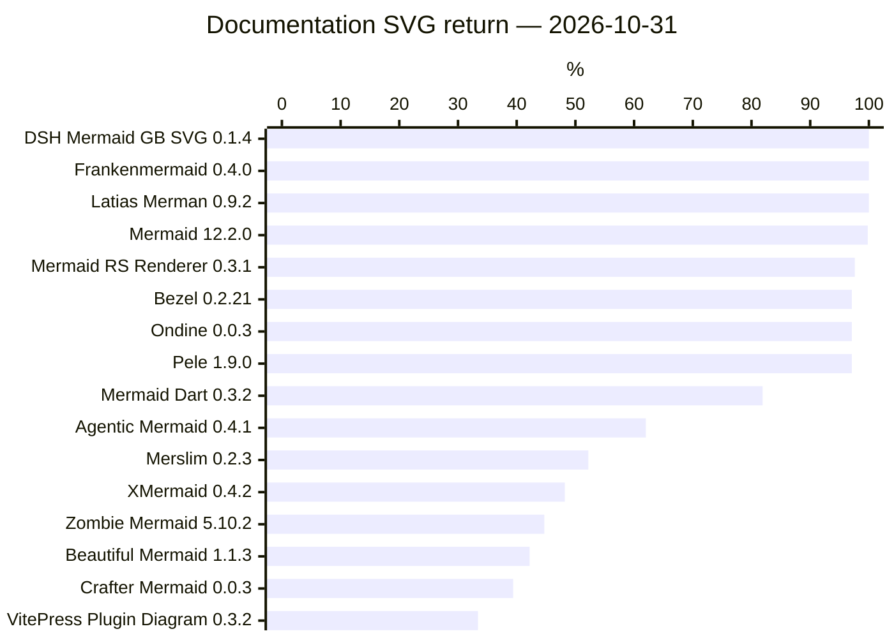
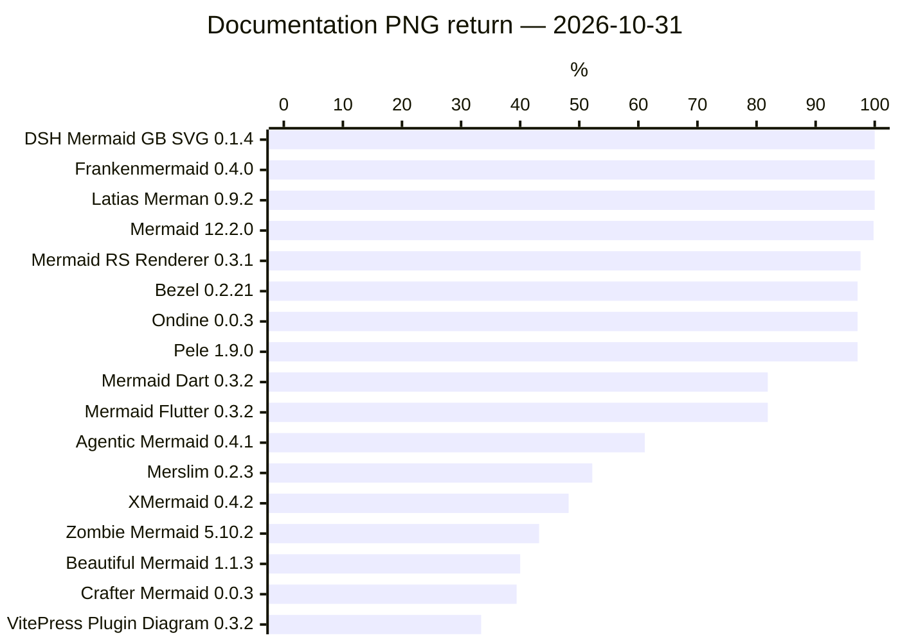

# DaveBench: Documentation Examples · part 1

[Ecosystem overview](../../RESULTS.md) · [All parts](docs.md)

**run-8d55a6fb4a81c18aed400c58** · 2026-10-31 · unit: documentation occurrences · [evidence](https://github.com/adewale/trident/blob/9a74e093893f45d5b1316912711c5314267acd69/evidence/1/report.json)

Corpus: Mermaid syntax documentation at 1fb7869866dd619168d840291c9c54b4f129758b; 548 occurrences, retaining duplicates. SVG output lane. Returned means the occurrence returned SVG in all 1 declared rounds. Failures and unexecuted work retain the full inventory. Output return does not certify drawing content.

Ranked by **Returned in all rounds / Planned**, highest first. Equal values share a rank; unavailable values are unranked. Timing ranks describe the displayed samples and retain their qualification limits.

“Higher” and “Lower” compare **Returned in all rounds** on this population. Unknown evidence remains unresolved. This is a comparison of the named metric, not overall project quality.

| Project | Rank | Version | Returned in all rounds | Failed | Unsupported | Blocked | Unexecuted | Partially observed | Planned | Measured | vs Mermaid | % |
| --- | --- | --- | --- | --- | --- | --- | --- | --- | --- | --- | --- | --- |
| DSH Mermaid GB SVG | 1 | 0.1.4 | 548 | 0 | 0 | 0 | 0 | 0 | 548 | 2026-10-31T08:45:44.095Z | Higher (+1) | 100.0% |
| Frankenmermaid | 1 | 0.4.0 | 548 | 0 | 0 | 0 | 0 | 0 | 548 | 2026-10-31T08:41:10.797Z | Higher (+1) | 100.0% |
| Latias Merman | 1 | 0.9.2 | 548 | 0 | 0 | 0 | 0 | 0 | 548 | 2026-10-31T08:45:35.625Z | Higher (+1) | 100.0% |
| Mermaid | 4 | 12.2.0 | 547 | 1 | 0 | 0 | 0 | 0 | 548 | 2026-10-31T08:46:15.504Z | Baseline | 99.8% |
| Mermaid RS Renderer | 5 | 0.3.1 | 535 | 13 | 0 | 0 | 0 | 0 | 548 | 2026-10-31T08:41:35.831Z | Lower (-12) | 97.6% |
| Bezel | 6 | 0.2.21 | 532 | 16 | 0 | 0 | 0 | 0 | 548 | 2026-10-31T08:46:19.959Z | Lower (-15) | 97.1% |
| Ondine | 6 | 0.0.3 | 532 | 16 | 0 | 0 | 0 | 0 | 548 | 2026-10-31T08:41:13.427Z | Lower (-15) | 97.1% |
| Pele | 6 | 1.9.0 | 532 | 16 | 0 | 0 | 0 | 0 | 548 | 2026-10-31T08:45:41.928Z | Lower (-15) | 97.1% |
| Mermaid Dart | 9 | 0.3.2 | 449 | 99 | 0 | 0 | 0 | 0 | 548 | 2026-10-31T08:41:16.319Z | Lower (-98) | 81.9% |
| Agentic Mermaid | 10 | 0.4.1 | 340 | 208 | 0 | 0 | 0 | 0 | 548 | 2026-10-31T08:41:24.716Z | Lower (-207) | 62.0% |
| Merslim | 11 | 0.2.3 | 286 | 262 | 0 | 0 | 0 | 0 | 548 | 2026-10-31T09:56:21.859Z | Lower (-261) | 52.2% |
| XMermaid | 12 | 0.4.2 | 264 | 284 | 0 | 0 | 0 | 0 | 548 | 2026-10-31T08:45:27.112Z | Lower (-283) | 48.2% |
| Zombie Mermaid | 13 | 5.10.2 | 245 | 303 | 0 | 0 | 0 | 0 | 548 | 2026-10-31T08:41:28.347Z | Lower (-302) | 44.7% |
| Beautiful Mermaid | 14 | 1.1.3 | 231 | 317 | 0 | 0 | 0 | 0 | 548 | 2026-10-31T08:45:38.967Z | Lower (-316) | 42.2% |
| Crafter Mermaid | 15 | 0.0.3 | 216 | 332 | 0 | 0 | 0 | 0 | 548 | 2026-10-31T08:41:38.044Z | Lower (-331) | 39.4% |
| VitePress Plugin Diagram | 16 | 0.3.2 | 183 | 365 | 0 | 0 | 0 | 0 | 548 | 2026-10-31T08:45:28.883Z | Lower (-364) | 33.4% |

**run-7e0d0be33d870c2757fa49b9** · 2026-10-31 · unit: documentation occurrences · [evidence](https://github.com/adewale/trident/blob/9a74e093893f45d5b1316912711c5314267acd69/evidence/1/report.json)

Corpus: the same pinned Mermaid documentation inventory. First-round actual SVG witnesses checked against source expectations. Shared SVG paint/meaning observer. Rank counts verified correct drawings; unknown sources/observers remain visible, and full accuracy and speed are unqualified.

Ranked by **Correct**, highest first. Equal values share a rank; unavailable values are unranked. Timing ranks describe the displayed samples and retain their qualification limits.

“Higher” and “Lower” compare **Correct** on this population. Unknown evidence remains unresolved. This is a comparison of the named metric, not overall project quality.

| Project | Rank | Version | Correct | Incorrect | Unknown | Not a drawing | Planned | Measured | vs Mermaid |
| --- | --- | --- | --- | --- | --- | --- | --- | --- | --- |
| Mermaid | 1 | 12.2.0 | 16 | 0 | 531 | 1 | 548 | 2026-10-31T08:46:15.504Z | Baseline |
| Bezel | 2 | 0.2.21 | 15 | 0 | 532 | 1 | 548 | 2026-10-31T08:46:19.959Z | Lower (-1) |
| Latias Merman | 2 | 0.9.2 | 15 | 1 | 531 | 1 | 548 | 2026-10-31T08:45:35.625Z | Lower (-1) |
| Ondine | 2 | 0.0.3 | 15 | 0 | 532 | 1 | 548 | 2026-10-31T08:41:13.427Z | Lower (-1) |
| Pele | 2 | 1.9.0 | 15 | 0 | 532 | 1 | 548 | 2026-10-31T08:45:41.928Z | Lower (-1) |
| Mermaid Dart | 6 | 0.3.2 | 13 | 1 | 533 | 1 | 548 | 2026-10-31T08:41:16.319Z | Lower (-3) |
| Frankenmermaid | 7 | 0.4.0 | 12 | 3 | 532 | 1 | 548 | 2026-10-31T08:41:10.797Z | Lower (-4) |
| Agentic Mermaid | 8 | 0.4.1 | 11 | 3 | 533 | 1 | 548 | 2026-10-31T08:41:24.716Z | Lower (-5) |
| Zombie Mermaid | 9 | 5.10.2 | 10 | 3 | 534 | 1 | 548 | 2026-10-31T08:41:28.347Z | Lower (-6) |
| Beautiful Mermaid | 10 | 1.1.3 | 7 | 5 | 535 | 1 | 548 | 2026-10-31T08:45:38.967Z | Lower (-9) |
| Crafter Mermaid | 10 | 0.0.3 | 7 | 6 | 534 | 1 | 548 | 2026-10-31T08:41:38.044Z | Lower (-9) |
| XMermaid | 12 | 0.4.2 | 3 | 1 | 543 | 1 | 548 | 2026-10-31T08:45:27.112Z | Lower (-13) |
| DSH Mermaid GB SVG | 13 | 0.1.4 | 2 | 14 | 531 | 1 | 548 | 2026-10-31T08:45:44.095Z | Lower (-14) |
| Mermaid RS Renderer | 14 | 0.3.1 | 0 | 4 | 543 | 1 | 548 | 2026-10-31T08:41:35.831Z | Lower (-16) |
| Merslim | 14 | 0.2.3 | 0 | 3 | 544 | 1 | 548 | 2026-10-31T09:56:21.859Z | Lower (-16) |
| VitePress Plugin Diagram | 14 | 0.3.2 | 0 | 7 | 540 | 1 | 548 | 2026-10-31T08:45:28.883Z | Lower (-16) |

**run-22a4e4549a96ba57423ed301** · 2026-10-31 · unit: reviewed documentation occurrences · [evidence](https://github.com/adewale/trident/blob/9a74e093893f45d5b1316912711c5314267acd69/evidence/1/report.json)

Corpus: reviewed 16-occurrence subset of 548 Mermaid documentation occurrences, bound to exact source hashes; SVG lane. This development-exposed profile ranks verified correct counts and keeps unresolved observations explicit. It supplies no full DaveBench accuracy, holdout or speed claim.

Ranked by **Correct / Planned reviewed**, highest first. Equal values share a rank; unavailable values are unranked. Timing ranks describe the displayed samples and retain their qualification limits.

“Higher” and “Lower” compare **Correct** on this population. Unknown evidence remains unresolved. This is a comparison of the named metric, not overall project quality.

| Project | Rank | Version | Correct | Incorrect | Unknown | Planned reviewed | Measured | vs Mermaid |
| --- | --- | --- | --- | --- | --- | --- | --- | --- |
| Mermaid | 1 | 12.2.0 | 16 | 0 | 0 | 16 | 2026-10-31T08:46:07.611Z | Baseline |
| Bezel | 2 | 0.2.21 | 15 | 0 | 1 | 16 | 2026-10-31T08:46:18.869Z | Lower (-1) |
| Latias Merman | 2 | 0.9.2 | 15 | 1 | 0 | 16 | 2026-10-31T08:45:34.623Z | Lower (-1) |
| Ondine | 2 | 0.0.3 | 15 | 0 | 1 | 16 | 2026-10-31T08:41:13.074Z | Lower (-1) |
| Pele | 2 | 1.9.0 | 15 | 0 | 1 | 16 | 2026-10-31T08:45:41.483Z | Lower (-1) |
| Mermaid Dart | 6 | 0.3.2 | 13 | 1 | 2 | 16 | 2026-10-31T08:41:15.946Z | Lower (-3) |
| Frankenmermaid | 7 | 0.4.0 | 12 | 3 | 1 | 16 | 2026-10-31T08:41:10.316Z | Lower (-4) |
| Agentic Mermaid | 8 | 0.4.1 | 11 | 3 | 2 | 16 | 2026-10-31T08:41:23.617Z | Lower (-5) |
| Zombie Mermaid | 9 | 5.10.2 | 10 | 3 | 3 | 16 | 2026-10-31T08:41:27.995Z | Lower (-6) |
| Beautiful Mermaid | 10 | 1.1.3 | 7 | 5 | 4 | 16 | 2026-10-31T08:45:38.577Z | Lower (-9) |
| Crafter Mermaid | 10 | 0.0.3 | 7 | 6 | 3 | 16 | 2026-10-31T08:41:37.803Z | Lower (-9) |
| XMermaid | 12 | 0.4.2 | 3 | 1 | 12 | 16 | 2026-10-31T08:45:26.846Z | Lower (-13) |
| DSH Mermaid GB SVG | 13 | 0.1.4 | 2 | 14 | 0 | 16 | 2026-10-31T08:45:43.786Z | Lower (-14) |
| Mermaid RS Renderer | 14 | 0.3.1 | 0 | 4 | 12 | 16 | 2026-10-31T08:41:33.205Z | Lower (-16) |
| Merslim | 14 | 0.2.3 | 0 | 3 | 13 | 16 | 2026-10-31T09:56:18.944Z | Lower (-16) |
| VitePress Plugin Diagram | 14 | 0.3.2 | 0 | 7 | 9 | 16 | 2026-10-31T08:45:28.688Z | Lower (-16) |

**run-71503b7aeb3bcf1ae763dc22** · 2026-10-31 · unit: documentation occurrences · [evidence](https://github.com/adewale/trident/blob/9a74e093893f45d5b1316912711c5314267acd69/evidence/1/report.json)

Corpus: Mermaid syntax documentation at 1fb7869866dd619168d840291c9c54b4f129758b; 548 occurrences, retaining duplicates. PNG output lane. Returned means the occurrence returned PNG in all 1 declared rounds. Failures and unexecuted work retain the full inventory. Output return does not certify drawing content.

Ranked by **Returned in all rounds / Planned**, highest first. Equal values share a rank; unavailable values are unranked. Timing ranks describe the displayed samples and retain their qualification limits.

“Higher” and “Lower” compare **Returned in all rounds** on this population. Unknown evidence remains unresolved. This is a comparison of the named metric, not overall project quality.

| Project | Rank | Version | Returned in all rounds | Failed | Unsupported | Blocked | Unexecuted | Partially observed | Planned | Measured | vs Mermaid | % |
| --- | --- | --- | --- | --- | --- | --- | --- | --- | --- | --- | --- | --- |
| DSH Mermaid GB SVG | 1 | 0.1.4 | 548 | 0 | 0 | 0 | 0 | 0 | 548 | 2026-10-31T09:02:18.370Z | Higher (+1) | 100.0% |
| Frankenmermaid | 1 | 0.4.0 | 548 | 0 | 0 | 0 | 0 | 0 | 548 | 2026-10-31T08:52:45.690Z | Higher (+1) | 100.0% |
| Latias Merman | 1 | 0.9.2 | 548 | 0 | 0 | 0 | 0 | 0 | 548 | 2026-10-31T09:41:09.417Z | Higher (+1) | 100.0% |
| Mermaid | 4 | 12.2.0 | 547 | 1 | 0 | 0 | 0 | 0 | 548 | 2026-10-31T08:57:17.896Z | Baseline | 99.8% |
| Mermaid RS Renderer | 5 | 0.3.1 | 535 | 13 | 0 | 0 | 0 | 0 | 548 | 2026-10-31T08:47:07.272Z | Lower (-12) | 97.6% |
| Bezel | 6 | 0.2.21 | 532 | 16 | 0 | 0 | 0 | 0 | 548 | 2026-10-31T08:49:27.092Z | Lower (-15) | 97.1% |
| Ondine | 6 | 0.0.3 | 532 | 16 | 0 | 0 | 0 | 0 | 548 | 2026-10-31T09:03:28.795Z | Lower (-15) | 97.1% |
| Pele | 6 | 1.9.0 | 532 | 16 | 0 | 0 | 0 | 0 | 548 | 2026-10-31T08:58:29.016Z | Lower (-15) | 97.1% |
| Mermaid Dart | 9 | 0.3.2 | 449 | 99 | 0 | 0 | 0 | 0 | 548 | 2026-10-31T08:59:54.810Z | Lower (-98) | 81.9% |
| Mermaid Flutter | 9 | 0.3.2 | 449 | 99 | 0 | 0 | 0 | 0 | 548 | 2026-10-31T09:01:40.231Z | Lower (-98) | 81.9% |
| Agentic Mermaid | 11 | 0.4.1 | 335 | 213 | 0 | 0 | 0 | 0 | 548 | 2026-10-31T08:48:17.153Z | Lower (-212) | 61.1% |
| Merslim | 12 | 0.2.3 | 286 | 262 | 0 | 0 | 0 | 0 | 548 | 2026-10-31T08:53:28.456Z | Lower (-261) | 52.2% |
| XMermaid | 13 | 0.4.2 | 264 | 284 | 0 | 0 | 0 | 0 | 548 | 2026-10-31T08:54:15.276Z | Lower (-283) | 48.2% |
| Zombie Mermaid | 14 | 5.10.2 | 237 | 311 | 0 | 0 | 0 | 0 | 548 | 2026-10-31T08:50:15.462Z | Lower (-310) | 43.2% |
| Beautiful Mermaid | 15 | 1.1.3 | 219 | 329 | 0 | 0 | 0 | 0 | 548 | 2026-10-31T08:54:48.175Z | Lower (-328) | 40.0% |
| Crafter Mermaid | 16 | 0.0.3 | 216 | 332 | 0 | 0 | 0 | 0 | 548 | 2026-10-31T08:49:42.058Z | Lower (-331) | 39.4% |
| VitePress Plugin Diagram | 17 | 0.3.2 | 183 | 365 | 0 | 0 | 0 | 0 | 548 | 2026-10-31T08:54:29.938Z | Lower (-364) | 33.4% |

**run-73d81f009014e474791bed2c** · 2026-10-31 · unit: documentation occurrences · [evidence](https://github.com/adewale/trident/blob/9a74e093893f45d5b1316912711c5314267acd69/evidence/1/report.json)

Corpus: the same pinned Mermaid documentation inventory. First-round actual PNG witnesses checked against source expectations. PNG content reviews bind actual image, source and expected-fact hashes; SVG and nonblank checks supply no raster correctness credit. Rank counts verified correct drawings; unknown sources/observers remain visible, and full accuracy and speed are unqualified.

Ranked by **Correct**, highest first. Equal values share a rank; unavailable values are unranked. Timing ranks describe the displayed samples and retain their qualification limits.

“Higher” and “Lower” compare **Correct** on this population. Unknown evidence remains unresolved. This is a comparison of the named metric, not overall project quality.

| Project | Rank | Version | Correct | Incorrect | Unknown | Not a drawing | Planned | Measured | vs Mermaid |
| --- | --- | --- | --- | --- | --- | --- | --- | --- | --- |
| Bezel | 1 | 0.2.21 | 16 | 0 | 531 | 1 | 548 | 2026-10-31T08:49:27.092Z | Tie |
| Latias Merman | 1 | 0.9.2 | 16 | 0 | 531 | 1 | 548 | 2026-10-31T09:41:09.417Z | Tie |
| Mermaid | 1 | 12.2.0 | 16 | 0 | 531 | 1 | 548 | 2026-10-31T08:57:17.896Z | Baseline |
| Ondine | 1 | 0.0.3 | 16 | 0 | 531 | 1 | 548 | 2026-10-31T09:03:28.795Z | Tie |
| Pele | 1 | 1.9.0 | 16 | 0 | 531 | 1 | 548 | 2026-10-31T08:58:29.016Z | Tie |
| Mermaid Dart | 6 | 0.3.2 | 15 | 1 | 531 | 1 | 548 | 2026-10-31T08:59:54.810Z | Lower (-1) |
| Mermaid Flutter | 6 | 0.3.2 | 15 | 1 | 531 | 1 | 548 | 2026-10-31T09:01:40.231Z | Lower (-1) |
| Frankenmermaid | 8 | 0.4.0 | 13 | 3 | 531 | 1 | 548 | 2026-10-31T08:52:45.690Z | Lower (-3) |
| Agentic Mermaid | 9 | 0.4.1 | 11 | 3 | 533 | 1 | 548 | 2026-10-31T08:48:17.153Z | Lower (-5) |
| Mermaid RS Renderer | 9 | 0.3.1 | 11 | 5 | 531 | 1 | 548 | 2026-10-31T08:47:07.272Z | Lower (-5) |
| Zombie Mermaid | 9 | 5.10.2 | 11 | 1 | 535 | 1 | 548 | 2026-10-31T08:50:15.462Z | Lower (-5) |
| XMermaid | 12 | 0.4.2 | 9 | 2 | 536 | 1 | 548 | 2026-10-31T08:54:15.276Z | Lower (-7) |
| Merslim | 13 | 0.2.3 | 8 | 5 | 534 | 1 | 548 | 2026-10-31T08:53:28.456Z | Lower (-8) |
| Beautiful Mermaid | 14 | 1.1.3 | 7 | 4 | 536 | 1 | 548 | 2026-10-31T08:54:48.175Z | Lower (-9) |
| Crafter Mermaid | 15 | 0.0.3 | 6 | 7 | 534 | 1 | 548 | 2026-10-31T08:49:42.058Z | Lower (-10) |
| DSH Mermaid GB SVG | 16 | 0.1.4 | 4 | 12 | 531 | 1 | 548 | 2026-10-31T09:02:18.370Z | Lower (-12) |
| VitePress Plugin Diagram | 17 | 0.3.2 | 1 | 7 | 539 | 1 | 548 | 2026-10-31T08:54:29.938Z | Lower (-15) |

**run-87c7d06be3ec5a0cad582f61** · 2026-10-31 · unit: reviewed documentation occurrences · [evidence](https://github.com/adewale/trident/blob/9a74e093893f45d5b1316912711c5314267acd69/evidence/1/report.json)

Corpus: reviewed 16-occurrence subset of 548 Mermaid documentation occurrences, bound to exact source hashes; PNG lane. This development-exposed profile ranks verified correct counts and keeps unresolved observations explicit. It supplies no full DaveBench accuracy, holdout or speed claim.

Ranked by **Correct / Planned reviewed**, highest first. Equal values share a rank; unavailable values are unranked. Timing ranks describe the displayed samples and retain their qualification limits.

“Higher” and “Lower” compare **Correct** on this population. Unknown evidence remains unresolved. This is a comparison of the named metric, not overall project quality.

| Project | Rank | Version | Correct | Incorrect | Unknown | Planned reviewed | Measured | vs Mermaid |
| --- | --- | --- | --- | --- | --- | --- | --- | --- |
| Bezel | 1 | 0.2.21 | 16 | 0 | 0 | 16 | 2026-10-31T08:49:07.186Z | Tie |
| Latias Merman | 1 | 0.9.2 | 16 | 0 | 0 | 16 | 2026-10-31T09:40:45.358Z | Tie |
| Mermaid | 1 | 12.2.0 | 16 | 0 | 0 | 16 | 2026-10-31T08:56:33.867Z | Baseline |
| Ondine | 1 | 0.0.3 | 16 | 0 | 0 | 16 | 2026-10-31T09:03:05.667Z | Tie |
| Pele | 1 | 1.9.0 | 16 | 0 | 0 | 16 | 2026-10-31T08:58:05.465Z | Tie |
| Mermaid Dart | 6 | 0.3.2 | 15 | 1 | 0 | 16 | 2026-10-31T08:59:37.784Z | Lower (-1) |
| Mermaid Flutter | 6 | 0.3.2 | 15 | 1 | 0 | 16 | 2026-10-31T09:01:36.559Z | Lower (-1) |
| Frankenmermaid | 8 | 0.4.0 | 13 | 3 | 0 | 16 | 2026-10-31T08:52:02.823Z | Lower (-3) |
| Agentic Mermaid | 9 | 0.4.1 | 11 | 3 | 2 | 16 | 2026-10-31T08:48:12.663Z | Lower (-5) |
| Mermaid RS Renderer | 9 | 0.3.1 | 11 | 5 | 0 | 16 | 2026-10-31T08:47:02.466Z | Lower (-5) |
| Zombie Mermaid | 9 | 5.10.2 | 11 | 1 | 4 | 16 | 2026-10-31T08:50:12.754Z | Lower (-5) |
| XMermaid | 12 | 0.4.2 | 9 | 2 | 5 | 16 | 2026-10-31T08:54:07.922Z | Lower (-7) |
| Merslim | 13 | 0.2.3 | 8 | 5 | 3 | 16 | 2026-10-31T08:53:21.531Z | Lower (-8) |
| Beautiful Mermaid | 14 | 1.1.3 | 7 | 4 | 5 | 16 | 2026-10-31T08:54:45.143Z | Lower (-9) |
| Crafter Mermaid | 15 | 0.0.3 | 6 | 7 | 3 | 16 | 2026-10-31T08:49:40.606Z | Lower (-10) |
| DSH Mermaid GB SVG | 16 | 0.1.4 | 4 | 12 | 0 | 16 | 2026-10-31T09:02:06.668Z | Lower (-12) |
| VitePress Plugin Diagram | 17 | 0.3.2 | 1 | 7 | 8 | 16 | 2026-10-31T08:54:29.717Z | Lower (-15) |

### Kitlangton Merman: DaveBench: Documentation Examples (core)

Campaign invocation: 2026-10-31T08:41:04.951Z → 2026-10-31T10:06:52.125Z · **not-applicable** · [evidence](https://github.com/adewale/trident/blob/9a74e093893f45d5b1316912711c5314267acd69/evidence/1/report.json) · [owning results and failures](https://github.com/adewale/trident/blob/9a74e093893f45d5b1316912711c5314267acd69/evidence/1/docs/)

emtyty/merslim round 1: Error: Browser call exceeded its declared host deadline; SVG return and reviewed drawing content are separate results. First-round SVG witnesses are retained; missing source reviews and incomplete observers remain unknown. Timings are descriptive public return samples, without A/A or per-call semantic qualification; no speed ranking is supported.; PNG return/decode and reviewed source-content are separate. Native PNG needs no SVG. SVG conversion, native API and CLI clocks retain different boundaries; no qualified speed ranking.; Campaign process status: failed; Recorded observation dispositions; process completion does not establish benchmark qualification.

| Version / artifact role | Interface / runtime | Format / operation | Mode / round | Distinct case IDs | Passed observations | Failed | Unsupported | Blocked | Other dispositions | Recorded observations |
| --- | --- | --- | --- | --- | --- | --- | --- | --- | --- | --- |
| 0.2.1 / default | declared-capability / not-invoked | svg / format-admission | format-not-applicable / not round-based | 1 | 0 | 0 | 0 | 0 | {"not-applicable":1} | 1 |
| 0.2.1 / default | declared-capability / not-invoked | png / format-admission | format-not-applicable / not round-based | 1 | 0 | 0 | 0 | 0 | {"not-applicable":1} | 1 |

### Mermaid Flutter: DaveBench: Documentation Examples (core)

Campaign invocation: 2026-10-31T08:41:04.951Z → 2026-10-31T10:06:52.125Z · **failed** · [evidence](https://github.com/adewale/trident/blob/9a74e093893f45d5b1316912711c5314267acd69/evidence/1/report.json) · [owning results and failures](https://github.com/adewale/trident/blob/9a74e093893f45d5b1316912711c5314267acd69/evidence/1/docs/)

emtyty/merslim round 1: Error: Browser call exceeded its declared host deadline; SVG return and reviewed drawing content are separate results. First-round SVG witnesses are retained; missing source reviews and incomplete observers remain unknown. Timings are descriptive public return samples, without A/A or per-call semantic qualification; no speed ranking is supported.; PNG return/decode and reviewed source-content are separate. Native PNG needs no SVG. SVG conversion, native API and CLI clocks retain different boundaries; no qualified speed ranking.; Campaign process status: failed; Recorded observation dispositions; process completion does not establish benchmark qualification.

| Version / artifact role | Interface / runtime | Format / operation | Mode / round | Distinct case IDs | Passed observations | Failed | Unsupported | Blocked | Other dispositions | Recorded observations |
| --- | --- | --- | --- | --- | --- | --- | --- | --- | --- | --- |
| 0.3.2 / default | declared-capability / not-invoked | svg / format-admission | format-not-applicable / not round-based | 1 | 0 | 0 | 0 | 0 | {"not-applicable":1} | 1 |
| 0.3.2 / default | png:reviewed-content / retained PNG | png / drawing-checks | reviewed-first-round-output / 1 | 548 | 15 | 1 | 0 | 531 | {"not-applicable":1} | 548 |
| 0.3.2 / default | public:png / see retained transport observations | png / render | one-public-output-call / 1 | 548 | 449 | 99 | 0 | 0 | {} | 548 |

### Agentic Mermaid: DaveBench: Documentation Examples (core)

Campaign invocation: 2026-10-31T08:41:04.951Z → 2026-10-31T10:06:52.125Z · **failed** · [evidence](https://github.com/adewale/trident/blob/9a74e093893f45d5b1316912711c5314267acd69/evidence/1/report.json) · [owning results and failures](https://github.com/adewale/trident/blob/9a74e093893f45d5b1316912711c5314267acd69/evidence/1/docs/)

emtyty/merslim round 1: Error: Browser call exceeded its declared host deadline; SVG return and reviewed drawing content are separate results. First-round SVG witnesses are retained; missing source reviews and incomplete observers remain unknown. Timings are descriptive public return samples, without A/A or per-call semantic qualification; no speed ranking is supported.; PNG return/decode and reviewed source-content are separate. Native PNG needs no SVG. SVG conversion, native API and CLI clocks retain different boundaries; no qualified speed ranking.; Campaign process status: failed; Recorded observation dispositions; process completion does not establish benchmark qualification.

| Version / artifact role | Interface / runtime | Format / operation | Mode / round | Distinct case IDs | Passed observations | Failed | Unsupported | Blocked | Other dispositions | Recorded observations |
| --- | --- | --- | --- | --- | --- | --- | --- | --- | --- | --- |
| 0.4.1 / default | browser:svg / Chromium | svg / render | one-public-call / 1 | 548 | 340 | 208 | 0 | 0 | {} | 548 |
| 0.4.1 / default | browser:svg / Chromium | svg / drawing-checks | reviewed-first-round-output / 1 | 548 | 11 | 3 | 0 | 533 | {"not-applicable":1} | 548 |
| 0.4.1 / default | png:reviewed-content / retained PNG | png / drawing-checks | reviewed-first-round-output / 1 | 548 | 11 | 3 | 0 | 533 | {"not-applicable":1} | 548 |
| 0.4.1 / default | public:png / see retained transport observations | png / render | one-public-output-call / 1 | 548 | 335 | 213 | 0 | 0 | {} | 548 |

### Loom renderer: DaveBench: Documentation Examples (core)

Campaign invocation: 2026-10-31T08:41:04.951Z → 2026-10-31T10:06:52.125Z · **not-applicable** · [evidence](https://github.com/adewale/trident/blob/9a74e093893f45d5b1316912711c5314267acd69/evidence/1/report.json) · [owning results and failures](https://github.com/adewale/trident/blob/9a74e093893f45d5b1316912711c5314267acd69/evidence/1/docs/)

emtyty/merslim round 1: Error: Browser call exceeded its declared host deadline; SVG return and reviewed drawing content are separate results. First-round SVG witnesses are retained; missing source reviews and incomplete observers remain unknown. Timings are descriptive public return samples, without A/A or per-call semantic qualification; no speed ranking is supported.; PNG return/decode and reviewed source-content are separate. Native PNG needs no SVG. SVG conversion, native API and CLI clocks retain different boundaries; no qualified speed ranking.; Campaign process status: failed; Recorded observation dispositions; process completion does not establish benchmark qualification.

| Version / artifact role | Interface / runtime | Format / operation | Mode / round | Distinct case IDs | Passed observations | Failed | Unsupported | Blocked | Other dispositions | Recorded observations |
| --- | --- | --- | --- | --- | --- | --- | --- | --- | --- | --- |
| 0.10.0 / default | declared-capability / not-invoked | svg / format-admission | format-not-applicable / not round-based | 1 | 0 | 0 | 0 | 0 | {"not-applicable":1} | 1 |
| 0.10.0 / default | declared-capability / not-invoked | png / format-admission | format-not-applicable / not round-based | 1 | 0 | 0 | 0 | 0 | {"not-applicable":1} | 1 |

### Merslim: DaveBench: Documentation Examples (core)

Campaign invocation: 2026-10-31T08:41:04.951Z → 2026-10-31T10:06:52.125Z · **failed** · [evidence](https://github.com/adewale/trident/blob/9a74e093893f45d5b1316912711c5314267acd69/evidence/1/report.json) · [owning results and failures](https://github.com/adewale/trident/blob/9a74e093893f45d5b1316912711c5314267acd69/evidence/1/docs/)

emtyty/merslim round 1: Error: Browser call exceeded its declared host deadline; SVG return and reviewed drawing content are separate results. First-round SVG witnesses are retained; missing source reviews and incomplete observers remain unknown. Timings are descriptive public return samples, without A/A or per-call semantic qualification; no speed ranking is supported.; PNG return/decode and reviewed source-content are separate. Native PNG needs no SVG. SVG conversion, native API and CLI clocks retain different boundaries; no qualified speed ranking.; Campaign process status: failed; Recorded observation dispositions; process completion does not establish benchmark qualification.

| Version / artifact role | Interface / runtime | Format / operation | Mode / round | Distinct case IDs | Passed observations | Failed | Unsupported | Blocked | Other dispositions | Recorded observations |
| --- | --- | --- | --- | --- | --- | --- | --- | --- | --- | --- |
| 0.2.3 / default | browser:png-export / Chromium | png / render | one-public-output-call / 1 | 548 | 286 | 262 | 0 | 0 | {} | 548 |
| 0.2.3 / default | browser:svg / Chromium | svg / render | one-public-call / 1 | 548 | 286 | 262 | 0 | 0 | {} | 548 |
| 0.2.3 / default | browser:svg / Chromium | svg / drawing-checks | reviewed-first-round-output / 1 | 548 | 0 | 3 | 0 | 544 | {"not-applicable":1} | 548 |
| 0.2.3 / default | png:reviewed-content / retained PNG | png / drawing-checks | reviewed-first-round-output / 1 | 548 | 8 | 5 | 0 | 534 | {"not-applicable":1} | 548 |

### Ondine: DaveBench: Documentation Examples (core)

Campaign invocation: 2026-10-31T08:41:04.951Z → 2026-10-31T10:06:52.125Z · **failed** · [evidence](https://github.com/adewale/trident/blob/9a74e093893f45d5b1316912711c5314267acd69/evidence/1/report.json) · [owning results and failures](https://github.com/adewale/trident/blob/9a74e093893f45d5b1316912711c5314267acd69/evidence/1/docs/)

emtyty/merslim round 1: Error: Browser call exceeded its declared host deadline; SVG return and reviewed drawing content are separate results. First-round SVG witnesses are retained; missing source reviews and incomplete observers remain unknown. Timings are descriptive public return samples, without A/A or per-call semantic qualification; no speed ranking is supported.; PNG return/decode and reviewed source-content are separate. Native PNG needs no SVG. SVG conversion, native API and CLI clocks retain different boundaries; no qualified speed ranking.; Campaign process status: failed; Recorded observation dispositions; process completion does not establish benchmark qualification.

| Version / artifact role | Interface / runtime | Format / operation | Mode / round | Distinct case IDs | Passed observations | Failed | Unsupported | Blocked | Other dispositions | Recorded observations |
| --- | --- | --- | --- | --- | --- | --- | --- | --- | --- | --- |
| 0.0.3 / default | browser:png-export / Chromium | png / render | one-public-output-call / 1 | 548 | 532 | 16 | 0 | 0 | {} | 548 |
| 0.0.3 / default | browser:svg / Chromium | svg / render | one-public-call / 1 | 548 | 532 | 16 | 0 | 0 | {} | 548 |
| 0.0.3 / default | browser:svg / Chromium | svg / drawing-checks | reviewed-first-round-output / 1 | 548 | 15 | 0 | 0 | 532 | {"not-applicable":1} | 548 |
| 0.0.3 / default | png:reviewed-content / retained PNG | png / drawing-checks | reviewed-first-round-output / 1 | 548 | 16 | 0 | 0 | 531 | {"not-applicable":1} | 548 |

### XMermaid: DaveBench: Documentation Examples (core)

Campaign invocation: 2026-10-31T08:41:04.951Z → 2026-10-31T10:06:52.125Z · **failed** · [evidence](https://github.com/adewale/trident/blob/9a74e093893f45d5b1316912711c5314267acd69/evidence/1/report.json) · [owning results and failures](https://github.com/adewale/trident/blob/9a74e093893f45d5b1316912711c5314267acd69/evidence/1/docs/)

emtyty/merslim round 1: Error: Browser call exceeded its declared host deadline; SVG return and reviewed drawing content are separate results. First-round SVG witnesses are retained; missing source reviews and incomplete observers remain unknown. Timings are descriptive public return samples, without A/A or per-call semantic qualification; no speed ranking is supported.; PNG return/decode and reviewed source-content are separate. Native PNG needs no SVG. SVG conversion, native API and CLI clocks retain different boundaries; no qualified speed ranking.; Campaign process status: failed; Recorded observation dispositions; process completion does not establish benchmark qualification.

| Version / artifact role | Interface / runtime | Format / operation | Mode / round | Distinct case IDs | Passed observations | Failed | Unsupported | Blocked | Other dispositions | Recorded observations |
| --- | --- | --- | --- | --- | --- | --- | --- | --- | --- | --- |
| 0.4.2 / default | browser:png-export / Chromium | png / render | one-public-output-call / 1 | 548 | 264 | 284 | 0 | 0 | {} | 548 |
| 0.4.2 / default | browser:svg / Chromium | svg / render | one-public-call / 1 | 548 | 264 | 284 | 0 | 0 | {} | 548 |
| 0.4.2 / default | browser:svg / Chromium | svg / drawing-checks | reviewed-first-round-output / 1 | 548 | 3 | 1 | 0 | 543 | {"not-applicable":1} | 548 |
| 0.4.2 / default | png:reviewed-content / retained PNG | png / drawing-checks | reviewed-first-round-output / 1 | 548 | 9 | 2 | 0 | 536 | {"not-applicable":1} | 548 |

### DSH Mermaid GB SVG: DaveBench: Documentation Examples (core)

Campaign invocation: 2026-10-31T08:41:04.951Z → 2026-10-31T10:06:52.125Z · **failed** · [evidence](https://github.com/adewale/trident/blob/9a74e093893f45d5b1316912711c5314267acd69/evidence/1/report.json) · [owning results and failures](https://github.com/adewale/trident/blob/9a74e093893f45d5b1316912711c5314267acd69/evidence/1/docs/)

emtyty/merslim round 1: Error: Browser call exceeded its declared host deadline; SVG return and reviewed drawing content are separate results. First-round SVG witnesses are retained; missing source reviews and incomplete observers remain unknown. Timings are descriptive public return samples, without A/A or per-call semantic qualification; no speed ranking is supported.; PNG return/decode and reviewed source-content are separate. Native PNG needs no SVG. SVG conversion, native API and CLI clocks retain different boundaries; no qualified speed ranking.; Campaign process status: failed; Recorded observation dispositions; process completion does not establish benchmark qualification.

| Version / artifact role | Interface / runtime | Format / operation | Mode / round | Distinct case IDs | Passed observations | Failed | Unsupported | Blocked | Other dispositions | Recorded observations |
| --- | --- | --- | --- | --- | --- | --- | --- | --- | --- | --- |
| 0.1.4 / default | browser:png-export / Chromium | png / render | one-public-output-call / 1 | 548 | 548 | 0 | 0 | 0 | {} | 548 |
| 0.1.4 / default | browser:svg / Chromium | svg / render | one-public-call / 1 | 548 | 548 | 0 | 0 | 0 | {} | 548 |
| 0.1.4 / default | browser:svg / Chromium | svg / drawing-checks | reviewed-first-round-output / 1 | 548 | 2 | 14 | 0 | 531 | {"not-applicable":1} | 548 |
| 0.1.4 / default | png:reviewed-content / retained PNG | png / drawing-checks | reviewed-first-round-output / 1 | 548 | 4 | 12 | 0 | 531 | {"not-applicable":1} | 548 |

### Frankenmermaid: DaveBench: Documentation Examples (core)

Campaign invocation: 2026-10-31T08:41:04.951Z → 2026-10-31T10:06:52.125Z · **failed** · [evidence](https://github.com/adewale/trident/blob/9a74e093893f45d5b1316912711c5314267acd69/evidence/1/report.json) · [owning results and failures](https://github.com/adewale/trident/blob/9a74e093893f45d5b1316912711c5314267acd69/evidence/1/docs/)

emtyty/merslim round 1: Error: Browser call exceeded its declared host deadline; SVG return and reviewed drawing content are separate results. First-round SVG witnesses are retained; missing source reviews and incomplete observers remain unknown. Timings are descriptive public return samples, without A/A or per-call semantic qualification; no speed ranking is supported.; PNG return/decode and reviewed source-content are separate. Native PNG needs no SVG. SVG conversion, native API and CLI clocks retain different boundaries; no qualified speed ranking.; Campaign process status: failed; Recorded observation dispositions; process completion does not establish benchmark qualification.

| Version / artifact role | Interface / runtime | Format / operation | Mode / round | Distinct case IDs | Passed observations | Failed | Unsupported | Blocked | Other dispositions | Recorded observations |
| --- | --- | --- | --- | --- | --- | --- | --- | --- | --- | --- |
| 0.4.0 / default | browser:png-export / Chromium | png / render | one-public-output-call / 1 | 548 | 548 | 0 | 0 | 0 | {} | 548 |
| 0.4.0 / default | browser:svg / Chromium | svg / render | one-public-call / 1 | 548 | 548 | 0 | 0 | 0 | {} | 548 |
| 0.4.0 / default | browser:svg / Chromium | svg / drawing-checks | reviewed-first-round-output / 1 | 548 | 12 | 3 | 0 | 532 | {"not-applicable":1} | 548 |
| 0.4.0 / default | png:reviewed-content / retained PNG | png / drawing-checks | reviewed-first-round-output / 1 | 548 | 13 | 3 | 0 | 531 | {"not-applicable":1} | 548 |

### OpenCode Merman: DaveBench: Documentation Examples (core)

Campaign invocation: 2026-10-31T08:41:04.951Z → 2026-10-31T10:06:52.125Z · **not-applicable** · [evidence](https://github.com/adewale/trident/blob/9a74e093893f45d5b1316912711c5314267acd69/evidence/1/report.json) · [owning results and failures](https://github.com/adewale/trident/blob/9a74e093893f45d5b1316912711c5314267acd69/evidence/1/docs/)

emtyty/merslim round 1: Error: Browser call exceeded its declared host deadline; SVG return and reviewed drawing content are separate results. First-round SVG witnesses are retained; missing source reviews and incomplete observers remain unknown. Timings are descriptive public return samples, without A/A or per-call semantic qualification; no speed ranking is supported.; PNG return/decode and reviewed source-content are separate. Native PNG needs no SVG. SVG conversion, native API and CLI clocks retain different boundaries; no qualified speed ranking.; Campaign process status: failed; Recorded observation dispositions; process completion does not establish benchmark qualification.

| Version / artifact role | Interface / runtime | Format / operation | Mode / round | Distinct case IDs | Passed observations | Failed | Unsupported | Blocked | Other dispositions | Recorded observations |
| --- | --- | --- | --- | --- | --- | --- | --- | --- | --- | --- |
| 2.0.26 / default | declared-capability / not-invoked | svg / format-admission | format-not-applicable / not round-based | 1 | 0 | 0 | 0 | 0 | {"not-applicable":1} | 1 |
| 2.0.26 / default | declared-capability / not-invoked | png / format-admission | format-not-applicable / not round-based | 1 | 0 | 0 | 0 | 0 | {"not-applicable":1} | 1 |

### Figurehead: DaveBench: Documentation Examples (core)

Campaign invocation: 2026-10-31T08:41:04.951Z → 2026-10-31T10:06:52.125Z · **not-applicable** · [evidence](https://github.com/adewale/trident/blob/9a74e093893f45d5b1316912711c5314267acd69/evidence/1/report.json) · [owning results and failures](https://github.com/adewale/trident/blob/9a74e093893f45d5b1316912711c5314267acd69/evidence/1/docs/)

emtyty/merslim round 1: Error: Browser call exceeded its declared host deadline; SVG return and reviewed drawing content are separate results. First-round SVG witnesses are retained; missing source reviews and incomplete observers remain unknown. Timings are descriptive public return samples, without A/A or per-call semantic qualification; no speed ranking is supported.; PNG return/decode and reviewed source-content are separate. Native PNG needs no SVG. SVG conversion, native API and CLI clocks retain different boundaries; no qualified speed ranking.; Campaign process status: failed; Recorded observation dispositions; process completion does not establish benchmark qualification.

| Version / artifact role | Interface / runtime | Format / operation | Mode / round | Distinct case IDs | Passed observations | Failed | Unsupported | Blocked | Other dispositions | Recorded observations |
| --- | --- | --- | --- | --- | --- | --- | --- | --- | --- | --- |
| v0.4.3 / default | declared-capability / not-invoked | svg / format-admission | format-not-applicable / not round-based | 1 | 0 | 0 | 0 | 0 | {"not-applicable":1} | 1 |
| v0.4.3 / default | declared-capability / not-invoked | png / format-admission | format-not-applicable / not round-based | 1 | 0 | 0 | 0 | 0 | {"not-applicable":1} | 1 |

### VitePress Plugin Diagram: DaveBench: Documentation Examples (core)

Campaign invocation: 2026-10-31T08:41:04.951Z → 2026-10-31T10:06:52.125Z · **failed** · [evidence](https://github.com/adewale/trident/blob/9a74e093893f45d5b1316912711c5314267acd69/evidence/1/report.json) · [owning results and failures](https://github.com/adewale/trident/blob/9a74e093893f45d5b1316912711c5314267acd69/evidence/1/docs/)

emtyty/merslim round 1: Error: Browser call exceeded its declared host deadline; SVG return and reviewed drawing content are separate results. First-round SVG witnesses are retained; missing source reviews and incomplete observers remain unknown. Timings are descriptive public return samples, without A/A or per-call semantic qualification; no speed ranking is supported.; PNG return/decode and reviewed source-content are separate. Native PNG needs no SVG. SVG conversion, native API and CLI clocks retain different boundaries; no qualified speed ranking.; Campaign process status: failed; Recorded observation dispositions; process completion does not establish benchmark qualification.

| Version / artifact role | Interface / runtime | Format / operation | Mode / round | Distinct case IDs | Passed observations | Failed | Unsupported | Blocked | Other dispositions | Recorded observations |
| --- | --- | --- | --- | --- | --- | --- | --- | --- | --- | --- |
| 0.3.2 / default | browser:png-export / Chromium | png / render | one-public-output-call / 1 | 548 | 183 | 365 | 0 | 0 | {} | 548 |
| 0.3.2 / default | browser:svg / Chromium | svg / render | one-public-call / 1 | 548 | 183 | 365 | 0 | 0 | {} | 548 |
| 0.3.2 / default | browser:svg / Chromium | svg / drawing-checks | reviewed-first-round-output / 1 | 548 | 0 | 7 | 0 | 540 | {"not-applicable":1} | 548 |
| 0.3.2 / default | png:reviewed-content / retained PNG | png / drawing-checks | reviewed-first-round-output / 1 | 548 | 1 | 7 | 0 | 539 | {"not-applicable":1} | 548 |

### MermaidTUI: DaveBench: Documentation Examples (core)

Campaign invocation: 2026-10-31T08:41:04.951Z → 2026-10-31T10:06:52.125Z · **not-applicable** · [evidence](https://github.com/adewale/trident/blob/9a74e093893f45d5b1316912711c5314267acd69/evidence/1/report.json) · [owning results and failures](https://github.com/adewale/trident/blob/9a74e093893f45d5b1316912711c5314267acd69/evidence/1/docs/)

emtyty/merslim round 1: Error: Browser call exceeded its declared host deadline; SVG return and reviewed drawing content are separate results. First-round SVG witnesses are retained; missing source reviews and incomplete observers remain unknown. Timings are descriptive public return samples, without A/A or per-call semantic qualification; no speed ranking is supported.; PNG return/decode and reviewed source-content are separate. Native PNG needs no SVG. SVG conversion, native API and CLI clocks retain different boundaries; no qualified speed ranking.; Campaign process status: failed; Recorded observation dispositions; process completion does not establish benchmark qualification.

| Version / artifact role | Interface / runtime | Format / operation | Mode / round | Distinct case IDs | Passed observations | Failed | Unsupported | Blocked | Other dispositions | Recorded observations |
| --- | --- | --- | --- | --- | --- | --- | --- | --- | --- | --- |
| 0.0.6 / default | declared-capability / not-invoked | svg / format-admission | format-not-applicable / not round-based | 1 | 0 | 0 | 0 | 0 | {"not-applicable":1} | 1 |
| 0.0.6 / default | declared-capability / not-invoked | png / format-admission | format-not-applicable / not round-based | 1 | 0 | 0 | 0 | 0 | {"not-applicable":1} | 1 |

### Mermaid: DaveBench: Documentation Examples (core)

Campaign invocation: 2026-10-31T08:41:04.951Z → 2026-10-31T10:06:52.125Z · **failed** · [evidence](https://github.com/adewale/trident/blob/9a74e093893f45d5b1316912711c5314267acd69/evidence/1/report.json) · [owning results and failures](https://github.com/adewale/trident/blob/9a74e093893f45d5b1316912711c5314267acd69/evidence/1/docs/)

emtyty/merslim round 1: Error: Browser call exceeded its declared host deadline; SVG return and reviewed drawing content are separate results. First-round SVG witnesses are retained; missing source reviews and incomplete observers remain unknown. Timings are descriptive public return samples, without A/A or per-call semantic qualification; no speed ranking is supported.; PNG return/decode and reviewed source-content are separate. Native PNG needs no SVG. SVG conversion, native API and CLI clocks retain different boundaries; no qualified speed ranking.; Campaign process status: failed; Recorded observation dispositions; process completion does not establish benchmark qualification.

| Version / artifact role | Interface / runtime | Format / operation | Mode / round | Distinct case IDs | Passed observations | Failed | Unsupported | Blocked | Other dispositions | Recorded observations |
| --- | --- | --- | --- | --- | --- | --- | --- | --- | --- | --- |
| 12.2.0 / default | browser:png-export / Chromium | png / render | one-public-output-call / 1 | 548 | 547 | 1 | 0 | 0 | {} | 548 |
| 12.2.0 / default | browser:svg / Chromium | svg / render | one-public-call / 1 | 548 | 547 | 1 | 0 | 0 | {} | 548 |
| 12.2.0 / default | browser:svg / Chromium | svg / drawing-checks | reviewed-first-round-output / 1 | 548 | 16 | 0 | 0 | 531 | {"not-applicable":1} | 548 |
| 12.2.0 / default | png:reviewed-content / retained PNG | png / drawing-checks | reviewed-first-round-output / 1 | 548 | 16 | 0 | 0 | 531 | {"not-applicable":1} | 548 |

### Grok renderer: DaveBench: Documentation Examples (core)

Campaign invocation: 2026-10-31T08:41:04.951Z → 2026-10-31T10:06:52.125Z · **not-applicable** · [evidence](https://github.com/adewale/trident/blob/9a74e093893f45d5b1316912711c5314267acd69/evidence/1/report.json) · [owning results and failures](https://github.com/adewale/trident/blob/9a74e093893f45d5b1316912711c5314267acd69/evidence/1/docs/)

emtyty/merslim round 1: Error: Browser call exceeded its declared host deadline; SVG return and reviewed drawing content are separate results. First-round SVG witnesses are retained; missing source reviews and incomplete observers remain unknown. Timings are descriptive public return samples, without A/A or per-call semantic qualification; no speed ranking is supported.; PNG return/decode and reviewed source-content are separate. Native PNG needs no SVG. SVG conversion, native API and CLI clocks retain different boundaries; no qualified speed ranking.; Campaign process status: failed; Recorded observation dispositions; process completion does not establish benchmark qualification.

| Version / artifact role | Interface / runtime | Format / operation | Mode / round | Distinct case IDs | Passed observations | Failed | Unsupported | Blocked | Other dispositions | Recorded observations |
| --- | --- | --- | --- | --- | --- | --- | --- | --- | --- | --- |
| git-2bdd1d6a6369 / default | declared-capability / not-invoked | svg / format-admission | format-not-applicable / not round-based | 1 | 0 | 0 | 0 | 0 | {"not-applicable":1} | 1 |
| git-2bdd1d6a6369 / default | declared-capability / not-invoked | png / format-admission | format-not-applicable / not round-based | 1 | 0 | 0 | 0 | 0 | {"not-applicable":1} | 1 |

### MermaidText: DaveBench: Documentation Examples (core)

Campaign invocation: 2026-10-31T08:41:04.951Z → 2026-10-31T10:06:52.125Z · **not-applicable** · [evidence](https://github.com/adewale/trident/blob/9a74e093893f45d5b1316912711c5314267acd69/evidence/1/report.json) · [owning results and failures](https://github.com/adewale/trident/blob/9a74e093893f45d5b1316912711c5314267acd69/evidence/1/docs/)

emtyty/merslim round 1: Error: Browser call exceeded its declared host deadline; SVG return and reviewed drawing content are separate results. First-round SVG witnesses are retained; missing source reviews and incomplete observers remain unknown. Timings are descriptive public return samples, without A/A or per-call semantic qualification; no speed ranking is supported.; PNG return/decode and reviewed source-content are separate. Native PNG needs no SVG. SVG conversion, native API and CLI clocks retain different boundaries; no qualified speed ranking.; Campaign process status: failed; Recorded observation dispositions; process completion does not establish benchmark qualification.

| Version / artifact role | Interface / runtime | Format / operation | Mode / round | Distinct case IDs | Passed observations | Failed | Unsupported | Blocked | Other dispositions | Recorded observations |
| --- | --- | --- | --- | --- | --- | --- | --- | --- | --- | --- |
| git-a6b0c7657b94 / default | declared-capability / not-invoked | svg / format-admission | format-not-applicable / not round-based | 1 | 0 | 0 | 0 | 0 | {"not-applicable":1} | 1 |
| git-a6b0c7657b94 / default | declared-capability / not-invoked | png / format-admission | format-not-applicable / not round-based | 1 | 0 | 0 | 0 | 0 | {"not-applicable":1} | 1 |

### Mermaid Dart: DaveBench: Documentation Examples (core)

Campaign invocation: 2026-10-31T08:41:04.951Z → 2026-10-31T10:06:52.125Z · **failed** · [evidence](https://github.com/adewale/trident/blob/9a74e093893f45d5b1316912711c5314267acd69/evidence/1/report.json) · [owning results and failures](https://github.com/adewale/trident/blob/9a74e093893f45d5b1316912711c5314267acd69/evidence/1/docs/)

emtyty/merslim round 1: Error: Browser call exceeded its declared host deadline; SVG return and reviewed drawing content are separate results. First-round SVG witnesses are retained; missing source reviews and incomplete observers remain unknown. Timings are descriptive public return samples, without A/A or per-call semantic qualification; no speed ranking is supported.; PNG return/decode and reviewed source-content are separate. Native PNG needs no SVG. SVG conversion, native API and CLI clocks retain different boundaries; no qualified speed ranking.; Campaign process status: failed; Recorded observation dispositions; process completion does not establish benchmark qualification.

| Version / artifact role | Interface / runtime | Format / operation | Mode / round | Distinct case IDs | Passed observations | Failed | Unsupported | Blocked | Other dispositions | Recorded observations |
| --- | --- | --- | --- | --- | --- | --- | --- | --- | --- | --- |
| 0.3.2 / default | browser:png-export / Chromium | png / render | one-public-output-call / 1 | 548 | 449 | 99 | 0 | 0 | {} | 548 |
| 0.3.2 / default | browser:svg / Chromium | svg / render | one-public-call / 1 | 548 | 449 | 99 | 0 | 0 | {} | 548 |
| 0.3.2 / default | browser:svg / Chromium | svg / drawing-checks | reviewed-first-round-output / 1 | 548 | 13 | 1 | 0 | 533 | {"not-applicable":1} | 548 |
| 0.3.2 / default | png:reviewed-content / retained PNG | png / drawing-checks | reviewed-first-round-output / 1 | 548 | 15 | 1 | 0 | 531 | {"not-applicable":1} | 548 |

### Beautiful Mermaid: DaveBench: Documentation Examples (core)

Campaign invocation: 2026-10-31T08:41:04.951Z → 2026-10-31T10:06:52.125Z · **failed** · [evidence](https://github.com/adewale/trident/blob/9a74e093893f45d5b1316912711c5314267acd69/evidence/1/report.json) · [owning results and failures](https://github.com/adewale/trident/blob/9a74e093893f45d5b1316912711c5314267acd69/evidence/1/docs/)

emtyty/merslim round 1: Error: Browser call exceeded its declared host deadline; SVG return and reviewed drawing content are separate results. First-round SVG witnesses are retained; missing source reviews and incomplete observers remain unknown. Timings are descriptive public return samples, without A/A or per-call semantic qualification; no speed ranking is supported.; PNG return/decode and reviewed source-content are separate. Native PNG needs no SVG. SVG conversion, native API and CLI clocks retain different boundaries; no qualified speed ranking.; Campaign process status: failed; Recorded observation dispositions; process completion does not establish benchmark qualification.

| Version / artifact role | Interface / runtime | Format / operation | Mode / round | Distinct case IDs | Passed observations | Failed | Unsupported | Blocked | Other dispositions | Recorded observations |
| --- | --- | --- | --- | --- | --- | --- | --- | --- | --- | --- |
| 1.1.3 / default | browser:png-export / Chromium | png / render | one-public-output-call / 1 | 548 | 219 | 329 | 0 | 0 | {} | 548 |
| 1.1.3 / default | browser:svg / Chromium | svg / render | one-public-call / 1 | 548 | 231 | 317 | 0 | 0 | {} | 548 |
| 1.1.3 / default | browser:svg / Chromium | svg / drawing-checks | reviewed-first-round-output / 1 | 548 | 7 | 5 | 0 | 535 | {"not-applicable":1} | 548 |
| 1.1.3 / default | png:reviewed-content / retained PNG | png / drawing-checks | reviewed-first-round-output / 1 | 548 | 7 | 4 | 0 | 536 | {"not-applicable":1} | 548 |

### Mermaid ASCII: DaveBench: Documentation Examples (core)

Campaign invocation: 2026-10-31T08:41:04.951Z → 2026-10-31T10:06:52.125Z · **not-applicable** · [evidence](https://github.com/adewale/trident/blob/9a74e093893f45d5b1316912711c5314267acd69/evidence/1/report.json) · [owning results and failures](https://github.com/adewale/trident/blob/9a74e093893f45d5b1316912711c5314267acd69/evidence/1/docs/)

emtyty/merslim round 1: Error: Browser call exceeded its declared host deadline; SVG return and reviewed drawing content are separate results. First-round SVG witnesses are retained; missing source reviews and incomplete observers remain unknown. Timings are descriptive public return samples, without A/A or per-call semantic qualification; no speed ranking is supported.; PNG return/decode and reviewed source-content are separate. Native PNG needs no SVG. SVG conversion, native API and CLI clocks retain different boundaries; no qualified speed ranking.; Campaign process status: failed; Recorded observation dispositions; process completion does not establish benchmark qualification.

| Version / artifact role | Interface / runtime | Format / operation | Mode / round | Distinct case IDs | Passed observations | Failed | Unsupported | Blocked | Other dispositions | Recorded observations |
| --- | --- | --- | --- | --- | --- | --- | --- | --- | --- | --- |
| 1.6.1 / default | declared-capability / not-invoked | svg / format-admission | format-not-applicable / not round-based | 1 | 0 | 0 | 0 | 0 | {"not-applicable":1} | 1 |
| 1.6.1 / default | declared-capability / not-invoked | png / format-admission | format-not-applicable / not round-based | 1 | 0 | 0 | 0 | 0 | {"not-applicable":1} | 1 |

### Zombie Mermaid: DaveBench: Documentation Examples (core)

Campaign invocation: 2026-10-31T08:41:04.951Z → 2026-10-31T10:06:52.125Z · **failed** · [evidence](https://github.com/adewale/trident/blob/9a74e093893f45d5b1316912711c5314267acd69/evidence/1/report.json) · [owning results and failures](https://github.com/adewale/trident/blob/9a74e093893f45d5b1316912711c5314267acd69/evidence/1/docs/)

emtyty/merslim round 1: Error: Browser call exceeded its declared host deadline; SVG return and reviewed drawing content are separate results. First-round SVG witnesses are retained; missing source reviews and incomplete observers remain unknown. Timings are descriptive public return samples, without A/A or per-call semantic qualification; no speed ranking is supported.; PNG return/decode and reviewed source-content are separate. Native PNG needs no SVG. SVG conversion, native API and CLI clocks retain different boundaries; no qualified speed ranking.; Campaign process status: failed; Recorded observation dispositions; process completion does not establish benchmark qualification.

| Version / artifact role | Interface / runtime | Format / operation | Mode / round | Distinct case IDs | Passed observations | Failed | Unsupported | Blocked | Other dispositions | Recorded observations |
| --- | --- | --- | --- | --- | --- | --- | --- | --- | --- | --- |
| 5.10.2 / default | browser:png-export / Chromium | png / render | one-public-output-call / 1 | 548 | 237 | 311 | 0 | 0 | {} | 548 |
| 5.10.2 / default | browser:svg / Chromium | svg / render | one-public-call / 1 | 548 | 245 | 303 | 0 | 0 | {} | 548 |
| 5.10.2 / default | browser:svg / Chromium | svg / drawing-checks | reviewed-first-round-output / 1 | 548 | 10 | 3 | 0 | 534 | {"not-applicable":1} | 548 |
| 5.10.2 / default | png:reviewed-content / retained PNG | png / drawing-checks | reviewed-first-round-output / 1 | 548 | 11 | 1 | 0 | 535 | {"not-applicable":1} | 548 |

### Bezel: DaveBench: Documentation Examples (core)

Campaign invocation: 2026-10-31T08:41:04.951Z → 2026-10-31T10:06:52.125Z · **failed** · [evidence](https://github.com/adewale/trident/blob/9a74e093893f45d5b1316912711c5314267acd69/evidence/1/report.json) · [owning results and failures](https://github.com/adewale/trident/blob/9a74e093893f45d5b1316912711c5314267acd69/evidence/1/docs/)

emtyty/merslim round 1: Error: Browser call exceeded its declared host deadline; SVG return and reviewed drawing content are separate results. First-round SVG witnesses are retained; missing source reviews and incomplete observers remain unknown. Timings are descriptive public return samples, without A/A or per-call semantic qualification; no speed ranking is supported.; PNG return/decode and reviewed source-content are separate. Native PNG needs no SVG. SVG conversion, native API and CLI clocks retain different boundaries; no qualified speed ranking.; Campaign process status: failed; Recorded observation dispositions; process completion does not establish benchmark qualification.

| Version / artifact role | Interface / runtime | Format / operation | Mode / round | Distinct case IDs | Passed observations | Failed | Unsupported | Blocked | Other dispositions | Recorded observations |
| --- | --- | --- | --- | --- | --- | --- | --- | --- | --- | --- |
| 0.2.21 / default | browser:png-export / Chromium | png / render | one-public-output-call / 1 | 548 | 532 | 16 | 0 | 0 | {} | 548 |
| 0.2.21 / default | browser:svg / Chromium | svg / render | one-public-call / 1 | 548 | 532 | 16 | 0 | 0 | {} | 548 |
| 0.2.21 / default | browser:svg / Chromium | svg / drawing-checks | reviewed-first-round-output / 1 | 548 | 15 | 0 | 0 | 532 | {"not-applicable":1} | 548 |
| 0.2.21 / default | png:reviewed-content / retained PNG | png / drawing-checks | reviewed-first-round-output / 1 | 548 | 16 | 0 | 0 | 531 | {"not-applicable":1} | 548 |

### Pele: DaveBench: Documentation Examples (core)

Campaign invocation: 2026-10-31T08:41:04.951Z → 2026-10-31T10:06:52.125Z · **failed** · [evidence](https://github.com/adewale/trident/blob/9a74e093893f45d5b1316912711c5314267acd69/evidence/1/report.json) · [owning results and failures](https://github.com/adewale/trident/blob/9a74e093893f45d5b1316912711c5314267acd69/evidence/1/docs/)

emtyty/merslim round 1: Error: Browser call exceeded its declared host deadline; SVG return and reviewed drawing content are separate results. First-round SVG witnesses are retained; missing source reviews and incomplete observers remain unknown. Timings are descriptive public return samples, without A/A or per-call semantic qualification; no speed ranking is supported.; PNG return/decode and reviewed source-content are separate. Native PNG needs no SVG. SVG conversion, native API and CLI clocks retain different boundaries; no qualified speed ranking.; Campaign process status: failed; Recorded observation dispositions; process completion does not establish benchmark qualification.

| Version / artifact role | Interface / runtime | Format / operation | Mode / round | Distinct case IDs | Passed observations | Failed | Unsupported | Blocked | Other dispositions | Recorded observations |
| --- | --- | --- | --- | --- | --- | --- | --- | --- | --- | --- |
| 1.9.0 / default | browser:png-export / Chromium | png / render | one-public-output-call / 1 | 548 | 532 | 16 | 0 | 0 | {} | 548 |
| 1.9.0 / default | browser:svg / Chromium | svg / render | one-public-call / 1 | 548 | 532 | 16 | 0 | 0 | {} | 548 |
| 1.9.0 / default | browser:svg / Chromium | svg / drawing-checks | reviewed-first-round-output / 1 | 548 | 15 | 0 | 0 | 532 | {"not-applicable":1} | 548 |
| 1.9.0 / default | png:reviewed-content / retained PNG | png / drawing-checks | reviewed-first-round-output / 1 | 548 | 16 | 0 | 0 | 531 | {"not-applicable":1} | 548 |

### Mermaid RS Renderer: DaveBench: Documentation Examples (core)

Campaign invocation: 2026-10-31T08:41:04.951Z → 2026-10-31T10:06:52.125Z · **failed** · [evidence](https://github.com/adewale/trident/blob/9a74e093893f45d5b1316912711c5314267acd69/evidence/1/report.json) · [owning results and failures](https://github.com/adewale/trident/blob/9a74e093893f45d5b1316912711c5314267acd69/evidence/1/docs/)

emtyty/merslim round 1: Error: Browser call exceeded its declared host deadline; SVG return and reviewed drawing content are separate results. First-round SVG witnesses are retained; missing source reviews and incomplete observers remain unknown. Timings are descriptive public return samples, without A/A or per-call semantic qualification; no speed ranking is supported.; PNG return/decode and reviewed source-content are separate. Native PNG needs no SVG. SVG conversion, native API and CLI clocks retain different boundaries; no qualified speed ranking.; Campaign process status: failed; Recorded observation dispositions; process completion does not establish benchmark qualification.

| Version / artifact role | Interface / runtime | Format / operation | Mode / round | Distinct case IDs | Passed observations | Failed | Unsupported | Blocked | Other dispositions | Recorded observations |
| --- | --- | --- | --- | --- | --- | --- | --- | --- | --- | --- |
| 0.3.1 / default | png:reviewed-content / retained PNG | png / drawing-checks | reviewed-first-round-output / 1 | 548 | 11 | 5 | 0 | 531 | {"not-applicable":1} | 548 |
| 0.3.1 / default | public:png / see retained transport observations | png / render | one-public-output-call / 1 | 548 | 535 | 13 | 0 | 0 | {} | 548 |
| 0.3.1 / default | public:svg / public CLI | svg / render | one-public-call / 1 | 548 | 535 | 13 | 0 | 0 | {} | 548 |
| 0.3.1 / default | public:svg / public CLI | svg / drawing-checks | reviewed-first-round-output / 1 | 548 | 0 | 4 | 0 | 543 | {"not-applicable":1} | 548 |

### ASCII Mermaid: DaveBench: Documentation Examples (core)

Campaign invocation: 2026-10-31T08:41:04.951Z → 2026-10-31T10:06:52.125Z · **not-applicable** · [evidence](https://github.com/adewale/trident/blob/9a74e093893f45d5b1316912711c5314267acd69/evidence/1/report.json) · [owning results and failures](https://github.com/adewale/trident/blob/9a74e093893f45d5b1316912711c5314267acd69/evidence/1/docs/)

emtyty/merslim round 1: Error: Browser call exceeded its declared host deadline; SVG return and reviewed drawing content are separate results. First-round SVG witnesses are retained; missing source reviews and incomplete observers remain unknown. Timings are descriptive public return samples, without A/A or per-call semantic qualification; no speed ranking is supported.; PNG return/decode and reviewed source-content are separate. Native PNG needs no SVG. SVG conversion, native API and CLI clocks retain different boundaries; no qualified speed ranking.; Campaign process status: failed; Recorded observation dispositions; process completion does not establish benchmark qualification.

| Version / artifact role | Interface / runtime | Format / operation | Mode / round | Distinct case IDs | Passed observations | Failed | Unsupported | Blocked | Other dispositions | Recorded observations |
| --- | --- | --- | --- | --- | --- | --- | --- | --- | --- | --- |
| 0.1.0 / default | declared-capability / not-invoked | svg / format-admission | format-not-applicable / not round-based | 1 | 0 | 0 | 0 | 0 | {"not-applicable":1} | 1 |
| 0.1.0 / default | declared-capability / not-invoked | png / format-admission | format-not-applicable / not round-based | 1 | 0 | 0 | 0 | 0 | {"not-applicable":1} | 1 |

### Latias Merman: DaveBench: Documentation Examples (core)

Campaign invocation: 2026-10-31T08:41:04.951Z → 2026-10-31T10:06:52.125Z · **failed** · [evidence](https://github.com/adewale/trident/blob/9a74e093893f45d5b1316912711c5314267acd69/evidence/1/report.json) · [owning results and failures](https://github.com/adewale/trident/blob/9a74e093893f45d5b1316912711c5314267acd69/evidence/1/docs/)

emtyty/merslim round 1: Error: Browser call exceeded its declared host deadline; SVG return and reviewed drawing content are separate results. First-round SVG witnesses are retained; missing source reviews and incomplete observers remain unknown. Timings are descriptive public return samples, without A/A or per-call semantic qualification; no speed ranking is supported.; PNG return/decode and reviewed source-content are separate. Native PNG needs no SVG. SVG conversion, native API and CLI clocks retain different boundaries; no qualified speed ranking.; Campaign process status: failed; Recorded observation dispositions; process completion does not establish benchmark qualification.

| Version / artifact role | Interface / runtime | Format / operation | Mode / round | Distinct case IDs | Passed observations | Failed | Unsupported | Blocked | Other dispositions | Recorded observations |
| --- | --- | --- | --- | --- | --- | --- | --- | --- | --- | --- |
| 0.9.2 / default | browser:png-export / Chromium | png / render | one-public-output-call / 1 | 548 | 548 | 0 | 0 | 0 | {} | 548 |
| 0.9.2 / default | browser:svg / Chromium | svg / render | one-public-call / 1 | 548 | 548 | 0 | 0 | 0 | {} | 548 |
| 0.9.2 / default | browser:svg / Chromium | svg / drawing-checks | reviewed-first-round-output / 1 | 548 | 15 | 1 | 0 | 531 | {"not-applicable":1} | 548 |
| 0.9.2 / default | png:reviewed-content / retained PNG | png / drawing-checks | reviewed-first-round-output / 1 | 548 | 16 | 0 | 0 | 531 | {"not-applicable":1} | 548 |

### Crafter Mermaid: DaveBench: Documentation Examples (core)

Campaign invocation: 2026-10-31T08:41:04.951Z → 2026-10-31T10:06:52.125Z · **failed** · [evidence](https://github.com/adewale/trident/blob/9a74e093893f45d5b1316912711c5314267acd69/evidence/1/report.json) · [owning results and failures](https://github.com/adewale/trident/blob/9a74e093893f45d5b1316912711c5314267acd69/evidence/1/docs/)

emtyty/merslim round 1: Error: Browser call exceeded its declared host deadline; SVG return and reviewed drawing content are separate results. First-round SVG witnesses are retained; missing source reviews and incomplete observers remain unknown. Timings are descriptive public return samples, without A/A or per-call semantic qualification; no speed ranking is supported.; PNG return/decode and reviewed source-content are separate. Native PNG needs no SVG. SVG conversion, native API and CLI clocks retain different boundaries; no qualified speed ranking.; Campaign process status: failed; Recorded observation dispositions; process completion does not establish benchmark qualification.

| Version / artifact role | Interface / runtime | Format / operation | Mode / round | Distinct case IDs | Passed observations | Failed | Unsupported | Blocked | Other dispositions | Recorded observations |
| --- | --- | --- | --- | --- | --- | --- | --- | --- | --- | --- |
| 0.0.3 / default | browser:png-export / Chromium | png / render | one-public-output-call / 1 | 548 | 216 | 332 | 0 | 0 | {} | 548 |
| 0.0.3 / default | browser:svg / Chromium | svg / render | one-public-call / 1 | 548 | 216 | 332 | 0 | 0 | {} | 548 |
| 0.0.3 / default | browser:svg / Chromium | svg / drawing-checks | reviewed-first-round-output / 1 | 548 | 7 | 6 | 0 | 534 | {"not-applicable":1} | 548 |
| 0.0.3 / default | png:reviewed-content / retained PNG | png / drawing-checks | reviewed-first-round-output / 1 | 548 | 6 | 7 | 0 | 534 | {"not-applicable":1} | 548 |

### Termaid: DaveBench: Documentation Examples (core)

Campaign invocation: 2026-10-31T08:41:04.951Z → 2026-10-31T10:06:52.125Z · **not-applicable** · [evidence](https://github.com/adewale/trident/blob/9a74e093893f45d5b1316912711c5314267acd69/evidence/1/report.json) · [owning results and failures](https://github.com/adewale/trident/blob/9a74e093893f45d5b1316912711c5314267acd69/evidence/1/docs/)

emtyty/merslim round 1: Error: Browser call exceeded its declared host deadline; SVG return and reviewed drawing content are separate results. First-round SVG witnesses are retained; missing source reviews and incomplete observers remain unknown. Timings are descriptive public return samples, without A/A or per-call semantic qualification; no speed ranking is supported.; PNG return/decode and reviewed source-content are separate. Native PNG needs no SVG. SVG conversion, native API and CLI clocks retain different boundaries; no qualified speed ranking.; Campaign process status: failed; Recorded observation dispositions; process completion does not establish benchmark qualification.

| Version / artifact role | Interface / runtime | Format / operation | Mode / round | Distinct case IDs | Passed observations | Failed | Unsupported | Blocked | Other dispositions | Recorded observations |
| --- | --- | --- | --- | --- | --- | --- | --- | --- | --- | --- |
| 0.10.0 / default | declared-capability / not-invoked | svg / format-admission | format-not-applicable / not round-based | 1 | 0 | 0 | 0 | 0 | {"not-applicable":1} | 1 |
| 0.10.0 / default | declared-capability / not-invoked | png / format-admission | format-not-applicable / not round-based | 1 | 0 | 0 | 0 | 0 | {"not-applicable":1} | 1 |

