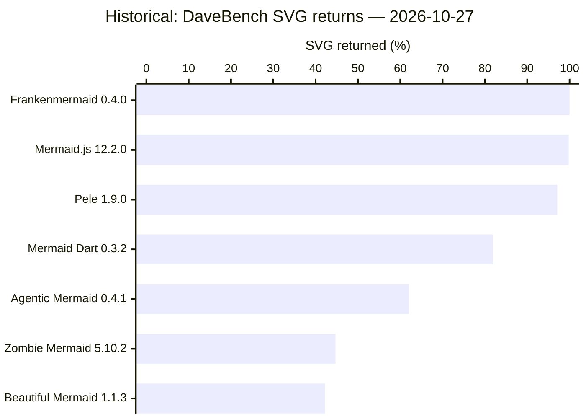
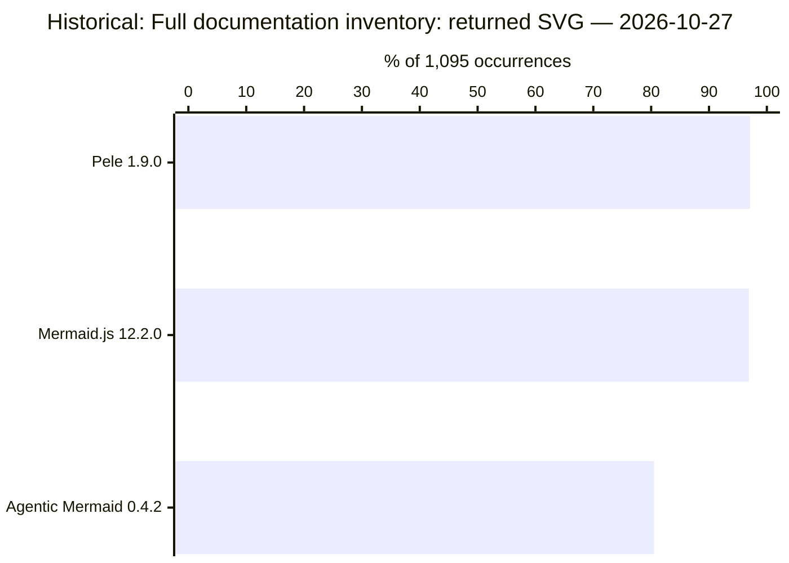
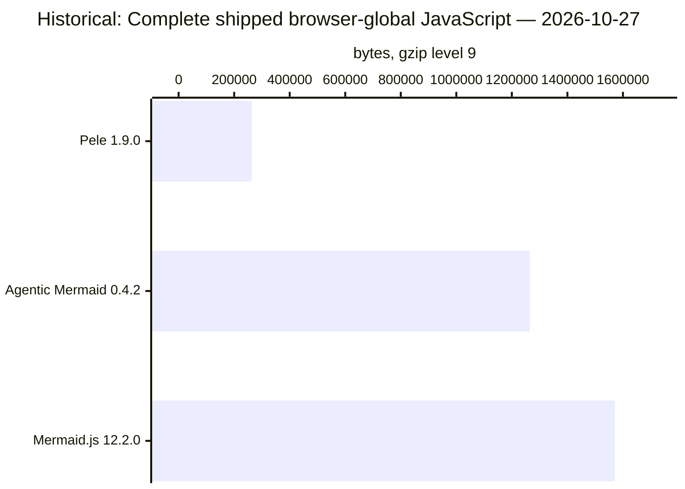
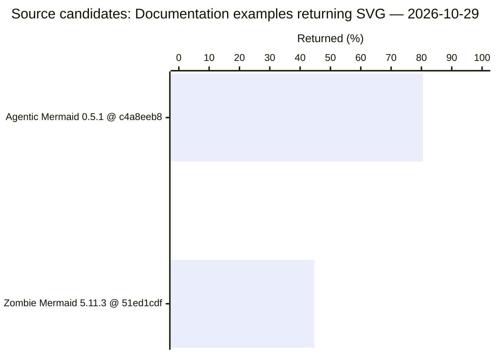
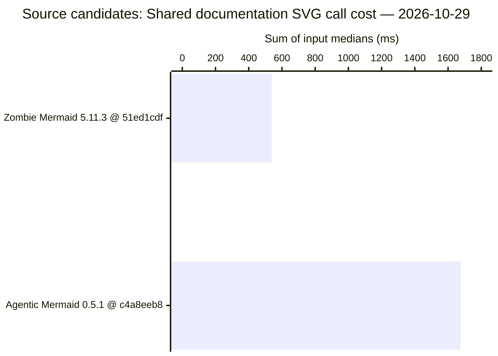
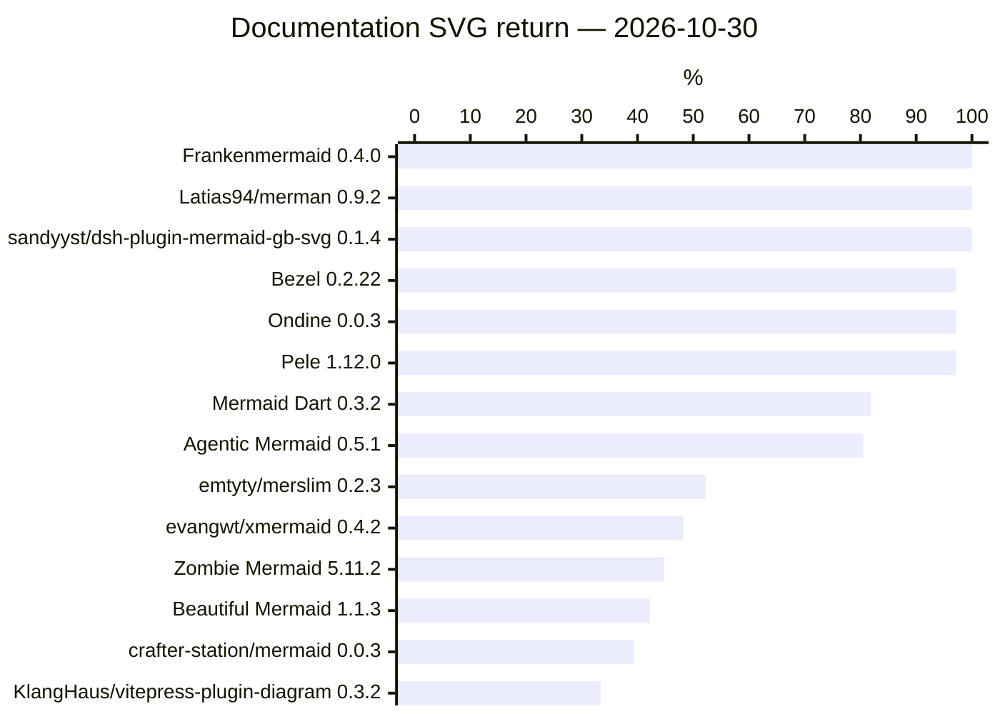

# DaveBench: Documentation Examples · part 1

[Ecosystem overview](../../RESULTS.md) · [All parts](docs.md)

**docs-coverage** · 2026-10-27 · Historical · unit: documentation occurrences · [evidence](../../docs/evidence/benchmark-examples.json)

Browser SVG; 548 documentation occurrences, 546 distinct sources, 34 pages; five rounds with identical per-round coverage. A returned SVG does not establish correct paint. Mermaid.js is the reference.

Ranked by **SVG returned / Planned occurrences**, highest first. Equal values share a rank; unavailable values are unranked. Timing ranks describe the displayed samples and retain their qualification limits.

| Project | Rank | Version | SVG returned | Failed | Planned occurrences | SVG returned (%) |
| --- | --- | --- | --- | --- | --- | --- |
| Frankenmermaid | 1 | 0.4.0 | 548 | 0 | 548 | 100.0% |
| Mermaid.js | 2 | 12.2.0 | 547 | 1 | 548 | 99.8% |
| Pele | 3 | 1.9.0 | 532 | 16 | 548 | 97.1% |
| Mermaid Dart | 4 | 0.3.2 | 449 | 99 | 548 | 81.9% |
| Agentic Mermaid | 5 | 0.4.1 | 340 | 208 | 548 | 62.0% |
| Zombie Mermaid | 6 | 5.10.2 | 245 | 303 | 548 | 44.7% |
| Beautiful Mermaid | 7 | 1.1.3 | 231 | 317 | 548 | 42.2% |

**docs-one-input-time** · 2026-10-27 · Historical · unit: milliseconds · [evidence](../../docs/evidence/benchmark-examples.json)

Browser SVG; one shared input: packages/mermaid/src/docs/syntax/flowchart.md:23. Median of five calls after warmup. Not calibrated; failed output withholds timing. This is not a whole-docs speed comparison.

Ranked by **Median call time (ms)**, lowest first. Equal values share a rank; unavailable values are unranked. Timing ranks describe the displayed samples and retain their qualification limits.

| Project | Rank | Version | Median call time (ms) | Successful calls | Comparison qualification |
| --- | --- | --- | --- | --- | --- |
| Frankenmermaid | 1 | 0.4.0 | 0.4 | 5/5 | Not calibrated |
| Pele | 2 | 1.9.0 | 0.6 | 5/5 | Not calibrated |
| Mermaid Dart | 3 | 0.3.2 | 3 | 5/5 | Not calibrated |
| Agentic Mermaid | 4 | 0.4.1 | 20.2 | 5/5 | Not calibrated |
| Mermaid.js | 5 | 12.2.0 | 78.3 | 5/5 | Not calibrated |
| Beautiful Mermaid | — | 1.1.3 | Withheld | 0/5 | SVG return failed |
| Zombie Mermaid | — | 5.10.2 | Withheld | 0/5 | SVG return failed |

**ecosystem-docs-1095-2026-10-27** · 2026-10-27 · Historical · unit: documentation occurrences · [evidence](../../docs/evidence/campaign-2026-10-28/comparative-tables.json)

Six rounds, 1,095 occurrences. Full inventory; acceptance does not establish meaning. CFD Agentic 0.4.2, Pele 1.9.0, Mermaid 12.2.0. 27 October 2026.

Ranked by **Returned SVG / Planned**, highest first. Equal values share a rank; unavailable values are unranked. Timing ranks describe the displayed samples and retain their qualification limits.

| Project | Rank | Version | Returned SVG | No SVG return | Planned | % of 1,095 occurrences |
| --- | --- | --- | --- | --- | --- | --- |
| Pele | 1 | 1.9.0 | 1063 | 32 | 1095 | 97.1% |
| Mermaid.js | 2 | 12.2.0 | 1061 | 34 | 1095 | 96.9% |
| Agentic Mermaid | 3 | 0.4.2 | 881 | 214 | 1095 | 80.5% |

**ecosystem-browser-gzip-2026-10-27** · 2026-10-27 · Historical · unit: gzip bytes · [evidence](../../docs/evidence/campaign-2026-10-28/comparative-tables.json)

Complete shipped browser globals, level-9 gzip. Excludes focused/lazy entries, fonts and wire overhead; not startup memory.

Ranked by **Gzip bytes**, lowest first. Equal values share a rank; unavailable values are unranked. Timing ranks describe the displayed samples and retain their qualification limits.

| Project | Rank | Version | Gzip bytes |
| --- | --- | --- | --- |
| Pele | 1 | 1.9.0 | 263250 |
| Agentic Mermaid | 2 | 0.4.2 | 1264968 |
| Mermaid.js | 3 | 12.2.0 | 1570966 |

**ecosystem-docs-call-cost-2026-10-27** · 2026-10-27 · Historical · unit: call cost / Mermaid · [evidence](../../docs/evidence/campaign-2026-10-28/comparative-tables.json)

847 identical successful occurrences across all tools and all six rounds; public SVG return clock excludes validation and paint. Descriptive; no A/A qualification. Full 1,095-occurrence outcomes appear separately. This is a descriptive ordering of retained samples, not a calibrated winner.

Ranked by **Call cost / Mermaid**, lowest first. Equal values share a rank; unavailable values are unranked. Timing ranks describe the displayed samples and retain their qualification limits.

| Project | Rank | Version | Call cost / Mermaid |
| --- | --- | --- | --- |
| Pele | 1 | 1.9.0 | 0.007979263124530539 |
| Agentic Mermaid | 2 | 0.4.2 | 0.1386222404620205 |
| Mermaid.js | 3 | 12.2.0 | 1 |

**am-zm-docs-2026-10-29** · 2026-10-29 · **Source candidates** · unit: documentation occurrences · [evidence](../../docs/evidence/am-zm-2026-10-29/receipt.json)

AM 0.5.1 at c4a8eeb8 and ZM 5.11.3 at 51ed1cdf are unreleased source builds. DaveBench: all 548 occurrences from 34 syntax pages at Mermaid 12.2.0. Both five-round blocks returned identical counts. A returned SVG does not certify its meaning. No SVG includes unsupported syntax, parser rejection and security-policy rejection.

Ranked by **Returned / Planned**, highest first. Equal values share a rank; unavailable values are unranked. Timing ranks describe the displayed samples and retain their qualification limits.

| Project | Rank | Version | Returned | No SVG | Planned | Returned (%) |
| --- | --- | --- | --- | --- | --- | --- |
| Agentic Mermaid | 1 | 0.5.1 @ c4a8eeb8 | 441 | 107 | 548 | 80.5% |
| Zombie Mermaid | 2 | 5.11.3 @ 51ed1cdf | 245 | 303 | 548 | 44.7% |

**am-zm-docs-call-cost-2026-10-29** · 2026-10-29 · **Source candidates** · unit: milliseconds · [evidence](../../docs/evidence/am-zm-2026-10-29/receipt.json)

AM 0.5.1 at c4a8eeb8 and ZM 5.11.3 at 51ed1cdf are unreleased source builds. Same 245 documentation occurrences returned SVG for both projects in all ten calls per input, split across two opposite-order five-round blocks. Each input contributes its median call time. p95 is over input medians, not individual-call tail latency. Timed public call through awaited SVG return; excludes initialization and paint. Descriptive only: no independent A/A performance qualification or equivalent-paint claim. One ZM input median was below timer resolution; no geometric-mean ratio is reported. This second block compensated for the original two-project scheduling bug; these measurements precede its fix.

Ranked by **Sum input medians (ms)**, lowest first. Equal values share a rank; unavailable values are unranked. Timing ranks describe the displayed samples and retain their qualification limits.

| Project | Rank | Version | Common inputs | Calls per input | Median input (ms) | p95 input medians (ms) | Sum input medians (ms) |
| --- | --- | --- | --- | --- | --- | --- | --- |
| Zombie Mermaid | 1 | 5.11.3 @ 51ed1cdf | 245 | 10 | 1.3 | 6.85 | 538.55 |
| Agentic Mermaid | 2 | 0.5.1 @ c4a8eeb8 | 245 | 10 | 3.8 | 24.45 | 1675.75 |

**run-8b501af93dc3dbc6f265dfd4** · 2026-10-30 · unit: documentation occurrences · [evidence](https://github.com/adewale/trident/tree/7d8c71a8a1307ba2834b803be24cee0270591ccf/evidence/1/report.json)

Pinned documentation occurrences; Chromium public SVG calls. Returned means the occurrence returned SVG in all 6 declared rounds. Failures and unexecuted work retain the full inventory. SVG return does not certify meaning or paint.

Ranked by **Returned in all rounds / Planned**, highest first. Equal values share a rank; unavailable values are unranked. Timing ranks describe the displayed samples and retain their qualification limits.

| Project | Rank | Version | Returned in all rounds | Failed | Unsupported | Blocked | Unexecuted | Partially observed | Planned | Measured | % | Ranking note |
| --- | --- | --- | --- | --- | --- | --- | --- | --- | --- | --- | --- | --- |
| Frankenmermaid | 1 | 0.4.0 | 548 | 0 | 0 | 0 | 0 | 0 | 548 | 2026-10-30T05:04:54.932Z | 100.0% |  |
| Latias94/merman | 1 | 0.9.2 | 548 | 0 | 0 | 0 | 0 | 0 | 548 | 2026-10-30T05:05:52.001Z | 100.0% |  |
| sandyyst/dsh-plugin-mermaid-gb-svg | 1 | 0.1.4 | 548 | 0 | 0 | 0 | 0 | 0 | 548 | 2026-10-30T05:05:39.320Z | 100.0% |  |
| Bezel | 4 | 0.2.22 | 532 | 16 | 0 | 0 | 0 | 0 | 548 | 2026-10-30T05:04:59.359Z | 97.1% |  |
| Ondine | 4 | 0.0.3 | 532 | 16 | 0 | 0 | 0 | 0 | 548 | 2026-10-30T05:04:52.149Z | 97.1% |  |
| Pele | 4 | 1.12.0 | 532 | 16 | 0 | 0 | 0 | 0 | 548 | 2026-10-30T05:05:41.924Z | 97.1% |  |
| Mermaid Dart | 7 | 0.3.2 | 449 | 99 | 0 | 0 | 0 | 0 | 548 | 2026-10-30T05:06:34.147Z | 81.9% |  |
| Agentic Mermaid | 8 | 0.5.1 | 441 | 107 | 0 | 0 | 0 | 0 | 548 | 2026-10-30T05:06:30.859Z | 80.5% |  |
| emtyty/merslim | 9 | 0.2.3 | 286 | 262 | 0 | 0 | 0 | 0 | 548 | 2026-10-30T05:06:11.748Z | 52.2% |  |
| evangwt/xmermaid | 10 | 0.4.2 | 264 | 284 | 0 | 0 | 0 | 0 | 548 | 2026-10-30T05:05:56.903Z | 48.2% |  |
| Zombie Mermaid | 11 | 5.11.2 | 245 | 303 | 0 | 0 | 0 | 0 | 548 | 2026-10-30T05:06:21.348Z | 44.7% |  |
| Beautiful Mermaid | 12 | 1.1.3 | 231 | 317 | 0 | 0 | 0 | 0 | 548 | 2026-10-30T05:05:45.344Z | 42.2% |  |
| crafter-station/mermaid | 13 | 0.0.3 | 216 | 332 | 0 | 0 | 0 | 0 | 548 | 2026-10-30T05:06:14.056Z | 39.4% |  |
| KlangHaus/vitepress-plugin-diagram | 14 | 0.3.2 | 183 | 365 | 0 | 0 | 0 | 0 | 548 | 2026-10-30T05:05:53.919Z | 33.4% |  |
| 1jehuang/mermaid-rs-renderer | — | unavailable | 0 | 0 | 0 | 548 | 0 | 0 | 548 | 2026-10-30T05:06:34.638Z | — | blocked (0/6 complete rounds) |
| Mermaid.js | — | 12.2.0 | 0 | 1 | 0 | 0 | 0 | 547 | 548 | 2026-10-30T05:05:37.011Z | — | incomplete (5/6 complete rounds) |

### AlexanderGrooff/mermaid-ascii: DaveBench: Documentation Examples (core)

Campaign invocation: 2026-10-30T03:05:19.681Z → 2026-10-30T11:37:15.317Z · **unsupported** · [evidence](https://github.com/adewale/trident/tree/7d8c71a8a1307ba2834b803be24cee0270591ccf/evidence/1/report.json) · [owning results and failures](https://github.com/adewale/trident/tree/7d8c71a8a1307ba2834b803be24cee0270591ccf/evidence/1/docs/)

excalidraw/mermaid-to-excalidraw: Error: Prepared artifact does not expose SVG output; pub:mermaid_flutter: Error: This community capability does not expose SVG rendering.; 1jehuang/mermaid-rs-renderer: Error: Prepared native CLI/Python/worker has no browser rendering distribution.; aj-archipelago/merval: Error: This community capability does not expose SVG rendering.; AlexanderGrooff/mermaid-ascii: Error: This community capability does not expose SVG rendering.; anomalyco/opencode: Error: This community capability does not expose SVG rendering.; chenyanchen/mermaid-formatter: Error: This community capability does not expose SVG rendering.; fasouto/termaid: Error: This community capability does not expose SVG rendering.; inkeep/visimer: Error: This community capability does not expose SVG rendering.; kingsword09/mermansi: Error: This community capability does not expose SVG rendering.; kitlangton/merman: Error: This community capability does not expose SVG rendering.; Mootikins/figurehead-rs: Error: This community capability does not expose SVG rendering.; neongreen/mermaid-ast: Error: This community capability does not expose SVG rendering.; probelabs/maid: Error: This community capability does not expose SVG rendering.; taoche/mermaid-reactflow-render: Error: This community capability does not expose SVG rendering.; tariqshams/mermaidtui: Error: This community capability does not expose SVG rendering.; xai-org/grok-build: Error: This community capability does not expose SVG rendering.; Yassimba/loom: Error: This community capability does not expose SVG rendering.; 4nkitd/opencode-merman: Error: This community capability does not expose SVG rendering.; kais-radwan/ascii-mermaid: Error: This community capability does not expose SVG rendering.; npm:tui-mermaid: Error: This community capability does not expose SVG rendering.; spacedock-dev/mermaidtext: Error: This community capability does not expose SVG rendering.; xl0/lovely-mermaid: Error: This community capability does not expose SVG rendering.; mermaid-js/mermaid round 3: Error: Browser call exceeded20s host deadline; SVG return only; no meaning/paint qualification. Distinct protocol from historical AM Davebench: complete pinned upstream syntax directory, all catalog browser bindings. Latency comparisons require pairwise common successes; no overall speed score.; Campaign process status: failed; Recorded observation dispositions; process completion does not establish benchmark qualification.

| Version / artifact role | Interface / runtime | Format / operation | Mode / round | Distinct case IDs | Passed observations | Failed | Unsupported | Blocked | Other dispositions | Recorded observations |
| --- | --- | --- | --- | --- | --- | --- | --- | --- | --- | --- |
| see frozen artifact receipt / default | browser:svg / Chromium | svg / artifact-admission | not-executed / not round-based | 1 | 0 | 0 | 1 | 0 | {} | 1 |

### ASCII Mermaid: DaveBench: Documentation Examples (core)

Campaign invocation: 2026-10-30T03:05:19.681Z → 2026-10-30T11:37:15.317Z · **unsupported** · [evidence](https://github.com/adewale/trident/tree/7d8c71a8a1307ba2834b803be24cee0270591ccf/evidence/1/report.json) · [owning results and failures](https://github.com/adewale/trident/tree/7d8c71a8a1307ba2834b803be24cee0270591ccf/evidence/1/docs/)

excalidraw/mermaid-to-excalidraw: Error: Prepared artifact does not expose SVG output; pub:mermaid_flutter: Error: This community capability does not expose SVG rendering.; 1jehuang/mermaid-rs-renderer: Error: Prepared native CLI/Python/worker has no browser rendering distribution.; aj-archipelago/merval: Error: This community capability does not expose SVG rendering.; AlexanderGrooff/mermaid-ascii: Error: This community capability does not expose SVG rendering.; anomalyco/opencode: Error: This community capability does not expose SVG rendering.; chenyanchen/mermaid-formatter: Error: This community capability does not expose SVG rendering.; fasouto/termaid: Error: This community capability does not expose SVG rendering.; inkeep/visimer: Error: This community capability does not expose SVG rendering.; kingsword09/mermansi: Error: This community capability does not expose SVG rendering.; kitlangton/merman: Error: This community capability does not expose SVG rendering.; Mootikins/figurehead-rs: Error: This community capability does not expose SVG rendering.; neongreen/mermaid-ast: Error: This community capability does not expose SVG rendering.; probelabs/maid: Error: This community capability does not expose SVG rendering.; taoche/mermaid-reactflow-render: Error: This community capability does not expose SVG rendering.; tariqshams/mermaidtui: Error: This community capability does not expose SVG rendering.; xai-org/grok-build: Error: This community capability does not expose SVG rendering.; Yassimba/loom: Error: This community capability does not expose SVG rendering.; 4nkitd/opencode-merman: Error: This community capability does not expose SVG rendering.; kais-radwan/ascii-mermaid: Error: This community capability does not expose SVG rendering.; npm:tui-mermaid: Error: This community capability does not expose SVG rendering.; spacedock-dev/mermaidtext: Error: This community capability does not expose SVG rendering.; xl0/lovely-mermaid: Error: This community capability does not expose SVG rendering.; mermaid-js/mermaid round 3: Error: Browser call exceeded20s host deadline; SVG return only; no meaning/paint qualification. Distinct protocol from historical AM Davebench: complete pinned upstream syntax directory, all catalog browser bindings. Latency comparisons require pairwise common successes; no overall speed score.; Campaign process status: failed; Recorded observation dispositions; process completion does not establish benchmark qualification.

| Version / artifact role | Interface / runtime | Format / operation | Mode / round | Distinct case IDs | Passed observations | Failed | Unsupported | Blocked | Other dispositions | Recorded observations |
| --- | --- | --- | --- | --- | --- | --- | --- | --- | --- | --- |
| see frozen artifact receipt / default | browser:svg / Chromium | svg / artifact-admission | not-executed / not round-based | 1 | 0 | 0 | 1 | 0 | {} | 1 |

### Ondine: DaveBench: Documentation Examples (core)

Campaign invocation: 2026-10-30T03:05:19.681Z → 2026-10-30T11:37:15.317Z · **failed** · [evidence](https://github.com/adewale/trident/tree/7d8c71a8a1307ba2834b803be24cee0270591ccf/evidence/1/report.json) · [owning results and failures](https://github.com/adewale/trident/tree/7d8c71a8a1307ba2834b803be24cee0270591ccf/evidence/1/docs/)

excalidraw/mermaid-to-excalidraw: Error: Prepared artifact does not expose SVG output; pub:mermaid_flutter: Error: This community capability does not expose SVG rendering.; 1jehuang/mermaid-rs-renderer: Error: Prepared native CLI/Python/worker has no browser rendering distribution.; aj-archipelago/merval: Error: This community capability does not expose SVG rendering.; AlexanderGrooff/mermaid-ascii: Error: This community capability does not expose SVG rendering.; anomalyco/opencode: Error: This community capability does not expose SVG rendering.; chenyanchen/mermaid-formatter: Error: This community capability does not expose SVG rendering.; fasouto/termaid: Error: This community capability does not expose SVG rendering.; inkeep/visimer: Error: This community capability does not expose SVG rendering.; kingsword09/mermansi: Error: This community capability does not expose SVG rendering.; kitlangton/merman: Error: This community capability does not expose SVG rendering.; Mootikins/figurehead-rs: Error: This community capability does not expose SVG rendering.; neongreen/mermaid-ast: Error: This community capability does not expose SVG rendering.; probelabs/maid: Error: This community capability does not expose SVG rendering.; taoche/mermaid-reactflow-render: Error: This community capability does not expose SVG rendering.; tariqshams/mermaidtui: Error: This community capability does not expose SVG rendering.; xai-org/grok-build: Error: This community capability does not expose SVG rendering.; Yassimba/loom: Error: This community capability does not expose SVG rendering.; 4nkitd/opencode-merman: Error: This community capability does not expose SVG rendering.; kais-radwan/ascii-mermaid: Error: This community capability does not expose SVG rendering.; npm:tui-mermaid: Error: This community capability does not expose SVG rendering.; spacedock-dev/mermaidtext: Error: This community capability does not expose SVG rendering.; xl0/lovely-mermaid: Error: This community capability does not expose SVG rendering.; mermaid-js/mermaid round 3: Error: Browser call exceeded20s host deadline; SVG return only; no meaning/paint qualification. Distinct protocol from historical AM Davebench: complete pinned upstream syntax directory, all catalog browser bindings. Latency comparisons require pairwise common successes; no overall speed score.; Campaign process status: failed; Recorded observation dispositions; process completion does not establish benchmark qualification.

| Version / artifact role | Interface / runtime | Format / operation | Mode / round | Distinct case IDs | Passed observations | Failed | Unsupported | Blocked | Other dispositions | Recorded observations |
| --- | --- | --- | --- | --- | --- | --- | --- | --- | --- | --- |
| 0.0.3 / default | browser:svg / Chromium | svg / render | one-public-call / 1 | 548 | 532 | 16 | 0 | 0 | {} | 548 |
| 0.0.3 / default | browser:svg / Chromium | svg / render | one-public-call / 2 | 548 | 532 | 16 | 0 | 0 | {} | 548 |
| 0.0.3 / default | browser:svg / Chromium | svg / render | one-public-call / 3 | 548 | 532 | 16 | 0 | 0 | {} | 548 |
| 0.0.3 / default | browser:svg / Chromium | svg / render | one-public-call / 4 | 548 | 532 | 16 | 0 | 0 | {} | 548 |
| 0.0.3 / default | browser:svg / Chromium | svg / render | one-public-call / 5 | 548 | 532 | 16 | 0 | 0 | {} | 548 |
| 0.0.3 / default | browser:svg / Chromium | svg / render | one-public-call / 6 | 548 | 532 | 16 | 0 | 0 | {} | 548 |

### sandyyst/dsh-plugin-mermaid-gb-svg: DaveBench: Documentation Examples (core)

Campaign invocation: 2026-10-30T03:05:19.681Z → 2026-10-30T11:37:15.317Z · **recorded** · [evidence](https://github.com/adewale/trident/tree/7d8c71a8a1307ba2834b803be24cee0270591ccf/evidence/1/report.json) · [owning results and failures](https://github.com/adewale/trident/tree/7d8c71a8a1307ba2834b803be24cee0270591ccf/evidence/1/docs/)

excalidraw/mermaid-to-excalidraw: Error: Prepared artifact does not expose SVG output; pub:mermaid_flutter: Error: This community capability does not expose SVG rendering.; 1jehuang/mermaid-rs-renderer: Error: Prepared native CLI/Python/worker has no browser rendering distribution.; aj-archipelago/merval: Error: This community capability does not expose SVG rendering.; AlexanderGrooff/mermaid-ascii: Error: This community capability does not expose SVG rendering.; anomalyco/opencode: Error: This community capability does not expose SVG rendering.; chenyanchen/mermaid-formatter: Error: This community capability does not expose SVG rendering.; fasouto/termaid: Error: This community capability does not expose SVG rendering.; inkeep/visimer: Error: This community capability does not expose SVG rendering.; kingsword09/mermansi: Error: This community capability does not expose SVG rendering.; kitlangton/merman: Error: This community capability does not expose SVG rendering.; Mootikins/figurehead-rs: Error: This community capability does not expose SVG rendering.; neongreen/mermaid-ast: Error: This community capability does not expose SVG rendering.; probelabs/maid: Error: This community capability does not expose SVG rendering.; taoche/mermaid-reactflow-render: Error: This community capability does not expose SVG rendering.; tariqshams/mermaidtui: Error: This community capability does not expose SVG rendering.; xai-org/grok-build: Error: This community capability does not expose SVG rendering.; Yassimba/loom: Error: This community capability does not expose SVG rendering.; 4nkitd/opencode-merman: Error: This community capability does not expose SVG rendering.; kais-radwan/ascii-mermaid: Error: This community capability does not expose SVG rendering.; npm:tui-mermaid: Error: This community capability does not expose SVG rendering.; spacedock-dev/mermaidtext: Error: This community capability does not expose SVG rendering.; xl0/lovely-mermaid: Error: This community capability does not expose SVG rendering.; mermaid-js/mermaid round 3: Error: Browser call exceeded20s host deadline; SVG return only; no meaning/paint qualification. Distinct protocol from historical AM Davebench: complete pinned upstream syntax directory, all catalog browser bindings. Latency comparisons require pairwise common successes; no overall speed score.; Campaign process status: failed; Recorded observation dispositions; process completion does not establish benchmark qualification.

| Version / artifact role | Interface / runtime | Format / operation | Mode / round | Distinct case IDs | Passed observations | Failed | Unsupported | Blocked | Other dispositions | Recorded observations |
| --- | --- | --- | --- | --- | --- | --- | --- | --- | --- | --- |
| 0.1.4 / default | browser:svg / Chromium | svg / render | one-public-call / 1 | 548 | 548 | 0 | 0 | 0 | {} | 548 |
| 0.1.4 / default | browser:svg / Chromium | svg / render | one-public-call / 2 | 548 | 548 | 0 | 0 | 0 | {} | 548 |
| 0.1.4 / default | browser:svg / Chromium | svg / render | one-public-call / 3 | 548 | 548 | 0 | 0 | 0 | {} | 548 |
| 0.1.4 / default | browser:svg / Chromium | svg / render | one-public-call / 4 | 548 | 548 | 0 | 0 | 0 | {} | 548 |
| 0.1.4 / default | browser:svg / Chromium | svg / render | one-public-call / 5 | 548 | 548 | 0 | 0 | 0 | {} | 548 |
| 0.1.4 / default | browser:svg / Chromium | svg / render | one-public-call / 6 | 548 | 548 | 0 | 0 | 0 | {} | 548 |

### Frankenmermaid: DaveBench: Documentation Examples (core)

Campaign invocation: 2026-10-30T03:05:19.681Z → 2026-10-30T11:37:15.317Z · **recorded** · [evidence](https://github.com/adewale/trident/tree/7d8c71a8a1307ba2834b803be24cee0270591ccf/evidence/1/report.json) · [owning results and failures](https://github.com/adewale/trident/tree/7d8c71a8a1307ba2834b803be24cee0270591ccf/evidence/1/docs/)

excalidraw/mermaid-to-excalidraw: Error: Prepared artifact does not expose SVG output; pub:mermaid_flutter: Error: This community capability does not expose SVG rendering.; 1jehuang/mermaid-rs-renderer: Error: Prepared native CLI/Python/worker has no browser rendering distribution.; aj-archipelago/merval: Error: This community capability does not expose SVG rendering.; AlexanderGrooff/mermaid-ascii: Error: This community capability does not expose SVG rendering.; anomalyco/opencode: Error: This community capability does not expose SVG rendering.; chenyanchen/mermaid-formatter: Error: This community capability does not expose SVG rendering.; fasouto/termaid: Error: This community capability does not expose SVG rendering.; inkeep/visimer: Error: This community capability does not expose SVG rendering.; kingsword09/mermansi: Error: This community capability does not expose SVG rendering.; kitlangton/merman: Error: This community capability does not expose SVG rendering.; Mootikins/figurehead-rs: Error: This community capability does not expose SVG rendering.; neongreen/mermaid-ast: Error: This community capability does not expose SVG rendering.; probelabs/maid: Error: This community capability does not expose SVG rendering.; taoche/mermaid-reactflow-render: Error: This community capability does not expose SVG rendering.; tariqshams/mermaidtui: Error: This community capability does not expose SVG rendering.; xai-org/grok-build: Error: This community capability does not expose SVG rendering.; Yassimba/loom: Error: This community capability does not expose SVG rendering.; 4nkitd/opencode-merman: Error: This community capability does not expose SVG rendering.; kais-radwan/ascii-mermaid: Error: This community capability does not expose SVG rendering.; npm:tui-mermaid: Error: This community capability does not expose SVG rendering.; spacedock-dev/mermaidtext: Error: This community capability does not expose SVG rendering.; xl0/lovely-mermaid: Error: This community capability does not expose SVG rendering.; mermaid-js/mermaid round 3: Error: Browser call exceeded20s host deadline; SVG return only; no meaning/paint qualification. Distinct protocol from historical AM Davebench: complete pinned upstream syntax directory, all catalog browser bindings. Latency comparisons require pairwise common successes; no overall speed score.; Campaign process status: failed; Recorded observation dispositions; process completion does not establish benchmark qualification.

| Version / artifact role | Interface / runtime | Format / operation | Mode / round | Distinct case IDs | Passed observations | Failed | Unsupported | Blocked | Other dispositions | Recorded observations |
| --- | --- | --- | --- | --- | --- | --- | --- | --- | --- | --- |
| 0.4.0 / default | browser:svg / Chromium | svg / render | one-public-call / 1 | 548 | 548 | 0 | 0 | 0 | {} | 548 |
| 0.4.0 / default | browser:svg / Chromium | svg / render | one-public-call / 2 | 548 | 548 | 0 | 0 | 0 | {} | 548 |
| 0.4.0 / default | browser:svg / Chromium | svg / render | one-public-call / 3 | 548 | 548 | 0 | 0 | 0 | {} | 548 |
| 0.4.0 / default | browser:svg / Chromium | svg / render | one-public-call / 4 | 548 | 548 | 0 | 0 | 0 | {} | 548 |
| 0.4.0 / default | browser:svg / Chromium | svg / render | one-public-call / 5 | 548 | 548 | 0 | 0 | 0 | {} | 548 |
| 0.4.0 / default | browser:svg / Chromium | svg / render | one-public-call / 6 | 548 | 548 | 0 | 0 | 0 | {} | 548 |

### fasouto/termaid: DaveBench: Documentation Examples (core)

Campaign invocation: 2026-10-30T03:05:19.681Z → 2026-10-30T11:37:15.317Z · **unsupported** · [evidence](https://github.com/adewale/trident/tree/7d8c71a8a1307ba2834b803be24cee0270591ccf/evidence/1/report.json) · [owning results and failures](https://github.com/adewale/trident/tree/7d8c71a8a1307ba2834b803be24cee0270591ccf/evidence/1/docs/)

excalidraw/mermaid-to-excalidraw: Error: Prepared artifact does not expose SVG output; pub:mermaid_flutter: Error: This community capability does not expose SVG rendering.; 1jehuang/mermaid-rs-renderer: Error: Prepared native CLI/Python/worker has no browser rendering distribution.; aj-archipelago/merval: Error: This community capability does not expose SVG rendering.; AlexanderGrooff/mermaid-ascii: Error: This community capability does not expose SVG rendering.; anomalyco/opencode: Error: This community capability does not expose SVG rendering.; chenyanchen/mermaid-formatter: Error: This community capability does not expose SVG rendering.; fasouto/termaid: Error: This community capability does not expose SVG rendering.; inkeep/visimer: Error: This community capability does not expose SVG rendering.; kingsword09/mermansi: Error: This community capability does not expose SVG rendering.; kitlangton/merman: Error: This community capability does not expose SVG rendering.; Mootikins/figurehead-rs: Error: This community capability does not expose SVG rendering.; neongreen/mermaid-ast: Error: This community capability does not expose SVG rendering.; probelabs/maid: Error: This community capability does not expose SVG rendering.; taoche/mermaid-reactflow-render: Error: This community capability does not expose SVG rendering.; tariqshams/mermaidtui: Error: This community capability does not expose SVG rendering.; xai-org/grok-build: Error: This community capability does not expose SVG rendering.; Yassimba/loom: Error: This community capability does not expose SVG rendering.; 4nkitd/opencode-merman: Error: This community capability does not expose SVG rendering.; kais-radwan/ascii-mermaid: Error: This community capability does not expose SVG rendering.; npm:tui-mermaid: Error: This community capability does not expose SVG rendering.; spacedock-dev/mermaidtext: Error: This community capability does not expose SVG rendering.; xl0/lovely-mermaid: Error: This community capability does not expose SVG rendering.; mermaid-js/mermaid round 3: Error: Browser call exceeded20s host deadline; SVG return only; no meaning/paint qualification. Distinct protocol from historical AM Davebench: complete pinned upstream syntax directory, all catalog browser bindings. Latency comparisons require pairwise common successes; no overall speed score.; Campaign process status: failed; Recorded observation dispositions; process completion does not establish benchmark qualification.

| Version / artifact role | Interface / runtime | Format / operation | Mode / round | Distinct case IDs | Passed observations | Failed | Unsupported | Blocked | Other dispositions | Recorded observations |
| --- | --- | --- | --- | --- | --- | --- | --- | --- | --- | --- |
| see frozen artifact receipt / default | browser:svg / Chromium | svg / artifact-admission | not-executed / not round-based | 1 | 0 | 0 | 1 | 0 | {} | 1 |

### emtyty/merslim: DaveBench: Documentation Examples (core)

Campaign invocation: 2026-10-30T03:05:19.681Z → 2026-10-30T11:37:15.317Z · **failed** · [evidence](https://github.com/adewale/trident/tree/7d8c71a8a1307ba2834b803be24cee0270591ccf/evidence/1/report.json) · [owning results and failures](https://github.com/adewale/trident/tree/7d8c71a8a1307ba2834b803be24cee0270591ccf/evidence/1/docs/)

excalidraw/mermaid-to-excalidraw: Error: Prepared artifact does not expose SVG output; pub:mermaid_flutter: Error: This community capability does not expose SVG rendering.; 1jehuang/mermaid-rs-renderer: Error: Prepared native CLI/Python/worker has no browser rendering distribution.; aj-archipelago/merval: Error: This community capability does not expose SVG rendering.; AlexanderGrooff/mermaid-ascii: Error: This community capability does not expose SVG rendering.; anomalyco/opencode: Error: This community capability does not expose SVG rendering.; chenyanchen/mermaid-formatter: Error: This community capability does not expose SVG rendering.; fasouto/termaid: Error: This community capability does not expose SVG rendering.; inkeep/visimer: Error: This community capability does not expose SVG rendering.; kingsword09/mermansi: Error: This community capability does not expose SVG rendering.; kitlangton/merman: Error: This community capability does not expose SVG rendering.; Mootikins/figurehead-rs: Error: This community capability does not expose SVG rendering.; neongreen/mermaid-ast: Error: This community capability does not expose SVG rendering.; probelabs/maid: Error: This community capability does not expose SVG rendering.; taoche/mermaid-reactflow-render: Error: This community capability does not expose SVG rendering.; tariqshams/mermaidtui: Error: This community capability does not expose SVG rendering.; xai-org/grok-build: Error: This community capability does not expose SVG rendering.; Yassimba/loom: Error: This community capability does not expose SVG rendering.; 4nkitd/opencode-merman: Error: This community capability does not expose SVG rendering.; kais-radwan/ascii-mermaid: Error: This community capability does not expose SVG rendering.; npm:tui-mermaid: Error: This community capability does not expose SVG rendering.; spacedock-dev/mermaidtext: Error: This community capability does not expose SVG rendering.; xl0/lovely-mermaid: Error: This community capability does not expose SVG rendering.; mermaid-js/mermaid round 3: Error: Browser call exceeded20s host deadline; SVG return only; no meaning/paint qualification. Distinct protocol from historical AM Davebench: complete pinned upstream syntax directory, all catalog browser bindings. Latency comparisons require pairwise common successes; no overall speed score.; Campaign process status: failed; Recorded observation dispositions; process completion does not establish benchmark qualification.

| Version / artifact role | Interface / runtime | Format / operation | Mode / round | Distinct case IDs | Passed observations | Failed | Unsupported | Blocked | Other dispositions | Recorded observations |
| --- | --- | --- | --- | --- | --- | --- | --- | --- | --- | --- |
| 0.2.3 / default | browser:svg / Chromium | svg / render | one-public-call / 1 | 548 | 286 | 262 | 0 | 0 | {} | 548 |
| 0.2.3 / default | browser:svg / Chromium | svg / render | one-public-call / 2 | 548 | 286 | 262 | 0 | 0 | {} | 548 |
| 0.2.3 / default | browser:svg / Chromium | svg / render | one-public-call / 3 | 548 | 286 | 262 | 0 | 0 | {} | 548 |
| 0.2.3 / default | browser:svg / Chromium | svg / render | one-public-call / 4 | 548 | 286 | 262 | 0 | 0 | {} | 548 |
| 0.2.3 / default | browser:svg / Chromium | svg / render | one-public-call / 5 | 548 | 286 | 262 | 0 | 0 | {} | 548 |
| 0.2.3 / default | browser:svg / Chromium | svg / render | one-public-call / 6 | 548 | 286 | 262 | 0 | 0 | {} | 548 |

### Pele: DaveBench: Documentation Examples (core)

Campaign invocation: 2026-10-30T03:05:19.681Z → 2026-10-30T11:37:15.317Z · **failed** · [evidence](https://github.com/adewale/trident/tree/7d8c71a8a1307ba2834b803be24cee0270591ccf/evidence/1/report.json) · [owning results and failures](https://github.com/adewale/trident/tree/7d8c71a8a1307ba2834b803be24cee0270591ccf/evidence/1/docs/)

excalidraw/mermaid-to-excalidraw: Error: Prepared artifact does not expose SVG output; pub:mermaid_flutter: Error: This community capability does not expose SVG rendering.; 1jehuang/mermaid-rs-renderer: Error: Prepared native CLI/Python/worker has no browser rendering distribution.; aj-archipelago/merval: Error: This community capability does not expose SVG rendering.; AlexanderGrooff/mermaid-ascii: Error: This community capability does not expose SVG rendering.; anomalyco/opencode: Error: This community capability does not expose SVG rendering.; chenyanchen/mermaid-formatter: Error: This community capability does not expose SVG rendering.; fasouto/termaid: Error: This community capability does not expose SVG rendering.; inkeep/visimer: Error: This community capability does not expose SVG rendering.; kingsword09/mermansi: Error: This community capability does not expose SVG rendering.; kitlangton/merman: Error: This community capability does not expose SVG rendering.; Mootikins/figurehead-rs: Error: This community capability does not expose SVG rendering.; neongreen/mermaid-ast: Error: This community capability does not expose SVG rendering.; probelabs/maid: Error: This community capability does not expose SVG rendering.; taoche/mermaid-reactflow-render: Error: This community capability does not expose SVG rendering.; tariqshams/mermaidtui: Error: This community capability does not expose SVG rendering.; xai-org/grok-build: Error: This community capability does not expose SVG rendering.; Yassimba/loom: Error: This community capability does not expose SVG rendering.; 4nkitd/opencode-merman: Error: This community capability does not expose SVG rendering.; kais-radwan/ascii-mermaid: Error: This community capability does not expose SVG rendering.; npm:tui-mermaid: Error: This community capability does not expose SVG rendering.; spacedock-dev/mermaidtext: Error: This community capability does not expose SVG rendering.; xl0/lovely-mermaid: Error: This community capability does not expose SVG rendering.; mermaid-js/mermaid round 3: Error: Browser call exceeded20s host deadline; SVG return only; no meaning/paint qualification. Distinct protocol from historical AM Davebench: complete pinned upstream syntax directory, all catalog browser bindings. Latency comparisons require pairwise common successes; no overall speed score.; Campaign process status: failed; Recorded observation dispositions; process completion does not establish benchmark qualification.

| Version / artifact role | Interface / runtime | Format / operation | Mode / round | Distinct case IDs | Passed observations | Failed | Unsupported | Blocked | Other dispositions | Recorded observations |
| --- | --- | --- | --- | --- | --- | --- | --- | --- | --- | --- |
| 1.12.0 / default | browser:svg / Chromium | svg / render | one-public-call / 1 | 548 | 532 | 16 | 0 | 0 | {} | 548 |
| 1.12.0 / default | browser:svg / Chromium | svg / render | one-public-call / 2 | 548 | 532 | 16 | 0 | 0 | {} | 548 |
| 1.12.0 / default | browser:svg / Chromium | svg / render | one-public-call / 3 | 548 | 532 | 16 | 0 | 0 | {} | 548 |
| 1.12.0 / default | browser:svg / Chromium | svg / render | one-public-call / 4 | 548 | 532 | 16 | 0 | 0 | {} | 548 |
| 1.12.0 / default | browser:svg / Chromium | svg / render | one-public-call / 5 | 548 | 532 | 16 | 0 | 0 | {} | 548 |
| 1.12.0 / default | browser:svg / Chromium | svg / render | one-public-call / 6 | 548 | 532 | 16 | 0 | 0 | {} | 548 |

### Grok renderer: DaveBench: Documentation Examples (core)

Campaign invocation: 2026-10-30T03:05:19.681Z → 2026-10-30T11:37:15.317Z · **unsupported** · [evidence](https://github.com/adewale/trident/tree/7d8c71a8a1307ba2834b803be24cee0270591ccf/evidence/1/report.json) · [owning results and failures](https://github.com/adewale/trident/tree/7d8c71a8a1307ba2834b803be24cee0270591ccf/evidence/1/docs/)

excalidraw/mermaid-to-excalidraw: Error: Prepared artifact does not expose SVG output; pub:mermaid_flutter: Error: This community capability does not expose SVG rendering.; 1jehuang/mermaid-rs-renderer: Error: Prepared native CLI/Python/worker has no browser rendering distribution.; aj-archipelago/merval: Error: This community capability does not expose SVG rendering.; AlexanderGrooff/mermaid-ascii: Error: This community capability does not expose SVG rendering.; anomalyco/opencode: Error: This community capability does not expose SVG rendering.; chenyanchen/mermaid-formatter: Error: This community capability does not expose SVG rendering.; fasouto/termaid: Error: This community capability does not expose SVG rendering.; inkeep/visimer: Error: This community capability does not expose SVG rendering.; kingsword09/mermansi: Error: This community capability does not expose SVG rendering.; kitlangton/merman: Error: This community capability does not expose SVG rendering.; Mootikins/figurehead-rs: Error: This community capability does not expose SVG rendering.; neongreen/mermaid-ast: Error: This community capability does not expose SVG rendering.; probelabs/maid: Error: This community capability does not expose SVG rendering.; taoche/mermaid-reactflow-render: Error: This community capability does not expose SVG rendering.; tariqshams/mermaidtui: Error: This community capability does not expose SVG rendering.; xai-org/grok-build: Error: This community capability does not expose SVG rendering.; Yassimba/loom: Error: This community capability does not expose SVG rendering.; 4nkitd/opencode-merman: Error: This community capability does not expose SVG rendering.; kais-radwan/ascii-mermaid: Error: This community capability does not expose SVG rendering.; npm:tui-mermaid: Error: This community capability does not expose SVG rendering.; spacedock-dev/mermaidtext: Error: This community capability does not expose SVG rendering.; xl0/lovely-mermaid: Error: This community capability does not expose SVG rendering.; mermaid-js/mermaid round 3: Error: Browser call exceeded20s host deadline; SVG return only; no meaning/paint qualification. Distinct protocol from historical AM Davebench: complete pinned upstream syntax directory, all catalog browser bindings. Latency comparisons require pairwise common successes; no overall speed score.; Campaign process status: failed; Recorded observation dispositions; process completion does not establish benchmark qualification.

| Version / artifact role | Interface / runtime | Format / operation | Mode / round | Distinct case IDs | Passed observations | Failed | Unsupported | Blocked | Other dispositions | Recorded observations |
| --- | --- | --- | --- | --- | --- | --- | --- | --- | --- | --- |
| see frozen artifact receipt / default | browser:svg / Chromium | svg / artifact-admission | not-executed / not round-based | 1 | 0 | 0 | 1 | 0 | {} | 1 |

### Latias94/merman: DaveBench: Documentation Examples (core)

Campaign invocation: 2026-10-30T03:05:19.681Z → 2026-10-30T11:37:15.317Z · **recorded** · [evidence](https://github.com/adewale/trident/tree/7d8c71a8a1307ba2834b803be24cee0270591ccf/evidence/1/report.json) · [owning results and failures](https://github.com/adewale/trident/tree/7d8c71a8a1307ba2834b803be24cee0270591ccf/evidence/1/docs/)

excalidraw/mermaid-to-excalidraw: Error: Prepared artifact does not expose SVG output; pub:mermaid_flutter: Error: This community capability does not expose SVG rendering.; 1jehuang/mermaid-rs-renderer: Error: Prepared native CLI/Python/worker has no browser rendering distribution.; aj-archipelago/merval: Error: This community capability does not expose SVG rendering.; AlexanderGrooff/mermaid-ascii: Error: This community capability does not expose SVG rendering.; anomalyco/opencode: Error: This community capability does not expose SVG rendering.; chenyanchen/mermaid-formatter: Error: This community capability does not expose SVG rendering.; fasouto/termaid: Error: This community capability does not expose SVG rendering.; inkeep/visimer: Error: This community capability does not expose SVG rendering.; kingsword09/mermansi: Error: This community capability does not expose SVG rendering.; kitlangton/merman: Error: This community capability does not expose SVG rendering.; Mootikins/figurehead-rs: Error: This community capability does not expose SVG rendering.; neongreen/mermaid-ast: Error: This community capability does not expose SVG rendering.; probelabs/maid: Error: This community capability does not expose SVG rendering.; taoche/mermaid-reactflow-render: Error: This community capability does not expose SVG rendering.; tariqshams/mermaidtui: Error: This community capability does not expose SVG rendering.; xai-org/grok-build: Error: This community capability does not expose SVG rendering.; Yassimba/loom: Error: This community capability does not expose SVG rendering.; 4nkitd/opencode-merman: Error: This community capability does not expose SVG rendering.; kais-radwan/ascii-mermaid: Error: This community capability does not expose SVG rendering.; npm:tui-mermaid: Error: This community capability does not expose SVG rendering.; spacedock-dev/mermaidtext: Error: This community capability does not expose SVG rendering.; xl0/lovely-mermaid: Error: This community capability does not expose SVG rendering.; mermaid-js/mermaid round 3: Error: Browser call exceeded20s host deadline; SVG return only; no meaning/paint qualification. Distinct protocol from historical AM Davebench: complete pinned upstream syntax directory, all catalog browser bindings. Latency comparisons require pairwise common successes; no overall speed score.; Campaign process status: failed; Recorded observation dispositions; process completion does not establish benchmark qualification.

| Version / artifact role | Interface / runtime | Format / operation | Mode / round | Distinct case IDs | Passed observations | Failed | Unsupported | Blocked | Other dispositions | Recorded observations |
| --- | --- | --- | --- | --- | --- | --- | --- | --- | --- | --- |
| 0.9.2 / default | browser:svg / Chromium | svg / render | one-public-call / 1 | 548 | 548 | 0 | 0 | 0 | {} | 548 |
| 0.9.2 / default | browser:svg / Chromium | svg / render | one-public-call / 2 | 548 | 548 | 0 | 0 | 0 | {} | 548 |
| 0.9.2 / default | browser:svg / Chromium | svg / render | one-public-call / 3 | 548 | 548 | 0 | 0 | 0 | {} | 548 |
| 0.9.2 / default | browser:svg / Chromium | svg / render | one-public-call / 4 | 548 | 548 | 0 | 0 | 0 | {} | 548 |
| 0.9.2 / default | browser:svg / Chromium | svg / render | one-public-call / 5 | 548 | 548 | 0 | 0 | 0 | {} | 548 |
| 0.9.2 / default | browser:svg / Chromium | svg / render | one-public-call / 6 | 548 | 548 | 0 | 0 | 0 | {} | 548 |

### tariqshams/mermaidtui: DaveBench: Documentation Examples (core)

Campaign invocation: 2026-10-30T03:05:19.681Z → 2026-10-30T11:37:15.317Z · **unsupported** · [evidence](https://github.com/adewale/trident/tree/7d8c71a8a1307ba2834b803be24cee0270591ccf/evidence/1/report.json) · [owning results and failures](https://github.com/adewale/trident/tree/7d8c71a8a1307ba2834b803be24cee0270591ccf/evidence/1/docs/)

excalidraw/mermaid-to-excalidraw: Error: Prepared artifact does not expose SVG output; pub:mermaid_flutter: Error: This community capability does not expose SVG rendering.; 1jehuang/mermaid-rs-renderer: Error: Prepared native CLI/Python/worker has no browser rendering distribution.; aj-archipelago/merval: Error: This community capability does not expose SVG rendering.; AlexanderGrooff/mermaid-ascii: Error: This community capability does not expose SVG rendering.; anomalyco/opencode: Error: This community capability does not expose SVG rendering.; chenyanchen/mermaid-formatter: Error: This community capability does not expose SVG rendering.; fasouto/termaid: Error: This community capability does not expose SVG rendering.; inkeep/visimer: Error: This community capability does not expose SVG rendering.; kingsword09/mermansi: Error: This community capability does not expose SVG rendering.; kitlangton/merman: Error: This community capability does not expose SVG rendering.; Mootikins/figurehead-rs: Error: This community capability does not expose SVG rendering.; neongreen/mermaid-ast: Error: This community capability does not expose SVG rendering.; probelabs/maid: Error: This community capability does not expose SVG rendering.; taoche/mermaid-reactflow-render: Error: This community capability does not expose SVG rendering.; tariqshams/mermaidtui: Error: This community capability does not expose SVG rendering.; xai-org/grok-build: Error: This community capability does not expose SVG rendering.; Yassimba/loom: Error: This community capability does not expose SVG rendering.; 4nkitd/opencode-merman: Error: This community capability does not expose SVG rendering.; kais-radwan/ascii-mermaid: Error: This community capability does not expose SVG rendering.; npm:tui-mermaid: Error: This community capability does not expose SVG rendering.; spacedock-dev/mermaidtext: Error: This community capability does not expose SVG rendering.; xl0/lovely-mermaid: Error: This community capability does not expose SVG rendering.; mermaid-js/mermaid round 3: Error: Browser call exceeded20s host deadline; SVG return only; no meaning/paint qualification. Distinct protocol from historical AM Davebench: complete pinned upstream syntax directory, all catalog browser bindings. Latency comparisons require pairwise common successes; no overall speed score.; Campaign process status: failed; Recorded observation dispositions; process completion does not establish benchmark qualification.

| Version / artifact role | Interface / runtime | Format / operation | Mode / round | Distinct case IDs | Passed observations | Failed | Unsupported | Blocked | Other dispositions | Recorded observations |
| --- | --- | --- | --- | --- | --- | --- | --- | --- | --- | --- |
| see frozen artifact receipt / default | browser:svg / Chromium | svg / artifact-admission | not-executed / not round-based | 1 | 0 | 0 | 1 | 0 | {} | 1 |

### Mermaid.js: DaveBench: Documentation Examples (core)

Campaign invocation: 2026-10-30T03:05:19.681Z → 2026-10-30T11:37:15.317Z · **failed** · [evidence](https://github.com/adewale/trident/tree/7d8c71a8a1307ba2834b803be24cee0270591ccf/evidence/1/report.json) · [owning results and failures](https://github.com/adewale/trident/tree/7d8c71a8a1307ba2834b803be24cee0270591ccf/evidence/1/docs/)

excalidraw/mermaid-to-excalidraw: Error: Prepared artifact does not expose SVG output; pub:mermaid_flutter: Error: This community capability does not expose SVG rendering.; 1jehuang/mermaid-rs-renderer: Error: Prepared native CLI/Python/worker has no browser rendering distribution.; aj-archipelago/merval: Error: This community capability does not expose SVG rendering.; AlexanderGrooff/mermaid-ascii: Error: This community capability does not expose SVG rendering.; anomalyco/opencode: Error: This community capability does not expose SVG rendering.; chenyanchen/mermaid-formatter: Error: This community capability does not expose SVG rendering.; fasouto/termaid: Error: This community capability does not expose SVG rendering.; inkeep/visimer: Error: This community capability does not expose SVG rendering.; kingsword09/mermansi: Error: This community capability does not expose SVG rendering.; kitlangton/merman: Error: This community capability does not expose SVG rendering.; Mootikins/figurehead-rs: Error: This community capability does not expose SVG rendering.; neongreen/mermaid-ast: Error: This community capability does not expose SVG rendering.; probelabs/maid: Error: This community capability does not expose SVG rendering.; taoche/mermaid-reactflow-render: Error: This community capability does not expose SVG rendering.; tariqshams/mermaidtui: Error: This community capability does not expose SVG rendering.; xai-org/grok-build: Error: This community capability does not expose SVG rendering.; Yassimba/loom: Error: This community capability does not expose SVG rendering.; 4nkitd/opencode-merman: Error: This community capability does not expose SVG rendering.; kais-radwan/ascii-mermaid: Error: This community capability does not expose SVG rendering.; npm:tui-mermaid: Error: This community capability does not expose SVG rendering.; spacedock-dev/mermaidtext: Error: This community capability does not expose SVG rendering.; xl0/lovely-mermaid: Error: This community capability does not expose SVG rendering.; mermaid-js/mermaid round 3: Error: Browser call exceeded20s host deadline; SVG return only; no meaning/paint qualification. Distinct protocol from historical AM Davebench: complete pinned upstream syntax directory, all catalog browser bindings. Latency comparisons require pairwise common successes; no overall speed score.; Campaign process status: failed; Recorded observation dispositions; process completion does not establish benchmark qualification.

| Version / artifact role | Interface / runtime | Format / operation | Mode / round | Distinct case IDs | Passed observations | Failed | Unsupported | Blocked | Other dispositions | Recorded observations |
| --- | --- | --- | --- | --- | --- | --- | --- | --- | --- | --- |
| see frozen artifact receipt / default | browser:svg / Chromium | svg / round | not-completed / 3 | 1 | 0 | 0 | 0 | 1 | {} | 1 |
| 12.2.0 / default | browser:svg / Chromium | svg / render | one-public-call / 1 | 548 | 547 | 1 | 0 | 0 | {} | 548 |
| 12.2.0 / default | browser:svg / Chromium | svg / render | one-public-call / 2 | 548 | 547 | 1 | 0 | 0 | {} | 548 |
| 12.2.0 / default | browser:svg / Chromium | svg / render | one-public-call / 4 | 548 | 547 | 1 | 0 | 0 | {} | 548 |
| 12.2.0 / default | browser:svg / Chromium | svg / render | one-public-call / 5 | 548 | 547 | 1 | 0 | 0 | {} | 548 |
| 12.2.0 / default | browser:svg / Chromium | svg / render | one-public-call / 6 | 548 | 547 | 1 | 0 | 0 | {} | 548 |

### Zombie Mermaid: DaveBench: Documentation Examples (core)

Campaign invocation: 2026-10-30T03:05:19.681Z → 2026-10-30T11:37:15.317Z · **failed** · [evidence](https://github.com/adewale/trident/tree/7d8c71a8a1307ba2834b803be24cee0270591ccf/evidence/1/report.json) · [owning results and failures](https://github.com/adewale/trident/tree/7d8c71a8a1307ba2834b803be24cee0270591ccf/evidence/1/docs/)

excalidraw/mermaid-to-excalidraw: Error: Prepared artifact does not expose SVG output; pub:mermaid_flutter: Error: This community capability does not expose SVG rendering.; 1jehuang/mermaid-rs-renderer: Error: Prepared native CLI/Python/worker has no browser rendering distribution.; aj-archipelago/merval: Error: This community capability does not expose SVG rendering.; AlexanderGrooff/mermaid-ascii: Error: This community capability does not expose SVG rendering.; anomalyco/opencode: Error: This community capability does not expose SVG rendering.; chenyanchen/mermaid-formatter: Error: This community capability does not expose SVG rendering.; fasouto/termaid: Error: This community capability does not expose SVG rendering.; inkeep/visimer: Error: This community capability does not expose SVG rendering.; kingsword09/mermansi: Error: This community capability does not expose SVG rendering.; kitlangton/merman: Error: This community capability does not expose SVG rendering.; Mootikins/figurehead-rs: Error: This community capability does not expose SVG rendering.; neongreen/mermaid-ast: Error: This community capability does not expose SVG rendering.; probelabs/maid: Error: This community capability does not expose SVG rendering.; taoche/mermaid-reactflow-render: Error: This community capability does not expose SVG rendering.; tariqshams/mermaidtui: Error: This community capability does not expose SVG rendering.; xai-org/grok-build: Error: This community capability does not expose SVG rendering.; Yassimba/loom: Error: This community capability does not expose SVG rendering.; 4nkitd/opencode-merman: Error: This community capability does not expose SVG rendering.; kais-radwan/ascii-mermaid: Error: This community capability does not expose SVG rendering.; npm:tui-mermaid: Error: This community capability does not expose SVG rendering.; spacedock-dev/mermaidtext: Error: This community capability does not expose SVG rendering.; xl0/lovely-mermaid: Error: This community capability does not expose SVG rendering.; mermaid-js/mermaid round 3: Error: Browser call exceeded20s host deadline; SVG return only; no meaning/paint qualification. Distinct protocol from historical AM Davebench: complete pinned upstream syntax directory, all catalog browser bindings. Latency comparisons require pairwise common successes; no overall speed score.; Campaign process status: failed; Recorded observation dispositions; process completion does not establish benchmark qualification.

| Version / artifact role | Interface / runtime | Format / operation | Mode / round | Distinct case IDs | Passed observations | Failed | Unsupported | Blocked | Other dispositions | Recorded observations |
| --- | --- | --- | --- | --- | --- | --- | --- | --- | --- | --- |
| 5.11.2 / default | browser:svg / Chromium | svg / render | one-public-call / 1 | 548 | 245 | 303 | 0 | 0 | {} | 548 |
| 5.11.2 / default | browser:svg / Chromium | svg / render | one-public-call / 2 | 548 | 245 | 303 | 0 | 0 | {} | 548 |
| 5.11.2 / default | browser:svg / Chromium | svg / render | one-public-call / 3 | 548 | 245 | 303 | 0 | 0 | {} | 548 |
| 5.11.2 / default | browser:svg / Chromium | svg / render | one-public-call / 4 | 548 | 245 | 303 | 0 | 0 | {} | 548 |
| 5.11.2 / default | browser:svg / Chromium | svg / render | one-public-call / 5 | 548 | 245 | 303 | 0 | 0 | {} | 548 |
| 5.11.2 / default | browser:svg / Chromium | svg / render | one-public-call / 6 | 548 | 245 | 303 | 0 | 0 | {} | 548 |

### MermaidText: DaveBench: Documentation Examples (core)

Campaign invocation: 2026-10-30T03:05:19.681Z → 2026-10-30T11:37:15.317Z · **unsupported** · [evidence](https://github.com/adewale/trident/tree/7d8c71a8a1307ba2834b803be24cee0270591ccf/evidence/1/report.json) · [owning results and failures](https://github.com/adewale/trident/tree/7d8c71a8a1307ba2834b803be24cee0270591ccf/evidence/1/docs/)

excalidraw/mermaid-to-excalidraw: Error: Prepared artifact does not expose SVG output; pub:mermaid_flutter: Error: This community capability does not expose SVG rendering.; 1jehuang/mermaid-rs-renderer: Error: Prepared native CLI/Python/worker has no browser rendering distribution.; aj-archipelago/merval: Error: This community capability does not expose SVG rendering.; AlexanderGrooff/mermaid-ascii: Error: This community capability does not expose SVG rendering.; anomalyco/opencode: Error: This community capability does not expose SVG rendering.; chenyanchen/mermaid-formatter: Error: This community capability does not expose SVG rendering.; fasouto/termaid: Error: This community capability does not expose SVG rendering.; inkeep/visimer: Error: This community capability does not expose SVG rendering.; kingsword09/mermansi: Error: This community capability does not expose SVG rendering.; kitlangton/merman: Error: This community capability does not expose SVG rendering.; Mootikins/figurehead-rs: Error: This community capability does not expose SVG rendering.; neongreen/mermaid-ast: Error: This community capability does not expose SVG rendering.; probelabs/maid: Error: This community capability does not expose SVG rendering.; taoche/mermaid-reactflow-render: Error: This community capability does not expose SVG rendering.; tariqshams/mermaidtui: Error: This community capability does not expose SVG rendering.; xai-org/grok-build: Error: This community capability does not expose SVG rendering.; Yassimba/loom: Error: This community capability does not expose SVG rendering.; 4nkitd/opencode-merman: Error: This community capability does not expose SVG rendering.; kais-radwan/ascii-mermaid: Error: This community capability does not expose SVG rendering.; npm:tui-mermaid: Error: This community capability does not expose SVG rendering.; spacedock-dev/mermaidtext: Error: This community capability does not expose SVG rendering.; xl0/lovely-mermaid: Error: This community capability does not expose SVG rendering.; mermaid-js/mermaid round 3: Error: Browser call exceeded20s host deadline; SVG return only; no meaning/paint qualification. Distinct protocol from historical AM Davebench: complete pinned upstream syntax directory, all catalog browser bindings. Latency comparisons require pairwise common successes; no overall speed score.; Campaign process status: failed; Recorded observation dispositions; process completion does not establish benchmark qualification.

| Version / artifact role | Interface / runtime | Format / operation | Mode / round | Distinct case IDs | Passed observations | Failed | Unsupported | Blocked | Other dispositions | Recorded observations |
| --- | --- | --- | --- | --- | --- | --- | --- | --- | --- | --- |
| see frozen artifact receipt / default | browser:svg / Chromium | svg / artifact-admission | not-executed / not round-based | 1 | 0 | 0 | 1 | 0 | {} | 1 |

### Mermaid Flutter: DaveBench: Documentation Examples (core)

Campaign invocation: 2026-10-30T03:05:19.681Z → 2026-10-30T11:37:15.317Z · **unsupported** · [evidence](https://github.com/adewale/trident/tree/7d8c71a8a1307ba2834b803be24cee0270591ccf/evidence/1/report.json) · [owning results and failures](https://github.com/adewale/trident/tree/7d8c71a8a1307ba2834b803be24cee0270591ccf/evidence/1/docs/)

excalidraw/mermaid-to-excalidraw: Error: Prepared artifact does not expose SVG output; pub:mermaid_flutter: Error: This community capability does not expose SVG rendering.; 1jehuang/mermaid-rs-renderer: Error: Prepared native CLI/Python/worker has no browser rendering distribution.; aj-archipelago/merval: Error: This community capability does not expose SVG rendering.; AlexanderGrooff/mermaid-ascii: Error: This community capability does not expose SVG rendering.; anomalyco/opencode: Error: This community capability does not expose SVG rendering.; chenyanchen/mermaid-formatter: Error: This community capability does not expose SVG rendering.; fasouto/termaid: Error: This community capability does not expose SVG rendering.; inkeep/visimer: Error: This community capability does not expose SVG rendering.; kingsword09/mermansi: Error: This community capability does not expose SVG rendering.; kitlangton/merman: Error: This community capability does not expose SVG rendering.; Mootikins/figurehead-rs: Error: This community capability does not expose SVG rendering.; neongreen/mermaid-ast: Error: This community capability does not expose SVG rendering.; probelabs/maid: Error: This community capability does not expose SVG rendering.; taoche/mermaid-reactflow-render: Error: This community capability does not expose SVG rendering.; tariqshams/mermaidtui: Error: This community capability does not expose SVG rendering.; xai-org/grok-build: Error: This community capability does not expose SVG rendering.; Yassimba/loom: Error: This community capability does not expose SVG rendering.; 4nkitd/opencode-merman: Error: This community capability does not expose SVG rendering.; kais-radwan/ascii-mermaid: Error: This community capability does not expose SVG rendering.; npm:tui-mermaid: Error: This community capability does not expose SVG rendering.; spacedock-dev/mermaidtext: Error: This community capability does not expose SVG rendering.; xl0/lovely-mermaid: Error: This community capability does not expose SVG rendering.; mermaid-js/mermaid round 3: Error: Browser call exceeded20s host deadline; SVG return only; no meaning/paint qualification. Distinct protocol from historical AM Davebench: complete pinned upstream syntax directory, all catalog browser bindings. Latency comparisons require pairwise common successes; no overall speed score.; Campaign process status: failed; Recorded observation dispositions; process completion does not establish benchmark qualification.

| Version / artifact role | Interface / runtime | Format / operation | Mode / round | Distinct case IDs | Passed observations | Failed | Unsupported | Blocked | Other dispositions | Recorded observations |
| --- | --- | --- | --- | --- | --- | --- | --- | --- | --- | --- |
| see frozen artifact receipt / default | browser:svg / Chromium | svg / artifact-admission | not-executed / not round-based | 1 | 0 | 0 | 1 | 0 | {} | 1 |

### Beautiful Mermaid: DaveBench: Documentation Examples (core)

Campaign invocation: 2026-10-30T03:05:19.681Z → 2026-10-30T11:37:15.317Z · **failed** · [evidence](https://github.com/adewale/trident/tree/7d8c71a8a1307ba2834b803be24cee0270591ccf/evidence/1/report.json) · [owning results and failures](https://github.com/adewale/trident/tree/7d8c71a8a1307ba2834b803be24cee0270591ccf/evidence/1/docs/)

excalidraw/mermaid-to-excalidraw: Error: Prepared artifact does not expose SVG output; pub:mermaid_flutter: Error: This community capability does not expose SVG rendering.; 1jehuang/mermaid-rs-renderer: Error: Prepared native CLI/Python/worker has no browser rendering distribution.; aj-archipelago/merval: Error: This community capability does not expose SVG rendering.; AlexanderGrooff/mermaid-ascii: Error: This community capability does not expose SVG rendering.; anomalyco/opencode: Error: This community capability does not expose SVG rendering.; chenyanchen/mermaid-formatter: Error: This community capability does not expose SVG rendering.; fasouto/termaid: Error: This community capability does not expose SVG rendering.; inkeep/visimer: Error: This community capability does not expose SVG rendering.; kingsword09/mermansi: Error: This community capability does not expose SVG rendering.; kitlangton/merman: Error: This community capability does not expose SVG rendering.; Mootikins/figurehead-rs: Error: This community capability does not expose SVG rendering.; neongreen/mermaid-ast: Error: This community capability does not expose SVG rendering.; probelabs/maid: Error: This community capability does not expose SVG rendering.; taoche/mermaid-reactflow-render: Error: This community capability does not expose SVG rendering.; tariqshams/mermaidtui: Error: This community capability does not expose SVG rendering.; xai-org/grok-build: Error: This community capability does not expose SVG rendering.; Yassimba/loom: Error: This community capability does not expose SVG rendering.; 4nkitd/opencode-merman: Error: This community capability does not expose SVG rendering.; kais-radwan/ascii-mermaid: Error: This community capability does not expose SVG rendering.; npm:tui-mermaid: Error: This community capability does not expose SVG rendering.; spacedock-dev/mermaidtext: Error: This community capability does not expose SVG rendering.; xl0/lovely-mermaid: Error: This community capability does not expose SVG rendering.; mermaid-js/mermaid round 3: Error: Browser call exceeded20s host deadline; SVG return only; no meaning/paint qualification. Distinct protocol from historical AM Davebench: complete pinned upstream syntax directory, all catalog browser bindings. Latency comparisons require pairwise common successes; no overall speed score.; Campaign process status: failed; Recorded observation dispositions; process completion does not establish benchmark qualification.

| Version / artifact role | Interface / runtime | Format / operation | Mode / round | Distinct case IDs | Passed observations | Failed | Unsupported | Blocked | Other dispositions | Recorded observations |
| --- | --- | --- | --- | --- | --- | --- | --- | --- | --- | --- |
| 1.1.3 / default | browser:svg / Chromium | svg / render | one-public-call / 1 | 548 | 231 | 317 | 0 | 0 | {} | 548 |
| 1.1.3 / default | browser:svg / Chromium | svg / render | one-public-call / 2 | 548 | 231 | 317 | 0 | 0 | {} | 548 |
| 1.1.3 / default | browser:svg / Chromium | svg / render | one-public-call / 3 | 548 | 231 | 317 | 0 | 0 | {} | 548 |
| 1.1.3 / default | browser:svg / Chromium | svg / render | one-public-call / 4 | 548 | 231 | 317 | 0 | 0 | {} | 548 |
| 1.1.3 / default | browser:svg / Chromium | svg / render | one-public-call / 5 | 548 | 231 | 317 | 0 | 0 | {} | 548 |
| 1.1.3 / default | browser:svg / Chromium | svg / render | one-public-call / 6 | 548 | 231 | 317 | 0 | 0 | {} | 548 |

### crafter-station/mermaid: DaveBench: Documentation Examples (core)

Campaign invocation: 2026-10-30T03:05:19.681Z → 2026-10-30T11:37:15.317Z · **failed** · [evidence](https://github.com/adewale/trident/tree/7d8c71a8a1307ba2834b803be24cee0270591ccf/evidence/1/report.json) · [owning results and failures](https://github.com/adewale/trident/tree/7d8c71a8a1307ba2834b803be24cee0270591ccf/evidence/1/docs/)

excalidraw/mermaid-to-excalidraw: Error: Prepared artifact does not expose SVG output; pub:mermaid_flutter: Error: This community capability does not expose SVG rendering.; 1jehuang/mermaid-rs-renderer: Error: Prepared native CLI/Python/worker has no browser rendering distribution.; aj-archipelago/merval: Error: This community capability does not expose SVG rendering.; AlexanderGrooff/mermaid-ascii: Error: This community capability does not expose SVG rendering.; anomalyco/opencode: Error: This community capability does not expose SVG rendering.; chenyanchen/mermaid-formatter: Error: This community capability does not expose SVG rendering.; fasouto/termaid: Error: This community capability does not expose SVG rendering.; inkeep/visimer: Error: This community capability does not expose SVG rendering.; kingsword09/mermansi: Error: This community capability does not expose SVG rendering.; kitlangton/merman: Error: This community capability does not expose SVG rendering.; Mootikins/figurehead-rs: Error: This community capability does not expose SVG rendering.; neongreen/mermaid-ast: Error: This community capability does not expose SVG rendering.; probelabs/maid: Error: This community capability does not expose SVG rendering.; taoche/mermaid-reactflow-render: Error: This community capability does not expose SVG rendering.; tariqshams/mermaidtui: Error: This community capability does not expose SVG rendering.; xai-org/grok-build: Error: This community capability does not expose SVG rendering.; Yassimba/loom: Error: This community capability does not expose SVG rendering.; 4nkitd/opencode-merman: Error: This community capability does not expose SVG rendering.; kais-radwan/ascii-mermaid: Error: This community capability does not expose SVG rendering.; npm:tui-mermaid: Error: This community capability does not expose SVG rendering.; spacedock-dev/mermaidtext: Error: This community capability does not expose SVG rendering.; xl0/lovely-mermaid: Error: This community capability does not expose SVG rendering.; mermaid-js/mermaid round 3: Error: Browser call exceeded20s host deadline; SVG return only; no meaning/paint qualification. Distinct protocol from historical AM Davebench: complete pinned upstream syntax directory, all catalog browser bindings. Latency comparisons require pairwise common successes; no overall speed score.; Campaign process status: failed; Recorded observation dispositions; process completion does not establish benchmark qualification.

| Version / artifact role | Interface / runtime | Format / operation | Mode / round | Distinct case IDs | Passed observations | Failed | Unsupported | Blocked | Other dispositions | Recorded observations |
| --- | --- | --- | --- | --- | --- | --- | --- | --- | --- | --- |
| 0.0.3 / default | browser:svg / Chromium | svg / render | one-public-call / 1 | 548 | 216 | 332 | 0 | 0 | {} | 548 |
| 0.0.3 / default | browser:svg / Chromium | svg / render | one-public-call / 2 | 548 | 216 | 332 | 0 | 0 | {} | 548 |
| 0.0.3 / default | browser:svg / Chromium | svg / render | one-public-call / 3 | 548 | 216 | 332 | 0 | 0 | {} | 548 |
| 0.0.3 / default | browser:svg / Chromium | svg / render | one-public-call / 4 | 548 | 216 | 332 | 0 | 0 | {} | 548 |
| 0.0.3 / default | browser:svg / Chromium | svg / render | one-public-call / 5 | 548 | 216 | 332 | 0 | 0 | {} | 548 |
| 0.0.3 / default | browser:svg / Chromium | svg / render | one-public-call / 6 | 548 | 216 | 332 | 0 | 0 | {} | 548 |

### 1jehuang/mermaid-rs-renderer: DaveBench: Documentation Examples (core)

Campaign invocation: 2026-10-30T03:05:19.681Z → 2026-10-30T11:37:15.317Z · **blocked** · [evidence](https://github.com/adewale/trident/tree/7d8c71a8a1307ba2834b803be24cee0270591ccf/evidence/1/report.json) · [owning results and failures](https://github.com/adewale/trident/tree/7d8c71a8a1307ba2834b803be24cee0270591ccf/evidence/1/docs/)

excalidraw/mermaid-to-excalidraw: Error: Prepared artifact does not expose SVG output; pub:mermaid_flutter: Error: This community capability does not expose SVG rendering.; 1jehuang/mermaid-rs-renderer: Error: Prepared native CLI/Python/worker has no browser rendering distribution.; aj-archipelago/merval: Error: This community capability does not expose SVG rendering.; AlexanderGrooff/mermaid-ascii: Error: This community capability does not expose SVG rendering.; anomalyco/opencode: Error: This community capability does not expose SVG rendering.; chenyanchen/mermaid-formatter: Error: This community capability does not expose SVG rendering.; fasouto/termaid: Error: This community capability does not expose SVG rendering.; inkeep/visimer: Error: This community capability does not expose SVG rendering.; kingsword09/mermansi: Error: This community capability does not expose SVG rendering.; kitlangton/merman: Error: This community capability does not expose SVG rendering.; Mootikins/figurehead-rs: Error: This community capability does not expose SVG rendering.; neongreen/mermaid-ast: Error: This community capability does not expose SVG rendering.; probelabs/maid: Error: This community capability does not expose SVG rendering.; taoche/mermaid-reactflow-render: Error: This community capability does not expose SVG rendering.; tariqshams/mermaidtui: Error: This community capability does not expose SVG rendering.; xai-org/grok-build: Error: This community capability does not expose SVG rendering.; Yassimba/loom: Error: This community capability does not expose SVG rendering.; 4nkitd/opencode-merman: Error: This community capability does not expose SVG rendering.; kais-radwan/ascii-mermaid: Error: This community capability does not expose SVG rendering.; npm:tui-mermaid: Error: This community capability does not expose SVG rendering.; spacedock-dev/mermaidtext: Error: This community capability does not expose SVG rendering.; xl0/lovely-mermaid: Error: This community capability does not expose SVG rendering.; mermaid-js/mermaid round 3: Error: Browser call exceeded20s host deadline; SVG return only; no meaning/paint qualification. Distinct protocol from historical AM Davebench: complete pinned upstream syntax directory, all catalog browser bindings. Latency comparisons require pairwise common successes; no overall speed score.; Campaign process status: failed; Recorded observation dispositions; process completion does not establish benchmark qualification.

| Version / artifact role | Interface / runtime | Format / operation | Mode / round | Distinct case IDs | Passed observations | Failed | Unsupported | Blocked | Other dispositions | Recorded observations |
| --- | --- | --- | --- | --- | --- | --- | --- | --- | --- | --- |
| see frozen artifact receipt / default | browser:svg / Chromium | svg / artifact-admission | not-executed / not round-based | 1 | 0 | 0 | 0 | 1 | {} | 1 |

### Agentic Mermaid: DaveBench: Documentation Examples (core)

Campaign invocation: 2026-10-30T03:05:19.681Z → 2026-10-30T11:37:15.317Z · **failed** · [evidence](https://github.com/adewale/trident/tree/7d8c71a8a1307ba2834b803be24cee0270591ccf/evidence/1/report.json) · [owning results and failures](https://github.com/adewale/trident/tree/7d8c71a8a1307ba2834b803be24cee0270591ccf/evidence/1/docs/)

excalidraw/mermaid-to-excalidraw: Error: Prepared artifact does not expose SVG output; pub:mermaid_flutter: Error: This community capability does not expose SVG rendering.; 1jehuang/mermaid-rs-renderer: Error: Prepared native CLI/Python/worker has no browser rendering distribution.; aj-archipelago/merval: Error: This community capability does not expose SVG rendering.; AlexanderGrooff/mermaid-ascii: Error: This community capability does not expose SVG rendering.; anomalyco/opencode: Error: This community capability does not expose SVG rendering.; chenyanchen/mermaid-formatter: Error: This community capability does not expose SVG rendering.; fasouto/termaid: Error: This community capability does not expose SVG rendering.; inkeep/visimer: Error: This community capability does not expose SVG rendering.; kingsword09/mermansi: Error: This community capability does not expose SVG rendering.; kitlangton/merman: Error: This community capability does not expose SVG rendering.; Mootikins/figurehead-rs: Error: This community capability does not expose SVG rendering.; neongreen/mermaid-ast: Error: This community capability does not expose SVG rendering.; probelabs/maid: Error: This community capability does not expose SVG rendering.; taoche/mermaid-reactflow-render: Error: This community capability does not expose SVG rendering.; tariqshams/mermaidtui: Error: This community capability does not expose SVG rendering.; xai-org/grok-build: Error: This community capability does not expose SVG rendering.; Yassimba/loom: Error: This community capability does not expose SVG rendering.; 4nkitd/opencode-merman: Error: This community capability does not expose SVG rendering.; kais-radwan/ascii-mermaid: Error: This community capability does not expose SVG rendering.; npm:tui-mermaid: Error: This community capability does not expose SVG rendering.; spacedock-dev/mermaidtext: Error: This community capability does not expose SVG rendering.; xl0/lovely-mermaid: Error: This community capability does not expose SVG rendering.; mermaid-js/mermaid round 3: Error: Browser call exceeded20s host deadline; SVG return only; no meaning/paint qualification. Distinct protocol from historical AM Davebench: complete pinned upstream syntax directory, all catalog browser bindings. Latency comparisons require pairwise common successes; no overall speed score.; Campaign process status: failed; Recorded observation dispositions; process completion does not establish benchmark qualification.

| Version / artifact role | Interface / runtime | Format / operation | Mode / round | Distinct case IDs | Passed observations | Failed | Unsupported | Blocked | Other dispositions | Recorded observations |
| --- | --- | --- | --- | --- | --- | --- | --- | --- | --- | --- |
| 0.5.1 / default | browser:svg / Chromium | svg / render | one-public-call / 1 | 548 | 441 | 107 | 0 | 0 | {} | 548 |
| 0.5.1 / default | browser:svg / Chromium | svg / render | one-public-call / 2 | 548 | 441 | 107 | 0 | 0 | {} | 548 |
| 0.5.1 / default | browser:svg / Chromium | svg / render | one-public-call / 3 | 548 | 441 | 107 | 0 | 0 | {} | 548 |
| 0.5.1 / default | browser:svg / Chromium | svg / render | one-public-call / 4 | 548 | 441 | 107 | 0 | 0 | {} | 548 |
| 0.5.1 / default | browser:svg / Chromium | svg / render | one-public-call / 5 | 548 | 441 | 107 | 0 | 0 | {} | 548 |
| 0.5.1 / default | browser:svg / Chromium | svg / render | one-public-call / 6 | 548 | 441 | 107 | 0 | 0 | {} | 548 |

### Mermaid Dart: DaveBench: Documentation Examples (core)

Campaign invocation: 2026-10-30T03:05:19.681Z → 2026-10-30T11:37:15.317Z · **failed** · [evidence](https://github.com/adewale/trident/tree/7d8c71a8a1307ba2834b803be24cee0270591ccf/evidence/1/report.json) · [owning results and failures](https://github.com/adewale/trident/tree/7d8c71a8a1307ba2834b803be24cee0270591ccf/evidence/1/docs/)

excalidraw/mermaid-to-excalidraw: Error: Prepared artifact does not expose SVG output; pub:mermaid_flutter: Error: This community capability does not expose SVG rendering.; 1jehuang/mermaid-rs-renderer: Error: Prepared native CLI/Python/worker has no browser rendering distribution.; aj-archipelago/merval: Error: This community capability does not expose SVG rendering.; AlexanderGrooff/mermaid-ascii: Error: This community capability does not expose SVG rendering.; anomalyco/opencode: Error: This community capability does not expose SVG rendering.; chenyanchen/mermaid-formatter: Error: This community capability does not expose SVG rendering.; fasouto/termaid: Error: This community capability does not expose SVG rendering.; inkeep/visimer: Error: This community capability does not expose SVG rendering.; kingsword09/mermansi: Error: This community capability does not expose SVG rendering.; kitlangton/merman: Error: This community capability does not expose SVG rendering.; Mootikins/figurehead-rs: Error: This community capability does not expose SVG rendering.; neongreen/mermaid-ast: Error: This community capability does not expose SVG rendering.; probelabs/maid: Error: This community capability does not expose SVG rendering.; taoche/mermaid-reactflow-render: Error: This community capability does not expose SVG rendering.; tariqshams/mermaidtui: Error: This community capability does not expose SVG rendering.; xai-org/grok-build: Error: This community capability does not expose SVG rendering.; Yassimba/loom: Error: This community capability does not expose SVG rendering.; 4nkitd/opencode-merman: Error: This community capability does not expose SVG rendering.; kais-radwan/ascii-mermaid: Error: This community capability does not expose SVG rendering.; npm:tui-mermaid: Error: This community capability does not expose SVG rendering.; spacedock-dev/mermaidtext: Error: This community capability does not expose SVG rendering.; xl0/lovely-mermaid: Error: This community capability does not expose SVG rendering.; mermaid-js/mermaid round 3: Error: Browser call exceeded20s host deadline; SVG return only; no meaning/paint qualification. Distinct protocol from historical AM Davebench: complete pinned upstream syntax directory, all catalog browser bindings. Latency comparisons require pairwise common successes; no overall speed score.; Campaign process status: failed; Recorded observation dispositions; process completion does not establish benchmark qualification.

| Version / artifact role | Interface / runtime | Format / operation | Mode / round | Distinct case IDs | Passed observations | Failed | Unsupported | Blocked | Other dispositions | Recorded observations |
| --- | --- | --- | --- | --- | --- | --- | --- | --- | --- | --- |
| 0.3.2 / default | browser:svg / Chromium | svg / render | one-public-call / 1 | 548 | 449 | 99 | 0 | 0 | {} | 548 |
| 0.3.2 / default | browser:svg / Chromium | svg / render | one-public-call / 2 | 548 | 449 | 99 | 0 | 0 | {} | 548 |
| 0.3.2 / default | browser:svg / Chromium | svg / render | one-public-call / 3 | 548 | 449 | 99 | 0 | 0 | {} | 548 |
| 0.3.2 / default | browser:svg / Chromium | svg / render | one-public-call / 4 | 548 | 449 | 99 | 0 | 0 | {} | 548 |
| 0.3.2 / default | browser:svg / Chromium | svg / render | one-public-call / 5 | 548 | 449 | 99 | 0 | 0 | {} | 548 |
| 0.3.2 / default | browser:svg / Chromium | svg / render | one-public-call / 6 | 548 | 449 | 99 | 0 | 0 | {} | 548 |

### Yassimba/loom: DaveBench: Documentation Examples (core)

Campaign invocation: 2026-10-30T03:05:19.681Z → 2026-10-30T11:37:15.317Z · **unsupported** · [evidence](https://github.com/adewale/trident/tree/7d8c71a8a1307ba2834b803be24cee0270591ccf/evidence/1/report.json) · [owning results and failures](https://github.com/adewale/trident/tree/7d8c71a8a1307ba2834b803be24cee0270591ccf/evidence/1/docs/)

excalidraw/mermaid-to-excalidraw: Error: Prepared artifact does not expose SVG output; pub:mermaid_flutter: Error: This community capability does not expose SVG rendering.; 1jehuang/mermaid-rs-renderer: Error: Prepared native CLI/Python/worker has no browser rendering distribution.; aj-archipelago/merval: Error: This community capability does not expose SVG rendering.; AlexanderGrooff/mermaid-ascii: Error: This community capability does not expose SVG rendering.; anomalyco/opencode: Error: This community capability does not expose SVG rendering.; chenyanchen/mermaid-formatter: Error: This community capability does not expose SVG rendering.; fasouto/termaid: Error: This community capability does not expose SVG rendering.; inkeep/visimer: Error: This community capability does not expose SVG rendering.; kingsword09/mermansi: Error: This community capability does not expose SVG rendering.; kitlangton/merman: Error: This community capability does not expose SVG rendering.; Mootikins/figurehead-rs: Error: This community capability does not expose SVG rendering.; neongreen/mermaid-ast: Error: This community capability does not expose SVG rendering.; probelabs/maid: Error: This community capability does not expose SVG rendering.; taoche/mermaid-reactflow-render: Error: This community capability does not expose SVG rendering.; tariqshams/mermaidtui: Error: This community capability does not expose SVG rendering.; xai-org/grok-build: Error: This community capability does not expose SVG rendering.; Yassimba/loom: Error: This community capability does not expose SVG rendering.; 4nkitd/opencode-merman: Error: This community capability does not expose SVG rendering.; kais-radwan/ascii-mermaid: Error: This community capability does not expose SVG rendering.; npm:tui-mermaid: Error: This community capability does not expose SVG rendering.; spacedock-dev/mermaidtext: Error: This community capability does not expose SVG rendering.; xl0/lovely-mermaid: Error: This community capability does not expose SVG rendering.; mermaid-js/mermaid round 3: Error: Browser call exceeded20s host deadline; SVG return only; no meaning/paint qualification. Distinct protocol from historical AM Davebench: complete pinned upstream syntax directory, all catalog browser bindings. Latency comparisons require pairwise common successes; no overall speed score.; Campaign process status: failed; Recorded observation dispositions; process completion does not establish benchmark qualification.

| Version / artifact role | Interface / runtime | Format / operation | Mode / round | Distinct case IDs | Passed observations | Failed | Unsupported | Blocked | Other dispositions | Recorded observations |
| --- | --- | --- | --- | --- | --- | --- | --- | --- | --- | --- |
| see frozen artifact receipt / default | browser:svg / Chromium | svg / artifact-admission | not-executed / not round-based | 1 | 0 | 0 | 1 | 0 | {} | 1 |

### KlangHaus/vitepress-plugin-diagram: DaveBench: Documentation Examples (core)

Campaign invocation: 2026-10-30T03:05:19.681Z → 2026-10-30T11:37:15.317Z · **failed** · [evidence](https://github.com/adewale/trident/tree/7d8c71a8a1307ba2834b803be24cee0270591ccf/evidence/1/report.json) · [owning results and failures](https://github.com/adewale/trident/tree/7d8c71a8a1307ba2834b803be24cee0270591ccf/evidence/1/docs/)

excalidraw/mermaid-to-excalidraw: Error: Prepared artifact does not expose SVG output; pub:mermaid_flutter: Error: This community capability does not expose SVG rendering.; 1jehuang/mermaid-rs-renderer: Error: Prepared native CLI/Python/worker has no browser rendering distribution.; aj-archipelago/merval: Error: This community capability does not expose SVG rendering.; AlexanderGrooff/mermaid-ascii: Error: This community capability does not expose SVG rendering.; anomalyco/opencode: Error: This community capability does not expose SVG rendering.; chenyanchen/mermaid-formatter: Error: This community capability does not expose SVG rendering.; fasouto/termaid: Error: This community capability does not expose SVG rendering.; inkeep/visimer: Error: This community capability does not expose SVG rendering.; kingsword09/mermansi: Error: This community capability does not expose SVG rendering.; kitlangton/merman: Error: This community capability does not expose SVG rendering.; Mootikins/figurehead-rs: Error: This community capability does not expose SVG rendering.; neongreen/mermaid-ast: Error: This community capability does not expose SVG rendering.; probelabs/maid: Error: This community capability does not expose SVG rendering.; taoche/mermaid-reactflow-render: Error: This community capability does not expose SVG rendering.; tariqshams/mermaidtui: Error: This community capability does not expose SVG rendering.; xai-org/grok-build: Error: This community capability does not expose SVG rendering.; Yassimba/loom: Error: This community capability does not expose SVG rendering.; 4nkitd/opencode-merman: Error: This community capability does not expose SVG rendering.; kais-radwan/ascii-mermaid: Error: This community capability does not expose SVG rendering.; npm:tui-mermaid: Error: This community capability does not expose SVG rendering.; spacedock-dev/mermaidtext: Error: This community capability does not expose SVG rendering.; xl0/lovely-mermaid: Error: This community capability does not expose SVG rendering.; mermaid-js/mermaid round 3: Error: Browser call exceeded20s host deadline; SVG return only; no meaning/paint qualification. Distinct protocol from historical AM Davebench: complete pinned upstream syntax directory, all catalog browser bindings. Latency comparisons require pairwise common successes; no overall speed score.; Campaign process status: failed; Recorded observation dispositions; process completion does not establish benchmark qualification.

| Version / artifact role | Interface / runtime | Format / operation | Mode / round | Distinct case IDs | Passed observations | Failed | Unsupported | Blocked | Other dispositions | Recorded observations |
| --- | --- | --- | --- | --- | --- | --- | --- | --- | --- | --- |
| 0.3.2 / default | browser:svg / Chromium | svg / render | one-public-call / 1 | 548 | 183 | 365 | 0 | 0 | {} | 548 |
| 0.3.2 / default | browser:svg / Chromium | svg / render | one-public-call / 2 | 548 | 183 | 365 | 0 | 0 | {} | 548 |
| 0.3.2 / default | browser:svg / Chromium | svg / render | one-public-call / 3 | 548 | 183 | 365 | 0 | 0 | {} | 548 |
| 0.3.2 / default | browser:svg / Chromium | svg / render | one-public-call / 4 | 548 | 183 | 365 | 0 | 0 | {} | 548 |
| 0.3.2 / default | browser:svg / Chromium | svg / render | one-public-call / 5 | 548 | 183 | 365 | 0 | 0 | {} | 548 |
| 0.3.2 / default | browser:svg / Chromium | svg / render | one-public-call / 6 | 548 | 183 | 365 | 0 | 0 | {} | 548 |

### Bezel: DaveBench: Documentation Examples (core)

Campaign invocation: 2026-10-30T03:05:19.681Z → 2026-10-30T11:37:15.317Z · **failed** · [evidence](https://github.com/adewale/trident/tree/7d8c71a8a1307ba2834b803be24cee0270591ccf/evidence/1/report.json) · [owning results and failures](https://github.com/adewale/trident/tree/7d8c71a8a1307ba2834b803be24cee0270591ccf/evidence/1/docs/)

excalidraw/mermaid-to-excalidraw: Error: Prepared artifact does not expose SVG output; pub:mermaid_flutter: Error: This community capability does not expose SVG rendering.; 1jehuang/mermaid-rs-renderer: Error: Prepared native CLI/Python/worker has no browser rendering distribution.; aj-archipelago/merval: Error: This community capability does not expose SVG rendering.; AlexanderGrooff/mermaid-ascii: Error: This community capability does not expose SVG rendering.; anomalyco/opencode: Error: This community capability does not expose SVG rendering.; chenyanchen/mermaid-formatter: Error: This community capability does not expose SVG rendering.; fasouto/termaid: Error: This community capability does not expose SVG rendering.; inkeep/visimer: Error: This community capability does not expose SVG rendering.; kingsword09/mermansi: Error: This community capability does not expose SVG rendering.; kitlangton/merman: Error: This community capability does not expose SVG rendering.; Mootikins/figurehead-rs: Error: This community capability does not expose SVG rendering.; neongreen/mermaid-ast: Error: This community capability does not expose SVG rendering.; probelabs/maid: Error: This community capability does not expose SVG rendering.; taoche/mermaid-reactflow-render: Error: This community capability does not expose SVG rendering.; tariqshams/mermaidtui: Error: This community capability does not expose SVG rendering.; xai-org/grok-build: Error: This community capability does not expose SVG rendering.; Yassimba/loom: Error: This community capability does not expose SVG rendering.; 4nkitd/opencode-merman: Error: This community capability does not expose SVG rendering.; kais-radwan/ascii-mermaid: Error: This community capability does not expose SVG rendering.; npm:tui-mermaid: Error: This community capability does not expose SVG rendering.; spacedock-dev/mermaidtext: Error: This community capability does not expose SVG rendering.; xl0/lovely-mermaid: Error: This community capability does not expose SVG rendering.; mermaid-js/mermaid round 3: Error: Browser call exceeded20s host deadline; SVG return only; no meaning/paint qualification. Distinct protocol from historical AM Davebench: complete pinned upstream syntax directory, all catalog browser bindings. Latency comparisons require pairwise common successes; no overall speed score.; Campaign process status: failed; Recorded observation dispositions; process completion does not establish benchmark qualification.

| Version / artifact role | Interface / runtime | Format / operation | Mode / round | Distinct case IDs | Passed observations | Failed | Unsupported | Blocked | Other dispositions | Recorded observations |
| --- | --- | --- | --- | --- | --- | --- | --- | --- | --- | --- |
| 0.2.22 / default | browser:svg / Chromium | svg / render | one-public-call / 1 | 548 | 532 | 16 | 0 | 0 | {} | 548 |
| 0.2.22 / default | browser:svg / Chromium | svg / render | one-public-call / 2 | 548 | 532 | 16 | 0 | 0 | {} | 548 |
| 0.2.22 / default | browser:svg / Chromium | svg / render | one-public-call / 3 | 548 | 532 | 16 | 0 | 0 | {} | 548 |
| 0.2.22 / default | browser:svg / Chromium | svg / render | one-public-call / 4 | 548 | 532 | 16 | 0 | 0 | {} | 548 |
| 0.2.22 / default | browser:svg / Chromium | svg / render | one-public-call / 5 | 548 | 532 | 16 | 0 | 0 | {} | 548 |
| 0.2.22 / default | browser:svg / Chromium | svg / render | one-public-call / 6 | 548 | 532 | 16 | 0 | 0 | {} | 548 |

### kitlangton/merman: DaveBench: Documentation Examples (core)

Campaign invocation: 2026-10-30T03:05:19.681Z → 2026-10-30T11:37:15.317Z · **unsupported** · [evidence](https://github.com/adewale/trident/tree/7d8c71a8a1307ba2834b803be24cee0270591ccf/evidence/1/report.json) · [owning results and failures](https://github.com/adewale/trident/tree/7d8c71a8a1307ba2834b803be24cee0270591ccf/evidence/1/docs/)

excalidraw/mermaid-to-excalidraw: Error: Prepared artifact does not expose SVG output; pub:mermaid_flutter: Error: This community capability does not expose SVG rendering.; 1jehuang/mermaid-rs-renderer: Error: Prepared native CLI/Python/worker has no browser rendering distribution.; aj-archipelago/merval: Error: This community capability does not expose SVG rendering.; AlexanderGrooff/mermaid-ascii: Error: This community capability does not expose SVG rendering.; anomalyco/opencode: Error: This community capability does not expose SVG rendering.; chenyanchen/mermaid-formatter: Error: This community capability does not expose SVG rendering.; fasouto/termaid: Error: This community capability does not expose SVG rendering.; inkeep/visimer: Error: This community capability does not expose SVG rendering.; kingsword09/mermansi: Error: This community capability does not expose SVG rendering.; kitlangton/merman: Error: This community capability does not expose SVG rendering.; Mootikins/figurehead-rs: Error: This community capability does not expose SVG rendering.; neongreen/mermaid-ast: Error: This community capability does not expose SVG rendering.; probelabs/maid: Error: This community capability does not expose SVG rendering.; taoche/mermaid-reactflow-render: Error: This community capability does not expose SVG rendering.; tariqshams/mermaidtui: Error: This community capability does not expose SVG rendering.; xai-org/grok-build: Error: This community capability does not expose SVG rendering.; Yassimba/loom: Error: This community capability does not expose SVG rendering.; 4nkitd/opencode-merman: Error: This community capability does not expose SVG rendering.; kais-radwan/ascii-mermaid: Error: This community capability does not expose SVG rendering.; npm:tui-mermaid: Error: This community capability does not expose SVG rendering.; spacedock-dev/mermaidtext: Error: This community capability does not expose SVG rendering.; xl0/lovely-mermaid: Error: This community capability does not expose SVG rendering.; mermaid-js/mermaid round 3: Error: Browser call exceeded20s host deadline; SVG return only; no meaning/paint qualification. Distinct protocol from historical AM Davebench: complete pinned upstream syntax directory, all catalog browser bindings. Latency comparisons require pairwise common successes; no overall speed score.; Campaign process status: failed; Recorded observation dispositions; process completion does not establish benchmark qualification.

| Version / artifact role | Interface / runtime | Format / operation | Mode / round | Distinct case IDs | Passed observations | Failed | Unsupported | Blocked | Other dispositions | Recorded observations |
| --- | --- | --- | --- | --- | --- | --- | --- | --- | --- | --- |
| see frozen artifact receipt / default | browser:svg / Chromium | svg / artifact-admission | not-executed / not round-based | 1 | 0 | 0 | 1 | 0 | {} | 1 |

### anomalyco/opencode: DaveBench: Documentation Examples (core)

Campaign invocation: 2026-10-30T03:05:19.681Z → 2026-10-30T11:37:15.317Z · **unsupported** · [evidence](https://github.com/adewale/trident/tree/7d8c71a8a1307ba2834b803be24cee0270591ccf/evidence/1/report.json) · [owning results and failures](https://github.com/adewale/trident/tree/7d8c71a8a1307ba2834b803be24cee0270591ccf/evidence/1/docs/)

excalidraw/mermaid-to-excalidraw: Error: Prepared artifact does not expose SVG output; pub:mermaid_flutter: Error: This community capability does not expose SVG rendering.; 1jehuang/mermaid-rs-renderer: Error: Prepared native CLI/Python/worker has no browser rendering distribution.; aj-archipelago/merval: Error: This community capability does not expose SVG rendering.; AlexanderGrooff/mermaid-ascii: Error: This community capability does not expose SVG rendering.; anomalyco/opencode: Error: This community capability does not expose SVG rendering.; chenyanchen/mermaid-formatter: Error: This community capability does not expose SVG rendering.; fasouto/termaid: Error: This community capability does not expose SVG rendering.; inkeep/visimer: Error: This community capability does not expose SVG rendering.; kingsword09/mermansi: Error: This community capability does not expose SVG rendering.; kitlangton/merman: Error: This community capability does not expose SVG rendering.; Mootikins/figurehead-rs: Error: This community capability does not expose SVG rendering.; neongreen/mermaid-ast: Error: This community capability does not expose SVG rendering.; probelabs/maid: Error: This community capability does not expose SVG rendering.; taoche/mermaid-reactflow-render: Error: This community capability does not expose SVG rendering.; tariqshams/mermaidtui: Error: This community capability does not expose SVG rendering.; xai-org/grok-build: Error: This community capability does not expose SVG rendering.; Yassimba/loom: Error: This community capability does not expose SVG rendering.; 4nkitd/opencode-merman: Error: This community capability does not expose SVG rendering.; kais-radwan/ascii-mermaid: Error: This community capability does not expose SVG rendering.; npm:tui-mermaid: Error: This community capability does not expose SVG rendering.; spacedock-dev/mermaidtext: Error: This community capability does not expose SVG rendering.; xl0/lovely-mermaid: Error: This community capability does not expose SVG rendering.; mermaid-js/mermaid round 3: Error: Browser call exceeded20s host deadline; SVG return only; no meaning/paint qualification. Distinct protocol from historical AM Davebench: complete pinned upstream syntax directory, all catalog browser bindings. Latency comparisons require pairwise common successes; no overall speed score.; Campaign process status: failed; Recorded observation dispositions; process completion does not establish benchmark qualification.

| Version / artifact role | Interface / runtime | Format / operation | Mode / round | Distinct case IDs | Passed observations | Failed | Unsupported | Blocked | Other dispositions | Recorded observations |
| --- | --- | --- | --- | --- | --- | --- | --- | --- | --- | --- |
| see frozen artifact receipt / default | browser:svg / Chromium | svg / artifact-admission | not-executed / not round-based | 1 | 0 | 0 | 1 | 0 | {} | 1 |

### Mootikins/figurehead-rs: DaveBench: Documentation Examples (core)

Campaign invocation: 2026-10-30T03:05:19.681Z → 2026-10-30T11:37:15.317Z · **unsupported** · [evidence](https://github.com/adewale/trident/tree/7d8c71a8a1307ba2834b803be24cee0270591ccf/evidence/1/report.json) · [owning results and failures](https://github.com/adewale/trident/tree/7d8c71a8a1307ba2834b803be24cee0270591ccf/evidence/1/docs/)

excalidraw/mermaid-to-excalidraw: Error: Prepared artifact does not expose SVG output; pub:mermaid_flutter: Error: This community capability does not expose SVG rendering.; 1jehuang/mermaid-rs-renderer: Error: Prepared native CLI/Python/worker has no browser rendering distribution.; aj-archipelago/merval: Error: This community capability does not expose SVG rendering.; AlexanderGrooff/mermaid-ascii: Error: This community capability does not expose SVG rendering.; anomalyco/opencode: Error: This community capability does not expose SVG rendering.; chenyanchen/mermaid-formatter: Error: This community capability does not expose SVG rendering.; fasouto/termaid: Error: This community capability does not expose SVG rendering.; inkeep/visimer: Error: This community capability does not expose SVG rendering.; kingsword09/mermansi: Error: This community capability does not expose SVG rendering.; kitlangton/merman: Error: This community capability does not expose SVG rendering.; Mootikins/figurehead-rs: Error: This community capability does not expose SVG rendering.; neongreen/mermaid-ast: Error: This community capability does not expose SVG rendering.; probelabs/maid: Error: This community capability does not expose SVG rendering.; taoche/mermaid-reactflow-render: Error: This community capability does not expose SVG rendering.; tariqshams/mermaidtui: Error: This community capability does not expose SVG rendering.; xai-org/grok-build: Error: This community capability does not expose SVG rendering.; Yassimba/loom: Error: This community capability does not expose SVG rendering.; 4nkitd/opencode-merman: Error: This community capability does not expose SVG rendering.; kais-radwan/ascii-mermaid: Error: This community capability does not expose SVG rendering.; npm:tui-mermaid: Error: This community capability does not expose SVG rendering.; spacedock-dev/mermaidtext: Error: This community capability does not expose SVG rendering.; xl0/lovely-mermaid: Error: This community capability does not expose SVG rendering.; mermaid-js/mermaid round 3: Error: Browser call exceeded20s host deadline; SVG return only; no meaning/paint qualification. Distinct protocol from historical AM Davebench: complete pinned upstream syntax directory, all catalog browser bindings. Latency comparisons require pairwise common successes; no overall speed score.; Campaign process status: failed; Recorded observation dispositions; process completion does not establish benchmark qualification.

| Version / artifact role | Interface / runtime | Format / operation | Mode / round | Distinct case IDs | Passed observations | Failed | Unsupported | Blocked | Other dispositions | Recorded observations |
| --- | --- | --- | --- | --- | --- | --- | --- | --- | --- | --- |
| see frozen artifact receipt / default | browser:svg / Chromium | svg / artifact-admission | not-executed / not round-based | 1 | 0 | 0 | 1 | 0 | {} | 1 |

### evangwt/xmermaid: DaveBench: Documentation Examples (core)

Campaign invocation: 2026-10-30T03:05:19.681Z → 2026-10-30T11:37:15.317Z · **failed** · [evidence](https://github.com/adewale/trident/tree/7d8c71a8a1307ba2834b803be24cee0270591ccf/evidence/1/report.json) · [owning results and failures](https://github.com/adewale/trident/tree/7d8c71a8a1307ba2834b803be24cee0270591ccf/evidence/1/docs/)

excalidraw/mermaid-to-excalidraw: Error: Prepared artifact does not expose SVG output; pub:mermaid_flutter: Error: This community capability does not expose SVG rendering.; 1jehuang/mermaid-rs-renderer: Error: Prepared native CLI/Python/worker has no browser rendering distribution.; aj-archipelago/merval: Error: This community capability does not expose SVG rendering.; AlexanderGrooff/mermaid-ascii: Error: This community capability does not expose SVG rendering.; anomalyco/opencode: Error: This community capability does not expose SVG rendering.; chenyanchen/mermaid-formatter: Error: This community capability does not expose SVG rendering.; fasouto/termaid: Error: This community capability does not expose SVG rendering.; inkeep/visimer: Error: This community capability does not expose SVG rendering.; kingsword09/mermansi: Error: This community capability does not expose SVG rendering.; kitlangton/merman: Error: This community capability does not expose SVG rendering.; Mootikins/figurehead-rs: Error: This community capability does not expose SVG rendering.; neongreen/mermaid-ast: Error: This community capability does not expose SVG rendering.; probelabs/maid: Error: This community capability does not expose SVG rendering.; taoche/mermaid-reactflow-render: Error: This community capability does not expose SVG rendering.; tariqshams/mermaidtui: Error: This community capability does not expose SVG rendering.; xai-org/grok-build: Error: This community capability does not expose SVG rendering.; Yassimba/loom: Error: This community capability does not expose SVG rendering.; 4nkitd/opencode-merman: Error: This community capability does not expose SVG rendering.; kais-radwan/ascii-mermaid: Error: This community capability does not expose SVG rendering.; npm:tui-mermaid: Error: This community capability does not expose SVG rendering.; spacedock-dev/mermaidtext: Error: This community capability does not expose SVG rendering.; xl0/lovely-mermaid: Error: This community capability does not expose SVG rendering.; mermaid-js/mermaid round 3: Error: Browser call exceeded20s host deadline; SVG return only; no meaning/paint qualification. Distinct protocol from historical AM Davebench: complete pinned upstream syntax directory, all catalog browser bindings. Latency comparisons require pairwise common successes; no overall speed score.; Campaign process status: failed; Recorded observation dispositions; process completion does not establish benchmark qualification.

| Version / artifact role | Interface / runtime | Format / operation | Mode / round | Distinct case IDs | Passed observations | Failed | Unsupported | Blocked | Other dispositions | Recorded observations |
| --- | --- | --- | --- | --- | --- | --- | --- | --- | --- | --- |
| 0.4.2 / default | browser:svg / Chromium | svg / render | one-public-call / 1 | 548 | 264 | 284 | 0 | 0 | {} | 548 |
| 0.4.2 / default | browser:svg / Chromium | svg / render | one-public-call / 2 | 548 | 264 | 284 | 0 | 0 | {} | 548 |
| 0.4.2 / default | browser:svg / Chromium | svg / render | one-public-call / 3 | 548 | 264 | 284 | 0 | 0 | {} | 548 |
| 0.4.2 / default | browser:svg / Chromium | svg / render | one-public-call / 4 | 548 | 264 | 284 | 0 | 0 | {} | 548 |
| 0.4.2 / default | browser:svg / Chromium | svg / render | one-public-call / 5 | 548 | 264 | 284 | 0 | 0 | {} | 548 |
| 0.4.2 / default | browser:svg / Chromium | svg / render | one-public-call / 6 | 548 | 264 | 284 | 0 | 0 | {} | 548 |

