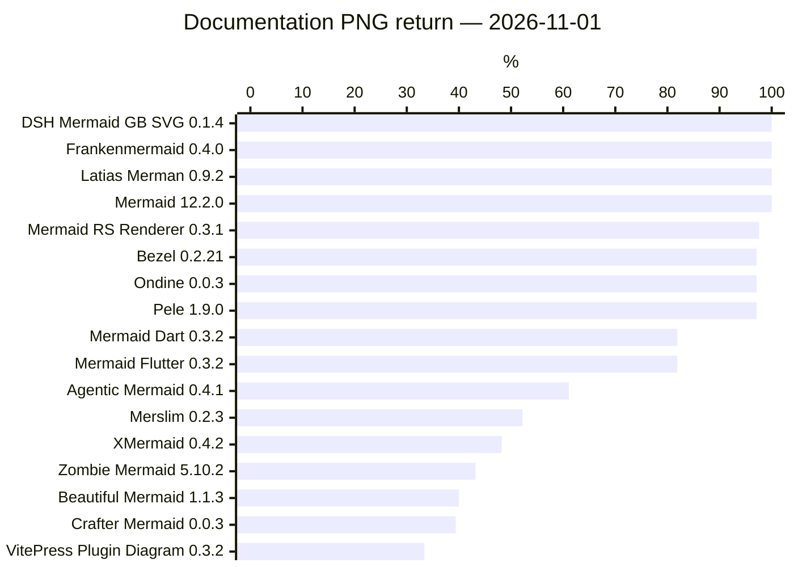
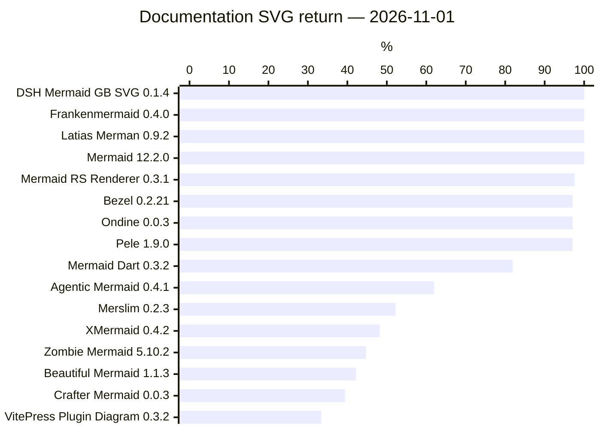
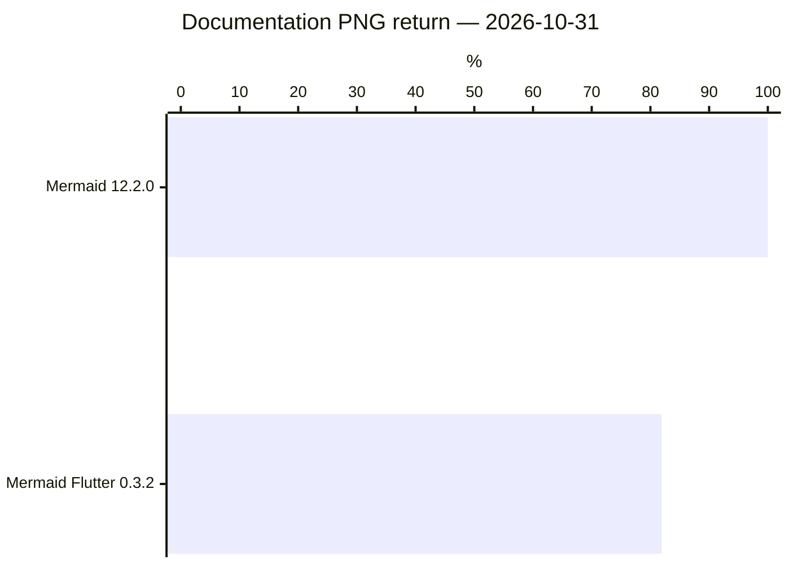
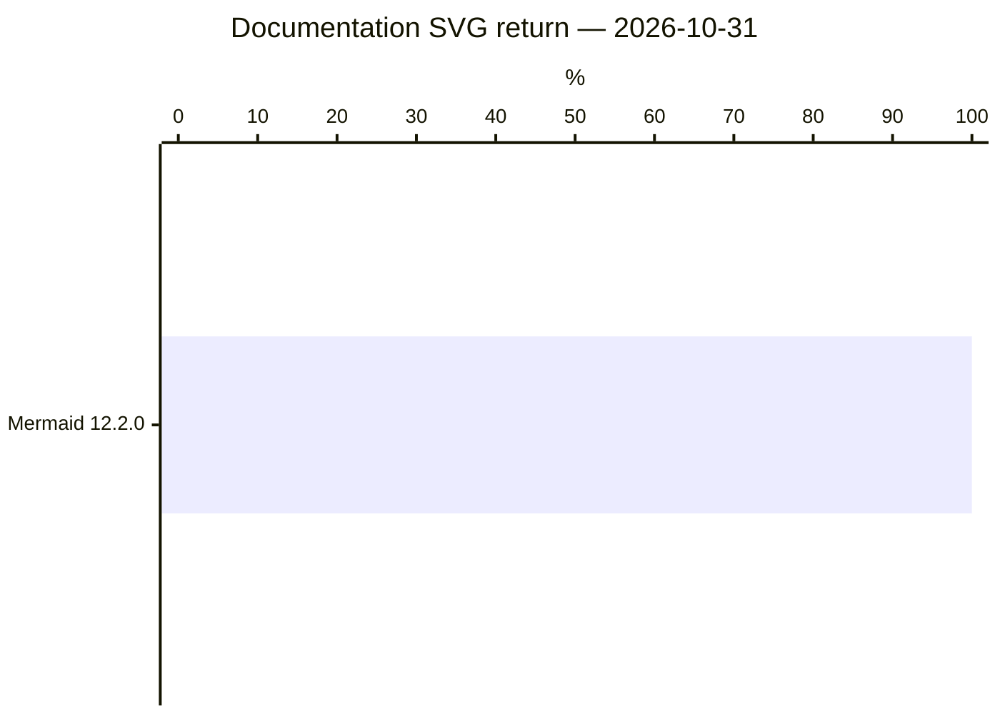
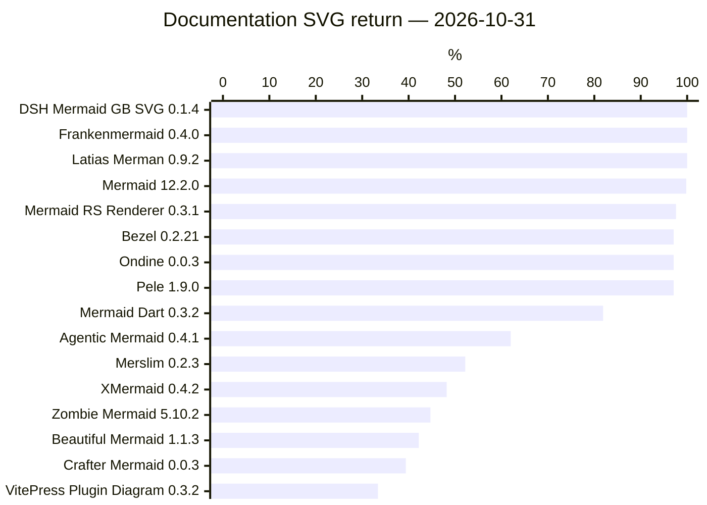

# DaveBench — Documentation Rendering · part 1

[Ecosystem overview](../../RESULTS.md) · [All parts](docs.md)

**run-0ed76179c115bf2cd81ed5c5** · 2026-11-01 · unit: documentation drawings · [evidence](https://raw.githubusercontent.com/adewale/trident/2c464366c5f05c01b29e41993a64e1eddb77be58/evidence/2/report.json)

Corpus: the same pinned Mermaid documentation inventory. First-round actual PNG witnesses checked against source expectations. PNG content reviews bind actual image, source and expected-fact hashes; SVG and nonblank checks supply no raster correctness credit. Rank counts verified correct drawings out of 546; 1 configuration example(s) and 1 independently invalid-source control(s) are separate. Unassessed sources/observers, unrun work and typed failures remain separate. Bounds span unresolved cases only; observer coverage counts actual drawing or format verdicts. Overlapping bounds establish no accuracy winner. Complete accuracy requires zero unresolved cases; speed requires its own qualified timing evidence.

Ranked by **Correct**, highest first. Equal values share a rank; unavailable values are unranked.

Ranks order verified correct counts once an outcome is resolved; observed zero remains ranked and fully unresolved rows are unranked. Observer coverage counts drawing and format verdicts. Correctness bounds include unresolved cases; overlapping bounds establish no accuracy winner. Unsupported inputs and proven renderer failures remain explicit non-successes on this corpus.

Comparisons claim superiority only when correctness bounds are disjoint; otherwise they describe verified-count differences. This is a comparison of the named metric, not overall project quality.

| Project | Verified-count rank | Version | Correct | Incorrect drawing | Invalid format | Unsupported | Renderer failure | Unassessed | Unrun | Harness failure | Planned drawings | Observer coverage (%) | Correctness lower (%) | Correctness upper (%) | Measured | vs Mermaid | Ranking note |
| --- | --- | --- | --- | --- | --- | --- | --- | --- | --- | --- | --- | --- | --- | --- | --- | --- | --- |
| Mermaid | 1 | 12.2.0 | 431 | 43 | 0 | 0 | 0 | 72 | 0 | 0 | 546 | 86.8 | 78.9 | 92.1 | 2026-11-01T16:11:48.486Z | Baseline |  |
| Mermaid Flutter | 2 | 0.3.2 | 297 | 138 | 0 | 0 | 0 | 111 | 0 | 0 | 546 | 79.7 | 54.4 | 74.7 | 2026-11-01T17:36:05.583027Z | Lower on this corpus (-134 verified); disjoint bounds |  |
| Latias Merman | 3 | 0.9.2 | 94 | 10 | 0 | 0 | 0 | 442 | 0 | 0 | 546 | 19.0 | 17.2 | 98.2 | 2026-11-01T13:17:40.908Z | Fewer verified (-337); bounds overlap |  |
| Crafter Mermaid | 4 | 0.0.3 | 0 | 15 | 0 | 0 | 0 | 531 | 0 | 0 | 546 | 2.7 | 0.0 | 97.3 | 2026-11-01T12:43:07.981Z | Fewer verified (-431); bounds overlap |  |
| Frankenmermaid | 4 | 0.4.0 | 0 | 2 | 0 | 0 | 0 | 544 | 0 | 0 | 546 | 0.4 | 0.0 | 99.6 | 2026-11-01T12:52:22.568Z | Fewer verified (-431); bounds overlap |  |
| Mermaid RS Renderer | 4 | 0.3.1 | 0 | 5 | 0 | 0 | 0 | 541 | 0 | 0 | 546 | 0.9 | 0.0 | 99.1 | 2026-11-01T12:34:21.308Z | Fewer verified (-431); bounds overlap |  |
| Merslim | 4 | 0.2.3 | 0 | 79 | 0 | 0 | 0 | 467 | 0 | 0 | 546 | 14.5 | 0.0 | 85.5 | 2026-11-01T12:56:59.533Z | Fewer verified (-431); bounds overlap |  |
| VitePress Plugin Diagram | 4 | 0.3.2 | 0 | 1 | 0 | 0 | 0 | 545 | 0 | 0 | 546 | 0.2 | 0.0 | 99.8 | 2026-11-01T13:07:57.827Z | Fewer verified (-431); bounds overlap |  |
| Agentic Mermaid | — | 0.4.1 | 0 | 0 | 0 | 0 | 0 | 546 | 0 | 0 | 546 | 0.0 | 0.0 | 100.0 | 2026-11-01T12:37:57.996Z | Fewer verified (-431); bounds overlap | No verified drawing-content observations |
| Beautiful Mermaid | — | 1.1.3 | 0 | 0 | 0 | 0 | 0 | 546 | 0 | 0 | 546 | 0.0 | 0.0 | 100.0 | 2026-11-01T13:26:04.258Z | Fewer verified (-431); bounds overlap | No verified drawing-content observations |
| Bezel | — | 0.2.21 | 0 | 0 | 0 | 0 | 0 | 546 | 0 | 0 | 546 | 0.0 | 0.0 | 100.0 | 2026-11-01T12:41:35.690Z | Fewer verified (-431); bounds overlap | No verified drawing-content observations |
| DSH Mermaid GB SVG | — | 0.1.4 | 0 | 0 | 0 | 0 | 0 | 546 | 0 | 0 | 546 | 0.0 | 0.0 | 100.0 | 2026-11-01T14:13:18.612Z | Fewer verified (-431); bounds overlap | No verified drawing-content observations |
| Mermaid Dart | — | 0.3.2 | 0 | 0 | 0 | 0 | 0 | 546 | 0 | 0 | 546 | 0.0 | 0.0 | 100.0 | 2026-11-01T14:00:31.418Z | Fewer verified (-431); bounds overlap | No verified drawing-content observations |
| Ondine | — | 0.0.3 | 0 | 0 | 0 | 0 | 0 | 546 | 0 | 0 | 546 | 0.0 | 0.0 | 100.0 | 2026-11-01T14:27:38.234Z | Fewer verified (-431); bounds overlap | No verified drawing-content observations |
| Pele | — | 1.9.0 | 0 | 0 | 0 | 0 | 0 | 546 | 0 | 0 | 546 | 0.0 | 0.0 | 100.0 | 2026-11-01T13:48:39.518Z | Fewer verified (-431); bounds overlap | No verified drawing-content observations |
| XMermaid | — | 0.4.2 | 0 | 0 | 0 | 0 | 0 | 546 | 0 | 0 | 546 | 0.0 | 0.0 | 100.0 | 2026-11-01T13:02:12.471Z | Fewer verified (-431); bounds overlap | No verified drawing-content observations |
| Zombie Mermaid | — | 5.10.2 | 0 | 0 | 0 | 0 | 0 | 546 | 0 | 0 | 546 | 0.0 | 0.0 | 100.0 | 2026-11-01T12:46:01.801Z | Fewer verified (-431); bounds overlap | No verified drawing-content observations |

**run-c69b61e4228a0b2c9388923a** · 2026-11-01 · unit: documentation drawings · [evidence](https://raw.githubusercontent.com/adewale/trident/2c464366c5f05c01b29e41993a64e1eddb77be58/evidence/1/report.json)

Corpus: the same pinned Mermaid documentation inventory. First-round actual SVG witnesses checked against source expectations. Shared SVG paint/meaning observer. Rank counts verified correct drawings out of 546; 1 configuration example(s) and 1 independently invalid-source control(s) are separate. Unassessed sources/observers, unrun work and typed failures remain separate. Bounds span unresolved cases only; observer coverage counts actual drawing or format verdicts. Overlapping bounds establish no accuracy winner. Complete accuracy requires zero unresolved cases; speed requires its own qualified timing evidence.

Ranked by **Correct**, highest first. Equal values share a rank; unavailable values are unranked.

Ranks order verified correct counts once an outcome is resolved; observed zero remains ranked and fully unresolved rows are unranked. Observer coverage counts drawing and format verdicts. Correctness bounds include unresolved cases; overlapping bounds establish no accuracy winner. Unsupported inputs and proven renderer failures remain explicit non-successes on this corpus.

Comparisons claim superiority only when correctness bounds are disjoint; otherwise they describe verified-count differences. This is a comparison of the named metric, not overall project quality.

| Project | Verified-count rank | Version | Correct | Incorrect drawing | Invalid format | Unsupported | Renderer failure | Unassessed | Unrun | Harness failure | Planned drawings | Observer coverage (%) | Correctness lower (%) | Correctness upper (%) | Measured | vs Mermaid |
| --- | --- | --- | --- | --- | --- | --- | --- | --- | --- | --- | --- | --- | --- | --- | --- | --- |
| Mermaid | 1 | 12.2.0 | 331 | 54 | 0 | 0 | 0 | 161 | 0 | 0 | 546 | 70.5 | 60.6 | 90.1 | 2026-11-01T12:24:33.018Z | Baseline |
| Latias Merman | 2 | 0.9.2 | 240 | 55 | 0 | 0 | 0 | 251 | 0 | 0 | 546 | 54.0 | 44.0 | 89.9 | 2026-11-01T11:58:59.589Z | Fewer verified (-91); bounds overlap |
| Bezel | 3 | 0.2.21 | 238 | 49 | 0 | 0 | 0 | 259 | 0 | 0 | 546 | 52.6 | 43.6 | 91.0 | 2026-11-01T12:32:25.974Z | Fewer verified (-93); bounds overlap |
| Pele | 3 | 1.9.0 | 238 | 49 | 0 | 0 | 0 | 259 | 0 | 0 | 546 | 52.6 | 43.6 | 91.0 | 2026-11-01T12:10:16.658Z | Fewer verified (-93); bounds overlap |
| Ondine | 5 | 0.0.3 | 236 | 48 | 0 | 0 | 0 | 262 | 0 | 0 | 546 | 52.0 | 43.2 | 91.2 | 2026-11-01T11:30:42.973Z | Fewer verified (-95); bounds overlap |
| Mermaid Dart | 6 | 0.3.2 | 146 | 116 | 0 | 0 | 0 | 284 | 0 | 0 | 546 | 48.0 | 26.7 | 78.8 | 2026-11-01T11:33:32.002Z | Fewer verified (-185); bounds overlap |
| Frankenmermaid | 7 | 0.4.0 | 110 | 189 | 0 | 0 | 0 | 244 | 0 | 3 | 546 | 54.8 | 20.1 | 65.4 | 2026-11-01T11:27:18.840Z | Fewer verified (-221); bounds overlap |
| Agentic Mermaid | 8 | 0.4.1 | 91 | 83 | 0 | 0 | 0 | 372 | 0 | 0 | 546 | 31.9 | 16.7 | 84.8 | 2026-11-01T11:35:32.452Z | Fewer verified (-240); bounds overlap |
| Zombie Mermaid | 9 | 5.10.2 | 72 | 61 | 0 | 0 | 0 | 413 | 0 | 0 | 546 | 24.4 | 13.2 | 88.8 | 2026-11-01T11:38:06.717Z | Fewer verified (-259); bounds overlap |
| Mermaid RS Renderer | 10 | 0.3.1 | 55 | 270 | 0 | 0 | 0 | 221 | 0 | 0 | 546 | 59.5 | 10.1 | 50.5 | 2026-11-01T11:40:49.082Z | Lower on this corpus (-276 verified); disjoint bounds |
| XMermaid | 11 | 0.4.2 | 34 | 86 | 0 | 0 | 0 | 426 | 0 | 0 | 546 | 22.0 | 6.2 | 84.2 | 2026-11-01T11:48:42.561Z | Fewer verified (-297); bounds overlap |
| Beautiful Mermaid | 12 | 1.1.3 | 29 | 155 | 0 | 0 | 0 | 362 | 0 | 0 | 546 | 33.7 | 5.3 | 71.6 | 2026-11-01T12:03:14.712Z | Fewer verified (-302); bounds overlap |
| Crafter Mermaid | 13 | 0.0.3 | 26 | 157 | 0 | 0 | 0 | 363 | 0 | 0 | 546 | 33.5 | 4.8 | 71.2 | 2026-11-01T11:42:47.418Z | Fewer verified (-305); bounds overlap |
| Merslim | 14 | 0.2.3 | 16 | 200 | 0 | 0 | 0 | 330 | 0 | 0 | 546 | 39.6 | 2.9 | 63.4 | 2026-11-01T11:45:50.321Z | Fewer verified (-315); bounds overlap |
| DSH Mermaid GB SVG | 15 | 0.1.4 | 15 | 457 | 0 | 0 | 0 | 72 | 0 | 2 | 546 | 86.4 | 2.7 | 16.3 | 2026-11-01T12:15:06.214Z | Lower on this corpus (-316 verified); disjoint bounds |
| VitePress Plugin Diagram | 16 | 0.3.2 | 0 | 147 | 0 | 0 | 0 | 399 | 0 | 0 | 546 | 26.9 | 0.0 | 73.1 | 2026-11-01T11:51:34.319Z | Fewer verified (-331); bounds overlap |

**run-254dfd3bc1261d7b8e4edfc8** · 2026-10-31 · unit: documentation drawings · [evidence](../../results/current-outcomes-2026-11-01/receipt.json)

Current retained-evidence outcome reduction. Only the explicitly listed saved-output corrections use new observers/contracts; all other rows retain their original per-case epochs in the attached normal results. No new renderer/API calls. Corpus: the same pinned Mermaid documentation inventory. First-round actual SVG witnesses checked against source expectations. Shared SVG paint/meaning observer. Rank counts verified correct drawings out of 546; 1 configuration example(s) and 1 independently invalid-source control(s) are separate. Unassessed sources/observers, unrun work and typed failures remain separate. Bounds span unresolved cases only; observer coverage counts actual drawing or format verdicts. Overlapping bounds establish no accuracy winner. Complete accuracy requires zero unresolved cases; speed requires its own qualified timing evidence. Dates use the owning PNG-export calls; these companion SVGs have no independent SVG clock. Observer publication/recheck time is separate in campaignUpdatedAt.

Ranked by **Correct**, highest first. Equal values share a rank; unavailable values are unranked.

Ranks order verified correct counts once an outcome is resolved; observed zero remains ranked and fully unresolved rows are unranked. Observer coverage counts drawing and format verdicts. Correctness bounds include unresolved cases; overlapping bounds establish no accuracy winner. Unsupported inputs and proven renderer failures remain explicit non-successes on this corpus.

Comparisons claim superiority only when correctness bounds are disjoint; otherwise they describe verified-count differences. This is a comparison of the named metric, not overall project quality.

| Project | Verified-count rank | Version | Correct | Incorrect drawing | Invalid format | Unsupported | Renderer failure | Unassessed | Unrun | Harness failure | Planned drawings | Observer coverage (%) | Correctness lower (%) | Correctness upper (%) | Measured | vs Mermaid |
| --- | --- | --- | --- | --- | --- | --- | --- | --- | --- | --- | --- | --- | --- | --- | --- | --- |
| Mermaid | 1 | 12.2.0 | 330 | 28 | 26 | 0 | 0 | 162 | 0 | 0 | 546 | 70.3 | 60.4 | 90.1 | 2026-10-31T20:31:37.517Z | Baseline |

**run-4c98b569db43bffecf6f3193** · 2026-10-31 · unit: documentation drawings · [evidence](../../results/current-outcomes-2026-11-01/receipt.json)

Current retained-evidence outcome reduction. Only the explicitly listed saved-output corrections use new observers/contracts; all other rows retain their original per-case epochs in the attached normal results. No new renderer/API calls. Corpus: the same pinned Mermaid documentation inventory. First-round actual PNG witnesses checked against source expectations. PNG content reviews bind actual image, source and expected-fact hashes; SVG and nonblank checks supply no raster correctness credit. Rank counts verified correct drawings out of 546; 1 configuration example(s) and 1 independently invalid-source control(s) are separate. Unassessed sources/observers, unrun work and typed failures remain separate. Bounds span unresolved cases only; observer coverage counts actual drawing or format verdicts. Overlapping bounds establish no accuracy winner. Complete accuracy requires zero unresolved cases; speed requires its own qualified timing evidence.

Ranked by **Correct**, highest first. Equal values share a rank; unavailable values are unranked.

Ranks order verified correct counts once an outcome is resolved; observed zero remains ranked and fully unresolved rows are unranked. Observer coverage counts drawing and format verdicts. Correctness bounds include unresolved cases; overlapping bounds establish no accuracy winner. Unsupported inputs and proven renderer failures remain explicit non-successes on this corpus.

Comparisons claim superiority only when correctness bounds are disjoint; otherwise they describe verified-count differences. This is a comparison of the named metric, not overall project quality.

| Project | Verified-count rank | Version | Correct | Incorrect drawing | Invalid format | Unsupported | Renderer failure | Unassessed | Unrun | Harness failure | Planned drawings | Observer coverage (%) | Correctness lower (%) | Correctness upper (%) | Measured | vs Mermaid |
| --- | --- | --- | --- | --- | --- | --- | --- | --- | --- | --- | --- | --- | --- | --- | --- | --- |
| Mermaid | 1 | 12.2.0 | 497 | 44 | 0 | 0 | 0 | 5 | 0 | 0 | 546 | 99.1 | 91.0 | 91.9 | 2026-10-31T20:31:37.517Z | Baseline |
| Mermaid Flutter | 2 | 0.3.2 | 297 | 138 | 0 | 78 | 21 | 12 | 0 | 0 | 546 | 79.7 | 54.4 | 56.6 | 2026-10-31T09:01:40.231Z | Lower on this corpus (-200 verified); disjoint bounds |

**run-4cba210a4cf14cd50f478f9e** · 2026-11-01 · unit: documentation occurrences · [evidence](https://raw.githubusercontent.com/adewale/trident/2c464366c5f05c01b29e41993a64e1eddb77be58/evidence/2/report.json)

Corpus: Mermaid syntax documentation at 1fb7869866dd619168d840291c9c54b4f129758b; 548 occurrences, retaining duplicates. PNG output lane. Returned means the occurrence returned PNG in all 1 declared rounds. Failures and unexecuted work retain the full inventory. Output return does not certify drawing content.

Ranked by **Returned in all rounds / Planned**, highest first. Equal values share a rank; unavailable values are unranked.

“Higher” and “Lower” compare **Returned in all rounds** on this population. Unknown evidence remains unresolved. This is a comparison of the named metric, not overall project quality.

| Project | Rank | Version | Returned in all rounds | Failed | Unsupported | Blocked | Unexecuted | Partially observed | Planned | Measured | vs Mermaid | % |
| --- | --- | --- | --- | --- | --- | --- | --- | --- | --- | --- | --- | --- |
| DSH Mermaid GB SVG | 1 | 0.1.4 | 548 | 0 | 0 | 0 | 0 | 0 | 548 | 2026-11-01T14:13:18.612Z | Tie | 100.0% |
| Frankenmermaid | 1 | 0.4.0 | 548 | 0 | 0 | 0 | 0 | 0 | 548 | 2026-11-01T12:52:22.568Z | Tie | 100.0% |
| Latias Merman | 1 | 0.9.2 | 548 | 0 | 0 | 0 | 0 | 0 | 548 | 2026-11-01T13:17:40.908Z | Tie | 100.0% |
| Mermaid | 1 | 12.2.0 | 548 | 0 | 0 | 0 | 0 | 0 | 548 | 2026-11-01T16:11:48.486Z | Baseline | 100.0% |
| Mermaid RS Renderer | 5 | 0.3.1 | 535 | 13 | 0 | 0 | 0 | 0 | 548 | 2026-11-01T12:34:21.308Z | Lower (-13) | 97.6% |
| Bezel | 6 | 0.2.21 | 532 | 16 | 0 | 0 | 0 | 0 | 548 | 2026-11-01T12:41:35.690Z | Lower (-16) | 97.1% |
| Ondine | 6 | 0.0.3 | 532 | 16 | 0 | 0 | 0 | 0 | 548 | 2026-11-01T14:27:38.234Z | Lower (-16) | 97.1% |
| Pele | 6 | 1.9.0 | 532 | 16 | 0 | 0 | 0 | 0 | 548 | 2026-11-01T13:48:39.518Z | Lower (-16) | 97.1% |
| Mermaid Dart | 9 | 0.3.2 | 449 | 99 | 0 | 0 | 0 | 0 | 548 | 2026-11-01T14:00:31.418Z | Lower (-99) | 81.9% |
| Mermaid Flutter | 9 | 0.3.2 | 449 | 99 | 0 | 0 | 0 | 0 | 548 | 2026-11-01T17:36:05.583027Z | Lower (-99) | 81.9% |
| Agentic Mermaid | 11 | 0.4.1 | 335 | 213 | 0 | 0 | 0 | 0 | 548 | 2026-11-01T12:37:57.996Z | Lower (-213) | 61.1% |
| Merslim | 12 | 0.2.3 | 286 | 262 | 0 | 0 | 0 | 0 | 548 | 2026-11-01T12:56:59.533Z | Lower (-262) | 52.2% |
| XMermaid | 13 | 0.4.2 | 264 | 284 | 0 | 0 | 0 | 0 | 548 | 2026-11-01T13:02:12.471Z | Lower (-284) | 48.2% |
| Zombie Mermaid | 14 | 5.10.2 | 237 | 311 | 0 | 0 | 0 | 0 | 548 | 2026-11-01T12:46:01.801Z | Lower (-311) | 43.2% |
| Beautiful Mermaid | 15 | 1.1.3 | 219 | 329 | 0 | 0 | 0 | 0 | 548 | 2026-11-01T13:26:04.258Z | Lower (-329) | 40.0% |
| Crafter Mermaid | 16 | 0.0.3 | 216 | 332 | 0 | 0 | 0 | 0 | 548 | 2026-11-01T12:43:07.981Z | Lower (-332) | 39.4% |
| VitePress Plugin Diagram | 17 | 0.3.2 | 183 | 365 | 0 | 0 | 0 | 0 | 548 | 2026-11-01T13:07:57.827Z | Lower (-365) | 33.4% |

**run-7a5fab897e6aeacafe4a0c73** · 2026-11-01 · unit: invalid-source controls · [evidence](https://raw.githubusercontent.com/adewale/trident/2c464366c5f05c01b29e41993a64e1eddb77be58/evidence/2/report.json)

Corpus: 1 invalid-source documentation example(s), retained verbatim in the 548-occurrence inventory. A source-bound typed native rejection passes; an actual public return fails. Generic exceptions and missing evidence remain unknown.

Ranked by **Correct rejection**, highest first. Equal values share a rank; unavailable values are unranked.

“Higher” and “Lower” compare **Correct rejection** on this population. Unknown evidence remains unresolved. This is a comparison of the named metric, not overall project quality.

| Project | Rank | Version | Correct rejection | Accepted invalid source | Unknown | Planned controls | Measured | vs Mermaid | Ranking note |
| --- | --- | --- | --- | --- | --- | --- | --- | --- | --- |
| Bezel | 1 | 0.2.21 | 0 | 1 | 0 | 1 | 2026-11-01T12:40:32.063Z | Tie |  |
| DSH Mermaid GB SVG | 1 | 0.1.4 | 0 | 1 | 0 | 1 | 2026-11-01T14:07:21.908Z | Tie |  |
| Frankenmermaid | 1 | 0.4.0 | 0 | 1 | 0 | 1 | 2026-11-01T12:49:13.413Z | Tie |  |
| Latias Merman | 1 | 0.9.2 | 0 | 1 | 0 | 1 | 2026-11-01T13:12:53.966Z | Tie |  |
| Mermaid | 1 | 12.2.0 | 0 | 1 | 0 | 1 | 2026-11-01T16:08:57.413Z | Baseline |  |
| Mermaid Dart | 1 | 0.3.2 | 0 | 1 | 0 | 1 | 2026-11-01T13:54:49.539Z | Tie |  |
| Mermaid Flutter | 1 | 0.3.2 | 0 | 1 | 0 | 1 | 2026-11-01T17:38:08.731Z | Tie |  |
| Mermaid RS Renderer | 1 | 0.3.1 | 0 | 1 | 0 | 1 | 2026-11-01T12:33:15.619Z | Tie |  |
| Ondine | 1 | 0.0.3 | 0 | 1 | 0 | 1 | 2026-11-01T14:20:38.926Z | Tie |  |
| Pele | 1 | 1.9.0 | 0 | 1 | 0 | 1 | 2026-11-01T13:43:50.760Z | Tie |  |
| Agentic Mermaid | — | 0.4.1 | 0 | 0 | 1 | 1 | 2026-11-01T12:37:24.802Z | Unresolved | No qualified source-control observation |
| Beautiful Mermaid | — | 1.1.3 | 0 | 0 | 1 | 1 | 2026-11-01T13:22:10.686Z | Unresolved | No qualified source-control observation |
| Crafter Mermaid | — | 0.0.3 | 0 | 0 | 1 | 1 | 2026-11-01T12:42:23.351Z | Unresolved | No qualified source-control observation |
| Merslim | — | 0.2.3 | 0 | 0 | 1 | 1 | 2026-11-01T12:54:51.493Z | Unresolved | No qualified source-control observation |
| VitePress Plugin Diagram | — | 0.3.2 | 0 | 0 | 1 | 1 | 2026-11-01T13:05:28.140Z | Unresolved | No qualified source-control observation |
| XMermaid | — | 0.4.2 | 0 | 0 | 1 | 1 | 2026-11-01T12:59:47.158Z | Unresolved | No qualified source-control observation |
| Zombie Mermaid | — | 5.10.2 | 0 | 0 | 1 | 1 | 2026-11-01T12:44:46.942Z | Unresolved | No qualified source-control observation |

**run-98873db1ec330a155097477e** · 2026-11-01 · unit: documentation occurrences · [evidence](https://raw.githubusercontent.com/adewale/trident/2c464366c5f05c01b29e41993a64e1eddb77be58/evidence/1/report.json)

Corpus: Mermaid syntax documentation at 1fb7869866dd619168d840291c9c54b4f129758b; 548 occurrences, retaining duplicates. SVG output lane. Returned means the occurrence returned SVG in all 1 declared rounds. Failures and unexecuted work retain the full inventory. Output return does not certify drawing content.

Ranked by **Returned in all rounds / Planned**, highest first. Equal values share a rank; unavailable values are unranked.

“Higher” and “Lower” compare **Returned in all rounds** on this population. Unknown evidence remains unresolved. This is a comparison of the named metric, not overall project quality.

| Project | Rank | Version | Returned in all rounds | Failed | Unsupported | Blocked | Unexecuted | Partially observed | Planned | Measured | vs Mermaid | % |
| --- | --- | --- | --- | --- | --- | --- | --- | --- | --- | --- | --- | --- |
| DSH Mermaid GB SVG | 1 | 0.1.4 | 548 | 0 | 0 | 0 | 0 | 0 | 548 | 2026-11-01T12:15:06.214Z | Tie | 100.0% |
| Frankenmermaid | 1 | 0.4.0 | 548 | 0 | 0 | 0 | 0 | 0 | 548 | 2026-11-01T11:27:18.840Z | Tie | 100.0% |
| Latias Merman | 1 | 0.9.2 | 548 | 0 | 0 | 0 | 0 | 0 | 548 | 2026-11-01T11:58:59.589Z | Tie | 100.0% |
| Mermaid | 1 | 12.2.0 | 548 | 0 | 0 | 0 | 0 | 0 | 548 | 2026-11-01T12:24:33.018Z | Baseline | 100.0% |
| Mermaid RS Renderer | 5 | 0.3.1 | 535 | 13 | 0 | 0 | 0 | 0 | 548 | 2026-11-01T11:40:49.082Z | Lower (-13) | 97.6% |
| Bezel | 6 | 0.2.21 | 532 | 16 | 0 | 0 | 0 | 0 | 548 | 2026-11-01T12:32:25.974Z | Lower (-16) | 97.1% |
| Ondine | 6 | 0.0.3 | 532 | 16 | 0 | 0 | 0 | 0 | 548 | 2026-11-01T11:30:42.973Z | Lower (-16) | 97.1% |
| Pele | 6 | 1.9.0 | 532 | 16 | 0 | 0 | 0 | 0 | 548 | 2026-11-01T12:10:16.658Z | Lower (-16) | 97.1% |
| Mermaid Dart | 9 | 0.3.2 | 449 | 99 | 0 | 0 | 0 | 0 | 548 | 2026-11-01T11:33:32.002Z | Lower (-99) | 81.9% |
| Agentic Mermaid | 10 | 0.4.1 | 340 | 208 | 0 | 0 | 0 | 0 | 548 | 2026-11-01T11:35:32.452Z | Lower (-208) | 62.0% |
| Merslim | 11 | 0.2.3 | 286 | 262 | 0 | 0 | 0 | 0 | 548 | 2026-11-01T11:45:50.321Z | Lower (-262) | 52.2% |
| XMermaid | 12 | 0.4.2 | 264 | 284 | 0 | 0 | 0 | 0 | 548 | 2026-11-01T11:48:42.561Z | Lower (-284) | 48.2% |
| Zombie Mermaid | 13 | 5.10.2 | 245 | 303 | 0 | 0 | 0 | 0 | 548 | 2026-11-01T11:38:06.717Z | Lower (-303) | 44.7% |
| Beautiful Mermaid | 14 | 1.1.3 | 231 | 317 | 0 | 0 | 0 | 0 | 548 | 2026-11-01T12:03:14.712Z | Lower (-317) | 42.2% |
| Crafter Mermaid | 15 | 0.0.3 | 216 | 332 | 0 | 0 | 0 | 0 | 548 | 2026-11-01T11:42:47.418Z | Lower (-332) | 39.4% |
| VitePress Plugin Diagram | 16 | 0.3.2 | 183 | 365 | 0 | 0 | 0 | 0 | 548 | 2026-11-01T11:51:34.319Z | Lower (-365) | 33.4% |

**run-f720469dcf3b4174db528ae8** · 2026-11-01 · unit: invalid-source controls · [evidence](https://raw.githubusercontent.com/adewale/trident/2c464366c5f05c01b29e41993a64e1eddb77be58/evidence/1/report.json)

Corpus: 1 invalid-source documentation example(s), retained verbatim in the 548-occurrence inventory. A source-bound typed native rejection passes; an actual public return fails. Generic exceptions and missing evidence remain unknown.

Ranked by **Correct rejection**, highest first. Equal values share a rank; unavailable values are unranked.

“Higher” and “Lower” compare **Correct rejection** on this population. Unknown evidence remains unresolved. This is a comparison of the named metric, not overall project quality.

| Project | Rank | Version | Correct rejection | Accepted invalid source | Unknown | Planned controls | Measured | vs Mermaid | Ranking note |
| --- | --- | --- | --- | --- | --- | --- | --- | --- | --- |
| Bezel | 1 | 0.2.21 | 0 | 1 | 0 | 1 | 2026-11-01T12:28:35.736Z | Tie |  |
| DSH Mermaid GB SVG | 1 | 0.1.4 | 0 | 1 | 0 | 1 | 2026-11-01T12:12:57.078Z | Tie |  |
| Frankenmermaid | 1 | 0.4.0 | 0 | 1 | 0 | 1 | 2026-11-01T11:26:22.616Z | Tie |  |
| Latias Merman | 1 | 0.9.2 | 0 | 1 | 0 | 1 | 2026-11-01T11:55:21.118Z | Tie |  |
| Mermaid | 1 | 12.2.0 | 0 | 1 | 0 | 1 | 2026-11-01T12:20:11.181Z | Baseline |  |
| Mermaid Dart | 1 | 0.3.2 | 0 | 1 | 0 | 1 | 2026-11-01T11:32:22.231Z | Tie |  |
| Mermaid RS Renderer | 1 | 0.3.1 | 0 | 1 | 0 | 1 | 2026-11-01T11:39:23.006Z | Tie |  |
| Ondine | 1 | 0.0.3 | 0 | 1 | 0 | 1 | 2026-11-01T11:29:13.757Z | Tie |  |
| Pele | 1 | 1.9.0 | 0 | 1 | 0 | 1 | 2026-11-01T12:07:09.564Z | Tie |  |
| Agentic Mermaid | — | 0.4.1 | 0 | 0 | 1 | 1 | 2026-11-01T11:34:41.228Z | Unresolved | No qualified source-control observation |
| Beautiful Mermaid | — | 1.1.3 | 0 | 0 | 1 | 1 | 2026-11-01T12:01:03.879Z | Unresolved | No qualified source-control observation |
| Crafter Mermaid | — | 0.0.3 | 0 | 0 | 1 | 1 | 2026-11-01T11:41:54.522Z | Unresolved | No qualified source-control observation |
| Merslim | — | 0.2.3 | 0 | 0 | 1 | 1 | 2026-11-01T11:44:32.693Z | Unresolved | No qualified source-control observation |
| VitePress Plugin Diagram | — | 0.3.2 | 0 | 0 | 1 | 1 | 2026-11-01T11:50:26.929Z | Unresolved | No qualified source-control observation |
| XMermaid | — | 0.4.2 | 0 | 0 | 1 | 1 | 2026-11-01T11:47:23.140Z | Unresolved | No qualified source-control observation |
| Zombie Mermaid | — | 5.10.2 | 0 | 0 | 1 | 1 | 2026-11-01T11:36:47.357Z | Unresolved | No qualified source-control observation |

**run-100e15cdd6fd53c4d6afd917** · 2026-10-31 · unit: documentation occurrences · [evidence](../../docs/evidence/b0/receipt.json)

Frozen B0; exact input, contract epochs and owned outcomes are in the B0 receipt. Corpus: Mermaid syntax documentation at 1fb7869866dd619168d840291c9c54b4f129758b; 548 occurrences, retaining duplicates. PNG output lane. Returned means the occurrence returned PNG in all 1 declared rounds. Failures and unexecuted work retain the full inventory. Output return does not certify drawing content.

Ranked by **Returned in all rounds / Planned**, highest first. Equal values share a rank; unavailable values are unranked.

“Higher” and “Lower” compare **Returned in all rounds** on this population. Unknown evidence remains unresolved. This is a comparison of the named metric, not overall project quality.

| Project | Rank | Version | Returned in all rounds | Failed | Unsupported | Blocked | Unexecuted | Partially observed | Planned | Measured | vs Mermaid | % |
| --- | --- | --- | --- | --- | --- | --- | --- | --- | --- | --- | --- | --- |
| Mermaid | 1 | 12.2.0 | 548 | 0 | 0 | 0 | 0 | 0 | 548 | 2026-10-31T20:31:37.517Z | Baseline | 100.0% |
| Mermaid Flutter | 2 | 0.3.2 | 449 | 99 | 0 | 0 | 0 | 0 | 548 | 2026-10-31T09:01:40.231Z | Lower (-99) | 81.9% |

**run-432d8455e8681dd50e77ed27** · 2026-10-31 · unit: invalid-source controls · [evidence](../../docs/evidence/b0/receipt.json)

Frozen B0; exact input, contract epochs and owned outcomes are in the B0 receipt. Corpus: 1 invalid-source documentation example(s), retained verbatim in the 548-occurrence inventory. A source-bound typed native rejection passes; an actual public return fails. Generic exceptions and missing evidence remain unknown.

Ranked by **Correct rejection**, highest first. Equal values share a rank; unavailable values are unranked.

“Higher” and “Lower” compare **Correct rejection** on this population. Unknown evidence remains unresolved. This is a comparison of the named metric, not overall project quality.

| Project | Rank | Version | Correct rejection | Accepted invalid source | Unknown | Planned controls | Measured | vs Mermaid |
| --- | --- | --- | --- | --- | --- | --- | --- | --- |
| Mermaid | 1 | 12.2.0 | 0 | 1 | 0 | 1 | 2026-10-31T19:23:21.034Z | Baseline |
| Mermaid Flutter | 1 | 0.3.2 | 0 | 1 | 0 | 1 | 2026-10-31T09:01:33.726Z | Tie |

**run-b206851a3126313e782400b2** · 2026-10-31 · unit: documentation occurrences · [evidence](../../docs/evidence/b0/receipt.json)

Frozen B0; exact input, contract epochs and owned outcomes are in the B0 receipt. Corpus: Mermaid syntax documentation at 1fb7869866dd619168d840291c9c54b4f129758b; 548 occurrences, retaining duplicates. SVG output lane. Returned means the occurrence returned SVG in all 1 declared rounds. Failures and unexecuted work retain the full inventory. Output return does not certify drawing content. Dates use the owning PNG-export calls; these companion SVGs have no independent SVG clock. Observer publication/recheck time is separate in campaignUpdatedAt.

Ranked by **Returned in all rounds / Planned**, highest first. Equal values share a rank; unavailable values are unranked.

“Higher” and “Lower” compare **Returned in all rounds** on this population. Unknown evidence remains unresolved. This is a comparison of the named metric, not overall project quality.

| Project | Rank | Version | Returned in all rounds | Failed | Unsupported | Blocked | Unexecuted | Partially observed | Planned | Measured | vs Mermaid | % |
| --- | --- | --- | --- | --- | --- | --- | --- | --- | --- | --- | --- | --- |
| Mermaid | 1 | 12.2.0 | 548 | 0 | 0 | 0 | 0 | 0 | 548 | 2026-10-31T20:31:37.517Z | Baseline | 100.0% |

**run-bfeb6b6827a69c7020371b47** · 2026-10-31 · unit: invalid-source controls · [evidence](../../docs/evidence/b0/receipt.json)

Frozen B0; exact input, contract epochs and owned outcomes are in the B0 receipt. Corpus: 1 invalid-source documentation example(s), retained verbatim in the 548-occurrence inventory. A source-bound typed native rejection passes; an actual public return fails. Generic exceptions and missing evidence remain unknown. Dates use the owning PNG-export calls; these companion SVGs have no independent SVG clock. Observer publication/recheck time is separate in campaignUpdatedAt.

Ranked by **Correct rejection**, highest first. Equal values share a rank; unavailable values are unranked.

“Higher” and “Lower” compare **Correct rejection** on this population. Unknown evidence remains unresolved. This is a comparison of the named metric, not overall project quality.

| Project | Rank | Version | Correct rejection | Accepted invalid source | Unknown | Planned controls | Measured | vs Mermaid |
| --- | --- | --- | --- | --- | --- | --- | --- | --- |
| Mermaid | 1 | 12.2.0 | 0 | 1 | 0 | 1 | 2026-10-31T19:23:21.034Z | Baseline |

**run-71503b7aeb3bcf1ae763dc22** · 2026-10-31 · unit: documentation occurrences · [evidence](https://github.com/adewale/trident/blob/9a74e093893f45d5b1316912711c5314267acd69/evidence/1/report.json)

Corpus: Mermaid syntax documentation at 1fb7869866dd619168d840291c9c54b4f129758b; 548 occurrences, retaining duplicates. PNG output lane. Returned means the occurrence returned PNG in all 1 declared rounds. Failures and unexecuted work retain the full inventory. Output return does not certify drawing content.

Ranked by **Returned in all rounds / Planned**, highest first. Equal values share a rank; unavailable values are unranked.

“Higher” and “Lower” compare **Returned in all rounds** on this population. Unknown evidence remains unresolved. This is a comparison of the named metric, not overall project quality.

| Project | Rank | Version | Returned in all rounds | Failed | Unsupported | Blocked | Unexecuted | Partially observed | Planned | Measured | vs Mermaid | % |
| --- | --- | --- | --- | --- | --- | --- | --- | --- | --- | --- | --- | --- |
| DSH Mermaid GB SVG | 1 | 0.1.4 | 548 | 0 | 0 | 0 | 0 | 0 | 548 | 2026-10-31T09:02:18.370Z | Higher (+1) | 100.0% |
| Frankenmermaid | 1 | 0.4.0 | 548 | 0 | 0 | 0 | 0 | 0 | 548 | 2026-10-31T08:52:45.690Z | Higher (+1) | 100.0% |
| Latias Merman | 1 | 0.9.2 | 548 | 0 | 0 | 0 | 0 | 0 | 548 | 2026-10-31T09:41:09.417Z | Higher (+1) | 100.0% |
| Mermaid | 4 | 12.2.0 | 547 | 1 | 0 | 0 | 0 | 0 | 548 | 2026-10-31T08:57:17.896Z | Baseline | 99.8% |
| Mermaid RS Renderer | 5 | 0.3.1 | 535 | 13 | 0 | 0 | 0 | 0 | 548 | 2026-10-31T08:47:07.272Z | Lower (-12) | 97.6% |
| Bezel | 6 | 0.2.21 | 532 | 16 | 0 | 0 | 0 | 0 | 548 | 2026-10-31T08:49:27.092Z | Lower (-15) | 97.1% |
| Ondine | 6 | 0.0.3 | 532 | 16 | 0 | 0 | 0 | 0 | 548 | 2026-10-31T09:03:28.795Z | Lower (-15) | 97.1% |
| Pele | 6 | 1.9.0 | 532 | 16 | 0 | 0 | 0 | 0 | 548 | 2026-10-31T08:58:29.016Z | Lower (-15) | 97.1% |
| Mermaid Dart | 9 | 0.3.2 | 449 | 99 | 0 | 0 | 0 | 0 | 548 | 2026-10-31T08:59:54.810Z | Lower (-98) | 81.9% |
| Mermaid Flutter | 9 | 0.3.2 | 449 | 99 | 0 | 0 | 0 | 0 | 548 | 2026-10-31T09:01:40.231Z | Lower (-98) | 81.9% |
| Agentic Mermaid | 11 | 0.4.1 | 335 | 213 | 0 | 0 | 0 | 0 | 548 | 2026-10-31T08:48:17.153Z | Lower (-212) | 61.1% |
| Merslim | 12 | 0.2.3 | 286 | 262 | 0 | 0 | 0 | 0 | 548 | 2026-10-31T08:53:28.456Z | Lower (-261) | 52.2% |
| XMermaid | 13 | 0.4.2 | 264 | 284 | 0 | 0 | 0 | 0 | 548 | 2026-10-31T08:54:15.276Z | Lower (-283) | 48.2% |
| Zombie Mermaid | 14 | 5.10.2 | 237 | 311 | 0 | 0 | 0 | 0 | 548 | 2026-10-31T08:50:15.462Z | Lower (-310) | 43.2% |
| Beautiful Mermaid | 15 | 1.1.3 | 219 | 329 | 0 | 0 | 0 | 0 | 548 | 2026-10-31T08:54:48.175Z | Lower (-328) | 40.0% |
| Crafter Mermaid | 16 | 0.0.3 | 216 | 332 | 0 | 0 | 0 | 0 | 548 | 2026-10-31T08:49:42.058Z | Lower (-331) | 39.4% |
| VitePress Plugin Diagram | 17 | 0.3.2 | 183 | 365 | 0 | 0 | 0 | 0 | 548 | 2026-10-31T08:54:29.938Z | Lower (-364) | 33.4% |

**run-73d81f009014e474791bed2c** · 2026-10-31 · unit: documentation occurrences · [evidence](https://github.com/adewale/trident/blob/9a74e093893f45d5b1316912711c5314267acd69/evidence/1/report.json)

Corpus: the same pinned Mermaid documentation inventory. First-round actual PNG witnesses checked against source expectations. PNG content reviews bind actual image, source and expected-fact hashes; SVG and nonblank checks supply no raster correctness credit. Rank counts verified correct drawings; unknown sources/observers remain visible, and full accuracy and speed are unqualified.

Ranked by **Correct**, highest first. Equal values share a rank; unavailable values are unranked.

Comparisons use **Correct** counts. “More verified” and “Fewer verified” mean accuracy is unresolved because either project has unknown outcomes. This is a comparison of the named metric, not overall project quality.

| Project | Rank | Version | Correct | Incorrect | Unknown | Not a drawing | Planned | Measured | vs Mermaid |
| --- | --- | --- | --- | --- | --- | --- | --- | --- | --- |
| Bezel | 1 | 0.2.21 | 16 | 0 | 531 | 1 | 548 | 2026-10-31T08:49:27.092Z | Same verified count; accuracy unresolved |
| Latias Merman | 1 | 0.9.2 | 16 | 0 | 531 | 1 | 548 | 2026-10-31T09:41:09.417Z | Same verified count; accuracy unresolved |
| Mermaid | 1 | 12.2.0 | 16 | 0 | 531 | 1 | 548 | 2026-10-31T08:57:17.896Z | Baseline |
| Ondine | 1 | 0.0.3 | 16 | 0 | 531 | 1 | 548 | 2026-10-31T09:03:28.795Z | Same verified count; accuracy unresolved |
| Pele | 1 | 1.9.0 | 16 | 0 | 531 | 1 | 548 | 2026-10-31T08:58:29.016Z | Same verified count; accuracy unresolved |
| Mermaid Dart | 6 | 0.3.2 | 15 | 1 | 531 | 1 | 548 | 2026-10-31T08:59:54.810Z | Fewer verified (-1); accuracy unresolved |
| Mermaid Flutter | 6 | 0.3.2 | 15 | 1 | 531 | 1 | 548 | 2026-10-31T09:01:40.231Z | Fewer verified (-1); accuracy unresolved |
| Frankenmermaid | 8 | 0.4.0 | 13 | 3 | 531 | 1 | 548 | 2026-10-31T08:52:45.690Z | Fewer verified (-3); accuracy unresolved |
| Agentic Mermaid | 9 | 0.4.1 | 11 | 3 | 533 | 1 | 548 | 2026-10-31T08:48:17.153Z | Fewer verified (-5); accuracy unresolved |
| Mermaid RS Renderer | 9 | 0.3.1 | 11 | 5 | 531 | 1 | 548 | 2026-10-31T08:47:07.272Z | Fewer verified (-5); accuracy unresolved |
| Zombie Mermaid | 9 | 5.10.2 | 11 | 1 | 535 | 1 | 548 | 2026-10-31T08:50:15.462Z | Fewer verified (-5); accuracy unresolved |
| XMermaid | 12 | 0.4.2 | 9 | 2 | 536 | 1 | 548 | 2026-10-31T08:54:15.276Z | Fewer verified (-7); accuracy unresolved |
| Merslim | 13 | 0.2.3 | 8 | 5 | 534 | 1 | 548 | 2026-10-31T08:53:28.456Z | Fewer verified (-8); accuracy unresolved |
| Beautiful Mermaid | 14 | 1.1.3 | 7 | 4 | 536 | 1 | 548 | 2026-10-31T08:54:48.175Z | Fewer verified (-9); accuracy unresolved |
| Crafter Mermaid | 15 | 0.0.3 | 6 | 7 | 534 | 1 | 548 | 2026-10-31T08:49:42.058Z | Fewer verified (-10); accuracy unresolved |
| DSH Mermaid GB SVG | 16 | 0.1.4 | 4 | 12 | 531 | 1 | 548 | 2026-10-31T09:02:18.370Z | Fewer verified (-12); accuracy unresolved |
| VitePress Plugin Diagram | 17 | 0.3.2 | 1 | 7 | 539 | 1 | 548 | 2026-10-31T08:54:29.938Z | Fewer verified (-15); accuracy unresolved |

**run-7e0d0be33d870c2757fa49b9** · 2026-10-31 · unit: documentation occurrences · [evidence](https://github.com/adewale/trident/blob/9a74e093893f45d5b1316912711c5314267acd69/evidence/1/report.json)

Corpus: the same pinned Mermaid documentation inventory. First-round actual SVG witnesses checked against source expectations. Shared SVG paint/meaning observer. Rank counts verified correct drawings; unknown sources/observers remain visible, and full accuracy and speed are unqualified.

Ranked by **Correct**, highest first. Equal values share a rank; unavailable values are unranked.

Comparisons use **Correct** counts. “More verified” and “Fewer verified” mean accuracy is unresolved because either project has unknown outcomes. This is a comparison of the named metric, not overall project quality.

| Project | Rank | Version | Correct | Incorrect | Unknown | Not a drawing | Planned | Measured | vs Mermaid |
| --- | --- | --- | --- | --- | --- | --- | --- | --- | --- |
| Mermaid | 1 | 12.2.0 | 16 | 0 | 531 | 1 | 548 | 2026-10-31T08:46:15.504Z | Baseline |
| Bezel | 2 | 0.2.21 | 15 | 0 | 532 | 1 | 548 | 2026-10-31T08:46:19.959Z | Fewer verified (-1); accuracy unresolved |
| Latias Merman | 2 | 0.9.2 | 15 | 1 | 531 | 1 | 548 | 2026-10-31T08:45:35.625Z | Fewer verified (-1); accuracy unresolved |
| Ondine | 2 | 0.0.3 | 15 | 0 | 532 | 1 | 548 | 2026-10-31T08:41:13.427Z | Fewer verified (-1); accuracy unresolved |
| Pele | 2 | 1.9.0 | 15 | 0 | 532 | 1 | 548 | 2026-10-31T08:45:41.928Z | Fewer verified (-1); accuracy unresolved |
| Mermaid Dart | 6 | 0.3.2 | 13 | 1 | 533 | 1 | 548 | 2026-10-31T08:41:16.319Z | Fewer verified (-3); accuracy unresolved |
| Frankenmermaid | 7 | 0.4.0 | 12 | 3 | 532 | 1 | 548 | 2026-10-31T08:41:10.797Z | Fewer verified (-4); accuracy unresolved |
| Agentic Mermaid | 8 | 0.4.1 | 11 | 3 | 533 | 1 | 548 | 2026-10-31T08:41:24.716Z | Fewer verified (-5); accuracy unresolved |
| Zombie Mermaid | 9 | 5.10.2 | 10 | 3 | 534 | 1 | 548 | 2026-10-31T08:41:28.347Z | Fewer verified (-6); accuracy unresolved |
| Beautiful Mermaid | 10 | 1.1.3 | 7 | 5 | 535 | 1 | 548 | 2026-10-31T08:45:38.967Z | Fewer verified (-9); accuracy unresolved |
| Crafter Mermaid | 10 | 0.0.3 | 7 | 6 | 534 | 1 | 548 | 2026-10-31T08:41:38.044Z | Fewer verified (-9); accuracy unresolved |
| XMermaid | 12 | 0.4.2 | 3 | 1 | 543 | 1 | 548 | 2026-10-31T08:45:27.112Z | Fewer verified (-13); accuracy unresolved |
| DSH Mermaid GB SVG | 13 | 0.1.4 | 2 | 14 | 531 | 1 | 548 | 2026-10-31T08:45:44.095Z | Fewer verified (-14); accuracy unresolved |
| Mermaid RS Renderer | 14 | 0.3.1 | 0 | 4 | 543 | 1 | 548 | 2026-10-31T08:41:35.831Z | Fewer verified (-16); accuracy unresolved |
| Merslim | 14 | 0.2.3 | 0 | 3 | 544 | 1 | 548 | 2026-10-31T09:56:21.859Z | Fewer verified (-16); accuracy unresolved |
| VitePress Plugin Diagram | 14 | 0.3.2 | 0 | 7 | 540 | 1 | 548 | 2026-10-31T08:45:28.883Z | Fewer verified (-16); accuracy unresolved |

**run-8d55a6fb4a81c18aed400c58** · 2026-10-31 · unit: documentation occurrences · [evidence](https://github.com/adewale/trident/blob/9a74e093893f45d5b1316912711c5314267acd69/evidence/1/report.json)

Corpus: Mermaid syntax documentation at 1fb7869866dd619168d840291c9c54b4f129758b; 548 occurrences, retaining duplicates. SVG output lane. Returned means the occurrence returned SVG in all 1 declared rounds. Failures and unexecuted work retain the full inventory. Output return does not certify drawing content.

Ranked by **Returned in all rounds / Planned**, highest first. Equal values share a rank; unavailable values are unranked.

“Higher” and “Lower” compare **Returned in all rounds** on this population. Unknown evidence remains unresolved. This is a comparison of the named metric, not overall project quality.

| Project | Rank | Version | Returned in all rounds | Failed | Unsupported | Blocked | Unexecuted | Partially observed | Planned | Measured | vs Mermaid | % |
| --- | --- | --- | --- | --- | --- | --- | --- | --- | --- | --- | --- | --- |
| DSH Mermaid GB SVG | 1 | 0.1.4 | 548 | 0 | 0 | 0 | 0 | 0 | 548 | 2026-10-31T08:45:44.095Z | Higher (+1) | 100.0% |
| Frankenmermaid | 1 | 0.4.0 | 548 | 0 | 0 | 0 | 0 | 0 | 548 | 2026-10-31T08:41:10.797Z | Higher (+1) | 100.0% |
| Latias Merman | 1 | 0.9.2 | 548 | 0 | 0 | 0 | 0 | 0 | 548 | 2026-10-31T08:45:35.625Z | Higher (+1) | 100.0% |
| Mermaid | 4 | 12.2.0 | 547 | 1 | 0 | 0 | 0 | 0 | 548 | 2026-10-31T08:46:15.504Z | Baseline | 99.8% |
| Mermaid RS Renderer | 5 | 0.3.1 | 535 | 13 | 0 | 0 | 0 | 0 | 548 | 2026-10-31T08:41:35.831Z | Lower (-12) | 97.6% |
| Bezel | 6 | 0.2.21 | 532 | 16 | 0 | 0 | 0 | 0 | 548 | 2026-10-31T08:46:19.959Z | Lower (-15) | 97.1% |
| Ondine | 6 | 0.0.3 | 532 | 16 | 0 | 0 | 0 | 0 | 548 | 2026-10-31T08:41:13.427Z | Lower (-15) | 97.1% |
| Pele | 6 | 1.9.0 | 532 | 16 | 0 | 0 | 0 | 0 | 548 | 2026-10-31T08:45:41.928Z | Lower (-15) | 97.1% |
| Mermaid Dart | 9 | 0.3.2 | 449 | 99 | 0 | 0 | 0 | 0 | 548 | 2026-10-31T08:41:16.319Z | Lower (-98) | 81.9% |
| Agentic Mermaid | 10 | 0.4.1 | 340 | 208 | 0 | 0 | 0 | 0 | 548 | 2026-10-31T08:41:24.716Z | Lower (-207) | 62.0% |
| Merslim | 11 | 0.2.3 | 286 | 262 | 0 | 0 | 0 | 0 | 548 | 2026-10-31T09:56:21.859Z | Lower (-261) | 52.2% |
| XMermaid | 12 | 0.4.2 | 264 | 284 | 0 | 0 | 0 | 0 | 548 | 2026-10-31T08:45:27.112Z | Lower (-283) | 48.2% |
| Zombie Mermaid | 13 | 5.10.2 | 245 | 303 | 0 | 0 | 0 | 0 | 548 | 2026-10-31T08:41:28.347Z | Lower (-302) | 44.7% |
| Beautiful Mermaid | 14 | 1.1.3 | 231 | 317 | 0 | 0 | 0 | 0 | 548 | 2026-10-31T08:45:38.967Z | Lower (-316) | 42.2% |
| Crafter Mermaid | 15 | 0.0.3 | 216 | 332 | 0 | 0 | 0 | 0 | 548 | 2026-10-31T08:41:38.044Z | Lower (-331) | 39.4% |
| VitePress Plugin Diagram | 16 | 0.3.2 | 183 | 365 | 0 | 0 | 0 | 0 | 548 | 2026-10-31T08:45:28.883Z | Lower (-364) | 33.4% |

**run-0f56c6cfd1a4a911414d4c95** · 2026-10-31 · unit: documentation drawings · [evidence](../../docs/evidence/b0/receipt.json)

Archived frozen B0 table, superseded for current scores; its original source and observer epochs remain unchanged. Frozen B0; exact input, contract epochs and owned outcomes are in the B0 receipt. Corpus: the same pinned Mermaid documentation inventory. First-round actual PNG witnesses checked against source expectations. PNG content reviews bind actual image, source and expected-fact hashes; SVG and nonblank checks supply no raster correctness credit. Rank counts verified correct drawings out of 546; 1 configuration example(s) and 1 independently invalid-source control(s) are separate. Unknown sources/observers remain visible. Complete accuracy requires zero unknowns; speed requires its own qualified timing evidence.

Ranked by **Correct**, highest first. Equal values share a rank; unavailable values are unranked.

Comparisons use **Correct** counts. “More verified” and “Fewer verified” mean accuracy is unresolved because either project has unknown outcomes. This is a comparison of the named metric, not overall project quality.

| Project | Rank | Version | Correct | Incorrect | Unknown | Planned drawings | Measured | vs Mermaid |
| --- | --- | --- | --- | --- | --- | --- | --- | --- |
| Mermaid | 1 | 12.2.0 | 497 | 44 | 5 | 546 | 2026-10-31T20:31:37.517Z | Baseline |
| Mermaid Flutter | 2 | 0.3.2 | 298 | 137 | 111 | 546 | 2026-10-31T09:01:40.231Z | Fewer verified (-199); accuracy unresolved |

**run-655e65f422c8fd4dfc06c98e** · 2026-10-31 · unit: documentation drawings · [evidence](../../docs/evidence/b0/receipt.json)

Archived frozen B0 table, superseded for current scores; its original source and observer epochs remain unchanged. Frozen B0; exact input, contract epochs and owned outcomes are in the B0 receipt. Corpus: the same pinned Mermaid documentation inventory. First-round actual SVG witnesses checked against source expectations. Shared SVG paint/meaning observer. Rank counts verified correct drawings out of 546; 1 configuration example(s) and 1 independently invalid-source control(s) are separate. Unknown sources/observers remain visible. Complete accuracy requires zero unknowns; speed requires its own qualified timing evidence. Dates use the owning PNG-export calls; these companion SVGs have no independent SVG clock. Observer publication/recheck time is separate in campaignUpdatedAt.

Ranked by **Correct**, highest first. Equal values share a rank; unavailable values are unranked.

Comparisons use **Correct** counts. “More verified” and “Fewer verified” mean accuracy is unresolved because either project has unknown outcomes. This is a comparison of the named metric, not overall project quality.

| Project | Rank | Version | Correct | Incorrect | Unknown | Planned drawings | Measured | vs Mermaid |
| --- | --- | --- | --- | --- | --- | --- | --- | --- |
| Mermaid | 1 | 12.2.0 | 327 | 54 | 165 | 546 | 2026-10-31T20:31:37.517Z | Baseline |

**run-22a4e4549a96ba57423ed301** · 2026-10-31 · unit: reviewed documentation occurrences · [evidence](https://github.com/adewale/trident/blob/9a74e093893f45d5b1316912711c5314267acd69/evidence/1/report.json)

Archived diagnostic profile; it supplies no current comparative score. Corpus: reviewed 16-occurrence subset of 548 Mermaid documentation occurrences, bound to exact source hashes; SVG lane. This development-exposed profile ranks verified correct counts and keeps unresolved observations explicit. It supplies no full DaveBench accuracy, holdout or speed claim.

No comparable numeric ranking measure is available.

| Project | Rank | Version | Correct | Incorrect | Unknown | Planned reviewed | Measured |
| --- | --- | --- | --- | --- | --- | --- | --- |
| Agentic Mermaid | — | 0.4.1 | 11 | 3 | 2 | 16 | 2026-10-31T08:41:23.617Z |
| Beautiful Mermaid | — | 1.1.3 | 7 | 5 | 4 | 16 | 2026-10-31T08:45:38.577Z |
| Bezel | — | 0.2.21 | 15 | 0 | 1 | 16 | 2026-10-31T08:46:18.869Z |
| Crafter Mermaid | — | 0.0.3 | 7 | 6 | 3 | 16 | 2026-10-31T08:41:37.803Z |
| DSH Mermaid GB SVG | — | 0.1.4 | 2 | 14 | 0 | 16 | 2026-10-31T08:45:43.786Z |
| Frankenmermaid | — | 0.4.0 | 12 | 3 | 1 | 16 | 2026-10-31T08:41:10.316Z |
| Latias Merman | — | 0.9.2 | 15 | 1 | 0 | 16 | 2026-10-31T08:45:34.623Z |
| Mermaid | — | 12.2.0 | 16 | 0 | 0 | 16 | 2026-10-31T08:46:07.611Z |
| Mermaid Dart | — | 0.3.2 | 13 | 1 | 2 | 16 | 2026-10-31T08:41:15.946Z |
| Mermaid RS Renderer | — | 0.3.1 | 0 | 4 | 12 | 16 | 2026-10-31T08:41:33.205Z |
| Merslim | — | 0.2.3 | 0 | 3 | 13 | 16 | 2026-10-31T09:56:18.944Z |
| Ondine | — | 0.0.3 | 15 | 0 | 1 | 16 | 2026-10-31T08:41:13.074Z |
| Pele | — | 1.9.0 | 15 | 0 | 1 | 16 | 2026-10-31T08:45:41.483Z |
| VitePress Plugin Diagram | — | 0.3.2 | 0 | 7 | 9 | 16 | 2026-10-31T08:45:28.688Z |
| XMermaid | — | 0.4.2 | 3 | 1 | 12 | 16 | 2026-10-31T08:45:26.846Z |
| Zombie Mermaid | — | 5.10.2 | 10 | 3 | 3 | 16 | 2026-10-31T08:41:27.995Z |

**run-87c7d06be3ec5a0cad582f61** · 2026-10-31 · unit: reviewed documentation occurrences · [evidence](https://github.com/adewale/trident/blob/9a74e093893f45d5b1316912711c5314267acd69/evidence/1/report.json)

Archived diagnostic profile; it supplies no current comparative score. Corpus: reviewed 16-occurrence subset of 548 Mermaid documentation occurrences, bound to exact source hashes; PNG lane. This development-exposed profile ranks verified correct counts and keeps unresolved observations explicit. It supplies no full DaveBench accuracy, holdout or speed claim.

No comparable numeric ranking measure is available.

| Project | Rank | Version | Correct | Incorrect | Unknown | Planned reviewed | Measured |
| --- | --- | --- | --- | --- | --- | --- | --- |
| Agentic Mermaid | — | 0.4.1 | 11 | 3 | 2 | 16 | 2026-10-31T08:48:12.663Z |
| Beautiful Mermaid | — | 1.1.3 | 7 | 4 | 5 | 16 | 2026-10-31T08:54:45.143Z |
| Bezel | — | 0.2.21 | 16 | 0 | 0 | 16 | 2026-10-31T08:49:07.186Z |
| Crafter Mermaid | — | 0.0.3 | 6 | 7 | 3 | 16 | 2026-10-31T08:49:40.606Z |
| DSH Mermaid GB SVG | — | 0.1.4 | 4 | 12 | 0 | 16 | 2026-10-31T09:02:06.668Z |
| Frankenmermaid | — | 0.4.0 | 13 | 3 | 0 | 16 | 2026-10-31T08:52:02.823Z |
| Latias Merman | — | 0.9.2 | 16 | 0 | 0 | 16 | 2026-10-31T09:40:45.358Z |
| Mermaid | — | 12.2.0 | 16 | 0 | 0 | 16 | 2026-10-31T08:56:33.867Z |
| Mermaid Dart | — | 0.3.2 | 15 | 1 | 0 | 16 | 2026-10-31T08:59:37.784Z |
| Mermaid Flutter | — | 0.3.2 | 15 | 1 | 0 | 16 | 2026-10-31T09:01:36.559Z |
| Mermaid RS Renderer | — | 0.3.1 | 11 | 5 | 0 | 16 | 2026-10-31T08:47:02.466Z |
| Merslim | — | 0.2.3 | 8 | 5 | 3 | 16 | 2026-10-31T08:53:21.531Z |
| Ondine | — | 0.0.3 | 16 | 0 | 0 | 16 | 2026-10-31T09:03:05.667Z |
| Pele | — | 1.9.0 | 16 | 0 | 0 | 16 | 2026-10-31T08:58:05.465Z |
| VitePress Plugin Diagram | — | 0.3.2 | 1 | 7 | 8 | 16 | 2026-10-31T08:54:29.717Z |
| XMermaid | — | 0.4.2 | 9 | 2 | 5 | 16 | 2026-10-31T08:54:07.922Z |
| Zombie Mermaid | — | 5.10.2 | 11 | 1 | 4 | 16 | 2026-10-31T08:50:12.754Z |

### Agentic Mermaid: DaveBench — Documentation Rendering

Campaign invocation: 2026-11-01T11:25:15.438Z → 2026-11-01T17:38:08.771Z · **unavailable** · [evidence](https://raw.githubusercontent.com/adewale/trident/2c464366c5f05c01b29e41993a64e1eddb77be58/evidence/2/report.json)

Campaign process status: failed; No per-project observation table was available.; Owning raw results are in the downloadable archive at evidence/2/sources/2/docs/

### Latias Merman: DaveBench — Documentation Rendering

Campaign invocation: 2026-11-01T11:25:15.438Z → 2026-11-01T17:38:08.771Z · **unavailable** · [evidence](https://raw.githubusercontent.com/adewale/trident/2c464366c5f05c01b29e41993a64e1eddb77be58/evidence/2/report.json)

Campaign process status: failed; No per-project observation table was available.; Owning raw results are in the downloadable archive at evidence/2/sources/2/docs/

### Mermaid Dart: DaveBench — Documentation Rendering

Campaign invocation: 2026-11-01T11:25:15.438Z → 2026-11-01T17:38:08.771Z · **unavailable** · [evidence](https://raw.githubusercontent.com/adewale/trident/2c464366c5f05c01b29e41993a64e1eddb77be58/evidence/2/report.json)

Campaign process status: failed; No per-project observation table was available.; Owning raw results are in the downloadable archive at evidence/2/sources/2/docs/

### DSH Mermaid GB SVG: DaveBench — Documentation Rendering

Campaign invocation: 2026-11-01T11:25:15.438Z → 2026-11-01T17:38:08.771Z · **unavailable** · [evidence](https://raw.githubusercontent.com/adewale/trident/2c464366c5f05c01b29e41993a64e1eddb77be58/evidence/2/report.json)

Campaign process status: failed; No per-project observation table was available.; Owning raw results are in the downloadable archive at evidence/2/sources/2/docs/

### VitePress Plugin Diagram: DaveBench — Documentation Rendering

Campaign invocation: 2026-11-01T11:25:15.438Z → 2026-11-01T17:38:08.771Z · **unavailable** · [evidence](https://raw.githubusercontent.com/adewale/trident/2c464366c5f05c01b29e41993a64e1eddb77be58/evidence/2/report.json)

Campaign process status: failed; No per-project observation table was available.; Owning raw results are in the downloadable archive at evidence/2/sources/2/docs/

### Mermaid RS Renderer: DaveBench — Documentation Rendering

Campaign invocation: 2026-11-01T11:25:15.438Z → 2026-11-01T17:38:08.771Z · **unavailable** · [evidence](https://raw.githubusercontent.com/adewale/trident/2c464366c5f05c01b29e41993a64e1eddb77be58/evidence/2/report.json)

Campaign process status: failed; No per-project observation table was available.; Owning raw results are in the downloadable archive at evidence/2/sources/2/docs/

### Merslim: DaveBench — Documentation Rendering

Campaign invocation: 2026-11-01T11:25:15.438Z → 2026-11-01T17:38:08.771Z · **unavailable** · [evidence](https://raw.githubusercontent.com/adewale/trident/2c464366c5f05c01b29e41993a64e1eddb77be58/evidence/2/report.json)

Campaign process status: failed; No per-project observation table was available.; Owning raw results are in the downloadable archive at evidence/2/sources/2/docs/

### Zombie Mermaid: DaveBench — Documentation Rendering

Campaign invocation: 2026-11-01T11:25:15.438Z → 2026-11-01T17:38:08.771Z · **unavailable** · [evidence](https://raw.githubusercontent.com/adewale/trident/2c464366c5f05c01b29e41993a64e1eddb77be58/evidence/2/report.json)

Campaign process status: failed; No per-project observation table was available.; Owning raw results are in the downloadable archive at evidence/2/sources/2/docs/

### Ondine: DaveBench — Documentation Rendering

Campaign invocation: 2026-11-01T11:25:15.438Z → 2026-11-01T17:38:08.771Z · **unavailable** · [evidence](https://raw.githubusercontent.com/adewale/trident/2c464366c5f05c01b29e41993a64e1eddb77be58/evidence/2/report.json)

Campaign process status: failed; No per-project observation table was available.; Owning raw results are in the downloadable archive at evidence/2/sources/2/docs/

### Bezel: DaveBench — Documentation Rendering

Campaign invocation: 2026-11-01T11:25:15.438Z → 2026-11-01T17:38:08.771Z · **unavailable** · [evidence](https://raw.githubusercontent.com/adewale/trident/2c464366c5f05c01b29e41993a64e1eddb77be58/evidence/2/report.json)

Campaign process status: failed; No per-project observation table was available.; Owning raw results are in the downloadable archive at evidence/2/sources/2/docs/

### Mermaid: DaveBench — Documentation Rendering

Campaign invocation: 2026-11-01T11:25:15.438Z → 2026-11-01T17:38:08.771Z · **unavailable** · [evidence](https://raw.githubusercontent.com/adewale/trident/2c464366c5f05c01b29e41993a64e1eddb77be58/evidence/2/report.json)

Campaign process status: failed; No per-project observation table was available.; Owning raw results are in the downloadable archive at evidence/2/sources/2/docs/

### Beautiful Mermaid: DaveBench — Documentation Rendering

Campaign invocation: 2026-11-01T11:25:15.438Z → 2026-11-01T17:38:08.771Z · **unavailable** · [evidence](https://raw.githubusercontent.com/adewale/trident/2c464366c5f05c01b29e41993a64e1eddb77be58/evidence/2/report.json)

Campaign process status: failed; No per-project observation table was available.; Owning raw results are in the downloadable archive at evidence/2/sources/2/docs/

### Pele: DaveBench — Documentation Rendering

Campaign invocation: 2026-11-01T11:25:15.438Z → 2026-11-01T17:38:08.771Z · **unavailable** · [evidence](https://raw.githubusercontent.com/adewale/trident/2c464366c5f05c01b29e41993a64e1eddb77be58/evidence/2/report.json)

Campaign process status: failed; No per-project observation table was available.; Owning raw results are in the downloadable archive at evidence/2/sources/2/docs/

### Mermaid Flutter: DaveBench — Documentation Rendering

Campaign invocation: 2026-11-01T11:25:15.438Z → 2026-11-01T17:38:08.771Z · **failed** · [evidence](https://raw.githubusercontent.com/adewale/trident/2c464366c5f05c01b29e41993a64e1eddb77be58/evidence/2/report.json)

Campaign process status: failed; Recorded observation dispositions; process completion does not establish benchmark qualification.; Owning raw results are in the downloadable archive at evidence/2/sources/2/docs/

| Version / artifact role | Interface / runtime | Format / operation | Mode / round | Distinct case IDs | Passed observations | Failed | Unsupported | Blocked | Other dispositions | Recorded observations |
| --- | --- | --- | --- | --- | --- | --- | --- | --- | --- | --- |
| 0.3.2 / primary | png:reviewed-content / retained PNG | png / drawing-checks | reviewed-first-round-output / 1 | 548 | 297 | 138 | 0 | 111 | {"not-applicable":2} | 548 |
| 0.3.2 / primary | public:png / see retained transport observations | png / render | one-public-output-call / 1 | 548 | 449 | 99 | 0 | 0 | {} | 548 |
| 0.3.2 / primary | public:source-control / see owning raw return | png / source-rejection | reviewed-first-round-control / 1 | 1 | 0 | 1 | 0 | 0 | {} | 1 |

### XMermaid: DaveBench — Documentation Rendering

Campaign invocation: 2026-11-01T11:25:15.438Z → 2026-11-01T17:38:08.771Z · **unavailable** · [evidence](https://raw.githubusercontent.com/adewale/trident/2c464366c5f05c01b29e41993a64e1eddb77be58/evidence/2/report.json)

Campaign process status: failed; No per-project observation table was available.; Owning raw results are in the downloadable archive at evidence/2/sources/2/docs/

### Crafter Mermaid: DaveBench — Documentation Rendering

Campaign invocation: 2026-11-01T11:25:15.438Z → 2026-11-01T17:38:08.771Z · **unavailable** · [evidence](https://raw.githubusercontent.com/adewale/trident/2c464366c5f05c01b29e41993a64e1eddb77be58/evidence/2/report.json)

Campaign process status: failed; No per-project observation table was available.; Owning raw results are in the downloadable archive at evidence/2/sources/2/docs/

### Frankenmermaid: DaveBench — Documentation Rendering

Campaign invocation: 2026-11-01T11:25:15.438Z → 2026-11-01T17:38:08.771Z · **unavailable** · [evidence](https://raw.githubusercontent.com/adewale/trident/2c464366c5f05c01b29e41993a64e1eddb77be58/evidence/2/report.json)

Campaign process status: failed; No per-project observation table was available.; Owning raw results are in the downloadable archive at evidence/2/sources/2/docs/

### Zombie Mermaid: DaveBench — Documentation Rendering

Campaign invocation: 2026-11-01T11:25:15.438Z → 2026-11-01T17:05:34.206Z · **failed** · [evidence](https://raw.githubusercontent.com/adewale/trident/2c464366c5f05c01b29e41993a64e1eddb77be58/evidence/1/report.json)

Campaign process status: failed; Recorded observation dispositions; process completion does not establish benchmark qualification.; Owning raw results are in the downloadable archive at evidence/1/sources/0/docs/

| Version / artifact role | Interface / runtime | Format / operation | Mode / round | Distinct case IDs | Passed observations | Failed | Unsupported | Blocked | Other dispositions | Recorded observations |
| --- | --- | --- | --- | --- | --- | --- | --- | --- | --- | --- |
| 5.10.2 / primary | browser:svg / Chromium | svg / render | one-public-call / 1 | 548 | 245 | 303 | 0 | 0 | {} | 548 |
| 5.10.2 / primary | browser:svg / Chromium | svg / drawing-checks | reviewed-first-round-output / 1 | 548 | 72 | 61 | 0 | 413 | {"not-applicable":2} | 548 |
| 5.10.2 / primary | public:source-control / retained owning return | svg / source-rejection | reviewed-first-round-control / 1 | 1 | 0 | 0 | 0 | 1 | {} | 1 |

### XMermaid: DaveBench — Documentation Rendering

Campaign invocation: 2026-11-01T11:25:15.438Z → 2026-11-01T17:05:34.206Z · **failed** · [evidence](https://raw.githubusercontent.com/adewale/trident/2c464366c5f05c01b29e41993a64e1eddb77be58/evidence/1/report.json)

Campaign process status: failed; Recorded observation dispositions; process completion does not establish benchmark qualification.; Owning raw results are in the downloadable archive at evidence/1/sources/0/docs/

| Version / artifact role | Interface / runtime | Format / operation | Mode / round | Distinct case IDs | Passed observations | Failed | Unsupported | Blocked | Other dispositions | Recorded observations |
| --- | --- | --- | --- | --- | --- | --- | --- | --- | --- | --- |
| 0.4.2 / primary | browser:svg / Chromium | svg / render | one-public-call / 1 | 548 | 264 | 284 | 0 | 0 | {} | 548 |
| 0.4.2 / primary | browser:svg / Chromium | svg / drawing-checks | reviewed-first-round-output / 1 | 548 | 34 | 86 | 0 | 426 | {"not-applicable":2} | 548 |
| 0.4.2 / primary | public:source-control / retained owning return | svg / source-rejection | reviewed-first-round-control / 1 | 1 | 0 | 0 | 0 | 1 | {} | 1 |

### Mermaid RS Renderer: DaveBench — Documentation Rendering

Campaign invocation: 2026-11-01T11:25:15.438Z → 2026-11-01T17:05:34.206Z · **failed** · [evidence](https://raw.githubusercontent.com/adewale/trident/2c464366c5f05c01b29e41993a64e1eddb77be58/evidence/1/report.json)

Campaign process status: failed; Recorded observation dispositions; process completion does not establish benchmark qualification.; Owning raw results are in the downloadable archive at evidence/1/sources/0/docs/

| Version / artifact role | Interface / runtime | Format / operation | Mode / round | Distinct case IDs | Passed observations | Failed | Unsupported | Blocked | Other dispositions | Recorded observations |
| --- | --- | --- | --- | --- | --- | --- | --- | --- | --- | --- |
| 0.3.1 / primary | public:source-control / retained owning return | svg / source-rejection | reviewed-first-round-control / 1 | 1 | 0 | 1 | 0 | 0 | {} | 1 |
| 0.3.1 / primary | public:svg / public CLI | svg / render | one-public-call / 1 | 548 | 535 | 13 | 0 | 0 | {} | 548 |
| 0.3.1 / primary | public:svg / public CLI | svg / drawing-checks | reviewed-first-round-output / 1 | 548 | 55 | 270 | 0 | 221 | {"not-applicable":2} | 548 |

### Beautiful Mermaid: DaveBench — Documentation Rendering

Campaign invocation: 2026-11-01T11:25:15.438Z → 2026-11-01T17:05:34.206Z · **failed** · [evidence](https://raw.githubusercontent.com/adewale/trident/2c464366c5f05c01b29e41993a64e1eddb77be58/evidence/1/report.json)

Campaign process status: failed; Recorded observation dispositions; process completion does not establish benchmark qualification.; Owning raw results are in the downloadable archive at evidence/1/sources/0/docs/

| Version / artifact role | Interface / runtime | Format / operation | Mode / round | Distinct case IDs | Passed observations | Failed | Unsupported | Blocked | Other dispositions | Recorded observations |
| --- | --- | --- | --- | --- | --- | --- | --- | --- | --- | --- |
| 1.1.3 / primary | browser:svg / Chromium | svg / render | one-public-call / 1 | 548 | 231 | 317 | 0 | 0 | {} | 548 |
| 1.1.3 / primary | browser:svg / Chromium | svg / drawing-checks | reviewed-first-round-output / 1 | 548 | 29 | 155 | 0 | 362 | {"not-applicable":2} | 548 |
| 1.1.3 / primary | public:source-control / retained owning return | svg / source-rejection | reviewed-first-round-control / 1 | 1 | 0 | 0 | 0 | 1 | {} | 1 |

### Pele: DaveBench — Documentation Rendering

Campaign invocation: 2026-11-01T11:25:15.438Z → 2026-11-01T17:05:34.206Z · **failed** · [evidence](https://raw.githubusercontent.com/adewale/trident/2c464366c5f05c01b29e41993a64e1eddb77be58/evidence/1/report.json)

Campaign process status: failed; Recorded observation dispositions; process completion does not establish benchmark qualification.; Owning raw results are in the downloadable archive at evidence/1/sources/0/docs/

| Version / artifact role | Interface / runtime | Format / operation | Mode / round | Distinct case IDs | Passed observations | Failed | Unsupported | Blocked | Other dispositions | Recorded observations |
| --- | --- | --- | --- | --- | --- | --- | --- | --- | --- | --- |
| 1.9.0 / primary | browser:svg / Chromium | svg / render | one-public-call / 1 | 548 | 532 | 16 | 0 | 0 | {} | 548 |
| 1.9.0 / primary | browser:svg / Chromium | svg / drawing-checks | reviewed-first-round-output / 1 | 548 | 238 | 49 | 0 | 259 | {"not-applicable":2} | 548 |
| 1.9.0 / primary | public:source-control / retained owning return | svg / source-rejection | reviewed-first-round-control / 1 | 1 | 0 | 1 | 0 | 0 | {} | 1 |

### Ondine: DaveBench — Documentation Rendering

Campaign invocation: 2026-11-01T11:25:15.438Z → 2026-11-01T17:05:34.206Z · **failed** · [evidence](https://raw.githubusercontent.com/adewale/trident/2c464366c5f05c01b29e41993a64e1eddb77be58/evidence/1/report.json)

Campaign process status: failed; Recorded observation dispositions; process completion does not establish benchmark qualification.; Owning raw results are in the downloadable archive at evidence/1/sources/0/docs/

| Version / artifact role | Interface / runtime | Format / operation | Mode / round | Distinct case IDs | Passed observations | Failed | Unsupported | Blocked | Other dispositions | Recorded observations |
| --- | --- | --- | --- | --- | --- | --- | --- | --- | --- | --- |
| 0.0.3 / primary | browser:svg / Chromium | svg / render | one-public-call / 1 | 548 | 532 | 16 | 0 | 0 | {} | 548 |
| 0.0.3 / primary | browser:svg / Chromium | svg / drawing-checks | reviewed-first-round-output / 1 | 548 | 236 | 48 | 0 | 262 | {"not-applicable":2} | 548 |
| 0.0.3 / primary | public:source-control / retained owning return | svg / source-rejection | reviewed-first-round-control / 1 | 1 | 0 | 1 | 0 | 0 | {} | 1 |

### VitePress Plugin Diagram: DaveBench — Documentation Rendering

Campaign invocation: 2026-11-01T11:25:15.438Z → 2026-11-01T17:05:34.206Z · **failed** · [evidence](https://raw.githubusercontent.com/adewale/trident/2c464366c5f05c01b29e41993a64e1eddb77be58/evidence/1/report.json)

Campaign process status: failed; Recorded observation dispositions; process completion does not establish benchmark qualification.; Owning raw results are in the downloadable archive at evidence/1/sources/0/docs/

| Version / artifact role | Interface / runtime | Format / operation | Mode / round | Distinct case IDs | Passed observations | Failed | Unsupported | Blocked | Other dispositions | Recorded observations |
| --- | --- | --- | --- | --- | --- | --- | --- | --- | --- | --- |
| 0.3.2 / primary | browser:svg / Chromium | svg / render | one-public-call / 1 | 548 | 183 | 365 | 0 | 0 | {} | 548 |
| 0.3.2 / primary | browser:svg / Chromium | svg / drawing-checks | reviewed-first-round-output / 1 | 548 | 0 | 147 | 0 | 399 | {"not-applicable":2} | 548 |
| 0.3.2 / primary | public:source-control / retained owning return | svg / source-rejection | reviewed-first-round-control / 1 | 1 | 0 | 0 | 0 | 1 | {} | 1 |

### Crafter Mermaid: DaveBench — Documentation Rendering

Campaign invocation: 2026-11-01T11:25:15.438Z → 2026-11-01T17:05:34.206Z · **failed** · [evidence](https://raw.githubusercontent.com/adewale/trident/2c464366c5f05c01b29e41993a64e1eddb77be58/evidence/1/report.json)

Campaign process status: failed; Recorded observation dispositions; process completion does not establish benchmark qualification.; Owning raw results are in the downloadable archive at evidence/1/sources/0/docs/

| Version / artifact role | Interface / runtime | Format / operation | Mode / round | Distinct case IDs | Passed observations | Failed | Unsupported | Blocked | Other dispositions | Recorded observations |
| --- | --- | --- | --- | --- | --- | --- | --- | --- | --- | --- |
| 0.0.3 / primary | browser:svg / Chromium | svg / render | one-public-call / 1 | 548 | 216 | 332 | 0 | 0 | {} | 548 |
| 0.0.3 / primary | browser:svg / Chromium | svg / drawing-checks | reviewed-first-round-output / 1 | 548 | 26 | 157 | 0 | 363 | {"not-applicable":2} | 548 |
| 0.0.3 / primary | public:source-control / retained owning return | svg / source-rejection | reviewed-first-round-control / 1 | 1 | 0 | 0 | 0 | 1 | {} | 1 |

### Bezel: DaveBench — Documentation Rendering

Campaign invocation: 2026-11-01T11:25:15.438Z → 2026-11-01T17:05:34.206Z · **failed** · [evidence](https://raw.githubusercontent.com/adewale/trident/2c464366c5f05c01b29e41993a64e1eddb77be58/evidence/1/report.json)

Campaign process status: failed; Recorded observation dispositions; process completion does not establish benchmark qualification.; Owning raw results are in the downloadable archive at evidence/1/sources/0/docs/

| Version / artifact role | Interface / runtime | Format / operation | Mode / round | Distinct case IDs | Passed observations | Failed | Unsupported | Blocked | Other dispositions | Recorded observations |
| --- | --- | --- | --- | --- | --- | --- | --- | --- | --- | --- |
| 0.2.21 / primary | browser:svg / Chromium | svg / render | one-public-call / 1 | 548 | 532 | 16 | 0 | 0 | {} | 548 |
| 0.2.21 / primary | browser:svg / Chromium | svg / drawing-checks | reviewed-first-round-output / 1 | 548 | 238 | 49 | 0 | 259 | {"not-applicable":2} | 548 |
| 0.2.21 / primary | public:source-control / retained owning return | svg / source-rejection | reviewed-first-round-control / 1 | 1 | 0 | 1 | 0 | 0 | {} | 1 |

### Frankenmermaid: DaveBench — Documentation Rendering

Campaign invocation: 2026-11-01T11:25:15.438Z → 2026-11-01T17:05:34.206Z · **failed** · [evidence](https://raw.githubusercontent.com/adewale/trident/2c464366c5f05c01b29e41993a64e1eddb77be58/evidence/1/report.json)

Campaign process status: failed; Recorded observation dispositions; process completion does not establish benchmark qualification.; Owning raw results are in the downloadable archive at evidence/1/sources/0/docs/

| Version / artifact role | Interface / runtime | Format / operation | Mode / round | Distinct case IDs | Passed observations | Failed | Unsupported | Blocked | Other dispositions | Recorded observations |
| --- | --- | --- | --- | --- | --- | --- | --- | --- | --- | --- |
| 0.4.0 / primary | browser:svg / Chromium | svg / render | one-public-call / 1 | 548 | 548 | 0 | 0 | 0 | {} | 548 |
| 0.4.0 / primary | browser:svg / Chromium | svg / drawing-checks | reviewed-first-round-output / 1 | 548 | 110 | 189 | 0 | 247 | {"not-applicable":2} | 548 |
| 0.4.0 / primary | public:source-control / retained owning return | svg / source-rejection | reviewed-first-round-control / 1 | 1 | 0 | 1 | 0 | 0 | {} | 1 |

### Agentic Mermaid: DaveBench — Documentation Rendering

Campaign invocation: 2026-11-01T11:25:15.438Z → 2026-11-01T17:05:34.206Z · **failed** · [evidence](https://raw.githubusercontent.com/adewale/trident/2c464366c5f05c01b29e41993a64e1eddb77be58/evidence/1/report.json)

Campaign process status: failed; Recorded observation dispositions; process completion does not establish benchmark qualification.; Owning raw results are in the downloadable archive at evidence/1/sources/0/docs/

| Version / artifact role | Interface / runtime | Format / operation | Mode / round | Distinct case IDs | Passed observations | Failed | Unsupported | Blocked | Other dispositions | Recorded observations |
| --- | --- | --- | --- | --- | --- | --- | --- | --- | --- | --- |
| 0.4.1 / primary | browser:svg / Chromium | svg / render | one-public-call / 1 | 548 | 340 | 208 | 0 | 0 | {} | 548 |
| 0.4.1 / primary | browser:svg / Chromium | svg / drawing-checks | reviewed-first-round-output / 1 | 548 | 91 | 83 | 0 | 372 | {"not-applicable":2} | 548 |
| 0.4.1 / primary | public:source-control / retained owning return | svg / source-rejection | reviewed-first-round-control / 1 | 1 | 0 | 0 | 0 | 1 | {} | 1 |

### Merslim: DaveBench — Documentation Rendering

Campaign invocation: 2026-11-01T11:25:15.438Z → 2026-11-01T17:05:34.206Z · **failed** · [evidence](https://raw.githubusercontent.com/adewale/trident/2c464366c5f05c01b29e41993a64e1eddb77be58/evidence/1/report.json)

Campaign process status: failed; Recorded observation dispositions; process completion does not establish benchmark qualification.; Owning raw results are in the downloadable archive at evidence/1/sources/0/docs/

| Version / artifact role | Interface / runtime | Format / operation | Mode / round | Distinct case IDs | Passed observations | Failed | Unsupported | Blocked | Other dispositions | Recorded observations |
| --- | --- | --- | --- | --- | --- | --- | --- | --- | --- | --- |
| 0.2.3 / primary | browser:svg / Chromium | svg / render | one-public-call / 1 | 548 | 286 | 262 | 0 | 0 | {} | 548 |
| 0.2.3 / primary | browser:svg / Chromium | svg / drawing-checks | reviewed-first-round-output / 1 | 548 | 16 | 200 | 0 | 330 | {"not-applicable":2} | 548 |
| 0.2.3 / primary | public:source-control / retained owning return | svg / source-rejection | reviewed-first-round-control / 1 | 1 | 0 | 0 | 0 | 1 | {} | 1 |

### Mermaid Dart: DaveBench — Documentation Rendering

Campaign invocation: 2026-11-01T11:25:15.438Z → 2026-11-01T17:05:34.206Z · **failed** · [evidence](https://raw.githubusercontent.com/adewale/trident/2c464366c5f05c01b29e41993a64e1eddb77be58/evidence/1/report.json)

Campaign process status: failed; Recorded observation dispositions; process completion does not establish benchmark qualification.; Owning raw results are in the downloadable archive at evidence/1/sources/0/docs/

| Version / artifact role | Interface / runtime | Format / operation | Mode / round | Distinct case IDs | Passed observations | Failed | Unsupported | Blocked | Other dispositions | Recorded observations |
| --- | --- | --- | --- | --- | --- | --- | --- | --- | --- | --- |
| 0.3.2 / primary | browser:svg / Chromium | svg / render | one-public-call / 1 | 548 | 449 | 99 | 0 | 0 | {} | 548 |
| 0.3.2 / primary | browser:svg / Chromium | svg / drawing-checks | reviewed-first-round-output / 1 | 548 | 146 | 116 | 0 | 284 | {"not-applicable":2} | 548 |
| 0.3.2 / primary | public:source-control / retained owning return | svg / source-rejection | reviewed-first-round-control / 1 | 1 | 0 | 1 | 0 | 0 | {} | 1 |

### DSH Mermaid GB SVG: DaveBench — Documentation Rendering

Campaign invocation: 2026-11-01T11:25:15.438Z → 2026-11-01T17:05:34.206Z · **failed** · [evidence](https://raw.githubusercontent.com/adewale/trident/2c464366c5f05c01b29e41993a64e1eddb77be58/evidence/1/report.json)

Campaign process status: failed; Recorded observation dispositions; process completion does not establish benchmark qualification.; Owning raw results are in the downloadable archive at evidence/1/sources/0/docs/

| Version / artifact role | Interface / runtime | Format / operation | Mode / round | Distinct case IDs | Passed observations | Failed | Unsupported | Blocked | Other dispositions | Recorded observations |
| --- | --- | --- | --- | --- | --- | --- | --- | --- | --- | --- |
| 0.1.4 / primary | browser:svg / Chromium | svg / render | one-public-call / 1 | 548 | 548 | 0 | 0 | 0 | {} | 548 |
| 0.1.4 / primary | browser:svg / Chromium | svg / drawing-checks | reviewed-first-round-output / 1 | 548 | 15 | 457 | 0 | 74 | {"not-applicable":2} | 548 |
| 0.1.4 / primary | public:source-control / retained owning return | svg / source-rejection | reviewed-first-round-control / 1 | 1 | 0 | 1 | 0 | 0 | {} | 1 |

### Latias Merman: DaveBench — Documentation Rendering

Campaign invocation: 2026-11-01T11:25:15.438Z → 2026-11-01T17:05:34.206Z · **failed** · [evidence](https://raw.githubusercontent.com/adewale/trident/2c464366c5f05c01b29e41993a64e1eddb77be58/evidence/1/report.json)

Campaign process status: failed; Recorded observation dispositions; process completion does not establish benchmark qualification.; Owning raw results are in the downloadable archive at evidence/1/sources/0/docs/

| Version / artifact role | Interface / runtime | Format / operation | Mode / round | Distinct case IDs | Passed observations | Failed | Unsupported | Blocked | Other dispositions | Recorded observations |
| --- | --- | --- | --- | --- | --- | --- | --- | --- | --- | --- |
| 0.9.2 / primary | browser:svg / Chromium | svg / render | one-public-call / 1 | 548 | 548 | 0 | 0 | 0 | {} | 548 |
| 0.9.2 / primary | browser:svg / Chromium | svg / drawing-checks | reviewed-first-round-output / 1 | 548 | 240 | 55 | 0 | 251 | {"not-applicable":2} | 548 |
| 0.9.2 / primary | public:source-control / retained owning return | svg / source-rejection | reviewed-first-round-control / 1 | 1 | 0 | 1 | 0 | 0 | {} | 1 |

### Mermaid: DaveBench — Documentation Rendering

Campaign invocation: 2026-11-01T11:25:15.438Z → 2026-11-01T17:05:34.206Z · **failed** · [evidence](https://raw.githubusercontent.com/adewale/trident/2c464366c5f05c01b29e41993a64e1eddb77be58/evidence/1/report.json)

Campaign process status: failed; Recorded observation dispositions; process completion does not establish benchmark qualification.; Owning raw results are in the downloadable archive at evidence/1/sources/0/docs/

| Version / artifact role | Interface / runtime | Format / operation | Mode / round | Distinct case IDs | Passed observations | Failed | Unsupported | Blocked | Other dispositions | Recorded observations |
| --- | --- | --- | --- | --- | --- | --- | --- | --- | --- | --- |
| 12.2.0 / primary | browser:svg / Chromium | svg / render | one-public-call / 1 | 548 | 548 | 0 | 0 | 0 | {} | 548 |
| 12.2.0 / primary | browser:svg / Chromium | svg / drawing-checks | reviewed-first-round-output / 1 | 548 | 331 | 54 | 0 | 161 | {"not-applicable":2} | 548 |
| 12.2.0 / primary | public:source-control / retained owning return | svg / source-rejection | reviewed-first-round-control / 1 | 1 | 0 | 1 | 0 | 0 | {} | 1 |

### Mermaid Flutter: DaveBench — Documentation Rendering

Campaign invocation: 2026-10-31T20:31:37.517Z → 2026-11-01T08:26:26.317Z · **recorded** · [evidence](../../results/current-outcomes-2026-11-01/receipt.json)

Reporting publication of retained calls and scoped saved-output rechecks; no new renderer/API invocation. Source/observer epochs and raw owners are explicit per case in the attached normal results.

### Mermaid: DaveBench — Documentation Rendering

Campaign invocation: 2026-10-31T20:31:37.517Z → 2026-11-01T08:26:26.317Z · **recorded** · [evidence](../../results/current-outcomes-2026-11-01/receipt.json)

Reporting publication of retained calls and scoped saved-output rechecks; no new renderer/API invocation. Source/observer epochs and raw owners are explicit per case in the attached normal results.

### Mermaid: DaveBench — Documentation Rendering

Campaign invocation: 2026-10-31T20:31:37.517Z → 2026-11-01T08:26:26.317Z · **recorded** · [evidence](../../results/current-outcomes-2026-11-01/receipt.json)

Reporting publication of retained calls and scoped saved-output rechecks; no new renderer/API invocation. Source/observer epochs and raw owners are explicit per case in the attached normal results.

### Mermaid: DaveBench — Documentation Rendering (b0)

Campaign invocation: 2026-10-31T20:31:37.517Z → 2026-11-01T06:09:57.406Z · **recorded** · [evidence](../../docs/evidence/b0/receipt.json)

B0 publication of already retained calls and current saved-output assessments; no new renderer/API invocation or independent SVG clock. Original dates, populations, unknowns and per-lane contract epochs remain in the owning evidence.

### Mermaid: DaveBench — Documentation Rendering (b0)

Campaign invocation: 2026-10-31T19:23:21.034Z → 2026-11-01T06:09:57.406Z · **recorded** · [evidence](../../docs/evidence/b0/receipt.json)

B0 publication of already retained calls and current saved-output assessments; no new renderer/API invocation or independent SVG clock. Original dates, populations, unknowns and per-lane contract epochs remain in the owning evidence.

### Mermaid: DaveBench — Documentation Rendering (b0)

Campaign invocation: 2026-10-31T19:23:21.034Z → 2026-11-01T06:09:57.406Z · **recorded** · [evidence](../../docs/evidence/b0/receipt.json)

B0 publication of already retained calls and current saved-output assessments; no new renderer/API invocation or independent SVG clock. Original dates, populations, unknowns and per-lane contract epochs remain in the owning evidence.

### Mermaid: DaveBench — Documentation Rendering (b0)

Campaign invocation: 2026-10-31T20:31:37.517Z → 2026-11-01T06:09:57.406Z · **recorded** · [evidence](../../docs/evidence/b0/receipt.json)

B0 publication of already retained calls and current saved-output assessments; no new renderer/API invocation or independent SVG clock. Original dates, populations, unknowns and per-lane contract epochs remain in the owning evidence.

### Mermaid Flutter: DaveBench — Documentation Rendering (b0)

Campaign invocation: 2026-10-31T19:23:21.034Z → 2026-11-01T06:09:57.406Z · **recorded** · [evidence](../../docs/evidence/b0/receipt.json)

B0 publication of already retained calls and current saved-output assessments; no new renderer/API invocation or independent SVG clock. Original dates, populations, unknowns and per-lane contract epochs remain in the owning evidence.

### Mermaid: DaveBench — Documentation Rendering (b0)

Campaign invocation: 2026-10-31T20:31:37.517Z → 2026-11-01T06:09:57.406Z · **recorded** · [evidence](../../docs/evidence/b0/receipt.json)

B0 publication of already retained calls and current saved-output assessments; no new renderer/API invocation or independent SVG clock. Original dates, populations, unknowns and per-lane contract epochs remain in the owning evidence.

### Mermaid: DaveBench — Documentation Rendering (b0)

Campaign invocation: 2026-10-31T20:31:37.517Z → 2026-11-01T06:09:57.406Z · **recorded** · [evidence](../../docs/evidence/b0/receipt.json)

B0 publication of already retained calls and current saved-output assessments; no new renderer/API invocation or independent SVG clock. Original dates, populations, unknowns and per-lane contract epochs remain in the owning evidence.

### Mermaid Flutter: DaveBench — Documentation Rendering (b0)

Campaign invocation: 2026-10-31T20:31:37.517Z → 2026-11-01T06:09:57.406Z · **recorded** · [evidence](../../docs/evidence/b0/receipt.json)

B0 publication of already retained calls and current saved-output assessments; no new renderer/API invocation or independent SVG clock. Original dates, populations, unknowns and per-lane contract epochs remain in the owning evidence.

### Mermaid Flutter: DaveBench — Documentation Rendering (b0)

Campaign invocation: 2026-10-31T20:31:37.517Z → 2026-11-01T06:09:57.406Z · **recorded** · [evidence](../../docs/evidence/b0/receipt.json)

B0 publication of already retained calls and current saved-output assessments; no new renderer/API invocation or independent SVG clock. Original dates, populations, unknowns and per-lane contract epochs remain in the owning evidence.

### Kitlangton Merman: DaveBench — Documentation Rendering (core)

Campaign invocation: 2026-10-31T08:41:04.951Z → 2026-10-31T10:06:52.125Z · **not-applicable** · [evidence](https://github.com/adewale/trident/blob/9a74e093893f45d5b1316912711c5314267acd69/evidence/1/report.json) · [owning results and failures](https://github.com/adewale/trident/blob/9a74e093893f45d5b1316912711c5314267acd69/evidence/1/docs/)

emtyty/merslim round 1: Error: Browser call exceeded its declared host deadline; SVG return and reviewed drawing content are separate results. First-round SVG witnesses are retained; missing source reviews and incomplete observers remain unknown. Timings are descriptive public return samples, without A/A or per-call semantic qualification; no speed ranking is supported.; PNG return/decode and reviewed source-content are separate. Native PNG needs no SVG. SVG conversion, native API and CLI clocks retain different boundaries; no qualified speed ranking.; Campaign process status: failed; Recorded observation dispositions; process completion does not establish benchmark qualification.

| Version / artifact role | Interface / runtime | Format / operation | Mode / round | Distinct case IDs | Passed observations | Failed | Unsupported | Blocked | Other dispositions | Recorded observations |
| --- | --- | --- | --- | --- | --- | --- | --- | --- | --- | --- |
| 0.2.1 / default | declared-capability / not-invoked | svg / format-admission | format-not-applicable / not round-based | 1 | 0 | 0 | 0 | 0 | {"not-applicable":1} | 1 |
| 0.2.1 / default | declared-capability / not-invoked | png / format-admission | format-not-applicable / not round-based | 1 | 0 | 0 | 0 | 0 | {"not-applicable":1} | 1 |

### Mermaid Flutter: DaveBench — Documentation Rendering (core)

Campaign invocation: 2026-10-31T08:41:04.951Z → 2026-10-31T10:06:52.125Z · **failed** · [evidence](https://github.com/adewale/trident/blob/9a74e093893f45d5b1316912711c5314267acd69/evidence/1/report.json) · [owning results and failures](https://github.com/adewale/trident/blob/9a74e093893f45d5b1316912711c5314267acd69/evidence/1/docs/)

emtyty/merslim round 1: Error: Browser call exceeded its declared host deadline; SVG return and reviewed drawing content are separate results. First-round SVG witnesses are retained; missing source reviews and incomplete observers remain unknown. Timings are descriptive public return samples, without A/A or per-call semantic qualification; no speed ranking is supported.; PNG return/decode and reviewed source-content are separate. Native PNG needs no SVG. SVG conversion, native API and CLI clocks retain different boundaries; no qualified speed ranking.; Campaign process status: failed; Recorded observation dispositions; process completion does not establish benchmark qualification.

| Version / artifact role | Interface / runtime | Format / operation | Mode / round | Distinct case IDs | Passed observations | Failed | Unsupported | Blocked | Other dispositions | Recorded observations |
| --- | --- | --- | --- | --- | --- | --- | --- | --- | --- | --- |
| 0.3.2 / default | declared-capability / not-invoked | svg / format-admission | format-not-applicable / not round-based | 1 | 0 | 0 | 0 | 0 | {"not-applicable":1} | 1 |
| 0.3.2 / default | png:reviewed-content / retained PNG | png / drawing-checks | reviewed-first-round-output / 1 | 548 | 15 | 1 | 0 | 531 | {"not-applicable":1} | 548 |
| 0.3.2 / default | public:png / see retained transport observations | png / render | one-public-output-call / 1 | 548 | 449 | 99 | 0 | 0 | {} | 548 |

### Agentic Mermaid: DaveBench — Documentation Rendering (core)

Campaign invocation: 2026-10-31T08:41:04.951Z → 2026-10-31T10:06:52.125Z · **failed** · [evidence](https://github.com/adewale/trident/blob/9a74e093893f45d5b1316912711c5314267acd69/evidence/1/report.json) · [owning results and failures](https://github.com/adewale/trident/blob/9a74e093893f45d5b1316912711c5314267acd69/evidence/1/docs/)

emtyty/merslim round 1: Error: Browser call exceeded its declared host deadline; SVG return and reviewed drawing content are separate results. First-round SVG witnesses are retained; missing source reviews and incomplete observers remain unknown. Timings are descriptive public return samples, without A/A or per-call semantic qualification; no speed ranking is supported.; PNG return/decode and reviewed source-content are separate. Native PNG needs no SVG. SVG conversion, native API and CLI clocks retain different boundaries; no qualified speed ranking.; Campaign process status: failed; Recorded observation dispositions; process completion does not establish benchmark qualification.

| Version / artifact role | Interface / runtime | Format / operation | Mode / round | Distinct case IDs | Passed observations | Failed | Unsupported | Blocked | Other dispositions | Recorded observations |
| --- | --- | --- | --- | --- | --- | --- | --- | --- | --- | --- |
| 0.4.1 / default | browser:svg / Chromium | svg / render | one-public-call / 1 | 548 | 340 | 208 | 0 | 0 | {} | 548 |
| 0.4.1 / default | browser:svg / Chromium | svg / drawing-checks | reviewed-first-round-output / 1 | 548 | 11 | 3 | 0 | 533 | {"not-applicable":1} | 548 |
| 0.4.1 / default | png:reviewed-content / retained PNG | png / drawing-checks | reviewed-first-round-output / 1 | 548 | 11 | 3 | 0 | 533 | {"not-applicable":1} | 548 |
| 0.4.1 / default | public:png / see retained transport observations | png / render | one-public-output-call / 1 | 548 | 335 | 213 | 0 | 0 | {} | 548 |

### Loom renderer: DaveBench — Documentation Rendering (core)

Campaign invocation: 2026-10-31T08:41:04.951Z → 2026-10-31T10:06:52.125Z · **not-applicable** · [evidence](https://github.com/adewale/trident/blob/9a74e093893f45d5b1316912711c5314267acd69/evidence/1/report.json) · [owning results and failures](https://github.com/adewale/trident/blob/9a74e093893f45d5b1316912711c5314267acd69/evidence/1/docs/)

emtyty/merslim round 1: Error: Browser call exceeded its declared host deadline; SVG return and reviewed drawing content are separate results. First-round SVG witnesses are retained; missing source reviews and incomplete observers remain unknown. Timings are descriptive public return samples, without A/A or per-call semantic qualification; no speed ranking is supported.; PNG return/decode and reviewed source-content are separate. Native PNG needs no SVG. SVG conversion, native API and CLI clocks retain different boundaries; no qualified speed ranking.; Campaign process status: failed; Recorded observation dispositions; process completion does not establish benchmark qualification.

| Version / artifact role | Interface / runtime | Format / operation | Mode / round | Distinct case IDs | Passed observations | Failed | Unsupported | Blocked | Other dispositions | Recorded observations |
| --- | --- | --- | --- | --- | --- | --- | --- | --- | --- | --- |
| 0.10.0 / default | declared-capability / not-invoked | svg / format-admission | format-not-applicable / not round-based | 1 | 0 | 0 | 0 | 0 | {"not-applicable":1} | 1 |
| 0.10.0 / default | declared-capability / not-invoked | png / format-admission | format-not-applicable / not round-based | 1 | 0 | 0 | 0 | 0 | {"not-applicable":1} | 1 |

### Merslim: DaveBench — Documentation Rendering (core)

Campaign invocation: 2026-10-31T08:41:04.951Z → 2026-10-31T10:06:52.125Z · **failed** · [evidence](https://github.com/adewale/trident/blob/9a74e093893f45d5b1316912711c5314267acd69/evidence/1/report.json) · [owning results and failures](https://github.com/adewale/trident/blob/9a74e093893f45d5b1316912711c5314267acd69/evidence/1/docs/)

emtyty/merslim round 1: Error: Browser call exceeded its declared host deadline; SVG return and reviewed drawing content are separate results. First-round SVG witnesses are retained; missing source reviews and incomplete observers remain unknown. Timings are descriptive public return samples, without A/A or per-call semantic qualification; no speed ranking is supported.; PNG return/decode and reviewed source-content are separate. Native PNG needs no SVG. SVG conversion, native API and CLI clocks retain different boundaries; no qualified speed ranking.; Campaign process status: failed; Recorded observation dispositions; process completion does not establish benchmark qualification.

| Version / artifact role | Interface / runtime | Format / operation | Mode / round | Distinct case IDs | Passed observations | Failed | Unsupported | Blocked | Other dispositions | Recorded observations |
| --- | --- | --- | --- | --- | --- | --- | --- | --- | --- | --- |
| 0.2.3 / default | browser:png-export / Chromium | png / render | one-public-output-call / 1 | 548 | 286 | 262 | 0 | 0 | {} | 548 |
| 0.2.3 / default | browser:svg / Chromium | svg / render | one-public-call / 1 | 548 | 286 | 262 | 0 | 0 | {} | 548 |
| 0.2.3 / default | browser:svg / Chromium | svg / drawing-checks | reviewed-first-round-output / 1 | 548 | 0 | 3 | 0 | 544 | {"not-applicable":1} | 548 |
| 0.2.3 / default | png:reviewed-content / retained PNG | png / drawing-checks | reviewed-first-round-output / 1 | 548 | 8 | 5 | 0 | 534 | {"not-applicable":1} | 548 |

### Ondine: DaveBench — Documentation Rendering (core)

Campaign invocation: 2026-10-31T08:41:04.951Z → 2026-10-31T10:06:52.125Z · **failed** · [evidence](https://github.com/adewale/trident/blob/9a74e093893f45d5b1316912711c5314267acd69/evidence/1/report.json) · [owning results and failures](https://github.com/adewale/trident/blob/9a74e093893f45d5b1316912711c5314267acd69/evidence/1/docs/)

emtyty/merslim round 1: Error: Browser call exceeded its declared host deadline; SVG return and reviewed drawing content are separate results. First-round SVG witnesses are retained; missing source reviews and incomplete observers remain unknown. Timings are descriptive public return samples, without A/A or per-call semantic qualification; no speed ranking is supported.; PNG return/decode and reviewed source-content are separate. Native PNG needs no SVG. SVG conversion, native API and CLI clocks retain different boundaries; no qualified speed ranking.; Campaign process status: failed; Recorded observation dispositions; process completion does not establish benchmark qualification.

| Version / artifact role | Interface / runtime | Format / operation | Mode / round | Distinct case IDs | Passed observations | Failed | Unsupported | Blocked | Other dispositions | Recorded observations |
| --- | --- | --- | --- | --- | --- | --- | --- | --- | --- | --- |
| 0.0.3 / default | browser:png-export / Chromium | png / render | one-public-output-call / 1 | 548 | 532 | 16 | 0 | 0 | {} | 548 |
| 0.0.3 / default | browser:svg / Chromium | svg / render | one-public-call / 1 | 548 | 532 | 16 | 0 | 0 | {} | 548 |
| 0.0.3 / default | browser:svg / Chromium | svg / drawing-checks | reviewed-first-round-output / 1 | 548 | 15 | 0 | 0 | 532 | {"not-applicable":1} | 548 |
| 0.0.3 / default | png:reviewed-content / retained PNG | png / drawing-checks | reviewed-first-round-output / 1 | 548 | 16 | 0 | 0 | 531 | {"not-applicable":1} | 548 |

### XMermaid: DaveBench — Documentation Rendering (core)

Campaign invocation: 2026-10-31T08:41:04.951Z → 2026-10-31T10:06:52.125Z · **failed** · [evidence](https://github.com/adewale/trident/blob/9a74e093893f45d5b1316912711c5314267acd69/evidence/1/report.json) · [owning results and failures](https://github.com/adewale/trident/blob/9a74e093893f45d5b1316912711c5314267acd69/evidence/1/docs/)

emtyty/merslim round 1: Error: Browser call exceeded its declared host deadline; SVG return and reviewed drawing content are separate results. First-round SVG witnesses are retained; missing source reviews and incomplete observers remain unknown. Timings are descriptive public return samples, without A/A or per-call semantic qualification; no speed ranking is supported.; PNG return/decode and reviewed source-content are separate. Native PNG needs no SVG. SVG conversion, native API and CLI clocks retain different boundaries; no qualified speed ranking.; Campaign process status: failed; Recorded observation dispositions; process completion does not establish benchmark qualification.

| Version / artifact role | Interface / runtime | Format / operation | Mode / round | Distinct case IDs | Passed observations | Failed | Unsupported | Blocked | Other dispositions | Recorded observations |
| --- | --- | --- | --- | --- | --- | --- | --- | --- | --- | --- |
| 0.4.2 / default | browser:png-export / Chromium | png / render | one-public-output-call / 1 | 548 | 264 | 284 | 0 | 0 | {} | 548 |
| 0.4.2 / default | browser:svg / Chromium | svg / render | one-public-call / 1 | 548 | 264 | 284 | 0 | 0 | {} | 548 |
| 0.4.2 / default | browser:svg / Chromium | svg / drawing-checks | reviewed-first-round-output / 1 | 548 | 3 | 1 | 0 | 543 | {"not-applicable":1} | 548 |
| 0.4.2 / default | png:reviewed-content / retained PNG | png / drawing-checks | reviewed-first-round-output / 1 | 548 | 9 | 2 | 0 | 536 | {"not-applicable":1} | 548 |

### DSH Mermaid GB SVG: DaveBench — Documentation Rendering (core)

Campaign invocation: 2026-10-31T08:41:04.951Z → 2026-10-31T10:06:52.125Z · **failed** · [evidence](https://github.com/adewale/trident/blob/9a74e093893f45d5b1316912711c5314267acd69/evidence/1/report.json) · [owning results and failures](https://github.com/adewale/trident/blob/9a74e093893f45d5b1316912711c5314267acd69/evidence/1/docs/)

emtyty/merslim round 1: Error: Browser call exceeded its declared host deadline; SVG return and reviewed drawing content are separate results. First-round SVG witnesses are retained; missing source reviews and incomplete observers remain unknown. Timings are descriptive public return samples, without A/A or per-call semantic qualification; no speed ranking is supported.; PNG return/decode and reviewed source-content are separate. Native PNG needs no SVG. SVG conversion, native API and CLI clocks retain different boundaries; no qualified speed ranking.; Campaign process status: failed; Recorded observation dispositions; process completion does not establish benchmark qualification.

| Version / artifact role | Interface / runtime | Format / operation | Mode / round | Distinct case IDs | Passed observations | Failed | Unsupported | Blocked | Other dispositions | Recorded observations |
| --- | --- | --- | --- | --- | --- | --- | --- | --- | --- | --- |
| 0.1.4 / default | browser:png-export / Chromium | png / render | one-public-output-call / 1 | 548 | 548 | 0 | 0 | 0 | {} | 548 |
| 0.1.4 / default | browser:svg / Chromium | svg / render | one-public-call / 1 | 548 | 548 | 0 | 0 | 0 | {} | 548 |
| 0.1.4 / default | browser:svg / Chromium | svg / drawing-checks | reviewed-first-round-output / 1 | 548 | 2 | 14 | 0 | 531 | {"not-applicable":1} | 548 |
| 0.1.4 / default | png:reviewed-content / retained PNG | png / drawing-checks | reviewed-first-round-output / 1 | 548 | 4 | 12 | 0 | 531 | {"not-applicable":1} | 548 |

### Frankenmermaid: DaveBench — Documentation Rendering (core)

Campaign invocation: 2026-10-31T08:41:04.951Z → 2026-10-31T10:06:52.125Z · **failed** · [evidence](https://github.com/adewale/trident/blob/9a74e093893f45d5b1316912711c5314267acd69/evidence/1/report.json) · [owning results and failures](https://github.com/adewale/trident/blob/9a74e093893f45d5b1316912711c5314267acd69/evidence/1/docs/)

emtyty/merslim round 1: Error: Browser call exceeded its declared host deadline; SVG return and reviewed drawing content are separate results. First-round SVG witnesses are retained; missing source reviews and incomplete observers remain unknown. Timings are descriptive public return samples, without A/A or per-call semantic qualification; no speed ranking is supported.; PNG return/decode and reviewed source-content are separate. Native PNG needs no SVG. SVG conversion, native API and CLI clocks retain different boundaries; no qualified speed ranking.; Campaign process status: failed; Recorded observation dispositions; process completion does not establish benchmark qualification.

| Version / artifact role | Interface / runtime | Format / operation | Mode / round | Distinct case IDs | Passed observations | Failed | Unsupported | Blocked | Other dispositions | Recorded observations |
| --- | --- | --- | --- | --- | --- | --- | --- | --- | --- | --- |
| 0.4.0 / default | browser:png-export / Chromium | png / render | one-public-output-call / 1 | 548 | 548 | 0 | 0 | 0 | {} | 548 |
| 0.4.0 / default | browser:svg / Chromium | svg / render | one-public-call / 1 | 548 | 548 | 0 | 0 | 0 | {} | 548 |
| 0.4.0 / default | browser:svg / Chromium | svg / drawing-checks | reviewed-first-round-output / 1 | 548 | 12 | 3 | 0 | 532 | {"not-applicable":1} | 548 |
| 0.4.0 / default | png:reviewed-content / retained PNG | png / drawing-checks | reviewed-first-round-output / 1 | 548 | 13 | 3 | 0 | 531 | {"not-applicable":1} | 548 |

### OpenCode Merman: DaveBench — Documentation Rendering (core)

Campaign invocation: 2026-10-31T08:41:04.951Z → 2026-10-31T10:06:52.125Z · **not-applicable** · [evidence](https://github.com/adewale/trident/blob/9a74e093893f45d5b1316912711c5314267acd69/evidence/1/report.json) · [owning results and failures](https://github.com/adewale/trident/blob/9a74e093893f45d5b1316912711c5314267acd69/evidence/1/docs/)

emtyty/merslim round 1: Error: Browser call exceeded its declared host deadline; SVG return and reviewed drawing content are separate results. First-round SVG witnesses are retained; missing source reviews and incomplete observers remain unknown. Timings are descriptive public return samples, without A/A or per-call semantic qualification; no speed ranking is supported.; PNG return/decode and reviewed source-content are separate. Native PNG needs no SVG. SVG conversion, native API and CLI clocks retain different boundaries; no qualified speed ranking.; Campaign process status: failed; Recorded observation dispositions; process completion does not establish benchmark qualification.

| Version / artifact role | Interface / runtime | Format / operation | Mode / round | Distinct case IDs | Passed observations | Failed | Unsupported | Blocked | Other dispositions | Recorded observations |
| --- | --- | --- | --- | --- | --- | --- | --- | --- | --- | --- |
| 2.0.26 / default | declared-capability / not-invoked | svg / format-admission | format-not-applicable / not round-based | 1 | 0 | 0 | 0 | 0 | {"not-applicable":1} | 1 |
| 2.0.26 / default | declared-capability / not-invoked | png / format-admission | format-not-applicable / not round-based | 1 | 0 | 0 | 0 | 0 | {"not-applicable":1} | 1 |

### Figurehead: DaveBench — Documentation Rendering (core)

Campaign invocation: 2026-10-31T08:41:04.951Z → 2026-10-31T10:06:52.125Z · **not-applicable** · [evidence](https://github.com/adewale/trident/blob/9a74e093893f45d5b1316912711c5314267acd69/evidence/1/report.json) · [owning results and failures](https://github.com/adewale/trident/blob/9a74e093893f45d5b1316912711c5314267acd69/evidence/1/docs/)

emtyty/merslim round 1: Error: Browser call exceeded its declared host deadline; SVG return and reviewed drawing content are separate results. First-round SVG witnesses are retained; missing source reviews and incomplete observers remain unknown. Timings are descriptive public return samples, without A/A or per-call semantic qualification; no speed ranking is supported.; PNG return/decode and reviewed source-content are separate. Native PNG needs no SVG. SVG conversion, native API and CLI clocks retain different boundaries; no qualified speed ranking.; Campaign process status: failed; Recorded observation dispositions; process completion does not establish benchmark qualification.

| Version / artifact role | Interface / runtime | Format / operation | Mode / round | Distinct case IDs | Passed observations | Failed | Unsupported | Blocked | Other dispositions | Recorded observations |
| --- | --- | --- | --- | --- | --- | --- | --- | --- | --- | --- |
| v0.4.3 / default | declared-capability / not-invoked | svg / format-admission | format-not-applicable / not round-based | 1 | 0 | 0 | 0 | 0 | {"not-applicable":1} | 1 |
| v0.4.3 / default | declared-capability / not-invoked | png / format-admission | format-not-applicable / not round-based | 1 | 0 | 0 | 0 | 0 | {"not-applicable":1} | 1 |

### VitePress Plugin Diagram: DaveBench — Documentation Rendering (core)

Campaign invocation: 2026-10-31T08:41:04.951Z → 2026-10-31T10:06:52.125Z · **failed** · [evidence](https://github.com/adewale/trident/blob/9a74e093893f45d5b1316912711c5314267acd69/evidence/1/report.json) · [owning results and failures](https://github.com/adewale/trident/blob/9a74e093893f45d5b1316912711c5314267acd69/evidence/1/docs/)

emtyty/merslim round 1: Error: Browser call exceeded its declared host deadline; SVG return and reviewed drawing content are separate results. First-round SVG witnesses are retained; missing source reviews and incomplete observers remain unknown. Timings are descriptive public return samples, without A/A or per-call semantic qualification; no speed ranking is supported.; PNG return/decode and reviewed source-content are separate. Native PNG needs no SVG. SVG conversion, native API and CLI clocks retain different boundaries; no qualified speed ranking.; Campaign process status: failed; Recorded observation dispositions; process completion does not establish benchmark qualification.

| Version / artifact role | Interface / runtime | Format / operation | Mode / round | Distinct case IDs | Passed observations | Failed | Unsupported | Blocked | Other dispositions | Recorded observations |
| --- | --- | --- | --- | --- | --- | --- | --- | --- | --- | --- |
| 0.3.2 / default | browser:png-export / Chromium | png / render | one-public-output-call / 1 | 548 | 183 | 365 | 0 | 0 | {} | 548 |
| 0.3.2 / default | browser:svg / Chromium | svg / render | one-public-call / 1 | 548 | 183 | 365 | 0 | 0 | {} | 548 |
| 0.3.2 / default | browser:svg / Chromium | svg / drawing-checks | reviewed-first-round-output / 1 | 548 | 0 | 7 | 0 | 540 | {"not-applicable":1} | 548 |
| 0.3.2 / default | png:reviewed-content / retained PNG | png / drawing-checks | reviewed-first-round-output / 1 | 548 | 1 | 7 | 0 | 539 | {"not-applicable":1} | 548 |

### MermaidTUI: DaveBench — Documentation Rendering (core)

Campaign invocation: 2026-10-31T08:41:04.951Z → 2026-10-31T10:06:52.125Z · **not-applicable** · [evidence](https://github.com/adewale/trident/blob/9a74e093893f45d5b1316912711c5314267acd69/evidence/1/report.json) · [owning results and failures](https://github.com/adewale/trident/blob/9a74e093893f45d5b1316912711c5314267acd69/evidence/1/docs/)

emtyty/merslim round 1: Error: Browser call exceeded its declared host deadline; SVG return and reviewed drawing content are separate results. First-round SVG witnesses are retained; missing source reviews and incomplete observers remain unknown. Timings are descriptive public return samples, without A/A or per-call semantic qualification; no speed ranking is supported.; PNG return/decode and reviewed source-content are separate. Native PNG needs no SVG. SVG conversion, native API and CLI clocks retain different boundaries; no qualified speed ranking.; Campaign process status: failed; Recorded observation dispositions; process completion does not establish benchmark qualification.

| Version / artifact role | Interface / runtime | Format / operation | Mode / round | Distinct case IDs | Passed observations | Failed | Unsupported | Blocked | Other dispositions | Recorded observations |
| --- | --- | --- | --- | --- | --- | --- | --- | --- | --- | --- |
| 0.0.6 / default | declared-capability / not-invoked | svg / format-admission | format-not-applicable / not round-based | 1 | 0 | 0 | 0 | 0 | {"not-applicable":1} | 1 |
| 0.0.6 / default | declared-capability / not-invoked | png / format-admission | format-not-applicable / not round-based | 1 | 0 | 0 | 0 | 0 | {"not-applicable":1} | 1 |

### Mermaid: DaveBench — Documentation Rendering (core)

Campaign invocation: 2026-10-31T08:41:04.951Z → 2026-10-31T10:06:52.125Z · **failed** · [evidence](https://github.com/adewale/trident/blob/9a74e093893f45d5b1316912711c5314267acd69/evidence/1/report.json) · [owning results and failures](https://github.com/adewale/trident/blob/9a74e093893f45d5b1316912711c5314267acd69/evidence/1/docs/)

emtyty/merslim round 1: Error: Browser call exceeded its declared host deadline; SVG return and reviewed drawing content are separate results. First-round SVG witnesses are retained; missing source reviews and incomplete observers remain unknown. Timings are descriptive public return samples, without A/A or per-call semantic qualification; no speed ranking is supported.; PNG return/decode and reviewed source-content are separate. Native PNG needs no SVG. SVG conversion, native API and CLI clocks retain different boundaries; no qualified speed ranking.; Campaign process status: failed; Recorded observation dispositions; process completion does not establish benchmark qualification.

| Version / artifact role | Interface / runtime | Format / operation | Mode / round | Distinct case IDs | Passed observations | Failed | Unsupported | Blocked | Other dispositions | Recorded observations |
| --- | --- | --- | --- | --- | --- | --- | --- | --- | --- | --- |
| 12.2.0 / default | browser:png-export / Chromium | png / render | one-public-output-call / 1 | 548 | 547 | 1 | 0 | 0 | {} | 548 |
| 12.2.0 / default | browser:svg / Chromium | svg / render | one-public-call / 1 | 548 | 547 | 1 | 0 | 0 | {} | 548 |
| 12.2.0 / default | browser:svg / Chromium | svg / drawing-checks | reviewed-first-round-output / 1 | 548 | 16 | 0 | 0 | 531 | {"not-applicable":1} | 548 |
| 12.2.0 / default | png:reviewed-content / retained PNG | png / drawing-checks | reviewed-first-round-output / 1 | 548 | 16 | 0 | 0 | 531 | {"not-applicable":1} | 548 |

### Grok renderer: DaveBench — Documentation Rendering (core)

Campaign invocation: 2026-10-31T08:41:04.951Z → 2026-10-31T10:06:52.125Z · **not-applicable** · [evidence](https://github.com/adewale/trident/blob/9a74e093893f45d5b1316912711c5314267acd69/evidence/1/report.json) · [owning results and failures](https://github.com/adewale/trident/blob/9a74e093893f45d5b1316912711c5314267acd69/evidence/1/docs/)

emtyty/merslim round 1: Error: Browser call exceeded its declared host deadline; SVG return and reviewed drawing content are separate results. First-round SVG witnesses are retained; missing source reviews and incomplete observers remain unknown. Timings are descriptive public return samples, without A/A or per-call semantic qualification; no speed ranking is supported.; PNG return/decode and reviewed source-content are separate. Native PNG needs no SVG. SVG conversion, native API and CLI clocks retain different boundaries; no qualified speed ranking.; Campaign process status: failed; Recorded observation dispositions; process completion does not establish benchmark qualification.

| Version / artifact role | Interface / runtime | Format / operation | Mode / round | Distinct case IDs | Passed observations | Failed | Unsupported | Blocked | Other dispositions | Recorded observations |
| --- | --- | --- | --- | --- | --- | --- | --- | --- | --- | --- |
| git-2bdd1d6a6369 / default | declared-capability / not-invoked | svg / format-admission | format-not-applicable / not round-based | 1 | 0 | 0 | 0 | 0 | {"not-applicable":1} | 1 |
| git-2bdd1d6a6369 / default | declared-capability / not-invoked | png / format-admission | format-not-applicable / not round-based | 1 | 0 | 0 | 0 | 0 | {"not-applicable":1} | 1 |

### MermaidText: DaveBench — Documentation Rendering (core)

Campaign invocation: 2026-10-31T08:41:04.951Z → 2026-10-31T10:06:52.125Z · **not-applicable** · [evidence](https://github.com/adewale/trident/blob/9a74e093893f45d5b1316912711c5314267acd69/evidence/1/report.json) · [owning results and failures](https://github.com/adewale/trident/blob/9a74e093893f45d5b1316912711c5314267acd69/evidence/1/docs/)

emtyty/merslim round 1: Error: Browser call exceeded its declared host deadline; SVG return and reviewed drawing content are separate results. First-round SVG witnesses are retained; missing source reviews and incomplete observers remain unknown. Timings are descriptive public return samples, without A/A or per-call semantic qualification; no speed ranking is supported.; PNG return/decode and reviewed source-content are separate. Native PNG needs no SVG. SVG conversion, native API and CLI clocks retain different boundaries; no qualified speed ranking.; Campaign process status: failed; Recorded observation dispositions; process completion does not establish benchmark qualification.

| Version / artifact role | Interface / runtime | Format / operation | Mode / round | Distinct case IDs | Passed observations | Failed | Unsupported | Blocked | Other dispositions | Recorded observations |
| --- | --- | --- | --- | --- | --- | --- | --- | --- | --- | --- |
| git-a6b0c7657b94 / default | declared-capability / not-invoked | svg / format-admission | format-not-applicable / not round-based | 1 | 0 | 0 | 0 | 0 | {"not-applicable":1} | 1 |
| git-a6b0c7657b94 / default | declared-capability / not-invoked | png / format-admission | format-not-applicable / not round-based | 1 | 0 | 0 | 0 | 0 | {"not-applicable":1} | 1 |

