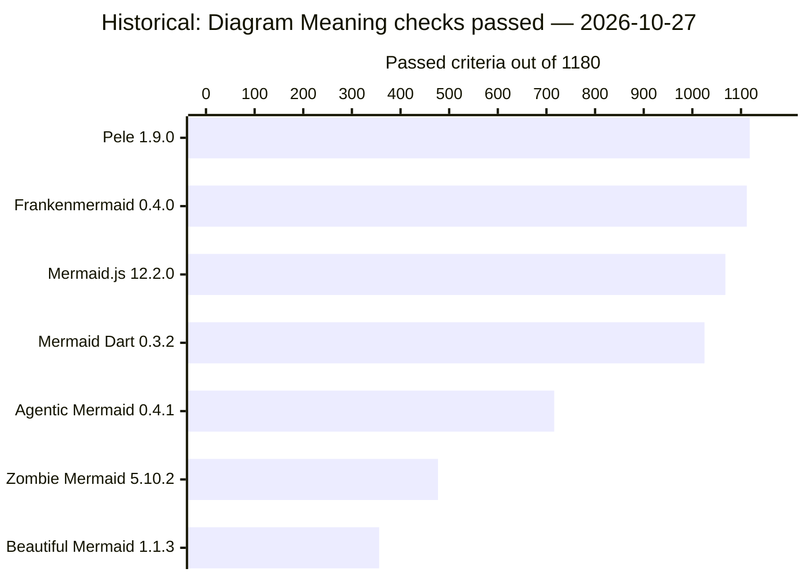
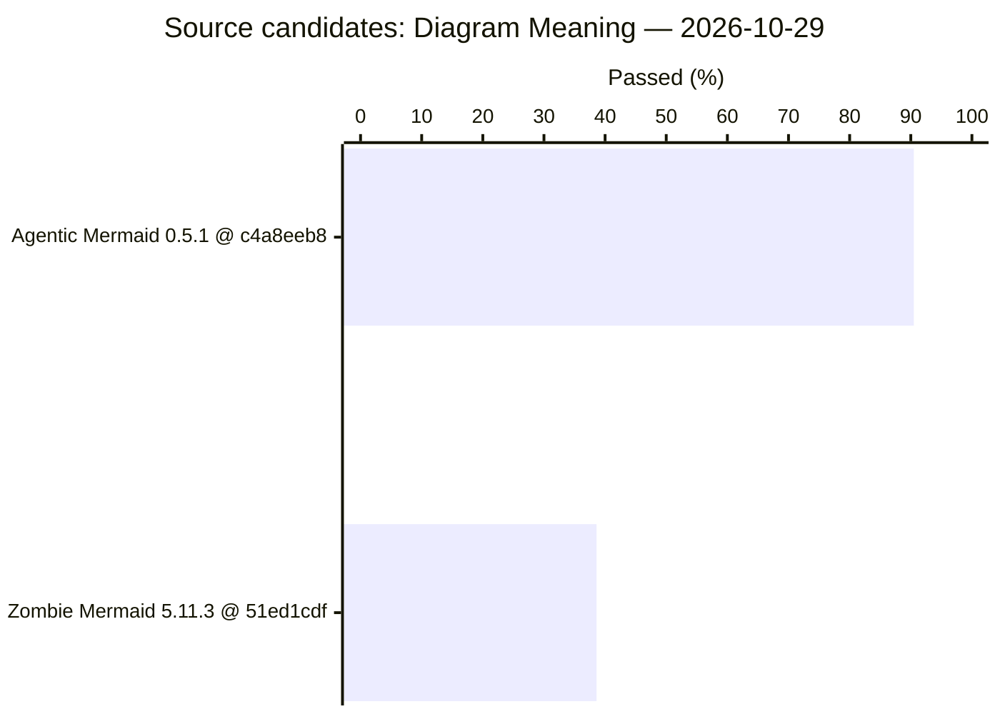

# Diagram Meaning · part 1

[Ecosystem overview](../../RESULTS.md) · [All parts](fidelity.md)

**svg-meaning** · 2026-10-27 · Historical · unit: SVG criteria · [evidence](../../docs/evidence/benchmark-examples.json)

Browser SVG; the same 1,180 SVG criterion identities per project. Native-model checks are excluded. The older observer needs fresh qualification; these counts are not current bug findings or an overall visual-quality score.

Ranked by **Passed criteria / Planned criteria**, highest first. Equal values share a rank; unavailable values are unranked. Timing ranks describe the displayed samples and retain their qualification limits.

| Project | Rank | Version | Passed criteria | Failed | Unsupported | Blocked | Planned criteria |
| --- | --- | --- | --- | --- | --- | --- | --- |
| Pele | 1 | 1.9.0 | 1118 | 5 | 14 | 43 | 1180 |
| Frankenmermaid | 2 | 0.4.0 | 1112 | 6 | 0 | 62 | 1180 |
| Mermaid.js | 3 | 12.2.0 | 1068 | 16 | 0 | 96 | 1180 |
| Mermaid Dart | 4 | 0.3.2 | 1025 | 45 | 0 | 110 | 1180 |
| Agentic Mermaid | 5 | 0.4.1 | 716 | 13 | 0 | 451 | 1180 |
| Zombie Mermaid | 6 | 5.10.2 | 477 | 13 | 0 | 690 | 1180 |
| Beautiful Mermaid | 7 | 1.1.3 | 356 | 18 | 0 | 806 | 1180 |

**ecosystem-paint-920-2026-10-27** · 2026-10-27 · Historical · unit: Mermaid-qualified paint criteria · [evidence](../../docs/evidence/campaign-2026-10-28/comparative-tables.json)

100 cases across 25 families; fixed 920 reference-passed paint criteria. Another 150 authored criteria are reference-unqualified across all surfaces. Alias rows do not create independent wins. Historical CFD candidate, not current main.

Ranked by **Passed / Planned**, highest first. Equal values share a rank; unavailable values are unranked. Timing ranks describe the displayed samples and retain their qualification limits.

| Project | Rank | Version | Passed | Failed | Unavailable | Planned |
| --- | --- | --- | --- | --- | --- | --- |
| Mermaid.js | 1 | 12.2.0 | 920 | 0 | 0 | 920 |
| Agentic Mermaid | 2 | 0.4.2 | 902 | 1 | 17 | 920 |
| Frankenmermaid | 3 | 0.4.0 | 891 | 14 | 15 | 920 |
| Latias94/merman | 4 | 0.9.2 | 889 | 29 | 2 | 920 |
| Pele | 5 | 1.9.0 | 852 | 1 | 67 | 920 |
| Bezel | 6 | 0.2.20 | 806 | 43 | 71 | 920 |
| Ondine | 6 | 0.0.3 | 806 | 43 | 71 | 920 |
| Mermaid Dart | 8 | 0.3.2 | 780 | 39 | 101 | 920 |
| toeverything/mermaid-rs-renderer | 9 | 0.1.2 | 777 | 34 | 109 | 920 |
| D3FEND Mermaid | 10 | 11.11.637 | 776 | 2 | 142 | 920 |
| jacob-lcs/mermaid | 10 | 11.9.0 | 776 | 2 | 142 | 920 |
| evangwt/xmermaid | 12 | 0.4.2 | 699 | 57 | 164 | 920 |
| NicolasNewman/mermaid | 13 | 11.4.1 | 654 | 1 | 265 | 920 |
| sandyyst/dsh-plugin-mermaid-gb-svg | 14 | 0.1.4 | 633 | 195 | 92 | 920 |
| Mermaid-Chart/mermaid-develop | 15 | 10.6.1 | 487 | 52 | 381 | 920 |
| zakaria-forks/mermaid | 15 | 11.0.0-alpha.7 | 487 | 52 | 381 | 920 |
| xeolabs/mermaid | 17 | 10.0.2 | 471 | 1 | 448 | 920 |
| blackst0ne/mermaid | 18 | 7.1.0-fixed | 460 | 274 | 186 | 920 |
| emtyty/merslim | 19 | 0.2.3 | 243 | 29 | 648 | 920 |
| lishid/mermaid | 20 | 8.10.2 | 223 | 10 | 687 | 920 |
| mbostock/mermaid | 21 | 9.0.0 | 220 | 0 | 700 | 920 |
| Zombie Mermaid | 22 | 5.9.1 | 217 | 7 | 696 | 920 |
| jgraph/mermaid | 23 | 11.14.0 | 213 | 1 | 706 | 920 |
| crafter-station/mermaid | 24 | 0.0.3 | 169 | 25 | 726 | 920 |
| ktrysmt/beautiful-mermaid | 25 | 1.5.2 | 167 | 10 | 743 | 920 |
| 2233admin/beautiful-mermaid | 26 | 1.1.3 | 165 | 12 | 743 | 920 |
| Beautiful Mermaid | 26 | 1.1.3 | 165 | 12 | 743 | 920 |
| HealthSamurai/beautiful-mermaid | 26 | 1.1.3 | 165 | 12 | 743 | 920 |
| Stars1233/beautiful-mermaid | 26 | 1.1.3 | 165 | 12 | 743 | 920 |
| thepanax/beautiful-mermaid | 26 | 1.1.3 | 165 | 12 | 743 | 920 |
| ysknsid25/beautiful-mermaid | 31 | 1.0.2 | 150 | 11 | 759 | 920 |
| 01colyncelestine-stack/beautiful-mermaid | 32 | 0.1.3 | 116 | 11 | 793 | 920 |
| fdotu/beautiful-mermaid | 32 | 0.1.3 | 116 | 11 | 793 | 920 |
| gmh5225/beautiful-mermaid | 32 | 0.1.3 | 116 | 11 | 793 | 920 |
| rohitg00/beautiful-mermaid | 32 | 0.1.3 | 116 | 11 | 793 | 920 |
| theletterf/beautiful-mermaid | 32 | 0.1.5 | 116 | 11 | 793 | 920 |
| vercel-labs/beautiful-mermaid | 32 | 0.1.5 | 116 | 11 | 793 | 920 |
| KlangHaus/vitepress-plugin-diagram | 38 | 0.3.2 | 71 | 16 | 833 | 920 |
| lyngai/mermaid | 39 | 8.4.8 | 63 | 9 | 848 | 920 |
| Merman | 40 | 1.0.0 | 62 | 9 | 849 | 920 |
| xen3r0/mermaid | 41 | 8.0.0-rc.9 | 49 | 6 | 865 | 920 |
| songshaodong/mermaid | 42 | 0.5.8 | 39 | 0 | 881 | 920 |

**am-zm-meaning-2026-10-29** · 2026-10-29 · **Source candidates** · unit: planned SVG paint/meaning criteria · [evidence](../../docs/evidence/am-zm-2026-10-29/receipt.json)

AM 0.5.1 at c4a8eeb8 and ZM 5.11.3 at 51ed1cdf are unreleased source builds. 100 authored cases; same 1,035 planned browser-owned-ink criteria per project. Unavailable checks remain in the denominator. Public API and native model criteria are separate and earn no extra paint credit. This is a bounded meaning check, not an aesthetic score.

Ranked by **Passed / Planned**, highest first. Equal values share a rank; unavailable values are unranked. Timing ranks describe the displayed samples and retain their qualification limits.

| Project | Rank | Version | Passed | Failed | Unavailable | Planned | Passed (%) |
| --- | --- | --- | --- | --- | --- | --- | --- |
| Agentic Mermaid | 1 | 0.5.1 @ c4a8eeb8 | 937 | 1 | 97 | 1035 | 90.5% |
| Zombie Mermaid | 2 | 5.11.3 @ 51ed1cdf | 400 | 13 | 622 | 1035 | 38.6% |

**run-7422124020959d9c7a0a80f2** · 2026-10-30 · unit: observations · [evidence](https://github.com/adewale/trident/tree/7d8c71a8a1307ba2834b803be24cee0270591ccf/evidence/1/report.json)

core; default; native-public-api; not-observed; structured; native-admission. Compared rows have the same recorded check coordinates. Counts are observations, not inferred diagram passes or full-inventory coverage. Missing bindings remain in campaign attempts.

Ranked by **Passed**, highest first. Equal values share a rank; unavailable values are unranked. Timing ranks describe the displayed samples and retain their qualification limits.

| Project | Rank | Version | Passed | Failed | Unsupported | Blocked | Not applicable | Skipped | Unavailable | Recorded | Measured |
| --- | --- | --- | --- | --- | --- | --- | --- | --- | --- | --- | --- |
| Agentic Mermaid | — | 0.5.1 | 0 | 0 | 0 | 100 | 0 | 0 | 0 | 100 | 2026-10-30T05:07:17.549Z |
| Beautiful Mermaid | — | 1.1.3 | 0 | 0 | 0 | 100 | 0 | 0 | 0 | 100 | 2026-10-30T05:10:59.819Z |
| Bezel | — | 0.2.22 | 0 | 0 | 0 | 100 | 0 | 0 | 0 | 100 | 2026-10-30T05:11:52.500Z |
| crafter-station/mermaid | — | 0.0.3 | 0 | 0 | 0 | 100 | 0 | 0 | 0 | 100 | 2026-10-30T05:07:36.148Z |
| emtyty/merslim | — | 0.2.3 | 0 | 0 | 0 | 100 | 0 | 0 | 0 | 100 | 2026-10-30T05:10:30.573Z |
| evangwt/xmermaid | — | 0.4.2 | 0 | 0 | 0 | 100 | 0 | 0 | 0 | 100 | 2026-10-30T05:10:38.764Z |
| Frankenmermaid | — | 0.4.0 | 0 | 0 | 0 | 100 | 0 | 0 | 0 | 100 | 2026-10-30T05:06:47.856Z |
| KlangHaus/vitepress-plugin-diagram | — | 0.3.2 | 0 | 0 | 0 | 100 | 0 | 0 | 0 | 100 | 2026-10-30T05:10:42.552Z |
| Latias94/merman | — | 0.9.2 | 0 | 0 | 0 | 100 | 0 | 0 | 0 | 100 | 2026-10-30T05:10:54.451Z |
| Mermaid Dart | — | 0.3.2 | 0 | 0 | 0 | 100 | 0 | 0 | 0 | 100 | 2026-10-30T05:07:05.365Z |
| Mermaid.js | — | 12.2.0 | 0 | 0 | 0 | 100 | 0 | 0 | 0 | 100 | 2026-10-30T05:11:42.445Z |
| Ondine | — | 0.0.3 | 0 | 0 | 0 | 100 | 0 | 0 | 0 | 100 | 2026-10-30T05:06:56.556Z |
| Pele | — | 1.12.0 | 0 | 0 | 0 | 100 | 0 | 0 | 0 | 100 | 2026-10-30T05:11:09.239Z |
| sandyyst/dsh-plugin-mermaid-gb-svg | — | 0.1.4 | 0 | 0 | 0 | 100 | 0 | 0 | 0 | 100 | 2026-10-30T05:11:18.579Z |
| Zombie Mermaid | — | 5.11.2 | 0 | 0 | 0 | 100 | 0 | 0 | 0 | 100 | 2026-10-30T05:07:25.363Z |

**run-e90c87d5ce8219decd71d4f0** · 2026-10-30 · unit: observations · [evidence](https://github.com/adewale/trident/tree/7d8c71a8a1307ba2834b803be24cee0270591ccf/evidence/1/report.json)

core; default; native-public-api; not-observed; structured; family. Compared rows have the same recorded check coordinates. Counts are observations, not inferred diagram passes or full-inventory coverage. Missing bindings remain in campaign attempts.

Ranked by **Passed**, highest first. Equal values share a rank; unavailable values are unranked. Timing ranks describe the displayed samples and retain their qualification limits.

| Project | Rank | Version | Passed | Failed | Unsupported | Blocked | Not applicable | Skipped | Unavailable | Recorded | Measured |
| --- | --- | --- | --- | --- | --- | --- | --- | --- | --- | --- | --- |
| Agentic Mermaid | — | 0.5.1 | 0 | 0 | 0 | 100 | 0 | 0 | 0 | 100 | 2026-10-30T05:07:17.549Z |
| Beautiful Mermaid | — | 1.1.3 | 0 | 0 | 0 | 100 | 0 | 0 | 0 | 100 | 2026-10-30T05:10:59.819Z |
| Bezel | — | 0.2.22 | 0 | 0 | 0 | 100 | 0 | 0 | 0 | 100 | 2026-10-30T05:11:52.500Z |
| crafter-station/mermaid | — | 0.0.3 | 0 | 0 | 0 | 100 | 0 | 0 | 0 | 100 | 2026-10-30T05:07:36.148Z |
| emtyty/merslim | — | 0.2.3 | 0 | 0 | 0 | 100 | 0 | 0 | 0 | 100 | 2026-10-30T05:10:30.573Z |
| evangwt/xmermaid | — | 0.4.2 | 0 | 0 | 0 | 100 | 0 | 0 | 0 | 100 | 2026-10-30T05:10:38.764Z |
| Frankenmermaid | — | 0.4.0 | 0 | 0 | 0 | 100 | 0 | 0 | 0 | 100 | 2026-10-30T05:06:47.856Z |
| KlangHaus/vitepress-plugin-diagram | — | 0.3.2 | 0 | 0 | 0 | 100 | 0 | 0 | 0 | 100 | 2026-10-30T05:10:42.552Z |
| Latias94/merman | — | 0.9.2 | 0 | 0 | 0 | 100 | 0 | 0 | 0 | 100 | 2026-10-30T05:10:54.451Z |
| Mermaid Dart | — | 0.3.2 | 0 | 0 | 0 | 100 | 0 | 0 | 0 | 100 | 2026-10-30T05:07:05.365Z |
| Mermaid.js | — | 12.2.0 | 0 | 0 | 0 | 100 | 0 | 0 | 0 | 100 | 2026-10-30T05:11:42.445Z |
| Ondine | — | 0.0.3 | 0 | 0 | 0 | 100 | 0 | 0 | 0 | 100 | 2026-10-30T05:06:56.556Z |
| Pele | — | 1.12.0 | 0 | 0 | 0 | 100 | 0 | 0 | 0 | 100 | 2026-10-30T05:11:09.239Z |
| sandyyst/dsh-plugin-mermaid-gb-svg | — | 0.1.4 | 0 | 0 | 0 | 100 | 0 | 0 | 0 | 100 | 2026-10-30T05:11:18.579Z |
| Zombie Mermaid | — | 5.11.2 | 0 | 0 | 0 | 100 | 0 | 0 | 0 | 100 | 2026-10-30T05:07:25.363Z |

**run-8bad4f0808d5d8a8a7829db5** · 2026-10-30 · unit: observations · [evidence](https://github.com/adewale/trident/tree/7d8c71a8a1307ba2834b803be24cee0270591ccf/evidence/1/report.json)

core; default; native-public-api; not-observed; structured; identities. Compared rows have the same recorded check coordinates. Counts are observations, not inferred diagram passes or full-inventory coverage. Missing bindings remain in campaign attempts.

Ranked by **Passed**, highest first. Equal values share a rank; unavailable values are unranked. Timing ranks describe the displayed samples and retain their qualification limits.

| Project | Rank | Version | Passed | Failed | Unsupported | Blocked | Not applicable | Skipped | Unavailable | Recorded | Measured |
| --- | --- | --- | --- | --- | --- | --- | --- | --- | --- | --- | --- |
| Agentic Mermaid | — | 0.5.1 | 0 | 0 | 0 | 74 | 0 | 0 | 0 | 74 | 2026-10-30T05:07:17.549Z |
| Beautiful Mermaid | — | 1.1.3 | 0 | 0 | 0 | 74 | 0 | 0 | 0 | 74 | 2026-10-30T05:10:59.819Z |
| Bezel | — | 0.2.22 | 0 | 0 | 0 | 74 | 0 | 0 | 0 | 74 | 2026-10-30T05:11:52.500Z |
| crafter-station/mermaid | — | 0.0.3 | 0 | 0 | 0 | 74 | 0 | 0 | 0 | 74 | 2026-10-30T05:07:36.148Z |
| emtyty/merslim | — | 0.2.3 | 0 | 0 | 0 | 74 | 0 | 0 | 0 | 74 | 2026-10-30T05:10:30.573Z |
| evangwt/xmermaid | — | 0.4.2 | 0 | 0 | 0 | 74 | 0 | 0 | 0 | 74 | 2026-10-30T05:10:38.764Z |
| Frankenmermaid | — | 0.4.0 | 0 | 0 | 0 | 74 | 0 | 0 | 0 | 74 | 2026-10-30T05:06:47.856Z |
| KlangHaus/vitepress-plugin-diagram | — | 0.3.2 | 0 | 0 | 0 | 74 | 0 | 0 | 0 | 74 | 2026-10-30T05:10:42.552Z |
| Latias94/merman | — | 0.9.2 | 0 | 0 | 0 | 74 | 0 | 0 | 0 | 74 | 2026-10-30T05:10:54.451Z |
| Mermaid Dart | — | 0.3.2 | 0 | 0 | 0 | 74 | 0 | 0 | 0 | 74 | 2026-10-30T05:07:05.365Z |
| Mermaid.js | — | 12.2.0 | 0 | 0 | 0 | 74 | 0 | 0 | 0 | 74 | 2026-10-30T05:11:42.445Z |
| Ondine | — | 0.0.3 | 0 | 0 | 0 | 74 | 0 | 0 | 0 | 74 | 2026-10-30T05:06:56.556Z |
| Pele | — | 1.12.0 | 0 | 0 | 0 | 74 | 0 | 0 | 0 | 74 | 2026-10-30T05:11:09.239Z |
| sandyyst/dsh-plugin-mermaid-gb-svg | — | 0.1.4 | 0 | 0 | 0 | 74 | 0 | 0 | 0 | 74 | 2026-10-30T05:11:18.579Z |
| Zombie Mermaid | — | 5.11.2 | 0 | 0 | 0 | 74 | 0 | 0 | 0 | 74 | 2026-10-30T05:07:25.363Z |

**run-f85e681d256291bc0f475289** · 2026-10-30 · unit: observations · [evidence](https://github.com/adewale/trident/tree/7d8c71a8a1307ba2834b803be24cee0270591ccf/evidence/1/report.json)

core; default; native-public-api; not-observed; structured; node-labels. Compared rows have the same recorded check coordinates. Counts are observations, not inferred diagram passes or full-inventory coverage. Missing bindings remain in campaign attempts.

Ranked by **Passed**, highest first. Equal values share a rank; unavailable values are unranked. Timing ranks describe the displayed samples and retain their qualification limits.

| Project | Rank | Version | Passed | Failed | Unsupported | Blocked | Not applicable | Skipped | Unavailable | Recorded | Measured |
| --- | --- | --- | --- | --- | --- | --- | --- | --- | --- | --- | --- |
| Agentic Mermaid | — | 0.5.1 | 0 | 0 | 0 | 74 | 0 | 0 | 0 | 74 | 2026-10-30T05:07:17.549Z |
| Beautiful Mermaid | — | 1.1.3 | 0 | 0 | 0 | 74 | 0 | 0 | 0 | 74 | 2026-10-30T05:10:59.819Z |
| Bezel | — | 0.2.22 | 0 | 0 | 0 | 74 | 0 | 0 | 0 | 74 | 2026-10-30T05:11:52.500Z |
| crafter-station/mermaid | — | 0.0.3 | 0 | 0 | 0 | 74 | 0 | 0 | 0 | 74 | 2026-10-30T05:07:36.148Z |
| emtyty/merslim | — | 0.2.3 | 0 | 0 | 0 | 74 | 0 | 0 | 0 | 74 | 2026-10-30T05:10:30.573Z |
| evangwt/xmermaid | — | 0.4.2 | 0 | 0 | 0 | 74 | 0 | 0 | 0 | 74 | 2026-10-30T05:10:38.764Z |
| Frankenmermaid | — | 0.4.0 | 0 | 0 | 0 | 74 | 0 | 0 | 0 | 74 | 2026-10-30T05:06:47.856Z |
| KlangHaus/vitepress-plugin-diagram | — | 0.3.2 | 0 | 0 | 0 | 74 | 0 | 0 | 0 | 74 | 2026-10-30T05:10:42.552Z |
| Latias94/merman | — | 0.9.2 | 0 | 0 | 0 | 74 | 0 | 0 | 0 | 74 | 2026-10-30T05:10:54.451Z |
| Mermaid Dart | — | 0.3.2 | 0 | 0 | 0 | 74 | 0 | 0 | 0 | 74 | 2026-10-30T05:07:05.365Z |
| Mermaid.js | — | 12.2.0 | 0 | 0 | 0 | 74 | 0 | 0 | 0 | 74 | 2026-10-30T05:11:42.445Z |
| Ondine | — | 0.0.3 | 0 | 0 | 0 | 74 | 0 | 0 | 0 | 74 | 2026-10-30T05:06:56.556Z |
| Pele | — | 1.12.0 | 0 | 0 | 0 | 74 | 0 | 0 | 0 | 74 | 2026-10-30T05:11:09.239Z |
| sandyyst/dsh-plugin-mermaid-gb-svg | — | 0.1.4 | 0 | 0 | 0 | 74 | 0 | 0 | 0 | 74 | 2026-10-30T05:11:18.579Z |
| Zombie Mermaid | — | 5.11.2 | 0 | 0 | 0 | 74 | 0 | 0 | 0 | 74 | 2026-10-30T05:07:25.363Z |

**run-09c7d6c2f7595cc2b7414d79** · 2026-10-30 · unit: observations · [evidence](https://github.com/adewale/trident/tree/7d8c71a8a1307ba2834b803be24cee0270591ccf/evidence/1/report.json)

core; default; native-public-api; not-observed; structured; relationships. Compared rows have the same recorded check coordinates. Counts are observations, not inferred diagram passes or full-inventory coverage. Missing bindings remain in campaign attempts.

Ranked by **Passed**, highest first. Equal values share a rank; unavailable values are unranked. Timing ranks describe the displayed samples and retain their qualification limits.

| Project | Rank | Version | Passed | Failed | Unsupported | Blocked | Not applicable | Skipped | Unavailable | Recorded | Measured |
| --- | --- | --- | --- | --- | --- | --- | --- | --- | --- | --- | --- |
| Agentic Mermaid | — | 0.5.1 | 0 | 0 | 0 | 70 | 0 | 0 | 0 | 70 | 2026-10-30T05:07:17.549Z |
| Beautiful Mermaid | — | 1.1.3 | 0 | 0 | 0 | 70 | 0 | 0 | 0 | 70 | 2026-10-30T05:10:59.819Z |
| Bezel | — | 0.2.22 | 0 | 0 | 0 | 70 | 0 | 0 | 0 | 70 | 2026-10-30T05:11:52.500Z |
| crafter-station/mermaid | — | 0.0.3 | 0 | 0 | 0 | 70 | 0 | 0 | 0 | 70 | 2026-10-30T05:07:36.148Z |
| emtyty/merslim | — | 0.2.3 | 0 | 0 | 0 | 70 | 0 | 0 | 0 | 70 | 2026-10-30T05:10:30.573Z |
| evangwt/xmermaid | — | 0.4.2 | 0 | 0 | 0 | 70 | 0 | 0 | 0 | 70 | 2026-10-30T05:10:38.764Z |
| Frankenmermaid | — | 0.4.0 | 0 | 0 | 0 | 70 | 0 | 0 | 0 | 70 | 2026-10-30T05:06:47.856Z |
| KlangHaus/vitepress-plugin-diagram | — | 0.3.2 | 0 | 0 | 0 | 70 | 0 | 0 | 0 | 70 | 2026-10-30T05:10:42.552Z |
| Latias94/merman | — | 0.9.2 | 0 | 0 | 0 | 70 | 0 | 0 | 0 | 70 | 2026-10-30T05:10:54.451Z |
| Mermaid Dart | — | 0.3.2 | 0 | 0 | 0 | 70 | 0 | 0 | 0 | 70 | 2026-10-30T05:07:05.365Z |
| Mermaid.js | — | 12.2.0 | 0 | 0 | 0 | 70 | 0 | 0 | 0 | 70 | 2026-10-30T05:11:42.445Z |
| Ondine | — | 0.0.3 | 0 | 0 | 0 | 70 | 0 | 0 | 0 | 70 | 2026-10-30T05:06:56.556Z |
| Pele | — | 1.12.0 | 0 | 0 | 0 | 70 | 0 | 0 | 0 | 70 | 2026-10-30T05:11:09.239Z |
| sandyyst/dsh-plugin-mermaid-gb-svg | — | 0.1.4 | 0 | 0 | 0 | 70 | 0 | 0 | 0 | 70 | 2026-10-30T05:11:18.579Z |
| Zombie Mermaid | — | 5.11.2 | 0 | 0 | 0 | 70 | 0 | 0 | 0 | 70 | 2026-10-30T05:07:25.363Z |

**run-25cde95de59809a68196f979** · 2026-10-30 · unit: observations · [evidence](https://github.com/adewale/trident/tree/7d8c71a8a1307ba2834b803be24cee0270591ccf/evidence/1/report.json)

core; default; browser-public-api; Chromium; svg; public-svg-admission. Compared rows have the same recorded check coordinates. Counts are observations, not inferred diagram passes or full-inventory coverage. Missing bindings remain in campaign attempts.

Ranked by **Passed**, highest first. Equal values share a rank; unavailable values are unranked. Timing ranks describe the displayed samples and retain their qualification limits.

| Project | Rank | Version | Passed | Failed | Unsupported | Blocked | Not applicable | Skipped | Unavailable | Recorded | Measured |
| --- | --- | --- | --- | --- | --- | --- | --- | --- | --- | --- | --- |
| Frankenmermaid | 1 | 0.4.0 | 100 | 0 | 0 | 0 | 0 | 0 | 0 | 100 | 2026-10-30T05:06:47.856Z |
| Latias94/merman | 1 | 0.9.2 | 100 | 0 | 0 | 0 | 0 | 0 | 0 | 100 | 2026-10-30T05:10:54.451Z |
| Mermaid.js | 1 | 12.2.0 | 100 | 0 | 0 | 0 | 0 | 0 | 0 | 100 | 2026-10-30T05:11:42.445Z |
| sandyyst/dsh-plugin-mermaid-gb-svg | 1 | 0.1.4 | 100 | 0 | 0 | 0 | 0 | 0 | 0 | 100 | 2026-10-30T05:11:18.579Z |
| Agentic Mermaid | 5 | 0.5.1 | 98 | 0 | 0 | 2 | 0 | 0 | 0 | 100 | 2026-10-30T05:07:17.549Z |
| Bezel | 6 | 0.2.22 | 95 | 0 | 0 | 5 | 0 | 0 | 0 | 100 | 2026-10-30T05:11:52.500Z |
| Mermaid Dart | 6 | 0.3.2 | 95 | 0 | 0 | 5 | 0 | 0 | 0 | 100 | 2026-10-30T05:07:05.365Z |
| Ondine | 6 | 0.0.3 | 95 | 0 | 0 | 5 | 0 | 0 | 0 | 100 | 2026-10-30T05:06:56.556Z |
| Pele | 6 | 1.12.0 | 95 | 0 | 5 | 0 | 0 | 0 | 0 | 100 | 2026-10-30T05:11:09.239Z |
| evangwt/xmermaid | 10 | 0.4.2 | 86 | 0 | 0 | 14 | 0 | 0 | 0 | 100 | 2026-10-30T05:10:38.764Z |
| emtyty/merslim | 11 | 0.2.3 | 57 | 0 | 0 | 43 | 0 | 0 | 0 | 100 | 2026-10-30T05:10:30.573Z |
| Zombie Mermaid | 12 | 5.11.2 | 40 | 0 | 0 | 60 | 0 | 0 | 0 | 100 | 2026-10-30T05:07:25.363Z |
| crafter-station/mermaid | 13 | 0.0.3 | 38 | 62 | 0 | 0 | 0 | 0 | 0 | 100 | 2026-10-30T05:07:36.148Z |
| Beautiful Mermaid | 14 | 1.1.3 | 31 | 0 | 0 | 69 | 0 | 0 | 0 | 100 | 2026-10-30T05:10:59.819Z |
| KlangHaus/vitepress-plugin-diagram | 15 | 0.3.2 | 18 | 0 | 82 | 0 | 0 | 0 | 0 | 100 | 2026-10-30T05:10:42.552Z |

**run-9d1c8aec8edffb3f3fe643d5** · 2026-10-30 · unit: observations · [evidence](https://github.com/adewale/trident/tree/7d8c71a8a1307ba2834b803be24cee0270591ccf/evidence/1/report.json)

core; default; browser-public-api; Chromium; svg; standalone-svg-and-labels. Compared rows have the same recorded check coordinates. Counts are observations, not inferred diagram passes or full-inventory coverage. Missing bindings remain in campaign attempts.

Ranked by **Passed**, highest first. Equal values share a rank; unavailable values are unranked. Timing ranks describe the displayed samples and retain their qualification limits.

| Project | Rank | Version | Passed | Failed | Unsupported | Blocked | Not applicable | Skipped | Unavailable | Recorded | Measured |
| --- | --- | --- | --- | --- | --- | --- | --- | --- | --- | --- | --- |
| Latias94/merman | 1 | 0.9.2 | 100 | 0 | 0 | 0 | 0 | 0 | 0 | 100 | 2026-10-30T05:10:54.451Z |
| Frankenmermaid | 2 | 0.4.0 | 99 | 1 | 0 | 0 | 0 | 0 | 0 | 100 | 2026-10-30T05:06:47.856Z |
| Mermaid.js | 2 | 12.2.0 | 99 | 1 | 0 | 0 | 0 | 0 | 0 | 100 | 2026-10-30T05:11:42.445Z |
| sandyyst/dsh-plugin-mermaid-gb-svg | 4 | 0.1.4 | 19 | 81 | 0 | 0 | 0 | 0 | 0 | 100 | 2026-10-30T05:11:18.579Z |

**run-dd776aa347dbe6c140a59249** · 2026-10-30 · unit: observations · [evidence](https://github.com/adewale/trident/tree/7d8c71a8a1307ba2834b803be24cee0270591ccf/evidence/1/report.json)

core; default; browser-owned-ink; Chromium; svg; svg-root. Compared rows have the same recorded check coordinates. Counts are observations, not inferred diagram passes or full-inventory coverage. Missing bindings remain in campaign attempts.

Ranked by **Passed**, highest first. Equal values share a rank; unavailable values are unranked. Timing ranks describe the displayed samples and retain their qualification limits.

| Project | Rank | Version | Passed | Failed | Unsupported | Blocked | Not applicable | Skipped | Unavailable | Recorded | Measured |
| --- | --- | --- | --- | --- | --- | --- | --- | --- | --- | --- | --- |
| Frankenmermaid | 1 | 0.4.0 | 100 | 0 | 0 | 0 | 0 | 0 | 0 | 100 | 2026-10-30T05:06:47.856Z |
| Latias94/merman | 1 | 0.9.2 | 100 | 0 | 0 | 0 | 0 | 0 | 0 | 100 | 2026-10-30T05:10:54.451Z |
| Mermaid.js | 1 | 12.2.0 | 100 | 0 | 0 | 0 | 0 | 0 | 0 | 100 | 2026-10-30T05:11:42.445Z |
| sandyyst/dsh-plugin-mermaid-gb-svg | 1 | 0.1.4 | 100 | 0 | 0 | 0 | 0 | 0 | 0 | 100 | 2026-10-30T05:11:18.579Z |

**run-939009b7fa3671e40e8c21ce** · 2026-10-30 · unit: observations · [evidence](https://github.com/adewale/trident/tree/7d8c71a8a1307ba2834b803be24cee0270591ccf/evidence/1/report.json)

core; default; browser-owned-ink; Chromium; svg; svg-unique-ids. Compared rows have the same recorded check coordinates. Counts are observations, not inferred diagram passes or full-inventory coverage. Missing bindings remain in campaign attempts.

Ranked by **Passed**, highest first. Equal values share a rank; unavailable values are unranked. Timing ranks describe the displayed samples and retain their qualification limits.

| Project | Rank | Version | Passed | Failed | Unsupported | Blocked | Not applicable | Skipped | Unavailable | Recorded | Measured |
| --- | --- | --- | --- | --- | --- | --- | --- | --- | --- | --- | --- |
| Frankenmermaid | 1 | 0.4.0 | 100 | 0 | 0 | 0 | 0 | 0 | 0 | 100 | 2026-10-30T05:06:47.856Z |
| sandyyst/dsh-plugin-mermaid-gb-svg | 1 | 0.1.4 | 100 | 0 | 0 | 0 | 0 | 0 | 0 | 100 | 2026-10-30T05:11:18.579Z |
| Latias94/merman | 3 | 0.9.2 | 97 | 3 | 0 | 0 | 0 | 0 | 0 | 100 | 2026-10-30T05:10:54.451Z |
| Mermaid.js | 3 | 12.2.0 | 97 | 3 | 0 | 0 | 0 | 0 | 0 | 100 | 2026-10-30T05:11:42.445Z |

**run-453fe070dd485f3c899b3cf3** · 2026-10-30 · unit: observations · [evidence](https://github.com/adewale/trident/tree/7d8c71a8a1307ba2834b803be24cee0270591ccf/evidence/1/report.json)

core; default; browser-owned-ink; Chromium; svg; canvas. Compared rows have the same recorded check coordinates. Counts are observations, not inferred diagram passes or full-inventory coverage. Missing bindings remain in campaign attempts.

Ranked by **Passed**, highest first. Equal values share a rank; unavailable values are unranked. Timing ranks describe the displayed samples and retain their qualification limits.

| Project | Rank | Version | Passed | Failed | Unsupported | Blocked | Not applicable | Skipped | Unavailable | Recorded | Measured |
| --- | --- | --- | --- | --- | --- | --- | --- | --- | --- | --- | --- |
| Frankenmermaid | 1 | 0.4.0 | 100 | 0 | 0 | 0 | 0 | 0 | 0 | 100 | 2026-10-30T05:06:47.856Z |
| Latias94/merman | 1 | 0.9.2 | 100 | 0 | 0 | 0 | 0 | 0 | 0 | 100 | 2026-10-30T05:10:54.451Z |
| Mermaid.js | 1 | 12.2.0 | 100 | 0 | 0 | 0 | 0 | 0 | 0 | 100 | 2026-10-30T05:11:42.445Z |
| sandyyst/dsh-plugin-mermaid-gb-svg | 1 | 0.1.4 | 100 | 0 | 0 | 0 | 0 | 0 | 0 | 100 | 2026-10-30T05:11:18.579Z |

**run-e97290cf0bf950c716d042ed** · 2026-10-30 · unit: observations · [evidence](https://github.com/adewale/trident/tree/7d8c71a8a1307ba2834b803be24cee0270591ccf/evidence/1/report.json)

core; default; browser-owned-ink; Chromium; svg; visible-authored-labels. Compared rows have the same recorded check coordinates. Counts are observations, not inferred diagram passes or full-inventory coverage. Missing bindings remain in campaign attempts.

Ranked by **Passed**, highest first. Equal values share a rank; unavailable values are unranked. Timing ranks describe the displayed samples and retain their qualification limits.

| Project | Rank | Version | Passed | Failed | Unsupported | Blocked | Not applicable | Skipped | Unavailable | Recorded | Measured |
| --- | --- | --- | --- | --- | --- | --- | --- | --- | --- | --- | --- |
| Latias94/merman | 1 | 0.9.2 | 100 | 0 | 0 | 0 | 0 | 0 | 0 | 100 | 2026-10-30T05:10:54.451Z |
| Mermaid.js | 1 | 12.2.0 | 100 | 0 | 0 | 0 | 0 | 0 | 0 | 100 | 2026-10-30T05:11:42.445Z |
| Frankenmermaid | 3 | 0.4.0 | 99 | 1 | 0 | 0 | 0 | 0 | 0 | 100 | 2026-10-30T05:06:47.856Z |
| sandyyst/dsh-plugin-mermaid-gb-svg | 4 | 0.1.4 | 23 | 77 | 0 | 0 | 0 | 0 | 0 | 100 | 2026-10-30T05:11:18.579Z |

**run-e1003fbed14cfafe2e18300b** · 2026-10-30 · unit: observations · [evidence](https://github.com/adewale/trident/tree/7d8c71a8a1307ba2834b803be24cee0270591ccf/evidence/1/report.json)

core; default; browser-owned-ink; Chromium; svg; labels-within-canvas. Compared rows have the same recorded check coordinates. Counts are observations, not inferred diagram passes or full-inventory coverage. Missing bindings remain in campaign attempts.

Ranked by **Passed**, highest first. Equal values share a rank; unavailable values are unranked. Timing ranks describe the displayed samples and retain their qualification limits.

| Project | Rank | Version | Passed | Failed | Unsupported | Blocked | Not applicable | Skipped | Unavailable | Recorded | Measured |
| --- | --- | --- | --- | --- | --- | --- | --- | --- | --- | --- | --- |
| Frankenmermaid | 1 | 0.4.0 | 99 | 1 | 0 | 0 | 0 | 0 | 0 | 100 | 2026-10-30T05:06:47.856Z |
| Latias94/merman | 2 | 0.9.2 | 98 | 2 | 0 | 0 | 0 | 0 | 0 | 100 | 2026-10-30T05:10:54.451Z |
| Mermaid.js | 2 | 12.2.0 | 98 | 2 | 0 | 0 | 0 | 0 | 0 | 100 | 2026-10-30T05:11:42.445Z |
| sandyyst/dsh-plugin-mermaid-gb-svg | 4 | 0.1.4 | 23 | 77 | 0 | 0 | 0 | 0 | 0 | 100 | 2026-10-30T05:11:18.579Z |

**run-7a21ad4917b3c55b9335f04c** · 2026-10-30 · unit: observations · [evidence](https://github.com/adewale/trident/tree/7d8c71a8a1307ba2834b803be24cee0270591ccf/evidence/1/report.json)

core; default; browser-owned-ink; Chromium; svg; unclipped-authored-labels. Compared rows have the same recorded check coordinates. Counts are observations, not inferred diagram passes or full-inventory coverage. Missing bindings remain in campaign attempts.

Ranked by **Passed**, highest first. Equal values share a rank; unavailable values are unranked. Timing ranks describe the displayed samples and retain their qualification limits.

| Project | Rank | Version | Passed | Failed | Unsupported | Blocked | Not applicable | Skipped | Unavailable | Recorded | Measured |
| --- | --- | --- | --- | --- | --- | --- | --- | --- | --- | --- | --- |
| Frankenmermaid | 1 | 0.4.0 | 100 | 0 | 0 | 0 | 0 | 0 | 0 | 100 | 2026-10-30T05:06:47.856Z |
| sandyyst/dsh-plugin-mermaid-gb-svg | 1 | 0.1.4 | 100 | 0 | 0 | 0 | 0 | 0 | 0 | 100 | 2026-10-30T05:11:18.579Z |
| Mermaid.js | 3 | 12.2.0 | 99 | 1 | 0 | 0 | 0 | 0 | 0 | 100 | 2026-10-30T05:11:42.445Z |
| Latias94/merman | 4 | 0.9.2 | 70 | 30 | 0 | 0 | 0 | 0 | 0 | 100 | 2026-10-30T05:10:54.451Z |

**run-558d66481bd990fc9b0e177e** · 2026-10-30 · unit: observations · [evidence](https://github.com/adewale/trident/tree/7d8c71a8a1307ba2834b803be24cee0270591ccf/evidence/1/report.json)

core; default; browser-owned-ink; Chromium; svg; visible-ink. Compared rows have the same recorded check coordinates. Counts are observations, not inferred diagram passes or full-inventory coverage. Missing bindings remain in campaign attempts.

Ranked by **Passed**, highest first. Equal values share a rank; unavailable values are unranked. Timing ranks describe the displayed samples and retain their qualification limits.

| Project | Rank | Version | Passed | Failed | Unsupported | Blocked | Not applicable | Skipped | Unavailable | Recorded | Measured |
| --- | --- | --- | --- | --- | --- | --- | --- | --- | --- | --- | --- |
| Frankenmermaid | 1 | 0.4.0 | 100 | 0 | 0 | 0 | 0 | 0 | 0 | 100 | 2026-10-30T05:06:47.856Z |
| Latias94/merman | 1 | 0.9.2 | 100 | 0 | 0 | 0 | 0 | 0 | 0 | 100 | 2026-10-30T05:10:54.451Z |
| Mermaid.js | 1 | 12.2.0 | 100 | 0 | 0 | 0 | 0 | 0 | 0 | 100 | 2026-10-30T05:11:42.445Z |
| sandyyst/dsh-plugin-mermaid-gb-svg | 1 | 0.1.4 | 100 | 0 | 0 | 0 | 0 | 0 | 0 | 100 | 2026-10-30T05:11:18.579Z |

**run-90c28aa25d5c2142b1a456d2** · 2026-10-30 · unit: observations · [evidence](https://github.com/adewale/trident/tree/7d8c71a8a1307ba2834b803be24cee0270591ccf/evidence/1/report.json)

core; default; browser-owned-ink; Chromium; svg; paint-opacity-and-color. Compared rows have the same recorded check coordinates. Counts are observations, not inferred diagram passes or full-inventory coverage. Missing bindings remain in campaign attempts.

Ranked by **Passed**, highest first. Equal values share a rank; unavailable values are unranked. Timing ranks describe the displayed samples and retain their qualification limits.

| Project | Rank | Version | Passed | Failed | Unsupported | Blocked | Not applicable | Skipped | Unavailable | Recorded | Measured |
| --- | --- | --- | --- | --- | --- | --- | --- | --- | --- | --- | --- |
| Frankenmermaid | 1 | 0.4.0 | 100 | 0 | 0 | 0 | 0 | 0 | 0 | 100 | 2026-10-30T05:06:47.856Z |
| sandyyst/dsh-plugin-mermaid-gb-svg | 1 | 0.1.4 | 100 | 0 | 0 | 0 | 0 | 0 | 0 | 100 | 2026-10-30T05:11:18.579Z |
| Latias94/merman | 3 | 0.9.2 | 64 | 0 | 0 | 36 | 0 | 0 | 0 | 100 | 2026-10-30T05:10:54.451Z |
| Mermaid.js | 3 | 12.2.0 | 64 | 0 | 0 | 36 | 0 | 0 | 0 | 100 | 2026-10-30T05:11:42.445Z |

**run-09f79e21c51bf72ea9651194** · 2026-10-30 · unit: observations · [evidence](https://github.com/adewale/trident/tree/7d8c71a8a1307ba2834b803be24cee0270591ccf/evidence/1/report.json)

core; default; browser-owned-ink; Chromium; svg; painted-node-ownership. Compared rows have the same recorded check coordinates. Counts are observations, not inferred diagram passes or full-inventory coverage. Missing bindings remain in campaign attempts.

Ranked by **Passed**, highest first. Equal values share a rank; unavailable values are unranked. Timing ranks describe the displayed samples and retain their qualification limits.

| Project | Rank | Version | Passed | Failed | Unsupported | Blocked | Not applicable | Skipped | Unavailable | Recorded | Measured |
| --- | --- | --- | --- | --- | --- | --- | --- | --- | --- | --- | --- |
| Frankenmermaid | 1 | 0.4.0 | 66 | 0 | 0 | 8 | 0 | 0 | 0 | 74 | 2026-10-30T05:06:47.856Z |
| Latias94/merman | 2 | 0.9.2 | 59 | 0 | 0 | 15 | 0 | 0 | 0 | 74 | 2026-10-30T05:10:54.451Z |
| Mermaid.js | 2 | 12.2.0 | 59 | 0 | 0 | 15 | 0 | 0 | 0 | 74 | 2026-10-30T05:11:42.445Z |
| sandyyst/dsh-plugin-mermaid-gb-svg | 4 | 0.1.4 | 30 | 0 | 0 | 44 | 0 | 0 | 0 | 74 | 2026-10-30T05:11:18.579Z |

**run-4f640661e3906e9d057f6476** · 2026-10-30 · unit: observations · [evidence](https://github.com/adewale/trident/tree/7d8c71a8a1307ba2834b803be24cee0270591ccf/evidence/1/report.json)

core; default; browser-owned-ink; Chromium; svg; painted-relationships. Compared rows have the same recorded check coordinates. Counts are observations, not inferred diagram passes or full-inventory coverage. Missing bindings remain in campaign attempts.

Ranked by **Passed**, highest first. Equal values share a rank; unavailable values are unranked. Timing ranks describe the displayed samples and retain their qualification limits.

| Project | Rank | Version | Passed | Failed | Unsupported | Blocked | Not applicable | Skipped | Unavailable | Recorded | Measured |
| --- | --- | --- | --- | --- | --- | --- | --- | --- | --- | --- | --- |
| Latias94/merman | 1 | 0.9.2 | 41 | 1 | 0 | 28 | 0 | 0 | 0 | 70 | 2026-10-30T05:10:54.451Z |
| Mermaid.js | 1 | 12.2.0 | 41 | 1 | 0 | 28 | 0 | 0 | 0 | 70 | 2026-10-30T05:11:42.445Z |
| Frankenmermaid | 3 | 0.4.0 | 37 | 9 | 0 | 24 | 0 | 0 | 0 | 70 | 2026-10-30T05:06:47.856Z |
| sandyyst/dsh-plugin-mermaid-gb-svg | 4 | 0.1.4 | 0 | 18 | 0 | 52 | 0 | 0 | 0 | 70 | 2026-10-30T05:11:18.579Z |

**run-e86627468dd74b0a4058ed12** · 2026-10-30 · unit: observations · [evidence](https://github.com/adewale/trident/tree/7d8c71a8a1307ba2834b803be24cee0270591ccf/evidence/1/report.json)

core; default; native-public-api; not-observed; structured; fact:title. Compared rows have the same recorded check coordinates. Counts are observations, not inferred diagram passes or full-inventory coverage. Missing bindings remain in campaign attempts.

Ranked by **Passed**, highest first. Equal values share a rank; unavailable values are unranked. Timing ranks describe the displayed samples and retain their qualification limits.

| Project | Rank | Version | Passed | Failed | Unsupported | Blocked | Not applicable | Skipped | Unavailable | Recorded | Measured |
| --- | --- | --- | --- | --- | --- | --- | --- | --- | --- | --- | --- |
| Agentic Mermaid | — | 0.5.1 | 0 | 0 | 0 | 18 | 0 | 0 | 0 | 18 | 2026-10-30T05:07:17.549Z |
| Beautiful Mermaid | — | 1.1.3 | 0 | 0 | 0 | 18 | 0 | 0 | 0 | 18 | 2026-10-30T05:10:59.819Z |
| Bezel | — | 0.2.22 | 0 | 0 | 0 | 18 | 0 | 0 | 0 | 18 | 2026-10-30T05:11:52.500Z |
| crafter-station/mermaid | — | 0.0.3 | 0 | 0 | 0 | 18 | 0 | 0 | 0 | 18 | 2026-10-30T05:07:36.148Z |
| emtyty/merslim | — | 0.2.3 | 0 | 0 | 0 | 18 | 0 | 0 | 0 | 18 | 2026-10-30T05:10:30.573Z |
| evangwt/xmermaid | — | 0.4.2 | 0 | 0 | 0 | 18 | 0 | 0 | 0 | 18 | 2026-10-30T05:10:38.764Z |
| Frankenmermaid | — | 0.4.0 | 0 | 0 | 0 | 18 | 0 | 0 | 0 | 18 | 2026-10-30T05:06:47.856Z |
| KlangHaus/vitepress-plugin-diagram | — | 0.3.2 | 0 | 0 | 0 | 18 | 0 | 0 | 0 | 18 | 2026-10-30T05:10:42.552Z |
| Latias94/merman | — | 0.9.2 | 0 | 0 | 0 | 18 | 0 | 0 | 0 | 18 | 2026-10-30T05:10:54.451Z |
| Mermaid Dart | — | 0.3.2 | 0 | 0 | 0 | 18 | 0 | 0 | 0 | 18 | 2026-10-30T05:07:05.365Z |
| Mermaid.js | — | 12.2.0 | 0 | 0 | 0 | 18 | 0 | 0 | 0 | 18 | 2026-10-30T05:11:42.445Z |
| Ondine | — | 0.0.3 | 0 | 0 | 0 | 18 | 0 | 0 | 0 | 18 | 2026-10-30T05:06:56.556Z |
| Pele | — | 1.12.0 | 0 | 0 | 0 | 18 | 0 | 0 | 0 | 18 | 2026-10-30T05:11:09.239Z |
| sandyyst/dsh-plugin-mermaid-gb-svg | — | 0.1.4 | 0 | 0 | 0 | 18 | 0 | 0 | 0 | 18 | 2026-10-30T05:11:18.579Z |
| Zombie Mermaid | — | 5.11.2 | 0 | 0 | 0 | 18 | 0 | 0 | 0 | 18 | 2026-10-30T05:07:25.363Z |

**run-160745a0a31c4def95a581f3** · 2026-10-30 · unit: observations · [evidence](https://github.com/adewale/trident/tree/7d8c71a8a1307ba2834b803be24cee0270591ccf/evidence/1/report.json)

core; default; native-public-api; not-observed; structured; fact:periods. Compared rows have the same recorded check coordinates. Counts are observations, not inferred diagram passes or full-inventory coverage. Missing bindings remain in campaign attempts.

Ranked by **Passed**, highest first. Equal values share a rank; unavailable values are unranked. Timing ranks describe the displayed samples and retain their qualification limits.

| Project | Rank | Version | Passed | Failed | Unsupported | Blocked | Not applicable | Skipped | Unavailable | Recorded | Measured |
| --- | --- | --- | --- | --- | --- | --- | --- | --- | --- | --- | --- |
| Agentic Mermaid | — | 0.5.1 | 0 | 0 | 0 | 1 | 0 | 0 | 0 | 1 | 2026-10-30T05:07:17.549Z |
| Beautiful Mermaid | — | 1.1.3 | 0 | 0 | 0 | 1 | 0 | 0 | 0 | 1 | 2026-10-30T05:10:59.819Z |
| Bezel | — | 0.2.22 | 0 | 0 | 0 | 1 | 0 | 0 | 0 | 1 | 2026-10-30T05:11:52.500Z |
| crafter-station/mermaid | — | 0.0.3 | 0 | 0 | 0 | 1 | 0 | 0 | 0 | 1 | 2026-10-30T05:07:36.148Z |
| emtyty/merslim | — | 0.2.3 | 0 | 0 | 0 | 1 | 0 | 0 | 0 | 1 | 2026-10-30T05:10:30.573Z |
| evangwt/xmermaid | — | 0.4.2 | 0 | 0 | 0 | 1 | 0 | 0 | 0 | 1 | 2026-10-30T05:10:38.764Z |
| Frankenmermaid | — | 0.4.0 | 0 | 0 | 0 | 1 | 0 | 0 | 0 | 1 | 2026-10-30T05:06:47.856Z |
| KlangHaus/vitepress-plugin-diagram | — | 0.3.2 | 0 | 0 | 0 | 1 | 0 | 0 | 0 | 1 | 2026-10-30T05:10:42.552Z |
| Latias94/merman | — | 0.9.2 | 0 | 0 | 0 | 1 | 0 | 0 | 0 | 1 | 2026-10-30T05:10:54.451Z |
| Mermaid Dart | — | 0.3.2 | 0 | 0 | 0 | 1 | 0 | 0 | 0 | 1 | 2026-10-30T05:07:05.365Z |
| Mermaid.js | — | 12.2.0 | 0 | 0 | 0 | 1 | 0 | 0 | 0 | 1 | 2026-10-30T05:11:42.445Z |
| Ondine | — | 0.0.3 | 0 | 0 | 0 | 1 | 0 | 0 | 0 | 1 | 2026-10-30T05:06:56.556Z |
| Pele | — | 1.12.0 | 0 | 0 | 0 | 1 | 0 | 0 | 0 | 1 | 2026-10-30T05:11:09.239Z |
| sandyyst/dsh-plugin-mermaid-gb-svg | — | 0.1.4 | 0 | 0 | 0 | 1 | 0 | 0 | 0 | 1 | 2026-10-30T05:11:18.579Z |
| Zombie Mermaid | — | 5.11.2 | 0 | 0 | 0 | 1 | 0 | 0 | 0 | 1 | 2026-10-30T05:07:25.363Z |

**run-d61610fd64388ed0816ad1bd** · 2026-10-30 · unit: observations · [evidence](https://github.com/adewale/trident/tree/7d8c71a8a1307ba2834b803be24cee0270591ccf/evidence/1/report.json)

core; default; native-public-api; not-observed; structured; fact:tasks. Compared rows have the same recorded check coordinates. Counts are observations, not inferred diagram passes or full-inventory coverage. Missing bindings remain in campaign attempts.

Ranked by **Passed**, highest first. Equal values share a rank; unavailable values are unranked. Timing ranks describe the displayed samples and retain their qualification limits.

| Project | Rank | Version | Passed | Failed | Unsupported | Blocked | Not applicable | Skipped | Unavailable | Recorded | Measured |
| --- | --- | --- | --- | --- | --- | --- | --- | --- | --- | --- | --- |
| Agentic Mermaid | — | 0.5.1 | 0 | 0 | 0 | 8 | 0 | 0 | 0 | 8 | 2026-10-30T05:07:17.549Z |
| Beautiful Mermaid | — | 1.1.3 | 0 | 0 | 0 | 8 | 0 | 0 | 0 | 8 | 2026-10-30T05:10:59.819Z |
| Bezel | — | 0.2.22 | 0 | 0 | 0 | 8 | 0 | 0 | 0 | 8 | 2026-10-30T05:11:52.500Z |
| crafter-station/mermaid | — | 0.0.3 | 0 | 0 | 0 | 8 | 0 | 0 | 0 | 8 | 2026-10-30T05:07:36.148Z |
| emtyty/merslim | — | 0.2.3 | 0 | 0 | 0 | 8 | 0 | 0 | 0 | 8 | 2026-10-30T05:10:30.573Z |
| evangwt/xmermaid | — | 0.4.2 | 0 | 0 | 0 | 8 | 0 | 0 | 0 | 8 | 2026-10-30T05:10:38.764Z |
| Frankenmermaid | — | 0.4.0 | 0 | 0 | 0 | 8 | 0 | 0 | 0 | 8 | 2026-10-30T05:06:47.856Z |
| KlangHaus/vitepress-plugin-diagram | — | 0.3.2 | 0 | 0 | 0 | 8 | 0 | 0 | 0 | 8 | 2026-10-30T05:10:42.552Z |
| Latias94/merman | — | 0.9.2 | 0 | 0 | 0 | 8 | 0 | 0 | 0 | 8 | 2026-10-30T05:10:54.451Z |
| Mermaid Dart | — | 0.3.2 | 0 | 0 | 0 | 8 | 0 | 0 | 0 | 8 | 2026-10-30T05:07:05.365Z |
| Mermaid.js | — | 12.2.0 | 0 | 0 | 0 | 8 | 0 | 0 | 0 | 8 | 2026-10-30T05:11:42.445Z |
| Ondine | — | 0.0.3 | 0 | 0 | 0 | 8 | 0 | 0 | 0 | 8 | 2026-10-30T05:06:56.556Z |
| Pele | — | 1.12.0 | 0 | 0 | 0 | 8 | 0 | 0 | 0 | 8 | 2026-10-30T05:11:09.239Z |
| sandyyst/dsh-plugin-mermaid-gb-svg | — | 0.1.4 | 0 | 0 | 0 | 8 | 0 | 0 | 0 | 8 | 2026-10-30T05:11:18.579Z |
| Zombie Mermaid | — | 5.11.2 | 0 | 0 | 0 | 8 | 0 | 0 | 0 | 8 | 2026-10-30T05:07:25.363Z |

**run-511e44d37f2b6daf792219aa** · 2026-10-30 · unit: observations · [evidence](https://github.com/adewale/trident/tree/7d8c71a8a1307ba2834b803be24cee0270591ccf/evidence/1/report.json)

core; default; native-public-api; not-observed; structured; groups. Compared rows have the same recorded check coordinates. Counts are observations, not inferred diagram passes or full-inventory coverage. Missing bindings remain in campaign attempts.

Ranked by **Passed**, highest first. Equal values share a rank; unavailable values are unranked. Timing ranks describe the displayed samples and retain their qualification limits.

| Project | Rank | Version | Passed | Failed | Unsupported | Blocked | Not applicable | Skipped | Unavailable | Recorded | Measured |
| --- | --- | --- | --- | --- | --- | --- | --- | --- | --- | --- | --- |
| Agentic Mermaid | — | 0.5.1 | 0 | 0 | 0 | 17 | 0 | 0 | 0 | 17 | 2026-10-30T05:07:17.549Z |
| Beautiful Mermaid | — | 1.1.3 | 0 | 0 | 0 | 17 | 0 | 0 | 0 | 17 | 2026-10-30T05:10:59.819Z |
| Bezel | — | 0.2.22 | 0 | 0 | 0 | 17 | 0 | 0 | 0 | 17 | 2026-10-30T05:11:52.500Z |
| crafter-station/mermaid | — | 0.0.3 | 0 | 0 | 0 | 17 | 0 | 0 | 0 | 17 | 2026-10-30T05:07:36.148Z |
| emtyty/merslim | — | 0.2.3 | 0 | 0 | 0 | 17 | 0 | 0 | 0 | 17 | 2026-10-30T05:10:30.573Z |
| evangwt/xmermaid | — | 0.4.2 | 0 | 0 | 0 | 17 | 0 | 0 | 0 | 17 | 2026-10-30T05:10:38.764Z |
| Frankenmermaid | — | 0.4.0 | 0 | 0 | 0 | 17 | 0 | 0 | 0 | 17 | 2026-10-30T05:06:47.856Z |
| KlangHaus/vitepress-plugin-diagram | — | 0.3.2 | 0 | 0 | 0 | 17 | 0 | 0 | 0 | 17 | 2026-10-30T05:10:42.552Z |
| Latias94/merman | — | 0.9.2 | 0 | 0 | 0 | 17 | 0 | 0 | 0 | 17 | 2026-10-30T05:10:54.451Z |
| Mermaid Dart | — | 0.3.2 | 0 | 0 | 0 | 17 | 0 | 0 | 0 | 17 | 2026-10-30T05:07:05.365Z |
| Mermaid.js | — | 12.2.0 | 0 | 0 | 0 | 17 | 0 | 0 | 0 | 17 | 2026-10-30T05:11:42.445Z |
| Ondine | — | 0.0.3 | 0 | 0 | 0 | 17 | 0 | 0 | 0 | 17 | 2026-10-30T05:06:56.556Z |
| Pele | — | 1.12.0 | 0 | 0 | 0 | 17 | 0 | 0 | 0 | 17 | 2026-10-30T05:11:09.239Z |
| sandyyst/dsh-plugin-mermaid-gb-svg | — | 0.1.4 | 0 | 0 | 0 | 17 | 0 | 0 | 0 | 17 | 2026-10-30T05:11:18.579Z |
| Zombie Mermaid | — | 5.11.2 | 0 | 0 | 0 | 17 | 0 | 0 | 0 | 17 | 2026-10-30T05:07:25.363Z |

**run-6570f92f08978aea85b873c6** · 2026-10-30 · unit: observations · [evidence](https://github.com/adewale/trident/tree/7d8c71a8a1307ba2834b803be24cee0270591ccf/evidence/1/report.json)

core; default; browser-owned-ink; Chromium; svg; painted-group:app. Compared rows have the same recorded check coordinates. Counts are observations, not inferred diagram passes or full-inventory coverage. Missing bindings remain in campaign attempts.

Ranked by **Passed**, highest first. Equal values share a rank; unavailable values are unranked. Timing ranks describe the displayed samples and retain their qualification limits.

| Project | Rank | Version | Passed | Failed | Unsupported | Blocked | Not applicable | Skipped | Unavailable | Recorded | Measured |
| --- | --- | --- | --- | --- | --- | --- | --- | --- | --- | --- | --- |
| Zombie Mermaid | 1 | 5.11.2 | 4 | 0 | 0 | 0 | 0 | 0 | 0 | 4 | 2026-10-30T05:07:25.363Z |
| Agentic Mermaid | — | 0.5.1 | 0 | 0 | 0 | 4 | 0 | 0 | 0 | 4 | 2026-10-30T05:07:17.549Z |
| Bezel | — | 0.2.22 | 0 | 0 | 0 | 4 | 0 | 0 | 0 | 4 | 2026-10-30T05:11:52.500Z |
| emtyty/merslim | — | 0.2.3 | 0 | 0 | 0 | 4 | 0 | 0 | 0 | 4 | 2026-10-30T05:10:30.573Z |
| evangwt/xmermaid | — | 0.4.2 | 0 | 0 | 0 | 4 | 0 | 0 | 0 | 4 | 2026-10-30T05:10:38.764Z |
| Frankenmermaid | — | 0.4.0 | 0 | 0 | 0 | 4 | 0 | 0 | 0 | 4 | 2026-10-30T05:06:47.856Z |
| Latias94/merman | — | 0.9.2 | 0 | 0 | 0 | 4 | 0 | 0 | 0 | 4 | 2026-10-30T05:10:54.451Z |
| Mermaid Dart | — | 0.3.2 | 0 | 0 | 0 | 4 | 0 | 0 | 0 | 4 | 2026-10-30T05:07:05.365Z |
| Mermaid.js | — | 12.2.0 | 0 | 0 | 0 | 4 | 0 | 0 | 0 | 4 | 2026-10-30T05:11:42.445Z |
| Ondine | — | 0.0.3 | 0 | 0 | 0 | 4 | 0 | 0 | 0 | 4 | 2026-10-30T05:06:56.556Z |
| Pele | — | 1.12.0 | 0 | 0 | 0 | 4 | 0 | 0 | 0 | 4 | 2026-10-30T05:11:09.239Z |
| sandyyst/dsh-plugin-mermaid-gb-svg | — | 0.1.4 | 0 | 0 | 0 | 4 | 0 | 0 | 0 | 4 | 2026-10-30T05:11:18.579Z |

**run-211746aa47acbfe1d3331295** · 2026-10-30 · unit: observations · [evidence](https://github.com/adewale/trident/tree/7d8c71a8a1307ba2834b803be24cee0270591ccf/evidence/1/report.json)

core; default; native-public-api; not-observed; structured; fact:x-categories. Compared rows have the same recorded check coordinates. Counts are observations, not inferred diagram passes or full-inventory coverage. Missing bindings remain in campaign attempts.

Ranked by **Passed**, highest first. Equal values share a rank; unavailable values are unranked. Timing ranks describe the displayed samples and retain their qualification limits.

| Project | Rank | Version | Passed | Failed | Unsupported | Blocked | Not applicable | Skipped | Unavailable | Recorded | Measured |
| --- | --- | --- | --- | --- | --- | --- | --- | --- | --- | --- | --- |
| Agentic Mermaid | — | 0.5.1 | 0 | 0 | 0 | 4 | 0 | 0 | 0 | 4 | 2026-10-30T05:07:17.549Z |
| Beautiful Mermaid | — | 1.1.3 | 0 | 0 | 0 | 4 | 0 | 0 | 0 | 4 | 2026-10-30T05:10:59.819Z |
| Bezel | — | 0.2.22 | 0 | 0 | 0 | 4 | 0 | 0 | 0 | 4 | 2026-10-30T05:11:52.500Z |
| crafter-station/mermaid | — | 0.0.3 | 0 | 0 | 0 | 4 | 0 | 0 | 0 | 4 | 2026-10-30T05:07:36.148Z |
| emtyty/merslim | — | 0.2.3 | 0 | 0 | 0 | 4 | 0 | 0 | 0 | 4 | 2026-10-30T05:10:30.573Z |
| evangwt/xmermaid | — | 0.4.2 | 0 | 0 | 0 | 4 | 0 | 0 | 0 | 4 | 2026-10-30T05:10:38.764Z |
| Frankenmermaid | — | 0.4.0 | 0 | 0 | 0 | 4 | 0 | 0 | 0 | 4 | 2026-10-30T05:06:47.856Z |
| KlangHaus/vitepress-plugin-diagram | — | 0.3.2 | 0 | 0 | 0 | 4 | 0 | 0 | 0 | 4 | 2026-10-30T05:10:42.552Z |
| Latias94/merman | — | 0.9.2 | 0 | 0 | 0 | 4 | 0 | 0 | 0 | 4 | 2026-10-30T05:10:54.451Z |
| Mermaid Dart | — | 0.3.2 | 0 | 0 | 0 | 4 | 0 | 0 | 0 | 4 | 2026-10-30T05:07:05.365Z |
| Mermaid.js | — | 12.2.0 | 0 | 0 | 0 | 4 | 0 | 0 | 0 | 4 | 2026-10-30T05:11:42.445Z |
| Ondine | — | 0.0.3 | 0 | 0 | 0 | 4 | 0 | 0 | 0 | 4 | 2026-10-30T05:06:56.556Z |
| Pele | — | 1.12.0 | 0 | 0 | 0 | 4 | 0 | 0 | 0 | 4 | 2026-10-30T05:11:09.239Z |
| sandyyst/dsh-plugin-mermaid-gb-svg | — | 0.1.4 | 0 | 0 | 0 | 4 | 0 | 0 | 0 | 4 | 2026-10-30T05:11:18.579Z |
| Zombie Mermaid | — | 5.11.2 | 0 | 0 | 0 | 4 | 0 | 0 | 0 | 4 | 2026-10-30T05:07:25.363Z |

**run-4c800a76e92a65f37290ec52** · 2026-10-30 · unit: observations · [evidence](https://github.com/adewale/trident/tree/7d8c71a8a1307ba2834b803be24cee0270591ccf/evidence/1/report.json)

core; default; native-public-api; not-observed; structured; fact:y-range. Compared rows have the same recorded check coordinates. Counts are observations, not inferred diagram passes or full-inventory coverage. Missing bindings remain in campaign attempts.

Ranked by **Passed**, highest first. Equal values share a rank; unavailable values are unranked. Timing ranks describe the displayed samples and retain their qualification limits.

| Project | Rank | Version | Passed | Failed | Unsupported | Blocked | Not applicable | Skipped | Unavailable | Recorded | Measured |
| --- | --- | --- | --- | --- | --- | --- | --- | --- | --- | --- | --- |
| Agentic Mermaid | — | 0.5.1 | 0 | 0 | 0 | 4 | 0 | 0 | 0 | 4 | 2026-10-30T05:07:17.549Z |
| Beautiful Mermaid | — | 1.1.3 | 0 | 0 | 0 | 4 | 0 | 0 | 0 | 4 | 2026-10-30T05:10:59.819Z |
| Bezel | — | 0.2.22 | 0 | 0 | 0 | 4 | 0 | 0 | 0 | 4 | 2026-10-30T05:11:52.500Z |
| crafter-station/mermaid | — | 0.0.3 | 0 | 0 | 0 | 4 | 0 | 0 | 0 | 4 | 2026-10-30T05:07:36.148Z |
| emtyty/merslim | — | 0.2.3 | 0 | 0 | 0 | 4 | 0 | 0 | 0 | 4 | 2026-10-30T05:10:30.573Z |
| evangwt/xmermaid | — | 0.4.2 | 0 | 0 | 0 | 4 | 0 | 0 | 0 | 4 | 2026-10-30T05:10:38.764Z |
| Frankenmermaid | — | 0.4.0 | 0 | 0 | 0 | 4 | 0 | 0 | 0 | 4 | 2026-10-30T05:06:47.856Z |
| KlangHaus/vitepress-plugin-diagram | — | 0.3.2 | 0 | 0 | 0 | 4 | 0 | 0 | 0 | 4 | 2026-10-30T05:10:42.552Z |
| Latias94/merman | — | 0.9.2 | 0 | 0 | 0 | 4 | 0 | 0 | 0 | 4 | 2026-10-30T05:10:54.451Z |
| Mermaid Dart | — | 0.3.2 | 0 | 0 | 0 | 4 | 0 | 0 | 0 | 4 | 2026-10-30T05:07:05.365Z |
| Mermaid.js | — | 12.2.0 | 0 | 0 | 0 | 4 | 0 | 0 | 0 | 4 | 2026-10-30T05:11:42.445Z |
| Ondine | — | 0.0.3 | 0 | 0 | 0 | 4 | 0 | 0 | 0 | 4 | 2026-10-30T05:06:56.556Z |
| Pele | — | 1.12.0 | 0 | 0 | 0 | 4 | 0 | 0 | 0 | 4 | 2026-10-30T05:11:09.239Z |
| sandyyst/dsh-plugin-mermaid-gb-svg | — | 0.1.4 | 0 | 0 | 0 | 4 | 0 | 0 | 0 | 4 | 2026-10-30T05:11:18.579Z |
| Zombie Mermaid | — | 5.11.2 | 0 | 0 | 0 | 4 | 0 | 0 | 0 | 4 | 2026-10-30T05:07:25.363Z |

**run-942d2f810c0065ac3a074772** · 2026-10-30 · unit: observations · [evidence](https://github.com/adewale/trident/tree/7d8c71a8a1307ba2834b803be24cee0270591ccf/evidence/1/report.json)

core; default; native-public-api; not-observed; structured; fact:series. Compared rows have the same recorded check coordinates. Counts are observations, not inferred diagram passes or full-inventory coverage. Missing bindings remain in campaign attempts.

Ranked by **Passed**, highest first. Equal values share a rank; unavailable values are unranked. Timing ranks describe the displayed samples and retain their qualification limits.

| Project | Rank | Version | Passed | Failed | Unsupported | Blocked | Not applicable | Skipped | Unavailable | Recorded | Measured |
| --- | --- | --- | --- | --- | --- | --- | --- | --- | --- | --- | --- |
| Agentic Mermaid | — | 0.5.1 | 0 | 0 | 0 | 4 | 0 | 0 | 0 | 4 | 2026-10-30T05:07:17.549Z |
| Beautiful Mermaid | — | 1.1.3 | 0 | 0 | 0 | 4 | 0 | 0 | 0 | 4 | 2026-10-30T05:10:59.819Z |
| Bezel | — | 0.2.22 | 0 | 0 | 0 | 4 | 0 | 0 | 0 | 4 | 2026-10-30T05:11:52.500Z |
| crafter-station/mermaid | — | 0.0.3 | 0 | 0 | 0 | 4 | 0 | 0 | 0 | 4 | 2026-10-30T05:07:36.148Z |
| emtyty/merslim | — | 0.2.3 | 0 | 0 | 0 | 4 | 0 | 0 | 0 | 4 | 2026-10-30T05:10:30.573Z |
| evangwt/xmermaid | — | 0.4.2 | 0 | 0 | 0 | 4 | 0 | 0 | 0 | 4 | 2026-10-30T05:10:38.764Z |
| Frankenmermaid | — | 0.4.0 | 0 | 0 | 0 | 4 | 0 | 0 | 0 | 4 | 2026-10-30T05:06:47.856Z |
| KlangHaus/vitepress-plugin-diagram | — | 0.3.2 | 0 | 0 | 0 | 4 | 0 | 0 | 0 | 4 | 2026-10-30T05:10:42.552Z |
| Latias94/merman | — | 0.9.2 | 0 | 0 | 0 | 4 | 0 | 0 | 0 | 4 | 2026-10-30T05:10:54.451Z |
| Mermaid Dart | — | 0.3.2 | 0 | 0 | 0 | 4 | 0 | 0 | 0 | 4 | 2026-10-30T05:07:05.365Z |
| Mermaid.js | — | 12.2.0 | 0 | 0 | 0 | 4 | 0 | 0 | 0 | 4 | 2026-10-30T05:11:42.445Z |
| Ondine | — | 0.0.3 | 0 | 0 | 0 | 4 | 0 | 0 | 0 | 4 | 2026-10-30T05:06:56.556Z |
| Pele | — | 1.12.0 | 0 | 0 | 0 | 4 | 0 | 0 | 0 | 4 | 2026-10-30T05:11:09.239Z |
| sandyyst/dsh-plugin-mermaid-gb-svg | — | 0.1.4 | 0 | 0 | 0 | 4 | 0 | 0 | 0 | 4 | 2026-10-30T05:11:18.579Z |
| Zombie Mermaid | — | 5.11.2 | 0 | 0 | 0 | 4 | 0 | 0 | 0 | 4 | 2026-10-30T05:07:25.363Z |

**run-dcc319b226eb053eb2f79b88** · 2026-10-30 · unit: observations · [evidence](https://github.com/adewale/trident/tree/7d8c71a8a1307ba2834b803be24cee0270591ccf/evidence/1/report.json)

core; default; browser-owned-ink; Chromium; svg; painted-series-values. Compared rows have the same recorded check coordinates. Counts are observations, not inferred diagram passes or full-inventory coverage. Missing bindings remain in campaign attempts.

Ranked by **Passed**, highest first. Equal values share a rank; unavailable values are unranked. Timing ranks describe the displayed samples and retain their qualification limits.

| Project | Rank | Version | Passed | Failed | Unsupported | Blocked | Not applicable | Skipped | Unavailable | Recorded | Measured |
| --- | --- | --- | --- | --- | --- | --- | --- | --- | --- | --- | --- |
| Agentic Mermaid | 1 | 0.5.1 | 3 | 0 | 0 | 1 | 0 | 0 | 0 | 4 | 2026-10-30T05:07:17.549Z |
| Bezel | 1 | 0.2.22 | 3 | 0 | 0 | 1 | 0 | 0 | 0 | 4 | 2026-10-30T05:11:52.500Z |
| Frankenmermaid | 1 | 0.4.0 | 3 | 0 | 0 | 1 | 0 | 0 | 0 | 4 | 2026-10-30T05:06:47.856Z |
| Latias94/merman | 1 | 0.9.2 | 3 | 0 | 0 | 1 | 0 | 0 | 0 | 4 | 2026-10-30T05:10:54.451Z |
| Mermaid.js | 1 | 12.2.0 | 3 | 0 | 0 | 1 | 0 | 0 | 0 | 4 | 2026-10-30T05:11:42.445Z |
| Ondine | 1 | 0.0.3 | 3 | 0 | 0 | 1 | 0 | 0 | 0 | 4 | 2026-10-30T05:06:56.556Z |
| Pele | 1 | 1.12.0 | 3 | 0 | 0 | 1 | 0 | 0 | 0 | 4 | 2026-10-30T05:11:09.239Z |
| Beautiful Mermaid | — | 1.1.3 | 0 | 0 | 0 | 4 | 0 | 0 | 0 | 4 | 2026-10-30T05:10:59.819Z |
| evangwt/xmermaid | — | 0.4.2 | 0 | 0 | 0 | 4 | 0 | 0 | 0 | 4 | 2026-10-30T05:10:38.764Z |
| Mermaid Dart | — | 0.3.2 | 0 | 0 | 0 | 4 | 0 | 0 | 0 | 4 | 2026-10-30T05:07:05.365Z |
| sandyyst/dsh-plugin-mermaid-gb-svg | — | 0.1.4 | 0 | 0 | 0 | 4 | 0 | 0 | 0 | 4 | 2026-10-30T05:11:18.579Z |
| Zombie Mermaid | — | 5.11.2 | 0 | 0 | 0 | 4 | 0 | 0 | 0 | 4 | 2026-10-30T05:07:25.363Z |

**run-98bc28f57fbf20e1f4669320** · 2026-10-30 · unit: observations · [evidence](https://github.com/adewale/trident/tree/7d8c71a8a1307ba2834b803be24cee0270591ccf/evidence/1/report.json)

core; default; native-public-api; not-observed; structured; fact:slices. Compared rows have the same recorded check coordinates. Counts are observations, not inferred diagram passes or full-inventory coverage. Missing bindings remain in campaign attempts.

Ranked by **Passed**, highest first. Equal values share a rank; unavailable values are unranked. Timing ranks describe the displayed samples and retain their qualification limits.

| Project | Rank | Version | Passed | Failed | Unsupported | Blocked | Not applicable | Skipped | Unavailable | Recorded | Measured |
| --- | --- | --- | --- | --- | --- | --- | --- | --- | --- | --- | --- |
| Agentic Mermaid | — | 0.5.1 | 0 | 0 | 0 | 4 | 0 | 0 | 0 | 4 | 2026-10-30T05:07:17.549Z |
| Beautiful Mermaid | — | 1.1.3 | 0 | 0 | 0 | 4 | 0 | 0 | 0 | 4 | 2026-10-30T05:10:59.819Z |
| Bezel | — | 0.2.22 | 0 | 0 | 0 | 4 | 0 | 0 | 0 | 4 | 2026-10-30T05:11:52.500Z |
| crafter-station/mermaid | — | 0.0.3 | 0 | 0 | 0 | 4 | 0 | 0 | 0 | 4 | 2026-10-30T05:07:36.148Z |
| emtyty/merslim | — | 0.2.3 | 0 | 0 | 0 | 4 | 0 | 0 | 0 | 4 | 2026-10-30T05:10:30.573Z |
| evangwt/xmermaid | — | 0.4.2 | 0 | 0 | 0 | 4 | 0 | 0 | 0 | 4 | 2026-10-30T05:10:38.764Z |
| Frankenmermaid | — | 0.4.0 | 0 | 0 | 0 | 4 | 0 | 0 | 0 | 4 | 2026-10-30T05:06:47.856Z |
| KlangHaus/vitepress-plugin-diagram | — | 0.3.2 | 0 | 0 | 0 | 4 | 0 | 0 | 0 | 4 | 2026-10-30T05:10:42.552Z |
| Latias94/merman | — | 0.9.2 | 0 | 0 | 0 | 4 | 0 | 0 | 0 | 4 | 2026-10-30T05:10:54.451Z |
| Mermaid Dart | — | 0.3.2 | 0 | 0 | 0 | 4 | 0 | 0 | 0 | 4 | 2026-10-30T05:07:05.365Z |
| Mermaid.js | — | 12.2.0 | 0 | 0 | 0 | 4 | 0 | 0 | 0 | 4 | 2026-10-30T05:11:42.445Z |
| Ondine | — | 0.0.3 | 0 | 0 | 0 | 4 | 0 | 0 | 0 | 4 | 2026-10-30T05:06:56.556Z |
| Pele | — | 1.12.0 | 0 | 0 | 0 | 4 | 0 | 0 | 0 | 4 | 2026-10-30T05:11:09.239Z |
| sandyyst/dsh-plugin-mermaid-gb-svg | — | 0.1.4 | 0 | 0 | 0 | 4 | 0 | 0 | 0 | 4 | 2026-10-30T05:11:18.579Z |
| Zombie Mermaid | — | 5.11.2 | 0 | 0 | 0 | 4 | 0 | 0 | 0 | 4 | 2026-10-30T05:07:25.363Z |

**run-84bb5449da7426f47a961648** · 2026-10-30 · unit: observations · [evidence](https://github.com/adewale/trident/tree/7d8c71a8a1307ba2834b803be24cee0270591ccf/evidence/1/report.json)

core; default; native-public-api; not-observed; structured; fact:show-data. Compared rows have the same recorded check coordinates. Counts are observations, not inferred diagram passes or full-inventory coverage. Missing bindings remain in campaign attempts.

Ranked by **Passed**, highest first. Equal values share a rank; unavailable values are unranked. Timing ranks describe the displayed samples and retain their qualification limits.

| Project | Rank | Version | Passed | Failed | Unsupported | Blocked | Not applicable | Skipped | Unavailable | Recorded | Measured |
| --- | --- | --- | --- | --- | --- | --- | --- | --- | --- | --- | --- |
| Agentic Mermaid | — | 0.5.1 | 0 | 0 | 0 | 4 | 0 | 0 | 0 | 4 | 2026-10-30T05:07:17.549Z |
| Beautiful Mermaid | — | 1.1.3 | 0 | 0 | 0 | 4 | 0 | 0 | 0 | 4 | 2026-10-30T05:10:59.819Z |
| Bezel | — | 0.2.22 | 0 | 0 | 0 | 4 | 0 | 0 | 0 | 4 | 2026-10-30T05:11:52.500Z |
| crafter-station/mermaid | — | 0.0.3 | 0 | 0 | 0 | 4 | 0 | 0 | 0 | 4 | 2026-10-30T05:07:36.148Z |
| emtyty/merslim | — | 0.2.3 | 0 | 0 | 0 | 4 | 0 | 0 | 0 | 4 | 2026-10-30T05:10:30.573Z |
| evangwt/xmermaid | — | 0.4.2 | 0 | 0 | 0 | 4 | 0 | 0 | 0 | 4 | 2026-10-30T05:10:38.764Z |
| Frankenmermaid | — | 0.4.0 | 0 | 0 | 0 | 4 | 0 | 0 | 0 | 4 | 2026-10-30T05:06:47.856Z |
| KlangHaus/vitepress-plugin-diagram | — | 0.3.2 | 0 | 0 | 0 | 4 | 0 | 0 | 0 | 4 | 2026-10-30T05:10:42.552Z |
| Latias94/merman | — | 0.9.2 | 0 | 0 | 0 | 4 | 0 | 0 | 0 | 4 | 2026-10-30T05:10:54.451Z |
| Mermaid Dart | — | 0.3.2 | 0 | 0 | 0 | 4 | 0 | 0 | 0 | 4 | 2026-10-30T05:07:05.365Z |
| Mermaid.js | — | 12.2.0 | 0 | 0 | 0 | 4 | 0 | 0 | 0 | 4 | 2026-10-30T05:11:42.445Z |
| Ondine | — | 0.0.3 | 0 | 0 | 0 | 4 | 0 | 0 | 0 | 4 | 2026-10-30T05:06:56.556Z |
| Pele | — | 1.12.0 | 0 | 0 | 0 | 4 | 0 | 0 | 0 | 4 | 2026-10-30T05:11:09.239Z |
| sandyyst/dsh-plugin-mermaid-gb-svg | — | 0.1.4 | 0 | 0 | 0 | 4 | 0 | 0 | 0 | 4 | 2026-10-30T05:11:18.579Z |
| Zombie Mermaid | — | 5.11.2 | 0 | 0 | 0 | 4 | 0 | 0 | 0 | 4 | 2026-10-30T05:07:25.363Z |

**run-a52fd60f182fe3e62e960085** · 2026-10-30 · unit: observations · [evidence](https://github.com/adewale/trident/tree/7d8c71a8a1307ba2834b803be24cee0270591ccf/evidence/1/report.json)

core; default; browser-owned-ink; Chromium; svg; painted-slice-weights. Compared rows have the same recorded check coordinates. Counts are observations, not inferred diagram passes or full-inventory coverage. Missing bindings remain in campaign attempts.

Ranked by **Passed**, highest first. Equal values share a rank; unavailable values are unranked. Timing ranks describe the displayed samples and retain their qualification limits.

| Project | Rank | Version | Passed | Failed | Unsupported | Blocked | Not applicable | Skipped | Unavailable | Recorded | Measured |
| --- | --- | --- | --- | --- | --- | --- | --- | --- | --- | --- | --- |
| Bezel | 1 | 0.2.22 | 4 | 0 | 0 | 0 | 0 | 0 | 0 | 4 | 2026-10-30T05:11:52.500Z |
| emtyty/merslim | 1 | 0.2.3 | 4 | 0 | 0 | 0 | 0 | 0 | 0 | 4 | 2026-10-30T05:10:30.573Z |
| Frankenmermaid | 1 | 0.4.0 | 4 | 0 | 0 | 0 | 0 | 0 | 0 | 4 | 2026-10-30T05:06:47.856Z |
| Latias94/merman | 1 | 0.9.2 | 4 | 0 | 0 | 0 | 0 | 0 | 0 | 4 | 2026-10-30T05:10:54.451Z |
| Mermaid.js | 1 | 12.2.0 | 4 | 0 | 0 | 0 | 0 | 0 | 0 | 4 | 2026-10-30T05:11:42.445Z |
| Ondine | 1 | 0.0.3 | 4 | 0 | 0 | 0 | 0 | 0 | 0 | 4 | 2026-10-30T05:06:56.556Z |
| Pele | 1 | 1.12.0 | 4 | 0 | 0 | 0 | 0 | 0 | 0 | 4 | 2026-10-30T05:11:09.239Z |
| Zombie Mermaid | 1 | 5.11.2 | 4 | 0 | 0 | 0 | 0 | 0 | 0 | 4 | 2026-10-30T05:07:25.363Z |
| Agentic Mermaid | 9 | 0.5.1 | 3 | 0 | 0 | 1 | 0 | 0 | 0 | 4 | 2026-10-30T05:07:17.549Z |
| evangwt/xmermaid | — | 0.4.2 | 0 | 0 | 0 | 4 | 0 | 0 | 0 | 4 | 2026-10-30T05:10:38.764Z |
| Mermaid Dart | — | 0.3.2 | 0 | 0 | 0 | 4 | 0 | 0 | 0 | 4 | 2026-10-30T05:07:05.365Z |
| sandyyst/dsh-plugin-mermaid-gb-svg | — | 0.1.4 | 0 | 0 | 0 | 4 | 0 | 0 | 0 | 4 | 2026-10-30T05:11:18.579Z |

**run-9beb324cb3d6c968b829de04** · 2026-10-30 · unit: observations · [evidence](https://github.com/adewale/trident/tree/7d8c71a8a1307ba2834b803be24cee0270591ccf/evidence/1/report.json)

core; default; native-public-api; not-observed; structured; fact:points. Compared rows have the same recorded check coordinates. Counts are observations, not inferred diagram passes or full-inventory coverage. Missing bindings remain in campaign attempts.

Ranked by **Passed**, highest first. Equal values share a rank; unavailable values are unranked. Timing ranks describe the displayed samples and retain their qualification limits.

| Project | Rank | Version | Passed | Failed | Unsupported | Blocked | Not applicable | Skipped | Unavailable | Recorded | Measured |
| --- | --- | --- | --- | --- | --- | --- | --- | --- | --- | --- | --- |
| Agentic Mermaid | — | 0.5.1 | 0 | 0 | 0 | 4 | 0 | 0 | 0 | 4 | 2026-10-30T05:07:17.549Z |
| Beautiful Mermaid | — | 1.1.3 | 0 | 0 | 0 | 4 | 0 | 0 | 0 | 4 | 2026-10-30T05:10:59.819Z |
| Bezel | — | 0.2.22 | 0 | 0 | 0 | 4 | 0 | 0 | 0 | 4 | 2026-10-30T05:11:52.500Z |
| crafter-station/mermaid | — | 0.0.3 | 0 | 0 | 0 | 4 | 0 | 0 | 0 | 4 | 2026-10-30T05:07:36.148Z |
| emtyty/merslim | — | 0.2.3 | 0 | 0 | 0 | 4 | 0 | 0 | 0 | 4 | 2026-10-30T05:10:30.573Z |
| evangwt/xmermaid | — | 0.4.2 | 0 | 0 | 0 | 4 | 0 | 0 | 0 | 4 | 2026-10-30T05:10:38.764Z |
| Frankenmermaid | — | 0.4.0 | 0 | 0 | 0 | 4 | 0 | 0 | 0 | 4 | 2026-10-30T05:06:47.856Z |
| KlangHaus/vitepress-plugin-diagram | — | 0.3.2 | 0 | 0 | 0 | 4 | 0 | 0 | 0 | 4 | 2026-10-30T05:10:42.552Z |
| Latias94/merman | — | 0.9.2 | 0 | 0 | 0 | 4 | 0 | 0 | 0 | 4 | 2026-10-30T05:10:54.451Z |
| Mermaid Dart | — | 0.3.2 | 0 | 0 | 0 | 4 | 0 | 0 | 0 | 4 | 2026-10-30T05:07:05.365Z |
| Mermaid.js | — | 12.2.0 | 0 | 0 | 0 | 4 | 0 | 0 | 0 | 4 | 2026-10-30T05:11:42.445Z |
| Ondine | — | 0.0.3 | 0 | 0 | 0 | 4 | 0 | 0 | 0 | 4 | 2026-10-30T05:06:56.556Z |
| Pele | — | 1.12.0 | 0 | 0 | 0 | 4 | 0 | 0 | 0 | 4 | 2026-10-30T05:11:09.239Z |
| sandyyst/dsh-plugin-mermaid-gb-svg | — | 0.1.4 | 0 | 0 | 0 | 4 | 0 | 0 | 0 | 4 | 2026-10-30T05:11:18.579Z |
| Zombie Mermaid | — | 5.11.2 | 0 | 0 | 0 | 4 | 0 | 0 | 0 | 4 | 2026-10-30T05:07:25.363Z |

**run-bf7884842d7e0dc4242be802** · 2026-10-30 · unit: observations · [evidence](https://github.com/adewale/trident/tree/7d8c71a8a1307ba2834b803be24cee0270591ccf/evidence/1/report.json)

core; default; native-public-api; not-observed; structured; fact:axis-labels. Compared rows have the same recorded check coordinates. Counts are observations, not inferred diagram passes or full-inventory coverage. Missing bindings remain in campaign attempts.

Ranked by **Passed**, highest first. Equal values share a rank; unavailable values are unranked. Timing ranks describe the displayed samples and retain their qualification limits.

| Project | Rank | Version | Passed | Failed | Unsupported | Blocked | Not applicable | Skipped | Unavailable | Recorded | Measured |
| --- | --- | --- | --- | --- | --- | --- | --- | --- | --- | --- | --- |
| Agentic Mermaid | — | 0.5.1 | 0 | 0 | 0 | 4 | 0 | 0 | 0 | 4 | 2026-10-30T05:07:17.549Z |
| Beautiful Mermaid | — | 1.1.3 | 0 | 0 | 0 | 4 | 0 | 0 | 0 | 4 | 2026-10-30T05:10:59.819Z |
| Bezel | — | 0.2.22 | 0 | 0 | 0 | 4 | 0 | 0 | 0 | 4 | 2026-10-30T05:11:52.500Z |
| crafter-station/mermaid | — | 0.0.3 | 0 | 0 | 0 | 4 | 0 | 0 | 0 | 4 | 2026-10-30T05:07:36.148Z |
| emtyty/merslim | — | 0.2.3 | 0 | 0 | 0 | 4 | 0 | 0 | 0 | 4 | 2026-10-30T05:10:30.573Z |
| evangwt/xmermaid | — | 0.4.2 | 0 | 0 | 0 | 4 | 0 | 0 | 0 | 4 | 2026-10-30T05:10:38.764Z |
| Frankenmermaid | — | 0.4.0 | 0 | 0 | 0 | 4 | 0 | 0 | 0 | 4 | 2026-10-30T05:06:47.856Z |
| KlangHaus/vitepress-plugin-diagram | — | 0.3.2 | 0 | 0 | 0 | 4 | 0 | 0 | 0 | 4 | 2026-10-30T05:10:42.552Z |
| Latias94/merman | — | 0.9.2 | 0 | 0 | 0 | 4 | 0 | 0 | 0 | 4 | 2026-10-30T05:10:54.451Z |
| Mermaid Dart | — | 0.3.2 | 0 | 0 | 0 | 4 | 0 | 0 | 0 | 4 | 2026-10-30T05:07:05.365Z |
| Mermaid.js | — | 12.2.0 | 0 | 0 | 0 | 4 | 0 | 0 | 0 | 4 | 2026-10-30T05:11:42.445Z |
| Ondine | — | 0.0.3 | 0 | 0 | 0 | 4 | 0 | 0 | 0 | 4 | 2026-10-30T05:06:56.556Z |
| Pele | — | 1.12.0 | 0 | 0 | 0 | 4 | 0 | 0 | 0 | 4 | 2026-10-30T05:11:09.239Z |
| sandyyst/dsh-plugin-mermaid-gb-svg | — | 0.1.4 | 0 | 0 | 0 | 4 | 0 | 0 | 0 | 4 | 2026-10-30T05:11:18.579Z |
| Zombie Mermaid | — | 5.11.2 | 0 | 0 | 0 | 4 | 0 | 0 | 0 | 4 | 2026-10-30T05:07:25.363Z |

**run-1a0008ba6118801590b0a6d3** · 2026-10-30 · unit: observations · [evidence](https://github.com/adewale/trident/tree/7d8c71a8a1307ba2834b803be24cee0270591ccf/evidence/1/report.json)

core; default; browser-owned-ink; Chromium; svg; painted-quadrant-coordinates. Compared rows have the same recorded check coordinates. Counts are observations, not inferred diagram passes or full-inventory coverage. Missing bindings remain in campaign attempts.

Ranked by **Passed**, highest first. Equal values share a rank; unavailable values are unranked. Timing ranks describe the displayed samples and retain their qualification limits.

| Project | Rank | Version | Passed | Failed | Unsupported | Blocked | Not applicable | Skipped | Unavailable | Recorded | Measured |
| --- | --- | --- | --- | --- | --- | --- | --- | --- | --- | --- | --- |
| Agentic Mermaid | 1 | 0.5.1 | 4 | 0 | 0 | 0 | 0 | 0 | 0 | 4 | 2026-10-30T05:07:17.549Z |
| Bezel | 1 | 0.2.22 | 4 | 0 | 0 | 0 | 0 | 0 | 0 | 4 | 2026-10-30T05:11:52.500Z |
| emtyty/merslim | 1 | 0.2.3 | 4 | 0 | 0 | 0 | 0 | 0 | 0 | 4 | 2026-10-30T05:10:30.573Z |
| evangwt/xmermaid | 1 | 0.4.2 | 4 | 0 | 0 | 0 | 0 | 0 | 0 | 4 | 2026-10-30T05:10:38.764Z |
| Frankenmermaid | 1 | 0.4.0 | 4 | 0 | 0 | 0 | 0 | 0 | 0 | 4 | 2026-10-30T05:06:47.856Z |
| Latias94/merman | 1 | 0.9.2 | 4 | 0 | 0 | 0 | 0 | 0 | 0 | 4 | 2026-10-30T05:10:54.451Z |
| Mermaid Dart | 1 | 0.3.2 | 4 | 0 | 0 | 0 | 0 | 0 | 0 | 4 | 2026-10-30T05:07:05.365Z |
| Mermaid.js | 1 | 12.2.0 | 4 | 0 | 0 | 0 | 0 | 0 | 0 | 4 | 2026-10-30T05:11:42.445Z |
| Ondine | 1 | 0.0.3 | 4 | 0 | 0 | 0 | 0 | 0 | 0 | 4 | 2026-10-30T05:06:56.556Z |
| Pele | 1 | 1.12.0 | 4 | 0 | 0 | 0 | 0 | 0 | 0 | 4 | 2026-10-30T05:11:09.239Z |
| sandyyst/dsh-plugin-mermaid-gb-svg | — | 0.1.4 | 0 | 0 | 0 | 4 | 0 | 0 | 0 | 4 | 2026-10-30T05:11:18.579Z |

**run-dfb5a757bad7e20ae90ae121** · 2026-10-30 · unit: observations · [evidence](https://github.com/adewale/trident/tree/7d8c71a8a1307ba2834b803be24cee0270591ccf/evidence/1/report.json)

core; default; browser-owned-ink; Chromium; svg; painted-duration-ratios. Compared rows have the same recorded check coordinates. Counts are observations, not inferred diagram passes or full-inventory coverage. Missing bindings remain in campaign attempts.

Ranked by **Passed**, highest first. Equal values share a rank; unavailable values are unranked. Timing ranks describe the displayed samples and retain their qualification limits.

| Project | Rank | Version | Passed | Failed | Unsupported | Blocked | Not applicable | Skipped | Unavailable | Recorded | Measured |
| --- | --- | --- | --- | --- | --- | --- | --- | --- | --- | --- | --- |
| Bezel | 1 | 0.2.22 | 3 | 0 | 0 | 1 | 0 | 0 | 0 | 4 | 2026-10-30T05:11:52.500Z |
| crafter-station/mermaid | 1 | 0.0.3 | 3 | 0 | 0 | 1 | 0 | 0 | 0 | 4 | 2026-10-30T05:07:36.148Z |
| Frankenmermaid | 1 | 0.4.0 | 3 | 0 | 0 | 1 | 0 | 0 | 0 | 4 | 2026-10-30T05:06:47.856Z |
| Latias94/merman | 1 | 0.9.2 | 3 | 0 | 0 | 1 | 0 | 0 | 0 | 4 | 2026-10-30T05:10:54.451Z |
| Mermaid Dart | 1 | 0.3.2 | 3 | 0 | 0 | 1 | 0 | 0 | 0 | 4 | 2026-10-30T05:07:05.365Z |
| Mermaid.js | 1 | 12.2.0 | 3 | 0 | 0 | 1 | 0 | 0 | 0 | 4 | 2026-10-30T05:11:42.445Z |
| Ondine | 1 | 0.0.3 | 3 | 0 | 0 | 1 | 0 | 0 | 0 | 4 | 2026-10-30T05:06:56.556Z |
| Pele | 1 | 1.12.0 | 3 | 0 | 0 | 1 | 0 | 0 | 0 | 4 | 2026-10-30T05:11:09.239Z |
| emtyty/merslim | 9 | 0.2.3 | 0 | 3 | 0 | 1 | 0 | 0 | 0 | 4 | 2026-10-30T05:10:30.573Z |
| sandyyst/dsh-plugin-mermaid-gb-svg | 9 | 0.1.4 | 0 | 3 | 0 | 1 | 0 | 0 | 0 | 4 | 2026-10-30T05:11:18.579Z |
| Agentic Mermaid | — | 0.5.1 | 0 | 0 | 0 | 4 | 0 | 0 | 0 | 4 | 2026-10-30T05:07:17.549Z |
| evangwt/xmermaid | — | 0.4.2 | 0 | 0 | 0 | 4 | 0 | 0 | 0 | 4 | 2026-10-30T05:10:38.764Z |

**run-bd8a65c65a5e4024828153a0** · 2026-10-30 · unit: observations · [evidence](https://github.com/adewale/trident/tree/7d8c71a8a1307ba2834b803be24cee0270591ccf/evidence/1/report.json)

core; default; native-public-api; not-observed; structured; fact:commits. Compared rows have the same recorded check coordinates. Counts are observations, not inferred diagram passes or full-inventory coverage. Missing bindings remain in campaign attempts.

Ranked by **Passed**, highest first. Equal values share a rank; unavailable values are unranked. Timing ranks describe the displayed samples and retain their qualification limits.

| Project | Rank | Version | Passed | Failed | Unsupported | Blocked | Not applicable | Skipped | Unavailable | Recorded | Measured |
| --- | --- | --- | --- | --- | --- | --- | --- | --- | --- | --- | --- |
| Agentic Mermaid | — | 0.5.1 | 0 | 0 | 0 | 4 | 0 | 0 | 0 | 4 | 2026-10-30T05:07:17.549Z |
| Beautiful Mermaid | — | 1.1.3 | 0 | 0 | 0 | 4 | 0 | 0 | 0 | 4 | 2026-10-30T05:10:59.819Z |
| Bezel | — | 0.2.22 | 0 | 0 | 0 | 4 | 0 | 0 | 0 | 4 | 2026-10-30T05:11:52.500Z |
| crafter-station/mermaid | — | 0.0.3 | 0 | 0 | 0 | 4 | 0 | 0 | 0 | 4 | 2026-10-30T05:07:36.148Z |
| emtyty/merslim | — | 0.2.3 | 0 | 0 | 0 | 4 | 0 | 0 | 0 | 4 | 2026-10-30T05:10:30.573Z |
| evangwt/xmermaid | — | 0.4.2 | 0 | 0 | 0 | 4 | 0 | 0 | 0 | 4 | 2026-10-30T05:10:38.764Z |
| Frankenmermaid | — | 0.4.0 | 0 | 0 | 0 | 4 | 0 | 0 | 0 | 4 | 2026-10-30T05:06:47.856Z |
| KlangHaus/vitepress-plugin-diagram | — | 0.3.2 | 0 | 0 | 0 | 4 | 0 | 0 | 0 | 4 | 2026-10-30T05:10:42.552Z |
| Latias94/merman | — | 0.9.2 | 0 | 0 | 0 | 4 | 0 | 0 | 0 | 4 | 2026-10-30T05:10:54.451Z |
| Mermaid Dart | — | 0.3.2 | 0 | 0 | 0 | 4 | 0 | 0 | 0 | 4 | 2026-10-30T05:07:05.365Z |
| Mermaid.js | — | 12.2.0 | 0 | 0 | 0 | 4 | 0 | 0 | 0 | 4 | 2026-10-30T05:11:42.445Z |
| Ondine | — | 0.0.3 | 0 | 0 | 0 | 4 | 0 | 0 | 0 | 4 | 2026-10-30T05:06:56.556Z |
| Pele | — | 1.12.0 | 0 | 0 | 0 | 4 | 0 | 0 | 0 | 4 | 2026-10-30T05:11:09.239Z |
| sandyyst/dsh-plugin-mermaid-gb-svg | — | 0.1.4 | 0 | 0 | 0 | 4 | 0 | 0 | 0 | 4 | 2026-10-30T05:11:18.579Z |
| Zombie Mermaid | — | 5.11.2 | 0 | 0 | 0 | 4 | 0 | 0 | 0 | 4 | 2026-10-30T05:07:25.363Z |

**run-c534a70ce50a9598e821b627** · 2026-10-30 · unit: observations · [evidence](https://github.com/adewale/trident/tree/7d8c71a8a1307ba2834b803be24cee0270591ccf/evidence/1/report.json)

core; default; native-public-api; not-observed; structured; fact:branches. Compared rows have the same recorded check coordinates. Counts are observations, not inferred diagram passes or full-inventory coverage. Missing bindings remain in campaign attempts.

Ranked by **Passed**, highest first. Equal values share a rank; unavailable values are unranked. Timing ranks describe the displayed samples and retain their qualification limits.

| Project | Rank | Version | Passed | Failed | Unsupported | Blocked | Not applicable | Skipped | Unavailable | Recorded | Measured |
| --- | --- | --- | --- | --- | --- | --- | --- | --- | --- | --- | --- |
| Agentic Mermaid | — | 0.5.1 | 0 | 0 | 0 | 4 | 0 | 0 | 0 | 4 | 2026-10-30T05:07:17.549Z |
| Beautiful Mermaid | — | 1.1.3 | 0 | 0 | 0 | 4 | 0 | 0 | 0 | 4 | 2026-10-30T05:10:59.819Z |
| Bezel | — | 0.2.22 | 0 | 0 | 0 | 4 | 0 | 0 | 0 | 4 | 2026-10-30T05:11:52.500Z |
| crafter-station/mermaid | — | 0.0.3 | 0 | 0 | 0 | 4 | 0 | 0 | 0 | 4 | 2026-10-30T05:07:36.148Z |
| emtyty/merslim | — | 0.2.3 | 0 | 0 | 0 | 4 | 0 | 0 | 0 | 4 | 2026-10-30T05:10:30.573Z |
| evangwt/xmermaid | — | 0.4.2 | 0 | 0 | 0 | 4 | 0 | 0 | 0 | 4 | 2026-10-30T05:10:38.764Z |
| Frankenmermaid | — | 0.4.0 | 0 | 0 | 0 | 4 | 0 | 0 | 0 | 4 | 2026-10-30T05:06:47.856Z |
| KlangHaus/vitepress-plugin-diagram | — | 0.3.2 | 0 | 0 | 0 | 4 | 0 | 0 | 0 | 4 | 2026-10-30T05:10:42.552Z |
| Latias94/merman | — | 0.9.2 | 0 | 0 | 0 | 4 | 0 | 0 | 0 | 4 | 2026-10-30T05:10:54.451Z |
| Mermaid Dart | — | 0.3.2 | 0 | 0 | 0 | 4 | 0 | 0 | 0 | 4 | 2026-10-30T05:07:05.365Z |
| Mermaid.js | — | 12.2.0 | 0 | 0 | 0 | 4 | 0 | 0 | 0 | 4 | 2026-10-30T05:11:42.445Z |
| Ondine | — | 0.0.3 | 0 | 0 | 0 | 4 | 0 | 0 | 0 | 4 | 2026-10-30T05:06:56.556Z |
| Pele | — | 1.12.0 | 0 | 0 | 0 | 4 | 0 | 0 | 0 | 4 | 2026-10-30T05:11:09.239Z |
| sandyyst/dsh-plugin-mermaid-gb-svg | — | 0.1.4 | 0 | 0 | 0 | 4 | 0 | 0 | 0 | 4 | 2026-10-30T05:11:18.579Z |
| Zombie Mermaid | — | 5.11.2 | 0 | 0 | 0 | 4 | 0 | 0 | 0 | 4 | 2026-10-30T05:07:25.363Z |

**run-e38ce301fb0b86ea8ccd72cc** · 2026-10-30 · unit: observations · [evidence](https://github.com/adewale/trident/tree/7d8c71a8a1307ba2834b803be24cee0270591ccf/evidence/1/report.json)

core; default; native-public-api; not-observed; structured; fact:axes. Compared rows have the same recorded check coordinates. Counts are observations, not inferred diagram passes or full-inventory coverage. Missing bindings remain in campaign attempts.

Ranked by **Passed**, highest first. Equal values share a rank; unavailable values are unranked. Timing ranks describe the displayed samples and retain their qualification limits.

| Project | Rank | Version | Passed | Failed | Unsupported | Blocked | Not applicable | Skipped | Unavailable | Recorded | Measured |
| --- | --- | --- | --- | --- | --- | --- | --- | --- | --- | --- | --- |
| Agentic Mermaid | — | 0.5.1 | 0 | 0 | 0 | 1 | 0 | 0 | 0 | 1 | 2026-10-30T05:07:17.549Z |
| Beautiful Mermaid | — | 1.1.3 | 0 | 0 | 0 | 1 | 0 | 0 | 0 | 1 | 2026-10-30T05:10:59.819Z |
| Bezel | — | 0.2.22 | 0 | 0 | 0 | 1 | 0 | 0 | 0 | 1 | 2026-10-30T05:11:52.500Z |
| crafter-station/mermaid | — | 0.0.3 | 0 | 0 | 0 | 1 | 0 | 0 | 0 | 1 | 2026-10-30T05:07:36.148Z |
| emtyty/merslim | — | 0.2.3 | 0 | 0 | 0 | 1 | 0 | 0 | 0 | 1 | 2026-10-30T05:10:30.573Z |
| evangwt/xmermaid | — | 0.4.2 | 0 | 0 | 0 | 1 | 0 | 0 | 0 | 1 | 2026-10-30T05:10:38.764Z |
| Frankenmermaid | — | 0.4.0 | 0 | 0 | 0 | 1 | 0 | 0 | 0 | 1 | 2026-10-30T05:06:47.856Z |
| KlangHaus/vitepress-plugin-diagram | — | 0.3.2 | 0 | 0 | 0 | 1 | 0 | 0 | 0 | 1 | 2026-10-30T05:10:42.552Z |
| Latias94/merman | — | 0.9.2 | 0 | 0 | 0 | 1 | 0 | 0 | 0 | 1 | 2026-10-30T05:10:54.451Z |
| Mermaid Dart | — | 0.3.2 | 0 | 0 | 0 | 1 | 0 | 0 | 0 | 1 | 2026-10-30T05:07:05.365Z |
| Mermaid.js | — | 12.2.0 | 0 | 0 | 0 | 1 | 0 | 0 | 0 | 1 | 2026-10-30T05:11:42.445Z |
| Ondine | — | 0.0.3 | 0 | 0 | 0 | 1 | 0 | 0 | 0 | 1 | 2026-10-30T05:06:56.556Z |
| Pele | — | 1.12.0 | 0 | 0 | 0 | 1 | 0 | 0 | 0 | 1 | 2026-10-30T05:11:09.239Z |
| sandyyst/dsh-plugin-mermaid-gb-svg | — | 0.1.4 | 0 | 0 | 0 | 1 | 0 | 0 | 0 | 1 | 2026-10-30T05:11:18.579Z |
| Zombie Mermaid | — | 5.11.2 | 0 | 0 | 0 | 1 | 0 | 0 | 0 | 1 | 2026-10-30T05:07:25.363Z |

**run-8ccb719173d25b0357652065** · 2026-10-30 · unit: observations · [evidence](https://github.com/adewale/trident/tree/7d8c71a8a1307ba2834b803be24cee0270591ccf/evidence/1/report.json)

core; default; native-public-api; not-observed; structured; fact:curves. Compared rows have the same recorded check coordinates. Counts are observations, not inferred diagram passes or full-inventory coverage. Missing bindings remain in campaign attempts.

Ranked by **Passed**, highest first. Equal values share a rank; unavailable values are unranked. Timing ranks describe the displayed samples and retain their qualification limits.

| Project | Rank | Version | Passed | Failed | Unsupported | Blocked | Not applicable | Skipped | Unavailable | Recorded | Measured |
| --- | --- | --- | --- | --- | --- | --- | --- | --- | --- | --- | --- |
| Agentic Mermaid | — | 0.5.1 | 0 | 0 | 0 | 1 | 0 | 0 | 0 | 1 | 2026-10-30T05:07:17.549Z |
| Beautiful Mermaid | — | 1.1.3 | 0 | 0 | 0 | 1 | 0 | 0 | 0 | 1 | 2026-10-30T05:10:59.819Z |
| Bezel | — | 0.2.22 | 0 | 0 | 0 | 1 | 0 | 0 | 0 | 1 | 2026-10-30T05:11:52.500Z |
| crafter-station/mermaid | — | 0.0.3 | 0 | 0 | 0 | 1 | 0 | 0 | 0 | 1 | 2026-10-30T05:07:36.148Z |
| emtyty/merslim | — | 0.2.3 | 0 | 0 | 0 | 1 | 0 | 0 | 0 | 1 | 2026-10-30T05:10:30.573Z |
| evangwt/xmermaid | — | 0.4.2 | 0 | 0 | 0 | 1 | 0 | 0 | 0 | 1 | 2026-10-30T05:10:38.764Z |
| Frankenmermaid | — | 0.4.0 | 0 | 0 | 0 | 1 | 0 | 0 | 0 | 1 | 2026-10-30T05:06:47.856Z |
| KlangHaus/vitepress-plugin-diagram | — | 0.3.2 | 0 | 0 | 0 | 1 | 0 | 0 | 0 | 1 | 2026-10-30T05:10:42.552Z |
| Latias94/merman | — | 0.9.2 | 0 | 0 | 0 | 1 | 0 | 0 | 0 | 1 | 2026-10-30T05:10:54.451Z |
| Mermaid Dart | — | 0.3.2 | 0 | 0 | 0 | 1 | 0 | 0 | 0 | 1 | 2026-10-30T05:07:05.365Z |
| Mermaid.js | — | 12.2.0 | 0 | 0 | 0 | 1 | 0 | 0 | 0 | 1 | 2026-10-30T05:11:42.445Z |
| Ondine | — | 0.0.3 | 0 | 0 | 0 | 1 | 0 | 0 | 0 | 1 | 2026-10-30T05:06:56.556Z |
| Pele | — | 1.12.0 | 0 | 0 | 0 | 1 | 0 | 0 | 0 | 1 | 2026-10-30T05:11:09.239Z |
| sandyyst/dsh-plugin-mermaid-gb-svg | — | 0.1.4 | 0 | 0 | 0 | 1 | 0 | 0 | 0 | 1 | 2026-10-30T05:11:18.579Z |
| Zombie Mermaid | — | 5.11.2 | 0 | 0 | 0 | 1 | 0 | 0 | 0 | 1 | 2026-10-30T05:07:25.363Z |

**run-8c98c64af59c345b4e162a0a** · 2026-10-30 · unit: observations · [evidence](https://github.com/adewale/trident/tree/7d8c71a8a1307ba2834b803be24cee0270591ccf/evidence/1/report.json)

core; default; native-public-api; not-observed; structured; fact:range. Compared rows have the same recorded check coordinates. Counts are observations, not inferred diagram passes or full-inventory coverage. Missing bindings remain in campaign attempts.

Ranked by **Passed**, highest first. Equal values share a rank; unavailable values are unranked. Timing ranks describe the displayed samples and retain their qualification limits.

| Project | Rank | Version | Passed | Failed | Unsupported | Blocked | Not applicable | Skipped | Unavailable | Recorded | Measured |
| --- | --- | --- | --- | --- | --- | --- | --- | --- | --- | --- | --- |
| Agentic Mermaid | — | 0.5.1 | 0 | 0 | 0 | 1 | 0 | 0 | 0 | 1 | 2026-10-30T05:07:17.549Z |
| Beautiful Mermaid | — | 1.1.3 | 0 | 0 | 0 | 1 | 0 | 0 | 0 | 1 | 2026-10-30T05:10:59.819Z |
| Bezel | — | 0.2.22 | 0 | 0 | 0 | 1 | 0 | 0 | 0 | 1 | 2026-10-30T05:11:52.500Z |
| crafter-station/mermaid | — | 0.0.3 | 0 | 0 | 0 | 1 | 0 | 0 | 0 | 1 | 2026-10-30T05:07:36.148Z |
| emtyty/merslim | — | 0.2.3 | 0 | 0 | 0 | 1 | 0 | 0 | 0 | 1 | 2026-10-30T05:10:30.573Z |
| evangwt/xmermaid | — | 0.4.2 | 0 | 0 | 0 | 1 | 0 | 0 | 0 | 1 | 2026-10-30T05:10:38.764Z |
| Frankenmermaid | — | 0.4.0 | 0 | 0 | 0 | 1 | 0 | 0 | 0 | 1 | 2026-10-30T05:06:47.856Z |
| KlangHaus/vitepress-plugin-diagram | — | 0.3.2 | 0 | 0 | 0 | 1 | 0 | 0 | 0 | 1 | 2026-10-30T05:10:42.552Z |
| Latias94/merman | — | 0.9.2 | 0 | 0 | 0 | 1 | 0 | 0 | 0 | 1 | 2026-10-30T05:10:54.451Z |
| Mermaid Dart | — | 0.3.2 | 0 | 0 | 0 | 1 | 0 | 0 | 0 | 1 | 2026-10-30T05:07:05.365Z |
| Mermaid.js | — | 12.2.0 | 0 | 0 | 0 | 1 | 0 | 0 | 0 | 1 | 2026-10-30T05:11:42.445Z |
| Ondine | — | 0.0.3 | 0 | 0 | 0 | 1 | 0 | 0 | 0 | 1 | 2026-10-30T05:06:56.556Z |
| Pele | — | 1.12.0 | 0 | 0 | 0 | 1 | 0 | 0 | 0 | 1 | 2026-10-30T05:11:09.239Z |
| sandyyst/dsh-plugin-mermaid-gb-svg | — | 0.1.4 | 0 | 0 | 0 | 1 | 0 | 0 | 0 | 1 | 2026-10-30T05:11:18.579Z |
| Zombie Mermaid | — | 5.11.2 | 0 | 0 | 0 | 1 | 0 | 0 | 0 | 1 | 2026-10-30T05:07:25.363Z |

**run-63dc1cfc5f3daf8127e30f85** · 2026-10-30 · unit: observations · [evidence](https://github.com/adewale/trident/tree/7d8c71a8a1307ba2834b803be24cee0270591ccf/evidence/1/report.json)

core; default; browser-owned-ink; Chromium; svg; painted-radar-values. Compared rows have the same recorded check coordinates. Counts are observations, not inferred diagram passes or full-inventory coverage. Missing bindings remain in campaign attempts.

Ranked by **Passed**, highest first. Equal values share a rank; unavailable values are unranked. Timing ranks describe the displayed samples and retain their qualification limits.

| Project | Rank | Version | Passed | Failed | Unsupported | Blocked | Not applicable | Skipped | Unavailable | Recorded | Measured |
| --- | --- | --- | --- | --- | --- | --- | --- | --- | --- | --- | --- |
| Agentic Mermaid | 1 | 0.5.1 | 1 | 0 | 0 | 0 | 0 | 0 | 0 | 1 | 2026-10-30T05:07:17.549Z |
| Latias94/merman | 1 | 0.9.2 | 1 | 0 | 0 | 0 | 0 | 0 | 0 | 1 | 2026-10-30T05:10:54.451Z |
| Mermaid.js | 1 | 12.2.0 | 1 | 0 | 0 | 0 | 0 | 0 | 0 | 1 | 2026-10-30T05:11:42.445Z |
| Pele | 1 | 1.12.0 | 1 | 0 | 0 | 0 | 0 | 0 | 0 | 1 | 2026-10-30T05:11:09.239Z |
| Bezel | — | 0.2.22 | 0 | 0 | 0 | 1 | 0 | 0 | 0 | 1 | 2026-10-30T05:11:52.500Z |
| Frankenmermaid | — | 0.4.0 | 0 | 0 | 0 | 1 | 0 | 0 | 0 | 1 | 2026-10-30T05:06:47.856Z |
| Mermaid Dart | — | 0.3.2 | 0 | 0 | 0 | 1 | 0 | 0 | 0 | 1 | 2026-10-30T05:07:05.365Z |
| Ondine | — | 0.0.3 | 0 | 0 | 0 | 1 | 0 | 0 | 0 | 1 | 2026-10-30T05:06:56.556Z |
| sandyyst/dsh-plugin-mermaid-gb-svg | — | 0.1.4 | 0 | 0 | 0 | 1 | 0 | 0 | 0 | 1 | 2026-10-30T05:11:18.579Z |

**run-86c648b6a7ffe180244e63f2** · 2026-10-30 · unit: observations · [evidence](https://github.com/adewale/trident/tree/7d8c71a8a1307ba2834b803be24cee0270591ccf/evidence/1/report.json)

core; default; native-public-api; not-observed; structured; fact:fields. Compared rows have the same recorded check coordinates. Counts are observations, not inferred diagram passes or full-inventory coverage. Missing bindings remain in campaign attempts.

Ranked by **Passed**, highest first. Equal values share a rank; unavailable values are unranked. Timing ranks describe the displayed samples and retain their qualification limits.

| Project | Rank | Version | Passed | Failed | Unsupported | Blocked | Not applicable | Skipped | Unavailable | Recorded | Measured |
| --- | --- | --- | --- | --- | --- | --- | --- | --- | --- | --- | --- |
| Agentic Mermaid | — | 0.5.1 | 0 | 0 | 0 | 4 | 0 | 0 | 0 | 4 | 2026-10-30T05:07:17.549Z |
| Beautiful Mermaid | — | 1.1.3 | 0 | 0 | 0 | 4 | 0 | 0 | 0 | 4 | 2026-10-30T05:10:59.819Z |
| Bezel | — | 0.2.22 | 0 | 0 | 0 | 4 | 0 | 0 | 0 | 4 | 2026-10-30T05:11:52.500Z |
| crafter-station/mermaid | — | 0.0.3 | 0 | 0 | 0 | 4 | 0 | 0 | 0 | 4 | 2026-10-30T05:07:36.148Z |
| emtyty/merslim | — | 0.2.3 | 0 | 0 | 0 | 4 | 0 | 0 | 0 | 4 | 2026-10-30T05:10:30.573Z |
| evangwt/xmermaid | — | 0.4.2 | 0 | 0 | 0 | 4 | 0 | 0 | 0 | 4 | 2026-10-30T05:10:38.764Z |
| Frankenmermaid | — | 0.4.0 | 0 | 0 | 0 | 4 | 0 | 0 | 0 | 4 | 2026-10-30T05:06:47.856Z |
| KlangHaus/vitepress-plugin-diagram | — | 0.3.2 | 0 | 0 | 0 | 4 | 0 | 0 | 0 | 4 | 2026-10-30T05:10:42.552Z |
| Latias94/merman | — | 0.9.2 | 0 | 0 | 0 | 4 | 0 | 0 | 0 | 4 | 2026-10-30T05:10:54.451Z |
| Mermaid Dart | — | 0.3.2 | 0 | 0 | 0 | 4 | 0 | 0 | 0 | 4 | 2026-10-30T05:07:05.365Z |
| Mermaid.js | — | 12.2.0 | 0 | 0 | 0 | 4 | 0 | 0 | 0 | 4 | 2026-10-30T05:11:42.445Z |
| Ondine | — | 0.0.3 | 0 | 0 | 0 | 4 | 0 | 0 | 0 | 4 | 2026-10-30T05:06:56.556Z |
| Pele | — | 1.12.0 | 0 | 0 | 0 | 4 | 0 | 0 | 0 | 4 | 2026-10-30T05:11:09.239Z |
| sandyyst/dsh-plugin-mermaid-gb-svg | — | 0.1.4 | 0 | 0 | 0 | 4 | 0 | 0 | 0 | 4 | 2026-10-30T05:11:18.579Z |
| Zombie Mermaid | — | 5.11.2 | 0 | 0 | 0 | 4 | 0 | 0 | 0 | 4 | 2026-10-30T05:07:25.363Z |

**run-7424288c1ed5292a9d5222dc** · 2026-10-30 · unit: observations · [evidence](https://github.com/adewale/trident/tree/7d8c71a8a1307ba2834b803be24cee0270591ccf/evidence/1/report.json)

core; default; browser-owned-ink; Chromium; svg; painted-bit-field-spans. Compared rows have the same recorded check coordinates. Counts are observations, not inferred diagram passes or full-inventory coverage. Missing bindings remain in campaign attempts.

Ranked by **Passed**, highest first. Equal values share a rank; unavailable values are unranked. Timing ranks describe the displayed samples and retain their qualification limits.

| Project | Rank | Version | Passed | Failed | Unsupported | Blocked | Not applicable | Skipped | Unavailable | Recorded | Measured |
| --- | --- | --- | --- | --- | --- | --- | --- | --- | --- | --- | --- |
| Agentic Mermaid | 1 | 0.5.1 | 4 | 0 | 0 | 0 | 0 | 0 | 0 | 4 | 2026-10-30T05:07:17.549Z |
| Bezel | 1 | 0.2.22 | 4 | 0 | 0 | 0 | 0 | 0 | 0 | 4 | 2026-10-30T05:11:52.500Z |
| evangwt/xmermaid | 1 | 0.4.2 | 4 | 0 | 0 | 0 | 0 | 0 | 0 | 4 | 2026-10-30T05:10:38.764Z |
| Frankenmermaid | 1 | 0.4.0 | 4 | 0 | 0 | 0 | 0 | 0 | 0 | 4 | 2026-10-30T05:06:47.856Z |
| Latias94/merman | 1 | 0.9.2 | 4 | 0 | 0 | 0 | 0 | 0 | 0 | 4 | 2026-10-30T05:10:54.451Z |
| Mermaid Dart | 1 | 0.3.2 | 4 | 0 | 0 | 0 | 0 | 0 | 0 | 4 | 2026-10-30T05:07:05.365Z |
| Mermaid.js | 1 | 12.2.0 | 4 | 0 | 0 | 0 | 0 | 0 | 0 | 4 | 2026-10-30T05:11:42.445Z |
| Ondine | 1 | 0.0.3 | 4 | 0 | 0 | 0 | 0 | 0 | 0 | 4 | 2026-10-30T05:06:56.556Z |
| Pele | 1 | 1.12.0 | 4 | 0 | 0 | 0 | 0 | 0 | 0 | 4 | 2026-10-30T05:11:09.239Z |
| sandyyst/dsh-plugin-mermaid-gb-svg | — | 0.1.4 | 0 | 0 | 0 | 4 | 0 | 0 | 0 | 4 | 2026-10-30T05:11:18.579Z |

**run-7da12cb2394120ab84bda0c3** · 2026-10-30 · unit: observations · [evidence](https://github.com/adewale/trident/tree/7d8c71a8a1307ba2834b803be24cee0270591ccf/evidence/1/report.json)

core; default; browser-owned-ink; Chromium; svg; painted-group:backlog. Compared rows have the same recorded check coordinates. Counts are observations, not inferred diagram passes or full-inventory coverage. Missing bindings remain in campaign attempts.

Ranked by **Passed**, highest first. Equal values share a rank; unavailable values are unranked. Timing ranks describe the displayed samples and retain their qualification limits.

| Project | Rank | Version | Passed | Failed | Unsupported | Blocked | Not applicable | Skipped | Unavailable | Recorded | Measured |
| --- | --- | --- | --- | --- | --- | --- | --- | --- | --- | --- | --- |
| Bezel | 1 | 0.2.22 | 4 | 0 | 0 | 0 | 0 | 0 | 0 | 4 | 2026-10-30T05:11:52.500Z |
| Ondine | 1 | 0.0.3 | 4 | 0 | 0 | 0 | 0 | 0 | 0 | 4 | 2026-10-30T05:06:56.556Z |
| sandyyst/dsh-plugin-mermaid-gb-svg | 3 | 0.1.4 | 0 | 4 | 0 | 0 | 0 | 0 | 0 | 4 | 2026-10-30T05:11:18.579Z |
| Agentic Mermaid | — | 0.5.1 | 0 | 0 | 0 | 4 | 0 | 0 | 0 | 4 | 2026-10-30T05:07:17.549Z |
| Frankenmermaid | — | 0.4.0 | 0 | 0 | 0 | 4 | 0 | 0 | 0 | 4 | 2026-10-30T05:06:47.856Z |
| Latias94/merman | — | 0.9.2 | 0 | 0 | 0 | 4 | 0 | 0 | 0 | 4 | 2026-10-30T05:10:54.451Z |
| Mermaid Dart | — | 0.3.2 | 0 | 0 | 0 | 4 | 0 | 0 | 0 | 4 | 2026-10-30T05:07:05.365Z |
| Mermaid.js | — | 12.2.0 | 0 | 0 | 0 | 4 | 0 | 0 | 0 | 4 | 2026-10-30T05:11:42.445Z |
| Pele | — | 1.12.0 | 0 | 0 | 0 | 4 | 0 | 0 | 0 | 4 | 2026-10-30T05:11:09.239Z |

**run-e17e79d603e7561d235f3bae** · 2026-10-30 · unit: observations · [evidence](https://github.com/adewale/trident/tree/7d8c71a8a1307ba2834b803be24cee0270591ccf/evidence/1/report.json)

core; default; browser-owned-ink; Chromium; svg; painted-group:done. Compared rows have the same recorded check coordinates. Counts are observations, not inferred diagram passes or full-inventory coverage. Missing bindings remain in campaign attempts.

Ranked by **Passed**, highest first. Equal values share a rank; unavailable values are unranked. Timing ranks describe the displayed samples and retain their qualification limits.

| Project | Rank | Version | Passed | Failed | Unsupported | Blocked | Not applicable | Skipped | Unavailable | Recorded | Measured |
| --- | --- | --- | --- | --- | --- | --- | --- | --- | --- | --- | --- |
| Bezel | 1 | 0.2.22 | 4 | 0 | 0 | 0 | 0 | 0 | 0 | 4 | 2026-10-30T05:11:52.500Z |
| Ondine | 1 | 0.0.3 | 4 | 0 | 0 | 0 | 0 | 0 | 0 | 4 | 2026-10-30T05:06:56.556Z |
| sandyyst/dsh-plugin-mermaid-gb-svg | 3 | 0.1.4 | 0 | 4 | 0 | 0 | 0 | 0 | 0 | 4 | 2026-10-30T05:11:18.579Z |
| Agentic Mermaid | — | 0.5.1 | 0 | 0 | 0 | 4 | 0 | 0 | 0 | 4 | 2026-10-30T05:07:17.549Z |
| Frankenmermaid | — | 0.4.0 | 0 | 0 | 0 | 4 | 0 | 0 | 0 | 4 | 2026-10-30T05:06:47.856Z |
| Latias94/merman | — | 0.9.2 | 0 | 0 | 0 | 4 | 0 | 0 | 0 | 4 | 2026-10-30T05:10:54.451Z |
| Mermaid Dart | — | 0.3.2 | 0 | 0 | 0 | 4 | 0 | 0 | 0 | 4 | 2026-10-30T05:07:05.365Z |
| Mermaid.js | — | 12.2.0 | 0 | 0 | 0 | 4 | 0 | 0 | 0 | 4 | 2026-10-30T05:11:42.445Z |
| Pele | — | 1.12.0 | 0 | 0 | 0 | 4 | 0 | 0 | 0 | 4 | 2026-10-30T05:11:09.239Z |

**run-0c0e8cc6a3a7670f3142fb5c** · 2026-10-30 · unit: observations · [evidence](https://github.com/adewale/trident/tree/7d8c71a8a1307ba2834b803be24cee0270591ccf/evidence/1/report.json)

core; default; native-public-api; not-observed; structured; fact:requirements. Compared rows have the same recorded check coordinates. Counts are observations, not inferred diagram passes or full-inventory coverage. Missing bindings remain in campaign attempts.

Ranked by **Passed**, highest first. Equal values share a rank; unavailable values are unranked. Timing ranks describe the displayed samples and retain their qualification limits.

| Project | Rank | Version | Passed | Failed | Unsupported | Blocked | Not applicable | Skipped | Unavailable | Recorded | Measured |
| --- | --- | --- | --- | --- | --- | --- | --- | --- | --- | --- | --- |
| Agentic Mermaid | — | 0.5.1 | 0 | 0 | 0 | 4 | 0 | 0 | 0 | 4 | 2026-10-30T05:07:17.549Z |
| Beautiful Mermaid | — | 1.1.3 | 0 | 0 | 0 | 4 | 0 | 0 | 0 | 4 | 2026-10-30T05:10:59.819Z |
| Bezel | — | 0.2.22 | 0 | 0 | 0 | 4 | 0 | 0 | 0 | 4 | 2026-10-30T05:11:52.500Z |
| crafter-station/mermaid | — | 0.0.3 | 0 | 0 | 0 | 4 | 0 | 0 | 0 | 4 | 2026-10-30T05:07:36.148Z |
| emtyty/merslim | — | 0.2.3 | 0 | 0 | 0 | 4 | 0 | 0 | 0 | 4 | 2026-10-30T05:10:30.573Z |
| evangwt/xmermaid | — | 0.4.2 | 0 | 0 | 0 | 4 | 0 | 0 | 0 | 4 | 2026-10-30T05:10:38.764Z |
| Frankenmermaid | — | 0.4.0 | 0 | 0 | 0 | 4 | 0 | 0 | 0 | 4 | 2026-10-30T05:06:47.856Z |
| KlangHaus/vitepress-plugin-diagram | — | 0.3.2 | 0 | 0 | 0 | 4 | 0 | 0 | 0 | 4 | 2026-10-30T05:10:42.552Z |
| Latias94/merman | — | 0.9.2 | 0 | 0 | 0 | 4 | 0 | 0 | 0 | 4 | 2026-10-30T05:10:54.451Z |
| Mermaid Dart | — | 0.3.2 | 0 | 0 | 0 | 4 | 0 | 0 | 0 | 4 | 2026-10-30T05:07:05.365Z |
| Mermaid.js | — | 12.2.0 | 0 | 0 | 0 | 4 | 0 | 0 | 0 | 4 | 2026-10-30T05:11:42.445Z |
| Ondine | — | 0.0.3 | 0 | 0 | 0 | 4 | 0 | 0 | 0 | 4 | 2026-10-30T05:06:56.556Z |
| Pele | — | 1.12.0 | 0 | 0 | 0 | 4 | 0 | 0 | 0 | 4 | 2026-10-30T05:11:09.239Z |
| sandyyst/dsh-plugin-mermaid-gb-svg | — | 0.1.4 | 0 | 0 | 0 | 4 | 0 | 0 | 0 | 4 | 2026-10-30T05:11:18.579Z |
| Zombie Mermaid | — | 5.11.2 | 0 | 0 | 0 | 4 | 0 | 0 | 0 | 4 | 2026-10-30T05:07:25.363Z |

**run-262ed277da2a8baf49249a15** · 2026-10-30 · unit: observations · [evidence](https://github.com/adewale/trident/tree/7d8c71a8a1307ba2834b803be24cee0270591ccf/evidence/1/report.json)

core; default; native-public-api; not-observed; structured; fact:elements. Compared rows have the same recorded check coordinates. Counts are observations, not inferred diagram passes or full-inventory coverage. Missing bindings remain in campaign attempts.

Ranked by **Passed**, highest first. Equal values share a rank; unavailable values are unranked. Timing ranks describe the displayed samples and retain their qualification limits.

| Project | Rank | Version | Passed | Failed | Unsupported | Blocked | Not applicable | Skipped | Unavailable | Recorded | Measured |
| --- | --- | --- | --- | --- | --- | --- | --- | --- | --- | --- | --- |
| Agentic Mermaid | — | 0.5.1 | 0 | 0 | 0 | 4 | 0 | 0 | 0 | 4 | 2026-10-30T05:07:17.549Z |
| Beautiful Mermaid | — | 1.1.3 | 0 | 0 | 0 | 4 | 0 | 0 | 0 | 4 | 2026-10-30T05:10:59.819Z |
| Bezel | — | 0.2.22 | 0 | 0 | 0 | 4 | 0 | 0 | 0 | 4 | 2026-10-30T05:11:52.500Z |
| crafter-station/mermaid | — | 0.0.3 | 0 | 0 | 0 | 4 | 0 | 0 | 0 | 4 | 2026-10-30T05:07:36.148Z |
| emtyty/merslim | — | 0.2.3 | 0 | 0 | 0 | 4 | 0 | 0 | 0 | 4 | 2026-10-30T05:10:30.573Z |
| evangwt/xmermaid | — | 0.4.2 | 0 | 0 | 0 | 4 | 0 | 0 | 0 | 4 | 2026-10-30T05:10:38.764Z |
| Frankenmermaid | — | 0.4.0 | 0 | 0 | 0 | 4 | 0 | 0 | 0 | 4 | 2026-10-30T05:06:47.856Z |
| KlangHaus/vitepress-plugin-diagram | — | 0.3.2 | 0 | 0 | 0 | 4 | 0 | 0 | 0 | 4 | 2026-10-30T05:10:42.552Z |
| Latias94/merman | — | 0.9.2 | 0 | 0 | 0 | 4 | 0 | 0 | 0 | 4 | 2026-10-30T05:10:54.451Z |
| Mermaid Dart | — | 0.3.2 | 0 | 0 | 0 | 4 | 0 | 0 | 0 | 4 | 2026-10-30T05:07:05.365Z |
| Mermaid.js | — | 12.2.0 | 0 | 0 | 0 | 4 | 0 | 0 | 0 | 4 | 2026-10-30T05:11:42.445Z |
| Ondine | — | 0.0.3 | 0 | 0 | 0 | 4 | 0 | 0 | 0 | 4 | 2026-10-30T05:06:56.556Z |
| Pele | — | 1.12.0 | 0 | 0 | 0 | 4 | 0 | 0 | 0 | 4 | 2026-10-30T05:11:09.239Z |
| sandyyst/dsh-plugin-mermaid-gb-svg | — | 0.1.4 | 0 | 0 | 0 | 4 | 0 | 0 | 0 | 4 | 2026-10-30T05:11:18.579Z |
| Zombie Mermaid | — | 5.11.2 | 0 | 0 | 0 | 4 | 0 | 0 | 0 | 4 | 2026-10-30T05:07:25.363Z |

**run-9bcc3892e119101e0f596f13** · 2026-10-30 · unit: observations · [evidence](https://github.com/adewale/trident/tree/7d8c71a8a1307ba2834b803be24cee0270591ccf/evidence/1/report.json)

core; default; browser-owned-ink; Chromium; svg; painted-relationship-label-counts. Compared rows have the same recorded check coordinates. Counts are observations, not inferred diagram passes or full-inventory coverage. Missing bindings remain in campaign attempts.

Ranked by **Passed**, highest first. Equal values share a rank; unavailable values are unranked. Timing ranks describe the displayed samples and retain their qualification limits.

| Project | Rank | Version | Passed | Failed | Unsupported | Blocked | Not applicable | Skipped | Unavailable | Recorded | Measured |
| --- | --- | --- | --- | --- | --- | --- | --- | --- | --- | --- | --- |
| Agentic Mermaid | 1 | 0.5.1 | 16 | 0 | 0 | 0 | 0 | 0 | 0 | 16 | 2026-10-30T05:07:17.549Z |
| Latias94/merman | 1 | 0.9.2 | 16 | 0 | 0 | 0 | 0 | 0 | 0 | 16 | 2026-10-30T05:10:54.451Z |
| Mermaid.js | 1 | 12.2.0 | 16 | 0 | 0 | 0 | 0 | 0 | 0 | 16 | 2026-10-30T05:11:42.445Z |
| Frankenmermaid | 4 | 0.4.0 | 15 | 1 | 0 | 0 | 0 | 0 | 0 | 16 | 2026-10-30T05:06:47.856Z |
| sandyyst/dsh-plugin-mermaid-gb-svg | 5 | 0.1.4 | 1 | 15 | 0 | 0 | 0 | 0 | 0 | 16 | 2026-10-30T05:11:18.579Z |

**run-d68ff2f4e32a94645f855cec** · 2026-10-30 · unit: observations · [evidence](https://github.com/adewale/trident/tree/7d8c71a8a1307ba2834b803be24cee0270591ccf/evidence/1/report.json)

core; default; browser-owned-ink; Chromium; svg; painted-relationship-label-ownership. Compared rows have the same recorded check coordinates. Counts are observations, not inferred diagram passes or full-inventory coverage. Missing bindings remain in campaign attempts.

Ranked by **Passed**, highest first. Equal values share a rank; unavailable values are unranked. Timing ranks describe the displayed samples and retain their qualification limits.

| Project | Rank | Version | Passed | Failed | Unsupported | Blocked | Not applicable | Skipped | Unavailable | Recorded | Measured |
| --- | --- | --- | --- | --- | --- | --- | --- | --- | --- | --- | --- |
| Latias94/merman | 1 | 0.9.2 | 15 | 0 | 0 | 1 | 0 | 0 | 0 | 16 | 2026-10-30T05:10:54.451Z |
| Mermaid.js | 1 | 12.2.0 | 15 | 0 | 0 | 1 | 0 | 0 | 0 | 16 | 2026-10-30T05:11:42.445Z |
| Agentic Mermaid | 3 | 0.5.1 | 14 | 0 | 0 | 2 | 0 | 0 | 0 | 16 | 2026-10-30T05:07:17.549Z |
| Frankenmermaid | 4 | 0.4.0 | 8 | 0 | 0 | 8 | 0 | 0 | 0 | 16 | 2026-10-30T05:06:47.856Z |
| sandyyst/dsh-plugin-mermaid-gb-svg | 5 | 0.1.4 | 0 | 4 | 0 | 12 | 0 | 0 | 0 | 16 | 2026-10-30T05:11:18.579Z |

**run-3e926fca7541736fc2ed16af** · 2026-10-30 · unit: observations · [evidence](https://github.com/adewale/trident/tree/7d8c71a8a1307ba2834b803be24cee0270591ccf/evidence/1/report.json)

core; default; native-public-api; not-observed; structured; fact:values. Compared rows have the same recorded check coordinates. Counts are observations, not inferred diagram passes or full-inventory coverage. Missing bindings remain in campaign attempts.

Ranked by **Passed**, highest first. Equal values share a rank; unavailable values are unranked. Timing ranks describe the displayed samples and retain their qualification limits.

| Project | Rank | Version | Passed | Failed | Unsupported | Blocked | Not applicable | Skipped | Unavailable | Recorded | Measured |
| --- | --- | --- | --- | --- | --- | --- | --- | --- | --- | --- | --- |
| Agentic Mermaid | — | 0.5.1 | 0 | 0 | 0 | 4 | 0 | 0 | 0 | 4 | 2026-10-30T05:07:17.549Z |
| Beautiful Mermaid | — | 1.1.3 | 0 | 0 | 0 | 4 | 0 | 0 | 0 | 4 | 2026-10-30T05:10:59.819Z |
| Bezel | — | 0.2.22 | 0 | 0 | 0 | 4 | 0 | 0 | 0 | 4 | 2026-10-30T05:11:52.500Z |
| crafter-station/mermaid | — | 0.0.3 | 0 | 0 | 0 | 4 | 0 | 0 | 0 | 4 | 2026-10-30T05:07:36.148Z |
| emtyty/merslim | — | 0.2.3 | 0 | 0 | 0 | 4 | 0 | 0 | 0 | 4 | 2026-10-30T05:10:30.573Z |
| evangwt/xmermaid | — | 0.4.2 | 0 | 0 | 0 | 4 | 0 | 0 | 0 | 4 | 2026-10-30T05:10:38.764Z |
| Frankenmermaid | — | 0.4.0 | 0 | 0 | 0 | 4 | 0 | 0 | 0 | 4 | 2026-10-30T05:06:47.856Z |
| KlangHaus/vitepress-plugin-diagram | — | 0.3.2 | 0 | 0 | 0 | 4 | 0 | 0 | 0 | 4 | 2026-10-30T05:10:42.552Z |
| Latias94/merman | — | 0.9.2 | 0 | 0 | 0 | 4 | 0 | 0 | 0 | 4 | 2026-10-30T05:10:54.451Z |
| Mermaid Dart | — | 0.3.2 | 0 | 0 | 0 | 4 | 0 | 0 | 0 | 4 | 2026-10-30T05:07:05.365Z |
| Mermaid.js | — | 12.2.0 | 0 | 0 | 0 | 4 | 0 | 0 | 0 | 4 | 2026-10-30T05:11:42.445Z |
| Ondine | — | 0.0.3 | 0 | 0 | 0 | 4 | 0 | 0 | 0 | 4 | 2026-10-30T05:06:56.556Z |
| Pele | — | 1.12.0 | 0 | 0 | 0 | 4 | 0 | 0 | 0 | 4 | 2026-10-30T05:11:09.239Z |
| sandyyst/dsh-plugin-mermaid-gb-svg | — | 0.1.4 | 0 | 0 | 0 | 4 | 0 | 0 | 0 | 4 | 2026-10-30T05:11:18.579Z |
| Zombie Mermaid | — | 5.11.2 | 0 | 0 | 0 | 4 | 0 | 0 | 0 | 4 | 2026-10-30T05:07:25.363Z |

**run-a990ebc44e19b0ed54b6e042** · 2026-10-30 · unit: observations · [evidence](https://github.com/adewale/trident/tree/7d8c71a8a1307ba2834b803be24cee0270591ccf/evidence/1/report.json)

core; default; browser-owned-ink; Chromium; svg; painted-group:Root. Compared rows have the same recorded check coordinates. Counts are observations, not inferred diagram passes or full-inventory coverage. Missing bindings remain in campaign attempts.

Ranked by **Passed**, highest first. Equal values share a rank; unavailable values are unranked. Timing ranks describe the displayed samples and retain their qualification limits.

| Project | Rank | Version | Passed | Failed | Unsupported | Blocked | Not applicable | Skipped | Unavailable | Recorded | Measured |
| --- | --- | --- | --- | --- | --- | --- | --- | --- | --- | --- | --- |
| Bezel | 1 | 0.2.22 | 4 | 0 | 0 | 0 | 0 | 0 | 0 | 4 | 2026-10-30T05:11:52.500Z |
| evangwt/xmermaid | 1 | 0.4.2 | 4 | 0 | 0 | 0 | 0 | 0 | 0 | 4 | 2026-10-30T05:10:38.764Z |
| Frankenmermaid | 1 | 0.4.0 | 4 | 0 | 0 | 0 | 0 | 0 | 0 | 4 | 2026-10-30T05:06:47.856Z |
| Latias94/merman | 1 | 0.9.2 | 4 | 0 | 0 | 0 | 0 | 0 | 0 | 4 | 2026-10-30T05:10:54.451Z |
| Mermaid.js | 1 | 12.2.0 | 4 | 0 | 0 | 0 | 0 | 0 | 0 | 4 | 2026-10-30T05:11:42.445Z |
| Ondine | 1 | 0.0.3 | 4 | 0 | 0 | 0 | 0 | 0 | 0 | 4 | 2026-10-30T05:06:56.556Z |
| Pele | 1 | 1.12.0 | 4 | 0 | 0 | 0 | 0 | 0 | 0 | 4 | 2026-10-30T05:11:09.239Z |
| Agentic Mermaid | — | 0.5.1 | 0 | 0 | 0 | 4 | 0 | 0 | 0 | 4 | 2026-10-30T05:07:17.549Z |
| Mermaid Dart | — | 0.3.2 | 0 | 0 | 0 | 4 | 0 | 0 | 0 | 4 | 2026-10-30T05:07:05.365Z |
| sandyyst/dsh-plugin-mermaid-gb-svg | — | 0.1.4 | 0 | 0 | 0 | 4 | 0 | 0 | 0 | 4 | 2026-10-30T05:11:18.579Z |

**run-22b57fc4e70aac3e1df46635** · 2026-10-30 · unit: observations · [evidence](https://github.com/adewale/trident/tree/7d8c71a8a1307ba2834b803be24cee0270591ccf/evidence/1/report.json)

core; default; browser-owned-ink; Chromium; svg; painted-leaf-weights. Compared rows have the same recorded check coordinates. Counts are observations, not inferred diagram passes or full-inventory coverage. Missing bindings remain in campaign attempts.

Ranked by **Passed**, highest first. Equal values share a rank; unavailable values are unranked. Timing ranks describe the displayed samples and retain their qualification limits.

| Project | Rank | Version | Passed | Failed | Unsupported | Blocked | Not applicable | Skipped | Unavailable | Recorded | Measured |
| --- | --- | --- | --- | --- | --- | --- | --- | --- | --- | --- | --- |
| Agentic Mermaid | 1 | 0.5.1 | 4 | 0 | 0 | 0 | 0 | 0 | 0 | 4 | 2026-10-30T05:07:17.549Z |
| Bezel | 1 | 0.2.22 | 4 | 0 | 0 | 0 | 0 | 0 | 0 | 4 | 2026-10-30T05:11:52.500Z |
| evangwt/xmermaid | 1 | 0.4.2 | 4 | 0 | 0 | 0 | 0 | 0 | 0 | 4 | 2026-10-30T05:10:38.764Z |
| Frankenmermaid | 1 | 0.4.0 | 4 | 0 | 0 | 0 | 0 | 0 | 0 | 4 | 2026-10-30T05:06:47.856Z |
| Mermaid Dart | 1 | 0.3.2 | 4 | 0 | 0 | 0 | 0 | 0 | 0 | 4 | 2026-10-30T05:07:05.365Z |
| Ondine | 1 | 0.0.3 | 4 | 0 | 0 | 0 | 0 | 0 | 0 | 4 | 2026-10-30T05:06:56.556Z |
| Pele | 1 | 1.12.0 | 4 | 0 | 0 | 0 | 0 | 0 | 0 | 4 | 2026-10-30T05:11:09.239Z |
| Latias94/merman | — | 0.9.2 | 0 | 0 | 0 | 4 | 0 | 0 | 0 | 4 | 2026-10-30T05:10:54.451Z |
| Mermaid.js | — | 12.2.0 | 0 | 0 | 0 | 4 | 0 | 0 | 0 | 4 | 2026-10-30T05:11:42.445Z |
| sandyyst/dsh-plugin-mermaid-gb-svg | — | 0.1.4 | 0 | 0 | 0 | 4 | 0 | 0 | 0 | 4 | 2026-10-30T05:11:18.579Z |

**run-d0dda2bd36a0174b4dca7061** · 2026-10-30 · unit: observations · [evidence](https://github.com/adewale/trident/tree/7d8c71a8a1307ba2834b803be24cee0270591ccf/evidence/1/report.json)

core; default; native-public-api; not-observed; structured; fact:columns. Compared rows have the same recorded check coordinates. Counts are observations, not inferred diagram passes or full-inventory coverage. Missing bindings remain in campaign attempts.

Ranked by **Passed**, highest first. Equal values share a rank; unavailable values are unranked. Timing ranks describe the displayed samples and retain their qualification limits.

| Project | Rank | Version | Passed | Failed | Unsupported | Blocked | Not applicable | Skipped | Unavailable | Recorded | Measured |
| --- | --- | --- | --- | --- | --- | --- | --- | --- | --- | --- | --- |
| Agentic Mermaid | — | 0.5.1 | 0 | 0 | 0 | 4 | 0 | 0 | 0 | 4 | 2026-10-30T05:07:17.549Z |
| Beautiful Mermaid | — | 1.1.3 | 0 | 0 | 0 | 4 | 0 | 0 | 0 | 4 | 2026-10-30T05:10:59.819Z |
| Bezel | — | 0.2.22 | 0 | 0 | 0 | 4 | 0 | 0 | 0 | 4 | 2026-10-30T05:11:52.500Z |
| crafter-station/mermaid | — | 0.0.3 | 0 | 0 | 0 | 4 | 0 | 0 | 0 | 4 | 2026-10-30T05:07:36.148Z |
| emtyty/merslim | — | 0.2.3 | 0 | 0 | 0 | 4 | 0 | 0 | 0 | 4 | 2026-10-30T05:10:30.573Z |
| evangwt/xmermaid | — | 0.4.2 | 0 | 0 | 0 | 4 | 0 | 0 | 0 | 4 | 2026-10-30T05:10:38.764Z |
| Frankenmermaid | — | 0.4.0 | 0 | 0 | 0 | 4 | 0 | 0 | 0 | 4 | 2026-10-30T05:06:47.856Z |
| KlangHaus/vitepress-plugin-diagram | — | 0.3.2 | 0 | 0 | 0 | 4 | 0 | 0 | 0 | 4 | 2026-10-30T05:10:42.552Z |
| Latias94/merman | — | 0.9.2 | 0 | 0 | 0 | 4 | 0 | 0 | 0 | 4 | 2026-10-30T05:10:54.451Z |
| Mermaid Dart | — | 0.3.2 | 0 | 0 | 0 | 4 | 0 | 0 | 0 | 4 | 2026-10-30T05:07:05.365Z |
| Mermaid.js | — | 12.2.0 | 0 | 0 | 0 | 4 | 0 | 0 | 0 | 4 | 2026-10-30T05:11:42.445Z |
| Ondine | — | 0.0.3 | 0 | 0 | 0 | 4 | 0 | 0 | 0 | 4 | 2026-10-30T05:06:56.556Z |
| Pele | — | 1.12.0 | 0 | 0 | 0 | 4 | 0 | 0 | 0 | 4 | 2026-10-30T05:11:09.239Z |
| sandyyst/dsh-plugin-mermaid-gb-svg | — | 0.1.4 | 0 | 0 | 0 | 4 | 0 | 0 | 0 | 4 | 2026-10-30T05:11:18.579Z |
| Zombie Mermaid | — | 5.11.2 | 0 | 0 | 0 | 4 | 0 | 0 | 0 | 4 | 2026-10-30T05:07:25.363Z |

**run-f1e6729629159e79848c2b2e** · 2026-10-30 · unit: observations · [evidence](https://github.com/adewale/trident/tree/7d8c71a8a1307ba2834b803be24cee0270591ccf/evidence/1/report.json)

core; default; native-public-api; not-observed; structured; fact:frame-order. Compared rows have the same recorded check coordinates. Counts are observations, not inferred diagram passes or full-inventory coverage. Missing bindings remain in campaign attempts.

Ranked by **Passed**, highest first. Equal values share a rank; unavailable values are unranked. Timing ranks describe the displayed samples and retain their qualification limits.

| Project | Rank | Version | Passed | Failed | Unsupported | Blocked | Not applicable | Skipped | Unavailable | Recorded | Measured |
| --- | --- | --- | --- | --- | --- | --- | --- | --- | --- | --- | --- |
| Agentic Mermaid | — | 0.5.1 | 0 | 0 | 0 | 5 | 0 | 0 | 0 | 5 | 2026-10-30T05:07:17.549Z |
| Beautiful Mermaid | — | 1.1.3 | 0 | 0 | 0 | 5 | 0 | 0 | 0 | 5 | 2026-10-30T05:10:59.819Z |
| Bezel | — | 0.2.22 | 0 | 0 | 0 | 5 | 0 | 0 | 0 | 5 | 2026-10-30T05:11:52.500Z |
| crafter-station/mermaid | — | 0.0.3 | 0 | 0 | 0 | 5 | 0 | 0 | 0 | 5 | 2026-10-30T05:07:36.148Z |
| emtyty/merslim | — | 0.2.3 | 0 | 0 | 0 | 5 | 0 | 0 | 0 | 5 | 2026-10-30T05:10:30.573Z |
| evangwt/xmermaid | — | 0.4.2 | 0 | 0 | 0 | 5 | 0 | 0 | 0 | 5 | 2026-10-30T05:10:38.764Z |
| Frankenmermaid | — | 0.4.0 | 0 | 0 | 0 | 5 | 0 | 0 | 0 | 5 | 2026-10-30T05:06:47.856Z |
| KlangHaus/vitepress-plugin-diagram | — | 0.3.2 | 0 | 0 | 0 | 5 | 0 | 0 | 0 | 5 | 2026-10-30T05:10:42.552Z |
| Latias94/merman | — | 0.9.2 | 0 | 0 | 0 | 5 | 0 | 0 | 0 | 5 | 2026-10-30T05:10:54.451Z |
| Mermaid Dart | — | 0.3.2 | 0 | 0 | 0 | 5 | 0 | 0 | 0 | 5 | 2026-10-30T05:07:05.365Z |
| Mermaid.js | — | 12.2.0 | 0 | 0 | 0 | 5 | 0 | 0 | 0 | 5 | 2026-10-30T05:11:42.445Z |
| Ondine | — | 0.0.3 | 0 | 0 | 0 | 5 | 0 | 0 | 0 | 5 | 2026-10-30T05:06:56.556Z |
| Pele | — | 1.12.0 | 0 | 0 | 0 | 5 | 0 | 0 | 0 | 5 | 2026-10-30T05:11:09.239Z |
| sandyyst/dsh-plugin-mermaid-gb-svg | — | 0.1.4 | 0 | 0 | 0 | 5 | 0 | 0 | 0 | 5 | 2026-10-30T05:11:18.579Z |
| Zombie Mermaid | — | 5.11.2 | 0 | 0 | 0 | 5 | 0 | 0 | 0 | 5 | 2026-10-30T05:07:25.363Z |

**run-73b5c8c089876421d00d534e** · 2026-10-30 · unit: observations · [evidence](https://github.com/adewale/trident/tree/7d8c71a8a1307ba2834b803be24cee0270591ccf/evidence/1/report.json)

core; default; native-public-api; not-observed; structured; fact:message-order. Compared rows have the same recorded check coordinates. Counts are observations, not inferred diagram passes or full-inventory coverage. Missing bindings remain in campaign attempts.

Ranked by **Passed**, highest first. Equal values share a rank; unavailable values are unranked. Timing ranks describe the displayed samples and retain their qualification limits.

| Project | Rank | Version | Passed | Failed | Unsupported | Blocked | Not applicable | Skipped | Unavailable | Recorded | Measured |
| --- | --- | --- | --- | --- | --- | --- | --- | --- | --- | --- | --- |
| Agentic Mermaid | — | 0.5.1 | 0 | 0 | 0 | 6 | 0 | 0 | 0 | 6 | 2026-10-30T05:07:17.549Z |
| Beautiful Mermaid | — | 1.1.3 | 0 | 0 | 0 | 6 | 0 | 0 | 0 | 6 | 2026-10-30T05:10:59.819Z |
| Bezel | — | 0.2.22 | 0 | 0 | 0 | 6 | 0 | 0 | 0 | 6 | 2026-10-30T05:11:52.500Z |
| crafter-station/mermaid | — | 0.0.3 | 0 | 0 | 0 | 6 | 0 | 0 | 0 | 6 | 2026-10-30T05:07:36.148Z |
| emtyty/merslim | — | 0.2.3 | 0 | 0 | 0 | 6 | 0 | 0 | 0 | 6 | 2026-10-30T05:10:30.573Z |
| evangwt/xmermaid | — | 0.4.2 | 0 | 0 | 0 | 6 | 0 | 0 | 0 | 6 | 2026-10-30T05:10:38.764Z |
| Frankenmermaid | — | 0.4.0 | 0 | 0 | 0 | 6 | 0 | 0 | 0 | 6 | 2026-10-30T05:06:47.856Z |
| KlangHaus/vitepress-plugin-diagram | — | 0.3.2 | 0 | 0 | 0 | 6 | 0 | 0 | 0 | 6 | 2026-10-30T05:10:42.552Z |
| Latias94/merman | — | 0.9.2 | 0 | 0 | 0 | 6 | 0 | 0 | 0 | 6 | 2026-10-30T05:10:54.451Z |
| Mermaid Dart | — | 0.3.2 | 0 | 0 | 0 | 6 | 0 | 0 | 0 | 6 | 2026-10-30T05:07:05.365Z |
| Mermaid.js | — | 12.2.0 | 0 | 0 | 0 | 6 | 0 | 0 | 0 | 6 | 2026-10-30T05:11:42.445Z |
| Ondine | — | 0.0.3 | 0 | 0 | 0 | 6 | 0 | 0 | 0 | 6 | 2026-10-30T05:06:56.556Z |
| Pele | — | 1.12.0 | 0 | 0 | 0 | 6 | 0 | 0 | 0 | 6 | 2026-10-30T05:11:09.239Z |
| sandyyst/dsh-plugin-mermaid-gb-svg | — | 0.1.4 | 0 | 0 | 0 | 6 | 0 | 0 | 0 | 6 | 2026-10-30T05:11:18.579Z |
| Zombie Mermaid | — | 5.11.2 | 0 | 0 | 0 | 6 | 0 | 0 | 0 | 6 | 2026-10-30T05:07:25.363Z |

**run-e862020d1d28fec1d05c8e77** · 2026-10-30 · unit: observations · [evidence](https://github.com/adewale/trident/tree/7d8c71a8a1307ba2834b803be24cee0270591ccf/evidence/1/report.json)

core; default; browser-owned-ink; Chromium; svg; computed-owned-node-fill. Compared rows have the same recorded check coordinates. Counts are observations, not inferred diagram passes or full-inventory coverage. Missing bindings remain in campaign attempts.

Ranked by **Passed**, highest first. Equal values share a rank; unavailable values are unranked. Timing ranks describe the displayed samples and retain their qualification limits.

| Project | Rank | Version | Passed | Failed | Unsupported | Blocked | Not applicable | Skipped | Unavailable | Recorded | Measured |
| --- | --- | --- | --- | --- | --- | --- | --- | --- | --- | --- | --- |
| Agentic Mermaid | 1 | 0.5.1 | 1 | 0 | 0 | 0 | 0 | 0 | 0 | 1 | 2026-10-30T05:07:17.549Z |
| Beautiful Mermaid | 1 | 1.1.3 | 1 | 0 | 0 | 0 | 0 | 0 | 0 | 1 | 2026-10-30T05:10:59.819Z |
| Bezel | 1 | 0.2.22 | 1 | 0 | 0 | 0 | 0 | 0 | 0 | 1 | 2026-10-30T05:11:52.500Z |
| evangwt/xmermaid | 1 | 0.4.2 | 1 | 0 | 0 | 0 | 0 | 0 | 0 | 1 | 2026-10-30T05:10:38.764Z |
| Frankenmermaid | 1 | 0.4.0 | 1 | 0 | 0 | 0 | 0 | 0 | 0 | 1 | 2026-10-30T05:06:47.856Z |
| Latias94/merman | 1 | 0.9.2 | 1 | 0 | 0 | 0 | 0 | 0 | 0 | 1 | 2026-10-30T05:10:54.451Z |
| Mermaid Dart | 1 | 0.3.2 | 1 | 0 | 0 | 0 | 0 | 0 | 0 | 1 | 2026-10-30T05:07:05.365Z |
| Mermaid.js | 1 | 12.2.0 | 1 | 0 | 0 | 0 | 0 | 0 | 0 | 1 | 2026-10-30T05:11:42.445Z |
| Ondine | 1 | 0.0.3 | 1 | 0 | 0 | 0 | 0 | 0 | 0 | 1 | 2026-10-30T05:06:56.556Z |
| Pele | 1 | 1.12.0 | 1 | 0 | 0 | 0 | 0 | 0 | 0 | 1 | 2026-10-30T05:11:09.239Z |
| Zombie Mermaid | 1 | 5.11.2 | 1 | 0 | 0 | 0 | 0 | 0 | 0 | 1 | 2026-10-30T05:07:25.363Z |
| crafter-station/mermaid | 12 | 0.0.3 | 0 | 1 | 0 | 0 | 0 | 0 | 0 | 1 | 2026-10-30T05:07:36.148Z |
| KlangHaus/vitepress-plugin-diagram | 12 | 0.3.2 | 0 | 1 | 0 | 0 | 0 | 0 | 0 | 1 | 2026-10-30T05:10:42.552Z |
| sandyyst/dsh-plugin-mermaid-gb-svg | 12 | 0.1.4 | 0 | 1 | 0 | 0 | 0 | 0 | 0 | 1 | 2026-10-30T05:11:18.579Z |
| emtyty/merslim | — | 0.2.3 | 0 | 0 | 0 | 1 | 0 | 0 | 0 | 1 | 2026-10-30T05:10:30.573Z |

**run-44d407b007c253b0c0bb5fcf** · 2026-10-30 · unit: observations · [evidence](https://github.com/adewale/trident/tree/7d8c71a8a1307ba2834b803be24cee0270591ccf/evidence/1/report.json)

core; default; browser-owned-ink; Chromium; svg; computed-owned-edge-style. Compared rows have the same recorded check coordinates. Counts are observations, not inferred diagram passes or full-inventory coverage. Missing bindings remain in campaign attempts.

Ranked by **Passed**, highest first. Equal values share a rank; unavailable values are unranked. Timing ranks describe the displayed samples and retain their qualification limits.

| Project | Rank | Version | Passed | Failed | Unsupported | Blocked | Not applicable | Skipped | Unavailable | Recorded | Measured |
| --- | --- | --- | --- | --- | --- | --- | --- | --- | --- | --- | --- |
| Agentic Mermaid | 1 | 0.5.1 | 1 | 0 | 0 | 0 | 0 | 0 | 0 | 1 | 2026-10-30T05:07:17.549Z |
| Beautiful Mermaid | 1 | 1.1.3 | 1 | 0 | 0 | 0 | 0 | 0 | 0 | 1 | 2026-10-30T05:10:59.819Z |
| Frankenmermaid | 1 | 0.4.0 | 1 | 0 | 0 | 0 | 0 | 0 | 0 | 1 | 2026-10-30T05:06:47.856Z |
| Latias94/merman | 1 | 0.9.2 | 1 | 0 | 0 | 0 | 0 | 0 | 0 | 1 | 2026-10-30T05:10:54.451Z |
| Mermaid.js | 1 | 12.2.0 | 1 | 0 | 0 | 0 | 0 | 0 | 0 | 1 | 2026-10-30T05:11:42.445Z |
| Pele | 1 | 1.12.0 | 1 | 0 | 0 | 0 | 0 | 0 | 0 | 1 | 2026-10-30T05:11:09.239Z |
| Zombie Mermaid | 1 | 5.11.2 | 1 | 0 | 0 | 0 | 0 | 0 | 0 | 1 | 2026-10-30T05:07:25.363Z |
| Bezel | 8 | 0.2.22 | 0 | 1 | 0 | 0 | 0 | 0 | 0 | 1 | 2026-10-30T05:11:52.500Z |
| crafter-station/mermaid | 8 | 0.0.3 | 0 | 1 | 0 | 0 | 0 | 0 | 0 | 1 | 2026-10-30T05:07:36.148Z |
| Ondine | 8 | 0.0.3 | 0 | 1 | 0 | 0 | 0 | 0 | 0 | 1 | 2026-10-30T05:06:56.556Z |
| emtyty/merslim | — | 0.2.3 | 0 | 0 | 0 | 1 | 0 | 0 | 0 | 1 | 2026-10-30T05:10:30.573Z |
| evangwt/xmermaid | — | 0.4.2 | 0 | 0 | 0 | 1 | 0 | 0 | 0 | 1 | 2026-10-30T05:10:38.764Z |
| KlangHaus/vitepress-plugin-diagram | — | 0.3.2 | 0 | 0 | 0 | 1 | 0 | 0 | 0 | 1 | 2026-10-30T05:10:42.552Z |
| Mermaid Dart | — | 0.3.2 | 0 | 0 | 0 | 1 | 0 | 0 | 0 | 1 | 2026-10-30T05:07:05.365Z |
| sandyyst/dsh-plugin-mermaid-gb-svg | — | 0.1.4 | 0 | 0 | 0 | 1 | 0 | 0 | 0 | 1 | 2026-10-30T05:11:18.579Z |

**run-fd037c45478f79107b47a67d** · 2026-10-30 · unit: observations · [evidence](https://github.com/adewale/trident/tree/7d8c71a8a1307ba2834b803be24cee0270591ccf/evidence/1/report.json)

core; default; native-public-api; not-observed; structured; fact:frame-content. Compared rows have the same recorded check coordinates. Counts are observations, not inferred diagram passes or full-inventory coverage. Missing bindings remain in campaign attempts.

Ranked by **Passed**, highest first. Equal values share a rank; unavailable values are unranked. Timing ranks describe the displayed samples and retain their qualification limits.

| Project | Rank | Version | Passed | Failed | Unsupported | Blocked | Not applicable | Skipped | Unavailable | Recorded | Measured |
| --- | --- | --- | --- | --- | --- | --- | --- | --- | --- | --- | --- |
| Agentic Mermaid | — | 0.5.1 | 0 | 0 | 0 | 1 | 0 | 0 | 0 | 1 | 2026-10-30T05:07:17.549Z |
| Beautiful Mermaid | — | 1.1.3 | 0 | 0 | 0 | 1 | 0 | 0 | 0 | 1 | 2026-10-30T05:10:59.819Z |
| Bezel | — | 0.2.22 | 0 | 0 | 0 | 1 | 0 | 0 | 0 | 1 | 2026-10-30T05:11:52.500Z |
| crafter-station/mermaid | — | 0.0.3 | 0 | 0 | 0 | 1 | 0 | 0 | 0 | 1 | 2026-10-30T05:07:36.148Z |
| emtyty/merslim | — | 0.2.3 | 0 | 0 | 0 | 1 | 0 | 0 | 0 | 1 | 2026-10-30T05:10:30.573Z |
| evangwt/xmermaid | — | 0.4.2 | 0 | 0 | 0 | 1 | 0 | 0 | 0 | 1 | 2026-10-30T05:10:38.764Z |
| Frankenmermaid | — | 0.4.0 | 0 | 0 | 0 | 1 | 0 | 0 | 0 | 1 | 2026-10-30T05:06:47.856Z |
| KlangHaus/vitepress-plugin-diagram | — | 0.3.2 | 0 | 0 | 0 | 1 | 0 | 0 | 0 | 1 | 2026-10-30T05:10:42.552Z |
| Latias94/merman | — | 0.9.2 | 0 | 0 | 0 | 1 | 0 | 0 | 0 | 1 | 2026-10-30T05:10:54.451Z |
| Mermaid Dart | — | 0.3.2 | 0 | 0 | 0 | 1 | 0 | 0 | 0 | 1 | 2026-10-30T05:07:05.365Z |
| Mermaid.js | — | 12.2.0 | 0 | 0 | 0 | 1 | 0 | 0 | 0 | 1 | 2026-10-30T05:11:42.445Z |
| Ondine | — | 0.0.3 | 0 | 0 | 0 | 1 | 0 | 0 | 0 | 1 | 2026-10-30T05:06:56.556Z |
| Pele | — | 1.12.0 | 0 | 0 | 0 | 1 | 0 | 0 | 0 | 1 | 2026-10-30T05:11:09.239Z |
| sandyyst/dsh-plugin-mermaid-gb-svg | — | 0.1.4 | 0 | 0 | 0 | 1 | 0 | 0 | 0 | 1 | 2026-10-30T05:11:18.579Z |
| Zombie Mermaid | — | 5.11.2 | 0 | 0 | 0 | 1 | 0 | 0 | 0 | 1 | 2026-10-30T05:07:25.363Z |

**run-772bf6e8f3ef852687aebc13** · 2026-10-30 · unit: observations · [evidence](https://github.com/adewale/trident/tree/7d8c71a8a1307ba2834b803be24cee0270591ccf/evidence/1/report.json)

core; default; native-public-api; not-observed; structured; fact:message-modes. Compared rows have the same recorded check coordinates. Counts are observations, not inferred diagram passes or full-inventory coverage. Missing bindings remain in campaign attempts.

Ranked by **Passed**, highest first. Equal values share a rank; unavailable values are unranked. Timing ranks describe the displayed samples and retain their qualification limits.

| Project | Rank | Version | Passed | Failed | Unsupported | Blocked | Not applicable | Skipped | Unavailable | Recorded | Measured |
| --- | --- | --- | --- | --- | --- | --- | --- | --- | --- | --- | --- |
| Agentic Mermaid | — | 0.5.1 | 0 | 0 | 0 | 1 | 0 | 0 | 0 | 1 | 2026-10-30T05:07:17.549Z |
| Beautiful Mermaid | — | 1.1.3 | 0 | 0 | 0 | 1 | 0 | 0 | 0 | 1 | 2026-10-30T05:10:59.819Z |
| Bezel | — | 0.2.22 | 0 | 0 | 0 | 1 | 0 | 0 | 0 | 1 | 2026-10-30T05:11:52.500Z |
| crafter-station/mermaid | — | 0.0.3 | 0 | 0 | 0 | 1 | 0 | 0 | 0 | 1 | 2026-10-30T05:07:36.148Z |
| emtyty/merslim | — | 0.2.3 | 0 | 0 | 0 | 1 | 0 | 0 | 0 | 1 | 2026-10-30T05:10:30.573Z |
| evangwt/xmermaid | — | 0.4.2 | 0 | 0 | 0 | 1 | 0 | 0 | 0 | 1 | 2026-10-30T05:10:38.764Z |
| Frankenmermaid | — | 0.4.0 | 0 | 0 | 0 | 1 | 0 | 0 | 0 | 1 | 2026-10-30T05:06:47.856Z |
| KlangHaus/vitepress-plugin-diagram | — | 0.3.2 | 0 | 0 | 0 | 1 | 0 | 0 | 0 | 1 | 2026-10-30T05:10:42.552Z |
| Latias94/merman | — | 0.9.2 | 0 | 0 | 0 | 1 | 0 | 0 | 0 | 1 | 2026-10-30T05:10:54.451Z |
| Mermaid Dart | — | 0.3.2 | 0 | 0 | 0 | 1 | 0 | 0 | 0 | 1 | 2026-10-30T05:07:05.365Z |
| Mermaid.js | — | 12.2.0 | 0 | 0 | 0 | 1 | 0 | 0 | 0 | 1 | 2026-10-30T05:11:42.445Z |
| Ondine | — | 0.0.3 | 0 | 0 | 0 | 1 | 0 | 0 | 0 | 1 | 2026-10-30T05:06:56.556Z |
| Pele | — | 1.12.0 | 0 | 0 | 0 | 1 | 0 | 0 | 0 | 1 | 2026-10-30T05:11:09.239Z |
| sandyyst/dsh-plugin-mermaid-gb-svg | — | 0.1.4 | 0 | 0 | 0 | 1 | 0 | 0 | 0 | 1 | 2026-10-30T05:11:18.579Z |
| Zombie Mermaid | — | 5.11.2 | 0 | 0 | 0 | 1 | 0 | 0 | 0 | 1 | 2026-10-30T05:07:25.363Z |

